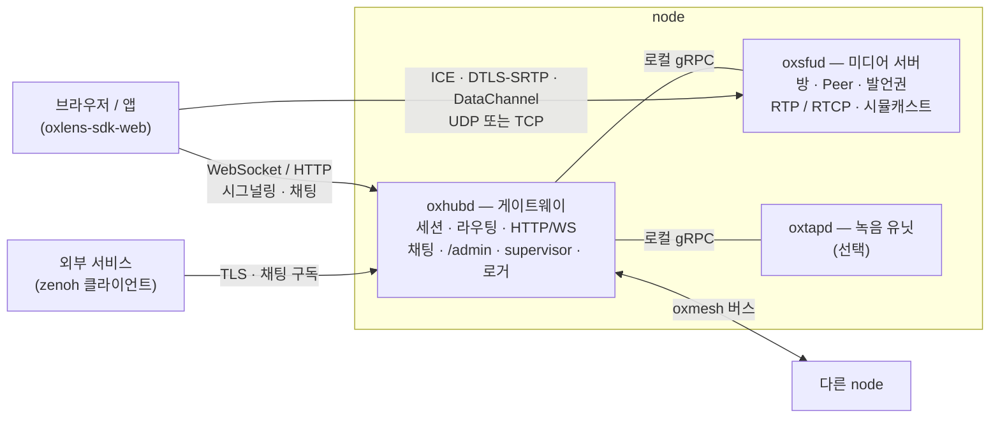

# OxLens SFU

**무전(PTT)과 화상회의를 한 서버에서 처리하는 Rust WebRTC SFU — 기계가 검사하는 규격을 정본으로 두고, AI 가 그 규격만 보고 다시 짓는다.**

[English README](README.md) · 라이선스: AGPL-3.0-only(`v1.12` 까지는 Apache-2.0) · 첫 공개: 2026-10-28 (`v1.4`) · 최신 태그: `v1.12`

---

## 무엇이 다른가

- **무전과 화상회의를 한 서버에서 처리합니다.** 발언권은 3GPP MCPTT(TS 24.380)를 따르고 WebRTC DataChannel 위에서 돕니다. 같은 방에서 시뮬캐스트를 쓰는 전이중 음성·영상도 함께 돕니다. 한 클라가 여러 방을 동시에 듣고, 그중 한 방에서 말할 수 있습니다. 문자 채팅은 게이트웨이에서 돌고, 무전 방의 발언 하나하나를 그 방 채팅에 남길 수 있습니다.
- **규격이 정본이고, 코드는 규격에서 다시 짓습니다.** 서버는 「재생성 회차」마다 처음부터 다시 지어집니다. 짓는 쪽은 규격만 읽는 AI 에이전트(Anthropic Claude)입니다. 회차마다 점수를 매기고, 회차가 드러낸 것은 규격으로 되돌려 다음 회차가 같은 자리에서 틀리지 못하게 합니다. 아래 [어떻게 짓나](#어떻게-짓나)를 보십시오.
- **시험만이 아니라 검증까지 합니다.** 모형 검사(TLA+ / TLC)가 프로토콜 상태기와, 서버의 node 버스 · 소유 · 미디어 경로를 잽니다. 규격이 낸 시험 벡터가 패킷 산수의 정답을 정합니다. 시험은 단위, 헤드리스 봇, 실브라우저의 세 층으로 돕니다.

## 기능

| 영역 | 상태 |
|---|---|
| 무전 발언권 — 요청 · 허가 · 대기 · 반환 · 회수 · 선점 · 타이머(MCPTT 꼴 바이너리 메시지 over DataChannel) | ✅ |
| 여러 방 동시 청취 · 세션당 말하는 방 하나(전환 가능) | ✅ |
| 전이중 음성 · 영상 회의 | ✅ |
| 시뮬캐스트 — 공간 층 셋(l / m / h)과 층마다 시간 층(VP8 은 payload 에서 · H264 는 dependency descriptor 에서 읽음) · 수동 층 선택 · 자동 층 조절(v1 RR 손실 · 반복 NACK · 버림 · v2 TWCC 위 송신측 추정 — 코드 기본은 꺼짐, 예시 `policy.toml` 은 켬) · 층 전략 셋(`media.layer_strategy`) | ✅ |
| 세션당 PeerConnection 하나 또는 둘(`1pc` / `2pc`) | ✅ |
| ICE-lite · UDP 와 TCP 위 ICE · DTLS-SRTP · SCTP DataChannel | ✅ |
| 서버가 끝내는 RTCP — RR · TWCC 피드백 · REMB · NACK / RTX(하향 재전송은 한꺼번에 쏟지 않고 간격을 두어 나눠 보냄) · PLI 스로틀(정책 손잡이) | ✅ |
| 구독 m-line 마다 고정된 다운링크 SSRC · 출처가 바뀌어도 seq / timestamp 를 이어 다시 씀 | ✅ |
| 다중 node — node 하나 = 게이트웨이 + 미디어 서버 · 자체 버스 `oxmesh`(router 직접 그물 · 한 홉 · [zenoh](https://zenoh.io) 일부를 가져와 줄였다)로 잇는다 · 방 배치는 HRW(rendezvous hash) | ✅ |
| 문자 채팅 — 공간 · 메시지 · 다시 붙은 뒤 따라잡기 · 다른 메시지를 가리키는 메시지(답장 · 고침 · 반응 · 지움) · 저장소는 메모리 · SQLite · PostgreSQL 중 하나 · `[chat]` 을 주지 않으면 꺼짐 | ✅ |
| 채팅 확장 — 클라 쪽 앱 칸(`ext`)과, 채팅을 구독하는 외부 서비스([채팅 확장](#채팅-확장) 참고) | ✅ |
| 무전 발언 기록 — 그 방 id 의 채팅 공간이 있으면 발언마다 화자의 `user_id` 로 남김 · 녹음하기로 한 방이면 녹음 파일을 거기에 붙임 | ✅ |
| 녹음 유닛 `oxtapd` — hub 가 띄우고 지키는 프로세스 · 녹음하기로 한 방에 들어가 발언마다 파일 하나(영상이 있으면 Matroska · 음성만이면 Ogg) | ✅ |
| 운영 — `oxadmin` CLI · `/admin/*` 읽기와 제어 · `/healthz/live` · `/healthz/ready` · node 마다 logfmt 로그 파일 하나 · 해석된 설정 전량을 남기는 기동 배너 | ✅ |
| 영상 무전(영상 발언권) | ⏸ 보류 — 브라우저 송신 pacer 를 이쪽에서 쥘 수 없다 |
| 대외 발행(webhook · 사건을 제3 서버로) | ⏳ 규격만 있고 미구현 |
| 다중 node 의 단일 권위 배치 | 🧪 설계 · 모형 검사 중 |
| 용량 측정 — 연결 수 천장 · 방송 fan-out · 용량 회귀 게이트(비공개 시험 저장소의 `oxcap`) | ✅ |

## 구조



| 크레이트 | 역할 |
|---|---|
| `oxsig` | 클라 프로토콜의 wire 형 — 프레임 · op · 오류 코드 · DataChannel 과 발언권 메시지 |
| `common` | 엄격한 설정(시스템 파일 · 정책 · CLI) · JWT · 버스 배선 · 로그 보내는 쪽 · 빌드 신원 · 기동 배너 |
| `oxhubd` | 게이트웨이 — 세션 · 방 배치와 라우팅 · HTTP / WebSocket · 채팅(저장 · 멤버가 붙은 node 로 뿌리기 · 외부 서비스 입구) · `/admin` · 프로세스 supervisor · 프로세스 안 로거 |
| `oxsfud` | 미디어 서버 — 방 · Peer · 발행 / 구독 · 발언권 · 전달 · RTCP · 시뮬캐스트 |
| `oxmesh` | node 버스 — router 직접 그물 한 홉 · 세션 신원(세대) · 레인 넷 · 토큰 · 구독 · 질의(hub 가 router · 미디어 서버가 client) |
| `oxtapd` | 녹음 유닛 — 녹음하기로 한 방에 참가자로 들어가 파일을 씀 |
| `oxadmin` | `/admin/*` 를 부르는 운영 CLI |

## 빠른 시작

Rust 1.85 이상(edition 2024)이 필요합니다. macOS 에서 Rust 1.94 로 개발했습니다.

```bash
git clone https://github.com/kodeholic9/oxlens-sfu
```

```bash
cd oxlens-sfu && cargo build
```

```bash
./target/debug/oxhubd --system system.toml --policy policy.toml
```

hub 는 `system.toml` 의 미디어 서버 유닛(`./target/debug/oxsfud` · gRPC `127.0.0.1:50061` · 미디어 UDP `20000`)을 띄우고, HTTP / WebSocket 을 `0.0.0.0:1974` 에, oxmesh 버스를 `127.0.0.1:7447` 에 엽니다. 다른 셸에서 확인합니다.

```bash
curl http://127.0.0.1:1974/healthz/ready
```

```bash
./target/debug/oxadmin --hub 127.0.0.1:1974 sfus
```

- loopback 에서는 `/admin/*` 에 운영 토큰이 필요 없습니다. 그 밖에서는 `--api-key` · `--api-secret` 을 줍니다.
- `oxadmin` 을 인자 없이 부르면 명령 전부를 보여 줍니다. 방 · 사용자 · `user <id>` · 스냅샷 · 버림 계수 · 버스 · 유닛 제어 · 세션 절단 · 퇴장 · 폭파 · 로그 수준입니다.
- 클라는 웹 SDK [oxlens-sdk-web](https://github.com/kodeholic9/oxlens-sdk-web)으로 붙습니다.
- `system.toml` 의 시연 계정(`ox_k_demo` / `ox_s_demo`)과 `jwt_secret = "change-me-in-production"` 은 로컬 개발용입니다.
- 기본 `system.toml` 에서는 채팅이 꺼져 있습니다. `[chat]` 에 `db = "memory:"` · `"sqlite:<경로>"` · `"postgres://…"` 중 하나를 주면 켜집니다.
- 3-node 개발 형상은 `dev/` 에 있습니다. `dev/gen_nodes.py` 가 `dev/system.node-*.toml` 을 짓고, 채팅 · 녹음 유닛 · 확장 입구까지 켭니다. `dev/pki` 의 키는 로컬 시험용 PKI 입니다.
- 녹음 유닛 `oxtapd` 는 기본 빌드에 들지 않습니다. 서버사이드 SDK `oxlens-sdk-peer` 를 쓰므로, 그 저장소가 이 저장소 옆에 있을 때 같은 `target/` 에 따로 짓습니다(`dev/` 형상은 녹음 유닛이 있어야 뜹니다).

```bash
cargo build --manifest-path crates/oxtapd/Cargo.toml --target-dir target
```

## 설정

모든 값은 세 자리 가운데 정확히 한 곳에만 있고, 기동 배너가 세 자리의 최종값을 전부 남깁니다. 배너는 여러 줄(`part` / `parts`)이라 잘리는 값이 없습니다.

| 자리 | 무엇 |
|---|---|
| 시스템 파일(`system.toml`) | 접속 주소 · 로그 디렉터리와 소켓 · 계정 · 유닛 목록 · 버스(`[bus]`) · supervisor · 채팅(`[chat]`) · 외부 서비스 입구(`[hook]`) · 녹음 파일 뿌리(`[data]`) |
| 정책 파일(`policy.toml`) | 게이트웨이와 미디어 서버가 함께 읽는 손잡이 — 로깅 · 미디어(비트레이트 · 시뮬캐스트 · PLI 스로틀) · 발언권. 키마다 범위가 있고, 모르는 키는 기동 실패입니다 |
| CLI 인자 | 프로세스별 값(node id · 포트 · 공인 IP). 공유해야 하는 값(로그 경로 · 버스 주소)은 hub 가 유닛을 띄울 때 덧붙입니다 |

## 채팅 확장

코어는 메시지를 저장하고 전달합니다. 그 밖의 것은 두 길 중 하나로 붙고, 어느 쪽도 코어를 바꾸지 않습니다.

**클라에서 붙이기.** 보내는 클라가 메시지에 평문 `content` 와 함께 앱 칸 `ext`(객체)를 싣습니다. 서버는 `ext` 를 읽지 않고 그대로 저장 · 전달합니다. `ext` 를 아는 클라는 거기에 맞게 그리고, 모르는 클라는 `content` 를 평문으로 보여 줍니다. 클라가 자기 메시지 종류(`kind`)를 정해 싣는 것은 아직 받지 않습니다.

**외부 서비스로 붙이기.** 서비스는 hub 를 통해 채팅을 구독합니다.

1. 시스템 파일에 그 서비스의 계정을 둡니다. `hook_allowed = true` 와, 받을 메시지 종류를 적은 `subscribe` 입니다. hub 는 그 서비스가 붙을 TLS 입구를 엽니다(`[hook] zenoh_listen = "tls/<host>:<port>"` 와 인증서 · 키 · CA).
2. 서비스는 TLS 로 [zenoh](https://zenoh.io) 1.x 클라이언트 모드로 붙습니다(1.10.1 · 1.10.2 로 시험). 그래서 zenoh 바인딩이 있는 언어면 어느 것으로든 만들 수 있습니다. 인증은 클라이언트 인증서로 하고, 인증서의 CN 이 계정 키입니다. 붙은 뒤 `ox/<[bus] namespace>/pub/v1/chat/sub/<계정 키>` 에 queryable 하나를 선언합니다.
3. hub 는 메시지 묶음 하나를 zenoh query 하나로 보냅니다. 묶음의 꼴은 클라가 받는 것과 같습니다. 받은 query 의 키로 reply 하면 그것이 수신 확인입니다. 확인을 못 받은 메시지는 서비스가 내려가 있는 동안 그 계정 몫으로 남습니다. 단 보관 기간(`[chat] undelivered_ttl_days`)과 다시 보내기 횟수 한도(`hook.ext_max_tries`) 안에서입니다.
4. 한 계정이 연결을 여럿 맺으면 묶음 하나는 그중 하나로만 갑니다(라운드 로빈). 같은 메시지가 두 번 올 수 있고 묶음 사이 차례는 없습니다. 서비스는 `msg_id` 로 중복을 거르고, 차례가 필요하면 시각으로 정렬합니다.
5. 서비스 계정에는 채팅 신원이 없습니다. 무언가를 더하려면 서비스가 보통 사용자 토큰으로 WebSocket API 에 붙어, 원문을 `ref` 로 가리키는 새 메시지를 올립니다.

**바꾸지 않고 덧붙인다.** 원문은 언제나 먼저 멤버에게 갑니다. 서비스는 그 옆에 메시지를 덧붙이기만 합니다. 그래서 서비스가 내려가거나 늦어도 대화는 계속되고, 코어는 서비스가 실패했는지 알 필요가 없습니다.

## 시험과 검증

| 층 | 무엇 | 어디 |
|---|---|---|
| 1 — 단위 | `cargo test --workspace` — 규격이 낸 벡터(출처 전환 재기록 · RTCP · 발언권 미디어 결합 · 시뮬캐스트)와 맹검 독립 시험 포함 · 벡터는 `testdata/spec/` 에 실린 규격 산출 사본이라 이 저장소만 받아도 돈다 | 이 저장소 |
| 2 — 헤드리스 | 봇 하네스가 실서버를 몬다 — 프로토콜 계약 실증 · 시나리오 120 여 개 · 스모크 · 패킷 덤프 위 등식 | 별도 저장소(아직 비공개) |
| 3 — 브라우저 | Playwright(크로뮴)로 실서버와 웹 SDK 를 함께 | [oxlens-sdk-web](https://github.com/kodeholic9/oxlens-sdk-web) `qa/live` |
| 모형 검사 | TLA+ / TLC — 프로토콜 상태기(세션 · 방 · 연결 · 발행 · 구독 · 트랙 · 소속 · 발언권 · 다서버) 판 93 · 서버(node 버스 · 메시 · 소유 · 실행 · 미디어 경로 · 권위) 판 99(그중 보류 7) | 규격 저장소 |
| 대조 | 같은 브라우저 한 쌍에 같은 망 조건(대역 · 손실 · 끊김)을 걸어 LiveKit 1.13.11 · mediasoup 3.32.2 와 견줌 — 기능 시험 여섯(대역 조임 · 패킷 손실 · 입장 · 층 전환 · 끊김 · 음성 손실). 서버를 라즈베리파이 4 에 올린 판도 돌림 | 별도 저장소(비공개) |

## 어떻게 짓나

규격은 구조화된 원천에서 짓는 문서 묶음입니다. 연동규격서(클라 프로토콜) · 서버 정의서 · SDK 정의서 · 운영 규격서 · 정책서입니다. 짓기는 다음을 합니다.
- 문서끼리 맞는지 검사합니다.
- TLA+ 모형, 시험 벡터, 코드 일부를 생성합니다.
- 없는 라벨 인용과 문서 사이의 값 사본을 막습니다.

그 가운데 클라와 서버의 계약인 연동규격서(wire 메시지 · 클라와 서버 상태기 · 타이머 · 흐름 · 오류 코드 · 발언권)를 여기 공개합니다: [docs/protocol/README.md](docs/protocol/README.md). 나머지 규격 문서와 원천은 별도 저장소에 있고 공개하지 않습니다.

**재생성 회차**마다 새 AI 에이전트가 규격만 보고 이 서버를 짓습니다. 앞 회차의 코드와 생성 산문은 읽지 못합니다. 그다음에 잽니다.
- 단위 · 헤드리스 · 브라우저 시험
- 맹검 독립 시험 — 다른 에이전트가 규격만 보고 시험을 짭니다.
- 증상 변이 — 규격의 「이렇게 잘못 지으면 → 이런 일이 생긴다」 줄을 코드에 일부러 넣어, 시험이 잡는지 봅니다.
- 맹검 코드 검토 둘 — 하나는 규격 → 코드, 하나는 코드 → 규격 방향입니다.
- 톱니 점수판 — 앞 회차보다 나빠진 칸이 있으면 회차가 닫히지 않습니다.

7회차(`v1.5`)까지는 결함을 손 패치가 아니라 규격이나 측정으로 되돌리고, 고쳐졌는지를 다음 회차가 보여 줬습니다. `v1.5` 뒤로는 회차를 멈추고 대장 행마다 손으로 고칩니다. 고칠 때마다 재발 시험을 하나 남기는데, 그 시험은 고치기 전 빌드에서 빨갛고 고친 빌드에서 초록이어야 합니다. 다시 짓기는 필요할 때 영역 단위로 하고, 전체 재생성은 모델이 크게 나아졌을 때만 합니다.

| 회차 | 첫 시나리오 판 | 검토 확인 결함(높음 · 중 · 낮음) | 코드가 인용한 서버 정의서 라벨 | 시험 자산이 부르는 규격 단위 |
|---|---|---|---|---|
| 3 | 52 / 58 | 4 · 12 · 17 | 76 % | 8 % |
| 4 | 42 / 58 | 1 · 9 · 35 | 92 % | 12 % |
| 5 | 56 / 58 | 1 · 10 · 11 | 93 % | 13 % |
| 6 (`v1.4`) | 57 / 59 | **0** · 7 · 9 | 96 % | 19 % |

6회차의 결과입니다.
- 맹검 독립 시험은 넣은 증상 52개 중 50개(96 %)를 잡았습니다. 짓는 에이전트가 짠 시험은 34개(65 %)를 잡았습니다.
- 앞 회차 뒤에 측정을 세운 자리는 매번 다음 회차가 맞게 지었습니다.
- 남은 중 결함은 모두 시간과 사건 순서 쪽입니다. 그래서 다음 검증은 미디어 경로(출처 전환 · NACK / RTX · PLI 빈도 · SR 번역)를 겨눕니다.

## 현황과 한계

- `v1.4` 는 첫 공개판입니다. `v1.5`(7회차)부터 용량 회귀 게이트(정해진 형상 — 생중계 1,000 · 1,500명 · 회의 128명)가 완료 조건에 들어갔습니다. 실망(손실 · 지연이 있는 망) 부하는 아직 재지 않았습니다. 그런 망에서의 기능 동작은 위 대조 시험에서 견줍니다.
- `v1.6` 부터는 손으로 만든 판입니다. `v1.6` 에서 node 버스를 `oxmesh` 로 바꿨습니다. `v1.7` ~ `v1.12` 에는 발언권 일련번호를 TS 24.380 대로 맞춘 것, 출처 표지(CSRC), 판단과 적용 시점이 갈리는 자리의 수리가 들어 있습니다. 채팅 · 채팅 확장 · 발언 기록 · 녹음 유닛 · 공간 층 셋과 시간 층 · 층 전략 · 송신측 추정 개편 · 하향 재전송 나눠 보내기는 `v1.12` 뒤 `main` 에 들어갔고 아직 태그가 없습니다.
- 규격은 정했는데 코드가 아직 따라오지 않은 것이 있습니다. 서버 정의서의 이행 대장에 번호 행으로 적혀 있고, 행마다 코드 자리와 그것을 닫을 시험이 있습니다.
- 웹 SDK 는 서버보다 어리고, 아직 재생성 회차를 거치지 않았습니다.

## 문서

| 문서 | 무엇 | 어떻게 만드나 |
|---|---|---|
| [연동규격서](docs/protocol/README.md) | 클라 ↔ 서버 계약 — wire 메시지 · 상태기 · 타이머 · 흐름 · 오류 코드 · 발언권 | 규격 원천에서 생성 |
| [서버 형상](docs/architecture.md) | 정적 구조 — 프로세스 · 스레드 · 공유 지점 · 패킷 하나의 길 | 소스를 읽어 쓴 해설(기준 커밋을 머리에 적음) |
| [학습 문서](docs/learn/00_INDEX.md) | 실측 흐름 21장(색인 따로) — 서버와 SDK 가 실제로 주고받는 것(WS 프레임 · SDP · 패킷 · 로그)을 시각순으로 · 녹음 · AI 에이전트 브리지 · 채팅 · 무전 발언 기록 포함 | 브라우저 탐침 · 2층 하네스 회차로 쓰고, 탐침을 다시 돌려 모양이 같은지 견준다 |

문서는 한국어입니다. 공개 문서는 버전 태그마다 그 판에 맞춰 다시 짓습니다.

## 관련 저장소

- [연동규격서](docs/protocol/README.md) — 공개한 클라 ↔ 서버 계약(규격 원천에서 생성)
- [oxlens-sdk-web](https://github.com/kodeholic9/oxlens-sdk-web) — 브라우저 SDK(TypeScript)와 브라우저 시험 층

## 라이선스

GNU Affero General Public License v3.0 only(`AGPL-3.0-only`) — [LICENSE](LICENSE). 서버와 서버사이드 SDK(`crates/oxpeer`)에 적용됩니다. `v1.12` 까지(포함) 낸 판은 Apache License 2.0 으로 공개되었고 그대로 남습니다.

**상용 라이선스.** AGPL 이 맞지 않는 쓰임(예: 고친 서버를 변경 공개 없이 서비스로 운영)에는 상용 라이선스를 드립니다. 조건과 단가는 관리자에게 메일로 문의해 주십시오(`Cargo.toml` 의 `authors`).

## 연락

이슈를 환영합니다. 코드 기여(풀 리퀘스트)는 받지 않습니다 — 한 사람이 개발해 AGPL 과 상용 라이선스로 함께 제공하기 위해서입니다. 보안 문제는 공개 이슈 대신 관리자에게 메일로 알려 주십시오(`Cargo.toml` 의 `authors`).
