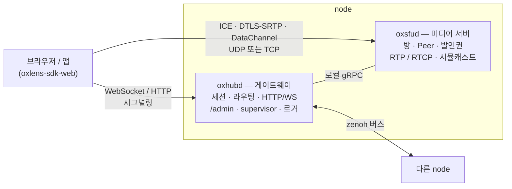

# OxLens SFU

**무전(PTT)과 화상회의를 한 서버에서 처리하는 Rust WebRTC SFU — 기계가 검사하는 규격을 정본으로 두고, AI 가 그 규격만 보고 다시 짓는다.**

[English README](README.md) · 라이선스: Apache-2.0 · 첫 공개: 2026-10-28 (`v1.4`)

---

## 무엇이 다른가

- **무전과 화상회의를 한 서버에서 처리합니다.** 발언권은 3GPP MCPTT(TS 24.380)를 따르고 WebRTC DataChannel 위에서 돕니다. 같은 방에서 시뮬캐스트를 쓰는 전이중 음성·영상도 함께 돕니다. 한 클라가 여러 방을 동시에 듣고, 그중 한 방에서 말할 수 있습니다.
- **규격이 정본이고, 코드는 규격에서 다시 짓습니다.** 서버는 「재생성 회차」마다 처음부터 다시 지어집니다. 짓는 쪽은 규격만 읽는 AI 에이전트(Anthropic Claude)입니다. 회차마다 점수를 매기고, 회차가 드러낸 것은 규격으로 되돌려 다음 회차가 같은 자리에서 틀리지 못하게 합니다. 아래 [어떻게 짓나](#어떻게-짓나)를 보십시오.
- **시험만이 아니라 검증까지 합니다.** 모형 검사(TLA+ / TLC)가 프로토콜 상태기와 node 버스를 잽니다. 규격이 낸 시험 벡터가 패킷 산수의 정답을 정합니다. 시험은 단위, 헤드리스 봇, 실브라우저의 세 층으로 돕니다.

## 기능

| 영역 | 상태 |
|---|---|
| 무전 발언권 — 요청 · 허가 · 대기 · 반환 · 회수 · 선점 · 타이머(MCPTT 꼴 바이너리 메시지 over DataChannel) | ✅ |
| 여러 방 동시 청취 · 세션당 말하는 방 하나(전환 가능) | ✅ |
| 전이중 음성 · 영상 회의 | ✅ |
| 시뮬캐스트(h / l) · 수동 층 선택 · 자동 층 조절(v1 REMB + 손실 · v2 TWCC 위 송신측 GCC — 기본 꺼짐) | ✅ |
| 세션당 PeerConnection 하나 또는 둘(`1pc` / `2pc`) | ✅ |
| ICE-lite · UDP 와 TCP 위 ICE · DTLS-SRTP · SCTP DataChannel | ✅ |
| 서버가 끝내는 RTCP — RR · TWCC 피드백 · REMB · NACK / RTX · PLI 스로틀(정책 손잡이) | ✅ |
| 구독 m-line 마다 고정된 다운링크 SSRC · 출처가 바뀌어도 seq / timestamp 를 이어 다시 씀 | ✅ |
| 다중 node — node 하나 = 게이트웨이 + 미디어 서버 · [zenoh](https://zenoh.io) 버스로 잇는다 · 방 배치는 HRW(rendezvous hash) | ✅ |
| 운영 — `oxadmin` CLI · `/admin/*` 읽기와 제어 · `/healthz/live` · `/healthz/ready` · node 마다 logfmt 로그 파일 하나 · 해석된 설정 전량을 남기는 기동 배너 | ✅ |
| 영상 무전(영상 발언권) | ⏸ 보류 — 브라우저 송신 pacer 를 이쪽에서 쥘 수 없다 |
| 대외 발행(webhook · 사건을 제3 서버로) | ⏳ 규격만 있고 미구현 |
| 다중 node 의 단일 권위 배치 | 🧪 설계 · 모형 검사 중 |
| 처리량 · 지연 · 메모리 측정 | ⏳ 아직 안 잼 |

## 구조



| 크레이트 | 역할 |
|---|---|
| `oxsig` | 클라 프로토콜의 wire 형 — 프레임 · op · 오류 코드 · DataChannel 과 발언권 메시지 |
| `common` | 엄격한 설정(시스템 파일 · 정책 · CLI) · JWT · zenoh 버스 · 로그 보내는 쪽 · 빌드 신원 · 기동 배너 |
| `oxhubd` | 게이트웨이 — 세션 · 방 배치와 라우팅 · HTTP / WebSocket · `/admin` · 프로세스 supervisor · 프로세스 안 로거 |
| `oxsfud` | 미디어 서버 — 방 · Peer · 발행 / 구독 · 발언권 · 전달 · RTCP · 시뮬캐스트 |
| `oxadmin` | `/admin/*` 를 부르는 운영 CLI |

## 빠른 시작

Rust 1.85 이상(edition 2024)이 필요합니다. macOS 에서 Rust 1.94 로 개발했습니다.

```bash
git clone https://github.com/kodeholic9/oxlens-sfu
```

```bash
cd oxlens-sfu && cargo build
```

```bash
./target/debug/oxhubd --system system.toml --policy policy.toml
```

hub 는 `system.toml` 의 미디어 서버 유닛(`./target/debug/oxsfud` · gRPC `127.0.0.1:50061` · 미디어 UDP `20000`)을 띄우고, HTTP / WebSocket 을 `0.0.0.0:1974` 에, zenoh 버스를 `127.0.0.1:7447` 에 엽니다. 다른 셸에서 확인합니다.

```bash
curl http://127.0.0.1:1974/healthz/ready
```

```bash
./target/debug/oxadmin --hub 127.0.0.1:1974 sfus
```

- loopback 에서는 `/admin/*` 에 운영 토큰이 필요 없습니다. 그 밖에서는 `--api-key` · `--api-secret` 을 줍니다.
- `oxadmin` 을 인자 없이 부르면 명령 전부를 보여 줍니다. 방 · 사용자 · `user <id>` · 스냅샷 · 버림 계수 · 버스 · 유닛 제어 · 세션 절단 · 퇴장 · 폭파 · 로그 수준입니다.
- 클라는 웹 SDK [oxlens-sdk-web](https://github.com/kodeholic9/oxlens-sdk-web)으로 붙습니다.
- `system.toml` 의 시연 계정(`ox_k_demo` / `ox_s_demo`)과 `jwt_secret = "change-me-in-production"` 은 로컬 개발용입니다.
- 3-node 개발 형상은 `dev/` 에 있습니다. `dev/gen_nodes.py` 가 `dev/system.node-*.toml` 을 짓습니다.

## 설정

모든 값은 세 자리 가운데 정확히 한 곳에만 있고, 기동 배너가 세 자리의 최종값을 전부 남깁니다. 배너는 여러 줄(`part` / `parts`)이라 잘리는 값이 없습니다.

| 자리 | 무엇 |
|---|---|
| 시스템 파일(`system.toml`) | 접속 주소 · 로그 디렉터리와 소켓 · 계정 · 유닛 목록 · zenoh · supervisor |
| 정책 파일(`policy.toml`) | 게이트웨이와 미디어 서버가 함께 읽는 손잡이 — 로깅 · 미디어(비트레이트 · 시뮬캐스트 · PLI 스로틀) · 발언권. 키마다 범위가 있고, 모르는 키는 기동 실패입니다 |
| CLI 인자 | 프로세스별 값(node id · 포트 · 공인 IP). 공유해야 하는 값(로그 경로 · 버스 주소)은 hub 가 유닛을 띄울 때 덧붙입니다 |

## 시험과 검증

| 층 | 무엇 | 어디 |
|---|---|---|
| 1 — 단위 | `cargo test --workspace` — 규격이 낸 벡터(출처 전환 재기록 · RTCP · 발언권 미디어 결합 · 시뮬캐스트)와 맹검 독립 시험 포함 | 이 저장소 |
| 2 — 헤드리스 | 봇 하네스가 실서버를 몬다 — 프로토콜 계약 실증 · 시나리오 59 · 스모크 · 패킷 덤프 위 등식 | 별도 저장소(아직 비공개) |
| 3 — 브라우저 | Playwright(크로뮴)로 실서버와 웹 SDK 를 함께 | [oxlens-sdk-web](https://github.com/kodeholic9/oxlens-sdk-web) `qa/live` |
| 모형 검사 | TLA+ / TLC — 프로토콜 상태기(세션 · 방 · 연결 · 발행 · 구독 · 트랙 · 소속 · 발언권 · 다서버) 판 80 · node 버스 판 17 | 규격 저장소 |

## 어떻게 짓나

규격은 구조화된 원천에서 짓는 문서 묶음입니다. 연동규격서(클라 프로토콜) · 서버 정의서 · SDK 정의서 · 운영 규격서 · 정책서입니다. 짓기는 다음을 합니다.
- 문서끼리 맞는지 검사합니다.
- TLA+ 모형, 시험 벡터, 코드 일부를 생성합니다.
- 없는 라벨 인용과 문서 사이의 값 사본을 막습니다.

그 가운데 클라와 서버의 계약인 연동규격서(wire 메시지 · 클라와 서버 상태기 · 타이머 · 흐름 · 오류 코드 · 발언권)를 여기 공개합니다: [docs/protocol/README.md](docs/protocol/README.md). 나머지 규격 문서와 원천은 별도 저장소에 있고 공개하지 않습니다.

**재생성 회차**마다 새 AI 에이전트가 규격만 보고 이 서버를 짓습니다. 앞 회차의 코드와 생성 산문은 읽지 못합니다. 그다음에 잽니다.
- 단위 · 헤드리스 · 브라우저 시험
- 맹검 독립 시험 — 다른 에이전트가 규격만 보고 시험을 짭니다.
- 증상 변이 — 규격의 「이렇게 잘못 지으면 → 이런 일이 생긴다」 줄을 코드에 일부러 넣어, 시험이 잡는지 봅니다.
- 맹검 코드 검토 둘 — 하나는 규격 → 코드, 하나는 코드 → 규격 방향입니다.
- 톱니 점수판 — 앞 회차보다 나빠진 칸이 있으면 회차가 닫히지 않습니다.

결함은 손 패치가 아니라 규격이나 측정으로 되돌리고, 고쳐졌는지는 다음 회차가 보여 줍니다.

| 회차 | 첫 시나리오 판 | 검토 확인 결함(높음 · 중 · 낮음) | 코드가 인용한 서버 정의서 라벨 | 시험 자산이 부르는 규격 단위 |
|---|---|---|---|---|
| 3 | 52 / 58 | 4 · 12 · 17 | 76 % | 8 % |
| 4 | 42 / 58 | 1 · 9 · 35 | 92 % | 12 % |
| 5 | 56 / 58 | 1 · 10 · 11 | 93 % | 13 % |
| 6 (`v1.4`) | 57 / 59 | **0** · 7 · 9 | 96 % | 19 % |

6회차의 결과입니다.
- 맹검 독립 시험은 넣은 증상 52개 중 50개(96 %)를 잡았습니다. 짓는 에이전트가 짠 시험은 34개(65 %)를 잡았습니다.
- 앞 회차 뒤에 측정을 세운 자리는 매번 다음 회차가 맞게 지었습니다.
- 남은 중 결함은 모두 시간과 사건 순서 쪽입니다. 그래서 다음 검증은 미디어 경로(출처 전환 · NACK / RTX · PLI 빈도 · SR 번역)를 겨눕니다.

## 현황과 한계

- `v1.4` 는 첫 공개판입니다. 위와 같이 검증한 동작하는 서버이지만, 부하 측정은 아직 하지 않았습니다.
- 규격은 정했는데 코드가 아직 따라오지 않은 것이 있습니다. 서버 정의서의 이행 대장에 번호 행으로 적혀 있고, 행마다 코드 자리와 그것을 닫을 시험이 있습니다.
- 웹 SDK 는 서버보다 어리고, 아직 재생성 회차를 거치지 않았습니다.

## 관련 저장소

- [연동규격서](docs/protocol/README.md) — 공개한 클라 ↔ 서버 계약(규격 원천에서 생성)
- [oxlens-sdk-web](https://github.com/kodeholic9/oxlens-sdk-web) — 브라우저 SDK(TypeScript)와 브라우저 시험 층

## 라이선스

Apache License 2.0 — [LICENSE](LICENSE)

## 연락

이슈와 풀 리퀘스트를 환영합니다. 보안 문제는 공개 이슈 대신 관리자에게 메일로 알려 주십시오(`Cargo.toml` 의 `authors`).
