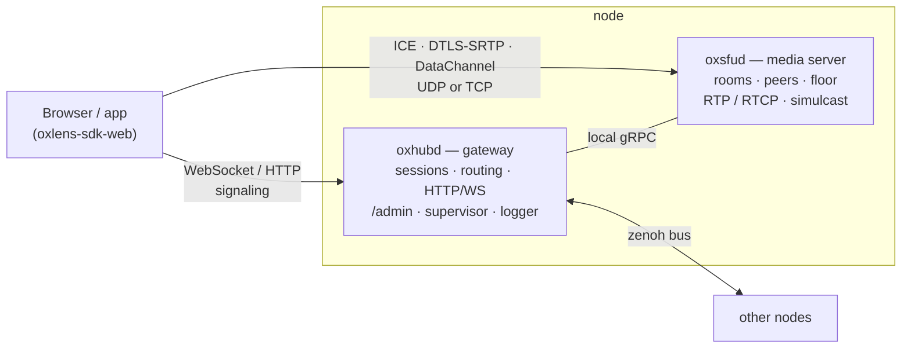

# OxLens SFU

**A WebRTC SFU in Rust for push-to-talk (PTT) and video conferencing — built from a machine-checked specification, and regenerated from that spec by AI.**

[한국어 README](README.ko.md) · License: Apache-2.0 · First public release: 2026-10-28 (`v1.4`)

---

## What makes it different

- **PTT and conferencing in one server.** Floor control follows 3GPP MCPTT (TS 24.380) and runs over a WebRTC DataChannel. Full-duplex audio and video with simulcast run in the same rooms. A client can listen to several rooms at once and talk in one.
- **The spec is the source of truth. The code is regenerated from it.** The server is rebuilt from scratch, in "regeneration rounds", by an AI agent (Anthropic Claude) that reads only the specification. Every round is scored, and whatever the round exposes goes back into the spec, so the next round cannot repeat it. See [How it is built](#how-it-is-built).
- **Verified, not just tested.** Model checking (TLA+ / TLC) covers protocol state machines and the node bus. Spec-generated test vectors fix the packet math. Tests run at three layers: unit, a headless bot harness, and real browsers.

## Features

| Area | Status |
|---|---|
| PTT floor control — request · grant · queue · release · revoke · preemption · timers (MCPTT-style binary messages over a DataChannel) | ✅ |
| Multi-room listening · one talk room per session (switchable) | ✅ |
| Full-duplex audio / video conferencing | ✅ |
| Simulcast (h / l) · manual layer selection · automatic layer control (v1 REMB+loss, v2 send-side GCC over TWCC — off by default) | ✅ |
| One or two PeerConnections per session (`1pc` / `2pc`) | ✅ |
| ICE-lite · ICE over UDP and TCP · DTLS-SRTP · SCTP DataChannel | ✅ |
| Server-terminated RTCP — RR · TWCC feedback · REMB · NACK / RTX · PLI throttling (policy knobs) | ✅ |
| Stable downlink SSRC per subscribed m-line, with sequence / timestamp rewriting across source switches | ✅ |
| Multi-node — each node = gateway + media server, connected by a [zenoh](https://zenoh.io) bus · rendezvous-hash room placement | ✅ |
| Operations — `oxadmin` CLI · `/admin/*` read and control · `/healthz/live` · `/healthz/ready` · logfmt logging to one file per node · boot banner with every resolved setting | ✅ |
| Video PTT (video floor) | ⏸ shelved — the browser send pacer cannot be controlled from here |
| Outbound hooks (webhooks / events to a third-party server) | ⏳ specified, not implemented |
| Single-authority multi-node placement | 🧪 design and model checking in progress |
| Throughput / latency / memory benchmarks | ⏳ not measured yet |

## Architecture



| Crate | Role |
|---|---|
| `oxsig` | Wire types of the client protocol — frames, ops, error codes, DataChannel and floor messages |
| `common` | Strict configuration (system file · policy · CLI), JWT, the zenoh bus, the log sender, build identity, the boot banner |
| `oxhubd` | Gateway: sessions, room placement and routing, HTTP / WebSocket, `/admin`, the process supervisor, the in-process logger |
| `oxsfud` | Media server: rooms, peers, publish / subscribe, floor control, forwarding, RTCP, simulcast |
| `oxadmin` | Operator CLI over `/admin/*` |

## Quick start

Requires Rust 1.85 or newer (edition 2024). Developed with Rust 1.94 on macOS.

```bash
git clone https://github.com/kodeholic9/oxlens-sfu
```

```bash
cd oxlens-sfu && cargo build
```

```bash
./target/debug/oxhubd --system system.toml --policy policy.toml
```

The hub starts the media server unit listed in `system.toml` (`./target/debug/oxsfud`, gRPC `127.0.0.1:50061`, media UDP `20000`), opens HTTP / WebSocket on `0.0.0.0:1974`, and runs the zenoh bus on `127.0.0.1:7447`. In another shell:

```bash
curl http://127.0.0.1:1974/healthz/ready
```

```bash
./target/debug/oxadmin --hub 127.0.0.1:1974 sfus
```

From loopback, `/admin/*` needs no operator token. From anywhere else, pass `--api-key` and `--api-secret`. `oxadmin` with no arguments prints every command (rooms · users · `user <id>` · snapshot · drops · bus · unit control · cut · reap · destroy · log-level).

To connect a client, use the web SDK: [oxlens-sdk-web](https://github.com/kodeholic9/oxlens-sdk-web). The demo account in `system.toml` (`ox_k_demo` / `ox_s_demo`) and `jwt_secret = "change-me-in-production"` are for local development only.

A three-node development layout is in `dev/`. `dev/gen_nodes.py` generates `dev/system.node-*.toml`.

## Configuration

Every value lives in exactly one of three places, and the boot banner prints the final value of all of them. The banner spans several log lines (`part` / `parts`), so nothing is truncated.

| Place | What goes there |
|---|---|
| System file (`system.toml`) | Listen addresses, log directory and socket, accounts, the unit list, zenoh, the supervisor |
| Policy file (`policy.toml`) | Tunables shared by gateway and media server — logging, media (bitrate · simulcast · PLI throttle), floor. Every key has a range. Unknown keys fail the boot |
| CLI arguments | Per-process values (node id · ports · public IP). The hub adds the shared ones (log paths · bus address) when it starts a unit |

## Testing and verification

| Layer | What | Where |
|---|---|---|
| 1 — unit | `cargo test --workspace`, including spec-generated vectors (source-switch rewriting · RTCP · floor/media binding · simulcast) and blind independent tests | this repository |
| 2 — headless | A bot harness drives the real server: protocol contract checks, 59 scenarios, smoke tests, equations over packet dumps | separate repository (not public yet) |
| 3 — browser | Playwright with Chromium against the real server and the web SDK | [oxlens-sdk-web](https://github.com/kodeholic9/oxlens-sdk-web) `qa/live` |
| Model checking | TLA+ / TLC — 80 configurations over the protocol state machines (session · room · link · publish · subscribe · tracks · affiliation · floor · multi-server) and 17 over the node bus | specification repository |

## How it is built

The specification is a set of documents generated from structured sources: the client protocol, the server spec, the SDK spec, the operations spec, and the policy. A build checks that the documents agree with one another, generates the TLA+ models, test vectors and part of the code, and refuses dangling references or values copied between documents. The specification is kept in a separate repository and is not public yet.

Each **regeneration round** asks a fresh AI agent to build this server from the specification alone. It may not read the previous round's code or the generated prose. The round is then measured:

- Unit, headless and browser tests.
- A blind second agent writes independent tests from the spec only.
- Symptom mutation: each "if you build it wrong, this happens" line in the spec is planted into the code, to see whether the tests catch it.
- Two blind code reviewers, one reading spec → code and one reading code → spec.
- A ratcheted scoreboard. A round cannot close if any column got worse than the previous round.

Defects go back into the spec or the measurement, never into a hand patch. The next round shows whether the fix held.

| Round | First scenario run | Review findings (high · medium · low) | Server spec labels cited by code | Spec units cited by test assets |
|---|---|---|---|---|
| 3 | 52 / 58 | 4 · 12 · 17 | 76 % | 8 % |
| 4 | 42 / 58 | 1 · 9 · 35 | 92 % | 12 % |
| 5 | 56 / 58 | 1 · 10 · 11 | 93 % | 13 % |
| 6 (`v1.4`) | 57 / 59 | **0** · 7 · 9 | 96 % | 19 % |

In round 6, blind independent tests caught 50 of 52 planted symptoms (96 %). Tests written by the building agent caught 34 (65 %). Every place where a check was added after an earlier round was built correctly by the next one. The remaining medium findings are all about timing and event ordering, so the next verification work targets the media path: source switches, NACK / RTX, PLI frequency, SR translation.

## Status and limits

- `v1.4` is the first public release. It is a working server, verified as described above, and has not been load-tested.
- Some things are specified but not yet followed by the code. They are tracked as numbered rows in the server spec's implementation ledger, and each one names the code location and the test that will close it.
- The web SDK is younger than the server and has not yet gone through regeneration rounds.

## Related repositories

- [oxlens-sdk-web](https://github.com/kodeholic9/oxlens-sdk-web) — browser SDK (TypeScript) and the browser test layer.

## License

Apache License 2.0 — see [LICENSE](LICENSE).

## Contact

Issues and pull requests are welcome. For security problems, please email the maintainer (see `authors` in `Cargo.toml`) instead of opening a public issue.
