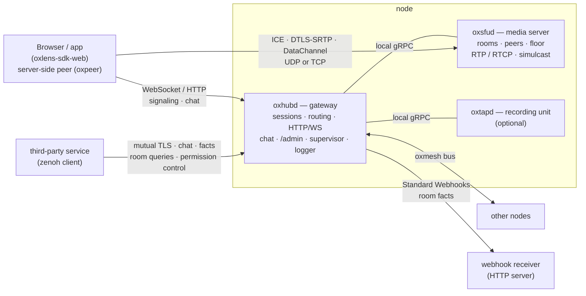

# OxLens SFU

**A WebRTC SFU in Rust for push-to-talk (PTT) and video conferencing — built from a machine-checked specification, and regenerated from that spec by AI.**

[한국어 README](README.ko.md) · License: AGPL-3.0-only (Apache-2.0 up to `v1.13`) · First public release: 2026-10-28 (`v1.4`) · Latest tag: `v1.13`

---

## What makes it different

- **PTT and conferencing in one server.** Floor control follows 3GPP MCPTT (TS 24.380) and runs over a WebRTC DataChannel. Full-duplex audio and video with simulcast run in the same rooms. A client can listen to several rooms at once and talk in one. Text chat runs in the gateway, and every utterance in a PTT room can be written to that room's chat.
- **The spec is the source of truth. The code is regenerated from it.** The server is rebuilt from scratch, in "regeneration rounds", by an AI agent (Anthropic Claude) that reads only the specification. Every round is scored, and whatever the round exposes goes back into the spec, so the next round cannot repeat it. See [How it is built](#how-it-is-built).
- **Verified, not just tested.** Model checking (TLA+ / TLC) covers the protocol state machines and the server's node bus, ownership and media path. Spec-generated test vectors fix the packet math. Tests run at three layers: unit, a headless bot harness, and real browsers.

## Features

| Area | Status |
|---|---|
| PTT floor control — request · grant · queue · release · revoke · preemption · timers (MCPTT-style binary messages over a DataChannel) | ✅ |
| Multi-room listening (up to 20 rooms per session) · one talk room per session (switchable) | ✅ |
| Full-duplex audio / video conferencing | ✅ |
| Simulcast — three spatial layers (l / m / h), each with temporal layers (VP8 from the payload, H264 from the dependency descriptor) · manual layer selection · automatic layer control (v1 RR loss · repeated NACKs · drops, v2 send-side estimation over TWCC — off by default in code, turned on in the sample `policy.toml`) · three layer strategies (`media.layer_strategy`) | ✅ |
| One or two PeerConnections per session (`1pc` / `2pc`) | ✅ |
| ICE-lite · ICE over UDP and TCP · DTLS-SRTP · SCTP DataChannel | ✅ |
| Server-terminated RTCP — RR · TWCC feedback · REMB · NACK / RTX with paced downlink retransmission · PLI throttling (policy knobs) | ✅ |
| Stable downlink SSRC per subscribed m-line, with sequence / timestamp rewriting across source switches | ✅ |
| Multi-node — each node = gateway + media server, connected by our own bus `oxmesh` (direct one-hop mesh of routers, adapted from parts of [zenoh](https://zenoh.io)) · rendezvous-hash room placement | ✅ |
| Text chat — spaces · messages · catch-up after a reconnect · messages that point to another one (reply · edit · reaction · delete) · stores: in-memory, SQLite or PostgreSQL · off unless `[chat]` is configured | ✅ |
| Chat extensions — client-side app data (`ext`) and third-party services that subscribe to chat (see [Extending chat](#extending-chat)) | ✅ |
| PTT talk record — when a chat space exists for the room, each utterance is written to it under the speaker's user id; in a room marked for recording, the recording is attached to it | ✅ |
| Recording unit `oxtapd` — a process the hub supervises; joins rooms marked for recording and writes one file per utterance (Matroska when it has video, Ogg for audio only) | ✅ |
| Operations — `oxadmin` CLI · `/admin/*` read and control · `/healthz/live` · `/healthz/ready` · logfmt logging to one file per node · boot banner with every resolved setting | ✅ |
| Video PTT (video floor) | ⏸ shelved — the browser send pacer cannot be controlled from here |
| Third-party integration (hook) — room facts (created · closed · joins · floor · recording) delivered per account with ACK windows over zenoh or Standard Webhooks; room status queries and permission control; mutual-TLS accounts (see [Integrating with rooms](#integrating-with-rooms-hook)) | ✅ |
| Server-side SDK `oxpeer` (Rust) — recorders, AI agents and gateways join rooms as ordinary peers (WebRTC media, floor control, recording) | ✅ |
| AI voice agents — a bridge built on `oxpeer` takes the floor, streams the speaker's voice to an AI service and speaks the answer back into the talk group (bridges are offered commercially, not in this repository) | ✅ |
| Extensibility for external devices and systems — anything that speaks the published client protocol, `oxpeer`, or the hook interface can join or observe rooms (radio gateways, dispatch consoles, sensors, recorders) | ✅ |
| Single-authority multi-node placement | 🧪 design and model checking in progress |
| Capacity measurement — connection ceiling · broadcast fan-out · capacity regression gate (`oxcap`, in a private test repository) | ✅ |

## Architecture



| Crate | Role |
|---|---|
| `oxsig` | Wire types of the client protocol — frames, ops, error codes, DataChannel and floor messages |
| `common` | Strict configuration (system file · policy · CLI), JWT, the bus wiring, the log sender, build identity, the boot banner |
| `oxhubd` | Gateway: sessions, room placement and routing, HTTP / WebSocket, chat (store, fan-out to the nodes where members are connected), third-party integration (the zenoh entry: chat and fact subscriptions, room queries, permission control; outbound webhooks), `/admin`, the process supervisor, the in-process logger |
| `oxsfud` | Media server: rooms, peers, publish / subscribe, floor control, forwarding, RTCP, simulcast |
| `oxmesh` | The node bus — routers in a direct one-hop mesh, session identity (generation), four lanes, tokens · subscriptions · queries (the hub is a router, the media server a client) |
| `oxtapd` | Recording unit — joins rooms marked for recording as a participant and writes the files (built on `oxpeer`) |
| `oxpeer` | Server-side SDK — a Rust library that joins rooms as an ordinary peer (signaling, ICE · DTLS-SRTP, DataChannel floor control, recording), for recorders, AI agents and gateways |
| `oxadmin` | Operator CLI over `/admin/*` |

## Quick start

Requires Rust 1.85 or newer (edition 2024). Developed with Rust 1.94 on macOS.

```bash
git clone https://github.com/kodeholic9/oxlens-sfu
```

```bash
cd oxlens-sfu && cargo build
```

```bash
./target/debug/oxhubd --system system.toml --policy policy.toml
```

The hub starts the media server unit listed in `system.toml` (`./target/debug/oxsfud`, gRPC `127.0.0.1:50061`, media UDP `20000`), opens HTTP / WebSocket on `0.0.0.0:1974`, and runs the oxmesh bus on `127.0.0.1:7447`. In another shell:

```bash
curl http://127.0.0.1:1974/healthz/ready
```

```bash
./target/debug/oxadmin --hub 127.0.0.1:1974 sfus
```

From loopback, `/admin/*` needs no operator token. From anywhere else, pass `--api-key` and `--api-secret`. `oxadmin` with no arguments prints every command (rooms · users · `user <id>` · snapshot · drops · bus · unit control · cut · reap · destroy · log-level).

To connect a client, use the web SDK: [oxlens-sdk-web](https://github.com/kodeholic9/oxlens-sdk-web). The demo account in `system.toml` (`ox_k_demo` / `ox_s_demo`) and `jwt_secret = "change-me-in-production"` are for local development only.

Chat is off in the default `system.toml`. Add `[chat]` with `db = "memory:"`, `"sqlite:<path>"` or `"postgres://…"` to turn it on.

A three-node development layout is in `dev/`. `dev/gen_nodes.py` generates `dev/system.node-*.toml`, with chat, a recording unit and the extension entry turned on. The keys in `dev/pki` are a test PKI for local use only.

The recording unit `oxtapd` is not part of the default build. It depends on the server-side SDK in this repository (`crates/oxpeer`); build the unit into the same `target/` (the `dev/` layout needs it):

```bash
cargo build --manifest-path crates/oxtapd/Cargo.toml --target-dir target
```

## Configuration

Every value lives in exactly one of three places, and the boot banner prints the final value of all of them. The banner spans several log lines (`part` / `parts`), so nothing is truncated.

| Place | What goes there |
|---|---|
| System file (`system.toml`) | Listen addresses, log directory and socket, accounts, the unit list, the bus (`[bus]`), the supervisor, chat (`[chat]`), third-party integration (`[hook]` — the zenoh entry and outbound webhooks), the data root for recordings (`[data]`) |
| Policy file (`policy.toml`) | Tunables shared by gateway and media server — logging, media (bitrate · simulcast · PLI throttle), floor. Every key has a range. Unknown keys fail the boot |
| CLI arguments | Per-process values (node id · ports · public IP). The hub adds the shared ones (log paths · bus address) when it starts a unit |

## Extending chat

The core stores and delivers messages. Anything more attaches in one of two ways, and neither changes the core.

**On the client.** A sending client puts app data `ext` (an object) on a message, next to the plain `content`. The server stores and relays `ext` without reading it. A client that understands it renders it; any other client shows `content` as plain text. Client-defined message kinds are not accepted yet.

**As a third-party service.** A service subscribes to chat through the hub:

1. The system file declares an account for the service: `hook_allowed = true` and `subscribe` with the message kinds it wants. The hub opens a TLS entry for it (`[hook] zenoh_listen = "tls/<host>:<port>"` with a certificate, key and CA).
2. The service connects over TLS as a [zenoh](https://zenoh.io) 1.x client in client mode (tested with 1.10.1 and 1.10.2), so it can be written in any language with a zenoh binding. It authenticates with a client certificate whose CN is the account key. Once connected, it declares one queryable on `ox/<[bus] namespace>/pub/v1/chat/sub/<account key>`.
3. The hub sends each batch of messages as a zenoh query, in the same shape clients receive. A reply on the query's key is the acknowledgement. Unacknowledged messages stay pending for that account while the service is down, within the retention period (`[chat] undelivered_ttl_days`) and a retry limit (`hook.ext_max_tries`).
4. With several connections from one account, each batch goes to one of them (round robin). A message can arrive twice, and batches are not ordered: the service drops duplicates by `msg_id` and sorts by time if it needs order.
5. The service account has no chat identity of its own. To add something, the service connects to the normal WebSocket API with an ordinary user token and posts a new message with `ref` pointing to the original.

**Append, never replace.** The original message always goes to the members first. A service only adds messages next to it. If a service is down or slow, the conversation goes on, and the core never has to know that a service failed.

## Integrating with rooms (hook)

A third-party system — a dispatch console, a recorder, an AI service, a radio gateway — can follow and steer rooms without becoming a client.

- **Account.** The system file declares the account with `hook_allowed = true` and `facts` (the fact kinds it wants, or `"*"`). Each account uses one transport: the zenoh entry or a webhook.
- **Room facts.** The hub that owns a room turns what happens in it (room created · closed, joins and leaves, floor granted · released · revoked, recording started · ended, …) into facts `{fact_id, type, t, room_id, body}` and queues them per account.
  - Over zenoh, the service connects with a client certificate whose CN is the account key and declares a queryable on `ox/<[bus] namespace>/pub/v1/facts/sub/<account key>`. Each batch is a query; the reply is the acknowledgement. Each account has a window of unacknowledged batches and retries with backoff.
  - Over a webhook, `[[hook.webhooks]]` gives the account `key`, the receiver `url` and a `whsec_` secret. Batches are signed as in Standard Webhooks v1; only a 2xx reply counts as delivered.
- **Queries and control** (zenoh entry). `…/pub/v1/q/rooms` lists rooms, `…/pub/v1/q/room/<room>` returns one room with its members and floor, and `…/pub/v1/ctl/room/<room>/permission` changes a member's permissions in that room.

The key layout under `pub/v1/` is the public contract; everything else on the bus is internal and may change.

## Testing and verification

| Layer | What | Where |
|---|---|---|
| 1 — unit | `cargo test --workspace`, including spec-generated vectors (source-switch rewriting · RTCP · floor/media binding · simulcast) and blind independent tests; the vectors are a copy of the spec output kept in `testdata/spec/`, so a fresh clone runs them on its own | this repository |
| 2 — headless | A bot harness drives the real server: protocol contract checks, over 120 scenarios, smoke tests, equations over packet dumps | separate repository (not public yet) |
| 3 — browser | Playwright with Chromium against the real server and the web SDK | [oxlens-sdk-web](https://github.com/kodeholic9/oxlens-sdk-web) `qa/live` |
| Model checking | TLA+ / TLC — 98 configurations over the protocol state machines (session · room · link · publish · subscribe · tracks · affiliation · floor · multi-server) and 100 over the server (node bus · mesh · ownership · execution · media path · authority — 7 of them on hold) | specification repository |
| Comparison | The same browser pair and the same network shaping against LiveKit 1.13.11 and mediasoup 3.32.2 — six feature tests: bandwidth squeeze, packet loss, joining, layer switch, outage, audio loss. Also run with the servers on a Raspberry Pi 4 | separate repository (not public) |

## How it is built

The specification is a set of documents generated from structured sources: the client protocol, the server spec, the SDK spec, the operations spec, and the policy. A build checks that the documents agree with one another, generates the TLA+ models, test vectors and part of the code, and refuses dangling references or values copied between documents. The client protocol — the contract between client and server (wire messages, client and server state machines, timers, flows, error codes, floor control) — is published here: [docs/protocol/README.md](docs/protocol/README.md) (Korean). The other specification documents and the sources are kept in a separate repository and are not public.

Each **regeneration round** asks a fresh AI agent to build this server from the specification alone. It may not read the previous round's code or the generated prose. The round is then measured:

- Unit, headless and browser tests.
- A blind second agent writes independent tests from the spec only.
- Symptom mutation: each "if you build it wrong, this happens" line in the spec is planted into the code, to see whether the tests catch it.
- Two blind code reviewers, one reading spec → code and one reading code → spec.
- A ratcheted scoreboard. A round cannot close if any column got worse than the previous round.

Up to round 7 (`v1.5`), defects went back into the spec or the measurement, never into a hand patch, and the next round showed whether the fix held. After `v1.5` the rounds are paused and ledger rows are fixed by hand. Each fix leaves a recurrence test that fails on the build before the fix and passes after it. A single area is regenerated when it needs to be; the whole server is regenerated only when the model improves substantially.

| Round | First scenario run | Review findings (high · medium · low) | Server spec labels cited by code | Spec units cited by test assets |
|---|---|---|---|---|
| 3 | 52 / 58 | 4 · 12 · 17 | 76 % | 8 % |
| 4 | 42 / 58 | 1 · 9 · 35 | 92 % | 12 % |
| 5 | 56 / 58 | 1 · 10 · 11 | 93 % | 13 % |
| 6 (`v1.4`) | 57 / 59 | **0** · 7 · 9 | 96 % | 19 % |

In round 6, blind independent tests caught 50 of 52 planted symptoms (96 %). Tests written by the building agent caught 34 (65 %). Every place where a check was added after an earlier round was built correctly by the next one. The remaining medium findings are all about timing and event ordering, so the next verification work targets the media path: source switches, NACK / RTX, PLI frequency, SR translation.

## Status and limits

- `v1.4` is the first public release. From `v1.5` (round 7) a capacity regression gate on fixed shapes (broadcast to 1,000 and 1,500 listeners, a 128-person meeting) is part of the completion criteria. Load on impaired networks (loss, delay) has not been measured yet. Behaviour on impaired networks is compared in the comparison rig above.
- From `v1.6` on, releases are made by hand. `v1.6` replaced the node bus with `oxmesh`. `v1.7` to `v1.12` include floor sequence numbers as in TS 24.380, contributing-source tagging, and fixes where a decision and its application happen at different times. `v1.13` adds chat, chat extensions, the talk record, the recording unit, three spatial layers with temporal layers, the layer strategies, the reworked send-side estimation and paced retransmission. On `main` after `v1.13` and not tagged yet: third-party integration (room facts over zenoh or webhooks, room queries, permission control), the server-side SDK `oxpeer` moved into this repository, the listening limit set to 20 rooms, and the license change to AGPL-3.0-only.
- Some things are specified but not yet followed by the code. They are tracked as numbered rows in the server spec's implementation ledger, and each one names the code location and the test that will close it.
- The web SDK is younger than the server and has not yet gone through regeneration rounds.

## Documentation

| Document | What | How it is made |
|---|---|---|
| [Client protocol](docs/protocol/README.md) | The client ↔ server contract — wire messages, state machines, timers, flows, error codes, floor control | Generated from the spec sources |
| [Server architecture](docs/architecture.md) | Static structure — processes, threads, shared data, the path of one packet | Hand-written from the source (the base commit is stated at the top) |
| [Learning guide](docs/learn/00_INDEX.md) | Measured flows in 21 chapters (plus an index) — what the server and the SDKs actually exchange (WebSocket frames, SDP, packets, logs), in time order, with failure paths, comparison with other SFUs and the trade-offs of each design choice; includes recording, the AI agent bridge, chat and the PTT talk record | Written from browser probes and 2-layer harness runs; re-running a probe checks that the shape of the flow has not changed |

The documents are in Korean. The published documents are rebuilt for every version tag.

## Related repositories

- [Client protocol](docs/protocol/README.md) — the published protocol contract (Korean, generated from the spec sources).
- [oxlens-sdk-web](https://github.com/kodeholic9/oxlens-sdk-web) — browser SDK (TypeScript) and the browser test layer.

## License

GNU Affero General Public License v3.0 only (`AGPL-3.0-only`) — see [LICENSE](LICENSE). This covers the servers and the server-side SDK (`crates/oxpeer`). Releases up to and including `v1.13` were published under the Apache License 2.0 and remain so.

**Commercial license.** If the AGPL does not fit your use (for example, running a modified server as a service without publishing your changes), a commercial license is available — for example, closed-network or on-premise delivery without AGPL obligations, SLA and technical support, and commercial add-ons (AI voice bridges; native mobile SDKs in preparation). For terms and pricing, please contact the maintainer by email (see `authors` in `Cargo.toml`).

## Contact

Issues are welcome. Code contributions (pull requests) are not accepted — the project is developed by a single author so it can be offered under both the AGPL and a commercial license. For security problems, please email the maintainer (see `authors` in `Cargo.toml`) instead of opening a public issue.
