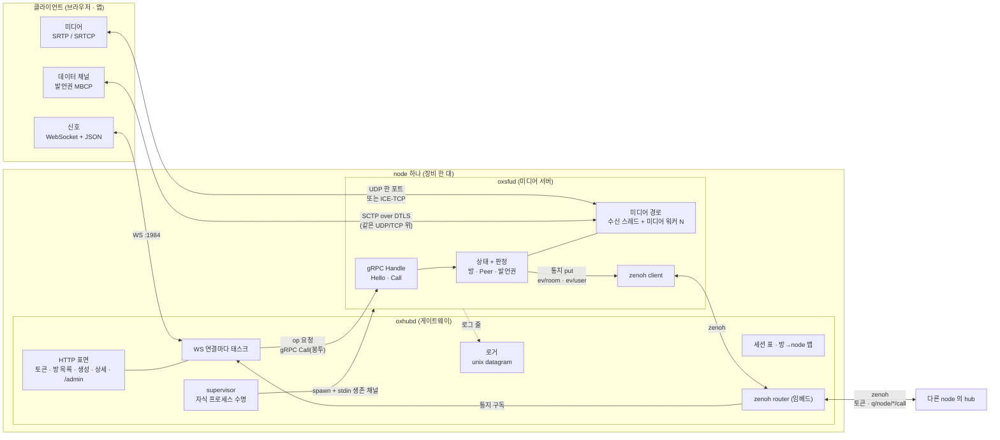
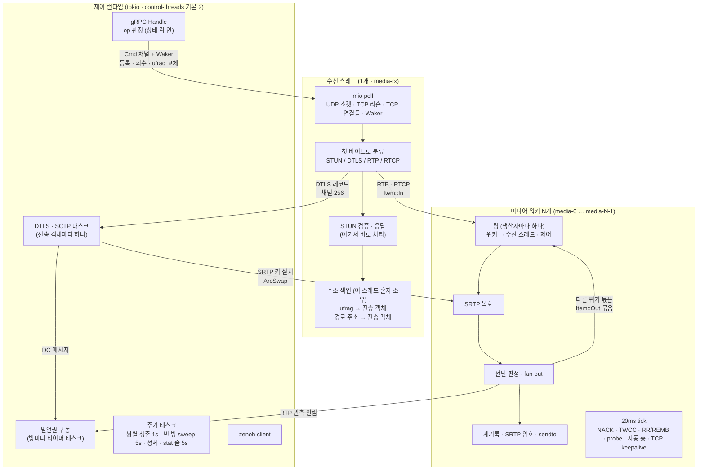
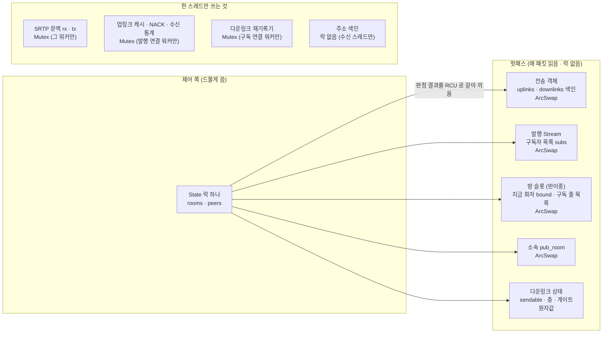
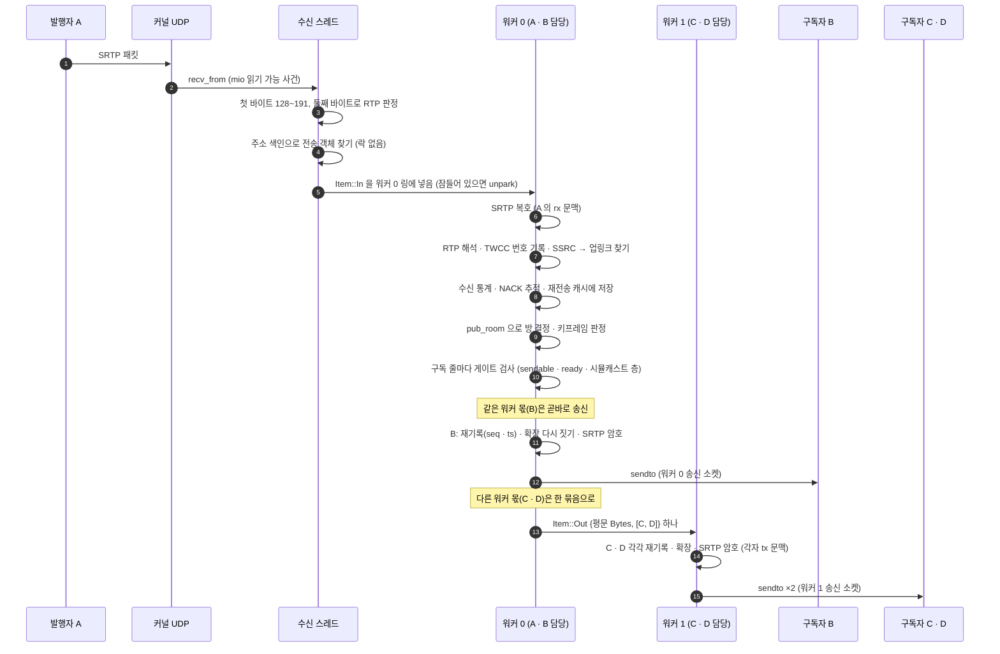
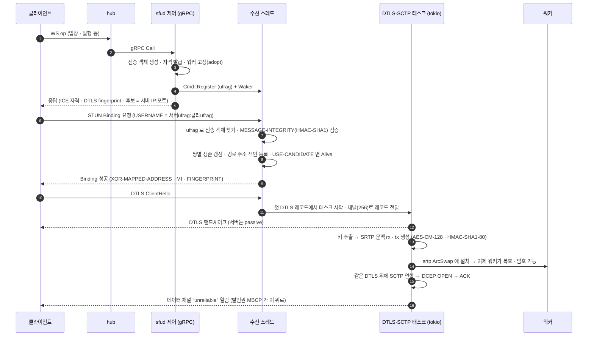
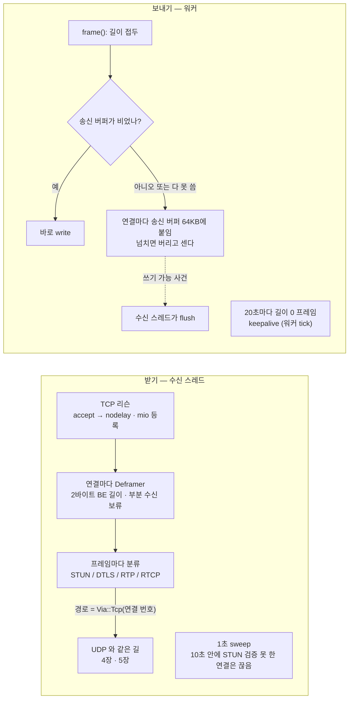
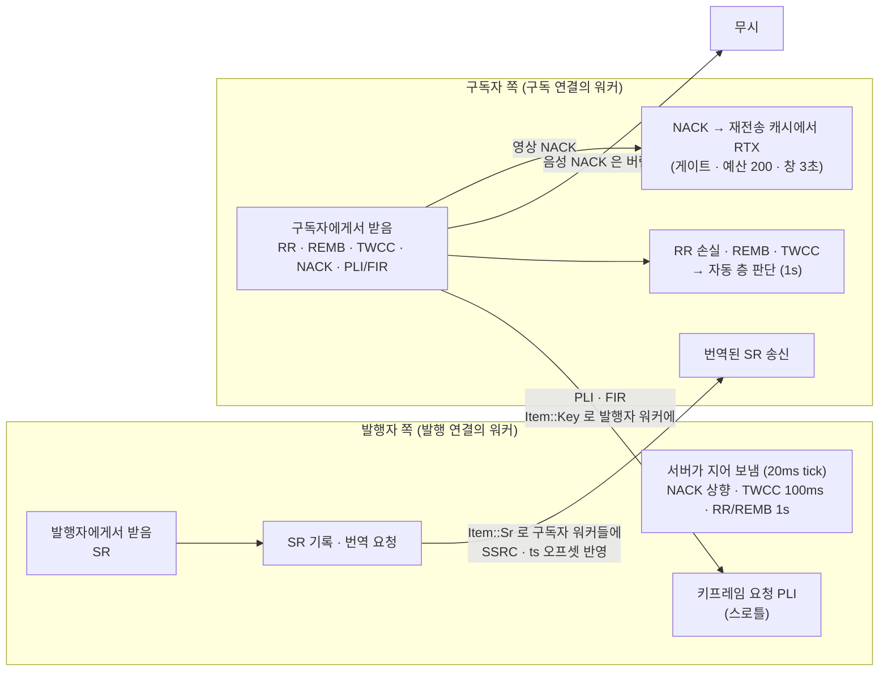
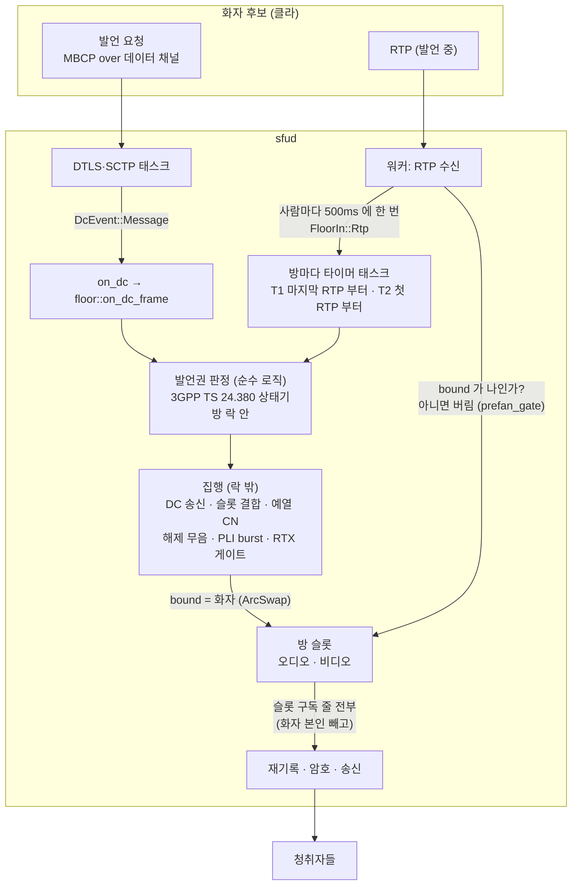
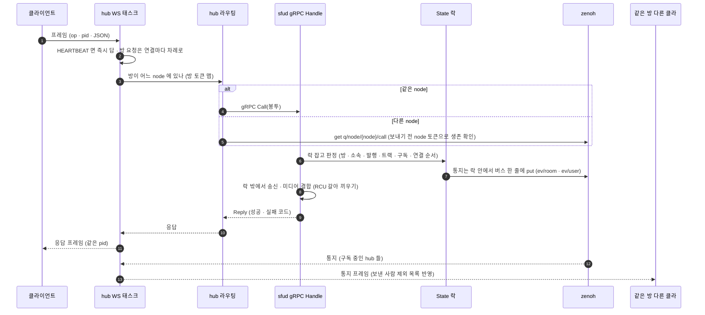

# OxLens SFU 형상

이 문서는 `oxlens-sfu` 서버가 어떤 부품으로 이루어져 있고, 부품끼리 어떻게 말을 주고받으며, 패킷 하나가 들어와서 나갈 때까지 어디를 거치는지를 그림으로 설명한다. 기준 소스는 `583279b`(미디어 워커 판, 2026-10-30)이다. 규격의 정본은 `context/spec/` 이고, 이 문서는 소스를 읽어 정리한 해설이다.

차례

1. [한눈에 보기 — 프로세스와 통로](#1-한눈에-보기--프로세스와-통로)
2. [sfud 안의 스레드 구성](#2-sfud-안의-스레드-구성)
3. [데이터 공유 지점](#3-데이터-공유-지점)
4. [수신에서 송신까지 — UDP RTP](#4-수신에서-송신까지--udp-rtp)
5. [연결 수립 — STUN · DTLS · SRTP · SCTP](#5-연결-수립--stun--dtls--srtp--sctp)
6. [TCP 경로 — ICE-TCP](#6-tcp-경로--ice-tcp)
7. [RTCP — 서버가 두 세션의 끝점](#7-rtcp--서버가-두-세션의-끝점)
8. [반이중(무전) 경로와 발언권](#8-반이중무전-경로와-발언권)
9. [신호 흐름 — op 하나의 왕복](#9-신호-흐름--op-하나의-왕복)
10. [사용한 기법 정리](#10-사용한-기법-정리)
11. [알려진 한계(실측)](#11-알려진-한계실측)

---

## 1. 한눈에 보기 — 프로세스와 통로

서버는 프로세스 둘로 나뉜다.

- **oxhubd(게이트웨이)** — 클라이언트의 HTTP · WebSocket 을 받는다. 세션 · 토큰 · 방이 어느 node 에 있는지를 알고, 요청을 맞는 미디어 서버로 넘긴다. sfud 를 자식 프로세스로 띄우고 지켜보는 supervisor 이며, zenoh router 를 품고 있다.
- **oxsfud(미디어 서버)** — 미디어(UDP · TCP)를 직접 받고 보낸다. 방 · 참가자 · 발행 · 구독 상태와 그 판정, 발언권(무전) 판정을 든다.

| 통로 | 양쪽 | 실어 나르는 것 | 형식 |
|---|---|---|---|
| WebSocket | 클라 ↔ hub | 요청 · 응답 · 통지 | 8바이트 머리(ver · flags · op · pid) + JSON 몸통 (`oxsig/src/frame.rs`) |
| HTTP | 클라 ↔ hub | 토큰 발급 · 방 목록 · 생성 · 상세, 운영 `/admin` | REST |
| gRPC `Call` | hub → 같은 node 의 sfud | op 요청 봉투 하나 = 판정 하나 | `Call` / `Reply` 봉투 (`common/src/bus/env.rs`) |
| zenoh `ev/room/{방}` · `ev/user/{사용자}` | sfud → hub | 방 통지 · 개인 통지 | `Notice` 봉투 |
| zenoh 토큰(liveliness) | node 사이 | node · 방 · 세션이 어디 살아 있는지 | 키에 모든 정보를 적는다 (`common/src/bus/keys.rs`) |
| zenoh `q/node/{node}/call` | hub → 다른 node | 다른 node 에 있는 방으로 가는 op | gRPC 와 같은 봉투 |
| stdin 생존 채널 | hub → sfud | 부모가 죽으면 stdin 이 닫혀 sfud 도 끝난다 | 파이프 |
| unix datagram | sfud → hub 로거 | 로그 한 줄씩 | 텍스트 줄 |
| UDP 한 포트 | 클라 ↔ sfud | STUN · DTLS · SRTP · SRTCP 를 첫 바이트로 가른다 | RFC 7983 식 demux |
| ICE-TCP | 클라 ↔ sfud | UDP 와 같은 것을 TCP 위로 | RFC 4571 (2바이트 길이 접두) |

---

## 2. sfud 안의 스레드 구성

sfud 안에는 일하는 무리가 셋 있다. 미디어는 tokio 런타임을 타지 않고, 전용 OS 스레드에서 돈다.

**스레드 수**

| 무리 | 개수 | 인자 | 하는 일 |
|---|---|---|---|
| 수신 스레드 | 1 | — | 모든 수신 소켓을 한 곳에서 기다리고, 분류해서 넘긴다. STUN 은 직접 답한다. |
| 미디어 워커 | N (기본: 코어 수 − 2, 최소 1) | `--media-workers` | 복호 · 전달 · 암호 · 송신, 그리고 주기 RTCP |
| 제어 런타임 | 기본 2 | `--control-threads` | gRPC op 판정, DTLS · SCTP, 발언권, 주기 정리, 버스 |

**전송 객체 고정(affinity)** — 연결(전송 객체) 하나는 생길 때 워커 하나에 묶이고(`fwd/work.rs` `adopt`), 그 연결의 복호 · 암호 · 주기 RTCP 는 그 워커만 한다. 발행용 연결과 구독용 연결은 따로 세어 고르게 나눈다(덜 찬 워커로). 덕분에 연결마다 있는 SRTP 문맥 락은 늘 한 스레드만 잡아서 경합이 없다.

**잠과 깨움** — 워커는 링이 비면 잠깐(256번) 돌며 기다리다가 「잠듦」 표시를 세우고 `park_timeout`(다음 tick 까지, 최대 50ms)으로 잔다. 넣는 쪽은 그 표시가 서 있을 때만 `unpark` 한다. 수신 스레드나 워커가 죽으면 프로세스를 `exit(70)` 으로 내린다(반쪽 상태로 살지 않는다).

---

## 3. 데이터 공유 지점

한 데이터를 여러 스레드가 만지는 곳과, 거기서 쓰는 방법이다. 원칙은 「매 패킷 읽는 것은 락 없이(RCU · 원자값), 상태 판정은 락 하나 안에서, 넘기기는 링으로」이다.

| 공유 지점 | 쓰는 쪽 | 읽는 쪽 | 기법 |
|---|---|---|---|
| `State`(방 · Peer 전체) | gRPC op 판정 · 정리 태스크 | 같은 쪽 | `Mutex` 하나. 판정은 락 안, 통지는 락 안에서 버스에 줄 세우고, 송신 · 미디어 결합은 락 밖 |
| 전송 객체의 `uplinks` · `downlinks`(SSRC → 스트림) | 제어 쪽 · 처음 보는 rid 학습 | 워커(매 패킷) | `ArcSwap` RCU — 통째로 복사해 바꿔 끼운다 |
| 발행 `Stream.subs`(구독 줄 목록) | 제어 쪽 | 워커 fan-out | `ArcSwap<Vec<Weak<Downlink>>>` |
| 방 슬롯 `bound` · `downlinks`(반이중) | 발언권 집행 | 워커 fan-out | `ArcSwap` |
| `aff.pub_room`(발행 방) | 제어 쪽 | 워커(매 패킷 방 결정) | `ArcSwapOption` |
| 다운링크 `sendable` · `cur/want/auto_layer` · `rtx_gate` 등 | 제어 · 워커 | 워커 | 원자값 |
| SRTP 문맥(`Srtp.rx` · `Srtp.tx`) | 그 전송 객체의 워커 | 같은 워커 | `Mutex` 이지만 한 스레드만 잡는다(경합 없음). 설치는 DTLS 태스크가 `ArcSwapOption` 으로 |
| 업링크 `cache` · `nack` · `ingress` | 발행 연결의 워커 | 같은 워커, stat 줄(5s) | `Mutex` |
| 다운링크 재기록기 `rewrite` | 구독 연결의 워커 | 같은 워커 | `Mutex`(알고 두는 비용 — 매 패킷) |
| 주소 색인(ufrag · 경로 주소) | 수신 스레드 | 수신 스레드 | 락 없음. 제어 쪽 변경은 `Cmd` 채널 + mio `Waker` 로 넘긴다 |
| TCP 송신 버퍼 | 워커(보냄) · 수신 스레드(쓰기 가능 사건에 비움) | — | 연결마다 `Mutex<Vec<u8>>`(64KB) |
| 워커 링 | 생산자 하나씩 | 그 워커 | `crossbeam::ArrayQueue`(락 없는 고정 크기 큐) — 차면 기다리지 않고 버리고 센다 |
| 패킷 몸통 | 업링크 워커 | 여러 다운링크 워커 | `bytes::Bytes` 참조 수 공유 — 워커 사이에 몸통을 복사하지 않는다 |
| 버림 계수(`/admin/drops`) | 누구나 | 운영 | 원자 카운터 |

**링 구성** — 워커마다 링이 「워커 수 + 2」개 있다: 다른 워커 각각에서 오는 링, 수신 스레드에서 오는 링(4,096), 제어 쪽에서 오는 링. 생산자가 하나뿐이라 넣는 쪽끼리 경합하지 않는다. 링에 들어가는 항목은 다섯 가지다.

| 항목 | 누가 넣나 | 내용 |
|---|---|---|
| `In` | 수신 스레드 | 암호화된 RTP/RTCP 하나 + 분류 |
| `Out` | 업링크 워커 | 평문 RTP 하나 + 이 워커가 보낼 다운링크 목록(목적지 워커마다 묶음) |
| `Key` | 아무 워커 | 「이 발행자에게 키프레임 요청을 보내라」 |
| `Sr` | 업링크 워커 | 발행자 SR 을 번역해 이 다운링크들에 보내라 |
| `Synth` | 제어(발언권) | 서버가 짓는 패킷(예열 CN · 해제 무음) |

---

## 4. 수신에서 송신까지 — UDP RTP

발행자 A 의 영상 RTP 하나가 구독자 여럿에게 나가는 길이다. A 의 연결은 워커 0, 구독자 B 는 워커 0, 구독자 C · D 는 워커 1 에 묶여 있다고 하자.

차례대로 보면 이렇다.

1. **받기(수신 스레드)** — `link/io.rs` `Reader::run`. mio 로 UDP 소켓 · TCP 리슨 · TCP 연결 · Waker 를 함께 기다린다. 읽을 것이 있으면 `WouldBlock` 이 날 때까지 다 읽는다.
2. **분류** — `classify`: 첫 바이트 0~3 = STUN, 20~63 = DTLS, 128~191 = RTP(둘째 바이트 192~223 이면 RTCP).
3. **주인 찾기** — 경로 주소(UDP 면 보낸 주소, TCP 면 연결 번호)로 전송 객체를 찾는다. 모르는 주소면 버리고 센다(`rtp_unknown_path`).
4. **넘기기** — `submit_in` 이 그 전송 객체의 워커 링에 `In` 을 넣는다. 2,048바이트가 넘으면 버린다(`oversize`), 링이 차면 버린다(`ingress_queue_full`).
5. **복호** — 워커가 `fwd/rx.rs` `dispatch` 에서 SRTP 를 풀고 RTP 면 `fwd::on_rtp`, RTCP 면 `rtcp::on_rtcp` 로.
6. **업링크 처리** — `fwd/mod.rs` `media`: 수신 통계 · NACK 추적(영상만) · 재전송 캐시 · 첫 RTP 신호 · PT 확인 · 음성 레벨 관측. 시뮬캐스트처럼 처음 보는 SSRC 는 rid · mid 확장으로 배워 업링크를 만든다(`learn`).
7. **어디로 보낼지(fan-out)** — 트랙의 `duplex` 하나로 갈린다.
   - 전이중(화상회의): 발행 `Stream.subs` 의 구독 줄마다 게이트(그 트랙을 싣는 줄인지 · 영상 ready 게이트 · `sendable` · 시뮬캐스트 층)를 보고 고른다.
   - 반이중(무전): 방 슬롯의 지금 화자가 이 발행자일 때만 슬롯 구독 줄 전부로 보낸다(화자 본인은 뺀다). [8장](#8-반이중무전-경로와-발언권) 참고.
8. **목적지 워커마다 묶음** — `Fanout::add` 는 같은 워커 몫이면 곧바로 송신하고, 다른 워커 몫은 목적지 워커마다 모았다가 `flush` 에서 `Out` 하나로 넘긴다. 패킷 하나당 다른 워커로 가는 항목은 「워커 수 − 1」개를 넘지 않는다.
9. **송신(다운링크마다)** — `fwd/egress.rs` `forward`:
   - 재기록기: 출처(발행 SSRC)가 바뀌면 영상은 키프레임부터만 받는다(아니면 버리고 키프레임 요청). seq · timestamp 는 출처가 바뀔 때 한 번 정한 오프셋 하나로 이어 붙인다(스칼라 오프셋).
   - 확장 다시 짓기: 구독자 협상 표대로 mid · 음성 레벨 · abs-send-time · 서버 TWCC 번호를 새로 쓴다.
   - PT 를 구독자 협상 값으로 바꾸고, 다운링크 SSRC 로 다시 짓는다.
   - SRTP 암호(그 연결의 tx 문맥) → `send_via` → UDP 면 이 워커 송신 소켓으로 `sendto`, TCP 면 길이 접두를 붙여 연결 송신 버퍼로.

---

## 5. 연결 수립 — STUN · DTLS · SRTP · SCTP

서버는 ICE-lite 다(후보를 모으지 않고 검사에 답만 한다). 연결 하나 = 자격(ufrag · pwd) 한 벌 = 전송 객체 하나다.

- **STUN 은 수신 스레드가 직접 끝낸다**(`link/io.rs` `on_stun`, `link/ice.rs`). MESSAGE-INTEGRITY 검증을 통과한 검사만 상태를 바꾼다.
- **경로 = 지명이 실린, 검증된 검사가 마지막으로 온 쌍.** 주소가 바뀌면(NAT 재바인딩 · 망 전환) 새 검사가 오는 대로 경로를 옮긴다. ICE restart 로 새 ufrag 가 오면 옛 ufrag 는 새 ufrag 의 첫 검증 검사 때 내린다.
- **생존** — 제어 쪽 1초 tick 이 쌍별 생존을 보고, 경로가 만료되면 `Alive → Suspect` 로 바꾸고 사용자에게 `LinkEvent` 통지를 보낸다. USE-CANDIDATE 가 실린 검사가 다시 오면 `Alive` 로 돌아온다.
- **DTLS 는 tokio 태스크**(`link/dtls.rs`). 수신 스레드는 레코드를 채널로 던지기만 한다. 핸드셰이크가 끝나면 SRTP 문맥을 전송 객체에 꽂고, 같은 DTLS 위에 SCTP(`sctp-proto`)를 올려 데이터 채널을 연다.

---

## 6. TCP 경로 — ICE-TCP

UDP 가 막힌 망을 위해 TCP passive 후보를 낸다(`--tcp-port`). 미디어 바이트는 UDP 와 같고, TCP 위에 RFC 4571 틀(2바이트 길이 접두)을 씌울 뿐이다.

- TCP 연결도 수신 스레드가 mio 로 함께 기다린다. 연결 번호가 mio 토큰이다.
- 받은 프레임은 UDP 데이터그램과 똑같이 `on_datagram` 으로 들어간다. 경로 주소가 「연결 번호 + 상대 주소」라는 것만 다르다.
- 보낼 때 커널 버퍼가 차면 그 연결의 송신 버퍼(64KB)에 쌓고, 수신 스레드가 「쓰기 가능」 사건에서 마저 비운다. 버퍼가 넘치면 기다리지 않고 버린다(실시간 우선).

---

## 7. RTCP — 서버가 두 세션의 끝점

서버는 RTCP 를 그냥 넘겨주지 않는다. 발행자 쪽 세션과 구독자 쪽 세션을 각각 끝내고, 필요한 것만 번역해 반대쪽에 낸다.

| 방향 | 무엇 | 서버가 하는 일 | 어디서 |
|---|---|---|---|
| 발행자 → 서버 | SR | 기록하고, 구독자마다 SSRC · timestamp 오프셋을 반영해 번역해서 보낸다 | 받기: 발행 워커 → 보내기: `Item::Sr` 로 각 구독 워커 |
| 서버 → 발행자 | NACK | 업링크 손실을 서버가 직접 감지해 요청(재시도 200ms · 포기 1s) | 발행 워커 tick 20ms |
| 서버 → 발행자 | TWCC | 업링크 도착 시각을 모아 피드백(발행자 쪽 대역 추정용) | 100ms |
| 서버 → 발행자 | RR · REMB | 수신 보고와 상한 비트레이트(정책 `max_bitrate_bps`) | 1s |
| 서버 → 발행자 | PLI | 구독자 PLI · 출처 전환 · 층 전환 때 키프레임 요청(스로틀) | `Item::Key` 로 발행 워커가 보냄 |
| 구독자 → 서버 | NACK | 영상만, 재전송 캐시에서 RTX 로 다시 보낸다(출처 seq 로 되돌려 찾음). 음성은 버린다 | 구독 워커 |
| 구독자 → 서버 | PLI · FIR | 지금 출처 발행자에게 키프레임 요청으로 바꿔 넘긴다 | 구독 워커 → 발행 워커 |
| 구독자 → 서버 | RR · REMB · TWCC | 자동 층 판단 입력(v1 = REMB + RR 손실, v2 = 서버가 찍은 TWCC 번호로 trendline · AIMD) | 구독 워커, 판단은 1초 tick |

서버가 구독자에게 보내는 모든 패킷에는 서버 자신의 TWCC 번호를 찍는다. 그래서 구독자가 돌려준 TWCC 피드백으로 서버 → 구독자 구간의 대역을 직접 추정할 수 있다. 시뮬캐스트 층을 올릴 때는 RTX 패딩으로 대역을 미리 떠 본다(probe).

---

## 8. 반이중(무전) 경로와 발언권

무전(PTT)은 「방마다 오디오 · 비디오 슬롯 하나씩」을 두고, 발언권을 쥔 사람의 RTP 만 그 슬롯으로 흘려보낸다. 구독자는 화자가 바뀌어도 m-line 하나로 계속 받는다(서버가 SSRC · seq · ts 를 이어 붙인다).

- 발언권 메시지(MBCP)는 WebSocket 이 아니라 **데이터 채널**로 오간다(`oxsig/src/mbcp.rs` — 2바이트 머리 + TLV).
- 판정은 순수 함수(`flr/core.rs`)이고, 집행(`ops/floor.rs`)이 결과대로 슬롯의 `bound`(지금 화자)를 갈아 끼운다.
- 워커는 매 패킷 `bound` 를 원자적으로 읽어 「이 발행자가 지금 화자인가」만 본다 — 락이 없다.
- 화자가 바뀌면 재기록기가 새 출처로 오프셋을 다시 잡는다. 영상은 키프레임이 올 때까지 기다리고 그동안 PLI 를 보낸다.

---

## 9. 신호 흐름 — op 하나의 왕복

- sfud 가 처리하는 op: 입장 · 퇴장 · 트랙 발행 · 트랙 설정 · ready · 층 구독 · ICE restart · 소속 · 메시지 (`ops/call.rs`).
- 통지 순서를 지키려고 통지는 상태 락 안에서 버스에 줄 세운다(판정 순서 = 통지 순서).
- 구독 m-line 배정은 연결마다 「배정표」(`sub/table.rs`)가 든다. mid 는 뒤로만 늘고 줄은 지우지 않으며, 바뀌면 `MlineEvent` 로 알린다. 클라가 확인(ack)한 차례 뒤의 줄만 미디어가 흐른다.

---

## 10. 사용한 기법 정리

| 영역 | 기법 | 왜 | 소스 |
|---|---|---|---|
| I/O | mio(kqueue · epoll) 하나로 UDP · TCP 리슨 · TCP 연결 · Waker 를 함께 기다림 | 수신 스레드 하나가 모든 소켓을 맡고 주소 색인을 혼자 쥐어 락을 없앰 | `link/io.rs` |
| I/O | 첫 바이트 demux (STUN · DTLS · RTP · RTCP 한 포트) | 포트 하나 · 방화벽 단순 | `link/io.rs` `classify` |
| I/O | macOS: 워커마다 송신 소켓(SO_REUSEPORT, 수신 소켓은 마지막에 bind) / 리눅스: 소켓 하나 공유 | macOS 는 한 소켓 동시 송신이 줄 서고, REUSEPORT 유니캐스트는 마지막 bind 소켓으로 받음 | `link/io.rs` `bind_udp` |
| 동시성 | 전송 객체를 워커 하나에 고정 | SRTP · 재기록기 · 수신 통계 락을 한 스레드만 잡음 | `fwd/work.rs` `adopt` |
| 동시성 | 생산자마다 링(락 없는 고정 큐) | 넣는 쪽끼리 경합 없음 | `crossbeam::ArrayQueue` |
| 동시성 | 목적지 워커마다 묶음 넘김 | 패킷마다 넘김 항목 ≤ 워커 수 − 1 | `Fanout` |
| 동시성 | 잠듦 표시 + park/unpark | 일 없을 때 CPU 를 쓰지 않고, 깨우기 시스템 콜은 잘 때만 | `fwd/work.rs` `run` · `wake` |
| 동시성 | RCU(`arc-swap`) | 매 패킷 읽는 색인 · 목록을 락 없이 읽고, 드문 변경은 통째로 바꿔 끼움 | 곳곳 |
| 동시성 | 상태 락 하나 + 판정은 순수 함수 | 판정 순서가 하나로 정해지고 시험 · 모형 검증이 쉬움 | `ops/call.rs` · `flr/core.rs` |
| 메모리 | `bytes::Bytes` 참조 수 공유 | 워커 사이에 패킷 몸통을 복사하지 않음 | `Item::Out` |
| 과부하 | 링 · TCP 버퍼가 차면 기다리지 않고 버리고 셈 | 실시간 우선, 막힘 전파 차단(`/admin/drops`) | `ops/drops.rs` |
| 장애 | 미디어 스레드가 끝나면 `exit(70)` · 부모 stdin 생존 채널 · 자가 감시 박동 | 반쪽 상태로 살지 않음, supervisor 가 다시 띄움 | `fwd/work.rs` · `common/proc.rs` |
| 보안 | ICE-lite + STUN MESSAGE-INTEGRITY 검증 뒤에만 상태 변경 | 위조 검사로 경로를 못 바꿈 | `link/ice.rs` · `link/stun.rs` |
| 암호 | DTLS passive → SRTP AES-CM-128 + HMAC-SHA1-80, 하드웨어 AES(`--cfg aes_armv8`, 실행 중 감지 · 없으면 소프트웨어) | 표준 WebRTC 호환 · ARM 에서 AES 가속 | `link/dtls.rs` · `.cargo/config.toml` |
| 전달 | 출처 전환 때 스칼라 오프셋 하나로 seq · ts 이어 붙이기, 영상은 키프레임부터 | 구독자 디코더가 끊김 없이 이어 받음 | `fwd/core.rs` `Rewriter` |
| 전달 | 확장 다시 짓기 + 서버 TWCC 번호 찍기 | 구독자 쪽 대역을 서버가 직접 추정 | `fwd/egress.rs` · `sub/ext.rs` |
| 품질 | 업링크 NACK · 재전송 캐시 · RTX(예산 · 창) · PLI 스로틀 | 손실 복구와 키프레임 폭주 방지 | `rtcp/*` · `fwd/egress.rs` |
| 품질 | 시뮬캐스트 층 전환은 목표 층 키프레임에서만 · 자동 층(trendline · AIMD) · RTX 패딩 probe | 층 바꿀 때 깨짐 없음 · 대역에 맞춤 | `fwd/mod.rs` `layer_ok` · `sim/*` |
| 무전 | 방 슬롯 + 발언권(3GPP TS 24.380 판정) + 데이터 채널 MBCP | 청취자는 m-line 하나로 화자 전환을 받음 | `flr/*` · `ops/floor.rs` |
| 분산 | zenoh 토큰(liveliness)으로 node · 방 · 세션 위치, 통지 put, node 사이 query | 방이 어느 node 에 있든 같은 봉투로 라우팅 | `common/bus/*` · `oxhubd/bus` |

---

## 11. 알려진 한계(실측)

자세한 수치는 `context/202610/20261030a_media_workers_impl_task.md` 와 규격 `conc` 성능 절에 있다.

- **처리량** — Apple M3(8코어) 한 대에 봇까지 함께 띄운 루프백에서 구독 1,500 = 약 356,000 pps 손실 0. 이 형상은 서버보다 기계가 먼저 찬다.
- **macOS 코어당 효율** — 워커 수를 늘리면 처리량은 그대로인데 코어만 더 쓴다. macOS 커널이 동시 `sendto`(받기까지 포함)를 전역으로 줄 세우기 때문이다(워커 1 → 6 에 1회 2.24 → 6.39μs). 리눅스는 그렇지 않다(아래).
- **리눅스 최소 사양(라즈베리파이 4)** — 워커 수만큼 처리량이 는다(워커 2 ≈ 47k · 3 ≈ 70 ~ 78k · 4 ≈ 74 ~ 97k pps, 코어당 약 26 ~ 30k). 손실 0 무릎은 워커 4 · 구독 300 · 71k pps.
- **포화 때 지연** — 워커 하나가 100% 에 닿으면 버리지 않고 쌓아서 지연이 수 초까지 늘어난다(pi 실측 p50 2.5 ~ 5.7초). 링의 한도가 시간이 아니라 항목 개수이고, `Out` 항목 하나가 구독자 여럿 몫을 품기 때문으로 보인다(미확정). 실시간 계약(늦은 패킷은 버린다)과 맞지 않는 곳이라 규격 · 설계 과제로 남아 있다.
- **패킷 풀(0-복사 칸)** — 설계에는 있으나 보류 중이다(대장 C-113 ④). 지금은 복호 · 암호 때 버퍼를 새로 잡는다.
