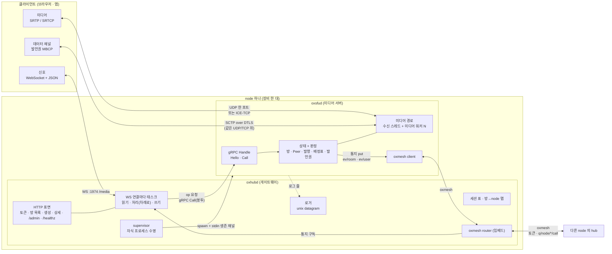
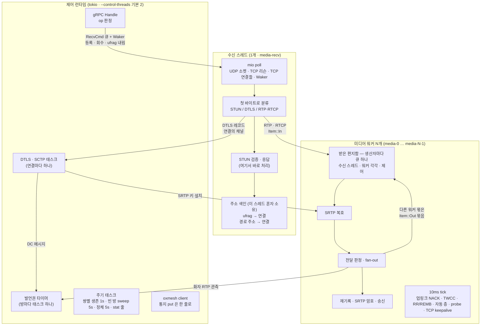
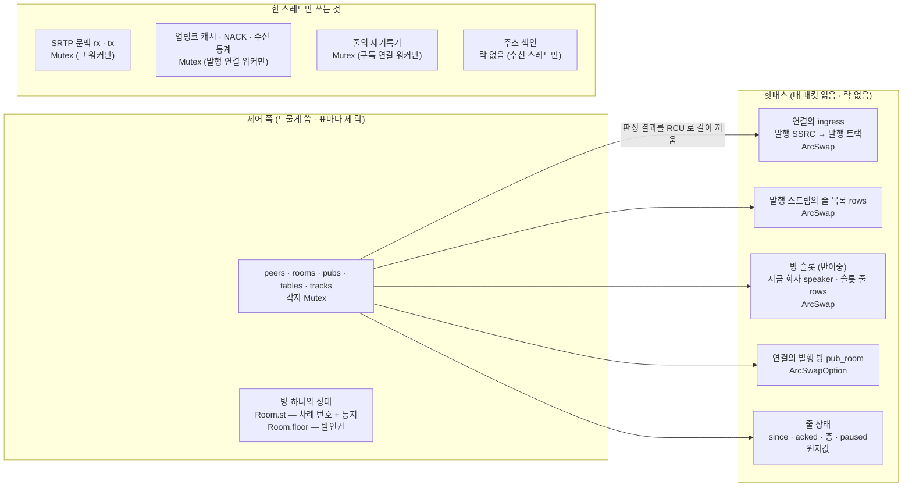
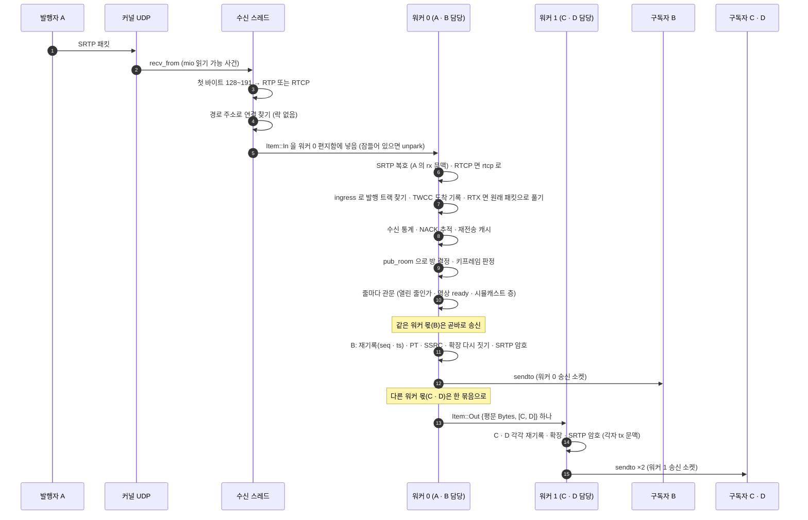
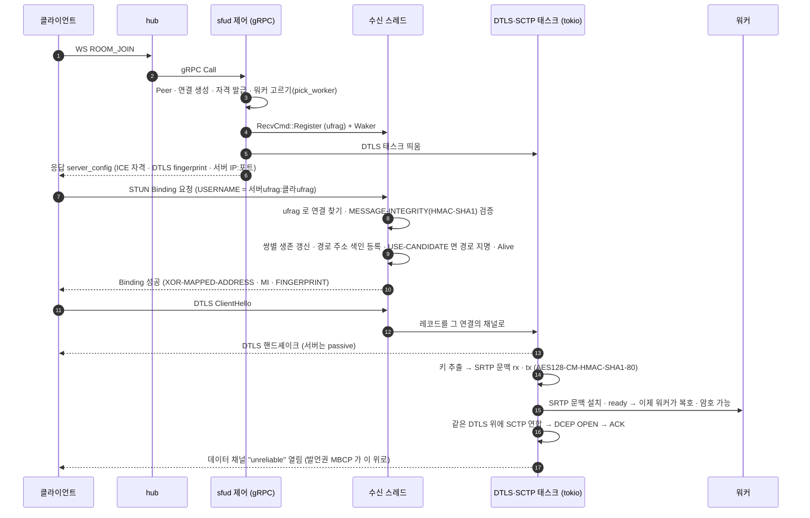
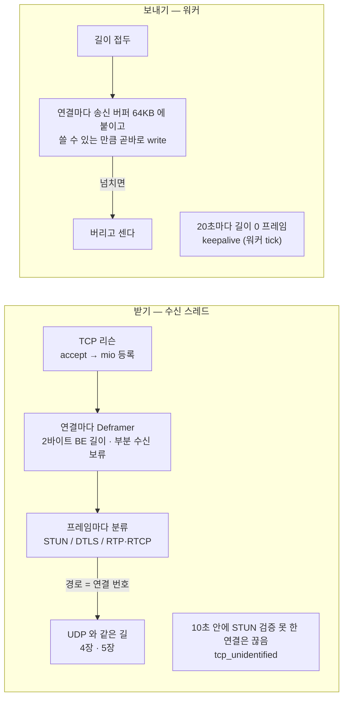
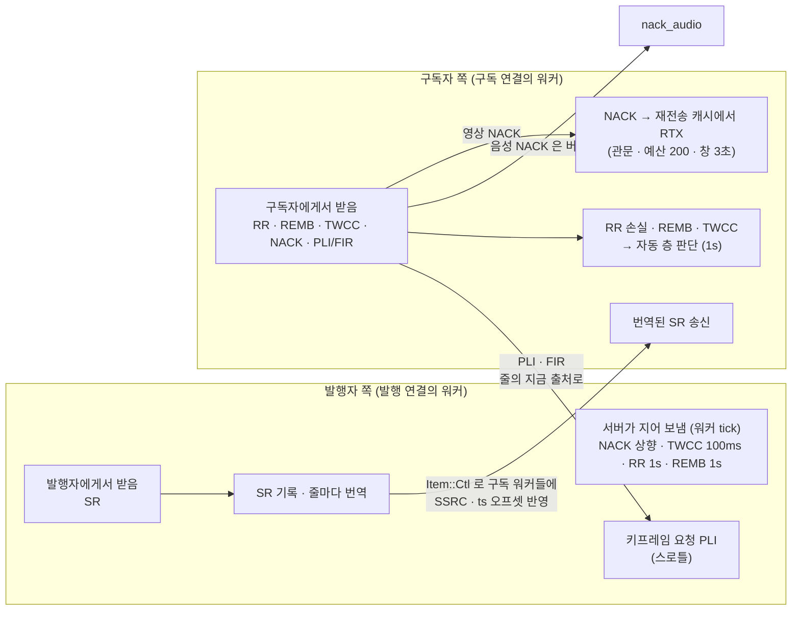
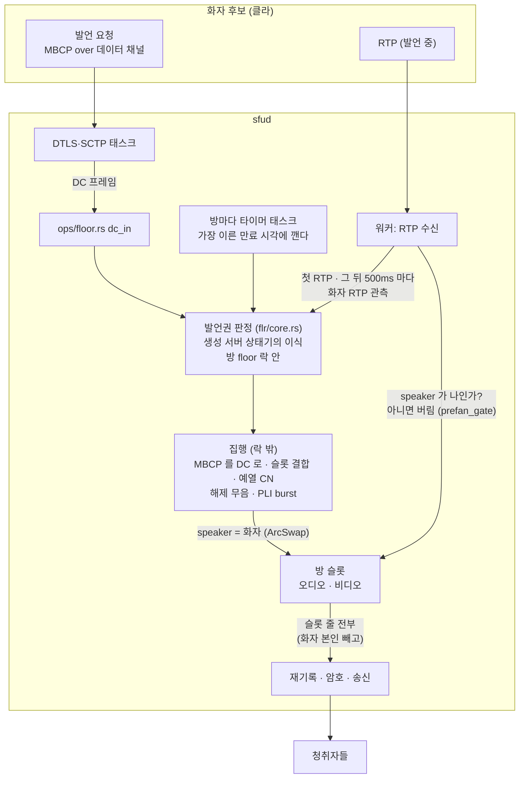
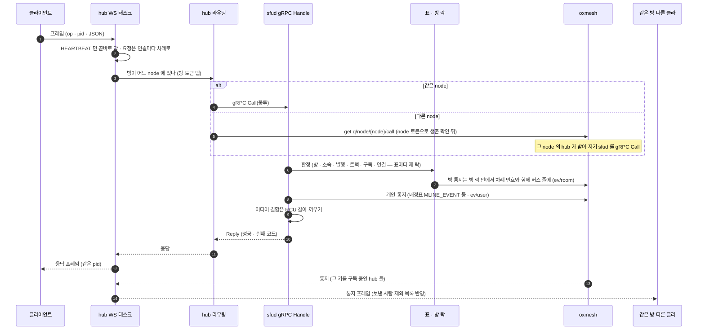

# OxLens SFU 형상

이 문서는 `oxlens-sfu` 서버가 어떤 부품으로 이루어져 있고, 부품끼리 어떻게 말을 주고받으며, 패킷 하나가 들어와서 나갈 때까지 어디를 거치는지를 그림으로 설명한다. 기준 소스는 `40c5ce0`(`v1.7` 다음 커밋, 2026-11-03)이다. 소스를 읽어 정리한 해설이고, 클라와 서버 사이의 계약은 [클라 통신 규격](protocol/README.md)이 정한다.

- **이 문서** — 정적 구조: 프로세스 · 스레드 · 공유 지점 · 패킷의 길.
- **[학습 문서](learn/00_INDEX.md)** — 실측 흐름: 시험을 한 번 돌려 거둔 WS 프레임 · SDP · 로그로, 입장부터 영상이 보이기까지를 시각순으로 따라간다.

차례

1. [한눈에 보기 — 프로세스와 통로](#1-한눈에-보기--프로세스와-통로)
2. [sfud 안의 스레드 구성](#2-sfud-안의-스레드-구성)
3. [데이터 공유 지점](#3-데이터-공유-지점)
4. [수신에서 송신까지 — UDP RTP](#4-수신에서-송신까지--udp-rtp)
5. [연결 수립 — STUN · DTLS · SRTP · SCTP](#5-연결-수립--stun--dtls--srtp--sctp)
6. [TCP 경로 — ICE-TCP](#6-tcp-경로--ice-tcp)
7. [RTCP — 서버가 두 세션의 끝점](#7-rtcp--서버가-두-세션의-끝점)
8. [반이중(무전) 경로와 발언권](#8-반이중무전-경로와-발언권)
9. [신호 흐름 — op 하나의 왕복](#9-신호-흐름--op-하나의-왕복)
10. [사용한 기법 정리](#10-사용한-기법-정리)
11. [알려진 한계(실측)](#11-알려진-한계실측)

---

## 1. 한눈에 보기 — 프로세스와 통로

서버는 프로세스 둘로 나뉜다. 둘을 묶어 **node** 라 부른다(장비 한 대에 하나).

- **oxhubd(게이트웨이)** — 클라이언트의 HTTP · WebSocket 을 받는다. 세션 · 토큰 · 방이 어느 node 에 있는지를 알고, 요청을 맞는 미디어 서버로 넘긴다. sfud 를 자식 프로세스로 띄우고 지켜보는 supervisor 이며, 버스(oxmesh) router 와 로거를 품고 있다.
- **oxsfud(미디어 서버)** — 미디어(UDP · TCP)를 직접 받고 보낸다. 방 · 참가자 · 발행 · 구독 상태와 그 판정, 발언권(무전) 판정을 든다.

| 통로 | 양쪽 | 실어 나르는 것 | 형식 |
|---|---|---|---|
| WebSocket | 클라 ↔ hub | 요청 · 응답 · 통지 | 8바이트 머리(ver · flags · op · pid) + JSON 몸통 (`oxsig/src/frame.rs`) |
| HTTP | 클라 ↔ hub | 토큰 발급 · 방 목록 · 생성 · 상세, 운영 `/admin` · `/healthz` | REST |
| gRPC `Handle` | hub → 같은 node 의 sfud | `Hello`(기동 확인 · epoch) · `Call`(op 요청 봉투 하나 = 판정 하나) | `crates/common/proto/handle.proto` · 봉투 `common/src/envelope.rs` |
| 버스 `ev/room/{방}` · `ev/user/{사용자}` | sfud → hub | 방 통지 · 개인 통지 | `Notice` 봉투 |
| 버스 토큰 | node 사이 | node · 방 · 세션이 어디 살아 있는지 | 키에 모든 정보를 적는다 (`common/src/keyspace.rs`) |
| 버스 `q/node/{node}/call` | hub → 다른 node 의 hub | 다른 node 에 있는 방으로 가는 op — 받은 hub 가 자기 sfud 를 gRPC 로 부른다 | gRPC 와 같은 봉투 |
| stdin 생존 채널 | hub → sfud | 부모가 죽으면 stdin 이 닫혀 sfud 도 끝난다 | 파이프 |
| unix datagram | sfud → hub 로거 | 로그 한 줄씩 | logfmt 줄 |
| UDP 한 포트 | 클라 ↔ sfud | STUN · DTLS · SRTP · SRTCP 를 첫 바이트로 가른다 | RFC 7983 식 demux |
| ICE-TCP | 클라 ↔ sfud | UDP 와 같은 것을 TCP 위로 | RFC 4571 (2바이트 길이 접두) |

- ★sfud 는 **자기 node 의 hub 하나에만** 붙는다. node 안은 gRPC 하나, node 사이는 전부 버스다 — 다른 node 의 sfud 와 직접 말하는 길이 없다(세션 · 배치를 든 hub 가 관문).

---

## 2. sfud 안의 스레드 구성

sfud 안에는 일하는 무리가 셋 있다. 미디어는 tokio 런타임을 타지 않고, 전용 OS 스레드에서 돈다(`fwd/rt.rs`).

**스레드 수**

| 무리 | 개수 | 인자 | 하는 일 |
|---|---|---|---|
| 수신 스레드 | 1 | — | 모든 수신 소켓을 한 곳에서 기다리고, 분류해서 넘긴다. STUN 은 직접 답한다. |
| 미디어 워커 | N (기본: 코어 수 − 2, 최소 1 · ★macOS 는 2 를 넘지 않는다) | `--media-workers` | 복호 · 전달 · 암호 · 송신, 그리고 주기 RTCP |
| 제어 런타임 | 기본 2 | `--control-threads` | gRPC op 판정, DTLS · SCTP, 발언권, 주기 정리, 버스 |

- macOS 상한은 실측 때문이다 — 워커를 늘려도 처리량이 그대로이고 코어만 더 쓴다([11장](#11-알려진-한계실측)).

**연결 고정(affinity)** — 연결(전송 객체) 하나는 생길 때 워커 하나에 묶이고(`fwd/rt.rs` `Media::pick_worker` — 발행 연결과 구독 연결을 따로 세어 덜 찬 워커로), 그 연결의 복호 · 암호 · 주기 RTCP 는 그 워커만 한다. 덕분에 연결마다 있는 SRTP 문맥 락은 늘 한 스레드만 잡아서 경합이 없다.

**잠과 깨움** — 워커는 편지함이 비면 64번 돌며 기다리다가 「잠듦」 표시를 세우고 `park_timeout`(5ms)으로 잔다(`fwd/mod.rs` `worker_loop`). 넣는 쪽은 그 표시가 서 있을 때만 `unpark` 한다. 수신 스레드나 워커가 끝나면 프로세스를 `exit(70)` 으로 내리고, 제어 런타임이 10초 멎으면 자가 감시가 끝낸다(`main.rs`) — 반쪽 상태로 살지 않고, supervisor 가 다시 띄운다.

---

## 3. 데이터 공유 지점

한 데이터를 여러 스레드가 만지는 곳과, 거기서 쓰는 방법이다. 원칙은 「매 패킷 읽는 것은 락 없이(RCU · 원자값), 상태는 표마다 제 락, 넘기기는 큐로」이다.

| 공유 지점 | 쓰는 쪽 | 읽는 쪽 | 기법 |
|---|---|---|---|
| 프로세스 상태(`ops/mod.rs` `Sfu` — peers · rooms · pubs · tables · tracks) | gRPC op · 정리 태스크 | 같은 쪽 | 표마다 `Mutex`. 전역 락 하나가 없다 |
| 방 상태 `Room.st`(인원 · 차례 번호 `seq`) | 방을 바꾸는 op | 같은 쪽 | `Mutex` — ★차례 번호를 올리는 것과 방 통지를 버스 줄에 넣는 것이 같은 락 안이다(`room/mod.rs` `bump_and_send`) · 방의 `seq` 차례 = 통지 차례 |
| 발언권 `Room.floor` | DC 메시지 · 방 타이머 · 화자 RTP 관측 | 같은 쪽 | `Mutex` — 판정은 락 안, 집행(DC 송신 · 슬롯 결합)은 락 밖 |
| 연결의 `ingress`(발행 SSRC → 발행 트랙) | 발행 · 시뮬캐스트 rid 학습 | 워커(매 패킷) | `ArcSwap` RCU — 통째로 복사해 바꿔 끼운다 |
| 발행 스트림 `rows`(받는 줄 목록) | 배정표 동기화 | 워커 fan-out | `ArcSwap<Vec<Arc<DownRow>>>` |
| 방 슬롯 `speaker` · `rows`(반이중) | 발언권 집행 | 워커 fan-out | `ArcSwap` |
| 연결의 `pub_room`(발행 방) | 소속 바꿈 | 워커(매 패킷 방 결정) | `ArcSwapOption` |
| 줄의 `since` · `acked` · `layer` · `paused` · `priority` 등 | 제어 · 워커 | 워커 | 원자값 — 줄은 `since ≤ acked`(클라가 그 배정표를 확인한 뒤)일 때만 열린다 |
| SRTP 문맥(`srtp_rx` · `srtp_tx`) | 그 연결의 워커 | 같은 워커 | `Mutex` 이지만 한 스레드만 잡는다(경합 없음). 설치는 DTLS 태스크가 |
| 업링크 `recv` · `nack` · `cache` | 발행 연결의 워커 | 같은 워커, stat 줄 | `Mutex` |
| 줄의 재기록기 `rw` | 구독 연결의 워커 | 같은 워커 | `Mutex`(알고 두는 비용 — 매 패킷) |
| 주소 색인(ufrag · 경로 주소) | 수신 스레드 | 수신 스레드 | 락 없음. 제어 쪽 변경은 `RecvCmd` 큐 + mio `Waker` 로 넘긴다 |
| TCP 송신 버퍼 | 워커(보냄) | — | 연결마다 `Mutex<Vec<u8>>`(64KB) |
| 워커 편지함 | 생산자 하나씩 | 그 워커 | `crossbeam::ArrayQueue`(락 없는 고정 크기 큐) — 차면 기다리지 않고 버리고 센다 |
| 패킷 몸통 | 업링크 워커 | 여러 다운링크 워커 | `bytes::Bytes` 참조 수 공유 — 워커 사이에 몸통을 복사하지 않는다 |
| 버림 계수(`/admin/drops`) | 누구나 | 운영 | 원자 카운터 — 사유는 닫힌 목록(`ops/mod.rs` `DROP_NAMES`) |
| 서버 체류 시간(`/admin/transit`) | 다운링크 송신을 마친 워커 | 운영 | 워커마다 구간 여덟 + 합(128B 정렬 — 워커끼리 캐시 줄을 같이 쓰지 않는다) · 받은 시각(μs)은 수신 스레드가 편지함 항목에 실어 보낸다 |

**편지함 구성** — 워커마다 큐가 「워커 수 + 2」개 있다: 수신 스레드에서 오는 큐(4,096), 다른 워커 각각에서 오는 큐(1,024), 제어 쪽에서 오는 큐(4,096). 생산자가 하나뿐이라 넣는 쪽끼리 경합하지 않는다. ★한도는 칸 수보다 먼저 **워커에 쌓인 패킷 수**로 건다(기본 6,000 · `--worker-queue-packets`) — `Out` 하나가 줄 여럿 몫을 품기 때문이다. 항목은 세 가지다(`fwd/rt.rs` `Item`).

| 항목 | 누가 넣나 | 내용 |
|---|---|---|
| `In` | 수신 스레드 | 암호화된 RTP/RTCP 하나 + 받은 시각 |
| `Out` | 업링크 워커 | 평문 RTP 하나 + 이 워커가 보낼 줄 목록(목적지 워커마다 묶음) |
| `Ctl` | 아무 스레드 | 서버가 짓는 것 — RTCP(PLI · 번역한 SR · 피드백) · RTX · 무전 슬롯의 예열 CN · 해제 무음 |

---

## 4. 수신에서 송신까지 — UDP RTP

발행자 A 의 영상 RTP 하나가 구독자 여럿에게 나가는 길이다. A 의 연결은 워커 0, 구독자 B 는 워커 0, 구독자 C · D 는 워커 1 에 묶여 있다고 하자.

차례대로 보면 이렇다.

1. **받기(수신 스레드)** — `fwd/rt.rs` `recv_loop`. mio 로 UDP 소켓 · TCP 리슨 · TCP 연결 · Waker 를 함께 기다린다. 읽을 것이 있으면 `WouldBlock` 이 날 때까지 다 읽는다.
2. **분류** — `datagram`: 첫 바이트 0~3 = STUN, 20~63 = DTLS, 128~191 = RTP/RTCP, 그 밖은 버리고 센다(`demux_unknown`).
3. **주인 찾기** — 경로 주소(UDP 면 보낸 주소, TCP 면 연결 번호)로 연결을 찾는다. 모르는 주소면 버리고 센다(`rtp_unknown_path`). 주소는 STUN 검사가 통과할 때 색인에 오른다(5장).
4. **넘기기** — 그 연결의 워커 편지함에 `In` 을 넣는다. 2,048바이트가 넘으면 버린다(`oversize`), 편지함이 차면 버린다(`ingress_queue_full`).
5. **복호** — 워커가 `fwd/mod.rs` `ingress` 에서 SRTP 를 풀고 RTP 면 `on_rtp`, RTCP 면 `rtcp::on_rtcp` 로(둘째 바이트 192~223 이 RTCP).
6. **업링크 처리** — `on_rtp`: 연결의 `ingress` 에서 발행 SSRC 로 발행 트랙을 찾는다. 처음 보는 SSRC 면 rid · mid 확장으로 배워 발행 트랙을 만들고(시뮬캐스트 — `pub/mod.rs` `learn`), 못 배우면 버린다(`rtp_unknown_ssrc`). RTX 는 원래 패킷으로 풀어 같은 길로 보낸다. 그다음 수신 통계 · NACK 추적 · 재전송 캐시(`on_ingress`).
7. **어디로 보낼지(fan-out)** — `forward`. 트랙의 `duplex` 하나로 갈린다.
   - 전이중(화상회의): 발행 스트림 `rows` 의 줄마다 관문을 본다 — 열린 줄인가(`row_gate` — 클라가 확인한 배정표의 줄) · 영상 ready 관문(`ready_gate`) · 시뮬캐스트 층(`sim::pass`).
   - 반이중(무전): 방 슬롯의 지금 화자가 이 발행자일 때만 슬롯 줄 전부로 보낸다(화자 본인은 뺀다). 아니면 버린다(`prefan_gate`). [8장](#8-반이중무전-경로와-발언권) 참고.
8. **목적지 워커마다 묶음** — 고른 줄을 그 줄 연결의 워커로 나눠, 같은 워커 몫이면 곧바로 송신하고 다른 워커 몫은 `Out` 하나로 넘긴다(못 넣으면 `egress_queue_full`). 패킷 하나당 다른 워커로 가는 항목은 「워커 수 − 1」개를 넘지 않는다.
9. **송신(줄마다)** — `send_down`:
   - 재기록기(`fwd/core.rs` `Rewriter`): 출처(발행 트랙)가 바뀌면 영상은 키프레임부터만 받는다(아니면 버리고 `await_keyframe` · 키프레임 요청). seq · timestamp 는 출처가 바뀔 때 한 번 정한 오프셋 하나로 이어 붙인다(스칼라 오프셋).
   - PT 를 줄의 PT 로, SSRC 를 줄의 다운링크 SSRC 로 다시 짓는다.
   - 확장 다시 짓기(`sub/ext.rs`): 들어온 확장은 버리고 구독자 번호표로 mid(줄의 mid) · 음량 · abs-send-time · 서버 TWCC 번호만 새로 쓴다.
   - SRTP 암호(그 연결의 tx 문맥) → UDP 면 이 워커 송신 소켓으로 `sendto`, TCP 면 길이 접두를 붙여 연결로.

---

## 5. 연결 수립 — STUN · DTLS · SRTP · SCTP

서버는 ICE-lite 다(후보를 모으지 않고 검사에 답만 한다). 연결 하나 = 자격(ufrag · pwd) 한 벌 = 전송 객체 하나다. 사람마다 미디어 서버마다 Peer 하나가 있고, Peer 는 발행 연결 · 구독 연결을 든다(`1pc` 면 둘이 같은 연결).

- **STUN 은 수신 스레드가 직접 끝낸다**(`fwd/rt.rs` `datagram` · 해석과 검증은 `link/stun.rs`). MESSAGE-INTEGRITY 검증을 통과한 검사만 상태를 바꾼다. 못 통과하면 버리고 센다(`stun_unverified`).
- **경로 = 지명이 실린, 검증된 검사가 마지막으로 온 쌍.** 주소가 바뀌면(NAT 재바인딩 · 망 전환) 새 검사가 오는 대로 경로를 옮긴다. ICE restart 로 새 ufrag 가 오면 옛 ufrag 는 새 ufrag 의 첫 검증 검사 때 내린다(`link/creds.rs`).
- **생존** — 제어 쪽 1초 tick(`ops/timers.rs`)이 쌍별 생존을 보고, 경로가 만료되면 `Alive → Suspect` 로 바꾸고 사용자에게 `LINK_EVENT` 통지를 보낸다. USE-CANDIDATE 가 실린 검사가 다시 오면 `Alive` 로 돌아온다.
- **DTLS 는 tokio 태스크**(`link/dtls.rs`). 수신 스레드는 레코드를 채널로 던지기만 한다. 핸드셰이크가 끝나면 SRTP 문맥을 연결에 꽂고, 같은 DTLS 위에 SCTP(`sctp-proto`)를 올려 데이터 채널을 연다. 레코드 하나 = SCTP 패킷 하나 · 재전송 한도 없음.

---

## 6. TCP 경로 — ICE-TCP

UDP 가 막힌 망을 위해 TCP passive 후보를 낸다(`--tcp-port`). 미디어 바이트는 UDP 와 같고, TCP 위에 RFC 4571 틀(2바이트 길이 접두)을 씌울 뿐이다(`link/tcp.rs`).

- TCP 연결도 수신 스레드가 mio 로 함께 기다린다. 연결 번호가 mio 토큰이다.
- 받은 프레임은 UDP 데이터그램과 똑같이 `datagram` 으로 들어간다. 경로 주소가 「연결 번호」라는 것만 다르다.
- 보낼 때 다 못 쓴 바이트는 그 연결의 송신 버퍼(64KB)에 남아 다음 송신 때 먼저 나간다. 버퍼가 넘치면 기다리지 않고 버린다(실시간 우선).

---

## 7. RTCP — 서버가 두 세션의 끝점

서버는 RTCP 를 그냥 넘겨주지 않는다. 발행자 쪽 세션과 구독자 쪽 세션을 각각 끝내고, 필요한 것만 번역해 반대쪽에 낸다(`rtcp/mod.rs`).

| 방향 | 무엇 | 서버가 하는 일 | 어디서 |
|---|---|---|---|
| 발행자 → 서버 | SR | 기록하고, 그 출처를 실은 줄마다 SSRC · timestamp 오프셋을 반영해 번역해서 보낸다 | 받기: 발행 워커 → 보내기: `Item::Ctl` 로 각 구독 워커 |
| 서버 → 발행자 | NACK | 업링크 손실을 서버가 직접 감지해 요청(재시도 200ms · 포기 1s) | 발행 워커 tick |
| 서버 → 발행자 | TWCC | 업링크 도착 시각을 모아 피드백(발행자 쪽 대역 추정용) | 100ms |
| 서버 → 발행자 | RR · REMB | 수신 보고와 상한 비트레이트(정책 `max_bitrate_bps`) | 1s |
| 서버 → 발행자 | PLI | 구독자 PLI · 출처 전환 · 층 전환 · `READY` 때 키프레임 요청(스로틀 · 버리면 `pli_throttled`) | `Item::Ctl` 로 발행 워커가 보냄 |
| 구독자 → 서버 | NACK | 영상만, 재전송 캐시에서 RTX 로 다시 보낸다(줄 SSRC 로 줄을 찾고 출처 seq 로 되돌려 찾음). 음성은 버린다 | 구독 워커 |
| 구독자 → 서버 | PLI · FIR | 줄의 지금 출처 발행자에게 키프레임 요청으로 바꿔 넘긴다 | 구독 워커 → 발행 워커 |
| 구독자 → 서버 | RR · REMB · TWCC | 자동 층 판단 입력(v1 = REMB + RR 손실, v2 = 서버가 찍은 TWCC 번호로 trendline · AIMD) | 구독 워커, 판단은 1초 |

서버가 구독자에게 보내는 모든 패킷에는 서버 자신의 TWCC 번호를 찍는다. 그래서 구독자가 돌려준 TWCC 피드백으로 서버 → 구독자 구간의 대역을 직접 추정할 수 있다. 시뮬캐스트 층을 올릴 때는 RTX 패딩으로 대역을 미리 떠 본다(probe · `sim/mod.rs`).

---

## 8. 반이중(무전) 경로와 발언권

무전(PTT)은 「방마다 오디오 · 비디오 슬롯 하나씩」을 두고, 발언권을 쥔 사람의 RTP 만 그 슬롯으로 흘려보낸다. 구독자는 화자가 바뀌어도 m-line 하나로 계속 받는다(서버가 SSRC · seq · ts 를 이어 붙인다).

- 발언권 메시지(MBCP)는 WebSocket 이 아니라 **데이터 채널**로 오간다 — DC 프레임 4바이트 머리(ver · svc · len · `oxsig/src/dc.rs`) 안에 MBCP(`oxsig/src/floor.rs` — 머리 + TLV).
- 판정은 순수 로직(`flr/core.rs`)이고, 집행(`ops/floor.rs`)이 결과대로 슬롯의 `speaker`(지금 화자)를 갈아 끼운다.
- 워커는 매 패킷 `speaker` 를 원자적으로 읽어 「이 발행자가 지금 화자인가」만 본다 — 락이 없다. 화자가 아닌 사람의 RTP 는 버리되, 500ms 에 한 번 발언권 쪽에 알린다(막힌 RTP).
- 화자가 바뀌면 재기록기가 새 출처로 오프셋을 다시 잡는다. 영상은 키프레임이 올 때까지 기다리고 그동안 PLI 를 보낸다.

---

## 9. 신호 흐름 — op 하나의 왕복

- sfud 가 처리하는 op: 입장 · 퇴장 · 트랙 발행 · 트랙 설정 · ready · 층 구독 · ICE restart · 소속 · 메시지(`ops/handle.rs` `op`). 그 밖에 세션 폐기 · RESUME · 방 생성 · 상세 · 목록 · 운영이 같은 봉투로 온다(`dispatch`).
- 통지 차례 — sfud 는 통지를 낸 차례 그대로 버스에 한 줄로 넣는다(`bus/mod.rs` — 넣는 태스크 하나). 방 통지는 방 락 안에서 차례 번호(`seq`)를 올리며 넣으므로 방 안의 차례가 통지 차례다. ★hub 는 방 키와 사용자 키를 **따로 구독**한다(`oxhubd/src/bus/mod.rs` `interest`) — 방 통지와 개인 통지 사이의 도착 차례는 정해지지 않는다(클라 규격이 그것을 전제로 짜여 있다).
- 구독 m-line 배정은 연결마다 「배정표」(`sub/mod.rs` `Table`)가 든다. 줄은 kind 마다 상한까지 생기고 지우지 않으며(비우기만), 바뀌면 `MLINE_EVENT` 로 알린다. 클라가 확인(`READY{arev}`)한 차례 뒤의 줄만 미디어가 흐른다.

---

## 10. 사용한 기법 정리

| 영역 | 기법 | 왜 | 소스 |
|---|---|---|---|
| I/O | mio(kqueue · epoll) 하나로 UDP · TCP 리슨 · TCP 연결 · Waker 를 함께 기다림 | 수신 스레드 하나가 모든 소켓을 맡고 주소 색인을 혼자 쥐어 락을 없앰 | `fwd/rt.rs` `recv_loop` |
| I/O | 첫 바이트 demux (STUN · DTLS · RTP · RTCP 한 포트) | 포트 하나 · 방화벽 단순 | `fwd/rt.rs` `datagram` |
| I/O | macOS: 워커마다 송신 소켓(SO_REUSEPORT, 수신 소켓은 마지막에 bind) / 리눅스: 소켓 하나 공유 | macOS 는 한 소켓 동시 송신이 줄 서고, REUSEPORT 유니캐스트는 마지막 bind 소켓으로 받음 | `fwd/rt.rs` `start` · `bind_udp` |
| 동시성 | 연결을 워커 하나에 고정 | SRTP · 재기록기 · 수신 통계 락을 한 스레드만 잡음 | `fwd/rt.rs` `Media::pick_worker` |
| 동시성 | 생산자마다 큐(락 없는 고정 큐) + 쌓인 패킷 수 한도 | 넣는 쪽끼리 경합 없음 · 묶음 항목도 패킷 수로 셈 | `fwd/rt.rs` `Worker::push` |
| 동시성 | 목적지 워커마다 묶음 넘김 | 패킷마다 넘김 항목 ≤ 워커 수 − 1 | `fwd/mod.rs` `forward` |
| 동시성 | 잠듦 표시 + park/unpark | 일 없을 때 CPU 를 쓰지 않고, 깨우기 시스템 콜은 잘 때만 | `fwd/mod.rs` `worker_loop` |
| 동시성 | RCU(`arc-swap`) | 매 패킷 읽는 색인 · 목록을 락 없이 읽고, 드문 변경은 통째로 바꿔 끼움 | 곳곳 |
| 동시성 | 표마다 제 락 + 방 차례 번호와 통지를 한 락 안에서 | 전역 락 없이 방 안의 통지 차례가 하나로 정해짐 | `ops/mod.rs` `Sfu` · `room/mod.rs` `bump_and_send` |
| 동시성 | 발언권 판정은 순수 로직(생성 상태기의 이식) · 집행은 락 밖 | 판정 차례가 하나로 정해지고 시험 · 모형 검증이 쉬움 | `flr/core.rs` · `ops/floor.rs` |
| 메모리 | `bytes::Bytes` 참조 수 공유 | 워커 사이에 패킷 몸통을 복사하지 않음 | `Item::Out` |
| 과부하 | 큐 · TCP 버퍼가 차면 기다리지 않고 버리고 셈 | 실시간 우선, 막힘 전파 차단(`/admin/drops`) | `ops/mod.rs` `drop_count` |
| 장애 | 미디어 스레드가 끝나면 `exit(70)` · 부모 stdin 생존 채널 · 제어 런타임 자가 감시(10s) | 반쪽 상태로 살지 않음, supervisor 가 다시 띄움 | `fwd/rt.rs` `start` · `main.rs` |
| 보안 | ICE-lite + STUN MESSAGE-INTEGRITY 검증 뒤에만 상태 변경 | 위조 검사로 경로를 못 바꿈 | `fwd/rt.rs` `datagram` · `link/stun.rs` |
| 암호 | DTLS passive → SRTP AES-CM-128 + HMAC-SHA1-80, 하드웨어 AES(`--cfg aes_armv8`, 실행 중 감지 · 없으면 소프트웨어) | 표준 WebRTC 호환 · ARM 에서 AES 가속 | `link/dtls.rs` · `.cargo/config.toml` |
| 전달 | 출처 전환 때 스칼라 오프셋 하나로 seq · ts 이어 붙이기, 영상은 키프레임부터 | 구독자 디코더가 끊김 없이 이어 받음 | `fwd/core.rs` `Rewriter` |
| 전달 | 확장 다시 짓기 + 서버 TWCC 번호 찍기 | 구독자 쪽 대역을 서버가 직접 추정 | `fwd/mod.rs` `send_down` · `sub/ext.rs` |
| 품질 | 업링크 NACK · 재전송 캐시 · RTX(예산 · 창) · PLI 스로틀 | 손실 복구와 키프레임 폭주 방지 | `rtcp/mod.rs` · `pub/mod.rs` |
| 품질 | 시뮬캐스트 층 전환은 목표 층 키프레임에서만 · 자동 층(trendline · AIMD) · RTX 패딩 probe | 층 바꿀 때 깨짐 없음 · 대역에 맞춤 | `sim/*` |
| 무전 | 방 슬롯 + 발언권(3GPP TS 24.380 판정) + 데이터 채널 MBCP | 청취자는 m-line 하나로 화자 전환을 받음 | `flr/*` · `ops/floor.rs` |
| 분산 | 버스(oxmesh) 토큰으로 node · 방 · 세션 위치, 통지 put, node 사이 query | 방이 어느 node 에 있든 같은 봉투로 라우팅 | `crates/oxmesh` · `oxhubd/src/bus` · `oxsfud/src/bus` |

---

## 11. 알려진 한계(실측)

수치는 2026-10-30 미디어 워커 판(`v1.5` 무렵)의 측정이다.

- **처리량** — Apple M3(8코어) 한 대에 봇까지 함께 띄운 루프백에서 구독 1,500 = 약 356,000 pps 손실 0. 이 형상은 서버보다 기계가 먼저 찬다.
- **macOS 코어당 효율** — 워커 수를 늘리면 처리량은 그대로인데 코어만 더 쓴다. macOS 커널이 동시 `sendto`(받기까지 포함)를 전역으로 줄 세우기 때문이다(워커 1 → 6 에 1회 2.24 → 6.39μs). 그래서 macOS 의 워커 기본값은 2 를 넘지 않는다(2장). 리눅스는 그렇지 않다(아래).
- **리눅스 최소 사양(라즈베리파이 4)** — 워커 수만큼 처리량이 는다(워커 2 ≈ 47k · 3 ≈ 70 ~ 78k · 4 ≈ 74 ~ 97k pps, 코어당 약 26 ~ 30k). 손실 0 무릎은 워커 4 · 구독 300 · 71k pps.
- **포화 때 지연** — 워커 하나가 100% 에 닿으면 큐에 오래 쌓여 지연이 수 초까지 늘어난다. 서버 체류 시간(`/admin/transit`)으로 서버 안이라는 것을 확인했다 — pi 영상 회의(방 8명) 48명에서 서버 몫 평균 466ms · 41% 가 50ms 넘음 · p99 > 1초, 같은 15초 창에 버림 약 6만 건(`egress_queue_full` · `ingress_queue_full`). 한도가 시간이 아니라 패킷 수라 버리기 전에 오래 쌓인다. 시간 한도 · 종류별 버림은 검토 뒤 보류 중이다.
- **서버 체류 시간 평시 값** — 맥 영상 회의 구독 128명(21만 pps)에서 평균 0.5ms · p99 ≤ 5ms, pi 32명에서 평균 1.2ms · p99 ≤ 10ms.
- **패킷 풀(0-복사 칸)** — 설계에는 있으나 보류 중이다. 지금은 복호 · 암호 때 버퍼를 새로 잡는다.
