# OxLens SFU 형상

이 문서는 `oxlens-sfu` 서버가 어떤 부품으로 이루어져 있고, 부품끼리 어떻게 말을 주고받으며, 패킷 하나가 들어와서 나갈 때까지 어디를 거치는지를 그림으로 설명한다. 기준 소스는 `b3f15aa`(`v1.12` 뒤, 2026-11-23)이다. 소스를 읽어 정리한 해설이고, 클라와 서버 사이의 계약은 [클라 통신 규격](protocol/README.md)이 정한다.

- **이 문서** — 정적 구조: 프로세스 · 스레드 · 공유 지점 · 패킷의 길.
- **[학습 문서](learn/00_INDEX.md)** — 실측 흐름 22장(00 차례 + 01 ~ 21, 일곱 부): 시험을 돌려 거둔 WS 프레임 · SDP · 패킷 · 로그로 입장 · 발행 · 구독 · 무전 · 복구 · 여러 node · 운영 · 녹음 · 에이전트 브리지 · 채팅 · 무전 발언 기록을 시각순으로 따라가고, 장마다 깨지는 길 · 다른 SFU 와 견주기 · 선택의 대가를 함께 적는다.

차례

1. [한눈에 보기 — 프로세스와 통로](#1-한눈에-보기--프로세스와-통로)
2. [sfud 안의 스레드 구성](#2-sfud-안의-스레드-구성)
3. [데이터 공유 지점](#3-데이터-공유-지점)
4. [수신에서 송신까지 — UDP RTP](#4-수신에서-송신까지--udp-rtp)
5. [연결 수립 — STUN · DTLS · SRTP · SCTP](#5-연결-수립--stun--dtls--srtp--sctp)
6. [TCP 경로 — ICE-TCP](#6-tcp-경로--ice-tcp)
7. [RTCP — 서버가 두 세션의 끝점](#7-rtcp--서버가-두-세션의-끝점)
8. [반이중(무전) 경로와 발언권](#8-반이중무전-경로와-발언권)
9. [신호 흐름 — op 하나의 왕복](#9-신호-흐름--op-하나의-왕복)
10. [사용한 기법 정리](#10-사용한-기법-정리)
11. [알려진 한계(실측)](#11-알려진-한계실측)

---

## 1. 한눈에 보기 — 프로세스와 통로

서버는 프로세스 둘로 나뉜다. 둘을 묶어 **node** 라 부른다(장비 한 대에 하나). 녹음을 켜면 셋째 프로세스(녹음 유닛)가 같은 node 에 붙는다.

- **oxhubd(게이트웨이)** — 클라이언트의 HTTP · WebSocket 을 받는다. 세션 · 토큰 · 방이 어느 node 에 있는지를 알고, 요청을 맞는 미디어 서버로 넘긴다. sfud 와 녹음 유닛을 자식 프로세스로 띄우고 지켜보는 supervisor 이며, 버스(oxmesh) router 와 로거를 품고 있다. 문자 채팅도 hub 안 모듈(`oxhubd/src/chat`)이 끝낸다 — 저장소를 쥐고, 다른 node 로 뿌리고, 채팅을 구독하는 외부 서비스(3rd)를 받는 zenoh 입구(`chat/zgate`)를 연다.
- **oxsfud(미디어 서버)** — 미디어(UDP · TCP)를 직접 받고 보낸다. 방 · 참가자 · 발행 · 구독 상태와 그 판정, 발언권(무전) 판정을 든다.
- **oxtapd(녹음 유닛 · 선택)** — 녹음하기로 한 방에 녹화 참가자로 들어가 발언마다 파일 하나를 쓴다(영상 트랙이 든 발언은 `.mkv`, 아니면 `.ogg`). 서버사이드 SDK `oxpeer` 의 클라이언트로 붙으므로 신호 · 미디어는 클라와 같은 길을 탄다(`oxtapd/src/main.rs`).
  - supervisor 는 `system.toml` 의 `[[unit]]` 중 `role = "rec"` 인 것(`kind = "process"` · `cmd` 필수 · `[data] root` 필수)을 그 `cmd` 로 띄우고, `--id` · `--build` · `--data-root` · `--rec-keep-days` · `--hub-base`(TLS 면 `--hub-ca`)와 녹화 참가자 토큰 `--token` 을 덧붙인다(`ops/supervisor.rs` `command` · `cfg/mod.rs` `rec_args`). 준비는 gRPC `Hello` 성공이고, sfud 와 달리 node 의 ready 에는 세지 않는다.
  - 기본 cargo 워크스페이스 밖에 있다(루트 `Cargo.toml` 의 `exclude`). 옆 저장소 `oxlens-sdk-peer` 의 `oxpeer` 를 경로로 물기 때문에, 그 저장소가 있을 때 `cargo build --manifest-path crates/oxtapd/Cargo.toml --target-dir target` 로 따로 짓는다. 크레이트 자신의 `[workspace]` · `Cargo.lock` 을 든다.

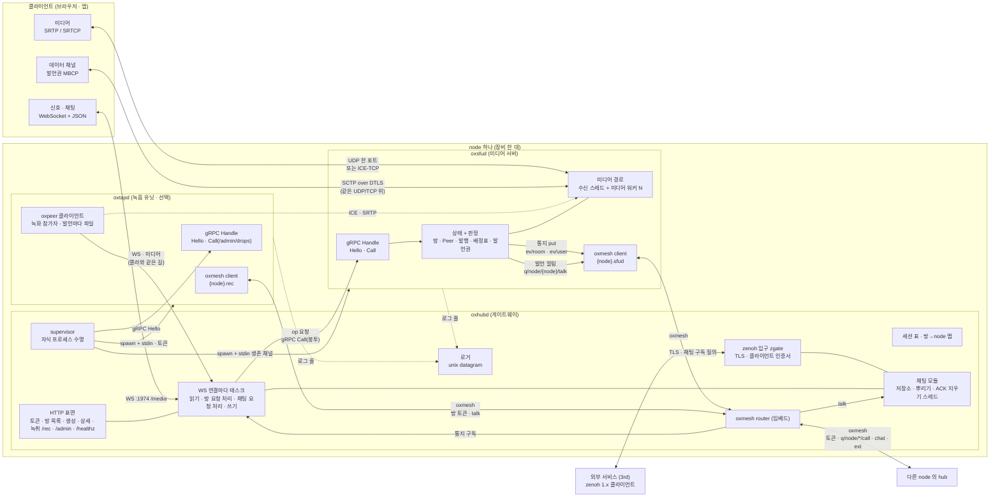

| 통로 | 양쪽 | 실어 나르는 것 | 형식 |
|---|---|---|---|
| WebSocket | 클라 ↔ hub | 요청 · 응답 · 통지 · 채팅 | 8바이트 머리(ver · flags · op · pid) + JSON 몸통 (`oxsig/src/frame.rs`) |
| HTTP | 클라 ↔ hub | 토큰 발급 · 방 목록 · 생성 · 상세 · 녹취 내려받기(`{base}/rec/{space_id}/{file}`), 운영 `/admin` · `/healthz` | REST (`oxhubd/src/ops/http.rs`) |
| gRPC `Handle` | hub → 같은 node 의 sfud | `Hello`(기동 확인 · epoch) · `Call`(op 요청 봉투 하나 = 판정 하나) | `crates/common/proto/handle.proto` · 봉투 `common/src/envelope.rs` |
| gRPC `Handle` | hub → 같은 node 의 녹음 유닛 | `Hello`(준비 신호) · `Call`(`/admin/drops` 만) — 미디어 서버 길과 섞지 않는다 | 같은 proto |
| 버스 `ev/room/{방}` · `ev/user/{사용자}` | sfud → hub | 방 통지 · 개인 통지 | `Notice` 봉투 |
| 버스 토큰 | node 사이 | node · 방 · 세션 · 3rd 연결(`ext/{계정}/{node}/{연결}`)이 어디 살아 있는지 | 키에 모든 정보를 적는다 (`common/src/keyspace.rs`) |
| 버스 `q/node/{node}/call` | hub → 다른 node 의 hub | 다른 node 에 있는 방으로 가는 op — 받은 hub 가 자기 sfud 를 gRPC 로 부른다 | gRPC 와 같은 봉투 |
| 버스 `q/node/{node}/talk` | sfud · 녹음 유닛 → 같은 node 의 hub | 발언 알림(시작 · 다시 허가 · 끝 · 녹취 파일) — hub 채팅이 발언 기록으로 남긴다 | `common/src/talk.rs` `Report` |
| 버스 `q/node/{node}/chat` · `ext` | hub → 다른 node 의 hub | 채팅 메시지 뿌리기 · 3rd 연결이 붙은 node 로 넘기기 | `chat::Deliver` · `zgate::send::ExtDeliver` |
| zenoh 입구 | 3rd ↔ hub | hub 가 3rd 의 계정 키(`pub/v1/chat/sub/{계정}`) queryable 에 채팅을 질의로 보낸다(첫 Reply = ACK) | TLS(클라이언트 인증서 첫 CN = 계정) 위 zenoh 1.x wire — 버스 그물에는 들이지 않는다 (`chat/zgate`) |
| stdin 생존 채널 | hub → sfud · 녹음 유닛 | 부모가 죽으면 stdin 이 닫혀 자식도 끝난다 | 파이프 |
| unix datagram | sfud · 녹음 유닛 → hub 로거 | 로그 한 줄씩 | logfmt 줄 |
| UDP 한 포트 | 클라 ↔ sfud | STUN · DTLS · SRTP · SRTCP 를 첫 바이트로 가른다 | RFC 7983 식 demux |
| ICE-TCP | 클라 ↔ sfud | UDP 와 같은 것을 TCP 위로 | RFC 4571 (2바이트 길이 접두) |

- ★sfud 와 녹음 유닛은 **자기 node 의 hub 하나에만** 붙는다. 버스 client 는 둘이 같이 쓰는 `common/src/bus.rs` 하나이고(이름 `{node}.{role}`), oxmesh 형은 그 파일과 hub 의 `bus/` 밖으로 나가지 않는다. node 안은 gRPC 하나, node 사이는 전부 버스다 — 다른 node 의 sfud 와 직접 말하는 길이 없다(세션 · 배치를 든 hub 가 관문).
- 녹음 유닛은 버스로 그 node 의 방 토큰을 지켜보다가, 방이 새로 서면 로컬 hub 의 방 상세(`GET /rooms/{방}`)를 읽어 녹음하기로 한 방이면 들어가고, 방 토큰이 사라지면 나온다(`oxtapd/src/main.rs` `discover`).

---

## 2. sfud 안의 스레드 구성

sfud 안에는 일하는 무리가 셋 있다. 미디어는 tokio 런타임을 타지 않고, 전용 OS 스레드에서 돈다(`fwd/rt.rs`).

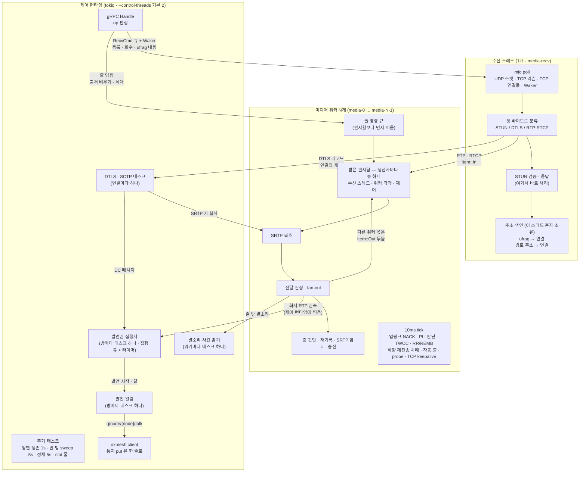

**스레드 수**

| 무리 | 개수 | 인자 | 하는 일 |
|---|---|---|---|
| 수신 스레드 | 1 | — | 모든 수신 소켓을 한 곳에서 기다리고, 분류해서 넘긴다. STUN 은 직접 답한다. |
| 미디어 워커 | N (기본: 코어 수 − 2, 최소 1 · ★macOS 는 2 를 넘지 않는다) | `--media-workers` | 복호 · 전달 · 암호 · 송신, 그리고 주기 RTCP(PLI 판단 · 하향 재전송 차례 포함) |
| 제어 런타임 | 기본 2 | `--control-threads` | gRPC op 판정, DTLS · SCTP, 발언권 집행, 발언 알림, 주기 정리, 버스 |

- macOS 상한은 실측 때문이다 — 워커를 늘려도 처리량이 그대로이고 코어만 더 쓴다([11장](#11-알려진-한계실측)).

**연결 고정(affinity)** — 연결(전송 객체) 하나는 생길 때 워커 하나에 묶이고(`fwd/rt.rs` `Media::pick_worker` — 발행 연결과 구독 연결을 따로 세어 덜 찬 워커로), 그 연결의 복호 · 암호 · 주기 RTCP 는 그 워커만 한다. 덕분에 연결마다 있는 SRTP 문맥 락은 늘 한 스레드만 잡아서 경합이 없다. 구독 줄(다운링크 m-line)의 재기록기 출처 · 실린 트랙 · 시뮬캐스트 층 상태도 그 줄 연결의 워커만 바꾼다 — 제어 쪽은 「줄 명령」을 그 워커에 넘길 뿐이다([3장](#3-데이터-공유-지점)).

**잠과 깨움** — 워커는 바퀴마다 줄 명령 큐부터 비우고 편지함을 돈다. 둘 다 비면 64번 돌며 기다리다가 「잠듦」 표시를 세우고 `park_timeout` 으로 잔다 — 길이는 5ms 와 다음 probe 시각 중 짧은 쪽이다(`fwd/mod.rs` `worker_loop` · `Worker.probe_at`). 넣는 쪽은 그 표시가 서 있을 때만 `unpark` 한다. 수신 스레드나 워커가 끝나면 프로세스를 `exit(70)` 으로 내리고, 제어 런타임이 10초 멎으면 자가 감시가 진단 줄을 남기고 로그를 비운 뒤 끝낸다(`main.rs` `self_watch`) — 반쪽 상태로 살지 않고, supervisor 가 다시 띄운다.

**말소리 사건** — 줄을 얻지 못한 음성 발행(m-line 상한 밖)에서 말소리가 이어지면 워커가 워커마다 둔 채널(256칸 · 차면 `voice_event_drop`)로 제어 런타임에 알리고, 받는 태스크가 그 방 배정표를 다시 맞춘다(`fwd/mod.rs` `voice` · `ops/media.rs` `voice`).

---

## 3. 데이터 공유 지점

한 데이터를 여러 스레드가 만지는 곳과, 거기서 쓰는 방법이다. 원칙은 「매 패킷 읽는 것은 락 없이(RCU · 원자값), 상태는 표마다 제 락, 넘기기는 큐로, 패킷 길의 상태는 주인 워커 하나가」이다.

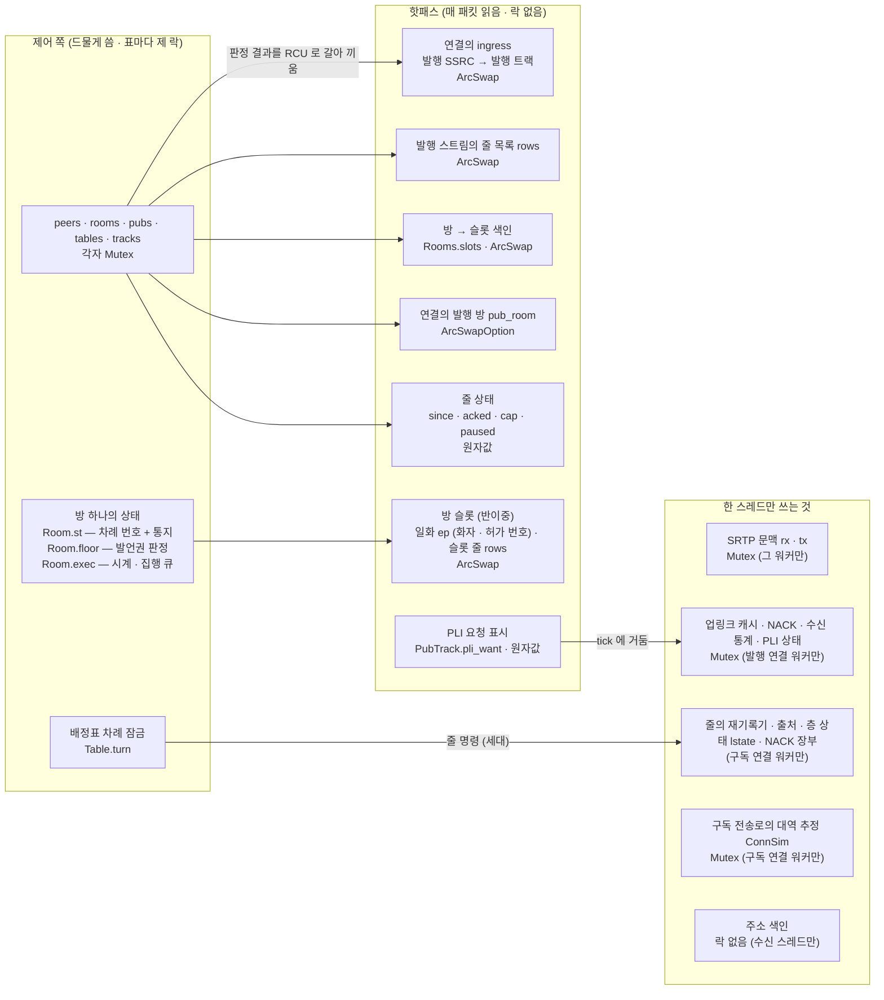

| 공유 지점 | 쓰는 쪽 | 읽는 쪽 | 기법 |
|---|---|---|---|
| 프로세스 상태(`ops/mod.rs` `Sfu` — peers · rooms · pubs · tables · tracks) | gRPC op · 정리 태스크 | 같은 쪽 | 표마다 `Mutex`. 전역 락 하나가 없다 |
| 방 상태 `Room.st`(인원 · 차례 번호 `seq`) | 방을 바꾸는 op | 같은 쪽 | `Mutex` — ★차례 번호를 올리는 것과 방 통지를 버스 줄에 넣는 것이 같은 락 안이다(`room/mod.rs` `bump_and_send`) · 방의 `seq` 차례 = 통지 차례 |
| 발언권 `Room.floor` · 시계 `Room.exec.clock` | DC 메시지 · 방 타이머 · 화자 RTP 관측 | 같은 쪽 | `Mutex` — 판정과 집행 큐에 넣기는 락 안, 집행(슬롯 교체 · DC 송신 · PLI)은 방 집행자 태스크가 큐 차례대로(`ops/floor.rs` `run` · `room_task`) |
| 방 → 슬롯 색인 `Rooms.slots` | 방 집합에 넣기 · 빼기 | 워커(반이중 매 패킷) | `ArcSwap<HashMap>` — 방 집합 잠금 안에서 통째로 갈아 끼운다(`room/mod.rs` `Rooms::insert` · `remove`) |
| 연결의 `ingress`(발행 SSRC → 발행 트랙) | 발행 · 시뮬캐스트 rid 학습 | 워커(매 패킷) | `ArcSwap` RCU — 통째로 복사해 바꿔 끼운다 |
| 발행 스트림 `rows`(받는 줄 목록) | 배정표 동기화 | 워커 fan-out | `ArcSwap<Vec<Arc<DownRow>>>` |
| 방 슬롯 `ep` · `rows`(반이중) | 발언권 집행 · 배정표 동기화 | 워커 fan-out | `ArcSwap` — 일화(`Episode` — 화자 · 일화 번호 · 허가 번호 · 첫/마지막 RTP 시각)를 통째로 바꿔 끼운다(`fwd/mod.rs` `SlotFan`) |
| 연결의 `pub_room`(발행 방) | 소속 바꿈 | 워커(매 패킷 방 결정) | `ArcSwapOption` |
| 줄의 `since` · `acked` · `cap` · `paused` · `priority` 등 | 제어 · 워커 | 워커 | 원자값 — 줄은 `since ≤ acked`(클라가 그 배정표를 확인한 뒤)일 때만 열린다 |
| 줄 명령(`fwd/mod.rs` `RowCmds`) | 배정표 동기화(`ops/media.rs` `apply_changes` → `post_row`) | 그 줄 연결의 워커 | 워커마다 한도 없는 큐(버리지 않음) — 재기록기 출처 비우기 · 층 상태 리셋 · 적용 세대 `applied` 올리기. 세대가 오르는 명령만 적용하고, 묶음 항목은 판단 때 세대와 `applied` 가 다르면 버린다(`row_stale`) |
| 배정표 차례(`sub/mod.rs` `Table.turn`) | 재배정 · 회수 | 같은 쪽 | 배정표마다 `Mutex<()>` — 재료 셈 · 판정 · 줄 목록 · 통지가 끼어듦 없이 한 차례에 |
| 줄의 시뮬캐스트 층 상태 `lstate` · 시간 층 `tsel` | 그 줄 연결의 워커 | 같은 워커 | 원자값 한 워드씩이지만 주인은 워커 하나(`sim::admit` · `temporal_keep`) |
| PLI 요청(`PubTrack.pli_want`) | 누구나(제어 · 다른 워커 · PLI burst 타이머) | 발행 연결의 워커 | 원자값 비트 OR(사유 아홉) — 발행 워커 tick 이 `swap(0)` 으로 거두어 판단한다(`rtcp/mod.rs` `request_pli` · `pli_tick`) |
| SRTP 문맥(`srtp_rx` · `srtp_tx`) | 그 연결의 워커 | 같은 워커 | `Mutex` 이지만 한 스레드만 잡는다(경합 없음). 설치는 DTLS 태스크가 |
| 업링크 `recv` · `nack` · `cache` · `pli` | 발행 연결의 워커 | 같은 워커, stat 줄 | `Mutex` |
| 줄의 재기록기 `rw` · 하향 NACK 장부 `nack` | 구독 연결의 워커 | 같은 워커 | `Mutex`(알고 두는 비용 — 매 패킷) |
| 구독 전송로의 대역 추정(`tr.rtc.sim` — `ConnSim`) | 구독 연결의 워커(tick · TWCC 피드백 · 송신 기록) | 같은 워커 | `Mutex` |
| 주소 색인(ufrag · 경로 주소) | 수신 스레드 | 수신 스레드 | 락 없음. 제어 쪽 변경은 `RecvCmd` 큐 + mio `Waker` 로 넘긴다 |
| TCP 송신 버퍼 | 워커(보냄) | — | 연결마다 `Mutex<Vec<u8>>`(64KB) |
| 워커 편지함 | 생산자 하나씩 | 그 워커 | `crossbeam::ArrayQueue`(락 없는 고정 크기 큐) — 차면 기다리지 않고 버리고 센다 |
| 패킷 몸통 | 업링크 워커 | 여러 다운링크 워커 | `bytes::Bytes` 참조 수 공유 — 워커 사이에 몸통을 복사하지 않는다 |
| 버림 계수(`/admin/drops`) | 누구나 | 운영 | 원자 카운터 — 사유는 닫힌 목록(`ops/mod.rs` `DROP_NAMES`) |
| 서버 체류 시간(`/admin/transit`) | 다운링크 송신을 마친 워커 | 운영 | 워커마다 구간 여덟 + 합(128B 정렬 — 워커끼리 캐시 줄을 같이 쓰지 않는다) · 받은 시각(μs)은 수신 스레드가 편지함 항목에 실어 보낸다 |

**편지함 구성** — 워커마다 큐가 「워커 수 + 2」개 있다: 수신 스레드에서 오는 큐(4,096), 다른 워커 각각에서 오는 큐(1,024), 제어 쪽에서 오는 큐(4,096). 생산자가 하나뿐이라 넣는 쪽끼리 경합하지 않는다. ★한도는 칸 수보다 먼저 **워커에 쌓인 패킷 수**로 건다(기본 6,000 · `--worker-queue-packets`) — `Out` 하나가 줄 여럿 몫을 품기 때문이다. 줄 명령 큐는 이 한도 밖이다. 항목은 세 가지다(`fwd/rt.rs` `Item`).

| 항목 | 누가 넣나 | 내용 |
|---|---|---|
| `In` | 수신 스레드 | 암호화된 RTP/RTCP 하나 + 받은 시각 |
| `Out` | 업링크 워커 | 평문 RTP 하나 + 이 워커가 보낼 줄 목록(줄마다 판단 때 세대 · 목적지 워커마다 묶음) + 반이중이면 슬롯과 일화 번호 |
| `Ctl` | 발행 연결의 워커 | 번역할 SR 하나(`Ctl::Sr`) — 다른 워커에 묶인 구독 줄 몫 |

- PLI 는 더 이상 항목으로 넘기지 않는다(위 「PLI 요청」 행). 무전 슬롯의 예열 CN · 해제 무음은 걷어냈다 — 서버가 지은 프레임이 화자 RTP 와 같은 SSRC · seq 공간을 나눠 쓰며 링 차례에 따라 화자 패킷 사이에 끼었기 때문이다.

---

## 4. 수신에서 송신까지 — UDP RTP

발행자 A 의 영상 RTP 하나가 구독자 여럿에게 나가는 길이다. A 의 연결은 워커 0, 구독자 B 는 워커 0, 구독자 C · D 는 워커 1 에 묶여 있다고 하자.

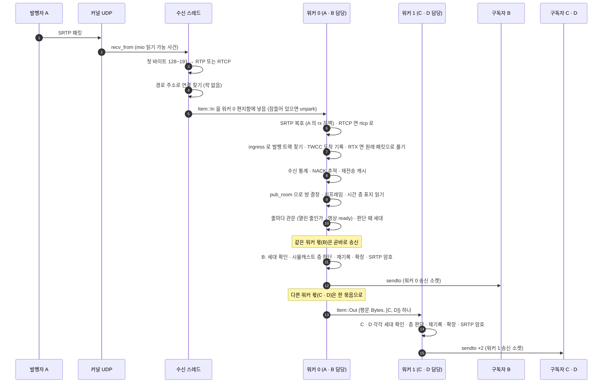

차례대로 보면 이렇다.

1. **받기(수신 스레드)** — `fwd/rt.rs` `recv_loop`. mio 로 UDP 소켓 · TCP 리슨 · TCP 연결 · Waker 를 함께 기다린다. 읽을 것이 있으면 `WouldBlock` 이 날 때까지 다 읽는다.
2. **분류** — `datagram`: 첫 바이트 0~3 = STUN, 20~63 = DTLS, 128~191 = RTP/RTCP, 그 밖은 버리고 센다(`demux_unknown`).
3. **주인 찾기** — 경로 주소(UDP 면 보낸 주소, TCP 면 연결 번호)로 연결을 찾는다. 모르는 주소면 버리고 센다(`rtp_unknown_path`). 주소는 STUN 검사가 통과할 때 색인에 오른다(5장).
4. **넘기기** — 그 연결의 워커 편지함에 `In` 을 넣는다. 2,048바이트가 넘으면 버린다(`oversize`), 편지함이 차면 버린다(`ingress_queue_full`).
5. **복호** — 워커가 `fwd/mod.rs` `ingress` 에서 SRTP 를 풀고 RTP 면 `on_rtp`, RTCP 면 `rtcp::on_rtcp` 로(둘째 바이트 192~223 이 RTCP).
6. **업링크 처리** — `on_rtp`: 연결의 `ingress` 에서 발행 SSRC 로 발행 트랙을 찾는다. 처음 보는 SSRC 면 rid · mid 확장으로 배워 발행 트랙을 만들고(시뮬캐스트 — `pub/mod.rs` `learn` · rid 는 고정 번호 `l`=0 · `m`=1 · `h`=2), 모르는 rid 면 `rid_unknown`, 못 배우면 `rtp_unknown_ssrc` 로 버린다. RTX 는 원래 패킷으로 풀되, 결손 장부에 있던 seq 이거나 새 seq 의 복원본만 흘린다(이미 받은 seq 는 `rtx_seen`, 패딩만 든 RTX 는 `rtx_padding`). 그다음 수신 통계 · NACK 추적 · 재전송 캐시(`on_ingress`).
7. **어디로 보낼지(fan-out)** — `forward`. 키프레임 판정과 VP8 picture ID · 시간 층 표지(VP8 은 payload, H264 는 dependency-descriptor 확장 — `sim/temporal.rs` · `sim/dd.rs`)를 여기서 한 번 읽어 패킷에 싣는다. 그다음 트랙의 `duplex` 하나로 갈린다.
   - 전이중(화상회의): 발행 스트림 `rows` 의 줄마다 관문을 본다 — 열린 줄인가(`row_gate` — 클라가 확인한 배정표의 줄) · 영상 ready 관문(`ready_gate`). 시뮬캐스트 층은 여기서 거르지 않고 송신 쪽이 본다(9번).
   - 반이중(무전): 방 슬롯의 지금 일화가 이 발행자일 때만 슬롯 줄 전부로 보낸다(화자 본인은 뺀다). 아니면 버린다(`prefan_gate` · 놓기 전에 받은 꼬리는 `pre_release_tail`). [8장](#8-반이중무전-경로와-발언권) 참고.
8. **목적지 워커마다 묶음** — 고른 줄을 그 줄 연결의 워커로 나눠, 같은 워커 몫이면 곧바로 송신하고 다른 워커 몫은 `Out` 하나로 넘긴다(못 넣으면 `egress_queue_full`). 패킷 하나당 다른 워커로 가는 항목은 「워커 수 − 1」개를 넘지 않는다. 받는 워커는 반이중 묶음의 일화가 이미 바뀌었으면 통째로 버린다(`slot_stale`).
9. **송신(줄마다)** — `deliver` → `send_down`:
   - 세대 확인: 판단 때 세대가 그 워커가 적용한 줄 명령 세대와 다르면 버린다(`row_stale`).
   - 시뮬캐스트 층(`sim::admit`): 그 줄의 원하는 층(`min(cap, auto_cap)`)을 목표로 맞추고, 목표 층 키프레임이 와야 층을 바꾼다. 다른 층 패킷은 송신 버퍼 · 재기록기 잠금에 닿지 않고 버린다.
   - 재기록기(`fwd/core.rs` `Rewriter`): 출처(발행 트랙)가 바뀌면 영상은 키프레임부터만 받는다(아니면 버리고 `await_keyframe` · 키프레임 요청 표시). seq · timestamp · VP8 picture ID · TL0PICIDX 는 출처가 바뀔 때 한 번 정한 오프셋 하나로 이어 붙인다(스칼라 오프셋). 시간 층(`sim::temporal_keep`)으로 뺀 패킷은 한 출처 안의 「뺀 런」으로 기록해 seq · picture ID 구멍을 닫는다. 전환 경계 앞 패킷은 버린다(`pre_boundary`).
   - PT 를 줄의 PT 로, SSRC 를 줄의 다운링크 SSRC 로 다시 짓는다. 출처 표지를 켠 연결이면 CSRC 에 발행 트랙의 출처 번호를 싣는다.
   - 확장 다시 짓기(`sub/ext.rs`): 들어온 확장은 버리고 구독자 번호표로 mid(줄의 mid) · 음량 · abs-send-time · 서버 TWCC 번호만 새로 쓴다.
   - SRTP 암호(그 연결의 tx 문맥) → UDP 면 이 워커 송신 소켓으로 `sendto`, TCP 면 길이 접두를 붙여 연결로. 보낸 크기 · 시각은 그 전송로의 대역 추정에 넘긴다(`rtcp::sent_twcc`).

---

## 5. 연결 수립 — STUN · DTLS · SRTP · SCTP

서버는 ICE-lite 다(후보를 모으지 않고 검사에 답만 한다). 연결 하나 = 자격(ufrag · pwd) 한 벌 = 전송 객체 하나다. 사람마다 미디어 서버마다 Peer 하나가 있고, Peer 는 발행 연결 · 구독 연결을 든다(`1pc` 면 둘이 같은 연결).

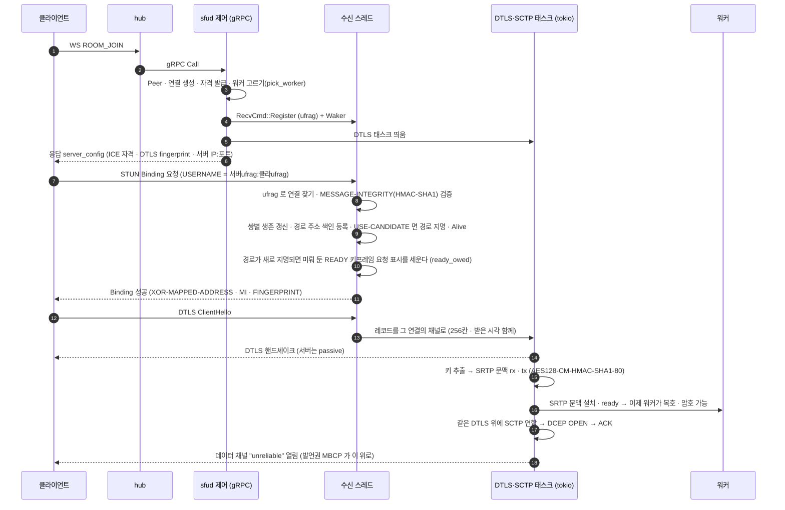

- **STUN 은 수신 스레드가 직접 끝낸다**(`fwd/rt.rs` `datagram` · 해석과 검증은 `link/stun.rs`). MESSAGE-INTEGRITY 검증을 통과한 검사만 상태를 바꾼다. 못 통과하면 버리고 센다(`stun_unverified`).
- **경로 = 지명이 실린, 검증된 검사가 마지막으로 온 쌍.** 주소가 바뀌면(NAT 재바인딩 · 망 전환) 새 검사가 오는 대로 경로를 옮긴다. ICE restart 로 새 ufrag 가 오면 옛 ufrag 는 새 ufrag 의 첫 검증 검사 때 내린다(`link/creds.rs`). 상태가 바뀌면 사유(`ice_restart_checked` · `nominated_new_pair` · `nominated`)와 머문 시간을 실은 전이 줄을 남긴다(`ops::peer_state_changed`).
- **입장 첫 키프레임** — `READY` 때의 키프레임 요청은 구독 전송로의 경로가 선 뒤에만 낸다. 경로가 아직 없으면 연결에 적어 두었다가(`Transport.ready_owed`) 지명 때 낸다(`ops/media.rs` `ready_owed`) — 경로가 서기 전에 온 키프레임이 사라지지 않게 하려는 것이다.
- **생존** — 제어 쪽 1초 tick(`ops/timers.rs`)이 쌍별 생존을 보고, 경로가 만료되면 `Alive → Suspect` 로 바꾸고 사용자에게 `LINK_EVENT` 통지를 보낸다. USE-CANDIDATE 가 실린 검사가 다시 오면 `Alive` 로 돌아온다.
- **DTLS 는 tokio 태스크**(`link/dtls.rs`). 수신 스레드는 레코드를 연결의 유한 채널(256칸)로 던지기만 하고, 차면 버리고 센다(`dtls_in_full`). 읽기 버퍼보다 큰 레코드는 잘라 넘기지 않고 오류로 끝낸다(`oversize`). 핸드셰이크가 끝나면 SRTP 문맥을 연결에 꽂고, 같은 DTLS 위에 SCTP(`sctp-proto`)를 올려 데이터 채널을 연다. 레코드 하나 = SCTP 패킷 하나 · 재전송 한도 없음.

---

## 6. TCP 경로 — ICE-TCP

UDP 가 막힌 망을 위해 TCP passive 후보를 낸다(`--tcp-port`). 미디어 바이트는 UDP 와 같고, TCP 위에 RFC 4571 틀(2바이트 길이 접두)을 씌울 뿐이다(`link/tcp.rs`).

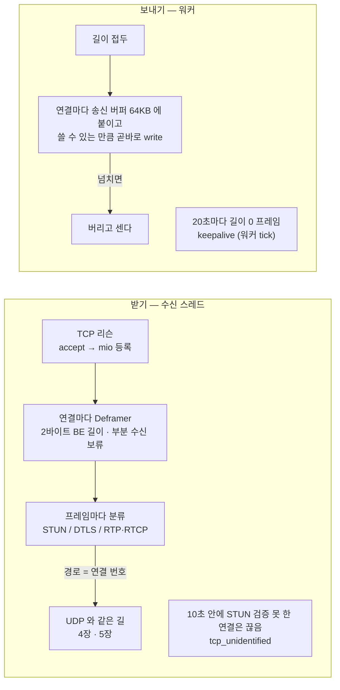

- TCP 연결도 수신 스레드가 mio 로 함께 기다린다. 연결 번호가 mio 토큰이다.
- 받은 프레임은 UDP 데이터그램과 똑같이 `datagram` 으로 들어간다. 경로 주소가 「연결 번호」라는 것만 다르다.
- 보낼 때 다 못 쓴 바이트는 그 연결의 송신 버퍼(64KB)에 남아 다음 송신 때 먼저 나간다. 버퍼가 넘치면 기다리지 않고 버린다(실시간 우선).

---

## 7. RTCP — 서버가 두 세션의 끝점

서버는 RTCP 를 그냥 넘겨주지 않는다. 발행자 쪽 세션과 구독자 쪽 세션을 각각 끝내고, 필요한 것만 번역해 반대쪽에 낸다(`rtcp/mod.rs`).

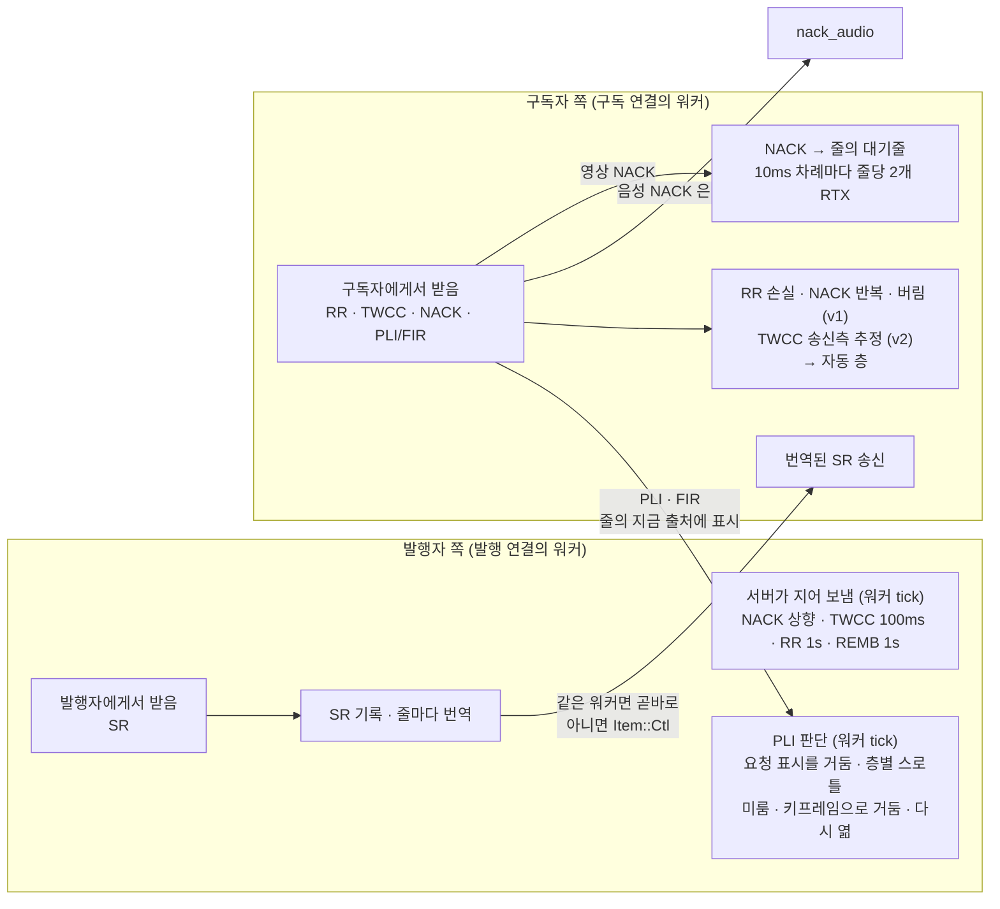

| 방향 | 무엇 | 서버가 하는 일 | 어디서 |
|---|---|---|---|
| 발행자 → 서버 | SR | 기록하고, 그 출처를 실은 줄마다 SSRC · timestamp 오프셋을 반영해 번역해서 보낸다 | 받기: 발행 워커 → 보내기: 같은 워커면 곧바로, 아니면 `Item::Ctl` 로 그 구독 워커 |
| 서버 → 발행자 | NACK | 업링크 손실을 서버가 직접 감지해 요청(재시도 200ms · 포기 1s · 포기하면 PLI 요청 표시) | 발행 워커 tick |
| 서버 → 발행자 | TWCC | 업링크 도착 시각을 모아 피드백(발행자 쪽 대역 추정용) | 100ms |
| 서버 → 발행자 | RR · REMB | 수신 보고와 상한 비트레이트(정책 `media.ingress_remb_max_bps` — 클라 인코더 상한 `media.max_bitrate_bps` 와 따로 둔 키) | 1s |
| 서버 → 발행자 | PLI | 요청은 발행 트랙의 표시 비트(`PubTrack.pli_want` — 구독자 · 층 · 채택 · 재시도 · 출처 전환 · `READY` · NACK 포기 · burst 등)로만 남고, 발행 워커가 RTCP tick 에서 거두어 판단한다(`pli_tick` → 순수 함수 `pli_decide`). 층별 스로틀(`media.pli_throttle_low_ms` · `high_ms`) 안이면 구독자 요청은 버리고(`pli_throttled`), 서버가 내는 요청(인프라)은 미뤘다가 그 층 키프레임이 오면 거둔다(`pli_answered` — 버림이 아니다). 마지막 PLI 뒤 그 층 키프레임이 왔고 엔진 바닥 300ms + 여유(`media.pli_reopen_margin_ms`)가 지났으면 인프라 요청에 한해 창을 다시 연다. 반이중에서 화자가 아닌 발행자에게는 보내지 않는다(`pli_unbound`) | 발행 워커 tick |
| 구독자 → 서버 | NACK | 영상만. 줄의 NACK 장부(`rtcp/nack.rs` `Ledger`) 대기줄에 들어온 차례로 넣고(대기 중인 seq 는 다시 안 넣음), 비어 있었으면 그 자리에서, 남은 것은 10ms 차례마다 줄당 2개씩 꺼내 재전송 캐시에서 RTX 로 보낸다(줄 SSRC 로 줄을 찾고 출처 seq 로 되돌려 찾음). 꺼낼 때 판정한다 — 구독자 PLI 뒤 그 줄 다음 키프레임까지는 멈춤(`rtx_wait_key`) · 나이 2s 넘으면(`rtx_old`) · 100ms 안 반복 · seq 마다 3번 상한(`rtx_repeat`). 반이중은 일화가 바뀌면 닫는다(`rtx_gate`). 음성은 버린다 | 구독 워커 (`on_nack` · `rtx_turn` · `drain_rtx`) |
| 구독자 → 서버 | PLI · FIR | 그 줄 장부를 키프레임 기다림으로 두고, 줄의 지금 출처 발행 트랙에 구독자 PLI 표시를 세운다 | 구독 워커 → (표시) → 발행 워커 |
| 구독자 → 서버 | RR · TWCC | 자동 층 판단 입력. RR 은 손실과 왕복 시간(서버가 보낸 SR 기준). 구독자가 보낸 REMB 는 쓰지 않는다 | 구독 워커 |

**자동 층** — 정책 `media.auto_layer`(off · v1 · v2, 코드 기본 off)가 고른다. 판단은 구독 전송로(연결) 하나마다 그 연결의 워커 tick 에서 돈다(`sim/mod.rs` `drive`).

- v1 은 1초마다 RR 손실 · 반복 NACK · 버림 수를 신호로 순수 함수(`sim/core.rs` `Policy::tick`)가 층을 정한다.
- v2 는 구독 전송로마다 대역 추정 한 덩이를 든다(`sim/bwe.rs` `Congestion` — mediasoup 3.32.2 BWE 를 옮긴 것: 처리량 · 여유 구간(ALR) · 탐색 판단 · 묶음 쏘기 · 묶음 실측 · 손실 기반 · 목표 속도 · 지연 기반(trendline · AIMD)). 서버가 구독자에게 보내는 모든 패킷에 서버 자신의 TWCC 번호를 찍으므로, 구독자가 돌려준 TWCC 피드백으로 서버 → 구독자 구간을 직접 추정한다. 목표 속도 한 값을 층 배분(`sim/alloc.rs` — mediasoup `BitrateAllocator` 꼴, 위로 오를 때만 그 점 값의 1.2배)이 줄마다 「공간 × 시간」 점에 나눈다. 탐색은 RTX 패딩 묶음으로 쏘고(OSN 없이 패딩 바이트만), 워커는 다음 탐색 시각에 맞춰 일찍 깬다. 그 구독자에게서 TWCC 피드백이 없으면 그 연결만 v1 로 판단한다.
- 시뮬캐스트는 공간 층 셋(`l` · `m` · `h`)과 층마다 시간 층(TID 0 ~ 2)이다. 배분 점을 고르는 방식은 정책 `media.layer_strategy`(`all_points` · `lowest_temporal` 기본 · `halve_wait`, 기동 때 한 번)가 정한다(`sim/strategy.rs`). 시간 층은 프레임 단위로 고른다 — 내리기는 다음 프레임, 올리기는 전환점(VP8 `Y` 비트 · DD 의 전환점 표지) 프레임, 키프레임은 목표로(`sim/temporal.rs`).

---

## 8. 반이중(무전) 경로와 발언권

무전(PTT)은 「방마다 오디오 · 비디오 슬롯 하나씩」을 두고, 발언권을 쥔 사람의 RTP 만 그 슬롯으로 흘려보낸다. 구독자는 화자가 바뀌어도 m-line 하나로 계속 받는다(서버가 SSRC · seq · ts 를 이어 붙인다).

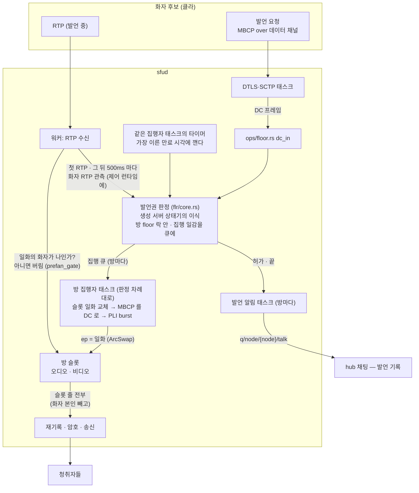

- 발언권 메시지(MBCP)는 WebSocket 이 아니라 **데이터 채널**로 오간다 — DC 프레임 4바이트 머리(ver · svc · len · `oxsig/src/dc.rs`) 안에 MBCP(`oxsig/src/floor.rs` — 머리 + TLV). 허가(Granted) · 발언 중(Taken) 알림에는 발언 id(TLV `TALK`)가 실리고, 발언 중 알림에는 화자의 출처 번호도 실린다.
- 판정은 순수 로직(`flr/core.rs`)이다. 입구(`ops/floor.rs` `run` — DC 메시지 · 타이머 · RTP 관측)는 방 floor 락과 시계 락 안에서 판정하고, 결과(보낼 MBCP · 슬롯 결합/해제 효과 · 화자 영상 트랙 · 코덱 일치 여부)를 그 방의 집행 큐에 넣는다. 빈 판정은 넣지 않는다.
- **방마다 집행자 하나** — 방이 생길 때 그 방의 태스크 하나(`room_task`)가 뜨고(지음 → 돎 을 이긴 쪽만), 큐를 먼저 비우며 판정 차례대로 집행한 뒤 가장 이른 타이머 만료 시각까지 잔다(`tokio::select!` `biased`). 집행 차례는 슬롯 일화 교체 → MBCP 송신 → PLI burst(0 · 500 · 1,500ms 뒤 그 일화가 그대로면 PLI 요청 표시)이다. 효과는 판정 번호(`grant_no`)를 들고, 슬롯은 본 최댓값보다 큰 결합만 받는다(`flr/bind.rs` — 어긋나면 `exec_order`).
- 워커는 매 패킷 슬롯의 일화(`Episode`)를 원자적으로 읽어 「이 발행자가 지금 화자인가」만 본다 — 락이 없다. 일화는 화자 · 일화 번호 · 허가 번호 · 첫/마지막 RTP 시각을 함께 든다. 화자가 아닌 사람의 RTP 는 버리되, 500ms 에 한 번 발언권 쪽에 알린다(막힌 RTP). 놓기(RELEASE)를 받기 전에 수신된 꼬리 RTP 는 위반으로 치지 않는다(`pre_release_tail`).
- 슬롯 출처의 키는 (트랙 · 일화)이다. 그래서 같은 화자를 다시 허가해도 출처 전환으로 다루어, 재기록기가 오프셋을 다시 잡고 쉰 시간만큼 ts 를 벌린다(`fwd/core.rs` `episode_src`). 영상은 키프레임이 올 때까지 기다리고 그동안 PLI 를 요청한다.

**발언 기록 · 녹취** — 허가 하나가 발언(`talk`) 하나다(`flr/talk.rs` — `deadline` = 허가 + T1 + T2 + T3).

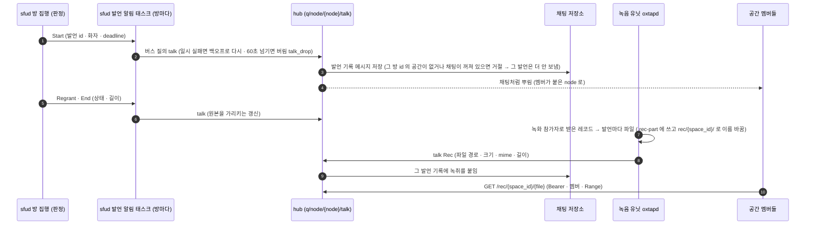

- sfud 쪽: 방 집행이 판정 때 발언 시작 · 다시 허가 · 끝을 방의 알림 줄에 넣고, 방마다 태스크 하나(`talk_reporter`)가 한 줄로 hub 에 묻는다(`ops/floor.rs` · `common/src/talk.rs` `deliver`).
- 녹음 유닛 쪽: oxpeer 클라이언트의 레코드 흐름을 발언 단위 파이프라인에 밀어 넣고, 파일을 닫으면 `Rec` 알림을 같은 길로 보낸다. 영상 키프레임이 필요하면 SDK 로 요청한다. 하루 한 번 보관 기간(`--rec-keep-days`)을 넘긴 녹취를 지운다(`oxtapd/src/lib.rs`).
- hub 쪽: `ses::talk` → `chat::Chat::talk` 가 채팅 저장소의 같은 저장 길목으로 남기고(보낸 세션 없음), 새로 쓴 것이면 채팅 뿌리기와 같은 길로 보낸다([9장](#9-신호-흐름--op-하나의-왕복)).

---

## 9. 신호 흐름 — op 하나의 왕복

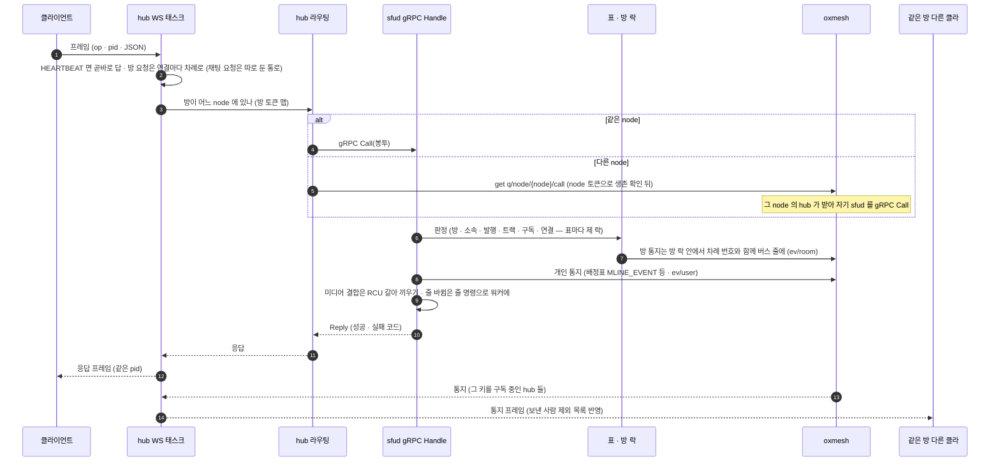

- sfud 가 처리하는 op: 입장 · 퇴장 · 트랙 발행 · ready · 층 구독 · 트랙 설정 · ICE restart · 소속(`ops/handle.rs` `op`). 그 밖에 세션 폐기 · RESUME · 방 생성 · 상세 · 목록 · 운영 · 로그 수준이 같은 봉투로 온다(`dispatch`). 문자 메시지(`MESSAGE`)는 더 이상 sfud 로 가지 않는다 — hub 채팅이 끝낸다(아래).
- WS 연결 하나에는 태스크가 넷 있다 — 읽기, 방 요청 처리(연결 순서대로), 채팅 요청 처리(따로 둔 통로에서 연결 순서대로), 쓰기(`oxhubd/src/ses/conn.rs` `serve`). 서버 통지는 쓰기 태스크의 4단 큐와 ACK 창으로 나간다.
- 통지 차례 — sfud 는 통지를 낸 차례 그대로 버스에 한 줄로 넣는다(`bus/mod.rs` — 데이터 레인, 차면 버리고 센다 `bus_ev_drop`). 방 통지는 방 락 안에서 차례 번호(`seq`)를 올리며 넣으므로 방 안의 차례가 통지 차례다. ★hub 는 방 키와 사용자 키를 **따로 구독**한다(`oxhubd/src/bus/mod.rs` `interest`) — 방 통지와 개인 통지 사이의 도착 차례는 정해지지 않는다(클라 규격이 그것을 전제로 짜여 있다).
- 구독 m-line 배정은 연결마다 「배정표」(`sub/mod.rs` `Table`)가 든다. 줄은 kind 마다 상한까지 생기고 지우지 않으며(비우기만), 바뀌면 `MLINE_EVENT` 로 알린다. 클라가 확인(`READY{arev}`)한 차례 뒤의 줄만 미디어가 흐른다. 재배정 한 번(재료 셈 · 판정 · 줄 목록 · 통지)은 배정표의 차례 잠금(`Table.turn`) 하나 안에서 끝나고, 줄 바뀜은 그 줄 워커에 줄 명령으로 넘긴다(`ops/media.rs` `settle` · `apply_changes`). 배정표 차례(`arev`)는 세션마다 이어진다(Peer 를 갈아 끼워도 1 로 돌아가지 않는다).

**채팅 — hub 안 모듈** — 채팅 op 다섯(`MESSAGE` · `SPACE_HISTORY` · `SPACE_LIST` · `SPACE_VIEW` · `CATCHUP`)은 sfud 를 거치지 않는다(`oxhubd/src/chat`).

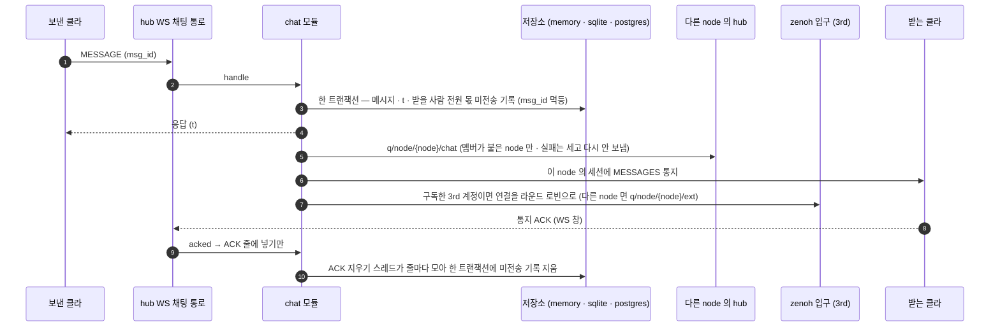

- 저장소는 `[chat] db` 값의 꼴이 고른다: `memory:` · `sqlite:<경로>` 는 SQLite 연결 하나(쓰기는 `BEGIN IMMEDIATE`), `postgres://…` 는 연결 풀(`chat/store/pg.rs` — 저장소가 쥔 2스레드 런타임에서 돈다). 저장소 호출은 `spawn_blocking` 으로 감싸 제어 태스크를 막지 않는다(`chat/mod.rs` `blocking`).
- 뿌리기 범위는 버스의 세션 토큰(`sess`)으로 본 「멤버가 붙은 node」다(`[bus] follow_sessions`, 기본 켬 — `bus/view.rs` `fanout_scope`). 받는 hub 가 제 공간 멤버 캐시로 받을 사람을 거른다.
- 통지 ACK 창이 찼을 때만, 데이터 단 줄 끝에 있는 실시간 채팅 통지에 새 메시지를 합쳐 `MESSAGES{live:true}` 하나로 보낸다(바이트 상한 안에서 · `ses/conn.rs`).
- ACK 는 멤버 몫 줄과 3rd 몫 줄을 따로 둔다(줄마다 상한). 지우는 주인은 스레드 하나(`chat-ack`)이고, 줄 하나를 골라(둘 다 있으면 번갈아) 묶음으로 지운다(`chat/acks.rs`). 보관 기간을 넘긴 미전송 기록은 주기 태스크가 지운다(`purge_loop`).
- **zenoh 입구(zgate)** — hub 의 바깥 포트 하나(`[hook] zenoh_listen` · TLS 만)가 3rd 의 zenoh 1.x 클라이언트를 직접 받는다(zenohd 없음). 클라이언트 인증서 첫 CN 이 계정이고, 연결이 제 계정 키 queryable 을 선언하면 버스 토큰 `ext/{계정}/{node}/{연결}` 을 내고 걷히거나 닫히면 거둔다. 보낼 줄은 연결마다 창 · 줄 상한 · 시간 넘김을 두고, 계정마다 가장 오래 붙은 연결이 밀린 것을 비운다(drain 주인 · `chat/zgate/plan.rs` · `send.rs`). 3rd 몫 ACK 아닌 끝은 시도 수를 올리고, 상한에서 지운다.

---

## 10. 사용한 기법 정리

| 영역 | 기법 | 왜 | 소스 |
|---|---|---|---|
| I/O | mio(kqueue · epoll) 하나로 UDP · TCP 리슨 · TCP 연결 · Waker 를 함께 기다림 | 수신 스레드 하나가 모든 소켓을 맡고 주소 색인을 혼자 쥐어 락을 없앰 | `fwd/rt.rs` `recv_loop` |
| I/O | 첫 바이트 demux (STUN · DTLS · RTP · RTCP 한 포트) | 포트 하나 · 방화벽 단순 | `fwd/rt.rs` `datagram` |
| I/O | macOS: 워커마다 송신 소켓(SO_REUSEPORT, 수신 소켓은 마지막에 bind) / 리눅스: 소켓 하나 공유 | macOS 는 한 소켓 동시 송신이 줄 서고, REUSEPORT 유니캐스트는 마지막 bind 소켓으로 받음 | `fwd/rt.rs` `start` · `bind_udp` |
| 동시성 | 연결을 워커 하나에 고정 | SRTP · 재기록기 · 수신 통계 · 대역 추정 락을 한 스레드만 잡음 | `fwd/rt.rs` `Media::pick_worker` |
| 동시성 | 생산자마다 큐(락 없는 고정 큐) + 쌓인 패킷 수 한도 | 넣는 쪽끼리 경합 없음 · 묶음 항목도 패킷 수로 셈 | `fwd/rt.rs` `Worker::push` |
| 동시성 | 목적지 워커마다 묶음 넘김 | 패킷마다 넘김 항목 ≤ 워커 수 − 1 | `fwd/mod.rs` `forward` |
| 동시성 | 줄 명령 큐 + 줄 세대 — 줄의 재기록기 출처 · 층 상태는 그 줄 워커만 씀 | 제어가 출처를 지우는 사이 워커가 그 줄로 재기록하는 겹침을 없앰 · 판단 때 세대와 적용 세대를 견줘 늦은 묶음을 버림 | `fwd/mod.rs` `RowCmds` · `post_row` · `deliver` |
| 동시성 | 잠듦 표시 + park/unpark (다음 probe 시각까지) | 일 없을 때 CPU 를 쓰지 않고, 깨우기 시스템 콜은 잘 때만 | `fwd/mod.rs` `worker_loop` |
| 동시성 | RCU(`arc-swap`) | 매 패킷 읽는 색인 · 목록 · 슬롯 일화를 락 없이 읽고, 드문 변경은 통째로 바꿔 끼움 | 곳곳 |
| 동시성 | 표마다 제 락 + 방 차례 번호와 통지를 한 락 안에서 · 배정표마다 차례 잠금 | 전역 락 없이 방 안의 통지 차례가 하나로 정해짐 · 재배정이 끼어듦 없이 한 차례 | `ops/mod.rs` `Sfu` · `room/mod.rs` `bump_and_send` · `sub/mod.rs` `Table.turn` |
| 동시성 | 발언권 판정은 순수 로직(생성 상태기의 이식) · 집행은 방마다 집행자 하나가 판정 차례대로 | 판정 차례 = 집행 차례 · 시험 · 모형 검증이 쉬움 | `flr/core.rs` · `ops/floor.rs` `run` · `room_task` |
| 동시성 | PLI 는 표시 비트 · 판단은 발행 워커 tick 의 순수 함수 | 요청이 어디서 오든 판단 자리가 하나 · 사유가 로그에 남음 | `rtcp/mod.rs` `request_pli` · `pli_decide` |
| 메모리 | `bytes::Bytes` 참조 수 공유 | 워커 사이에 패킷 몸통을 복사하지 않음 | `Item::Out` |
| 과부하 | 큐 · TCP 버퍼 · DTLS 채널이 차면 기다리지 않고 버리고 셈 | 실시간 우선, 막힘 전파 차단(`/admin/drops`) | `ops/mod.rs` `drop_count` |
| 장애 | 미디어 스레드가 끝나면 `exit(70)` · 부모 stdin 생존 채널 · 제어 런타임 자가 감시(10s) · 끝내기 전 진단 줄과 로그 비우기 | 반쪽 상태로 살지 않음, supervisor 가 다시 띄움 | `fwd/rt.rs` `start` · `main.rs` |
| 보안 | ICE-lite + STUN MESSAGE-INTEGRITY 검증 뒤에만 상태 변경 | 위조 검사로 경로를 못 바꿈 | `fwd/rt.rs` `datagram` · `link/stun.rs` |
| 암호 | DTLS passive → SRTP AES-CM-128 + HMAC-SHA1-80, 하드웨어 AES(`--cfg aes_armv8`, 실행 중 감지 · 없으면 소프트웨어) | 표준 WebRTC 호환 · ARM 에서 AES 가속 | `link/dtls.rs` · `.cargo/config.toml` |
| 전달 | 출처 전환 때 스칼라 오프셋 하나로 seq · ts · VP8 picture ID · TL0PICIDX 이어 붙이기, 영상은 키프레임부터 · 한 출처 안 뺀 런 | 구독자 디코더가 끊김 없이 이어 받음 · 시간 층으로 뺀 자리에 구멍이 없음 | `fwd/core.rs` `Rewriter` |
| 전달 | 확장 다시 짓기 + 서버 TWCC 번호 찍기 · 켠 연결만 CSRC 출처 표지 | 구독자 쪽 대역을 서버가 직접 추정 · 화자 식별 | `fwd/mod.rs` `send_down` · `sub/ext.rs` |
| 품질 | 업링크 NACK · 재전송 캐시 · 업링크 RTX 는 결손 seq 만 · 하향 RTX 는 줄마다 대기줄에서 10ms 에 2개씩(키프레임 기다림 · 나이 2s · seq 마다 3번) · PLI 층별 스로틀 + 키프레임으로 거둠 · 다시 엶 | 손실 복구 · 끊김 뒤 재전송 폭주와 키프레임 폭주 방지 | `rtcp/mod.rs` · `rtcp/nack.rs` · `pub/mod.rs` |
| 품질 | 시뮬캐스트 공간 층 셋 · 시간 층(VP8 payload · H264 DD) · 층 전략 셋 · 층 전환은 목표 층 키프레임에서만 · 자동 층 v1(손실 · NACK · 버림) / v2(구독 전송로마다 mediasoup 3.32.2 꼴 송신측 추정 · 배분 · RTX 패딩 탐색) | 층 바꿀 때 깨짐 없음 · 대역에 맞춤 | `sim/*` |
| 무전 | 방 슬롯 + 발언권(3GPP TS 24.380 판정) + 데이터 채널 MBCP · 슬롯 출처 키 = (트랙 · 일화) | 청취자는 m-line 하나로 화자 전환을 받음 · 같은 화자 재허가도 출처 전환 | `flr/*` · `ops/floor.rs` · `fwd/mod.rs` `SlotFan` |
| 무전 | 발언 알림을 방마다 한 줄로 hub 에 · 녹음 유닛은 발언마다 파일 하나(임시 자리에 쓰고 이름 바꿔 닫음) | 발언 기록과 녹취가 같은 채팅 길목에 모임 | `flr/talk.rs` · `common/src/talk.rs` · `crates/oxtapd` |
| 채팅 | hub 안 모듈 · 저장 한 트랜잭션(메시지 + 미전송 기록) · 멤버가 붙은 node 로만 뿌림 · ACK 는 줄에 넣기만, 지우기는 스레드 하나 · 혼잡할 때만 실시간 통지 묶기 | 요청 길에서 지우기 쓰기를 떼어 냄 · 재연결 뒤 따라잡기 | `oxhubd/src/chat` · `ses/conn.rs` |
| 채팅 | 3rd 구독은 zenoh 1.x wire 를 hub 가 직접 받는 입구(zgate) · 계정은 인증서 CN · 연결 위치는 버스 토큰 | 외부 서비스를 버스 그물에 들이지 않음 | `oxhubd/src/chat/zgate` |
| 분산 | 버스(oxmesh) 토큰으로 node · 방 · 세션 · 3rd 연결 위치, 통지 put, node 사이 query | 방이 어느 node 에 있든 같은 봉투로 라우팅 | `crates/oxmesh` · `oxhubd/src/bus`(router) · `common/src/bus.rs`(client — sfud · 녹음 유닛) |

---

## 11. 알려진 한계(실측)

수치는 2026-10-30 미디어 워커 판(`v1.5` 무렵)의 측정이다.

- **처리량** — Apple M3(8코어) 한 대에 봇까지 함께 띄운 루프백에서 구독 1,500 = 약 356,000 pps 손실 0. 이 형상은 서버보다 기계가 먼저 찬다.
- **macOS 코어당 효율** — 워커 수를 늘리면 처리량은 그대로인데 코어만 더 쓴다. macOS 커널이 동시 `sendto`(받기까지 포함)를 전역으로 줄 세우기 때문이다(워커 1 → 6 에 1회 2.24 → 6.39μs). 그래서 macOS 의 워커 기본값은 2 를 넘지 않는다(2장). 리눅스는 그렇지 않다(아래).
- **리눅스 최소 사양(라즈베리파이 4)** — 워커 수만큼 처리량이 는다(워커 2 ≈ 47k · 3 ≈ 70 ~ 78k · 4 ≈ 74 ~ 97k pps, 코어당 약 26 ~ 30k). 손실 0 무릎은 워커 4 · 구독 300 · 71k pps.
- **포화 때 지연** — 워커 하나가 100% 에 닿으면 큐에 오래 쌓여 지연이 수 초까지 늘어난다. 서버 체류 시간(`/admin/transit`)으로 서버 안이라는 것을 확인했다 — pi 영상 회의(방 8명) 48명에서 서버 몫 평균 466ms · 41% 가 50ms 넘음 · p99 > 1초, 같은 15초 창에 버림 약 6만 건(`egress_queue_full` · `ingress_queue_full`). 한도가 시간이 아니라 패킷 수라 버리기 전에 오래 쌓인다. 시간 한도 · 종류별 버림은 검토 뒤 보류 중이다.
- **서버 체류 시간 평시 값** — 맥 영상 회의 구독 128명(21만 pps)에서 평균 0.5ms · p99 ≤ 5ms, pi 32명에서 평균 1.2ms · p99 ≤ 10ms.
- **패킷 풀(0-복사 칸)** — 설계에는 있으나 보류 중이다. 지금은 복호 · 암호 때 버퍼를 새로 잡는다.
