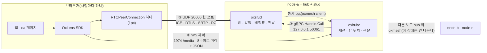
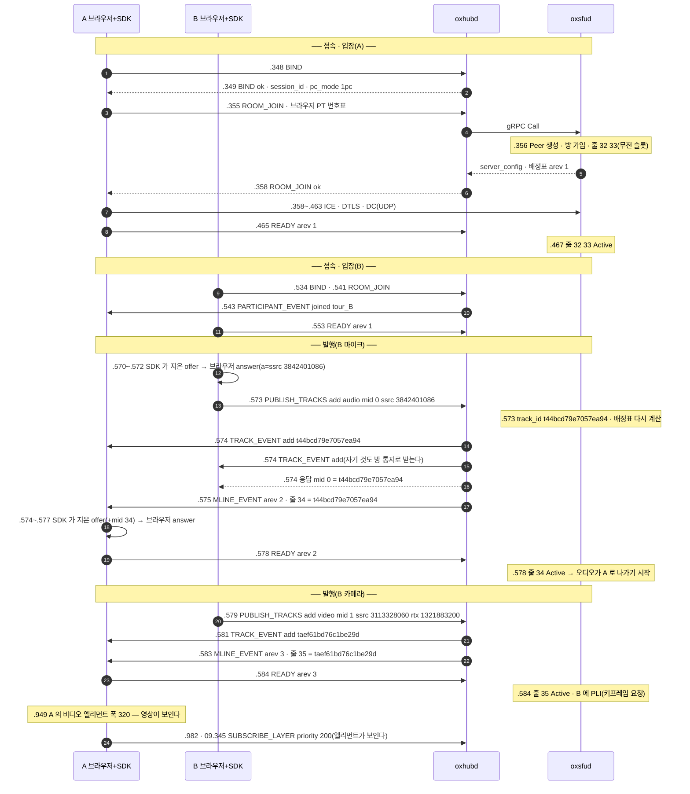
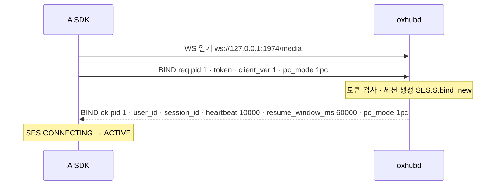
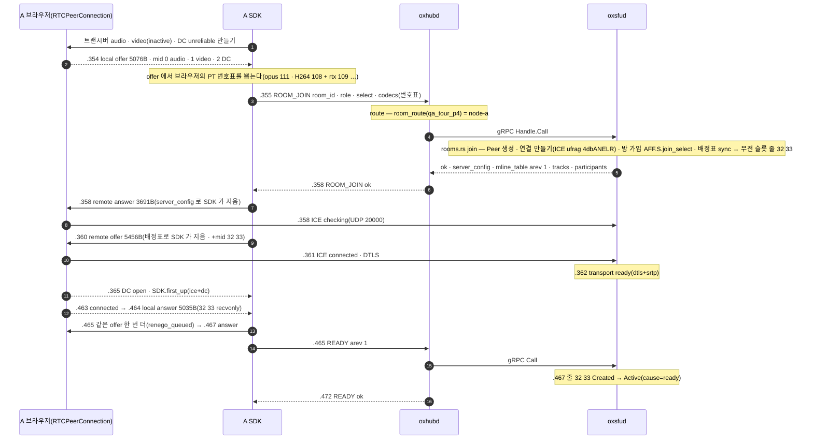
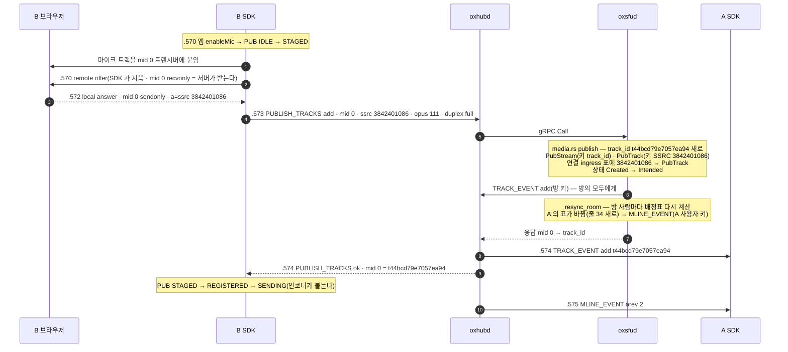
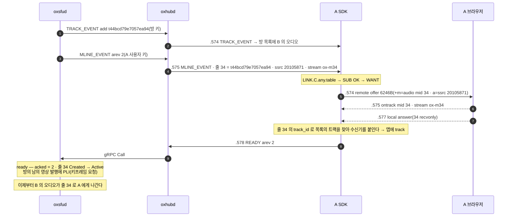
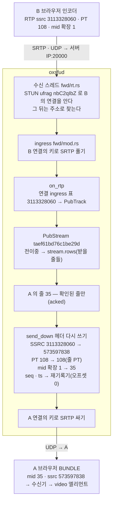

# 01. 입장 → 발행 → 구독 → 영상이 보이기까지

> author: kodeholic (powered by Claude) · created: 2026-11-03.
> ★**대조한 커밋** — 서버 `oxlens-sfu` `40c5ce0` · SDK `oxlens-sdk-web` `bd1c025`.
> ★**실측 회차** — `tour-20261103-114708`(탐침을 한 번 돌려 거둔 것). 이 장의 값 · 시각은 전부 이 회차의 것이다. 값은 돌릴 때마다 바뀌고, 차례 · 모양은 같다.
> 탐침 — `oxlens-sdk-web` `qa/live/tests/probe/tour_capture.spec.ts`(`f366ec7` · 재현 명령은 [00_INDEX](00_INDEX.md)).

## 0. 한 줄 목적 · 등장인물

**사람 B 가 카메라 · 마이크를 켜면, 같은 방의 사람 A 화면에 B 의 영상이 뜨기까지 무엇이 어떤 차례로 오가는가.**

| 이름 | 실제 값(이 회차) | 무엇 |
|---|---|---|
| A | `tour_A` | 받기만 하는 사람(발행 없음) |
| B | `tour_B` | 마이크 · 카메라를 켜는 사람 |
| 방 | `qa_tour_p4` | node-a 에 놓이는 이름을 탐침이 골랐다(배치 = 방 이름의 HRW · 같은 노드 길만 보려고) |
| node-a | hub `127.0.0.1:1974` · sfud gRPC `127.0.0.1:50061` · 미디어 UDP `20000` | 개발 형상 세 노드 중 하나(`oxlens-sfu/dev/system.node-a.toml`) |
| 미디어 서버 신원 | `sfu_id` = `4658416ba9e5e54d` | sfud 가 기동마다 새로 뽑는 값(= epoch) |
| 연결 방식 | `pc_mode` = `1pc` | 사람마다 RTCPeerConnection 하나 — 보내기 · 받기가 한 연결([연:RULE-LINK-SDP-1PC](../protocol/09-link.md#RULE-LINK-SDP-1PC)) |

## 1. 큰 그림 — 선이 셋이다



- **① 제어(WS)** — 요청 · 응답 · 통지가 전부 이 선으로 간다. 브라우저는 hub 만 안다.
- **② node 안(gRPC)** — hub 가 그 방을 든 노드의 sfud 를 부른다. 같은 노드면 gRPC 한 번이다. 통지는 반대로 sfud 가 oxmesh 로 내고 hub 가 받아 WS 로 민다.
- **③ 미디어(UDP)** — 오디오 · 비디오 · DC 가 포트 하나로 오간다. 사람마다 ICE ufrag 가 달라 서버가 누구 패킷인지 가른다.
- ★**SDP 는 어느 선에도 안 실린다.** 서버는 SDP 를 모른다 — SDK 가 서버가 준 값(`server_config` · 배정표)으로 ★**서버 쪽 SDP 를 손수 지어** 자기 브라우저에 넣는다(아래 §3-2 · [연:RULE-LINK-SDP-1PC](../protocol/09-link.md#RULE-LINK-SDP-1PC) 1).

## 2. 전체 타임라인 — 한 장

시각은 로컬(KST) `11:47:08.xxx` 의 뒤 세 숫자(ms). SDK 전이 · 서버 로그는 각자의 시계이고, WS 프레임 시각은 시험 프로세스(Playwright)가 본 시각이라 몇 ms 늦게 찍힐 수 있다.



카메라를 켠 시험 단계(`B.enableCamera` .575)에서 A 가 디코딩된 폭을 본 때(.949)까지 약 **370ms** 다(탐침이 폴링으로 잰 값이라 위 끝).

## 3. 단계별

### 3-1. 접속 — `BIND`



**WS 프레임 한 장을 바이트로** — 8바이트 머리 + JSON([연:TRN.frame.WS](../protocol/02-trn.md#TRN.frame.WS) · SDK `internal/ses/signaling.ts` `encodeFrame`).

```
01 00 01 01 00 00 00 01 7b 22 74 6f 6b 65 6e ...   (A 가 보낸 첫 프레임)
│  │  └─┬─┘ └────┬────┘ └─ JSON {"token":"…","client_ver":1,"pc_mode":"1pc"}
│  │    │        └ pid 1     (요청 번호 — 응답이 같은 pid 로 돌아온다)
│  │    └ op 0x0101 = BIND
│  └ flags 하위 2비트 00 = 요청 (01 = 성공 응답 · 10 = 실패 응답)
└ ver 1
```

받은 응답은 `01 01 01 01 00 00 00 01 {…}` — flags `01`(성공) · 같은 op · 같은 pid.
통지도 같은 꼴이다. 서버가 보내는 통지는 flags `00`(요청 꼴)이고, SDK 는 ★**body 가 빈 `01` 프레임으로 ACK** 한다 — 프레임 목록의 `A send ok PARTICIPANT_EVENT 1 {}` 가 그것이다([연:RULE-TRN-NOTIFY-ACK-STEPS](../protocol/02-trn.md#RULE-TRN-NOTIFY-ACK-STEPS)).

로그(서버 hub):
```
11:47:08.348 proc=hub kind=ev spec=SES.S.bind_new session=8ffa04de user=tour_A area=SES key=8ffa04de from=- to=live+bound cause=BIND
11:47:08.348 proc=hub kind=ev spec=CP-OP-BIND session=8ffa04de user=tour_A msg=bound
```
로그(SDK 전이):
```
11:47:08.346 SES session DISCONNECTED → CONNECTING | app     | SES.C.DISCONNECTED.connect
11:47:08.347 SES session CONNECTING → CONNECTING   | ws.open | SES.C.CONNECTING.open
11:47:08.348 SES session CONNECTING → ACTIVE       | BIND.res| SES.C.CONNECTING.bind_ok
```
- `spec=` · `label` 칸은 ★**규격의 전이 라벨**이다. 로그 한 줄이 규격의 어느 줄을 밟았는지 그대로 말한다.
- hub 로그의 `session=8ffa04de` 는 응답의 `session_id`(`50375172…`) 그 자체가 아니라 ★**그 값의 지문**이다(`oxhubd/src/ses/mod.rs` `fp: common::log::fingerprint(&sid)`). 로그에는 세션 id 원문이 안 찍힌다 — 사건을 이을 때는 지문으로 잇는다.

### 3-2. 방 입장 — `ROOM_JOIN` 과 첫 협상

입장은 ★**SDP 협상 두 번**과 엮여 있다. 1pc 에서 첫 협상만 브라우저가 offer 를 내고, 그 뒤로는 언제나 「서버 offer(SDK 가 지은 것) → 브라우저 answer」다([연:RULE-LINK-SDP-1PC](../protocol/09-link.md#RULE-LINK-SDP-1PC) 1).



**ROOM_JOIN 응답에 실려 오는 것**(이 회차 값 · [연:ROOM.op.ROOM_JOIN](../protocol/04-room.md#ROOM.op.ROOM_JOIN) · [연:LINK.type.ServerConfig](../protocol/09-link.md#LINK.type.ServerConfig)):

| 칸 | 값 | 무엇에 쓰나 |
|---|---|---|
| `server_config.ice` | ip `<서버 IP>` · port `20000` · ufrag `4dbANELR` · pwd(22자) | SDK 가 짓는 서버 쪽 SDP 의 `a=candidate` · `a=ice-ufrag` · `a=ice-pwd` |
| `server_config.dtls` | fingerprint `sha-256 …`(서버 인증서 지문) · setup `passive` | 서버 쪽 SDP 의 `a=fingerprint` · `a=setup` |
| `server_config.extmap` | mid 1 · audio-level 4 · abs-send-time 5 · twcc 6 · rid 10 · repair-rid 11 | 서버 쪽 SDP 의 `a=extmap` |
| `server_config.codecs` | opus · VP8 · H264 와 각 rtcp-fb | 서버 쪽 SDP 의 `a=rtcp-fb` |
| `mline_table` | arev 1 · 줄 32(audio · `ptt-qa_tour_p4-audio`) · 줄 33(video · `ptt-qa_tour_p4-video`) | 받을 m-line — 무전 슬롯 줄은 입장하면 바로 실린다 |
| `tracks` | 슬롯 둘 | 방의 트랙 목록(아직 B 가 없다) |
| `media_codecs` | audio opus · video H264 | 그 방의 코덱 |

**SDK 가 지은 서버 offer 의 받는 m-line**(브라우저에 들어간 SDP 에서 발췌):
```
m=audio 20000 UDP/TLS/RTP/SAVPF 111
a=mid:32
a=sendonly                      ← 서버가 보낸다는 뜻(서버 시각)
a=msid:ox-ptt ox-m32            ← stream_id · 트랙 이름
a=ssrc:2008593217 cname:ox-sfu  ← 줄 32 의 다운링크 SSRC(배정표의 ssrc 그대로)
m=video 20000 UDP/TLS/RTP/SAVPF 108 109
a=mid:33
a=ssrc:1476098668 cname:ox-sfu
a=ssrc:1947666 cname:ox-sfu
a=ssrc-group:FID 1476098668 1947666   ← RTX 짝
```

- 1pc 에서 받는 줄의 mid 는 **32 부터**다(발행 mid 0 · 1 · DC 2 와 겹치지 않게 — 줄 번호 = 시작 + 순번).
- **협상이 두 번인 까닭** — SDK 전이에 `LINK.C.any.renego_queued` 가 있다. 첫 협상(브라우저 offer)이 아직 안 끝났을 때 배정표가 와서 다시 협상을 큐에 넣었고, 첫 협상이 끝나자(`nego_ok_next`) 큐의 것을 한 번 더 했다. 내용이 같아 SDP 는 그대로다.
- **관찰** — A 의 첫 받는 협상 answer(.464)는 브라우저 연결이 `connected`(.463)가 된 직후에 닫혔다. B 도 같은 꼴(.551 → .553)이다. 그 사이 브라우저가 무엇을 기다렸는지는 이 회차로 가리지 않았다(브라우저 안쪽).

로그(서버 sfud · hub — 한 줄씩 같은 사건):
```
11:47:08.356 proc=sfu kind=ev spec=SV-STATE-PEER-STATE user=tour_A area=LINK key=PeerState from=- to=Alive cause=peer_created
11:47:08.356 proc=sfu kind=ev spec=AFF.S.join_select user=tour_A area=AFF key=tour_A from=- to=qa_tour_p4 cause=ROOM_JOIN
11:47:08.357 proc=hub kind=ev spec=CP-OP-ROOM-JOIN session=8ffa04de user=tour_A msg=ok
11:47:08.362 proc=sfu kind=diag user=tour_A msg="transport ready (dtls+srtp) conn 629"
11:47:08.420 proc=sfu kind=diag user=tour_A msg="peer state Alive after 65ms (conn 629)"
11:47:08.467 proc=sfu kind=ev spec=SV-STATE-SUBSCRIBE-STATE user=tour_A area=SUB key=ptt-qa_tour_p4-audio from=Created to=Active cause=ready
11:47:08.467 proc=sfu kind=ev spec=SV-STATE-SUBSCRIBE-STATE user=tour_A area=SUB key=ptt-qa_tour_p4-video from=Created to=Active cause=ready
11:47:08.468 proc=hub kind=ev spec=CP-OP-READY session=8ffa04de user=tour_A msg=ok
```
- `proc=sfu` 와 `proc=hub` 가 ★**한 파일**에 섞여 찍힌다(개발 형상 `/tmp/oxlens/node-a/ox.log.<날짜>`). hub 의 `CP-OP-*` 줄은 「그 op 의 gRPC 응답이 돌아왔다」는 뜻이라 sfud 줄보다 늦다.
- `READY` 는 「이 배정표(arev)로 협상을 끝냈다」는 확인이다. ★**서버는 확인된 줄로만 보낸다**([연:RULE-SUB-EGRESS-ACKED](../protocol/08-sub.md#RULE-SUB-EGRESS-ACKED)) — 그래서 `Active cause=ready` 가 READY 직후에 찍힌다.

### 3-2b. 길이 둘일 때 — UDP 와 TCP(실측 `TOUR-01T` · 2026-11-04)


`ROOM_JOIN` 응답의 `server_config.ice` 에는 `port 20000` 과 함께 ★`tcp_port 20000` 이 온다(위 표). 상용 웹 SDK 는 그래도 **UDP 한 줄**만 낸다 — TCP passive 줄은 안드로이드 축(UDP 가 막힌 망)의 폴백이고 웹에서는 QA 스위치로만 켠다([연:RULE-LINK-SDP-COMMON](../protocol/09-link.md#RULE-LINK-SDP-COMMON)). 그 스위치로 두 형상을 쟀다.

| | A — 둘 다 낸다 | B — TCP 만 남긴다(UDP 후보를 걷음) |
|---|---|---|
| SDK 가 지은 서버 쪽 SDP 의 후보 | `a=candidate:1 1 udp 2113937151 <IP> 20000 typ host` · `a=candidate:2 1 tcp 2113937150 <IP> 20000 typ host tcptype passive` | `a=candidate:2 1 tcp … tcptype passive` 한 줄 |
| 브라우저가 만든 쌍 | ★**UDP 하나뿐** — STUN 9 왕복 · nominated · 96KB · ★TCP 쌍은 0, 12초 뒤에도 0 | TCP 하나 — 브라우저가 active(포트 9)로 서버 passive 에 건다 · STUN 8 왕복 · nominated · 96KB |
| ICE `checking` → `connected` | .925 → .928(3ms) | .247 → .248(1ms) |
| 서버 `transport ready(dtls+srtp)` | .930 · conn 359 | .252 · conn 360 |
| 서버 `peer state Alive`(지명 쌍) | .984 — 62ms | .308 — 182ms |
| 미디어 | — | A 가 B 의 소리를 듣는다(.535) — 업링크가 TCP 다 |

- ★**둘 다 주면 브라우저는 TCP 를 시도조차 않는다.** 쌍을 만들어 두고 버리는 것이 아니라 아예 만들지 않는다(3층 `ice_tcp` 시험 ICETCP-03 · 20260913 실측과 같다). 그래서 「둘 다 열어두고 서버가 고른다」는 브라우저에서 성립하지 않는다 — 서버는 ICE-lite 라 클라가 지명한 쌍을 따를 뿐이다([연:RULE-LINK-SDP-COMMON](../protocol/09-link.md#RULE-LINK-SDP-COMMON)).
- **TCP 만 있으면 붙고 흐른다.** 서버 쪽은 UDP 와 같은 수신 스레드가 TCP 연결도 함께 기다리고, 바이트는 같고 RFC 4571 의 2바이트 길이 틀만 씌운다(서버 `link/tcp.rs`). 로그도 UDP 와 같은 줄이다 — `transport ready … conn 360` · TCP 만의 줄은 없다. 「연결 번호」가 주소 노릇을 한다.
- 지명까지 TCP 가 3배 걸렸다(62 → 182ms) — 같은 기계 안이라 망 지연은 없고, TCP 연결 수립과 STUN 검사가 직렬인 몫이다.

### 3-3. 다른 사람이 들어온다 — `PARTICIPANT_EVENT`

B 의 입장은 A 와 똑같은 길이다. 다른 것은 ★**A 에게 통지가 하나 간다**는 것뿐이다.
```
A recv req PARTICIPANT_EVENT 1 {"room_id":"qa_tour_p4","type":"joined","user_id":"tour_B","version":{"epoch":"4658416ba9e5e54d","seq":2}}
A send ok  PARTICIPANT_EVENT 1 {}
```
- `version.seq` 는 ★**방 목록의 차례 번호**다. 입장 응답이 `seq 1`, B 가 들어와 `2`, 뒤의 트랙 추가가 `3` · `4`. 방 목록(사람 · 트랙)이 바뀔 때마다 1 씩 오른다 — 배정표의 `arev`(내 연결 하나의 차례)와 다른 번호다.

### 3-4. 발행 — B 가 마이크 · 카메라를 켠다

★**차례가 핵심이다 — 「SDP 협상 먼저, PUBLISH_TRACKS 나중」.** 서버에 알릴 발행 SSRC 는 브라우저가 answer 를 만들 때 정하기 때문이다.



B 가 보낸 요청과 받은 응답(실제 프레임):
```
B send req PUBLISH_TRACKS 4 {"action":"add","room_id":"qa_tour_p4","tracks":[{"kind":"audio","ssrc":3842401086,"mid":"0","pt":111,
       "codec":"opus","fmtp":"minptime=10;useinbandfec=1","duplex":"full","simulcast":false}],
       "audio_level_extmap_id":1,"twcc_extmap_id":3,"mid_extmap_id":4}
B recv ok  PUBLISH_TRACKS 4 {"action":"add","tracks":[{"mid":"0","track_id":"t44bcd79e7057ea94"}]}
```
- `*_extmap_id` 는 ★**B 브라우저가 쓰는 확장 헤더 번호**다(B 의 SDP 기준). 서버는 그 번호로 B 의 RTP 에서 음량 · twcc · mid 를 읽는다. 서버가 하향으로 쓰는 번호(`server_config.extmap`)와 다를 수 있다.
- 응답은 `mid → track_id` 하나뿐이다. SDK 는 ★**자기 발행 mid 로 자기 track_id 를 찾는다** — 이후 그 트랙을 끄고 켜는 조작(`TRACK_SET` · `remove`)은 track_id 로 부른다.
- 카메라는 같은 길에 RTX 가 더해진다: `ssrc 3113328060` · `rtx_ssrc 1321883200` · `pt 108` · `rtx_pt 109` · `source camera` → `taef61bd76c1be29d`.
- B 도 자기 트랙의 `TRACK_EVENT` 를 받는다(방 통지라서). B 의 배정표는 그대로다 — 자기 트랙은 받을 후보가 아니다 — 그래서 B 에게는 `MLINE_EVENT` 가 없다.
- ★**시뮬캐스트가 아닌 전이중 트랙은 RTP 를 기다리지 않고 곧바로 알린다**(`media.rs` `publish` 의 `to_announce`). 시뮬캐스트는 첫 RTP 에서 레이어 SSRC 를 배운 뒤 알린다(`announce_add`). 그래서 이 회차 로그의 발행 상태 줄은 `Intended` 까지다(`Active` 줄은 시뮬캐스트 첫 RTP 길에만 찍힌다).

로그(서버):
```
11:47:08.573 proc=sfu kind=ev spec=SV-STATE-PUBLISH-STATE user=tour_B area=PUB key=t44bcd79e7057ea94 from=Created to=Intended cause=publish
11:47:08.574 proc=hub kind=ev spec=CP-OP-PUBLISH-TRACKS session=31ed684a user=tour_B msg=ok
```
로그(B SDK 전이):
```
11:47:08.570 PUB audio:microphone IDLE → STAGED          | app               | PUB.C.IDLE.on
11:47:08.572 PUB audio:microphone STAGED → STAGED        | nego.ok           | PUB.C.STAGED.nego_ok
11:47:08.574 PUB t44bcd79e7057ea94 STAGED → REGISTERED   | PUBLISH_TRACKS.add| PUB.C.STAGED.pub_ok
11:47:08.574 PUB t44bcd79e7057ea94 REGISTERED → SENDING  | encoder           | PUB.C.REGISTERED.attach_ok
```
- 상태기의 키가 `audio:microphone`(아직 이름 없음) → `t44bcd79e7057ea94`(서버가 이름을 준 뒤)로 바뀐다.

### 3-5. 구독 — A 에게 줄이 생긴다



이 회차 끝의 A 배정표(arev 3 · 서버 `/admin/users/tour_A/media` 와 같다):

| 줄 mid | kind | 다운링크 SSRC | RTX SSRC | stream_id | 실린 트랙 | 누가 골랐나 |
|---|---|---|---|---|---|---|
| 32 | audio | 2008593217 | — | `ox-ptt` | `ptt-qa_tour_p4-audio` | 무전 슬롯(입장하면 실림) |
| 33 | video | 1476098668 | 1947666 | `ox-ptt` | `ptt-qa_tour_p4-video` | 무전 슬롯 |
| 34 | audio | 20105871 | — | `ox-m34` | `t44bcd79e7057ea94`(B 마이크) | 서버(음량 순위) |
| 35 | video | 573597838 | 249990890 | `ox-m35` | `taef61bd76c1be29d`(B 카메라) | 클라 선호(기본값 = 안 멈춤) |

- 영상 줄 35 는 ★**A 가 아무것도 요청하기 전에** 생겼다(.583). 서버의 선호 기본값이 「안 멈춤 · priority 0」이라(`sub/mod.rs` `set_pref` 의 `or_insert((0, false))`) 새 영상도 바로 후보가 된다. 영상을 고르는 손잡이(`paused` · `priority`)는 클라 것이지만([연:RULE-SUB-FILL](../protocol/08-sub.md#RULE-SUB-FILL)), 아무 말이 없으면 받는다.
- `READY` 의 일([연:RULE-SUB-READY-WHAT](../protocol/08-sub.md#RULE-SUB-READY-WHAT)) — 막아 둔 영상을 흘리고 키프레임을 요청한다. B 의 송신 통계가 그 흔적이다: `pliCount 1` · `keyFramesEncoded 2`(처음 하나 + PLI 로 하나).
- 서버 표면의 같은 사실: `arev 3 · acked 3` — 「표는 3번째 판이고, 클라도 3번째 판까지 확인했다」.

### 3-6. 미디어 — 패킷 하나가 B 에서 A 로



- ★**서버를 지나며 바뀌는 것** — SSRC · PT · mid 확장(줄의 것으로) · seq · ts(재기록기). ★**안 바뀌는 것** — 페이로드(인코딩된 프레임 그대로 · 디코딩하지 않는다).
- 재기록기 상태(서버 표면 `rewrite`): `seq_off 0 · ts_off 0 · switches 0` — 출처가 한 번도 안 바뀌어 오프셋이 0 이다. 줄에 다른 트랙이 실리면(재배정 · 화자 전환) 여기가 움직인다.
- A 브라우저는 SDK 가 지은 SDP 의 `a=ssrc:573597838`(줄 35) · `a=mid:35` 로 이 패킷이 어느 트랜시버 것인지 안다. ★**A 는 B 의 진짜 SSRC(3113328060)를 끝내 모른다.**
- 받는 통계(A): 영상이 처음 보인 무렵 `packets 3 · framesDecoded 2` → 2.5초 뒤 `packets 55 · framesDecoded 53 · 폭 320 · keyFramesDecoded 2 · pli 0 · nack 0`. 오디오는 같은 동안 `11 → 126` 패킷.

### 3-7. 영상이 보인 뒤 — `SUBSCRIBE_LAYER`

```
A send req SUBSCRIBE_LAYER 6 {"room_id":"qa_tour_p4","targets":[{"track_id":"ptt-qa_tour_p4-video","paused":false,"priority":200}]}
A send req SUBSCRIBE_LAYER 7 {"room_id":"qa_tour_p4","targets":[{"track_id":"taef61bd76c1be29d","paused":false,"priority":200}]}
```
- 영상을 흐르게 한 것은 이 요청이 아니다 — 줄 35 는 이미 흐르고 있었다(§3-5). 이것은 SDK 의 ★**adaptiveStream** 이다. 비디오 엘리먼트가 화면에 붙으면 보이는지 · 폭이 얼마인지를 재고, 500ms 묶은 뒤(`adaptiveStreamSettleMs`) 「보인다 = `paused:false` · `priority 200`, 안 보인다 = `paused:true` · `priority 1`」을 한 번 낸다(`domain/trk/remote.ts` `adapt` · `PRIO_VISIBLE`).
- 시각이 그것을 말한다: 슬롯 영상(.982) · B 카메라(09.345) — 각 엘리먼트가 붙은 뒤 약 0.4~0.5초.

### 3-8. 끝 — `LEAVE`

```
11:47:11.505 proc=hub kind=ev spec=SES.S.leave session=8ffa04de user=tour_A ... from=live+bound+rooms to=- cause=LEAVE
11:47:11.506 proc=sfu kind=ev spec=AFF.S.left user=tour_A ... from=qa_tour_p4 to=- cause=session_gone
11:47:11.507 proc=sfu kind=diag user=tour_A msg="gc: peer reaped via session_gone"
```
- `qa.teardown()` = `client.close()` = WS `LEAVE` 하나. hub 가 세션을 곧바로 거두고, 그 세션이 닿은 미디어 서버마다 `session_gone` 을 불러 Peer 를 축출한다. B 에게는 `PARTICIPANT_EVENT left tour_A` 가 간다.

## 4. 구간 × 키 — 이 회차 값으로

| 구간 | 무엇을 찾나 | 키(이 회차 값) |
|---|---|---|
| 클라 → hub | 세션 | WS 연결 하나 = 세션 하나(`session_id` 50375172…) |
| hub → sfud | 방을 든 노드 | `room_id` qa_tour_p4 → node-a(`route` · `room_route`) |
| sfud 안 | 사람의 Peer | `user_id` tour_A |
| UDP → 연결 | 누구의 연결 | 처음엔 STUN ufrag(A `4dbANELR` · B `nbC2qIbZ`) · 그 뒤 주소 |
| 업링크 RTP → 발행 트랙 | PubTrack | 발행 SSRC 3113328060(RTX 1321883200) |
| 발행 트랙 → 받을 줄 | 줄 목록 | track_id taef61bd76c1be29d 의 `stream.rows` |
| 하향 RTP 헤더 | — | 줄 35 의 SSRC 573597838 · PT 108 · mid 35 |
| A 브라우저 → 트랜시버 | 수신기 | SDP 의 `a=mid:35` · `a=ssrc:573597838` |
| A SDK 목록 → 줄 | 받는 트랙의 줄 | track_id → 배정표(`rowOf`) |
| A SDK 줄 → 수신기 | RTCRtpReceiver | 줄 mid 35(`receiverOf`) |
| 발행 응답 → B SDK | 내 트랙 이름 | 발행 mid 0 · 1 |


## 5. 로그 읽는 법

**서버 로그 한 줄**(logfmt — 칸 차례 · 회전의 정본은 운영 규격서):
```
ts=…11:47:08.578… mono=… node=node-a proc=sfu kind=ev spec=SV-STATE-SUBSCRIBE-STATE user=tour_A epoch=4658416ba9e5e54d area=SUB key=t44bcd79e7057ea94 from=Created to=Active cause=ready
                         └ 노드   └ hub/sfu └ ev=전이·사건 └ 규격 라벨             └ 상관 키  └ 미디어 서버 신원      └ 영역  └ 무엇의 상태   └ 전이           └ 원인
```
- `kind=ev` 는 상태 전이 · op 결과(규격 라벨이 붙는다), `kind=diag` 는 사람이 읽는 진단 문장, `kind=stat` 은 5초마다의 집계(이 장의 발췌에서는 뺐다).
- 한 사람만 보려면 `user=` 로, 한 방만 보려면 `room=` 으로 거른다. 단, `room=` 이 안 붙는 줄(연결 · Peer)이 있으니 사건 하나를 따라갈 때는 ★**시각 창으로 자르고 user 로 거른다**.

**SDK 전이 한 줄**(탐침의 `qa.diag().transitions`):
```
11:47:08.578 SUB qa_tour_p4 WANT → SENT | nego | SUB.C.WANT.nego_ok
             └ 영역 └ 키     └ 전이       └ 원인 └ 규격 라벨(연동규격서 SUB 장 · C = 클라 쪽 상태기)
```

**거두는 법** — 탐침 한 번이면 위 셋(WS 프레임 · SDK 전이 · 서버 로그)과 SDP · 서버 표면이 `tour.json` 하나에 모인다. 프레임은 바이트(`b64:`)라 풀어 읽는다 — 이 회차의 `frames.txt` 가 풀어 쓴 판이다.

## 6. 소스 · 규격 좌표

| 단계 | 서버 | SDK | 규격 |
|---|---|---|---|
| WS 프레임 | — | `internal/ses/signaling.ts` `encodeFrame` · `decodeFrame` | [연:TRN.frame.WS](../protocol/02-trn.md#TRN.frame.WS) · [연:RULE-TRN-NOTIFY-ACK-STEPS](../protocol/02-trn.md#RULE-TRN-NOTIFY-ACK-STEPS) |
| hub 경로 | `oxhubd/src/ses/mod.rs` `route` · `bus/mod.rs` `call` · `call_local` | — | — |
| 입장 | `oxsfud/src/ops/rooms.rs` `join` · `new_peer` · `server_config` | `domain/room/core.ts`(join 본문의 `codecs`) · `internal/link/transport.ts` 첫 협상(1pc) | [연:ROOM.op.ROOM_JOIN](../protocol/04-room.md#ROOM.op.ROOM_JOIN) · [연:LINK.type.ServerConfig](../protocol/09-link.md#LINK.type.ServerConfig) · [연:RULE-LINK-SDP-1PC](../protocol/09-link.md#RULE-LINK-SDP-1PC) |
| 서버 SDP 짓기 | (서버는 SDP 를 모른다) | `internal/link/sdp.ts` `answer` · `onePcOffer` | [연:RULE-LINK-SDP-1PC-FILL](../protocol/09-link.md#RULE-LINK-SDP-1PC-FILL) |
| 발행 | `ops/media.rs` `publish` · `track_event` · `resync_room` | 발행 상태기 PUB | [연:PUB.op.PUBLISH_TRACKS](../protocol/07-pub.md#PUB.op.PUBLISH_TRACKS) · [연:TRK.op.TRACK_EVENT](../protocol/06-trk.md#TRK.op.TRACK_EVENT) |
| 배정표 | `sub/mod.rs` `sync` · `set_pref` · `ready` | `domain/link/table.ts` | [연:RULE-SUB-FILL](../protocol/08-sub.md#RULE-SUB-FILL) · [연:LINK.op.MLINE_EVENT](../protocol/09-link.md#LINK.op.MLINE_EVENT) |
| READY | `ops/media.rs` `ready`(PLI 요청 포함) | SUB 상태기 | [연:SUB.op.READY](../protocol/08-sub.md#SUB.op.READY) · [연:RULE-SUB-READY-WHAT](../protocol/08-sub.md#RULE-SUB-READY-WHAT) · [연:RULE-SUB-EGRESS-ACKED](../protocol/08-sub.md#RULE-SUB-EGRESS-ACKED) |
| 전달 | `fwd/rt.rs`(ufrag · 주소) · `fwd/mod.rs` `ingress` · `on_rtp` · `send_down` | — | — |
| 엘리먼트 가시성 | — | `domain/trk/remote.ts` `adapt` | [연:SUB.op.SUBSCRIBE_LAYER](../protocol/08-sub.md#SUB.op.SUBSCRIBE_LAYER) |

## 7. 스스로 확인하는 질문

<details><summary>1. A 의 브라우저가 받는 B 의 영상 SSRC 는 무엇인가? B 가 정한 3113328060 인가?</summary>

아니다. 줄 35 의 다운링크 SSRC 573597838 이다. 서버가 줄을 만들 때 정했고(업링크 SSRC 와 겹치지 않게), 하향 RTP 헤더를 그 값으로 다시 쓴다. A 는 B 의 진짜 SSRC 를 모른다.
</details>

<details><summary>2. 서버가 SDP 를 안 받는데, 서버는 B 의 SSRC 를 어떻게 아나?</summary>

`PUBLISH_TRACKS` 본문의 `ssrc` · `rtx_ssrc` 로 안다. 그래서 SDK 는 협상(브라우저 answer 에서 SSRC 가 정해짐)을 먼저 하고 `PUBLISH_TRACKS` 를 나중에 보낸다. 시뮬캐스트는 SSRC 를 0 으로 보내고 서버가 첫 RTP 의 rid 로 배운다.
</details>

<details><summary>3. B 가 카메라를 켠 뒤 A 의 SDP 가 바뀐 까닭은? 늘 바뀌나?</summary>

A 의 연결에 영상 빈 줄이 없어서 줄 35 가 새로 생겼다 — 줄이 생기면 m-line 이 늘어 SDP 가 바뀐다. 빈 줄이 있으면 표(`MLINE_EVENT`)만 오고 SDP 는 그대로다. 상한(kind 마다 25)이면 재배정 — 줄의 실린 트랙만 바뀌고 SDP 는 그대로다([연:RULE-SUB-FILL](../protocol/08-sub.md#RULE-SUB-FILL)).
</details>

<details><summary>4. A 가 READY 를 안 보내면?</summary>

서버는 확인된 차례(acked) 이후 바뀐 줄로는 보내지 않는다 — 줄 35 가 열리지 않는다([연:RULE-SUB-EGRESS-ACKED](../protocol/08-sub.md#RULE-SUB-EGRESS-ACKED)). 안전망으로 5초 뒤 서버가 스스로 푼다([연:RULE-SUB-READY-WHAT](../protocol/08-sub.md#RULE-SUB-READY-WHAT)).
</details>

<details><summary>5. `version.seq` 와 `arev` 는 무엇이 다른가?</summary>

`seq` 는 방 목록(사람 · 트랙)의 차례 — 방 하나에 하나, 그 방 사람 모두가 같은 값을 본다. `arev` 는 배정표의 차례 — 연결(사람 × 서버) 하나에 하나. B 의 트랙이 추가될 때 방 `seq` 는 B 에게도 오르지만, B 의 `arev` 는 그대로다(B 의 표가 안 바뀌어서).
</details>
