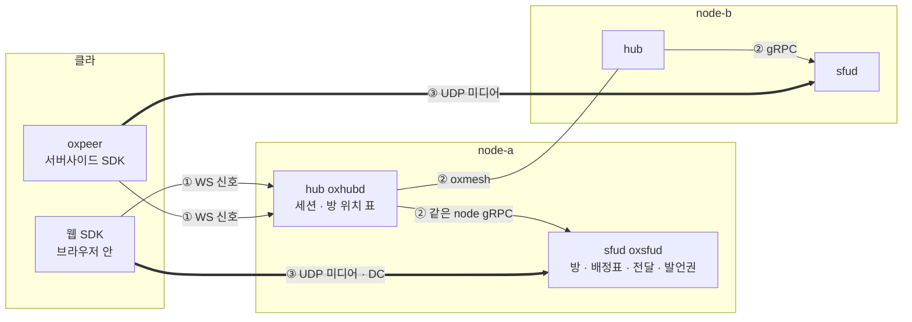
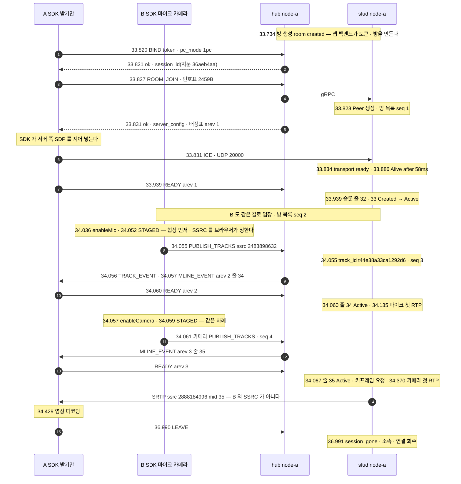

# 01. 한눈에 — 구성요소 · 선 셋 · 접속 한 번의 일생 · 우리만의 것

> author: kodeholic (powered by Claude) · created: 2026-11-09.
> ★**대조한 커밋** — 서버 `oxlens-sfu` `c3642e8` · SDK `oxlens-sdk-web` `9f40557`(+탐침) · 2층 `oxlens-labs` `fc584ff` · oxpeer `93df1c6`
> ★**실측 회차** — 이 장은 새로 재지 않았다. 값은 02 ~ 17 장이 3층 탐침 `tour-learn-20261109` · 2층 회차 `e2e-20261109-070257` 에서 인용한 것이다. 값은 돌릴 때마다 바뀌고 차례 · 모양은 같다.

## 1. 30초 요약

- 클라는 **hub 하나에만 붙는다**(① WS). hub 가 방 이름으로 그 방의 node 를 찾아 제 sfud 나 남의 hub 로 넘긴다(②). 미디어는 hub 를 안 지나고 **방을 든 sfud 로 곧장** 간다(③).
- 서버는 SDP 를 만들지 않는다 — 입장 응답의 재료로 **SDK 가 서버 쪽 SDP 를 지어** 자기 브라우저에 넣는다. 받을 줄은 서버가 고른 **배정표**로 오고, 클라가 `READY` 로 확인한 줄로만 패킷이 나간다.
- 한 서버가 회의(전이중)와 무전(반이중 · 발언권 · 슬롯)을 **트랙 단위로** 섞어 든다. 연결은 1pc 를 지향하고, 방은 한 node 에만 산다.

## 2. 등장인물 · 값

| 구성요소 | 무엇 | 이 회차 값 | 집 |
|---|---|---|---|
| 웹 SDK `oxlens-sdk-web` | 브라우저 안 클라. 판단은 규격에서 생성한 상태기, 집행은 손 코드 | Chromium 153 · Firefox 155 부터 1pc(능력표) | [02](02_CONNECT_JOIN.md) · [15](15_SDK_INSIDE.md) |
| oxpeer `oxlens-sdk-peer` | Rust 서버사이드 SDK — 녹음 · 녹화 · 에이전트가 보통 클라와 같은 계약으로 든다 | `2pc` · `source_tag true` · 2층 24 판 빨강 0 | [16](16_OXPEER.md) |
| hub `oxhubd` | 관문 — 세션 · 방 위치 표 · oxmesh router | node-a `127.0.0.1:1974` · 하트비트 `10000`ms · 재개 창 `60000`ms | [02](02_CONNECT_JOIN.md) · [10](10_RECOVERY.md) · [13](13_MULTI_NODE.md) |
| sfud `oxsfud` | 미디어 서버 — 방 · 발행 · 배정표 · 전달 · 발언권 · RTCP 종단 | node-a `sfu_id` `8701a55ebcdd350f` · UDP `20000` · `media-workers=2` | [02](02_CONNECT_JOIN.md) · [04](04_PACKET_PATH.md) |
| oxmesh | node 사이 버스 — router 그물 · 선언 · 레인 | router listen `7447` · `7448` · `7449` · lease `10000`ms | [14](14_OXMESH.md) |
| node | hub + sfud 한 벌. 개발 형상은 한 기계 위 셋(node-a · b · c) | 방 `qa_tournode_p1` 은 HRW 로 node-b · UDP `20001` | [13](13_MULTI_NODE.md) |
| 접속의 일생(§3-2)의 사람 | A `tour_A` 받기만 · B `tour_B` 마이크 · 카메라 · 둘 다 1pc | 방 `qa_tour_p4` · node-a · A 의 세션 지문 `36aeb4aa` | [02](02_CONNECT_JOIN.md) · [03](03_PUBLISH_SUBSCRIBE.md) |

## 3. 정상 길

### 3-1. 선 셋

| 선 | 누가 누구와 | 무엇이 실리나 | 실측 | 집 |
|---|---|---|---|---|
| ① WS 신호 | SDK · oxpeer ↔ 자기 hub | 요청 · 응답 · 통지 — 8바이트 머리(ver · flags · op · pid) + JSON. 통지는 요청 꼴로 오고 클라가 본문 없는 8바이트로 ACK 한다 | `BIND` 첫 프레임 247바이트 · ACK 8바이트 | [02 §3-2](02_CONNECT_JOIN.md) |
| ② 서버 안 | hub → sfud(같은 node gRPC) · hub → oxmesh → 남의 hub → gRPC · 통지는 sfud 가 버스에 직접 낸다 | 요청 봉투 · 방 · 사람 통지 · 선언(node · room · sess 토큰) | 같은 node 와 다른 node 의 `ROOM_JOIN` 왕복이 둘 다 4ms(한 기계라 갈리지 않았다) · node 사이 요청 시한 10초 | [13 §3-2](13_MULTI_NODE.md) · [14](14_OXMESH.md) |
| ③ UDP 미디어 | SDK · oxpeer ↔ 방을 든 sfud 직접 | ICE · DTLS · SRTP(RTP · RTCP) · DC(발언권 MBCP) — 포트 하나, 사람마다 ufrag 로 가른다 | 지명까지 58ms(1pc A) · TCP 후보만 주면 177ms | [02 §3-5 · §3-6](02_CONNECT_JOIN.md) · [04](04_PACKET_PATH.md) |

★**SDP 는 어느 선에도 안 실린다** — WS 프레임 어디에도 `v=0` 이 없었다([02 §3-4](02_CONNECT_JOIN.md)).

### 3-2. 접속 한 번의 일생 — 한 장

3층 탐침 `TOUR-02` 하나에서 [02](02_CONNECT_JOIN.md) · [03](03_PUBLISH_SUBSCRIBE.md) · [04](04_PACKET_PATH.md) 가 각자 떼어 쓴 구간을 이었다. 시각은 KST `07:35:33.xxx` · `34.xxx` · `36.xxx` 의 초 · ms.

| 구간 | 실측 | 무엇이 시간을 쓰나 | 집 |
|---|---|---|---|
| `BIND` 왕복 · `ROOM_JOIN` 왕복 | 1ms · 4ms | hub 의 토큰 검사 · sfud 의 Peer 생성 | [02 §3-2 · §3-3](02_CONNECT_JOIN.md) |
| Peer 생성 → 지명 쌍 | 58ms | ICE 검사 — 서버는 ICE-lite 라 클라 지명을 따른다 | [02 §3-3](02_CONNECT_JOIN.md) |
| `MLINE_EVENT` → 줄 Active | 5ms(줄 34 · 줄 35 둘 다) | SDK 가 표로 SDP 를 다시 짓고 협상 · `READY` | [03 §3-2](03_PUBLISH_SUBSCRIBE.md) |
| 발행 등록 → 첫 RTP | 마이크 80ms · 카메라 308ms | 장치 · 인코더. 서버는 RTP 를 기다리지 않고 먼저 알린다 | [03 §3-1](03_PUBLISH_SUBSCRIBE.md) |
| `enableCamera` 부름(.057) → A 가 디코딩(.429) | 372ms | 첫 RTP · `READY` 의 키프레임 요청 · 디코더 | [03 §3-3](03_PUBLISH_SUBSCRIBE.md) |
| 서버 통과(헤더만 다시 쓴다 — 2층 `adv_loss` 의 패킷 하나) | 페이로드 62바이트 그대로 · 머리 12 → 28바이트(확장을 통째로 다시 지음) | 재기록기 · SRTP 풀기 · 싸기 | [04 §3-2](04_PACKET_PATH.md) |

같은 일생의 갈래 — 2pc 는 연결 둘 · 서버 ICE 자격 두 벌([02 §3-5](02_CONNECT_JOIN.md)) · 무전이면 누름 → 허가 1ms 와 슬롯([07](07_FLOOR.md) · [08](08_SLOT_SPEAKER.md)) · 방이 다른 node 면 hub 한 홉([13](13_MULTI_NODE.md)) · 끝은 `LEAVE` 하나로 hub 가 세션을 거두고 닿은 미디어 서버마다 `session_gone` 을 부른다([02 §3-7](02_CONNECT_JOIN.md)).

### 3-3. 키 지도 — 구간마다 무엇으로 찾나

| 구간 | 찾는 것 | 무엇으로 | 실측 예 | 집 |
|---|---|---|---|---|
| 앱 백엔드 → hub | 누구인가 · 어떤 참가자인가 | 토큰 클레임 `sub` · `participant_type` · `hidden` | `tour_A` · `0` · `false` | [02](02_CONNECT_JOIN.md) · [16](16_OXPEER.md) |
| WS 요청 ↔ 응답 | 어느 요청의 답인가 | 8바이트 머리의 op · pid | `BIND` pid 1 | [02](02_CONNECT_JOIN.md) |
| 세션 ↔ 로그 | 어느 접속인가 | `session_id`(원값은 인증 수단) → 지문 8자 = 로그 `session=` = 통화 번호 | `36aeb4aa` | [17](17_OPERATIONS.md) |
| 방 → node | 방이 어느 node 에 있나 | 방 이름의 HRW → hub 의 방 위치 표(방 토큰) | `qa_tournode_p1` → node-b | [13](13_MULTI_NODE.md) · [14](14_OXMESH.md) |
| 미디어 서버 | 어느 기동의 sfud 인가 | `sfu_id` = `epoch`(기동마다 새 값) | `8701a55ebcdd350f` | [02](02_CONNECT_JOIN.md) · [14](14_OXMESH.md) |
| 방 안 요청 | 이 입장의 요청인가 | `join_id` | `8eb8aacff64fe6f0` | [02](02_CONNECT_JOIN.md) |
| STUN → 서버 연결 | 누구의 연결인가 | ufrag(사람마다) → 전송 객체 · 그 주소를 묶는다 | `tWUIQ5qz` | [04 §3-1](04_PACKET_PATH.md) |
| RTP · RTCP → 서버 연결 | 누구의 패킷인가 | 보낸 주소(STUN 이 묶은 것) → 전송 객체 → 그 워커 큐 | — | [04 §3-1](04_PACKET_PATH.md) |
| 업링크 RTP → 트랙 | 어느 발행인가 | 업링크 SSRC(브라우저가 정해 `PUBLISH_TRACKS` 로 신고) | `2464905041` → `t8a5c4ff5410606b8` | [03](03_PUBLISH_SUBSCRIBE.md) · [04](04_PACKET_PATH.md) |
| 트랙 → 받는 줄 | 이 트랙을 어느 줄로 | 배정표(mid · 다운링크 SSRC · 차례 `arev`) | 줄 35 · `2888184996` | [03 §3-2](03_PUBLISH_SUBSCRIBE.md) |
| NACK → 원 패킷 | 무엇을 다시 보내나 | 대상 SSRC → 줄 · 재기록기 오프셋을 빼서 원 seq | OSN 58 · 1ms | [04 §3-4](04_PACKET_PATH.md) |
| 방 목록 통지 | 빠진 통지가 있나 | `version` 의 `epoch` · `seq` | seq 1 → 4 | [03 §3-4](03_PUBLISH_SUBSCRIBE.md) |
| 다운링크 패킷 → 발행 출처 | 누가 보낸 패킷인가 | CSRC(출처 표지를 켠 연결만) | B 마이크 `csrc 188` | [03 §3-1](03_PUBLISH_SUBSCRIBE.md) · [08 §3-3](08_SLOT_SPEAKER.md) |
| DC 발언권 메시지 → 방 | 어느 방의 발언권인가 | MBCP TLV `ROOM`(29) — DC 는 미디어 서버마다 하나라 방이 섞여 온다 | `qa_tourptt_p2` | [07 §3-2](07_FLOOR.md) |
| 로그 줄 → 규격 | 이 줄의 근거가 무엇인가 | `spec=` 라벨 | `SES.S.bind_new` | [17](17_OPERATIONS.md) |

## 4. 깨지는 길 — 어떤 고장이 어느 장에 있나

증상으로 장을 찾는 지도다. 값은 각 장의 실측이다.

| 고장 | 누가 먼저 아나 | 사용자가 겪는 것 | 실측 | 로그 첫 단서 | 장 |
|---|---|---|---|---|---|
| 신호(WS)만 끊김 | 양쪽 1ms 안(TCP 닫힘) | 소리는 이어진다(499 패킷 · 감춘 표본 0) | 끊김 → `ACTIVE` 5.56초(망 없음 3.01 + 사다리 기다림 2.54) | `SES.S.drop … in.c=0` | [10 §3-1](10_RECOVERY.md) · [17 §4-1](17_OPERATIONS.md) |
| 프로세스 35초 얼림(재개 창 안) | hub 하트비트 30초 · sfud 쌍 만료 30초 | 얼은 동안 끊김 · 깨면 이어진다 | 깨어남 → ICE 재시작 끝 250ms | `SES.S.drop` — ★보낸 `4008` 이 `in.c=0` 으로 빠진다(결함 의심) | [10 §3-3 · §4-2](10_RECOVERY.md) |
| 95초 얼림(재개 창 밖) | hub 재개 창 만료 | 새 세션 · 재구축 · 통화 번호가 바뀐다 | 깨어남 → 연결 428ms · 번호 `915c6956` → `fcdedaa8` | `SES.S.TWindow` → 새 `bind_new` | [10 §3-4](10_RECOVERY.md) · [17 §4-5](17_OPERATIONS.md) |
| 운영 절단 | 서버(운영자) — `LEAVE 2009` | 강제 퇴장 → 재구축 | 녹음기 2.99초 · 에이전트 0.78초 | `SES.S.drop_reclaim … cause=cut` | [10 §3-5](10_RECOVERY.md) |
| 방을 든 미디어 유닛 죽음 | hub(방 토큰 사라짐 1.0초) · SDK(ICE) | 소리가 끊기고 약 12초 뒤 「방 없음」 · 세션은 산다 | 유닛 정지 → `3001` 12.2초 · 클라 통지 0 | `SV.rooms … cause=room_dropped` | [10 §3-6](10_RECOVERY.md) · [13 §4-1](13_MULTI_NODE.md) · [17 §4-3](17_OPERATIONS.md) |
| 방을 든 node 통째(hub 까지) | 다른 node 의 router 가 `session down` 을 곧바로 | 위와 같은 결말(`3010` → `3001`) | node-b 가 1.7초 만에 돌아와 같은 이름 방이 다시 node-b 로 | `mesh session down … reason=shutdown` | [13 §4-2](13_MULTI_NODE.md) |
| 유닛 kill — 버스 쪽 | hub(방 토큰이 세션째 사라짐) | — | 판정까지 1.93초(버스 전체가 1초 조용해야 끝난다) | `drop candidate` | [14 §4-1](14_OXMESH.md) |
| hub 둘 내려감 → 고립 | 남은 hub 가 「내가 고립」으로 판정 | 남은 node 는 계속 방을 받는다 | 홈 거두기 grace 30.09초 · ★죽은 sfud 의 방 셋이 40분 뒤에도 표에 남음(결함 의심) | `bus isolated` | [14 §4-2](14_OXMESH.md) |
| 전달 정체 | 아무도 바로 모른다(발행자에게는 손실 0 RR) | 화자가 말하는 중인데 소리 없음 | 2층 11.2초 · 3층 19.7초(규격 상한을 넘음 — 결함 의심) | `SV-IMPL-ROOM-STALL` → `CP-OP-ROOM-EVENT` | [11](11_STALL_RESYNC.md) · [17 §4-2](17_OPERATIONS.md) |
| 없는 방 대 못 닿는 node | hub | `3001`「방이 없다」 대 `5001`「기다렸다 다시」 | 유닛 `Stopped` 뒤 116ms 창에 `5001` | `CP-CODE-ROOM-NOT-FOUND` · ★`5001` 은 줄도 계수도 없다 | [12 §4-1](12_ERRORS.md) · [13 §4-3](13_MULTI_NODE.md) |
| 잘못된 요청 | 클라만 안다(일부) | 접속 · 입장 실패 | 19발 전부 기대 번호 · 서버 줄은 11발만 | `CP-CODE-<이름> … op=<op>` | [12 §3-1 · §4-3](12_ERRORS.md) · [17 §4-6](17_OPERATIONS.md) |
| 발언권 선점 · 회수 | 서버 판정 | 말하던 사람이 끊긴다 | `T8` 재전송 1,002ms | 방으로 물으면 `TAKEN→PREVOKE` | [07 §4](07_FLOOR.md) · [17 §4-4](17_OPERATIONS.md) |
| 패킷 손실 | 서버 업링크 몫(NACK) · 구독자 쪽은 서버 캐시 | 대개 못 느낀다(빈 번호 0) | NACK → RTX 1ms | 5초 `stat` 계수뿐 | [04 §4-1 · §4-2](04_PACKET_PATH.md) · [17 §4-7](17_OPERATIONS.md) |
| 35초 무발화 | — | 아무 일 없다 — 끊김이 아니다 | 회수 0 · 받은 패킷 1600 | — | [10 §3-7](10_RECOVERY.md) |

다른 장 안의 깨짐(그 장의 「4. 깨지는 길」):

| 장 | 깨지는 길 |
|---|---|
| [02](02_CONNECT_JOIN.md) | `BIND` 에서 안 선다(토큰 · 세대 · 같은 신원 `2010`) · 토큰 발급(HTTP) · `ROOM_JOIN`(없는 방 · 정원 `4001`) |
| [03](03_PUBLISH_SUBSCRIBE.md) | 줄 상한 25 와 재배정(26번째가 4.4초 늦게) · 1pc SSRC 겹침 `3008` · 발행 수 `4002` · `READY` 가 안 온다(안전망 5초는 게이트만 푼다) |
| [05](05_SIMULCAST_BWE.md) | 과사용 강등 · NACK 사유 강등 · 프로브 실패 · 재발행 |
| [06](06_TRACK_ATTRS.md) | `muted` 와 `duplex` 한 요청에 `1007` · 시뮬캐스트 트랙 duplex `3006` · 다시 실린 줄의 첫 패킷이 delta |
| [04](04_PACKET_PATH.md) | 출처가 바뀌는 순간 — 새 화자 첫 키프레임까지 영상을 버림(새 화자 첫 패킷부터 2.03초) · 경계 앞 NACK 에 RTX 0 |
| [07](07_FLOOR.md) | 화자가 놓지 않고 사라짐(T1 회수 · 죽은 사람에게 가는 `TAKEN`) · 남의 방을 지목하거나 방을 안 적은 요청 |
| [08](08_SLOT_SPEAKER.md) | 새 화자 첫 키프레임까지 듣는 쪽 영상 2.54초 공백(앞 화자 마지막 영상부터 — 04 의 2.03초와 같은 창) · 다른 node 방 청취자에게 화자 통지 0 |
| [09](09_MIC_COST.md) | cold 에서 누르면 첫 음절이 잘린다 · 마이크를 꺼도 망 비용은 안 준다 |
| [15](15_SDK_INSIDE.md) | 받지 않는 사건 · 생성본 어긋남 · 손 결합이 규격을 비껴갈 때 |
| [16](16_OXPEER.md) | 유닛 죽음에 녹음기가 방을 잃는다 · 손실 · 줄 상한 넘는 녹화 |

## 5. 왜 이 모양인가 — 우리만의 것

다른 SFU 에 없거나 드문 선택만 모았다. 각 줄은 그 장의 `★우리만의 것` 상자에서 장이 쓴 숫자 그대로 옮겼다 — 얻은 것만이 아니라 잃은 것도 숫자로 적는다.

| 우리만의 것 | 선택 배경 | 얻은 것 | 잃은 것 | 집 |
|---|---|---|---|---|
| 서버가 SDP 를 안 만든다 | 서버가 offer 를 밀면 클라 offer 와 부딪히고(glare) 푸는 길은 `rollback` 뿐 | 서버에 SDP 파서 · 생성기가 없다 · 입장 응답 한 장(2368B)이 재료 전부 · 열 탐침 회차 `rollback` 0 | SDK 가 계약의 일부가 된다 · 서버가 협상할 여지가 없다 · 새 클라마다 조립을 다시 짓는다 | [02 §5](02_CONNECT_JOIN.md) |
| 1pc | 무전은 종일 켜 두어 상시 비용이 지배 · 무발화에도 전송로마다 STUN · DTLS · RTCP | 전송로 한 벌 — 서버 ICE 자격 한 벌 · 지명 한 번(58ms) | 협상 큐 하나(발행 · 구독이 서로 기다림) · 매번 SDP 전체(7231B 대 2pc 구독 3633B) · 번호 공간 하나(번호표 2459B 대 60B · mid 32 부터 · SSRC 겹침 `3008`) | [02 §5](02_CONNECT_JOIN.md) |
| 1pc 상시 비용 | 대기 비용의 대부분이 keepalive(옛 2pc 실측 STUN 61%) | 60초 무발화 STUN 동의 검사 22번 대 45번 | STUN 밖 몫은 같았다(보냄 394B · 받음 130B) · 그래도 Zello 대기(시간당 20kB)보다 크다(페이로드만 세도 시간당 약 31kB) | [09 §5](09_MIC_COST.md) |
| 배정표 + `READY` | 옛 꼴은 클라가 여러 길의 사건으로 표를 다시 지어 어긋날 곳이 일곱 | 재배정 · 빈 줄 채우기에 SDP 가 안 바뀐다(26명 방에서 표만) · 엉뚱한 사람이 비치는 길이 없다 | 표가 바뀔 때마다 한 왕복(5ms · 녹화기 11ms) · `READY` 가 안 오면 그 줄은 영영 안 열린다 · 연결마다 영상 25 | [03 §5](03_PUBLISH_SUBSCRIBE.md) |
| RTCP 종단 | 구독자 RR 을 넘기면 발행자가 남의 수신 품질로 비트레이트를 깎는다 | 발행자 RR 은 업링크마다 1초에 하나(3초에 3) · NACK 은 1ms 에 서버 캐시로 · 인프라 PLI 도 스로틀(PLI 3 = `READY` 1 + 대기 2) | 물리 트랙마다 캐시 1,024 · 사람마다 RTX 예산 · 발행자는 나쁜 구독자를 못 본다 · 메운 손실도 수신 줄에 남는다(`packets_lost=16`) | [04 §5](04_PACKET_PATH.md) |
| 단일 스칼라 재기록 | 옛 범위 지도(`SnRangeMap`)가 화자 전환에 나가는 seq 를 역행시켜(15614 → 209) 무전 음성이 끊겼다 | 줄 상태가 숫자 넷 · 전환은 덧셈 둘(57 → 58 구멍 없음) · 역행 없음 | 경계 앞(늦은 패킷 · 옛 번호 NACK)은 버린다 · 버리는 계층(temporal)을 들이면 깨진다 | [04 §5](04_PACKET_PATH.md) |
| WebRTC 위 반이중(MCPTT 발언권 over DC) | 업무 무전은 한 사람 · 우선순위 · 줄 · 선점이 본질 · 읽어 본 WebRTC 서버에는 발언권이 없다 → 3GPP TS 24.380 원문 그대로, 실을 곳만 DC 로 | 요청 → 허가 1ms · 넘겨받기 2ms · 놓음 완료 3ms(같은 기계) · 원문 절과 한 줄씩 대조된다 | DC 없는 청취자는 통지를 못 받는다(다른 node 방 청취자 `TAKEN` 0) · 영상 무전 보류(NetEQ 누적 지연 p99 264ms · 영상 끄면 42ms — 예전 실측 · 이번 회차 아님) · 첫 음절 앞 왕복 하나 | [07 §5](07_FLOOR.md) |
| 슬롯 | 화자마다 줄을 열면 전환마다 m-line · 재협상 | 전환에 신호 0 · 재협상 0 · seq 91 → 96 구멍 없이 · 듣는 사람은 두 화자를 mid 32 하나로 213 패킷 | 패킷만으로 화자를 모른다(`TAKEN` · CSRC 필요) · 새 화자 키프레임까지 영상 공백 2.54초(앞 화자 마지막 영상부터) · 동시 발화 불가 | [08 §5](08_SLOT_SPEAKER.md) |
| 트랙 단위 duplex | 방 모드를 걷고 반이중 · 전이중을 트랙 종류로 내렸다 · 기존 무전은 1:1 승격을 별도 세션 · 채널 이탈로 한다(우리 조사 · 실측 아님) | 전환이 프레임 하나 · `seq` 한 칸 · 통지까지 2ms · 응답 7 ~ 11ms · `track_id` · SDP 그대로 | 시뮬캐스트 트랙은 못 바꾼다(`3006`) · 돌아올 때 재배정 · `READY` · 키프레임 기다림 · 첫 패킷이 delta(쓸 수 없는 영상 211ms) · 규칙이 늘었다 | [06 §5](06_TRACK_ATTRS.md) |
| 신호와 미디어가 따로 산다 | WS(TCP)와 미디어(UDP)는 따로 끊긴다 | 신호 5.6초 끊김에 소리 499 패킷 · 감춘 표본 0 · 재협상 0 · 이어받기 6 ~ 10ms | 끊긴 동안 통지는 사라진다(따라잡기 셋을 SDK 가 대조) · 재개 창 동안 서버가 세션을 쥔다(③ 회차 60.57초 · 이날 `TWindow` 는 drop 뒤 60.01~61.01초) | [10 §5](10_RECOVERY.md) |
| 복구 단위 = 미디어 서버마다 연결 | 한 미디어 서버가 살면 그 방이 다 살고 죽으면 다 죽는다 | 유닛이 죽어도 세션은 끝까지 산다 — 그 서버 연결만 닫았다 | 유닛이 죽으면 방을 잃는다(`3001`) · 재구축 첫 `ROOM_JOIN` 이 최대 5초 늦는다(409 · 757 · 2,975ms) | [10 §5](10_RECOVERY.md) |
| 정체 = 전달 자격과 한 함수 | 「안 흐른다」의 절반 이상이 정상(음소거 · 멈춤 · 무전 무음) | 87 시나리오 헛 통지 0 | 판정이 느리다(2층 11.2 · 12.4초 · 3층 19.7초) · 하향이 죽은 것은 못 본다 | [11 §5](11_STALL_RESYNC.md) |
| 번호 하나에 뜻 하나 | 클라는 서버보다 늦게 고쳐진다 — 첫 숫자가 할 일을 답한다 | 19발 전부 기대 번호 · 응답과 `LEAVE` 사유가 한 표 · 복구는 첫 숫자 넷으로 | `3001` 이 「원래 없던 방」과 「방금 사라진 방」을 안 가른다 · 진단 해상도가 클라 어휘에 묶인다 | [12 §5](12_ERRORS.md) |
| 방 한 node · 서버 간 미디어 중계 없음 | 대상이 LAN · 지역 단위 · node 천장이 높다(용량 기록 생중계 1,500명 1.5코어 — 이 회차 아님) | node 사이 재기록 · 구독 집계 · 상태 동기 결함 축이 없다 · 레이어 고르는 곳이 하나 · 루프 방지가 필요 없다 | 한 방이 기계 한 대를 못 넘는다 · node 장애 회복이 방 닫힘 + 재입장(`3001` 까지 약 12초) · edge 가 없다 | [13 §5](13_MULTI_NODE.md) |
| HRW 순수 함수 배치 | 배치를 기억하는 외부 저장소 없이 · 시험이 위상을 선언할 수 있게 | 어느 hub 가 계산해도 같은 node · node 가 늘거나 줄면 1/N 만 옮긴다 | 부하를 안 본다 · 같은 식이 서버 · 2층 · 탐침 셋에 따로 있다 · 시야가 갈리면 같은 방이 둘로 설 수 있다 | [13 §5](13_MULTI_NODE.md) |
| hub 다중화 | LB 가 아무 hub 로 보내도 어느 방에나 들어야 | 클라는 방이 다른 node 에 있다는 것을 모른다 | 요청마다 hub 한 홉(한 기계라 4ms 대 4ms) · 한 사건의 줄이 두 node 로그로 갈린다(16줄 · 42줄) | [13 §5](13_MULTI_NODE.md) |
| oxmesh(zenoh 를 갈아 끼움) | zenoh 1.10.1 그물에서 멈췄다 깬 node 의 선언이 이웃에 안 갔다 · 포크 고침 두 번 실패 | 멈춤 12초 × 20 선언 유실 0(zenoh 17/20 실패) · 100대 그물 6.1초 · 토큰 p99 4.1ms · 크레이트 2,223줄 | 부분 단절에 중계가 없다 · 연결 N(N−1)/2 라 100대 미만 · zenoh 생태계 · 와이어 호환을 버렸다 | [14 §5](14_OXMESH.md) |
| 「있다」는 선언으로 | 방 학습 방송은 소멸 통보 하나를 빠뜨리면 죽은 방이 node 를 영원히 문다 | 주체가 죽으면 아무 정리 코드 없이 키가 사라진다 · 배치 저장소가 따로 없다 | 「내가 고립」과 「남이 다 죽음」을 가를 신호가 없다 · 멎은(죽지 않은) 프로세스는 모른다 | [14 §5](14_OXMESH.md) |
| 생성 상태기 | 규격이 정본이고 코드는 규격에서 다시 짓는다 · 손 코드에서 사본 8쌍이 나왔다 | 원천 한 줄이 웹 · Rust · TLA+ · 전이 줄에 같은 라벨 · 호출 벡터 4,271 개로 Rust ≡ TS | 생성기 · 대조 도구 4,368줄 · 원천을 고치면 SDK 로 옮기는 걸음 · `core.ts` 다섯 2,225줄은 여전히 손 | [15 §5](15_SDK_INSIDE.md) |
| 서버사이드 SDK | 녹음 · 녹화 · 에이전트를 코어에 넣으면 기능마다 특례 | 서버 특례 0(차이는 토큰의 `hidden` 한 칸) · 발언 한 건 = 파일 하나를 패킷 출처가 정한다(137 · 115 그대로) · 2층 24 판 빨강 0 | 디코딩 · 인코딩 · 송신 조절은 앱 몫 · 줄 상한에 묶인다(26번째 4.4초) · CSRC 4바이트 | [16 §5](16_OXPEER.md) |
| 로그가 규격 라벨을 들고 다닌다 | 「규격에 이름이 있으면 `ev`」 · 운영성 조사(열린 소스 여섯 · 호스팅 다섯)에서 우리뿐 | 판정기가 사람이 못 본 결함을 줄만으로 잡는다(이번에도 회수 줄 두 번) | 로그량 — 생중계 1,000명 44 kB/s · 1,500명 66 kB/s · 이름 없는 사건은 `diag` | [17 §5](17_OPERATIONS.md) |
| 통화 번호 | 사용자가 부르는 번호 = 로그 세션 키 · 원값은 인증 수단이라 지문 8자 | 와이어 변경 0 · `ec1d1bc5` 하나로 두 node 의 줄이 열린다 | 32비트라 겹칠 수 있다 · 세션이 새로 서면 번호가 바뀐다 | [17 §5](17_OPERATIONS.md) |

## 6. 다른 SFU 는 — 축마다 한 표

★저쪽 칸은 각 프로젝트 소스 · 문서를 **정적으로 읽은 기록**에서 장들이 옮긴 것이다 — 「저쪽 소스에는 이렇게 적혀 있다(실측 아님)」. 장들이 근거를 못 찾은 칸은 `—` 로 비웠다. 우리 쪽 장점 · 대가는 링크한 장의 표에 있다.

| 축 | LiveKit | mediasoup | Janus | JVB | Mumble · SvxLink · Zello | 우리 | 장 |
|---|---|---|---|---|---|---|---|
| 서버와 SDP | v1 `join_request` 가 첫 offer 를 동봉 | worker 는 `RtpParameters` 만 · SDP 변환은 클라 라이브러리 | — | — | — | 서버는 SDP 를 안 본다 · SDK 가 서버 쪽 SDP 를 짓는다 | [02](02_CONNECT_JOIN.md) |
| 연결 수 | 기본 2 · v1 경로 1 | 포트 공유 · ufrag 로 가름 | 반드시 분리(재협상 문제) | — | — | 1pc 지향 · 2pc 기준선 | [02](02_CONNECT_JOIN.md) |
| 동시 offer | 협상 상태기 None → Remote → Retry | — | — | — | — | 시작하는 쪽이 늘 클라 · 큐(`rollback` 0) | [02](02_CONNECT_JOIN.md) · [15](15_SDK_INSIDE.md) |
| 구독 결정 | `desired` + 조정 루프(사건 + 3초 주기) | 영상 Consumer 는 `paused` 로 만들라고 권함 | — | 구독자마다 SSRC 상한 50 · 50 · 다시 씀 | — | 배정표 · `arev` · `READY` · 줄 25 · 재배정 | [03](03_PUBLISH_SUBSCRIBE.md) |
| 재기록 모형 | 전달 경로 단일 오프셋 · 범위 지도는 buffer 쪽 | 스칼라 base + 버린 번호 집합 | — | 계층을 버리면 서버가 seq 공간 관리 | — | 줄마다 단일 오프셋 · 경계 앞 버림 | [04](04_PACKET_PATH.md) |
| 키프레임 요청 억제 | 층마다 low 500ms · high 1s | SSRC 마다 1,000ms | — | 수신자마다 + 출처 전체 2단 | — | 발행자 · 층마다 h 1,000 · l 500ms · 인프라 요청도 같은 스로틀 | [04](04_PACKET_PATH.md) |
| 재전송 버퍼 | — | 2,500개 또는 2,000ms | 시간 + RTT 적응 | — | — | 1,024개 + 사람마다 200회/3초 | [04](04_PACKET_PATH.md) |
| 실행 단위 | — | 코어마다 worker 프로세스 | 한 프로세스 · 루프 풀 | — | Mumble 스레드 둘 · 락 하나 | 수신 스레드 1 · 워커 N · 제어 C | [04](04_PACKET_PATH.md) |
| 층 판단 | 구독자 연결마다 할당기 · 혼잡 3단 | 전원 한 계단씩 · BWE 강등 뒤 10초 고정 | 코어에 추정기 없음 | 안 보는 층을 발행자가 안 만들게 되먹임 | — | 구독 전송 객체마다 · 기본 손 상한 · v2 GCC + 프로브 | [05](05_SIMULCAST_BWE.md) |
| 음소거 | `MUTED` · `PUB_MUTED` 사유 · 공백 프레임 | 멈춘 Producer 는 통계만 쌓는다 | audiobridge `mute` · `suspend` | — | — | 서버는 RTP 를 안 거르고 통지만 | [06](06_TRACK_ATTRS.md) |
| 발언권 | 없음 · 오디오 레벨로 화자 판정 | 관측자(판정 · 게이트 아님) | audiobridge 가 서버에서 섞는다 | 에너지 순위로 입구에서 자른다 | Mumble 클라 판정 · SvxLink 먼저 보낸 쪽 · Zello Work 비상 호출 | 서버 권위 MBCP over DC · 줄 · 선점 · 회수 | [07](07_FLOOR.md) |
| 줄 돌려쓰기 · 녹화 신원 | 트랙 하나 = 구독 하나 고정 | Consumer 는 Producer 하나에 평생 | 발행 핸들에서 녹화 | 받는 SSRC 를 다시 써 돌려쓴다 | — | 슬롯 · 재배정 + CSRC(켠 연결만) | [08](08_SLOT_SPEAKER.md) · [16](16_OXPEER.md) |
| 다방 청취 | — | — | — | 수신자가 `include` · `exclude` | Mumble 채널 청취 · SvxLink 말할 곳 하나 + 들을 곳 집합 · Zello 채널 4종 | `pub_room` 하나 + `sub_rooms` 집합 | [08](08_SLOT_SPEAKER.md) |
| 대기 비용 | — | ICE Lite · 동의 시한 앱 설정(기본 30초) | 동의 · keepalive 를 설정으로 | — | Zello 자체 프로토콜 시간당 20kB | WebRTC 그대로 · 1pc 로 연결 수만 줄인다 | [09](09_MIC_COST.md) |
| 복구 | resume · ICE restart · full 3단 · 클라 `SyncState` 신고 | `RESTART_ICE` 원시 연산 · 언제는 앱 몫 | `claim` — 다른 연결이 인계 | make-before-break(agent 둘) | Mumble UDP · TCP 판정을 기억 | 같은 3단 · 신고 없는 조회 · 사다리가 계약 | [10](10_RECOVERY.md) |
| 정체 감지 | 불연속을 새 스트림으로(기본 꺼짐) · 구독 실패 3분류 | — | — | — | — | 전달 자격과 한 함수 · 5초 창 · 구독자에게 통지 | [11](11_STALL_RESYNC.md) |
| 오류 어휘 | 내부 30 · 클라 13 · 종료 사유 11 · 사상 함수 | — | 문자열 하나 · 상태 비트 21 | — | — | 번호 공간 하나 39개 · 응답 · 끊김 공용 · 첫 숫자 | [12](12_ERRORS.md) |
| 방 배치 · 분산 | Redis `room_node_map` · CPU · 부하 · 지역 · node 간 미디어 없음 | `PipeTransport` 하나 · 정책은 앱 | 단일 프로세스(node 간 버스 근거 없음) | 브리지 릴레이 · 중앙 Jicofo · split-horizon | — | 방 한 node · HRW · 중계 없음 | [13](13_MULTI_NODE.md) |
| node 간 상태 | Redis 키 둘 · 죽은 node 정리는 기동 때 한 번 | 버스 없음 | — | 중앙 조정자(XMPP) | — | oxmesh 토큰 선언(주체 세션에 묶임) · 외부 저장소 없음 | [14](14_OXMESH.md) |
| 서버 쪽 참가자 · 녹화 | 에이전트 워커에 job 배정 · grant `Hidden` · `Recorder` · `Agent` | Plain 전송으로 밖에 넘긴다 | `rtpfwd` · 녹음은 MJR | 발행 단위 tap | — | 앱이 토큰을 받아 보통 클라로(oxpeer) · 서버 특례 없음 | [16](16_OXPEER.md) |
| 상태기 짓는 법 | 손으로 쓴 Go | 상태기는 통합 시험 18 파일 | 단위 시험 없음 · 퍼저 셋 | — | — | 규격 원천에서 생성 · TLA+ 모형 · 호출 벡터 | [15](15_SDK_INSIDE.md) |
| 로그 · 지난 세션 | zap 구조 · 세션 분석은 호스팅 기능(열린 소스에서 못 찾음) | DEBUG 문자열 · trace 런타임 켜기 | JSON 로거 · 사건 처리기 9형 | 자유 문장 · REST 토글 | — | logfmt · `spec=` 규격 라벨 · 로그 줄을 골라 node 마다 나란히 | [17](17_OPERATIONS.md) |

이 표 밖에서 장들이 견준 것 — str0m(1.5초 무패킷 사건 · 시간 입력 · [04](04_PACKET_PATH.md) · [11](11_STALL_RESYNC.md) · [15](15_SDK_INSIDE.md)) · webrtc-rs(시간 경계 CI · [15](15_SDK_INSIDE.md)) · Discord(SDP 를 wire 에서 뺌 · [02](02_CONNECT_JOIN.md)) · Google Meet 미디어 API(CSRC 가 참가자 신원 · [08](08_SLOT_SPEAKER.md)) · atm0s · Cloudflare · Millicast · MoQ(분산 · [13](13_MULTI_NODE.md)) · zenoh 1.10.1(우리가 직접 잰 유일한 상대 · [14](14_OXMESH.md)).

## 7. 운영에서 보는 법

| 묻는 것 | 먼저 볼 곳 | 집 |
|---|---|---|
| 「이 사람이 왜 안 되나」 | 사용자가 부른 통화 번호 8자 → `oxadmin history` · `GET /admin/history`(node 마다 나란히) | [17](17_OPERATIONS.md) |
| 받는 영상이 검다 | `/admin/users/<user>/media` 의 `arev` 와 `acked` 가 같은가 → 줄의 `rewrite` · 발행 쪽 `first_rtp` | [03 §7](03_PUBLISH_SUBSCRIBE.md) · [04](04_PACKET_PATH.md) |
| 패킷을 버렸나 | `/admin/drops`(사유마다 계수 — 로그 줄이 아니다) · `/admin/transit`(두 번 읽어 차) | [04 §7](04_PACKET_PATH.md) |
| 워커 수 · 정책 값 | 기동 줄 `sfud boot …` | [04 §7](04_PACKET_PATH.md) |
| 방이 어느 node 에 · 버스가 무엇을 보나 | `/admin/rooms` · `/admin/bus` · `oxadmin bus --all` | [13](13_MULTI_NODE.md) · [14](14_OXMESH.md) |
| 거절이 왜 로그에 없나 | HTTP 실패 · `1001` · `1004` · `5001` 은 줄이 안 남는다 | [12 §4-3](12_ERRORS.md) |

한 사람의 줄은 세션을 든 hub 의 node 와 방을 든 node 로 갈린다 — `session=` 으로 잇는다([13 §7](13_MULTI_NODE.md) · [17](17_OPERATIONS.md)).

## 8. 소스 · 규격 좌표

| 구성요소 | 소스 | 규격(공개) |
|---|---|---|
| hub | `oxlens-sfu/crates/oxhubd/src/` — `ses`(세션 · `BIND`) · `room`(방 위치) · `bus`(버스 시야 · `placement.rs` HRW) · `ops`(HTTP · 운영) | [연:RULE-SES-PC-MODE-SESSION](../protocol/03-ses.md#RULE-SES-PC-MODE-SESSION) · [연:RULE-SES-FINGERPRINT](../protocol/03-ses.md#RULE-SES-FINGERPRINT) |
| sfud | `oxlens-sfu/crates/oxsfud/src/` — `fwd`(수신 스레드 · 워커 · 재기록기) · `rtcp` · `sub`(배정표) · `pub` · `flr`(발언권) · `sim` · `link` · `gc` | [연:RULE-SUB-FILL](../protocol/08-sub.md#RULE-SUB-FILL) · [연:RULE-SUB-EGRESS-ACKED](../protocol/08-sub.md#RULE-SUB-EGRESS-ACKED) · [연:RULE-FLR-MBCP-COMPLY](../protocol/10-flr.md#RULE-FLR-MBCP-COMPLY) |
| oxmesh | `oxlens-sfu/crates/oxmesh/src/` — `core.rs` · `session.rs` · `wire.rs` · `keyexpr.rs` | — |
| 운영 도구 | `oxlens-sfu/crates/oxadmin/` | (운영 규격은 [17](17_OPERATIONS.md)) |
| 웹 SDK | `oxlens-sdk-web/src/` — `domain/<영역>/core.ts`(손 집행) · `internal/link/sdp.ts`(서버 쪽 SDP) · `platform/capability.ts`(`pc_mode`) · `internal/wire/ws.ts`(op 표) | [연:RULE-LINK-SDP-FREE](../protocol/09-link.md#RULE-LINK-SDP-FREE) · [연:RULE-LINK-SDP-1PC](../protocol/09-link.md#RULE-LINK-SDP-1PC) · [연:RULE-LINK-SDP-PC-COUNT](../protocol/09-link.md#RULE-LINK-SDP-PC-COUNT) · [연:R-LINK-SDP-WE-1PC](../protocol/09-link.md#R-LINK-SDP-WE-1PC) |
| oxpeer | `oxlens-sdk-peer/src/` · 예제 `examples/` | [연:RULE-TRK-CSRC](../protocol/06-trk.md#RULE-TRK-CSRC) |
| 복구 · 오류 | (각 장) | [연:RULE-LINK-RECOVERY-TIERS](../protocol/09-link.md#RULE-LINK-RECOVERY-TIERS) · [연:RULE-LINK-RECOVERY-UNIT](../protocol/09-link.md#RULE-LINK-RECOVERY-UNIT) · [연:RULE-ERR-ONE-NUMBER-ONE-MEANING](../protocol/11-err.md#RULE-ERR-ONE-NUMBER-ONE-MEANING) · [연:RULE-ERR-UNKNOWN-BY-LEAD](../protocol/11-err.md#RULE-ERR-UNKNOWN-BY-LEAD) · [연:R-ROOM-CLOSED-OPS-ONLY](../protocol/04-room.md#R-ROOM-CLOSED-OPS-ONLY) |

## 9. 스스로 확인하는 질문

1. 클라는 node-a 의 hub 에 붙었고 방은 node-b 에 있다. 요청 · 통지 · 미디어는 각각 어느 선으로 어디를 지나나?

요청은 ① WS 로 hub-a → ② oxmesh 로 hub-b → gRPC 로 sfud-b. 통지는 sfud-b 가 버스에 직접 내고 그 방에 관심을 선언한 hub-a 가 받아 WS 로 내린다. 미디어는 ③ UDP 로 브라우저에서 sfud-b(`20001`)로 곧장 간다 — hub 를 안 지난다([13](13_MULTI_NODE.md)).

2. A 의 화면에 B 의 영상이 뜰 때, A 가 받은 패킷의 SSRC 는 B 의 카메라 SSRC 인가?

아니다. A 는 줄 35 의 다운링크 SSRC `2888184996` 으로 받는다. B 의 진짜 SSRC `2464905041` 은 B 의 answer · `PUBLISH_TRACKS` · 송신 통계에만 있다 — 서버가 SSRC · PT · seq · ts · 확장을 줄의 것으로 다시 쓰고 페이로드만 그대로 둔다([04 §3-2](04_PACKET_PATH.md)).

3. 녹음기가 든 방의 미디어 유닛이 죽었다. 녹음기는 무엇으로 그 사실을 알고, 세션은 어떻게 되나?

클라에 통지를 지어 보내지 않는다. 녹음기는 미디어가 멎은 것을 보고 그 서버 연결의 복구 사다리를 밟아 `ICE_RESTART` → `3010` → 재구축 → `ROOM_JOIN` `3001` 로 방이 없어진 것을 안다(약 12초). 세션은 산 채로 그 서버 연결만 닫는다 — 복구 단위가 미디어 서버마다 연결이라서다([10 §3-6](10_RECOVERY.md) · [13 §4-1](13_MULTI_NODE.md)).

4. 1pc 가 2pc 보다 대기 비용을 얼마나 줄였나? 무엇은 안 줄었나?

60초 무발화에 STUN 동의 검사가 22번 대 45번으로 반이 됐다. STUN 밖의 페이로드(보냄 394B · 받음 130B)는 같았다. 대신 1pc 는 협상 큐 하나 · 매번 SDP 전체 · 번호 공간 하나를 치른다([09](09_MIC_COST.md) · [02 §5](02_CONNECT_JOIN.md)).

5. 듣는 사람 귀에 소리가 끊겼는데 화자는 말하는 중으로 보인다. 서버는 언제 알리고, 왜 바로 못 알리나?

전달 정체다. 서버는 5초마다 「흘릴 자격이 있는데 안 흐른 줄」을 판정해 구독자에게 `sync_required` 를 보낸다 — 2층 11.2초 · 3층 19.7초 걸렸다. 창을 줄이면 말을 멈춘 화자 · 음소거 같은 정상 무음까지 잡는다. 판정 창(5,000ms)과 주기가 같아, 한 회차의 창이 1ms 만 모자라도(4,999ms) 그 회차를 판정 없이 넘긴다. 3층에서는 그 모자람이 두 번 겹쳤다 — 31.25 회차가 모자라 넘기고, 36.25 회차는 멎기 직전 흐른 16 패킷을 보고 창을 새로 열고, 41.25 회차가 또 모자라 46.25 에야 판정했다. 그래서 규격 상한(≈15초)을 넘었고 결함 의심이다([11 §4-1](11_STALL_RESYNC.md)).

