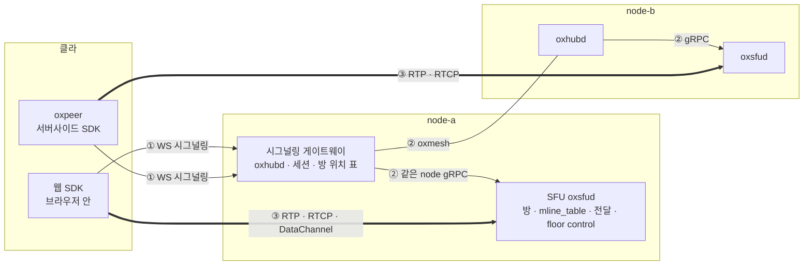
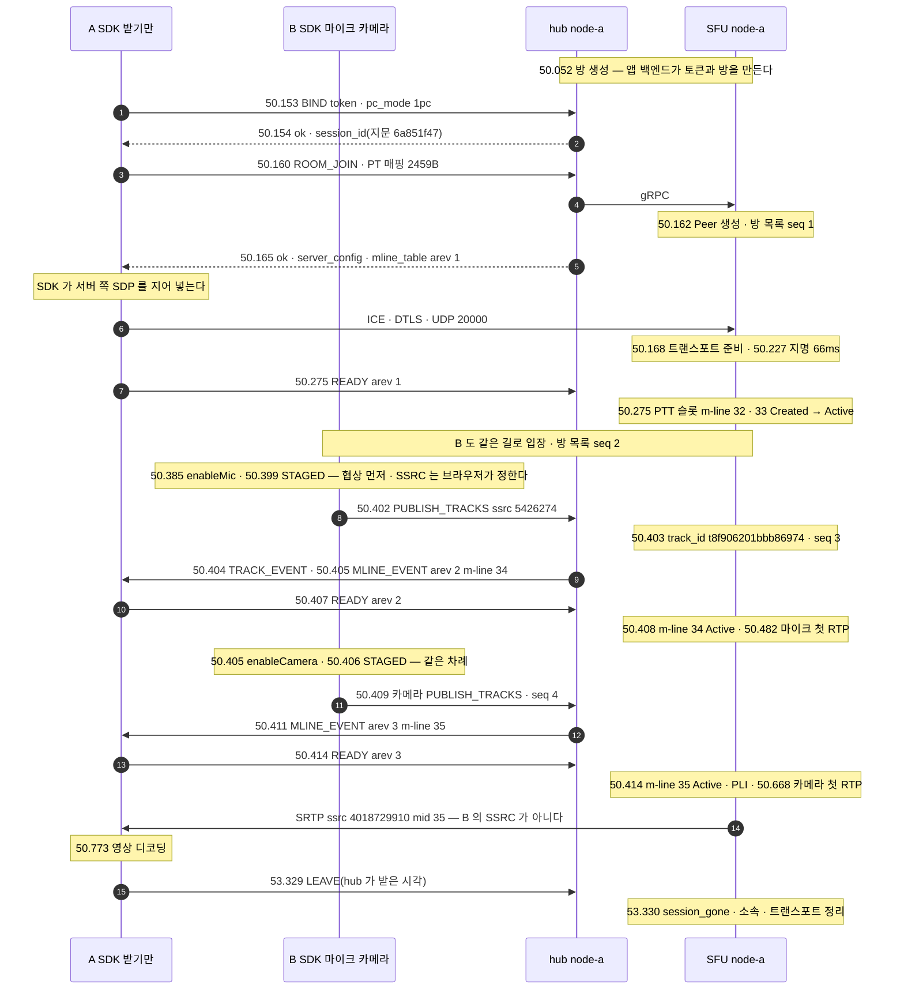

# 01. 한눈에 — 구성요소 · 선 셋 · 접속 한 번의 일생 · 우리만의 것

> author: kodeholic (powered by Claude) · created: 2026-11-09.
> ★**대조한 커밋** — 서버 `oxlens-sfu` `1ef7265` · SDK `oxlens-sdk-web` `de8c4a9`(+탐침) · 2층 `oxlens-labs` `a68d2de` · oxpeer `740f172`
> ★**실측 회차** — 3층 탐침 `tour-learn` 20261109 둘째 판 · 2층 회차 `e2e-20261109-132317`. 값은 돌릴 때마다 바뀌고 차례 · 모양은 같다.

## 1. 30초 요약

- 클라는 시그널링 게이트웨이(hub) 하나에만 붙는다(① WS). hub 는 방 이름으로 그 방의 node 를 찾아 요청을 넘긴다(②). 미디어는 hub 를 지나지 않고, 방을 든 SFU 로 곧장 간다(③).
- 서버는 SDP 를 만들지 않는다. SDK 가 입장 응답을 재료로 서버 쪽 SDP 를 지어 브라우저에 넣는다. 받을 m-line 은 서버가 고른 `mline_table`(m-line 표)로 오고, 클라가 `READY` 로 확인한 m-line 으로만 패킷이 나간다.
- 한 서버가 회의(full-duplex)와 무전(half-duplex · floor control · PTT 슬롯)을 트랙 단위로 섞어 든다. 연결은 1pc(PeerConnection 하나)를 지향하고, 방은 한 node 에만 산다.

## 2. 등장인물 · 값

| 구성요소 | 무엇 | 이 회차 값 | 집 |
|---|---|---|---|
| 웹 SDK `oxlens-sdk-web` | 브라우저 안 클라. 판단은 규격에서 생성한 상태기가, 집행은 손 코드가 한다 | Chromium 153 · Firefox 155 부터 1pc(능력표) | [02](02_CONNECT_JOIN.md) · [15](15_SDK_INSIDE.md) |
| oxpeer `oxlens-sdk-peer` | Rust 서버사이드 SDK. 녹음 · 녹화 · 에이전트가 보통 클라와 같은 계약으로 방에 든다 | `2pc` · `source_tag true` · 2층 24 판 빨강 0 | [16](16_OXPEER.md) |
| 시그널링 게이트웨이 `oxhubd`(hub) | 클라가 붙는 관문. 세션 · 방 위치 표 · oxmesh router 를 든다 | node-a `127.0.0.1:1974` · 하트비트 `10000`ms · 재개 창 `60000`ms | [02](02_CONNECT_JOIN.md) · [10](10_RECOVERY.md) · [13](13_MULTI_NODE.md) |
| SFU `oxsfud` | 방 · 발행 · `mline_table` · 전달 · floor control · RTCP 종단 | node-a `sfu_id` `d6c9ad052c4a12ae` · UDP `20000` · `media-workers=2` | [02](02_CONNECT_JOIN.md) · [04](04_PACKET_PATH.md) |
| oxmesh | node 사이 버스 — router 풀 메시 · liveliness token 선언 · 우선순위 큐 | router listen `7447` · `7448` · `7449` · lease `10000`ms | [14](14_OXMESH.md) |
| node | hub + SFU 한 벌. 개발 형상은 한 기계 위 셋(node-a · b · c) | 방 `qa_tournode_p1` 은 HRW 로 node-b · UDP `20001` | [13](13_MULTI_NODE.md) |
| 접속의 일생(§3-2)의 사람 | A `tour_A` 받기만 · B `tour_B` 마이크 · 카메라. 둘 다 1pc | 방 `qa_tour_p4` · node-a · A 의 세션 지문 `6a851f47` | [02](02_CONNECT_JOIN.md) · [03](03_PUBLISH_SUBSCRIBE.md) |

## 3. 정상 길

### 3-1. 선 셋

| 선 | 누가 누구와 | 무엇이 실리나 | 실측 | 집 |
|---|---|---|---|---|
| ① WS 시그널링 | SDK · oxpeer ↔ 자기 hub | 요청 · 응답 · 통지. 8바이트 머리(ver · flags · op · pid) + JSON. 통지는 요청 꼴로 오고, 클라는 본문 없는 8바이트로 ACK 한다 | `BIND` 첫 프레임 247바이트 · ACK 8바이트 | [02 §3-2](02_CONNECT_JOIN.md) |
| ② 서버 안 | hub → SFU(같은 node gRPC) · hub → oxmesh → 다른 node 의 hub → gRPC. 통지는 SFU 가 버스에 직접 낸다 | 요청 봉투 · 방 · 사람 통지 · liveliness token 선언(node · room · sess) | `ROOM_JOIN` 왕복이 같은 node 5ms(`TOUR-02`) · 다른 node 4ms(`TOUR-13`). 한 기계라 갈리지 않았다. node 사이 요청 시한은 10초 | [13 §3-2](13_MULTI_NODE.md) · [14](14_OXMESH.md) |
| ③ 미디어 | SDK · oxpeer ↔ 방을 든 SFU 직접 | ICE · DTLS · SRTP(RTP · RTCP) · DataChannel(floor control 메시지). UDP 포트 하나에 모두 받고, 사람은 ICE ufrag 로 가른다 | 지명까지 66ms(1pc A) · TCP 후보만 주면 188ms | [02 §3-5 · §3-6](02_CONNECT_JOIN.md) · [04](04_PACKET_PATH.md) |

SDP 는 어느 선에도 실리지 않는다. WS 프레임 어디에도 `v=0` 이 없었다([02 §3-4](02_CONNECT_JOIN.md)).

### 3-2. 접속 한 번의 일생 — 한 장

3층 탐침 `TOUR-02` 하나를 처음부터 끝까지 이었다. [02](02_CONNECT_JOIN.md) · [03](03_PUBLISH_SUBSCRIBE.md) · [04](04_PACKET_PATH.md) 는 이 가운데 한 구간씩을 떼어 깊이 본다. 시각은 KST `14:35:50.xxx` · `53.xxx` 의 초 · ms 다. 브라우저 시계와 서버 시계가 섞여 있어, 1 ~ 3ms 차이는 앞뒤가 바뀔 수 있다.

| 구간 | 실측 | 무엇이 시간을 쓰나 | 집 |
|---|---|---|---|
| `BIND` 왕복 · `ROOM_JOIN` 왕복 | 1ms · 5ms | hub 의 토큰 검사 · SFU 의 Peer 생성 | [02 §3-2 · §3-3](02_CONNECT_JOIN.md) |
| Peer 생성 → 지명 쌍 | 66ms | ICE 검사. 서버는 ICE-lite 라 클라의 지명을 따른다 | [02 §3-3](02_CONNECT_JOIN.md) |
| 서버의 `MLINE_EVENT` → m-line Active | 5ms(m-line 34 · 35 둘 다) | SDK 가 표로 SDP 를 다시 짓고 협상한 뒤 `READY` | [03 §3-2](03_PUBLISH_SUBSCRIBE.md) |
| 발행 등록 → 첫 RTP | 마이크 79ms · 카메라 259ms | 장치 · 인코더. 서버는 RTP 를 기다리지 않고 먼저 알린다 | [03 §3-1](03_PUBLISH_SUBSCRIBE.md) |
| `enableCamera`(.405) → A 가 디코딩(.773) | 368ms | 첫 RTP · `READY` 가 부른 PLI · 디코더 | [03 §3-3](03_PUBLISH_SUBSCRIBE.md) |
| 서버 통과(2층 `adv_loss` 의 영상 패킷) | 페이로드 62바이트 그대로 · RTP 머리 12 → 28바이트 | RTP 헤더 재작성(확장 머리를 통째로 다시 짓는다) · SRTP 풀기 · 싸기 | [04 §3-2](04_PACKET_PATH.md) |

같은 일생의 갈래가 넷 있다.
- 2pc 는 PeerConnection 둘 · 서버 ICE 자격 두 벌이다([02 §3-5](02_CONNECT_JOIN.md)). 20261109 부터 SDK 는 발행 협상 때 구독 PeerConnection 을 다시 협상하지 않는다.
- 무전이면 Floor Request → Floor Granted 가 1ms 안에 오고, 소리는 PTT 슬롯으로 흐른다([07](07_FLOOR.md) · [08](08_SLOT_SPEAKER.md)).
- 방이 다른 node 에 있으면 hub 한 홉이 더 든다([13](13_MULTI_NODE.md)).
- 끝은 `LEAVE` 하나다. hub 가 세션을 거두고, 닿은 SFU 마다 `session_gone` 을 부른다([02 §3-7](02_CONNECT_JOIN.md)).

### 3-3. 키 지도 — 구간마다 무엇으로 찾나

| 구간 | 찾는 것 | 무엇으로 | 실측 예 | 집 |
|---|---|---|---|---|
| 앱 백엔드 → hub | 누구인가 · 어떤 참가자인가 | 토큰 클레임 `sub` · `participant_type` · `hidden` | `tour_A` · `0` · `false` | [02](02_CONNECT_JOIN.md) · [16](16_OXPEER.md) |
| WS 요청 ↔ 응답 | 어느 요청의 답인가 | 8바이트 머리의 op · pid | `BIND` pid 1 | [02](02_CONNECT_JOIN.md) |
| 세션 ↔ 로그 | 어느 접속인가 | `session_id`(원값은 인증 수단) → 세션 지문 8자 = 로그 `session=` | `6a851f47` | [17](17_OPERATIONS.md) |
| 방 → node | 방이 어느 node 에 있나 | 방 이름의 HRW → hub 의 방 위치 표(방 토큰) | `qa_tournode_p1` → node-b | [13](13_MULTI_NODE.md) · [14](14_OXMESH.md) |
| SFU | 어느 기동의 SFU 인가 | `sfu_id` = `epoch`(기동마다 새 값) | `d6c9ad052c4a12ae` | [02](02_CONNECT_JOIN.md) · [14](14_OXMESH.md) |
| 방 안 요청 | 이 입장의 요청인가 | `join_id` | `4c5097d28940f35a` | [02](02_CONNECT_JOIN.md) |
| STUN → 트랜스포트 | 누구의 연결인가 | 서버 ICE ufrag(사람마다) → 트랜스포트. STUN 이 보낸 주소를 함께 묶는다 | `2dVzgEv1` | [04 §3-1](04_PACKET_PATH.md) |
| RTP · RTCP → 트랜스포트 | 누구의 패킷인가 | 보낸 주소(STUN 이 묶은 것) → 트랜스포트 → 그 미디어 워커 큐 | — | [04 §3-1](04_PACKET_PATH.md) |
| 업링크 RTP → 트랙 | 어느 발행인가 | 업링크 SSRC(브라우저가 정해 `PUBLISH_TRACKS` 로 신고) | `3872882618` → `t622aaeab8ea27911` | [03](03_PUBLISH_SUBSCRIBE.md) · [04](04_PACKET_PATH.md) |
| 트랙 → 받는 m-line | 이 트랙을 어느 m-line 으로 | `mline_table`(mid · 다운링크 SSRC · 판 번호 `arev`) | m-line 35 · `4018729910` | [03 §3-2](03_PUBLISH_SUBSCRIBE.md) |
| NACK → 원 패킷 | 무엇을 다시 보내나 | 대상 SSRC → m-line → 재작성 오프셋을 빼서 원 seq | OSN 57 · NACK 에서 RTX 까지 1ms | [04 §3-4](04_PACKET_PATH.md) |
| 방 목록 통지 | 빠진 통지가 있나 | `version` 의 `epoch` · `seq` | seq 1 → 4 | [03 §3-4](03_PUBLISH_SUBSCRIBE.md) |
| 다운링크 패킷 → 발행 출처 | 누가 보낸 패킷인가 | CSRC(`source_tag` 를 켠 세션만) | B 마이크 `csrc 17` | [03 §3-1](03_PUBLISH_SUBSCRIBE.md) · [08 §3-3](08_SLOT_SPEAKER.md) |
| floor control 메시지 → 방 | 어느 방의 floor 인가 | MBCP TLV `ROOM`(29). DataChannel 은 SFU 마다 하나라 여러 방이 섞여 온다 | `qa_tourptt_p2` | [07 §3-2](07_FLOOR.md) |
| 로그 줄 → 규격 | 이 줄의 근거가 무엇인가 | `spec=` 라벨 | `SES.S.bind_new` | [17](17_OPERATIONS.md) |

## 4. 깨지는 길 — 어떤 고장이 어느 장에 있나

증상으로 장을 찾는 지도다. 「실측」 칸은 이 장이 같은 회차에서 다시 뽑은 값이다.

| 고장 | 누가 먼저 아나 | 사용자가 겪는 것 | 실측 | 로그 첫 단서 | 장 |
|---|---|---|---|---|---|
| 시그널링(WS)만 끊김 | hub · SDK 둘 다 끊긴 뒤 3ms 안(TCP 닫힘) | 소리는 이어진다(449 패킷 · 감춘 표본 0) | 끊김 → `ACTIVE` 4.49초. 망 없음 3.01초 + 백오프 대기 1.47초 | `SES.S.drop … in.c=0`(TCP 닫힘에는 사유 코드가 없다) | [10 §3-1](10_RECOVERY.md) · [17 §4-1](17_OPERATIONS.md) |
| 프로세스 35초 얼림(재개 창 안) | hub 하트비트 시한 30초 · SFU 의 ICE 동의 만료 30초 | 얼은 동안 끊기고, 깨면 이어진다 | 깨어나 세션 재개(`BIND` → `resume_ok`) 6ms → ICE 재시작 | `SES.S.drop … in.c=4008`. 20261109 고침 전에는 보낸 `4008` 이 `in.c=0` 으로 빠졌다 | [10 §3-3 · §4-2](10_RECOVERY.md) |
| 95초 얼림(재개 창 밖) | hub 재개 창 만료 | 새 세션 · 재연결(rebuild) · 세션 지문이 바뀐다 | 지문 `f44c1528` → `e6620821` | `SES.S.TWindow` → 새 `bind_new` | [10 §3-4](10_RECOVERY.md) · [17 §4-5](17_OPERATIONS.md) |
| 운영 절단 | 서버(운영자). `LEAVE 2009` | 강제 퇴장 → 재연결 | 다시 입장까지 녹음기 0.08초 · 에이전트 0.84초(회차마다 갈린다) | `SES.S.drop_reclaim … cause=cut` | [10 §3-5](10_RECOVERY.md) |
| 방을 든 SFU 유닛 죽음 | hub(방 토큰이 사라짐) · SDK(ICE) | 소리가 끊기고 약 11초 뒤 「방 없음」. 세션은 산다 | 세 hub 가 1.03 ~ 1.15초에 방 라우팅을 거둠 · 유닛 정지 → `3001` 10.8초 · 클라에 보내는 통지 0 | `SV.rooms … cause=room_dropped` | [10 §3-6](10_RECOVERY.md) · [13 §4-1](13_MULTI_NODE.md) · [14 §4-1](14_OXMESH.md) · [17 §4-3](17_OPERATIONS.md) |
| 방을 든 node 통째(hub 까지) | 다른 node 의 router 가 세션 끊김을 곧바로 본다 | 위와 같은 결말(`3010` → `3001`) | 같은 이름 방을 다시 만들면 같은 node 로 간다(HRW) | `mesh session down … reason=shutdown` | [13 §4-2](13_MULTI_NODE.md) |
| hub 둘 내려감 → 고립 | 남은 hub 가 「내가 고립」으로 판정 | 남은 node 는 계속 방을 받는다 | 고립이 풀리고 2.2초 뒤, 다시 선언되지 않은 보류 방 다섯을 거뒀다. 20261109 고침 전에는 남았다 | `bus isolated` → `held room released` | [14 §4-2](14_OXMESH.md) |
| 미디어 정체(stall) | 아무도 바로 모른다(발행자에게는 손실 0 RR) | 화자가 말하는 중인데 소리가 없다 | 3층 7.46초 — 규격 상한(약 15초) 안. 20261109 고침 전에는 19.7초로 넘었다 | `SV-IMPL-ROOM-STALL` → `CP-OP-ROOM-EVENT` | [11](11_STALL_RESYNC.md) · [17 §4-2](17_OPERATIONS.md) |
| 없는 방 대 못 닿는 node | hub | `3001`「방이 없다」 대 `5001`「기다렸다 다시」 | 유닛 `Stopped` 뒤 4ms 에 `5001` | `CP-CODE-ROOM-NOT-FOUND` · `CP-CODE-SFU-UNAVAILABLE` | [12 §4-1](12_ERRORS.md) · [13 §4-3](13_MULTI_NODE.md) |
| 잘못된 요청 | 클라와 서버 둘 다 | 접속 · 입장 실패 | 19발 전부 기대 번호. 서버 `CP-CODE` 줄도 19개 | `CP-CODE-<이름> … op=<op>` | [12 §3-1 · §4-3](12_ERRORS.md) · [17 §4-6](17_OPERATIONS.md) |
| floor 선점 · 회수 | 서버 판정 | 말하던 사람이 끊긴다 | Floor Revoke 재전송(T8)이 1초마다 — 1,001 · 1,003ms | 방으로 물으면 `TAKEN→PREVOKE` | [07 §4](07_FLOOR.md) · [17 §4-4](17_OPERATIONS.md) |
| 패킷 손실 | 서버(업링크는 서버가 NACK). 구독자 쪽은 서버 캐시가 RTX | 대개 못 느낀다 | NACK → RTX 1ms | 5초 `stat` 계수뿐 | [04 §4-1 · §4-2](04_PACKET_PATH.md) · [17 §4-7](17_OPERATIONS.md) |
| 35초 무발화 | — | 아무 일 없다. 끊김이 아니다 | 정리 0 · 받은 패킷 1,603 | — | [10 §3-7](10_RECOVERY.md) |

다른 장 안의 깨짐(그 장의 「4. 깨지는 길」):

| 장 | 깨지는 길 |
|---|---|
| [02](02_CONNECT_JOIN.md) | `BIND` 에서 안 선다(토큰 · 세대 · 같은 신원 `2010`) · 토큰 발급(HTTP) · `ROOM_JOIN`(없는 방 · 정원 `4001`) |
| [03](03_PUBLISH_SUBSCRIBE.md) | m-line 상한 25 와 재배정(26번째는 늦게 열린다) · 1pc SSRC 겹침 `3008` · 발행 수 `4002` · `READY` 가 안 온다(안전망 5초는 게이트만 푼다) |
| [04](04_PACKET_PATH.md) | 출처가 바뀌는 순간 — 새 화자 첫 키프레임까지 영상을 버린다 · 경계 앞 NACK 에는 RTX 를 안 보낸다 |
| [05](05_SIMULCAST_BWE.md) | 과사용 강등 · NACK 사유 강등 · 프로브 실패 · 재발행 · pause 를 푼 시뮬캐스트 m-line(20261109 고침 — 이제 다시 흐른다) |
| [06](06_TRACK_ATTRS.md) | `muted` 와 `duplex` 를 한 요청에 `1007` · 시뮬캐스트 트랙 duplex `3006` · 회의로 돌아온 m-line 의 첫 패킷(20261109 고침 — 이제 키프레임부터) |
| [07](07_FLOOR.md) | 화자가 놓지 않고 사라짐(T1 회수 · 끊긴 사람에게 가는 Floor Taken) · 다른 방을 지목하거나 방을 안 적은 요청 |
| [08](08_SLOT_SPEAKER.md) | 새 화자 첫 키프레임까지 듣는 쪽 영상 공백 · 다른 node 방을 듣는 사람 — 청취 서버에 DataChannel 이 없으면 Floor Taken 이 안 온다 |
| [09](09_MIC_COST.md) | cold 에서 누르면 첫 음절이 잘린다 · 마이크를 꺼도 망 비용은 안 준다 |
| [15](15_SDK_INSIDE.md) | 받지 않는 사건 · 생성본 어긋남 · 손 결합이 규격을 비껴갈 때 |
| [16](16_OXPEER.md) | 유닛 죽음에 녹음기가 방을 잃는다 · 손실 · m-line 상한을 넘는 녹화 |

## 5. 왜 이 모양인가 — 우리만의 것

다른 SFU 에 없거나 드문 선택만 모았다. 각 행의 깊은 설명과 근거는 그 장 §5 의 `★우리만의 것` 상자에 있다. 얻은 것만이 아니라 잃은 것도 적는다.

| 우리만의 것 | 선택 배경 | 얻은 것 | 잃은 것 | 집 |
|---|---|---|---|---|
| 서버가 SDP 를 안 만든다 | 서버가 offer 를 밀면 클라 offer 와 부딪힌다(glare). 푸는 길은 `rollback` 뿐이다 | 서버에 SDP 파서 · 생성기가 없다. 입장 응답 한 장(2369B)이 재료 전부다. 탐침 열 회차에 `rollback` 0 | SDK 가 계약의 일부가 된다. 서버가 협상할 여지가 없다. 새 클라마다 SDP 조립을 다시 짓는다 | [02 §5](02_CONNECT_JOIN.md) |
| 1pc | 무전은 종일 켜 둔다. 그래서 상시 비용이 지배한다 | 트랜스포트 한 벌 — 서버 ICE 자격 한 벌 · 지명 한 번(66ms) | 협상 큐가 하나라 발행 · 구독이 서로 기다린다. 매번 SDP 전체를 다룬다(7233B 대 2pc 구독 3635B). 번호 공간이 하나다(PT 매핑을 실은 `ROOM_JOIN` 2459B 대 60B · mid 32 부터 · SSRC 겹침 `3008`) | [02 §5](02_CONNECT_JOIN.md) |
| 1pc 상시 비용 | 대기 비용의 대부분이 keepalive 다(옛 2pc 실측 STUN 61%) | 60초 무발화에 STUN 동의 검사 22번 대 45번. STUN 몫이 반이다 | STUN 밖은 같았다(보냄 394B · 받음 130B). 페이로드만 세도 시간당 약 31kB 로, Zello 대기(시간당 20kB)보다 크다 | [09 §5](09_MIC_COST.md) |
| `mline_table` + `READY` | 옛 꼴은 클라가 여러 길의 사건으로 표를 다시 지었다. 어긋날 곳이 일곱이었다 | 재배정 · 빈 m-line 채우기에 SDP 가 안 바뀐다. 엉뚱한 사람이 비치는 길이 없다 | 표가 바뀔 때마다 한 왕복(5ms). `READY` 가 안 오면 그 m-line 은 열리지 않는다. 연결마다 영상 m-line 25 | [03 §5](03_PUBLISH_SUBSCRIBE.md) |
| RTCP 종단 | 구독자 RR 을 발행자에게 넘기면, 발행자가 남의 수신 품질로 비트레이트를 깎는다 | 발행자는 서버가 지은 RR 만 받는다. NACK 은 서버 캐시가 RTX 로 1ms 에 답한다. 인프라 PLI 도 같은 스로틀을 탄다 | 물리 트랙마다 캐시 1,024개 · 사람마다 RTX 예산이 든다. 발행자는 나쁜 구독자를 못 본다 | [04 §5](04_PACKET_PATH.md) |
| 단일 스칼라 offset 재작성 | 옛 범위 지도(`SnRangeMap`)가 화자 전환 때 나가는 seq 를 거꾸로 돌렸다(15614 → 209). 무전 음성이 끊겼다 | m-line 상태가 숫자 넷이다. 전환은 덧셈 둘이다. seq 역행이 없다 | 경계 앞의 늦은 패킷 · 옛 번호 NACK 은 버린다. 계층을 버리는 코덱(temporal layer)을 들이면 깨진다 | [04 §5](04_PACKET_PATH.md) |
| WebRTC 위 half-duplex(floor control over DataChannel) | 업무 무전은 한 사람 · 우선순위 · 대기열 · 선점이 본질이다. 읽어 본 WebRTC 서버에는 floor control 이 없다. 그래서 3GPP TS 24.380 원문을 그대로 따르고, 실을 곳만 DataChannel 로 바꿨다 | Floor Request → Granted 1ms 안 · 대기열 승계 2ms · Release 완료 3ms(한 기계 · `TOUR-07`). 원문 절과 한 줄씩 대조된다 | 청취하는 SFU 마다 발행 PeerConnection 과 DataChannel 이 있어야 통지를 받는다. 영상 무전은 보류했다(NetEQ 누적 지연 p99 264ms · 영상 끄면 42ms — 예전 실측 · 이번 회차 아님). 첫 음절 앞에 왕복이 하나 든다 | [07 §5](07_FLOOR.md) |
| PTT 슬롯 | 화자마다 m-line 을 열면 전환마다 재협상이 든다 | 화자 전환에 신호 0 · 재협상 0. seq 가 구멍 없이 이어진다. 듣는 사람은 두 화자를 mid 32 하나로 214 패킷 받았다(`TOUR-07`) | 패킷만으로는 화자를 모른다(Floor Taken · CSRC 가 필요하다). 새 화자 키프레임까지 영상이 빈다. 동시 발화가 없다 | [08 §5](08_SLOT_SPEAKER.md) |
| 트랙 단위 duplex | 방 모드를 걷고, half · full 을 트랙 속성으로 내렸다. 기존 무전은 1:1 승격을 별도 세션 · 채널 이탈로 한다(우리 조사 · 실측 아님) | 전환이 요청 하나 · `seq` 한 칸이다. 응답까지 8 ~ 10ms(`TOUR-06`). `track_id` · SDP 가 그대로다 | 시뮬캐스트 트랙은 못 바꾼다(`3006`). 돌아올 때 재배정 · `READY` · 키프레임 기다림이 다시 든다. 상태 규칙이 늘었다 | [06 §5](06_TRACK_ATTRS.md) |
| 시그널링과 미디어가 따로 산다 | WS(TCP)와 미디어(UDP)는 따로 끊긴다 | 시그널링이 4.49초 끊겨도 소리는 이어졌다(449 패킷 · 감춘 표본 0). 재협상 0 · `RESUME` 왕복 6ms | 끊긴 동안의 통지는 사라진다(SDK 가 따라잡기 셋을 대조한다). 재개 창(60초) 동안 서버가 세션을 쥔다 | [10 §5](10_RECOVERY.md) |
| 복구 단위 = SFU 마다 트랜스포트 | 한 SFU 가 살면 그 방이 다 살고, 죽으면 다 죽는다 | 유닛이 죽어도 세션은 끝까지 산다. 그 SFU 연결만 닫는다 | 유닛이 죽으면 방을 잃는다(`3001`). 재연결 첫 `ROOM_JOIN` 이 회차마다 갈린다(이번에 0.08초 · 0.84초) | [10 §5](10_RECOVERY.md) |
| 미디어 정체 = 전달 자격과 한 함수 | 「안 흐른다」의 절반 이상은 정상이다(음소거 · 멈춤 · 무전 무음) | run-all 87 시나리오에서 헛 통지 등식(`stall_no_false_alarm`) 빨강 0 | 판정이 느리다 — 5초 틱 · 상한 3주기(약 15초 · 3층 7.46초). 다운링크가 죽은 것은 못 본다 | [11 §5](11_STALL_RESYNC.md) |
| 번호 하나에 뜻 하나 | 클라는 서버보다 늦게 고쳐진다. 그래서 첫 숫자가 할 일을 답한다 | 19발 전부 기대 번호 · 서버 줄도 19개. 응답과 `LEAVE` 사유가 한 표다. 복구는 첫 숫자 넷으로 끝난다 | `3001` 이 「원래 없던 방」과 「방금 사라진 방」을 가르지 않는다. 진단 해상도가 클라 어휘에 묶인다 | [12 §5](12_ERRORS.md) |
| 방 한 node · 서버 간 미디어 중계 없음 | 대상이 LAN · 지역 단위다. node 하나의 천장이 높다(용량 게이트 20261109 생중계 1,500명에 SFU 1.46코어 — 이 장의 회차 아님) | node 사이 재작성 · 구독 집계 · 상태 동기의 결함 축이 없다. 레이어를 고르는 곳이 하나다. 루프 방지가 필요 없다 | 한 방이 기계 한 대를 못 넘는다. node 장애 회복은 방 닫힘 + 재입장이다(`3001` 까지 약 11초). edge 가 없다 | [13 §5](13_MULTI_NODE.md) |
| rendezvous hashing(HRW) 배치 | 배치를 기억하는 외부 저장소 없이 · 시험이 위상을 선언할 수 있게 | 어느 hub 가 계산해도 같은 node 다. node 가 늘거나 줄면 1/N 만 옮긴다 | 부하를 안 본다. 같은 식이 서버 · 2층 · 탐침 셋에 따로 있다. 시야가 갈리면 같은 방이 둘로 설 수 있다 | [13 §5](13_MULTI_NODE.md) |
| hub 다중화 | LB 가 아무 hub 로 보내도 어느 방에나 들어야 한다 | 클라는 방이 다른 node 에 있다는 것을 모른다 | 요청마다 hub 한 홉(한 기계라 5ms 대 4ms — 차이 없음). 한 사건의 줄이 두 node 로그로 갈린다 | [13 §5](13_MULTI_NODE.md) |
| oxmesh(zenoh 를 갈아 끼움) | zenoh 1.10.1 풀 메시에서, 멈췄다 깬 node 의 선언이 이웃에 안 갔다. 포크 고침도 두 번 실패했다 | 멈춤 12초 × 20 에 선언 유실 0(zenoh 17/20 실패) · 100대 풀 메시 6.1초 · liveliness token p99 4.1ms | 부분 단절에 중계가 없다. 연결이 N(N−1)/2 라 100대 미만이다. zenoh 생태계 · 와이어 호환을 버렸다 | [14 §5](14_OXMESH.md) |
| 「있다」는 선언으로 | 방을 방송으로 배우면, 소멸 통보 하나만 빠뜨려도 죽은 방이 node 를 영원히 문다 | 주체가 죽으면 정리 코드 없이 키가 사라진다. 배치 저장소가 따로 없다 | 「내가 고립」과 「남이 다 죽음」을 가를 신호가 없다. 멎은(죽지 않은) 프로세스는 모른다 | [14 §5](14_OXMESH.md) |
| 생성 상태기 | 규격이 정본이고 코드는 규격에서 다시 짓는다. 손 코드에서 사본 8쌍이 나왔다 | 원천 한 줄이 웹 · Rust · TLA+ · 전이 줄에 같은 라벨로 나온다. 호출 벡터로 Rust 와 TS 가 같음을 본다 | 생성기 · 대조 도구가 따로 든다. 원천을 고치면 SDK 로 옮기는 걸음이 든다. `core.ts` 다섯은 여전히 손으로 쓴다 | [15 §5](15_SDK_INSIDE.md) |
| 서버사이드 SDK | 녹음 · 녹화 · 에이전트를 SFU 코어에 넣으면 기능마다 특례가 생긴다 | 서버 특례 0(차이는 토큰의 `hidden` 한 칸). 발언 한 건 = 파일 하나를 패킷의 CSRC 가 정한다. 2층 24 판 빨강 0 | 디코딩 · 인코딩 · 송신 조절은 앱 몫이다. m-line 상한에 묶인다. CSRC 4바이트가 붙는다 | [16 §5](16_OXPEER.md) |
| 로그가 규격 라벨을 들고 다닌다 | 「규격에 이름이 있으면 `ev`」. 운영성 조사(열린 소스 여섯 · 호스팅 다섯)에서 우리뿐이었다 | 이력 판정기가 줄만으로 결함을 잡는다. 20261109 에 Peer 정리(reclaim) 줄 두 번 · 구독 끝 줄 없음을 잡아 고쳤고, 이제 run-all 끝마다 전량을 돌린다(어긋남 0) | 로그량 — 생중계 1,000명 44 kB/s · 1,500명 66 kB/s. 이름 없는 사건은 `diag` 로 남는다 | [17 §5](17_OPERATIONS.md) |
| 세션 지문(session fingerprint) | 사용자가 문의할 때 불러 주는 번호를 로그 세션 키와 같게 했다. 원값은 인증 수단이라 지문 8자만 쓴다 | 와이어 변경 0. `83e581a6` 하나로 두 node 의 줄이 열린다(`TOUR-13` A) | 32비트라 겹칠 수 있다. 세션이 새로 서면 번호가 바뀐다 | [17 §5](17_OPERATIONS.md) |

## 6. 다른 SFU 는 — 축마다 한 표

저쪽 칸은 각 프로젝트 소스 · 문서를 정적으로 읽은 기록에서 장들이 옮긴 것이다 — 「저쪽 소스에는 이렇게 적혀 있다(실측 아님)」. 장들이 근거를 못 찾은 칸은 `—` 로 비웠다. 우리 쪽 장점 · 대가는 링크한 장의 표에 있다.

| 축 | LiveKit | mediasoup | Janus | JVB | Mumble · SvxLink · Zello | 우리 | 장 |
|---|---|---|---|---|---|---|---|
| 서버와 SDP | v1 `join_request` 가 첫 offer 를 동봉 | worker 는 `RtpParameters` 만. SDP 변환은 클라 라이브러리 | — | — | — | 서버는 SDP 를 안 본다. SDK 가 서버 쪽 SDP 를 짓는다 | [02](02_CONNECT_JOIN.md) |
| PeerConnection 수 | 기본 2 · v1 경로 1 | 포트 공유 · ufrag 로 가름 | 반드시 분리(재협상 문제) | — | — | 1pc 지향 · 2pc 기준선 | [02](02_CONNECT_JOIN.md) |
| 동시 offer | 협상 상태기 None → Remote → Retry | — | — | — | — | 시작하는 쪽이 늘 클라 · 큐(`rollback` 0) | [02](02_CONNECT_JOIN.md) · [15](15_SDK_INSIDE.md) |
| 구독 결정 | `desired` + 조정 루프(사건 + 3초 주기) | 영상 Consumer 는 `paused` 로 만들라고 권함 | — | 구독자마다 SSRC 상한 50 · 50 · 다시 씀 | — | `mline_table` · `arev` · `READY` · m-line 25 · 재배정 | [03](03_PUBLISH_SUBSCRIBE.md) |
| RTP 헤더 재작성 | 전달 경로 단일 오프셋 · 범위 지도는 buffer 쪽 | 스칼라 base + 버린 번호 집합 | — | 계층을 버리면 서버가 seq 공간 관리 | — | m-line 마다 단일 오프셋 · 경계 앞 버림 | [04](04_PACKET_PATH.md) |
| PLI 억제 | 레이어마다 low 500ms · high 1s | SSRC 마다 1,000ms | — | 수신자마다 + 출처 전체 2단 | — | 발행자 · 레이어마다 h 1,000 · l 500ms. 인프라 요청도 같은 스로틀 | [04](04_PACKET_PATH.md) |
| 재전송 버퍼 | — | 2,500개 또는 2,000ms | 시간 + RTT 적응 | — | — | 1,024개 + 사람마다 200회/3초 | [04](04_PACKET_PATH.md) |
| 실행 단위 | — | 코어마다 worker 프로세스 | 한 프로세스 · 루프 풀 | — | Mumble 스레드 둘 · 락 하나 | 수신 스레드 1 · 미디어 워커 N · 제어 C | [04](04_PACKET_PATH.md) |
| 레이어 판단 | 구독자 연결마다 할당기 · 혼잡 3단 | 전원 한 계단씩 · BWE 강등 뒤 10초 고정 | 코어에 추정기 없음 | 안 보는 레이어를 발행자가 안 만들게 되먹임 | — | 구독 트랜스포트마다 · 기본 손 상한 · v2 GCC + 프로브 | [05](05_SIMULCAST_BWE.md) |
| 음소거 | `MUTED` · `PUB_MUTED` 사유 · 공백 프레임 | 멈춘 Producer 는 통계만 쌓는다 | audiobridge `mute` · `suspend` | — | — | 서버는 RTP 를 안 거르고 통지만 | [06](06_TRACK_ATTRS.md) |
| floor control | 없음 · 오디오 레벨로 화자 판정 | 관측자(판정 · 게이트 아님) | audiobridge 가 서버에서 섞는다 | 에너지 순위로 입구에서 자른다 | Mumble 클라 판정 · SvxLink 먼저 보낸 쪽 · Zello Work 비상 호출 | 서버 권위 TS 24.380 over DataChannel · 대기열 · 선점 · Revoke | [07](07_FLOOR.md) |
| m-line 돌려쓰기 · 녹화 신원 | 트랙 하나 = 구독 하나 고정 | Consumer 는 Producer 하나에 평생 | 발행 핸들에서 녹화 | 받는 SSRC 를 다시 써 돌려쓴다 | — | PTT 슬롯 · 재배정 + CSRC(켠 세션만) | [08](08_SLOT_SPEAKER.md) · [16](16_OXPEER.md) |
| 다방 청취 | — | — | — | 수신자가 `include` · `exclude` | Mumble 채널 청취 · SvxLink 말할 곳 하나 + 들을 곳 집합 · Zello 채널 4종 | `pub_room` 하나 + `sub_rooms` 집합 | [08](08_SLOT_SPEAKER.md) |
| 대기 비용 | — | ICE Lite · 동의 시한 앱 설정(기본 30초) | 동의 · keepalive 를 설정으로 | — | Zello 자체 프로토콜 시간당 20kB | WebRTC 그대로 · 1pc 로 트랜스포트 수만 줄인다 | [09](09_MIC_COST.md) |
| 복구 | resume · ICE restart · full 3단 · 클라 `SyncState` 신고 | `RESTART_ICE` 원시 연산 · 언제는 앱 몫 | `claim` — 다른 연결이 인계 | make-before-break(agent 둘) | Mumble UDP · TCP 판정을 기억 | 같은 3단 · 신고 없는 조회 · 사다리가 계약 | [10](10_RECOVERY.md) |
| 정체 감지 | 불연속을 새 스트림으로(기본 꺼짐) · 구독 실패 3분류 | — | — | — | — | 전달 자격과 한 함수 · 5초 틱 · 구독자에게 통지 | [11](11_STALL_RESYNC.md) |
| 오류 어휘 | 내부 30 · 클라 13 · 종료 사유 11 · 사상 함수 | — | 문자열 하나 · 상태 비트 21 | — | — | 번호 공간 하나 39개 · 응답 · 끊김 공용 · 첫 숫자 | [12](12_ERRORS.md) |
| 방 배치 · 분산 | Redis `room_node_map` · CPU · 부하 · 지역 · node 간 미디어 없음 | `PipeTransport` 하나 · 정책은 앱 | 단일 프로세스(node 간 버스 근거 없음) | 브리지 릴레이 · 중앙 Jicofo · split-horizon | — | 방 한 node · HRW · 중계 없음 | [13](13_MULTI_NODE.md) |
| node 간 상태 | Redis 키 둘 · 죽은 node 정리는 기동 때 한 번 | 버스 없음 | — | 중앙 조정자(XMPP) | — | oxmesh liveliness token(주체 세션에 묶임) · 외부 저장소 없음 | [14](14_OXMESH.md) |
| 서버 쪽 참가자 · 녹화 | 에이전트 워커에 job 배정 · grant `Hidden` · `Recorder` · `Agent` | Plain 전송으로 밖에 넘긴다 | `rtpfwd` · 녹음은 MJR | 발행 단위 tap | — | 앱이 토큰을 받아 보통 클라로(oxpeer) · 서버 특례 없음 | [16](16_OXPEER.md) |
| 상태기 짓는 법 | 손으로 쓴 Go | 상태기는 통합 시험 18 파일 | 단위 시험 없음 · 퍼저 셋 | — | — | 규격 원천에서 생성 · TLA+ 모형 · 호출 벡터 | [15](15_SDK_INSIDE.md) |
| 로그 · 지난 세션 | zap 구조 · 세션 분석은 호스팅 기능(열린 소스에서 못 찾음) | DEBUG 문자열 · trace 런타임 켜기 | JSON 로거 · 사건 처리기 9형 | 자유 문장 · REST 토글 | — | logfmt · `spec=` 규격 라벨 · 로그 줄을 골라 node 마다 나란히 | [17](17_OPERATIONS.md) |

이 표 밖에서 장들이 견준 것도 있다 — str0m(1.5초 무패킷 사건 · 시간 입력 · [04](04_PACKET_PATH.md) · [11](11_STALL_RESYNC.md) · [15](15_SDK_INSIDE.md)) · webrtc-rs(시간 경계 CI · [15](15_SDK_INSIDE.md)) · Discord(SDP 를 wire 에서 뺌 · [02](02_CONNECT_JOIN.md)) · Google Meet 미디어 API(CSRC 가 참가자 신원 · [08](08_SLOT_SPEAKER.md)) · atm0s · Cloudflare · Millicast · MoQ(분산 · [13](13_MULTI_NODE.md)) · zenoh 1.10.1(우리가 직접 잰 유일한 상대 · [14](14_OXMESH.md)).

## 7. 운영에서 보는 법

| 묻는 것 | 먼저 볼 곳 | 집 |
|---|---|---|
| 「이 사람이 왜 안 되나」 | 사용자가 부른 세션 지문 8자 → `oxadmin history` · `GET /admin/history`(node 마다 나란히) | [17](17_OPERATIONS.md) |
| 받는 영상이 검다 | `/admin/users/<user>/media` 의 `arev` 와 `acked` 가 같은가 → m-line 의 `rewrite` · 발행 쪽 `first_rtp` | [03 §7](03_PUBLISH_SUBSCRIBE.md) · [04](04_PACKET_PATH.md) |
| 패킷을 버렸나 | `/admin/drops`(사유마다 계수 — 로그 줄이 아니다) · `/admin/transit`(두 번 읽어 차) | [04 §7](04_PACKET_PATH.md) |
| 워커 수 · 정책 값 | 기동 줄 `sfud boot …` | [04 §7](04_PACKET_PATH.md) |
| 방이 어느 node 에 · 버스가 무엇을 보나 | `/admin/rooms` · `/admin/bus` · `oxadmin bus --all` | [13](13_MULTI_NODE.md) · [14](14_OXMESH.md) |
| 거절이 무엇이었나 | 실패 응답 · 끊김 사유마다 `CP-CODE-<이름>` 줄이 하나 남는다(HTTP · `BIND` 실패 · 모르는 op · `5001` 도) | [12 §4-3](12_ERRORS.md) |
| floor 사건의 차례 | 발언권 `ev` 줄의 `floor_sequence`(방 계수) · `mbcp_seq` | [07 §7](07_FLOOR.md) · [17](17_OPERATIONS.md) |

한 사람의 줄은 세션을 든 hub 의 node 와 방을 든 node 로 갈린다. 둘은 `session=` 으로 잇는다([13 §7](13_MULTI_NODE.md) · [17](17_OPERATIONS.md)).

## 8. 소스 · 규격 좌표

| 구성요소 | 소스 | 규격(공개) |
|---|---|---|
| hub | `oxlens-sfu/crates/oxhubd/src/` — `ses`(세션 · `BIND`) · `room`(방 위치) · `bus`(버스 시야 · `placement.rs` HRW) · `ops`(HTTP · 운영) | [연:RULE-SES-PC-MODE-SESSION](../protocol/03-ses.md#RULE-SES-PC-MODE-SESSION) · [연:RULE-SES-FINGERPRINT](../protocol/03-ses.md#RULE-SES-FINGERPRINT) |
| SFU | `oxlens-sfu/crates/oxsfud/src/` — `fwd`(수신 스레드 · 미디어 워커 · RTP 헤더 재작성) · `rtcp` · `sub`(`mline_table`) · `pub` · `flr`(floor control) · `sim` · `link` · `gc` | [연:RULE-SUB-FILL](../protocol/08-sub.md#RULE-SUB-FILL) · [연:RULE-SUB-EGRESS-ACKED](../protocol/08-sub.md#RULE-SUB-EGRESS-ACKED) · [연:RULE-FLR-MBCP-COMPLY](../protocol/10-flr.md#RULE-FLR-MBCP-COMPLY) |
| oxmesh | `oxlens-sfu/crates/oxmesh/src/` — `core.rs` · `session.rs` · `wire.rs` · `keyexpr.rs` | — |
| 운영 도구 | `oxlens-sfu/crates/oxadmin/` | (운영 규격은 [17](17_OPERATIONS.md)) |
| 웹 SDK | `oxlens-sdk-web/src/` — `domain/<영역>/core.ts`(손 집행) · `internal/link/sdp.ts`(서버 쪽 SDP) · `platform/capability.ts`(`pc_mode`) · `internal/wire/ws.ts`(op 표) | [연:RULE-LINK-SDP-FREE](../protocol/09-link.md#RULE-LINK-SDP-FREE) · [연:RULE-LINK-SDP-1PC](../protocol/09-link.md#RULE-LINK-SDP-1PC) · [연:RULE-LINK-SDP-PC-COUNT](../protocol/09-link.md#RULE-LINK-SDP-PC-COUNT) · [연:R-LINK-SDP-WE-1PC](../protocol/09-link.md#R-LINK-SDP-WE-1PC) · [연:RULE-LINK-SDP-DC-OPENER](../protocol/09-link.md#RULE-LINK-SDP-DC-OPENER) |
| oxpeer | `oxlens-sdk-peer/src/` · 예제 `examples/` | [연:RULE-TRK-CSRC](../protocol/06-trk.md#RULE-TRK-CSRC) |
| 복구 · 오류 | (각 장) | [연:RULE-LINK-RECOVERY-TIERS](../protocol/09-link.md#RULE-LINK-RECOVERY-TIERS) · [연:RULE-LINK-RECOVERY-UNIT](../protocol/09-link.md#RULE-LINK-RECOVERY-UNIT) · [연:RULE-LINK-RECOVERY-WS-FIRST](../protocol/09-link.md#RULE-LINK-RECOVERY-WS-FIRST) · [연:RULE-ERR-ONE-NUMBER-ONE-MEANING](../protocol/11-err.md#RULE-ERR-ONE-NUMBER-ONE-MEANING) · [연:RULE-ERR-UNKNOWN-BY-LEAD](../protocol/11-err.md#RULE-ERR-UNKNOWN-BY-LEAD) · [연:R-ROOM-CLOSED-OPS-ONLY](../protocol/04-room.md#R-ROOM-CLOSED-OPS-ONLY) |

## 9. 스스로 확인하는 질문

1. 클라는 node-a 의 hub 에 붙었고 방은 node-b 에 있다. 요청 · 통지 · 미디어는 각각 어느 선으로 어디를 지나나?

요청은 ① WS 로 hub-a 에 간다. hub-a 는 ② oxmesh 로 hub-b 에 넘기고, hub-b 가 gRPC 로 SFU-b 에 넘긴다. 통지는 SFU-b 가 버스에 직접 낸다. 그 방에 관심을 선언한 hub-a 가 받아 WS 로 내린다. 미디어는 ③ UDP 로 브라우저에서 SFU-b(`20001`)로 곧장 간다. hub 를 지나지 않는다([13](13_MULTI_NODE.md)).

2. A 의 화면에 B 의 영상이 뜰 때, A 가 받은 패킷의 SSRC 는 B 의 카메라 SSRC 인가?

아니다. A 는 m-line 35 의 다운링크 SSRC `4018729910` 으로 받는다. B 의 진짜 SSRC `3872882618` 은 B 의 answer · `PUBLISH_TRACKS` · 송신 통계에만 있다. 서버가 SSRC · PT · seq · ts · 확장을 m-line 의 것으로 다시 쓰고 페이로드만 그대로 둔다([04 §3-2](04_PACKET_PATH.md)). 서버가 짓는 다운링크 SSRC 는 최상위 비트를 세운 난수라 CSRC 와 겹치지 않는다. 20261109 고침 뒤로 이 회차의 다운링크 SSRC 는 전부 `0x80000000` 이상이었다([연:RULE-LINK-SDP-1PC](../protocol/09-link.md#RULE-LINK-SDP-1PC)).

3. 녹음기가 든 방의 SFU 유닛이 죽었다. 녹음기는 무엇으로 그 사실을 알고, 세션은 어떻게 되나?

서버는 클라에 통지를 지어 보내지 않는다. 녹음기는 미디어가 멎은 것을 보고 그 SFU 연결의 복구 사다리를 밟는다. `ICE_RESTART` → `3010` → 재연결 → `ROOM_JOIN` `3001` 순서로 방이 없어진 것을 안다(이 회차 유닛 정지부터 10.8초). 세션은 산 채로 그 SFU 연결만 닫는다. 복구 단위가 SFU 마다 트랜스포트라서다([10 §3-6](10_RECOVERY.md) · [13 §4-1](13_MULTI_NODE.md)).

4. 1pc 가 2pc 보다 대기 비용을 얼마나 줄였나? 무엇은 안 줄었나?

60초 무발화에 STUN 동의 검사가 22번 대 45번이었다. STUN 몫이 반이 됐다. STUN 밖의 페이로드(보냄 394B · 받음 130B)는 같았다. 그래서 「상시 비용 반」이 아니라 「STUN 몫 반」이다. 대신 1pc 는 협상 큐 하나 · 매번 SDP 전체 · 번호 공간 하나를 치른다([09](09_MIC_COST.md) · [02 §5](02_CONNECT_JOIN.md)).

5. 듣는 사람 귀에 소리가 끊겼는데 화자는 말하는 중으로 보인다. 서버는 언제 알리고, 왜 바로 못 알리나?

미디어 정체(stall)다. 서버는 5초 틱마다 「전달 자격이 있는데 안 흐른 m-line」을 판정한다. 걸리면 구독자에게 `sync_required` 를 보낸다. 이 회차 3층은 발행이 멎고 7.46초 뒤에 알렸다. 창을 줄이면 말을 멈춘 화자 · 음소거 같은 정상 무음까지 잡는다. 20261109 고침 전에는 판정 창과 틱 주기가 같아, 1ms 모자람에 한 주기씩 밀렸다(3층 19.7초). 이제 판정을 틱 단위로 해 상한 3주기(약 15초)를 지킨다([11 §4-1](11_STALL_RESYNC.md)).

6. 다른 node 의 무전 방을 듣기만 하는 사람이 Floor Taken 을 받으려면 무엇이 있어야 하나?

floor control 메시지는 DataChannel 로 오고, DataChannel 은 발행 PeerConnection 위에 있다. 그래서 듣기만 해도 청취하는 SFU 마다 트랙 없는 발행 PeerConnection 과 DataChannel 을 세운다([연:RULE-LINK-SDP-DC-OPENER](../protocol/09-link.md#RULE-LINK-SDP-DC-OPENER)). 한때 「다른 node 방 청취자에게 Floor Taken 이 0」으로 보였다. 원인은 서버가 아니라 2층 봇이 홈 서버에만 DataChannel 을 연 것이었다. 봇을 규격대로 고친 뒤 `ptt_multiroom` 의 청취자는 Floor Taken 을 받았다([08 §4-3](08_SLOT_SPEAKER.md)).

