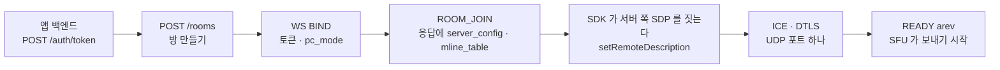
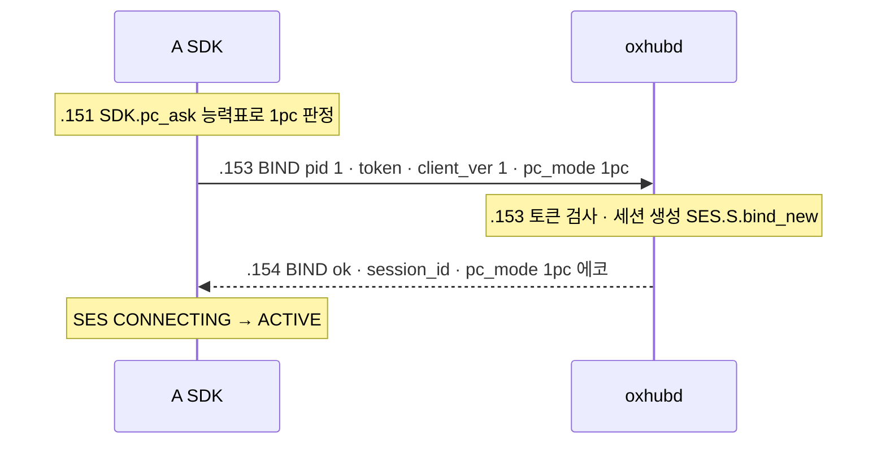
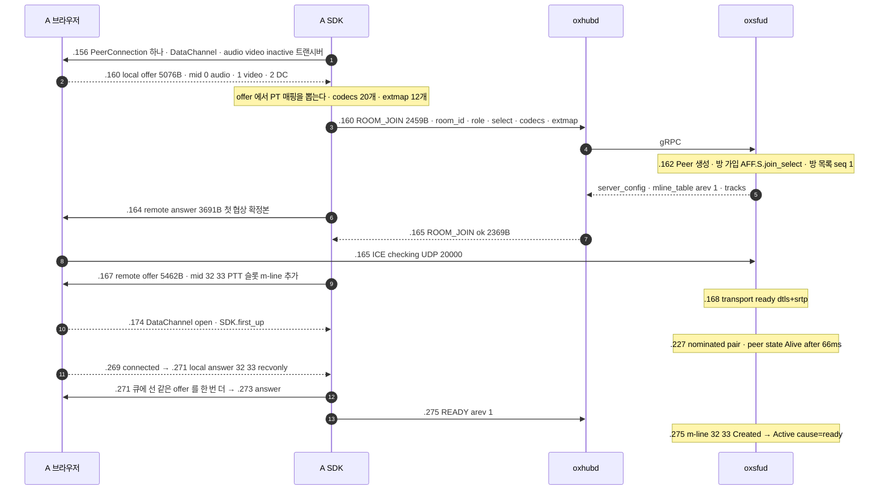
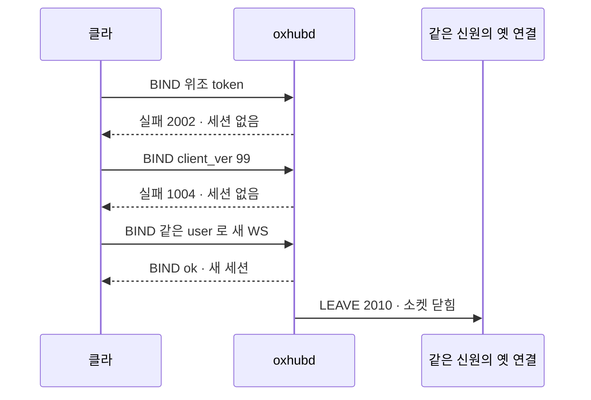

# 02. 접속과 입장 — 토큰 · BIND · ROOM_JOIN · 1pc 와 2pc

> author: kodeholic (powered by Claude) · created: 2026-11-09 · 고침: 2026-11-09(새 회차 · 표준 용어).
> ★**대조한 커밋** — 서버 `oxlens-sfu` `1ef7265` · SDK `oxlens-sdk-web` `de8c4a9`(+탐침) · 2층 `oxlens-labs` `a68d2de`
> ★**실측 회차** — 3층 탐침 `tour-learn` 20261109 둘째 판(`02` · `02P` · `02T`) · 2층 회차 `e2e-20261109-132317`(`adv_wire_reject`). 값은 돌릴 때마다 바뀌고 차례 · 모양은 같다.

용어 대응(m-line · PeerConnection · 트랜스포트 · PT 매핑 등)은 [00 용어](00_INDEX.md#표준-용어)에 있다.

## 1. 30초 요약



- 서버는 SDP 를 주지도 받지도 않는다. SDK 가 `ROOM_JOIN` 응답의 재료로 서버 쪽 SDP 를 직접 짓는다. 재료는 `server_config` 와 `mline_table`(m-line 표)이다.
- 그래서 offer 를 내는 쪽은 늘 클라다. glare(양쪽 offer 충돌)가 생기지 않는다.
- `pc_mode` 는 `BIND` 에서 정하는 세션 값이다. 1pc 는 PeerConnection 하나에 트랜스포트(ICE · DTLS · SRTP 한 벌) 하나다. 2pc 는 둘이다.
- 접속이 실패하는 곳은 셋이다 — 토큰 발급(HTTP) · `BIND` · `ROOM_JOIN`. 거절은 이제 전부 서버 로그에 `CP-CODE-*` 줄을 남긴다(20261109 고침 · §4 · §7).

## 2. 등장인물 · 값

| 이름 | 이 회차 값 | 무엇 |
|---|---|---|
| A · B | `tour_A` · `tour_B`(1pc) / `tour2pc_A` · `tour2pc_B`(2pc) / `tourtcp_A` · `tourtcp_B`(UDP · TCP) | A 는 받기만 한다. B 는 마이크 · 카메라를 켠다 |
| 방 | `qa_tour_p4` · `qa_tour2pc_p0` · `qa_tourtcp_p0` | 셋 다 node-a 에 놓였다 |
| 토큰 클레임(A) | `{"sub":"tour_A","participant_type":0,"hidden":false,"iat":1794202550,"exp":1794206150}` · HS256 | 유효 3600초 · [연:RULE-SES-TOKEN-CLAIMS](../protocol/03-ses.md#RULE-SES-TOKEN-CLAIMS) |
| SFU 신원 | `sfu_id` = `d6c9ad052c4a12ae` | 응답 `server_config.sfu_id` 와 `version.epoch` 가 같다 |
| 세션(A, 1pc) | `session_id` `cb59eebc…`(32자) · 로그 지문 `6a851f47` | 지문 = `SHA-256(session_id)` 앞 8자([연:RULE-SES-FINGERPRINT](../protocol/03-ses.md#RULE-SES-FINGERPRINT) · 읽는 법은 [17](17_OPERATIONS.md)) |
| BIND 응답 | `heartbeat_interval 10000` · `resume_window_ms 60000` · `server_ver 1` · `source_tag false` | 재개 창은 [10](10_RECOVERY.md) |
| 서버 ICE(1pc A) | `publish_ufrag` = `subscribe_ufrag` = `2dVzgEv1` · `port 20000` · `tcp_port 20000` | [연:LINK.type.ServerConfig](../protocol/09-link.md#LINK.type.ServerConfig) |
| 서버 ICE(2pc A) | `publish_ufrag RTdPiHEz` · `subscribe_ufrag SPb0kr7S` | 두 벌 |
| DTLS | `setup passive` · 지문 `sha-256 …` | 서버가 passive, 브라우저가 active |

## 3. 정상 길

시각은 KST `14:35:50.xxx` 의 뒤 세 숫자(ms)다. WS 프레임은 시험 프로세스가 본 시각이다. 그래서 브라우저 사건보다 1~2ms 늦게 찍히기도 한다.

### 3-1. 시작 전 — 토큰과 방

토큰 발급은 앱 백엔드의 일이다([연:SES.http.TOKEN](../protocol/03-ses.md#SES.http.TOKEN)). 탐침이 백엔드 노릇을 한다. `POST /auth/token` 에 `api_key` · `api_secret` · `user_id` · `participant_type 0` · `hidden false` 를 보내고, 받은 JWT 를 SDK 에 넘긴다.

방은 `POST /rooms` 로 만든다([연:ROOM.http.CREATE_ROOM](../protocol/04-room.md#ROOM.http.CREATE_ROOM)). 같은 `room_id` 로 다시 부르면 있는 방을 돌려준다([연:RULE-ROOM-CREATE-PROC](../protocol/04-room.md#RULE-ROOM-CREATE-PROC)).

```
14:35:50.052 node=node-a proc=sfu kind=diag spec=SV-IMPL-ROOM-LIFE room=qa_tour_p4 in.unused_ttl=30 in.departure_ttl=5 msg="room created"
```
- 탐침은 TTL 을 주지 않았다. 그래서 서버 설정 값(`unused_ttl 30` · `departure_ttl 5`)이 붙었다.
- 상용 기본은 영구다. 앱이 TTL 을 빠뜨리면 빈 방이 남는다([연:R-ROOM-CREATE-SYMPTOM](../protocol/04-room.md#R-ROOM-CREATE-SYMPTOM)).

### 3-2. 접속 — `BIND`



**WS 프레임 한 장을 바이트로 본다**([연:TRN.frame.WS](../protocol/02-trn.md#TRN.frame.WS)). 8바이트 머리는 이 장에서만 푼다.

```
01 00 01 01 00 00 00 01 7b 22 74 6f 6b 65 6e ...   A 가 보낸 첫 프레임(247바이트)
│  │  └─┬─┘ └────┬────┘ └ JSON {"token":"…","client_ver":1,"pc_mode":"1pc"}
│  │    │        └ pid 1 — 응답이 같은 pid 로 돌아온다
│  │    └ op 0x0101 = BIND
│  └ flags 하위 2비트 00 = 요청(01 성공 응답 · 10 실패 응답)
└ ver 1
01 01 01 01 00 00 00 01 {"user_id":"tour_A",…}       응답(178바이트) — flags 01 · 같은 op · 같은 pid
01 00 07 01 00 00 00 01 {"type":"joined",…}          서버 통지 PARTICIPANT_EVENT — 요청 꼴(flags 00) · 서버가 매긴 pid
01 01 07 01 00 00 00 01                               A 의 ACK — 머리 8바이트뿐, 본문 없음
```
- 서버 통지는 요청 꼴로 온다. 클라는 같은 op · 같은 pid 의 성공 프레임으로 ACK 한다([연:RULE-TRN-NOTIFY-ACK-STEPS](../protocol/02-trn.md#RULE-TRN-NOTIFY-ACK-STEPS)).
- 이 회차의 ACK 는 전부 8바이트였다.
- `pc_mode` 는 붙기 전에 정하는 세션 값이다([연:RULE-SES-PC-MODE-SESSION](../protocol/03-ses.md#RULE-SES-PC-MODE-SESSION)). SDK 는 브라우저 능력표로 정한다 — Chromium 153 · Firefox 155 부터 1pc, 표에 없으면 2pc. 전이 `SDK.pc_ask` 가 그 판정이다.
- 앱이 정하면 앱이 이긴다. 02P 탐침이 그렇게 2pc 를 골랐다.

```
14:35:50.153 proc=hub kind=ev spec=SES.S.bind_new session=6a851f47 user=tour_A area=SES key=6a851f47 from=- to=live+bound cause=BIND
14:35:50.153 proc=hub kind=ev spec=CP-OP-BIND session=6a851f47 user=tour_A msg=bound
```

### 3-3. 입장 — `ROOM_JOIN` 과 첫 협상(1pc)



**`ROOM_JOIN` 응답에 실려 온 것**([연:ROOM.op.ROOM_JOIN](../protocol/04-room.md#ROOM.op.ROOM_JOIN) · [연:LINK.type.ServerConfig](../protocol/09-link.md#LINK.type.ServerConfig)):

| 칸 | 이 회차 값 | 무엇에 쓰나 |
|---|---|---|
| `server_config.ice` | ip `<서버 IP>` · port 20000 · tcp_port 20000 · ufrag `2dVzgEv1` · pwd 22자 | 서버 쪽 SDP 의 `a=candidate` · `a=ice-ufrag` · `a=ice-pwd` |
| `server_config.dtls` | `sha-256 …` · `passive` | `a=fingerprint` · `a=setup` |
| `server_config.extmap` | mid 1 · audio-level 4 · abs-send-time 5 · twcc 6 · rid 10 · repaired-rid 11 | 2pc 구독 SDP 의 확장 번호(1pc 는 PT 매핑을 쓴다 — §3-5) |
| `server_config.codecs` | opus · VP8 · H264 와 각 `rtcp_fb` | 서버가 정하는 것은 코덱 이름과 받고 싶은 RTCP 피드백뿐이다([연:RULE-ROOM-JOIN-PROC](../protocol/04-room.md#RULE-ROOM-JOIN-PROC)) |
| `mline_table` | arev 1 · m-line 32 audio · 33 video(PTT 슬롯) | 받을 m-line 목록 — 자세한 것은 [03](03_PUBLISH_SUBSCRIBE.md) |
| `join_id` | `4c5097d28940f35a` | 그 방의 요청마다 싣는 입장 식별자([연:RULE-ROOM-JOIN-ID](../protocol/04-room.md#RULE-ROOM-JOIN-ID)) |
| `version` | epoch `d6c9ad052c4a12ae` · seq 1 | 방 목록 차례 — [03](03_PUBLISH_SUBSCRIBE.md) |

- **PT 매핑(payload type mapping)** — 1pc 는 `ROOM_JOIN` 을 보내기 전에 브라우저 offer 를 먼저 만든다. 그 offer 의 PT 표와 확장 ID 표를 요청에 싣는다([연:RULE-ROOM-JOIN-NUMBER-TAGS](../protocol/04-room.md#RULE-ROOM-JOIN-NUMBER-TAGS)).
- 왜 싣나 — 1pc 는 BUNDLE 하나라 번호 공간이 하나다. 서버는 내 번호와 겹치지 않게 구독 PT 를 골라야 한다.
- 이것은 트랙 발행이 아니다. 듣기만 하는 A 도 싣는다.
- **협상이 두 번인 까닭** — 첫 협상(브라우저 offer)이 끝나기 전에 m-line 표가 왔다. SDK 는 다시 짓기를 큐에 넣었다(`LINK.C.any.renego_queued`). 첫 협상이 끝나자(`nego_ok_next`) 큐의 것을 한 번 더 했다. 두 offer 가 겹치지 않고 차례로 돌았다(§5).
- **관찰** — A 의 첫 local answer(.271)는 PeerConnection 이 `connected`(.269)가 된 직후에 나왔다. remote offer(.167)에서 약 104ms 다. B 는 같은 구간이 7ms 였다(.375 → .382). 브라우저 안쪽 일이라 까닭은 이 회차로 가리지 않았다(옛 회차도 같은 모양 — 100ms 대 7ms).

```
14:35:50.162 proc=sfu kind=ev spec=SV-STATE-PEER-STATE session=6a851f47 user=tour_A area=LINK key=publish from=- to=Alive cause=peer_created
14:35:50.162 proc=sfu kind=ev spec=SV-STATE-SUBSCRIBE-STATE session=6a851f47 user=tour_A area=SUB key=ptt-qa_tour_p4-audio from=- to=Created cause=load
14:35:50.162 proc=sfu kind=ev spec=AFF.S.join_select session=6a851f47 user=tour_A area=AFF key=tour_A from=- to=qa_tour_p4 cause=ROOM_JOIN
14:35:50.163 proc=hub kind=ev spec=CP-OP-ROOM-JOIN session=6a851f47 user=tour_A msg=ok
14:35:50.168 proc=sfu kind=diag spec=SV-RULE-LINK-TRANSPORT session=6a851f47 user=tour_A msg="transport ready (dtls+srtp) publish"
14:35:50.227 proc=sfu kind=ev spec=SV-STATE-PEER-STATE session=6a851f47 user=tour_A area=LINK key=publish from=Alive to=Alive cause=nominated_new_pair
14:35:50.227 proc=sfu kind=diag spec=SV-IMPL-LINK-PEER-STATE session=6a851f47 user=tour_A in.dwell_ms=66 msg="peer state Alive after 66ms (publish)"
14:35:50.275 proc=sfu kind=ev spec=SV-STATE-SUBSCRIBE-STATE session=6a851f47 user=tour_A area=SUB key=ptt-qa_tour_p4-audio from=Created to=Active cause=ready
```
- 1pc 의 트랜스포트 하나는 서버 로그에서 `key=publish` 로 찍힌다. 2pc 의 `publish` · `subscribe` 가운데 앞 이름을 그대로 쓴다.
- `transport ready`(DTLS · SRTP 키)가 `peer state Alive`(지명된 후보 쌍 확정)보다 앞선다. 서버는 ICE-lite 라 클라가 지명한 쌍을 따를 뿐이다.
- 구독 상태기(m-line 하나의 상태)는 이제 생성 줄 `-→Created cause=load` 부터 찍힌다(20261109 고침). 전에는 생성 · 소멸 줄이 없어 사슬이 중간에서 시작했다 — [17](17_OPERATIONS.md).

### 3-4. 서버가 SDP 를 안 만든다 — 누가 offer 를 냈나

탐침이 브라우저의 `setLocalDescription` · `setRemoteDescription` 을 전부 거뒀다. `remote` 로 들어간 SDP 는 전부 SDK 가 지은 것이다. 서버에서 SDP 가 온 적이 없다 — WS 프레임 어디에도 `v=0` 이 없다.

| PeerConnection | 사건 | 브라우저에 들어간 것 | [연:RULE-LINK-SDP-DIRECTION](../protocol/09-link.md#RULE-LINK-SDP-DIRECTION) 의 칸 |
|---|---|---|---|
| 1pc pc0 | 첫 협상(입장) | local **offer**(브라우저) → remote answer(SDK 가 지음) | 발행 방향 — 첫 협상 한 번만([연:RULE-LINK-SDP-1PC](../protocol/09-link.md#RULE-LINK-SDP-1PC) 규칙 1) |
| 1pc pc0 | m-line 표 · 마이크 · 카메라 | remote **offer**(SDK 가 지음) → local answer | 그 뒤는 언제나 서버 쪽 offer |
| 2pc pc0(발행) | 입장 · 마이크 · 카메라 | local **offer** → remote answer | 발행 — 늘 브라우저 offer |
| 2pc pc1(구독) | 입장 · m-line 표 | remote **offer** → local answer | 구독 — 늘 서버 쪽 offer |

SDK 가 지은 서버 쪽 SDP 한 절이다(1pc A, m-line 34). 서버 값이 그대로 들어간다:
```
m=audio 20000 UDP/TLS/RTP/SAVPF 111
a=ice-ufrag:2dVzgEv1              ← server_config.ice
a=fingerprint:sha-256 …           ← server_config.dtls
a=setup:passive                   ← 서버가 passive
a=mid:34                          ← m-line 표의 mid 그대로
a=sendonly                        ← 서버가 보낸다(서버 시각)
a=ssrc:3663402885 cname:ox-sfu    ← m-line 표의 다운링크 SSRC
a=candidate:1 1 udp 2113937151 <서버 IP> 20000 typ host
a=end-of-candidates
```
- 열 탐침 회차(02 ~ 13) 전부에서 `rollback` 은 0 이었다. SDK 전이 `renego_queued` 는 27번이었다.
- 협상을 시작하는 쪽이 늘 클라다. 겹치면 클라가 큐에 세운다([연:RULE-LINK-SDP-RENEGOTIATE](../protocol/09-link.md#RULE-LINK-SDP-RENEGOTIATE)).
- 다운링크 SSRC `3663402885` 는 `0x80000000` 이상이다. 서버가 만드는 SSRC 의 최상위 비트 규칙은 [03 §4-2](03_PUBLISH_SUBSCRIBE.md) 에 있다(20261109 고침).

### 3-5. 1pc 와 2pc — 같은 길을 두 번 잰 것

| | 1pc(`02`) | 2pc(`02P`) |
|---|---|---|
| RTCPeerConnection | pc0 하나 | pc0(발행) · pc1(구독) |
| 입장 전 브라우저 offer | 있다 — 5076B(audio · video inactive + DataChannel) | 없다 — 응답 뒤 pc0 offer 458B(DataChannel 하나) |
| `ROOM_JOIN` 요청 | 2459B(PT 매핑 실림) | 60B(`room_id` · `role` · `select`) |
| 서버 ICE 자격 | 한 벌 — publish = subscribe = `2dVzgEv1` | 두 벌 — `RTdPiHEz` · `SPb0kr7S` |
| 서버 `transport ready` 줄 | `publish` 하나 | `publish` · `subscribe` 둘 |
| 지명까지(`peer state Alive after`) | A 66 · B 59ms | A 70 / 81 · B 68 / 82ms |
| 발행 mid | audio 0 · video 1 · DataChannel 2 | DataChannel 0 · audio 1 · video 2 |
| 구독 m-line mid | 32 · 33(PTT 슬롯) · 34 · 35 | 0 · 1(PTT 슬롯) · 2 · 3 |
| 받는 video PT | 108 / rtx 109(브라우저 PT 매핑의 H264) | 102 / rtx 103(서버가 고름) |
| 구독 m-line 확장 번호 | sdes:mid 4 · audio-level 1(브라우저 번호) | sdes:mid 1 · audio-level 4(`server_config`) |
| A 의 협상 수 | 5 = 브라우저 offer 1 + 서버 쪽 offer 4 | ★4 = pc0 1 + pc1 3 |
| B 의 협상 수(마이크 · 카메라) | 5 = 1 + 4 | ★4 = pc0 3 + pc1 1 |

- **1pc 는 번호 공간이 하나다.** 구독 m-line mid 가 32 부터인 것이 그 결과다. 받는 PT · 확장 번호가 브라우저 번호를 따르는 것, 요청에 PT 매핑이 실리는 것도 같다([연:RULE-LINK-SDP-1PC](../protocol/09-link.md#RULE-LINK-SDP-1PC) 의 「무엇이 하나가 되나」 표).
- 2pc 는 구독 PeerConnection 이 따로라 서버 번호를 그대로 쓴다.
- **2pc 의 협상 수가 줄었다(20261109 고침 · SDK `db73da9`).** 옛 회차는 A 5 · B 7 이었다. B 가 마이크 · 카메라를 켤 때마다 구독 PeerConnection(pc1)도 같은 SDP 로 한 번 더 협상했다. [연:R-LINK-SDP-WHY-2PC](../protocol/09-link.md#R-LINK-SDP-WHY-2PC) 는 「발행을 고칠 때 구독 SDP 를 열지 않는다」고 적는다.
- 이제 SDK 는 m-line 이 바뀐 때만 구독 SDP 를 다시 짓는다(`PeerLink.setRows`). 이 회차의 B pc1 협상은 입장 때 하나뿐이다. A pc1 도 입장 때 큐에 섰던 다시 짓기가 offer 없이 끝났다.
- 전이 `SUB.C.any.nego_ok_other` 는 B 에 지금도 찍힌다(.286 · .293). 발행 PeerConnection 의 협상이 끝난 것을 구독 상태기가 보고 할 일 없이 넘긴 줄이다. 그 사이 pc1 에 들어간 offer 는 없다.
- 1pc A 는 지금도 입장 때 같은 offer(5462B)를 한 번 더 넣었다(.271). 큐에 선 다시 짓기가 돈 것이다. 해는 없고 이 장에서는 관찰로만 둔다.
- 곁가지 — 2pc B 는 자기 마이크 트랙의 `TRACK_EVENT` 를 `PUBLISH_TRACKS` 응답보다 늦게 받았다. 그래서 SDK 전이가 `TRK.C.any.mine_other`(내 트랙으로 알아봄)로 찍혔다. 1pc B 는 통지가 응답보다 먼저 와 `track_event` 였다. 두 프레임의 도착 차례가 회차마다 다른 것이다.
- 상시 비용(keepalive 가 트랜스포트 수에 비례)은 [09](09_MIC_COST.md) 가 1pc 대 2pc 로 잰다.

### 3-6. UDP 와 TCP(`02T`)

`server_config.ice` 에는 `tcp_port 20000` 이 온다. 상용 웹은 UDP 후보 한 줄만 낸다. TCP passive 후보는 안드로이드의 폴백이다([연:RULE-LINK-SDP-COMMON](../protocol/09-link.md#RULE-LINK-SDP-COMMON) `a=candidate` 행). 탐침은 QA 스위치로 두 형상을 쟀다.

| | A — 후보 둘(UDP + TCP passive) | B — TCP 후보만 |
|---|---|---|
| SDK 가 지은 후보 | `udp 2113937151 … typ host` · `tcp 2113937150 … typ host tcptype passive` | `tcp … tcptype passive` 한 줄 |
| 브라우저가 만든 후보 쌍 | UDP 하나뿐 — STUN 9 왕복 · nominated · 12초 뒤에도 쌍 하나 | TCP 하나 — 브라우저 쪽 `prflx` · 서버 `passive` · STUN 8 왕복 |
| remote answer → ICE checking | 26.824 → .825 | 27.058 → .180(122ms) |
| 서버 `peer state Alive after` | 63ms | 188ms |
| 미디어 | — | A 가 B 의 소리를 듣는다(`A.hearsB` 27.456) |

- **후보를 둘 다 주면 브라우저는 TCP 쌍을 만들지 않는다.** 만들었다 버리는 것이 아니라 아예 없다. 「둘 다 열어 두고 서버가 고른다」는 브라우저에서 성립하지 않는다.
- TCP 후보만 있으면 붙고 미디어가 흐른다. 서버 로그는 UDP 와 같은 줄(`transport ready … publish`)이다. TCP 만의 줄은 없다.
- B 의 ICE 시작이 122ms 늦은 까닭은 이 회차로 가리지 않았다(옛 회차도 118ms).

### 3-7. 끝 — `LEAVE`

```
14:35:53.329 proc=hub kind=ev spec=SES.S.leave session=6a851f47 user=tour_A area=SES key=6a851f47 from=live+bound+rooms to=- cause=LEAVE
14:35:53.330 proc=sfu kind=ev spec=AFF.S.left session=6a851f47 user=tour_A area=AFF key=tour_A from=qa_tour_p4 to=- cause=session_gone
14:35:53.330 proc=sfu kind=ev spec=SV-STATE-SUBSCRIBE-STATE session=6a851f47 user=tour_A area=SUB key=ptt-qa_tour_p4-audio from=Active to=- cause=unload
14:35:53.331 proc=sfu kind=ev spec=SV-STATE-PEER-STATE session=6a851f47 user=tour_A area=LINK key=publish from=Alive to=- cause=session_gone
14:35:53.331 proc=sfu kind=diag spec=SV-RULE-GC-EDGES session=6a851f47 room=qa_tour_p4 user=tour_A msg="gc: left via session_gone (state Alive)"
```
- `client.close()` 는 WS `LEAVE` 하나다. 시그널링 게이트웨이(`oxhubd`)가 세션을 거둔다. 그 세션이 붙어 있던 SFU 마다 `session_gone` 을 부른다.
- B 에게 `PARTICIPANT_EVENT left`(seq 5)가 간다.
- `PEER-STATE … to=- cause=session_gone` 줄은 이제 한 번만 찍힌다(20261109 고침 · 서버 `f6bbf02`). 옛 회차는 같은 줄이 두 번이었다(2pc 는 네 줄). 정리(reap)가 두 번 돌았기 때문이고, 워커 부하 계수도 두 번 내려갔다. 2pc 회차(02P)도 `publish` · `subscribe` 한 줄씩이다.
- 구독 상태기의 끝 줄(`Active → - cause=unload`)도 m-line 마다 하나씩 생겼다(20261109 고침).

## 4. 깨지는 길

2층 `adv_wire_reject` 는 봇 하나가 어긋난 프레임을 줄줄이 보내고, 받은 사유 코드를 적는다. 이 장은 「접속이 어디서 멈추나」의 흐름만 본다. 코드 체계는 [12](12_ERRORS.md) 에 있다.

### 4-1. `BIND` 에서 멈춘다 — 토큰 · 판 · 같은 신원



| 자극(이 회차 `13:32:30` 무렵) | 클라가 받은 것 | 어디서 멈췄나 | 사용자가 겪는 것 | 서버 로그 줄 |
|---|---|---|---|---|
| 서명이 안 맞는 토큰 | 실패 `2002` | `BIND` 응답 — 세션이 안 선다 | 접속 실패. 다시 붙어도 같다 | `CP-CODE-TOKEN-INVALID op=BIND` · `SES.S.bind_2002` |
| `client_ver 99` | 실패 `1004` | `BIND` 응답 — 세션이 안 선다 | 앱 갱신이 필요하다 | `CP-CODE-VERSION-MISMATCH op=BIND` |
| 같은 신원으로 다른 소켓이 `BIND` | 옛 소켓에 `LEAVE 2010` | 새 세션은 서고 옛 세션이 끝난다 | 먼저 붙어 있던 기기가 끊긴다([연:RULE-SES-EVICT-OLD](../protocol/03-ses.md#RULE-SES-EVICT-OLD)) | `CP-CODE-DUPLICATE-SESSION op=LEAVE` · 옛 세션 끝 줄 `… to=- cause=evict` |
| 운영자가 `POST /admin/users/<u>/cut` | 그 소켓에 `LEAVE 2009` | 선 세션이 끝난다 | 강제로 내보내졌다 | `CP-CODE-SESSION-REVOKED op=LEAVE` · `SES.S.drop_reclaim cause=cut` |
| text 프레임 | `LEAVE 1008` | 소켓이 닫힌다 | 클라 버그. 상용 SDK 는 보낼 수 없다 | `CP-CODE-PROTOCOL-ERROR op=LEAVE` |
| `pc_mode` 에 모르는 값 | 규격은 `1002`([연:RULE-SES-PC-MODE-SESSION](../protocol/03-ses.md#RULE-SES-PC-MODE-SESSION)) | `BIND` 응답 | 이 회차로 재지 않았다 — 소스(`oxhubd/src/ses/mod.rs` `bind`)는 본문 풀기 실패로 `1002` 를 낸다 | — |

- **누가 먼저 아나** — 전부 시그널링 게이트웨이(`oxhubd`)다. `BIND` 는 SFU 까지 가지 않는다.
- **거절마다 로그 줄이 남는다(20261109 고침 · 서버 `1ef7265`).** 옛 회차는 `1004` · text 프레임 · 쫓겨난 옛 세션의 끝이 줄 없이 지나갔다. 이제 hub 의 `code_line` 한 곳이 실패 응답과 끊김 사유를 늘 한 줄로 낸다. 2층 run-all 은 거절 탐침이 받은 코드마다 그 줄이 있는지 대조한다(어긋남 0).
- 쫓겨난 옛 세션도 끝 줄이 생겼다. 이 회차 `dupprobe` 의 옛 세션 `11e51057` 은 `from=live+bound to=- cause=evict` 로 끝났다(13:32:30.474).
- 남은 빈칸 — `op=BIND` · `op=HTTP` · `op=LEAVE` 줄에는 `session=` · `user=` 가 없다. `BIND`(`2002` · `1004`)와 HTTP 는 세션이 서기 전이라 지문이 없다. `LEAVE` 사유 줄은 세션이 있었는데도 없다. 같은 ms 의 세션 끝 줄로 잇는다 — `2010` 은 13:32:30.474 의 `cause=evict` 줄, `2009` 는 .739 의 `cause=cut` 줄이다. 운영자는 시각과 `op=` 로 찾는다([12 §4-3](12_ERRORS.md)).
- 모르는 `pc_mode` 를 조용히 `2pc` 로 받지 않는 까닭 — 오타가 2pc 로 등록되면 클라는 1pc 로 도는 줄 안다. 폴백이 일어난 것도 모른다([연:RULE-SES-PC-MODE-SESSION](../protocol/03-ses.md#RULE-SES-PC-MODE-SESSION) 「모르는 값」 행). 응답의 `pc_mode` 에코와 `server_config.pc_mode` 가 그 확인이다([연:RULE-ROOM-JOIN-PC-MODE-CHECK](../protocol/04-room.md#RULE-ROOM-JOIN-PC-MODE-CHECK)).

### 4-2. 토큰 발급에서 멈춘다 — HTTP

`BIND` 앞에서 멈추는 갈래다. 앱 백엔드가 `POST /auth/token` 으로 토큰을 받는 단계다.

- 이 회차는 넷을 쏘았다. 틀린 `api_secret` → `2004`, 허용 안 된 계정의 `hidden:true` → `2005`, 모르는 `participant_type` → `1002`, `GET /rooms` 에 없는 세션 헤더 → `2008` 이다.
- 넷 다 서버 로그에 `CP-CODE-<이름> op=HTTP` 한 줄을 남겼다(13:32:30). 옛 회차는 줄이 없었다(20261109 고침). 줄 원문과 번호의 뜻은 [12 §3-1](12_ERRORS.md) 에 있다.
- 토큰이 없으면 SDK 는 시작도 못 한다. 사용자에게는 「로그인 실패」다.
- 발급이 앱 백엔드 몫이라 SDK 는 스스로 토큰을 얻지 못한다([연:RULE-SES-WINDOW-NEEDS-BACKEND](../protocol/03-ses.md#RULE-SES-WINDOW-NEEDS-BACKEND)).

### 4-3. `ROOM_JOIN` 에서 멈춘다 — 없는 방 · 정원 · PT 매핑

- **없는 방**(29.848) → `3001`. hub 가 그 방의 배치를 모르면 SFU 를 부르지 않고 바로 답한다. 줄 `CP-CODE-ROOM-NOT-FOUND op=ROOM_JOIN`.
- **정원** — 정원 1 인 방을 node-b 에 짓고(30.912 `room created`) botB 가 먼저 들어간다(.925). 그 뒤 botA 가 들어가면 `4001`(.929)이다. 이쪽은 SFU 가 판정한다(`oxsfud/src/ops/rooms.rs` `join`). 줄 `CP-CODE-ROOM-FULL op=ROOM_JOIN`.
- 두 경우 다 `BIND` 는 서 있다. 세션은 산다. SDK 는 그 방만 `NONE` 으로 남긴다.
- **1pc PT 매핑이 빠지면** — hub 는 1pc 세션의 `ROOM_JOIN` 에 `extmap` · `codecs` 가 없으면 `1003` 을 낸다. 2pc 세션에 실려 오면 `1002` 다(`oxhubd/src/ses/mod.rs` `route`). 이 갈래는 이 회차로 재지 않았다 — 소스로 적은 것이다.
- 번호의 뜻은 [12 §3-1](12_ERRORS.md).

## 5. 왜 이 모양인가

> ★**우리만의 것 — 서버가 SDP 를 만들지 않는다(SDP-Free)**
> - **선택 배경** — offer/answer 는 한 번에 한 방향만 돈다. 협상을 시작하는 사건은 둘이다. 「내가 켰다」(클라)와 「남이 들어왔다」(서버)다. 서버가 스스로 offer 를 밀면 내 offer 와 부딪힌다(glare). 푸는 길은 `rollback` 뿐이다([연:R-LINK-SDP-WHY-2PC](../protocol/09-link.md#R-LINK-SDP-WHY-2PC)). 서버가 SDP 를 안 만들면 두 offer 를 다 클라가 시작한다. 겹칠지 말지를 클라가 쥔다.
> - **얻은 것** — 서버에 SDP 파서 · 생성기가 없다. wire 에 SDP 가 없다. 입장 응답 한 장(2369B)이 재료의 전부다. 열 탐침 회차에서 `rollback` 은 0 이었다. offer 와 answer 는 짝이 맞았다(08 탐침 하나만 offer 15 · answer 14). 1pc 든 2pc 든 같다.
> - **잃은 것** — SDK 가 계약의 일부가 된다. 「클라가 조립할 서버 쪽 SDP」의 규칙이 곧 프로토콜이다([연:RULE-LINK-SDP-FREE](../protocol/09-link.md#RULE-LINK-SDP-FREE)). 서버가 코덱 · 확장을 협상할 여지가 없다. 고정 PT 표로 지으면 검은 화면이 나오고 PLI 가 0 이다([연:R-ROOM-JOIN-SYMPTOMS](../protocol/04-room.md#R-ROOM-JOIN-SYMPTOMS)). 새 클라(네이티브 · oxpeer)마다 같은 조립을 다시 짓는다.

> ★**우리만의 것 — 1pc(PeerConnection 하나로 보내기 · 받기)**
> - **선택 배경** — 무전은 종일 켜 두는 물건이다. 그래서 상시 비용이 지배한다. 말하지 않을 때도 STUN · DTLS · RTCP 가 트랜스포트마다 흐른다([연:RULE-LINK-SDP-PC-COUNT](../protocol/09-link.md#RULE-LINK-SDP-PC-COUNT) · [연:R-LINK-1PC-BUNDLE](../protocol/09-link.md#R-LINK-1PC-BUNDLE)). 청취 전용도 발행 PeerConnection 을 세운다 — floor control 의 DataChannel 이 그 위에 있어서다.
> - **얻은 것** — 트랜스포트가 한 벌이다. 이 회차에서 서버 ICE 자격 한 벌 · `transport ready` 한 줄 · 지명 한 번(66ms)이었다. 2pc 는 둘씩이다. 상시 비용 실측은 [09](09_MIC_COST.md) — 1pc 가 줄이는 것은 STUN 몫이다.
> - **잃은 것** — [연:R-LINK-SDP-WE-1PC](../protocol/09-link.md#R-LINK-SDP-WE-1PC) 의 세 값이다. ①**지연** — 협상 큐가 하나라 발행과 구독이 서로 기다린다. ②**사고 반경** — 매번 SDP 한 벌 전체를 다시 낸다(1pc A 의 마지막 offer 7233B · 2pc 구독 offer 3635B). 무관한 절을 한 글자도 안 바꾸는 규칙(무중단 불변)이 그것을 막는다. ③**공유 번호 공간** — PT · 확장 번호 · mid · SSRC 가 하나다. 그래서 `ROOM_JOIN` 이 PT 매핑을 실어야 하고(2459B 대 60B), 구독 mid 가 32 부터이고, SSRC 가 겹치면 서버가 `3008` 로 막아야 한다([03 §4-2](03_PUBLISH_SUBSCRIBE.md)). 그래서 2pc 를 버리지 않고 기준선으로 둔다. 능력표에 없는 브라우저는 2pc 다.

- **`pc_mode` 를 `ROOM_JOIN` 에 싣지 않은 까닭** — 요청 시점에 그 방이 어느 SFU 에 있는지 모른다. SFU 마다 다른 값을 실을 방법이 없다([연:RULE-ROOM-JOIN-NO-PC-MODE](../protocol/04-room.md#RULE-ROOM-JOIN-NO-PC-MODE)). 세션 값으로 두면 한 세션이 붙는 모든 SFU 가 같은 값이다.
- **PT 매핑을 확정본 뒤에 알리지 않은 까닭** — 옛 `READY{transport}` 갈래는 첫 응답의 배정을 되돌리는 재배정이 필요했다. 브라우저 번호는 offer 시점에 정해지고 서버 재료가 필요 없다. 그래서 요청에 싣는다([연:RULE-ROOM-JOIN-NUMBER-TAGS](../protocol/04-room.md#RULE-ROOM-JOIN-NUMBER-TAGS)).
- **TCP 를 웹에서 기본으로 안 내는 까닭** — 둘 다 주면 브라우저가 TCP 쌍을 만들지 않는다(§3-6). 웹에서는 얻는 것이 없다. 런타임 폴백 사다리도 없다 — 붙기 전에 정한다.

## 6. 다른 SFU 는

아래 「그쪽 방식」은 각 서버의 소스를 정적으로 읽은 대장에서 옮긴 것이다. 「저쪽 소스에는 이렇게 적혀 있다」이지 실측이 아니다.

| 축 | 그쪽 방식 | 우리 | 우리 쪽 장점 | 우리 쪽 대가 |
|---|---|---|---|---|
| 서버가 SDP 를 보나 | mediasoup — worker 는 `RtpParameters` 만 받는다. SDP ↔ ORTC 변환은 클라 라이브러리 몫(`mediasoup §9`) | 서버는 안 본다. SDK 가 서버 쪽 SDP 를 짓는다 | 같은 방향의 극단 — 협상 자체가 없다 | 서버가 협상 여지를 포기했다 · SDK 가 계약의 일부 |
| 첫 접속 왕복 | LiveKit v1 `join_request` 가 첫 offer 와 AddTrack 을 함께 싣는다(상한 1MB · `livekit §3-1`) | 1pc 는 PT 매핑만 싣는다(2459B). offer 는 안 싣는다 | 서버가 SDP 를 읽지 않아도 된다 | PT 매핑이라는 우리만의 재료가 생겼다 |
| PeerConnection 수 | LiveKit 기본 2개(subscriber 가 primary) · v1 경로는 1개(`livekit §0` · `§3-1`) / Janus 는 반드시 분리 — 소스 주석 「하나의 PC 로 송수신을 겸하면 재협상 시 문제가 불가피」(`Janus §6-1`) | 1pc 지향 · 2pc 기준선 | 트랜스포트 한 벌 | Janus 가 피한 재협상 위험을 큐 하나 · 무중단 불변으로 떠안았다 |
| 동시 offer | LiveKit — 협상 상태기(None → Remote → Retry)로 offer 폭주를 막는다(`livekit §7-2`) | 시작하는 쪽이 늘 클라 · PeerConnection 마다 큐 | 상태로 막을 필요 자체가 없다(rollback 0) | 1pc 는 큐가 하나라 지연 |
| 포트 · 트랜스포트 식별 | mediasoup `WebRtcServer` 가 포트를 공유하고 STUN ufrag 로 가른다(`mediasoup §8-3`) | 같은 결론 — UDP 20000 하나 · 사람마다 ufrag | 방화벽 규칙 하나 | — |
| ICE · TCP | LiveKit 폴백 사다리 UDP → ICE/TCP → TURN/TLS(`livekit §7-3`) / Janus 는 ICE 표면이 넓다(`Janus §1-3`) | ICE-lite · host 후보 하나 · TCP passive 는 안드로이드 폴백 · TURN 없음 | 서버 ICE 가 응답만 한다 | 런타임 폴백 사다리가 없다 · UDP 가 막힌 웹은 못 붙는다 |
| 시그널링에서 SDP 를 뺐나 | Discord — SDP 협상을 자체 JSON opcode 로 바꿨다. 입장 교환 약 1000바이트(공식 블로그 인용 · 2차) | 같은 결론(SDP 를 wire 에서 뺐다) — 단 ICE · DTLS 는 남겼다 | 브라우저를 그대로 쓴다 | keepalive 를 못 줄인다([09](09_MIC_COST.md)) |

## 7. 운영에서 보는 법

| 사건 | 서버 로그 줄(이 회차) | 운영 표면 · SDK 전이 |
|---|---|---|
| 붙었다 | `SES.S.bind_new` · `CP-OP-BIND msg=bound` | `SES.C.CONNECTING.bind_ok` |
| 방에 들어갔다 | `SV-STATE-PEER-STATE … cause=peer_created` · `SV-STATE-SUBSCRIBE-STATE … cause=load` · `AFF.S.join_select` · `CP-OP-ROOM-JOIN msg=ok` | `ROOM.C.JOINING.join_ok` · `/admin/rooms/<room>/snapshot` |
| 트랜스포트가 섰다 | `SV-RULE-LINK-TRANSPORT "transport ready (dtls+srtp) publish"` · `SV-STATE-PEER-STATE … cause=nominated_new_pair` · `SV-IMPL-LINK-PEER-STATE in.dwell_ms=66` | `SDK.first_up` · `/admin/users/<user>/media`(`ufrag` · `arev` · `acked`) |
| 받기를 확인했다 | `SV-STATE-SUBSCRIBE-STATE … cause=ready` · `CP-OP-READY arev=1` | `SUB.C.SENT.ready_ok` |
| 거절 · 끊김 | `CP-CODE-<이름> op=<op>` 한 줄(모든 실패 응답 · `LEAVE` 사유) · `SES.S.bind_2002` · `SES.S.drop_reclaim cause=cut` · 쫓겨난 옛 세션 `… cause=evict` | 응답 코드 · `LEAVE` 사유 |
| 떠났다 | `SES.S.leave` · `AFF.S.left` · `SV-STATE-SUBSCRIBE-STATE … cause=unload` · `SV-STATE-PEER-STATE … to=- cause=session_gone`(트랜스포트마다 한 줄) | `/admin/history` |

- 한 사람의 사건은 `session=`(세션 지문)으로 잇는다. 사용자가 불러 주는 번호와 같은 값이다. 줄 읽는 법 · `/admin/history` 는 [17](17_OPERATIONS.md).
- 거절 줄의 이름 체계와 번호의 뜻은 [12](12_ERRORS.md). `op=BIND` · `op=HTTP` · `op=LEAVE` 줄은 지문이 없다(§4-1).

## 8. 소스 · 규격 좌표

| 단계 | 서버 | SDK | 규격 |
|---|---|---|---|
| 토큰 | `oxhubd/src/ops/http.rs` `token` · `oxhubd/src/ses/token.rs` `issue` | — | [연:SES.http.TOKEN](../protocol/03-ses.md#SES.http.TOKEN) · [연:RULE-SES-TOKEN-CLAIMS](../protocol/03-ses.md#RULE-SES-TOKEN-CLAIMS) |
| 방 만들기 | `oxhubd/src/ops/http.rs` `rooms` | — | [연:ROOM.http.CREATE_ROOM](../protocol/04-room.md#ROOM.http.CREATE_ROOM) |
| WS 프레임 | — | `internal/ses/signaling.ts` `encodeFrame` | [연:TRN.frame.WS](../protocol/02-trn.md#TRN.frame.WS) · [연:RULE-TRN-NOTIFY-ACK-STEPS](../protocol/02-trn.md#RULE-TRN-NOTIFY-ACK-STEPS) |
| BIND | `oxhubd/src/ses/mod.rs` `bind` · `fail_bind` · `dispose` | `domain/ses/core.ts` · `platform/capability.ts` `decide` | [연:SES.op.BIND](../protocol/03-ses.md#SES.op.BIND) · [연:RULE-SES-PC-MODE-SESSION](../protocol/03-ses.md#RULE-SES-PC-MODE-SESSION) · [연:RULE-SES-EVICT-OLD](../protocol/03-ses.md#RULE-SES-EVICT-OLD) |
| 거절 줄 | `oxhubd/src/ses/mod.rs` `code_line` | — | (운영 규격 몫 — 공개 규격 밖) |
| 입장 | `oxhubd/src/ses/mod.rs` `route` · `oxsfud/src/ops/rooms.rs` `join` · `new_peer` · `server_config` | `domain/room/core.ts`(PT 매핑 `codecs`) | [연:ROOM.op.ROOM_JOIN](../protocol/04-room.md#ROOM.op.ROOM_JOIN) · [연:RULE-ROOM-JOIN-NUMBER-TAGS](../protocol/04-room.md#RULE-ROOM-JOIN-NUMBER-TAGS) · [연:LINK.type.ServerConfig](../protocol/09-link.md#LINK.type.ServerConfig) |
| 서버 쪽 SDP | (서버는 SDP 를 모른다) | `internal/link/sdp.ts` `answer` · `subOffer` · `onePcOffer` · `internal/link/transport.ts` `PeerLink`(`setRows`) | [연:RULE-LINK-SDP-FREE](../protocol/09-link.md#RULE-LINK-SDP-FREE) · [연:RULE-LINK-SDP-DIRECTION](../protocol/09-link.md#RULE-LINK-SDP-DIRECTION) · [연:RULE-LINK-SDP-1PC](../protocol/09-link.md#RULE-LINK-SDP-1PC) · [연:RULE-LINK-SDP-1PC-PROC](../protocol/09-link.md#RULE-LINK-SDP-1PC-PROC) · [연:RULE-LINK-SDP-RENEGOTIATE](../protocol/09-link.md#RULE-LINK-SDP-RENEGOTIATE) |
| 후보 · TCP | (트랜스포트 수신은 [04](04_PACKET_PATH.md)) | `internal/link/sdp.ts` | [연:RULE-LINK-SDP-COMMON](../protocol/09-link.md#RULE-LINK-SDP-COMMON) |

## 9. 스스로 확인하는 질문

<details><summary>1. 서버가 SDP 를 안 받는데 브라우저는 어떻게 서버의 DTLS 지문 · ICE 자격을 아나?</summary>

`ROOM_JOIN` 응답의 `server_config` 로 안다. SDK 가 그 값으로 서버 쪽 SDP 를 짓는다(`a=fingerprint` · `a=ice-ufrag` · `a=setup:passive` · `a=candidate`). 그것을 `setRemoteDescription` 에 넣는다. 그래서 응답이 오기 전에는 미디어를 보낼 수 없다.
</details>

<details><summary>2. 1pc 에서 offer 를 브라우저가 낸 것은 몇 번이었나? 왜 그때뿐인가?</summary>

입장의 첫 협상 한 번(.160, 5076B)뿐이다. 그 뒤 m-line 표 · 마이크 · 카메라는 전부 SDK 가 지은 서버 쪽 offer 였다. 브라우저 offer 는 협상 전 목록이라 쓸 수 있는 코덱이 다 들어 있다. 그것으로 다시 협상하면 확정했던 코덱 · 번호가 되살아난다. 그러면 이미 `PUBLISH_TRACKS` 로 보고한 합의가 조용히 갈린다([연:RULE-LINK-SDP-1PC](../protocol/09-link.md#RULE-LINK-SDP-1PC)).
</details>

<details><summary>3. 같은 계정으로 휴대폰과 노트북에서 차례로 붙었다. 휴대폰은 어떻게 되고, 운영자는 로그로 그것을 볼 수 있나?</summary>

휴대폰 소켓에 `LEAVE 2010` DUPLICATE_SESSION 이 오고 닫힌다([연:RULE-SES-EVICT-OLD](../protocol/03-ses.md#RULE-SES-EVICT-OLD)). 운영자는 이제 로그로 본다. 휴대폰 세션 지문의 끝 줄 `… to=- cause=evict` 와 `CP-CODE-DUPLICATE-SESSION op=LEAVE` 가 남는다(20261109 고침). 옛 회차는 노트북의 `bind_new` 만 남아 미루어 알아야 했다.
</details>

<details><summary>4. TCP 가 열려 있으면 UDP 가 막힌 망에서도 브라우저가 알아서 TCP 로 붙나?</summary>

아니다. 웹 SDK 는 상용에서 UDP 후보 한 줄만 낸다. QA 스위치로 둘 다 내도 브라우저는 UDP 쌍만 만들었다(02T A). TCP 후보만 줄 때만 TCP 로 붙었다(02T B · 지명 188ms). 런타임 폴백 사다리는 없다.
</details>

<details><summary>5. 2pc B 가 카메라를 켰을 때 구독 PeerConnection 도 협상했나? 옛 회차와 무엇이 다른가?</summary>

이 회차는 안 했다. B 의 pc1 협상은 입장 때 하나뿐이다(B 협상 수 4 = pc0 3 + pc1 1). 옛 회차는 발행 협상마다 pc1 도 같은 SDP 로 한 번 더 협상해 7번이었다. SDK 가 이제 m-line 이 바뀐 때만 구독 SDP 를 다시 짓는다(20261109 고침). 「발행을 고칠 때 구독 SDP 를 열지 않는다」가 2pc 를 두는 까닭이기도 하다([연:R-LINK-SDP-WHY-2PC](../protocol/09-link.md#R-LINK-SDP-WHY-2PC)).
</details>

<details><summary>6. `pc_mode` 를 `"1PC"` 로 잘못 보내면? 2pc 로 붙으면 되지 않나?</summary>

규격은 `1002` INVALID_PAYLOAD 로 거절한다([연:RULE-SES-PC-MODE-SESSION](../protocol/03-ses.md#RULE-SES-PC-MODE-SESSION)). 조용히 2pc 로 받으면 클라는 1pc 로 도는 줄 알고 폴백이 일어난 것도 모르기 때문이다. 이 회차로는 재지 않았다.
</details>
