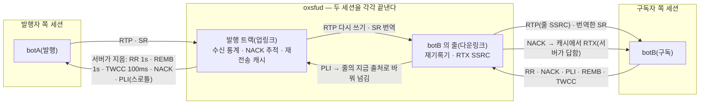
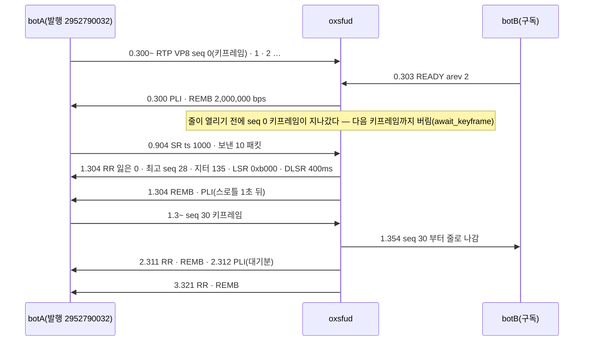

# 02. RTCP — 서버가 두 세션의 끝점이다

> author: kodeholic (powered by Claude) · created: 2026-11-03.
> ★**대조한 커밋** — 서버 `oxlens-sfu` `c5ecb6d`.
> ★**실측 회차** — 2층 하네스(헤드리스 봇)의 시나리오 `adv_loss` · `adv_rtcp` 한 회차씩. 봇이 보내고 받은 RTP · RTCP 를 바이트 그대로 남긴 덤프를 풀어 읽었다.
> RTCP 는 UDP 안에서 암호화되어 오가 브라우저 탐침으로는 안 보인다 — 이 장은 봇 덤프로 그린다. 시각은 봇이 시작한 뒤 경과 초다.

## 0. 한 줄 목적 · 등장인물

**발행자와 구독자 사이에서 서버가 RTCP 를 어떻게 끊고, 무엇을 스스로 짓고, 무엇만 번역해 넘기는가 — 키프레임 요청(PLI) · 재전송 요청(NACK) · 수신 보고(RR) · 송신 보고(SR).**

| 이름 | 실제 값 | 무엇 |
|---|---|---|
| botA · botB | 2층 봇(브라우저 아님 · 정해진 RTP 를 보낸다) | 둘 다 발행하고 서로 받는다 |
| adv_loss | 영상 VP8 · 30fps · 키프레임 30프레임마다 · botA 발행 SSRC `2952790032`(0xB0000010) | NACK → RTX 길 |
| adv_rtcp | 음성 opus · botA 발행 SSRC `2684354561`(0xA0000001) | SR 번역 · RR 종단 |
| 서버의 RTCP 이름 | 보낸이 SSRC `1` | 서버가 지은 RTCP 는 모두 SSRC 1 로 나간다(`rtcp/mod.rs` `SENDER_SSRC`) |

## 1. 큰 그림 — 그냥 넘기지 않는다



- **구독자의 RR 은 발행자에게 안 간다.** 발행자가 받는 RR 은 서버가 업링크를 보고 지은 것이다(보낸이 SSRC 1). 구독자 여럿의 RR 이 발행자에게 쏟아지지 않는다.
- **구독자의 NACK 은 서버가 답한다.** 서버가 업링크 패킷을 캐시에 두었다가 RTX 로 다시 보낸다 — 발행자에게 묻지 않는다.
- **넘기는 것은 둘뿐이다.** 구독자의 PLI · FIR(키프레임 요청)은 그 줄에 지금 실린 출처 발행자에게, 발행자의 SR 은 그 출처를 실은 줄마다 번역해서.

## 2. 발행자 쪽 — 서버가 짓는 것(adv_loss · botA)



| 서버 → 발행자 | 이 회차 | 무엇 · 언제 |
|---|---|---|
| **RR** | 1.304 · 2.311 · 3.321 | 1초마다(`RR_MS`). 업링크 수신 통계 — 잃은 비율 0/256 · 누적 0 · 최고 seq 28 → 56 → 85 · 지터 135 → 186 → 184. `LSR 0xb000` = 받은 SR 의 NTP 가운데 32비트, `DLSR` = 그 SR 을 받고 지난 시간(400 → 1,407 → 2,417ms — 봇은 SR 을 한 번만 보냈다). 발행자는 이것으로 왕복 시간을 잰다 |
| **REMB** | 0.300 · 1.304 · 2.311 · 3.321 | 1초마다. 상한 비트레이트 = 정책 `max_bitrate_bps`(2,000,000) |
| **PLI** | 0.300 · 1.304 · 2.312 | 키프레임 요청. 아래 §2-1 |
| **NACK(상향)** | 없음 | 업링크에 빈 seq 가 생기면 서버가 직접 낸다(재시도 200ms · 포기 1초 — `pub/mod.rs`) · 이 회차는 업링크 손실이 없었다 |
| **TWCC** | 없음 | 100ms 마다 — 봇이 TWCC 확장 번호를 알리지 않아 이 회차에는 안 나갔다 |

### 2-1. PLI — 스로틀 1초 · 창 안 요청은 「대기」

- 0.300 — 구독자 `READY` 가 남의 영상 발행에 키프레임을 요청한다(01 §3-5 · `ops/media.rs` `ready`). 3층 회차(01)에서도 같은 일이 보였다: B 의 송신 통계 `pliCount 1 · keyFramesEncoded 2`.
- 그런데 줄이 열리기(`READY` 0.303) 직전에 seq 0 키프레임이 지나가 버렸다. 열린 뒤 첫 패킷은 키프레임이 아니라 서버가 버리고 다시 PLI 를 청한다(`fwd/mod.rs` `send_down` — `await_keyframe`).
- **PLI 스로틀** — 같은 발행 트랙에 PLI 는 정책 `pli_throttle_high_ms`(1,000ms) 안에 한 번만 나간다(시뮬캐스트 낮은 층은 `pli_throttle_low_ms` 500ms). ★창 안에 들어온 인프라 요청(출처 전환 · 게이트 해제 · 키프레임 기다림 · NACK 포기)은 버리지 않고 「대기」로 두었다가, 창이 지나면 워커 tick 이 한 번 보낸다(`rtcp/mod.rs` `request_pli` · 업링크 tick 의 `pending` 처리 — 서버 규격 「인프라 PLI 도 같은 스로틀 · 막힌 것은 창이 열리는 대로 한 번」). 그래서 1.304 에 하나 · 2.312 에 하나가 나갔다 — ★2.312 는 키프레임(seq 30)이 이미 1.354 에 와서 흐르기 시작한 뒤다. 1.304 ~ 1.354 사이에 쌓인 「대기」가 창이 지난 뒤 나간 것이다.
- 봇은 PLI 를 무시하고 정해진 주기(30프레임)로만 키프레임을 내므로, 구독자가 처음 받은 seq 는 30 이다(1.354). 브라우저 발행자는 PLI 를 받자마자 키프레임을 낸다.

## 3. 구독자 쪽 — NACK 은 서버가 답한다(adv_loss · botB → 서버)

```
3.305 botA send rtcp NACK 보낸이 3424272198 대상 278874751 잃은 seq [58]
3.306 botA recv rtp  ssrc 2568303108 pt 97 seq 2954 ts 174000 92B OSN 58
```
- botA 가 받는 줄(botB 의 영상)의 SSRC 는 `278874751` — botB 의 진짜 SSRC(`2952790048`)가 아니라 줄의 다운링크 SSRC 다(01 §3-6). NACK 의 「대상」도 그 줄 SSRC 다.
- 서버는 줄 SSRC 로 줄을 찾고(`sub/mod.rs` `row_by_ssrc`), 출처 seq 로 되돌려 재전송 캐시에서 원래 패킷을 꺼내, **줄의 RTX SSRC(`2568303108`) · RTX PT(97)** 로 싸서 보낸다. RTX 패킷의 페이로드 맨 앞 2바이트가 원래 seq(OSN = 58)다(RFC 4588).
- NACK 에서 RTX 까지 **1ms**. 발행자에게는 아무것도 가지 않는다. 오디오 NACK 은 버린다(`nack_audio`).
- RTX 는 예산(`RTX_BUDGET` 200) · 창(`RTX_WINDOW_MS` 3초) 안에서만 — 넘치면 버리고 센다(`rtx_budget`).

## 4. SR 번역 · RR 종단(adv_rtcp — 음성)

```
0.889 botA send rtcp SR ssrc 2684354561 NTP 3758096384.a000 RTP ts 1000 보낸 패킷 10 바이트 1000
0.890 botB recv rtcp SR ssrc 2845757632 NTP 3758096384.a000 RTP ts 1000 보낸 패킷 27 바이트 1647
3.291 botA send rtcp RR 보낸이 3429109904 [ssrc 3468018551 …]       ← botA 가 받는 줄에 대한 RR
3.306 botA recv rtcp RR 보낸이 1 [ssrc 2684354561 잃은 0 · 최고 seq 137 · 지터 86 …]   ← 서버가 지은 RR
```
- **SR 번역** — botA 의 SR 하나가 1ms 뒤 botB 에게 번역되어 간다: SSRC 는 botB 의 줄 SSRC(`2845757632`), NTP 는 그대로, RTP ts 는 재기록기 오프셋을 빼서(여기서는 출처가 한 번도 안 바뀌어 0 — 그대로 1000), **보낸 패킷 · 바이트는 서버가 그 줄로 실제로 보낸 값(27 · 1,647)**으로 바꾼다(`rtcp/mod.rs` — `rows_of_source` · `translate_sr_ts` · `build_sr`). 구독자는 이것으로 오디오 · 비디오의 립싱크를 맞춘다.
- ★번역은 **그 줄이 지금 그 출처를 싣고 있을 때만** 한다(재기록기의 출처가 같을 때). adv_loss 에서 봇들의 SR(0.904)은 구독자에게 번역되어 가지 않았다 — 그때는 줄이 아직 키프레임을 못 받아 출처가 서지 않았다.
- **RR 종단** — botA 가 서버에 보낸 RR(3.291)은 botB 에게 넘어가지 않는다. botB 가 받는 RR 은 보낸이 `1`(서버)뿐이다. 이 시나리오의 등식(`adv_rtcp` PASS)이 바로 이것 — 「구독자의 RR 보낸이 SSRC 가 상대 발행자의 수신 RTCP 에 나타나지 않는다」를 잰다.

## 5. 소스 · 규격 좌표

| 무엇 | 서버 |
|---|---|
| RTCP 종단 · 주기(RR · REMB · TWCC) · SR 번역 | `oxsfud/src/rtcp/mod.rs`(`tick` · `on_rtcp` · `on_sr` · `build_sr` · `emit`) · 줄 찾기 `sub/mod.rs` `row_by_ssrc` |
| PLI 스로틀 · 대기 · burst | `rtcp/mod.rs` `request_pli` · `pli_burst` · 정책 `pli_throttle_high_ms` · `pli_throttle_low_ms` |
| NACK → RTX | `rtcp/mod.rs` `send_rtx` · 재전송 캐시 `pub/mod.rs` |
| 업링크 NACK(상향) | `pub/mod.rs` `NackUp`(재시도 200ms · 포기 1초) |
| 키프레임 기다림 | `fwd/mod.rs` `send_down`(`await_keyframe`) |

(RTCP 종단의 계약은 서버 정의서에 있다 — 공개 규격 밖. 클라가 볼 수 있는 것은 줄 SSRC · RTX SSRC 가 배정표에 실린다는 것뿐이다 — [연:LINK.op.MLINE_EVENT](../protocol/09-link.md#LINK.op.MLINE_EVENT).)

## 6. 스스로 확인하는 질문

<details><summary>1. 구독자가 셋이면 발행자가 받는 RR 은 몇 개인가?</summary>

1초에 하나다 — 서버가 업링크를 보고 짓는 RR 하나. 구독자 셋의 RR 은 서버에서 끝난다.
</details>

<details><summary>2. 2.312 의 PLI 는 필요했나?</summary>

이 회차에서는 아니었다 — 키프레임이 1.354 에 이미 와서 흐르고 있었다. 1.304 의 PLI 직후 스로틀 창 안에 들어온 요청이 「대기」로 남았다가 창이 지난 뒤 나간 것이다. 서버 규격이 그렇게 정했다 — 「스로틀에 막힌 인프라 PLI 는 버리지 않고 창이 열리는 대로 한 번 낸다(같은 층에 몰린 것은 하나로 합친다)」. 대기가 그 사이에 온 키프레임으로 지워지지는 않는다.
</details>

<details><summary>3. 구독자가 받는 SR 의 「보낸 패킷」은 누구의 숫자인가?</summary>

서버가 그 줄로 실제로 보낸 패킷 수다 — 발행자의 숫자가 아니다. 구독자 쪽 세션의 끝점이 서버이기 때문이다.
</details>
