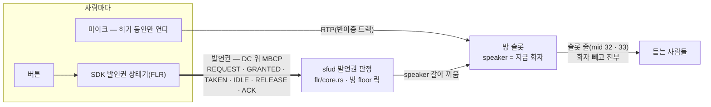
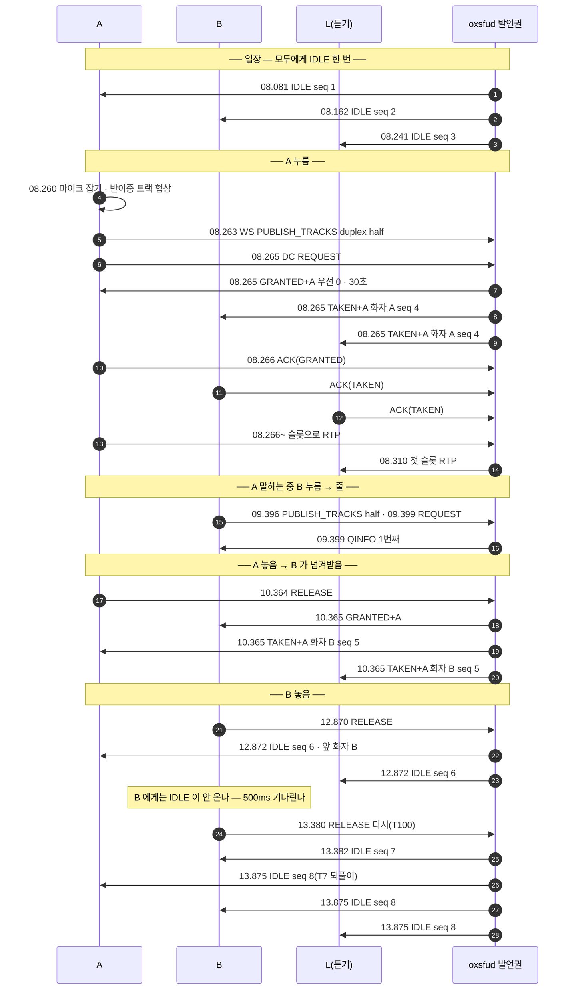
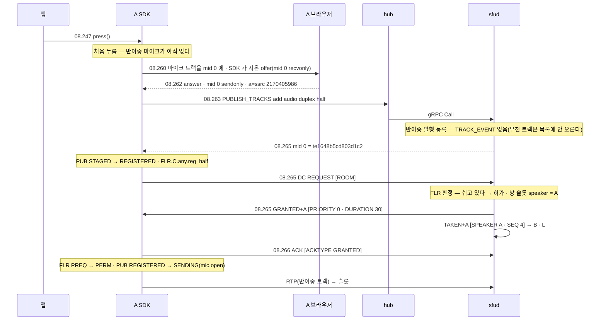

# 03. 무전 — 누름 · 허가 · 줄 서기 · 넘겨받기 · 놓음

> author: kodeholic (powered by Claude) · created: 2026-11-03.
> ★**대조한 커밋** — 서버 `oxlens-sfu` `c5ecb6d` · SDK `oxlens-sdk-web` `c14dfe8`.
> ★**실측 회차** — `tour-20261103-140404`(탐침 `TOUR-03`). 값은 돌릴 때마다 바뀌고, 차례 · 모양은 같다.

## 0. 한 줄 목적 · 등장인물

**무전 방에서 A 가 버튼을 누르면 무엇이 오가고, A 가 말하는 동안 B 가 누르면 어떻게 줄을 서며, A 가 놓으면 어떻게 B 에게 넘어가는가.**

| 이름 | 실제 값 | 무엇 |
|---|---|---|
| A | `tourptt_A` · 말하기(`talk`) | 먼저 누르는 사람 |
| B | `tourptt_B` · 말하기 | A 가 말하는 중에 누르는 사람 |
| L | `tourptt_L` · 듣기(`listen`) | 듣기만 하는 사람 — 정원은 먹지만 발행하지 않는다 |
| 방 | `qa_tourptt_p2` · node-a | |

## 1. 큰 그림 — 무전은 선이 둘이다



- **발언권은 WebSocket 이 아니라 데이터 채널(DC)로 간다**([연:RULE-FLR-TRANSPORT-DC](../protocol/10-flr.md#RULE-FLR-TRANSPORT-DC) · [연:TRN.frame.DC](../protocol/02-trn.md#TRN.frame.DC)). DC 프레임 = 4바이트 머리(ver · svc · len) + MBCP(머리 · TLV 개수 · TLV). 3GPP MCPTT(TS 24.380)의 발언권 메시지를 그대로 쓴다.
- **미디어는 슬롯으로 간다.** 방마다 오디오 · 비디오 슬롯이 하나씩 있고, 입장하면 슬롯 줄(1pc 에서 mid 32 · 33, stream `ox-ptt`)이 곧바로 실린다(01 §3-2). 화자가 바뀌어도 듣는 쪽 줄은 그대로 — 서버가 SSRC · seq · ts 를 이어 붙인다.
- 서버의 발언권 판정은 규격 상태기를 옮긴 순수 로직이다. 로그 · 규격 표의 라벨(`FLR.S.…` 서버 · `FLR.C.…` 클라)이 원문 절 번호와 한 줄씩 맞물린다.

## 2. 전체 타임라인

시각은 `14:04:xx.xxx`(KST). DC 시각은 브라우저가 찍은 것이다.



## 3. 단계별

### 3-1. 입장하면 IDLE 하나

입장(01 과 같은 길) 뒤 `READY` 를 보내는 순간, 서버가 그 사람에게 **지금 발언권 상태**를 DC 로 한 번 알린다 — 아무도 안 말하면 `IDLE`, 누가 말하고 있으면 `TAKEN`(`FLR.S.P.join.idle` · [연:RULE-SUB-READY-WHAT](../protocol/08-sub.md#RULE-SUB-READY-WHAT) 「처음 알리기」).

```
08.081 DC A recv MBCP IDLE [SEQ=0001 · ROOM=qa_tourptt_p2]
             (01 01 0015 | 05 02 | 08 02 0001 | 1d 0d 71615f746f75727074745f7032)
              │  │  │      │  │    │           └ TLV 29 ROOM 13바이트 "qa_tourptt_p2"
              │  │  │      │  │    └ TLV 8 SEQ 2바이트 = 1
              │  │  │      │  └ TLV 2개
              │  │  │      └ 머리 0x05 = 종류 5 IDLE · A 비트 0
              │  │  └ 길이 21
              │  └ svc 1 = 발언권
              └ ver 1
```

- `SEQ` 는 방의 발언권 일련번호다. `TAKEN` · `IDLE` 을 낼 때마다 1 씩 오른다(A · B · L 입장 1 · 2 · 3 → A 허가 4 → B 넘겨받음 5 → 쉼 6 · 7 · 8) — 늦게 온 옛 알림을 거르는 데 쓴다([연:RULE-FLR-SEQ](../protocol/10-flr.md#RULE-FLR-SEQ)).
- 듣기 모드 L 도 DC 를 연다 — 발행이 없어도 발언권 알림은 받아야 누가 말하는지 안다(L 의 `ROOM_JOIN` 은 `select:false` · 서버 로그 `AFF.S.join_listen` · 소속 응답 `pub_room: null`).

### 3-2. A 누름 — 마이크는 누를 때 잡는다



- **누름부터 허가까지 18ms**(08.247 → 08.265). 그 사이 대부분은 처음 누를 때의 마이크 잡기와 협상이다. 미리 데우는 손잡이가 `ptt.enable()` 이다(SDK README).
- 무전 트랙(`duplex:"half"`)은 **`TRACK_EVENT` 를 내지 않는다** — 목록이 아니라 슬롯으로 듣기 때문이다. 01 의 전이중 발행과 다른 점이다.
- `GRANTED+A` · `TAKEN+A` 의 `+A` 는 「확인(ACK)을 보내라」 비트다. 받은 쪽은 `ACK` 의 `ACKTYPE` 에 무엇을 확인하는지 싣는다(`0100` = GRANTED · `0200` = TAKEN). 서버는 ACK 이 안 오면 되보낸다(T20 · T21).
- `DURATION 30` = 한 번에 말할 수 있는 시간(초 · 서버 T2). 넘기면 서버가 `REVOKE` 한다.
- 마이크는 허가가 난 순간 열린다(`PUB.C.REGISTERED.floor_open`) — 그 전에는 트랙이 등록만 되고 RTP 를 안 보낸다.
- **L 이 처음 슬롯 RTP 를 받은 것은 08.310**(허가 뒤 45ms · SDK 전이 `FLR.C.NOPERM.rtp_rx`).

서버 로그는 발언권 판정을 줄로 남기지 않는다(DC 가 증거다) — 발행 등록만 남는다:
```
08.264 proc=sfu kind=ev spec=SV-STATE-PUBLISH-STATE user=tourptt_A area=PUB key=te1648b5cd803d1c2 from=Created to=Intended cause=publish
08.264 proc=hub kind=ev spec=CP-OP-PUBLISH-TRACKS session=748b701c user=tourptt_A msg=ok
```
끝난 뒤의 방 표면(`/admin/rooms/{id}/snapshot` 의 `floor`): `state IDLE · speaker null · queue [] · timers [T7]`.

### 3-3. A 가 말하는 중 B 누름 — 줄을 선다

```
09.399 DC B send MBCP REQUEST [ROOM=qa_tourptt_p2]
09.399 DC B recv MBCP QINFO [QINFO=0100 · ROOM=qa_tourptt_p2]     ← 줄 1번째 · 우선 0
09.399 SDK B FLR NOPERM → PREQ | press   | FLR.C.NOPERM.press
09.399 SDK B FLR PREQ → QUEUED | rx.QINFO | FLR.C.PREQ.rx_QINFO
```
- 서버 판정 `FLR.S.P.NP_TAKEN.req_enqueue` — 누가 말하는 중이면 거절하지 않고 줄에 넣고 몇 번째인지(`QINFO`)를 알린다. 줄이 차면 `DENY`(QUEUE_FULL)다.
- B 도 처음 누름이라 마이크를 잡고 `PUBLISH_TRACKS` 를 먼저 보낸다(09.396) — 줄을 서는 동안 마이크는 열리지 않는다.

### 3-4. A 놓음 — 줄의 첫 사람에게 곧바로

```
10.364 DC A send RELEASE
10.365 DC B recv GRANTED+A [PRIORITY 0 · DURATION 30]   → B FLR QUEUED → PERM · mic.open
10.365 DC A recv TAKEN+A [SPEAKER tourptt_B · SEQ 5]
10.365 DC L recv TAKEN+A [SPEAKER tourptt_B · SEQ 5]
```
- 쉬는 상태를 거치지 않고 줄의 첫 사람에게 넘긴다(`FLR.S.G.IDLE.enter_succession`) — A 놓음부터 B 허가까지 1ms. 듣는 사람은 `IDLE` 없이 `TAKEN`(화자 B)만 받는다.
- A 는 이제 듣는 쪽이다 — 슬롯으로 B 의 소리를 받는다(끝 통계: A 슬롯 오디오 125 패킷 · B 88 · L 211).

### 3-5. B 놓음 — 관찰: 놓은 사람에게는 IDLE 이 바로 안 간다

```
12.870 DC  B send RELEASE                         SDK B FLR PERM → PREL | FLR.C.PERM.release
12.872 DC  A recv IDLE [SEQ 6 · PREV tourptt_B]   (A · L 에게만)
12.872 DC  L recv IDLE [SEQ 6 · PREV tourptt_B]
13.380 DC  B send RELEASE                         SDK B FLR PREL → PREL | timer | FLR.C.PREL.T100
13.382 DC  B recv IDLE [SEQ 7 · PREV tourptt_B]   SDK B FLR PREL → NOPERM | FLR.C.PREL.rx_IDLE
13.875 DC  A · B · L recv IDLE [SEQ 8]            (쉬는 동안 1초마다 되풀이 — T7)
```
- 서버는 쉬는 상태로 들어가며 방 사람 모두에게 `IDLE` 을 돌리는데, 놓은 사람(허가 상태)에게는 상태만 바꾸고 보내지 않는다 — 규격 행 [연:FLR.S.P.PERMITTED.a_IDLE](../protocol/10-flr.md#FLR.S.P.PERMITTED.a_IDLE) 「enter u NP_IDLE」(근거 원문 6.3.5.5.4).
- 그래서 놓은 B 는 `PREL`(놓는 중)에서 T100(500ms)을 다 기다려 `RELEASE` 를 다시 보내고(`FLR.C.PREL.T100`), 그때 받은 `RELEASE` 에 서버가 `IDLE` 로 답한다([연:FLR.S.P.NP_IDLE.rx_RELEASE](../protocol/10-flr.md#FLR.S.P.NP_IDLE.rx_RELEASE)). **놓은 사람의 놓음 완료 = 약 512ms**(12.870 → 13.382), 메시지는 하나 더.
- 마이크는 놓는 순간 닫힌다(12.870 `PUB.C.SENDING.floor_close`) — 화면의 「놓음」과 소리는 즉시다. 늦는 것은 B 의 발언권 상태기가 `NOPERM` 으로 돌아오는 시점이다.
- 쉬는 동안 서버는 1초마다 `IDLE` 을 되풀이한다(`FLR.S.G.IDLE.T7` · 최대 C7 번) — 늦게 들어오거나 하나를 놓친 사람도 결국 쉼을 안다.

## 4. 슬롯 — 화자가 바뀌어도 줄은 하나

- 듣는 쪽 슬롯 줄은 입장 때 실린 mid 32(오디오) · 33(비디오) 그대로다. 화자가 A → B 로 바뀌면 서버 재기록기가 출처를 바꾸며 seq · ts 를 이어 붙인다(오프셋 하나 · `fwd/core.rs` `Rewriter`). 듣는 브라우저는 SSRC 도 mid 도 바뀌지 않으니 재협상이 없다.
- 화자가 아닌 사람의 반이중 RTP 는 서버가 버린다(`prefan_gate`) — 허가 전 · 놓은 뒤에 마이크가 새도 듣는 쪽에 안 간다(서버 형상 문서 8장).

## 5. 소스 · 규격 좌표

| 무엇 | 서버 | SDK | 규격 |
|---|---|---|---|
| DC 프레임 · MBCP | `oxsig/src/dc.rs` · `oxsig/src/floor.rs` | `internal/flr/mbcp.ts` · `internal/wire/floor_codec.ts` | [연:TRN.frame.DC](../protocol/02-trn.md#TRN.frame.DC) · [연:FLR.wire](../protocol/10-flr.md#FLR.wire) |
| 판정 | `oxsfud/src/flr/core.rs`(생성 서버 상태기의 이식) | — | `FLR.S.…` 표 |
| 집행 · 타이머 | `oxsfud/src/ops/floor.rs`(`dc_in` · `timer_task` · 슬롯 결합) | — | |
| 클라 상태기 | — | `domain/flr`(생성 상태기 + 손 결합) | `FLR.C.…` 표 |
| 슬롯 전달 | `fwd/mod.rs` `forward`(반이중 갈래) | — | |

## 6. 스스로 확인하는 질문

<details><summary>1. 듣기 모드 L 은 발행을 안 하는데 왜 DC 를 여나?</summary>

발언권 알림(`TAKEN` · `IDLE`)이 DC 로만 오기 때문이다. DC 가 없으면 누가 말하는지 영영 모른다. 그래서 1pc 의 첫 협상은 발행이 없어도 DC m-line 을 담는다.
</details>

<details><summary>2. A 가 놓았을 때 L 이 IDLE 을 안 받은 까닭은?</summary>

줄에 B 가 있어서 쉬는 상태를 거치지 않고 곧바로 B 에게 넘겼기 때문이다(`enter_succession`). L 은 `TAKEN`(화자 B)만 받는다.
</details>

<details><summary>3. 놓은 B 가 RELEASE 를 두 번 보낸 까닭은?</summary>

서버가 놓은 사람에게는 `IDLE` 을 보내지 않고 상태만 바꾸므로(규격 행 `FLR.S.P.PERMITTED.a_IDLE`), B 는 T100(500ms) 뒤 `RELEASE` 를 다시 보내고 그 답으로 `IDLE` 을 받는다.
</details>
