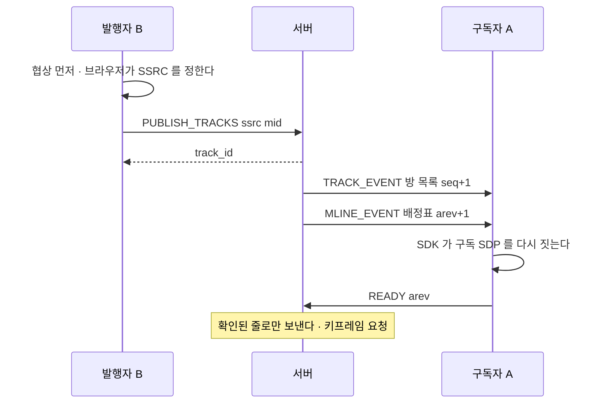
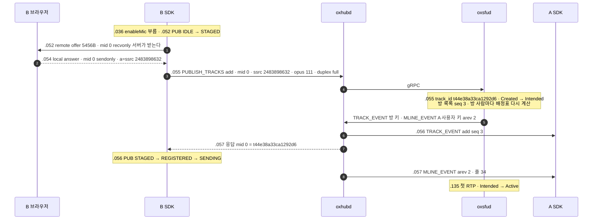
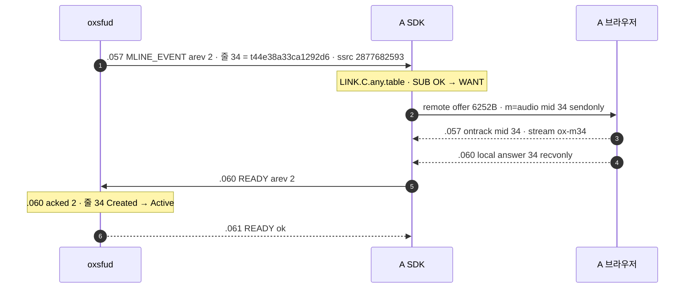
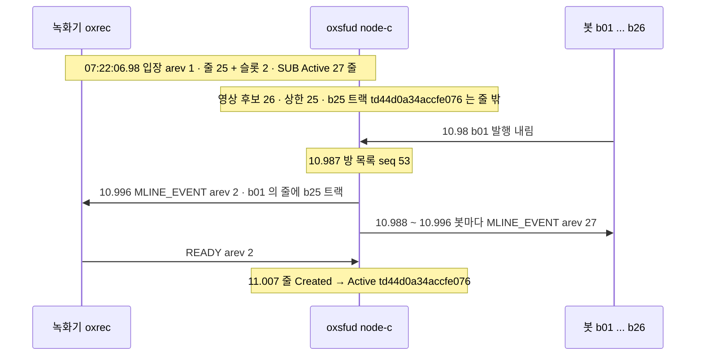

# 03. 발행과 구독 — 협상 먼저 · 배정표 · READY

> author: kodeholic (powered by Claude) · created: 2026-11-09.
> ★**대조한 커밋** — 서버 `oxlens-sfu` `c3642e8` · SDK `oxlens-sdk-web` `9f40557`(+탐침) · 2층 `oxlens-labs` `fc584ff` · oxpeer `93df1c6`
> ★**실측 회차** — 3층 탐침 `tour-learn-20261109`(`02` · `02P`) · 2층 회차 `e2e-20261109-070257`(`peer_record_reassign` · `adv_wire_reject` · `adv_resource` · 연기 시험 `ops_history`). 값은 돌릴 때마다 바뀌고 차례 · 모양은 같다.

## 1. 30초 요약



- ★**차례가 핵심이다 — SDP 협상 먼저, `PUBLISH_TRACKS` 나중.** 서버에 알릴 발행 SSRC 는 브라우저가 answer 를 만들 때 정해진다.
- 구독은 ★**배정표**(서버가 고른 「줄 mid → 트랙」 표 · 차례 `arev`) 하나로 간다. 클라가 그 표로 SDP 를 지어 협상하고 `READY{arev}` 로 확인하면 ★**서버는 확인된 줄로만 보낸다**.
- 줄은 kind 마다 25 까지만 생긴다. 넘으면 서버가 고른 트랙을 있는 줄에 싣는다(재배정) — SDP 는 안 바뀌고 표만 간다.

## 2. 등장인물 · 값

| 이름 | 이 회차 값(1pc `02`) | 무엇 |
|---|---|---|
| B 마이크 | 업링크 SSRC `2483898632` · 발행 mid 0 · PT 111 → track_id `t44e38a33ca1292d6` | 서버가 이름(track_id)을 준다 |
| B 카메라 | SSRC `2464905041` · rtx `3421347988` · mid 1 · PT 108 / rtx 109 · `source camera` → `t8a5c4ff5410606b8` | H264 `42e01f` |
| A 의 줄 34 | audio · 다운링크 SSRC `2877682593` · stream `ox-m34` · B 마이크 | 서버가 음량으로 고른 줄 |
| A 의 줄 35 | video · 다운링크 SSRC `2888184996` · rtx `4254884345` · stream `ox-m35` · B 카메라 | 클라 선호(기본값 = 안 멈춤) |
| A 의 줄 32 · 33 | `ptt-qa_tour_p4-audio` · `-video` · stream `ox-ptt` | 무전 슬롯 — 입장하면 실린다([08](08_SLOT_SPEAKER.md)) |
| 방 목록 차례 | `version` epoch `8701a55ebcdd350f` · seq 1 → 4 | 방 하나에 하나 |
| 배정표 차례 | A arev 1 → 3 · B arev 1 그대로 | 연결(사람 × 미디어 서버) 하나에 하나 |
| 줄 상한 | 연결마다 audio 25 · video 25 | [연:RULE-SUB-FILL](../protocol/08-sub.md#RULE-SUB-FILL) |
| BUNDLE 천장 | m-line 128 · 구독 몫 1pc 96 · 2pc 128 · 슬롯 몫 기본 40 | [연:RULE-ROOM-BUNDLE-128](../protocol/04-room.md#RULE-ROOM-BUNDLE-128) · [연:RULE-ROOM-BUDGET-MATH](../protocol/04-room.md#RULE-ROOM-BUDGET-MATH) |
| 발행 상한 | 요청마다 8 · 사람마다 16 | `oxsfud/src/ops/media.rs` `PER_REQUEST` · `PER_PERSON`(이 회차 거절 값과 같다 — §4-3) |

## 3. 정상 길

시각은 KST `07:35:34.xxx` 의 뒤 세 숫자(ms) · 1pc 회차 `02`.

### 3-1. 발행 — B 가 마이크를 켠다



실제 프레임:
```
B send req PUBLISH_TRACKS #4 {"action":"add","room_id":"qa_tour_p4","join_id":"996179360e52d06d",
   "tracks":[{"kind":"audio","ssrc":2483898632,"mid":"0","pt":111,"codec":"opus",
   "fmtp":"minptime=10;useinbandfec=1","duplex":"full","simulcast":false}],
   "audio_level_extmap_id":1,"twcc_extmap_id":3,"mid_extmap_id":4}
B recv ok  PUBLISH_TRACKS #4 {"action":"add","tracks":[{"mid":"0","track_id":"t44e38a33ca1292d6"}]}
A recv req TRACK_EVENT #2 {"action":"add","tracks":[{"active":true,"csrc":188,"kind":"audio","muted":false,
   "track_id":"t44e38a33ca1292d6","type":"individual","user_id":"tour_B",…}],"version":{"epoch":"8701a55ebcdd350f","seq":3}}
```
- 1pc 라 발행 협상도 ★**SDK 가 지은 서버 offer** 로 했다(첫 협상만 브라우저 offer — [02 §3-4](02_CONNECT_JOIN.md)). 서버 offer 의 `mid 0 recvonly` 는 「서버가 받는다」는 서버 시각이다.
- `*_extmap_id` 는 ★**B 브라우저가 쓰는 확장 번호**다. 서버는 그 번호로 B 의 RTP 에서 음량 · twcc · mid 를 읽는다.
- 응답은 `mid → track_id` 하나뿐이다. SDK 는 자기 발행 mid 로 자기 track_id 를 찾고, 그 뒤의 조작(`TRACK_SET` · `remove`)은 track_id 로 부른다.
- B 도 자기 트랙의 `TRACK_EVENT` 를 받는다(방 통지라서). B 의 배정표는 그대로다 — 자기 트랙은 받을 후보가 아니다 — 그래서 B 에게는 `MLINE_EVENT` 가 없다.
- `csrc 188` 은 받는 쪽이 켜면 다운링크 패킷에 실리는 출처 번호다 — [08](08_SLOT_SPEAKER.md) 이 집이다.

카메라는 같은 길에 RTX 가 더해진다(.057 enableCamera 부름 · .059 STAGED → .061 `PUBLISH_TRACKS #5` · `rtx_ssrc 3421347988` · `source camera` → .063 `t8a5c4ff5410606b8` · 방 목록 seq 4 · A 에게 arev 3).

```
07:35:34.055 proc=sfu kind=ev spec=SV-STATE-PUBLISH-STATE session=cd122ac6 user=tour_B area=PUB key=t44e38a33ca1292d6 from=Created to=Intended cause=publish
07:35:34.055 proc=sfu kind=ev spec=CP-OP-TRACK-EVENT room=qa_tour_p4 seq=3
07:35:34.055 proc=sfu kind=ev spec=CP-OP-MLINE-EVENT session=36aeb4aa user=tour_A arev=2
07:35:34.135 proc=sfu kind=ev spec=SV-STATE-PUBLISH-STATE session=cd122ac6 user=tour_B area=PUB key=t44e38a33ca1292d6 from=Intended to=Active cause=first_rtp
07:35:34.370 proc=sfu kind=ev spec=SV-STATE-PUBLISH-STATE session=cd122ac6 user=tour_B area=PUB key=t8a5c4ff5410606b8 from=Intended to=Active cause=first_rtp
```
- 서버는 ★**RTP 를 기다리지 않고 곧바로 알린다**(`Intended` 에서 `TRACK_EVENT`). 첫 RTP 는 마이크 80ms · 카메라 308ms 뒤에 왔다 — 그 사이 A 는 이미 줄을 받고 READY 까지 끝냈다.

### 3-2. 구독 — A 에게 줄이 생긴다



SDK 가 그 표로 지은 줄 35(받는 m-line):
```
m=video 20000 UDP/TLS/RTP/SAVPF 108 109
a=mid:35                                  ← 줄 mid 그대로(연:RULE-LINK-SDP-ORDER-SUB)
a=sendonly
a=rtpmap:108 H264/90000                   ← 줄 pt
a=msid:ox-m35 ox-m35                      ← 줄 stream_id
a=ssrc:2888184996 cname:ox-sfu            ← 줄 다운링크 SSRC
a=ssrc:4254884345 cname:ox-sfu
a=ssrc-group:FID 2888184996 4254884345    ← RTX 짝
```

이 회차 끝의 A 배정표(서버 표면 `/admin/users/tour_A/media` — `arev 3 · acked 3`):

| 줄 mid | kind | 다운링크 SSRC | 실린 트랙 | `since`(실린 때) | 재기록기 |
|---|---|---|---|---|---|
| 32 | audio | 4098035694 | `ptt-qa_tour_p4-audio` | 입장(.828) | 없음(화자 없음) |
| 33 | video | 1722490070 · rtx 605502296 | `ptt-qa_tour_p4-video` | 입장 | 없음 |
| 34 | audio | 2877682593 | B 마이크 | .055 | `seq_off 0 · ts_off 0 · switches 0` |
| 35 | video | 2888184996 · rtx 4254884345 | B 카메라 | .062 | `seq_off 0 · switches 0` |

- ★**표가 원천이다** — SDK 는 트랙 목록이 아니라 표의 줄을 mid 오름차순으로 세워 SDP 를 짓는다. A 가 아무것도 요청하기 전에 줄 35 가 생긴 것은 영상 선호 기본값이 「안 멈춤」이라서다. 영상을 고르는 손잡이(`paused` · `priority`)는 클라 것이고, 음성 줄은 서버가 음량으로 고른다([연:RULE-SUB-FILL](../protocol/08-sub.md#RULE-SUB-FILL) 표).
- `MLINE_EVENT`(서버 .055) → 줄 Active(.060)까지 5ms · 카메라 줄(.062 → .067)도 5ms. 이 왕복이 배정표의 값이다.
- 재기록기 칸이 0 인 것은 출처가 한 번도 안 바뀌어서다. 헤더를 어떻게 다시 쓰는지는 [04](04_PACKET_PATH.md) 가 집이다.

### 3-3. READY 가 하는 일

```
07:35:34.067 proc=sfu kind=ev spec=SV-STATE-SUBSCRIBE-STATE session=36aeb4aa user=tour_A area=SUB key=t8a5c4ff5410606b8 from=Created to=Active cause=ready
07:35:34.067 proc=hub kind=ev spec=CP-OP-READY session=36aeb4aa user=tour_A arev=3 msg=ok
```
- [연:RULE-SUB-READY-WHAT](../protocol/08-sub.md#RULE-SUB-READY-WHAT) — 막아 둔 영상을 흘리고 ★**키프레임을 요청하고** 그 방의 처음 알리기(무전 상태 · DC `IDLE` — [07](07_FLOOR.md))를 한다. B 의 송신 통계가 흔적이다: `pliCount 1` · `keyFramesEncoded 2`(처음 하나 + 요청에 하나) · `framesEncoded 52`.
- `READY` 는 ★**방마다** 보낸다 — 키프레임 요청과 처음 알리기가 그 방 범위라서다([연:R-SUB-READY-PER-ROOM](../protocol/08-sub.md#R-SUB-READY-PER-ROOM)). 이 회차 A 는 READY 를 세 번 냈고 그때마다 DC 로 `MBCP IDLE` 이 왔다(SEQ 1 · 3 · 4).
- `B.enableCamera`(.057)에서 A 가 디코딩된 폭을 본 때(`A.videoDecoded` .429)까지 372ms(탐침 폴링이라 위 끝). 수집 때 A 의 카메라 수신 `packets 55 · framesDecoded 52`.

### 3-4. 방 목록 차례 `seq` 와 배정표 차례 `arev`

| 사건 | 방 목록 seq(방 하나) | A 의 arev | B 의 arev |
|---|---|---|---|
| A 입장 | 1 | 1 | — |
| B 입장 | 2 | 1(표 그대로) | 1 |
| B 마이크 | 3 | 2(줄 34) | 1 |
| B 카메라 | 4 | 3(줄 35) | 1 |
| A 퇴장 · B 퇴장 | 5 · 6(트랙 내림) · 7 | — | — |

- `seq` 는 방 목록(사람 · 트랙)이 바뀔 때마다 오르고 그 방 사람 모두가 같은 값을 본다([연:ROOM.type.Version](../protocol/04-room.md#ROOM.type.Version)). 통지마다 실려 와 클라가 빠진 통지를 안다 — 빠지면 다시 받기([11](11_STALL_RESYNC.md)).
- `arev` 는 ★**내 연결의 표**의 차례다. B 의 트랙이 늘면 방 seq 는 B 에게도 오르지만 B 의 arev 는 그대로다. READY 는 arev 를 싣는다 — 「이 차례의 표로 협상을 끝냈다」.

### 3-5. 1pc 의 mid 32 ~ 와 2pc

같은 길을 1pc(`02`)와 2pc(`02P`)로 잰 표 — 발행 mid · 받는 줄 mid(32 ~ 대 0 ~) · 받는 PT — 는 [02 §3-5](02_CONNECT_JOIN.md) 가 집이다. 여기서는 받는 mid 가 왜 32 부터인지만 본다.

- 1pc 는 내 발행 mid(브라우저가 매김)와 받는 mid 가 ★**한 공간**이라 서버가 받는 mid 를 32 부터 낸다(`oxsfud/src/sub/mod.rs` `START_1PC`). 클라는 자기 m-line 을 32 개 미만으로 둔다([연:SUB.type.MlineEntry](../protocol/08-sub.md#SUB.type.MlineEntry)). 2pc 는 구독 연결이 따로라 0 부터다.
- 그래서 1pc 의 구독 몫은 128 − 32 = 96, 2pc 는 128 이다([연:RULE-ROOM-BUDGET-MATH](../protocol/04-room.md#RULE-ROOM-BUDGET-MATH)).

## 4. 깨지는 길

### 4-1. 줄이 모자란다 — 상한 25 와 재배정(2층 `peer_record_reassign`)

봇 26 명이 영상 하나씩 발행하고, 투명 참가자 녹화기(oxpeer · 2pc)가 들어와 전부 받으려 한다. 4초에 b01 이 발행을 내린다.



```
07:22:06.973 node=node-c proc=sfu kind=ev spec=SV-STATE-PEER-STATE session=6654081a user=oxrec~peer_record_reassign … area=LINK key=publish from=- to=Alive cause=peer_created
07:22:10.996 node=node-c proc=sfu kind=ev spec=CP-OP-MLINE-EVENT session=6654081a user=oxrec~peer_record_reassign … arev=2
07:22:11.007 node=node-c proc=sfu kind=ev spec=SV-STATE-SUBSCRIBE-STATE session=6654081a user=oxrec~peer_record_reassign … area=SUB key=td44d0a34accfe076 from=Created to=Active cause=ready
07:22:11.010 node=node-a proc=hub kind=ev spec=CP-OP-READY session=6654081a user=oxrec~peer_record_reassign arev=2 msg=ok
```

녹화기가 남긴 파일(발행자마다 하나):

| 출처 | 파일 시작(첫 파일 기준) | 길이 | 키프레임 |
|---|---|---|---|
| b01 | 0ms | 3500ms | 4 |
| b02 ~ b24 · b26 | 8 ~ 291ms | 10033 ~ 10300ms | 11 |
| ★b25 | 4379ms | 6066ms | 7 |

- **무엇이 깨졌나** — 받을 영상이 26 인데 줄은 25 다. ★**입장이 막히지도 SDP 가 바뀌지도 않는다** — 26 번째는 「목록에는 있고 표에는 없는」 트랙으로 남는다([연:RULE-SUB-NO-ASSIGN-NO-SDP](../protocol/08-sub.md#RULE-SUB-NO-ASSIGN-NO-SDP)).
- **누가 먼저 아나** — 서버다. 줄이 비자 ★표만 갔다(`MLINE_EVENT` arev 2) — 트랙 목록은 b01 이 빠진 것만 바뀌었다. 재배정은 줄의 `track_id` 만 바꾸고 mid · 튜플 · 다운링크 SSRC · stream_id 는 그대로라 구독 SDP 가 안 바뀐다([연:RULE-SUB-FILL](../protocol/08-sub.md#RULE-SUB-FILL)).
- **무엇이 오가나** — 표 → `READY{arev 2}` → 그 뒤에야 새 트랙이 그 줄로 나간다(MLINE 10.996 → Active 11.007 · 11ms). 확인 전에 다른 사람이 그 칸에 보이는 일이 구조적으로 없다([연:RULE-SUB-EGRESS-ACKED](../protocol/08-sub.md#RULE-SUB-EGRESS-ACKED)).
- **사용자가 겪는 것** — b25 는 처음 4.4초 동안 녹화되지 않았다(파일이 그만큼 늦게 시작). 녹화기는 출처(CSRC)로 파일을 가른다 — [16](16_OXPEER.md).
- **관찰** — 줄 밖에 남은 것은 가장 늦게 발행한 b26(06.623)이 아니라 b25(06.605)였다(시나리오 머리 주석은 b26 이라 적었다). 같은 순위끼리 누가 밀리는지는 서버 정의서의 몫이고(`oxsfud/src/sub/mod.rs` `sync` 의 정렬) 이 회차로 규칙을 가리지 않았다. 그리고 재배정 뒤 녹화기의 사건 목록에 b25 의 `Receiving` 이 다시 오지 않았다(파일은 생겼다) — [16](16_OXPEER.md) 몫으로 넘긴다.

### 4-2. 1pc 에서 SSRC 가 겹친다 — `3008`(2층 `adv_wire_reject`)

1pc 봇 botC 의 입장 응답 표에 슬롯 줄 32 의 다운링크 SSRC `2512409936` 이 있었다. 그 값을 ★**그대로 되실어** 발행해 본다(값을 지어내지 않는다).

```
botC send PUBLISH_TRACKS {"action":"add","tracks":[{"kind":"audio","mid":"9","ssrc":2512409936,"pt":111}]}
botC recv fail {"code":3008,"name":"SSRC_COLLISION","permanent":true}
07:12:06.147 proc=hub kind=ev spec=CP-CODE-SSRC-COLLISION session=d2dd0205 user=botC~adv_wire_reject op=PUBLISH_TRACKS
```
- **무엇이 깨졌나** — 1pc 는 한 BUNDLE 이라 SSRC 공간이 하나다. 다운링크 SSRC 는 서버가, 업링크 SSRC 는 브라우저가 만드니 ★겹칠 수 있다.
- **막지 않으면** — 브라우저가 두 m-line 에서 같은 SSRC 를 보고 ★**한쪽이 조용히 죽는다**(그 트랙 `packetsReceived` 0 — [연:RULE-LINK-SDP-1PC](../protocol/09-link.md#RULE-LINK-SDP-1PC) SSRC 문단). 기록만으로는 안 잡히는 사고다.
- **그래서** — 서버가 `PUBLISH_TRACKS` 의 `ssrc` · `rtx_ssrc` 를 이 연결에 낸 다운링크 SSRC 집합과 대조해 거절한다(`oxsfud/src/ops/media.rs` `publish` 의 `down_ssrcs`). 클라는 새 트랜시버로 한 번 다시 발행한다. 2pc 는 원리적으로 이 일이 없다.
- ★**관찰(결함 의심)** — 규격은 「서버가 만드는 다운링크 SSRC 는 최상위 비트를 세운 난수(`0x80000000` 이상)」라 적고 그래서 출처 번호(CSRC — 최상위 비트 0)와 ★구조적으로 안 겹친다고 한다. 3층 탐침 열 회차의 배정표에 실린 다운링크 SSRC(RTX 포함) 89개 가운데 38개가 `0x80000000` 아래였다(`56206715` · `605502296` · `669572021` 등). 소스 `fresh_ssrc` 는 `rand_u32()` 그대로 쓴다. 겹침 확률은 작지만 규격이 말한 「구조적」 보증은 지금 서 있지 않다.
- 곁가지 — 업링크 SSRC 값으로 무엇을 짐작하지 않는다. 옛 서버는 상위 4비트가 `0xF` 인 SSRC 를 「아직 모르는 SSRC」 표지로 오판해 자기 트랙을 지웠다(검은 화면). 2층 `conf_sentinel_band` 가 `0xF8000001` 대역으로 발행해 지금은 정상임을 지킨다(이 회차 판정 35 초록).

### 4-3. 한 번에 너무 많이 발행한다 — `4002`(2층 `adv_resource`)

| 봇 | 보낸 것 | 받은 것 |
|---|---|---|
| botADV | 한 요청에 300 트랙 | `4002 TRACK_LIMIT` · `details {"current":300,"limit":8}` |
| botADV2 | 8 · 8 · 8 · 8 · 8 | 앞 둘은 성공(16 트랙) · 셋째부터 `4002` · `{"current":24,"limit":16}` 세 번 |
| botB · botC | 하나씩 | 정상(`CP-OP-PUBLISH-TRACKS msg=ok` 07:10:55.258 · .261) |

```
07:10:55.242 proc=hub kind=ev spec=CP-CODE-TRACK-LIMIT session=8b398656 user=botADV~adv_resource op=PUBLISH_TRACKS
07:10:55.246 proc=hub kind=ev spec=CP-OP-PUBLISH-TRACKS session=f1e49742 user=botADV2~adv_resource msg=ok
07:10:55.250 proc=hub kind=ev spec=CP-OP-PUBLISH-TRACKS session=f1e49742 user=botADV2~adv_resource msg=ok
07:10:55.252 proc=hub kind=ev spec=CP-CODE-TRACK-LIMIT session=f1e49742 user=botADV2~adv_resource op=PUBLISH_TRACKS
```
- ★**일부만 받지 않는다** — 넘치는 요청은 통째로 거절이고 상태가 안 바뀐다. `current` 는 「받았다면 몇이 되나」다(16 + 8 = 24).
- 사용자가 겪는 것 — 정상 앱은 닿을 일이 없다. 실패를 안 되돌리는 클라는 유령 발행이 상한을 먹어 `4002` 가 잦아진다([연:R-PUB-PUBLISH-SYMPTOMS](../protocol/07-pub.md#R-PUB-PUBLISH-SYMPTOMS)). 같은 방의 정상 발행자는 영향이 없었다.

### 4-4. READY 가 안 온다 — 안전망 `T-gate`(2층 연기 시험 `ops_history`)

조용한 참가자 하나가 청취 입장만 하고 ★**협상도 READY 도 하지 않는다**.
```
07:06:46.764 node=node-b proc=sfu kind=ev spec=AFF.S.join_listen session=64c94808 user=hist75606uq area=AFF … cause=ROOM_JOIN
07:06:46.765 node=node-a proc=hub kind=ev spec=CP-OP-ROOM-JOIN session=64c94808 user=hist75606uq msg=ok
07:06:52.317 node=node-b proc=sfu kind=diag spec=CP-TIMER-T-GATE session=64c94808 room=hist75606r0 user=hist75606uq in.held_ms=5553 msg="READY gate released by timeout — READY 미수신 의심 (no keyframe request on this path)"
```
- **누가 먼저 아나** — 서버다. 게이트를 연 지 5초([연:RULE-SUB-TGATE](../protocol/08-sub.md#RULE-SUB-TGATE) · 점검 주기 1초라 5553ms)에 스스로 풀고 진단 줄을 남긴다. ★키프레임 요청은 하지 않는다(줄에 적혀 있다).
- 그러나 이 사람의 줄은 ★**`Created → Active` 줄이 끝내 안 찍혔다** — 확인된 차례(acked)가 없으니 서버는 그 줄로 보내지 않는다([연:RULE-SUB-EGRESS-ACKED](../protocol/08-sub.md#RULE-SUB-EGRESS-ACKED)). 안전망은 「막아 둔 것」을 풀 뿐 확인을 대신하지 않는다. 그래서 규격이 증상을 「받는 영상이 영구히 검다」로 적는다([연:R-SUB-READY-SYMPTOMS](../protocol/08-sub.md#R-SUB-READY-SYMPTOMS)).
- 이 연기 시험의 참가자는 미디어 연결을 세우지 않아 ★**패킷이 실제로 안 갔는지는 재지 않았다** — 로그로 본 것이다.
- 같은 꼴이 클라 쪽에서 실제로 났던 기록이 규격에 있다 — 입장 응답과 남의 영상 발행이 6ms 겹쳐 협상 중간 끝에 READY 를 내면 `arev 2 acked 1` 로 남아 받는 영상이 검었다. 그래서 「큐가 빈 협상의 끝에만 READY 를 낸다」([연:RULE-LINK-SDP-RENEGOTIATE](../protocol/09-link.md#RULE-LINK-SDP-RENEGOTIATE)).

## 5. 왜 이 모양인가

> ★**우리만의 것 — 배정표(서버가 고르고 클라가 READY 로 확인한다)**
> - **선택 배경** — 옛 꼴은 서버 안의 「mid → 트랙」을 클라가 여러 길의 사건으로 다시 지었다. HTTP 와 WS 의 경주 · 차례 없는 재발급 · mid 를 클라가 짐작 · 서버가 클라 적용 범위를 모름 등 어긋날 곳이 일곱이었다([연:R-SUB-TABLE-WHY](../protocol/08-sub.md#R-SUB-TABLE-WHY)). 표를 원천으로 두고 한 길로, 차례 번호와 함께 보내면 일곱이 구조로 없어진다.
> - **얻은 것** — 재배정 · 빈 줄 채우기에 SDP 가 안 바뀐다(§4-1 — 26 명 방에서 표만 갔다). 클라 SDP 에 없는 대응으로 패킷이 나가는 길이 없다 — 화면에 엉뚱한 사람이 비치는 일이 구조적으로 막힌다. 큰 방도 문턱 없이 같은 장치다(작은 방은 재배정이 안 일어날 뿐 — [연:R-SUB-FILL-WHY](../protocol/08-sub.md#R-SUB-FILL-WHY)).
> - **잃은 것** — ★표가 바뀔 때마다 한 왕복(이 회차 5ms · 녹화기 11ms). READY 가 안 오면 그 줄은 영영 안 열린다 — 안전망 5초는 게이트만 푼다(§4-4). 받는 영상은 연결마다 25 를 넘지 못한다(26 번째는 줄이 빌 때까지 못 받는다). 한 BUNDLE 천장 128 은 브라우저가 정한다 — Firefox 155 가 129 절부터 BUNDLE 밖으로 내보내 ★오류 없이 그 트랙만 안 나오므로([연:R-ROOM-SILENT-OVERFLOW](../protocol/04-room.md#R-ROOM-SILENT-OVERFLOW)) 서버가 세어 막는다.

- **왜 협상 먼저인가** — 발행 SSRC 는 브라우저가 answer 를 지을 때 정한다. 서버는 SDP 를 안 보므로 그 값을 `PUBLISH_TRACKS` 로 받아야 한다. 시뮬캐스트만 SSRC 를 0 으로 보내고 첫 RTP 의 rid 로 배운다([05](05_SIMULCAST_BWE.md)).
- **왜 RTP 를 기다리지 않고 알리나** — 첫 RTP(80 · 308ms)를 기다리면 그만큼 구독 협상이 늦게 시작한다. 알림과 협상을 겹쳐 두고, 확인(READY)이 실제 송출을 지킨다.
- **왜 영상은 클라가, 음성은 서버가 고르나** — 영상은 화면에 보이는지 클라만 안다. 음성은 받기 전에 누가 말하는지 클라가 모른다 — 서버가 들어오는 음량 확장으로 고른다([연:RULE-SUB-FILL](../protocol/08-sub.md#RULE-SUB-FILL) 표).
- **왜 상한이 인원과 무관한 25 인가** — 인원 문턱으로 방식을 바꾸면 문턱을 넘는 순간 SSRC 가 바뀌고 모두가 재협상한다. 처음부터 한 장치로 둔다([연:R-SUB-FILL-WHY](../protocol/08-sub.md#R-SUB-FILL-WHY) · [연:RULE-ROOM-BUDGET-SPLIT](../protocol/04-room.md#RULE-ROOM-BUDGET-SPLIT)).

## 6. 다른 SFU 는

★「그쪽 방식」은 각 서버의 소스를 정적으로 읽은 대장에서 옮긴 것이다 — 「저쪽 소스에는 이렇게 적혀 있다」이지 실측이 아니다.

| 축 | 그쪽 방식 | 우리 | 우리 쪽 장점 | 우리 쪽 대가 |
|---|---|---|---|---|
| 시그널 의도와 실제 RTP 를 잇기 | LiveKit — client id 2축(시그널 cid · SDP msid) 매칭, 짝이 없으면 `pendingRemoteTracks` 에 쌓았다 재처리(`livekit §8-1`) | 협상 뒤 `PUBLISH_TRACKS` 가 ssrc · mid 를 선언 · 동기 응답으로 track_id | 등록이 한 왕복으로 끝나고 순서가 하나다 | 클라가 SSRC 를 정확히 신고해야 한다 |
| 코덱을 언제 확정하나 | LiveKit — PT 0 인 클라는 첫 RTP 를 읽어 확정(`livekit §8-1`) | 선언이 권위 · video 는 코덱이 없으면 `1005` · 방의 코덱과 다르면 거절 | RTP 전에 구독자 SDP 를 지을 수 있다 | 클라 정직성에 기댄다 |
| 등록이 뒤집혀 오면 | LiveKit — 클라가 AddTrack 응답을 안 기다리고 협상하면 앞 트랙이 닫히기 전에 새 트랙이 발행되는 일이 실제로 생겨 `queued` 플래그로 줄 세운다(`livekit §8-1`) | 협상 큐가 끝난 뒤에 `PUBLISH_TRACKS` · 동기 등록 · 요청 8 · 사람 16 · 넘치면 전체 거절(§4-3) | 등록 순서가 하나이고 서버 자원이 유계 | 한 번에 많이 올리는 클라는 나눠 보내야 한다 |
| 구독을 명령으로 · 상태로 | LiveKit — `desired` 만 세우고 조정 루프가 사건 + 3초 주기로 수렴(`livekit §9-1`) | 사건마다 서버가 표를 다시 계산(`resync_room`) · 차례 `arev` · 확인 `READY` | 주기 없이 곧바로 · 클라 적용 범위를 서버가 안다 | 확인 한 왕복 |
| 구독을 만들자마자 흘리나 | mediasoup — 영상은 `paused:true` 로 만들라고 API 주석이 권한다, 키프레임이 클라 준비 전에 오면 검은 화면이라서(`mediasoup §5-4`) | 서버가 막고 클라 `READY` 로 풀며 키프레임 요청 · 5초 안전망 | 앱이 부를 것이 없다 | READY 가 안 오면 영구히 검다(§4-4) |
| 받는 줄이 모자랄 때 | Jitsi Videobridge — 구독자마다 SSRC 상한(audio 50 · video 50) · 오래 안 쓴 것부터 다시 쓰고 맵 통지만, 경주는 여유분으로 줄인다(규격 [연:R-SUB-FILL-WHY](../protocol/08-sub.md#R-SUB-FILL-WHY) 가 든 선례 · 2차) | 상한 25 · 재배정 · 확인된 차례로 경주를 막는다 | 다른 사람이 그 칸에 비치는 창이 없다 | 재배정마다 한 왕복 |
| 음성을 몇 개 흘리나 | JVB — 에너지 순위 상위 N(`num-loudest 3` · 기본 꺼짐)을 입구에서 자른다(`JVB §4-2`) | 음성 줄 25 · 서버가 음량으로 고른다 | 동시에 25 줄까지 받는다 | 25 를 넘는 동시 발화는 서버 고르기에 맡긴다 |

## 7. 운영에서 보는 법

| 사건 | 서버 로그 줄(이 회차) | 운영 표면 · SDK 전이 |
|---|---|---|
| 발행 등록 | `SV-STATE-PUBLISH-STATE … Created → Intended cause=publish` · `CP-OP-TRACK-EVENT seq=3` | `PUB.C.STAGED.pub_ok` · `/admin/rooms/<room>/snapshot`(`tracks` · `version.seq`) |
| 발행 미디어 도착 | `… Intended → Active cause=first_rtp` | — |
| 표가 바뀌었다 | `CP-OP-MLINE-EVENT session=… arev=2` | `LINK.C.any.table` · `SUB.C.any.table_changed` |
| 확인 | `SV-STATE-SUBSCRIBE-STATE … Created → Active cause=ready` · `CP-OP-READY arev=2 msg=ok` | `SUB.C.SENT.ready_ok` · `/admin/users/<user>/media`(`arev` · `acked` · 줄마다 `since` · `rewrite`) |
| READY 를 못 받음 | `CP-TIMER-T-GATE in.held_ms=…` | `acked` 가 `arev` 보다 작다 |
| 거절 | `CP-CODE-SSRC-COLLISION` · `CP-CODE-TRACK-LIMIT` | 응답 `code` · `details` |

- ★**검은 화면을 볼 때 첫 질문** — `/admin/users/<user>/media` 의 `arev` 와 `acked` 가 같은가. 다르면 클라가 마지막 표를 확인하지 않았다(READY 길). 같은데 검으면 줄의 `rewrite` 가 움직이는지 · 발행 쪽 `first_rtp` 가 있었는지로 내려간다([04](04_PACKET_PATH.md)).
- 줄 읽는 법 · `/admin/history` 로 한 사람의 사슬을 거두는 법은 [17](17_OPERATIONS.md).

## 8. 소스 · 규격 좌표

| 단계 | 서버 | SDK | 규격 |
|---|---|---|---|
| 발행 | `oxsfud/src/ops/media.rs` `publish`(`PER_REQUEST` · `PER_PERSON` · `down_ssrcs` 대조) · `track_event` · `resync_room` | `domain/pub/local.ts` · `domain/pub/registry.ts`(PUB 상태기) | [연:PUB.op.PUBLISH_TRACKS](../protocol/07-pub.md#PUB.op.PUBLISH_TRACKS) · [연:TRK.op.TRACK_EVENT](../protocol/06-trk.md#TRK.op.TRACK_EVENT) |
| 배정표 | `oxsfud/src/sub/mod.rs` `sync` · `set_pref` · `fresh_ssrc` · `START_1PC` · `FULL_AUDIO` · `FULL_VIDEO` | `domain/link/table.ts` `TableStore` · `internal/link/sdp.ts` `subOffer` | [연:SUB.type.MlineTable](../protocol/08-sub.md#SUB.type.MlineTable) · [연:LINK.op.MLINE_EVENT](../protocol/09-link.md#LINK.op.MLINE_EVENT) · [연:RULE-SUB-FILL](../protocol/08-sub.md#RULE-SUB-FILL) |
| READY | `oxsfud/src/ops/media.rs` `ready` · `oxsfud/src/sub/mod.rs` `ready` · `oxsfud/src/ops/timers.rs`(`CP-TIMER-T-GATE`) | `domain/trk/sub.ts` · `domain/room/core.ts` `request` | [연:SUB.op.READY](../protocol/08-sub.md#SUB.op.READY) · [연:RULE-SUB-READY-WHAT](../protocol/08-sub.md#RULE-SUB-READY-WHAT) · [연:RULE-SUB-EGRESS-ACKED](../protocol/08-sub.md#RULE-SUB-EGRESS-ACKED) · [연:RULE-SUB-TGATE](../protocol/08-sub.md#RULE-SUB-TGATE) |
| 차례 | `oxsfud/src/ops/media.rs` `track_event`(seq) | `domain/room/store.ts` | [연:ROOM.type.Version](../protocol/04-room.md#ROOM.type.Version) · [연:RULE-ROOM-VERSION-CLIENT-RULES](../protocol/04-room.md#RULE-ROOM-VERSION-CLIENT-RULES) |
| 천장 · 몫 | `oxsfud/src/sub/mod.rs` `sync`(`mid_limit`) | — | [연:RULE-ROOM-BUNDLE-128](../protocol/04-room.md#RULE-ROOM-BUNDLE-128) · [연:RULE-ROOM-BUDGET-MATH](../protocol/04-room.md#RULE-ROOM-BUDGET-MATH) · [연:RULE-ROOM-BUDGET-SPLIT](../protocol/04-room.md#RULE-ROOM-BUDGET-SPLIT) |
| 받는 쪽 손잡이 | `oxsfud/src/sub/mod.rs` `set_pref` | `domain/trk/remote.ts` `adapt` · `PRIO_VISIBLE` | [연:SUB.op.SUBSCRIBE_LAYER](../protocol/08-sub.md#SUB.op.SUBSCRIBE_LAYER) |

## 9. 스스로 확인하는 질문

<details><summary>1. B 가 마이크를 켰을 때 A 의 SDP 는 바뀌었나? B 가 한 명 더 늘어 받을 영상이 26 이 되면?</summary>

바뀌었다 — A 의 연결에 빈 audio 줄이 없어 줄 34 가 새로 생겼고 m-line 이 늘었다. 빈 줄이 있으면 표(`MLINE_EVENT`)만 오고 SDP 는 그대로다. 26 번째 영상은 줄 상한 25 라 줄을 못 받고 목록에만 남는다 — 줄이 비면 재배정으로 표만 온다(§4-1).
</details>

<details><summary>2. 서버가 SDP 를 안 받는데 B 의 업링크 SSRC 는 어떻게 아나? 그래서 무엇이 먼저인가?</summary>

`PUBLISH_TRACKS` 본문의 `ssrc` · `rtx_ssrc` 로 안다. 그 값은 브라우저가 answer 를 만들 때 정해지므로 SDK 는 협상을 먼저 하고 `PUBLISH_TRACKS` 를 나중에 보낸다(.054 answer → .055 요청).
</details>

<details><summary>3. 녹화기가 b01 의 줄을 b25 에게 넘겨받을 때 무엇이 오갔고, 왜 b25 가 그 줄로 곧바로 나가지 않았나?</summary>

`MLINE_EVENT arev 2` 하나가 오고 녹화기가 `READY arev 2` 로 확인한 뒤(11ms) 줄이 Active 가 됐다. 서버는 확인된 차례 이후 바뀐 줄로 보내지 않는다([연:RULE-SUB-EGRESS-ACKED](../protocol/08-sub.md#RULE-SUB-EGRESS-ACKED)) — 클라가 화면을 다시 잇기 전에 다른 사람이 그 칸에 비치지 않게 하려는 것이다.
</details>

<details><summary>4. 클라가 READY 를 영영 안 보내면 5초 뒤에 화면이 나오나?</summary>

안 나온다고 봐야 한다. 5초 안전망(`CP-TIMER-T-GATE`)은 막아 둔 게이트만 풀고 키프레임 요청도 안 한다. 줄의 확인(acked)은 READY 만 세우므로 그 줄로는 보내지 않는다 — 이 회차 로그에서 그 사람의 줄은 `Active` 가 끝내 안 찍혔다(§4-4).
</details>

<details><summary>5. 1pc 에서 받는 줄 mid 가 32 부터인 까닭은? 2pc 는?</summary>

1pc 는 내 발행 m-line(브라우저가 0 · 1 · 2 로 매김)과 받는 m-line 이 한 연결 · 한 mid 공간이라 겹치지 않게 서버가 32 부터 낸다. 2pc 는 구독 연결이 따로라 0 부터다(02P 의 0 · 1 · 2 · 3). 그래서 1pc 의 구독 몫은 96, 2pc 는 128 이다.
</details>
