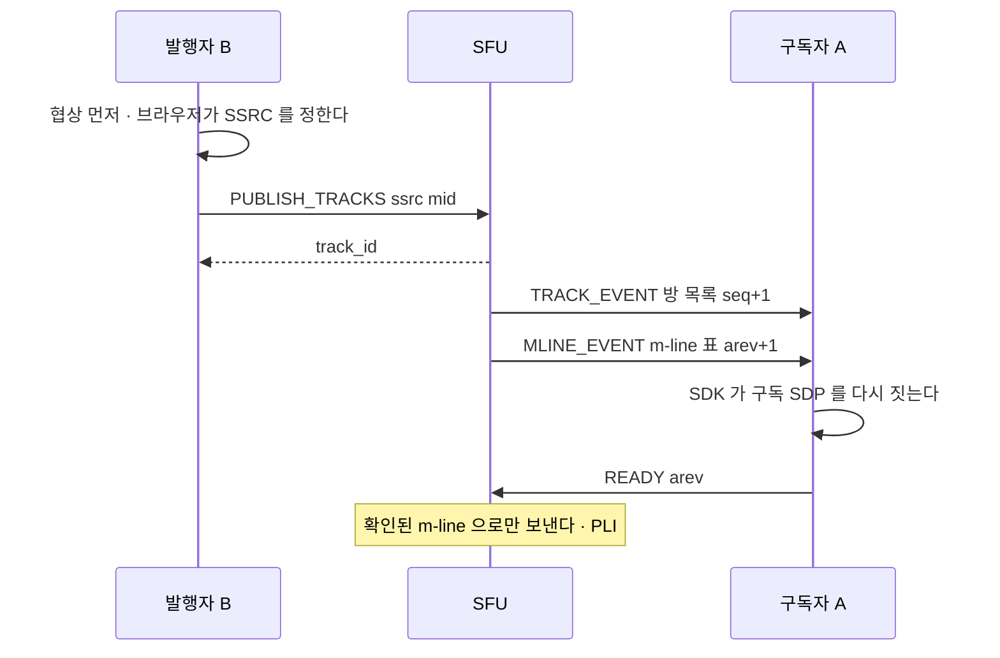
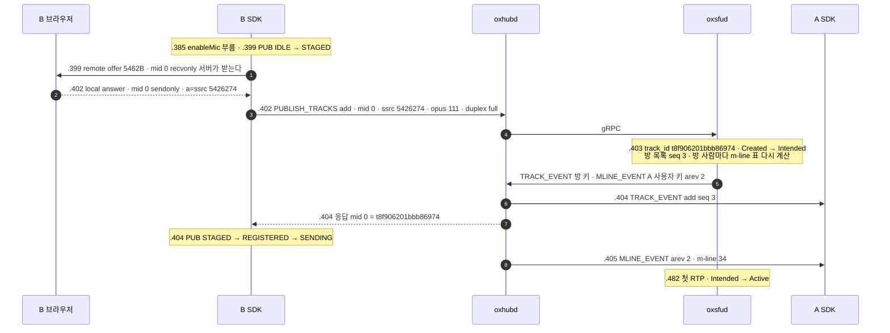
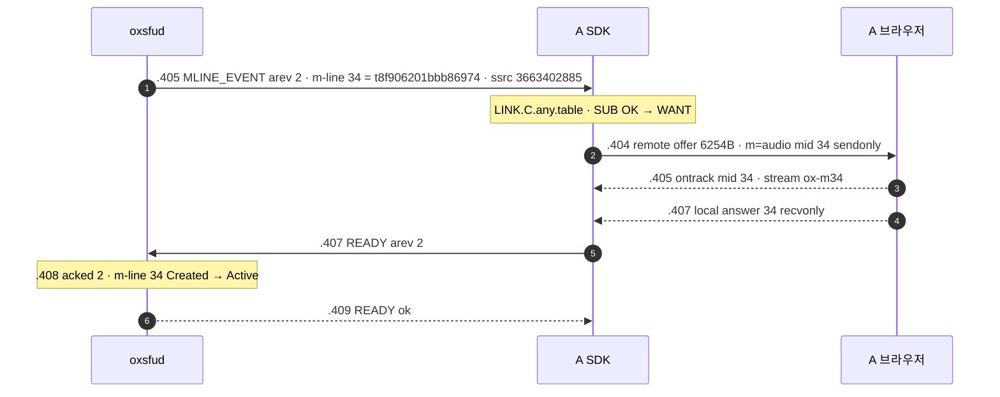
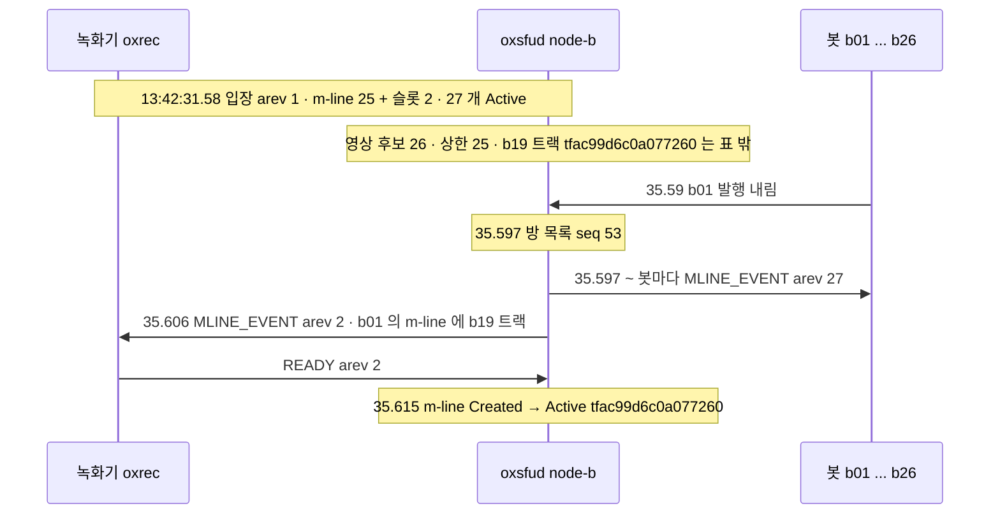

# 03. 발행과 구독 — 협상 먼저 · m-line 표 · READY

> author: kodeholic (powered by Claude) · created: 2026-11-09 · 고침: 2026-11-09(새 회차 · 표준 용어).
> ★**대조한 커밋** — 서버 `oxlens-sfu` `1ef7265` · SDK `oxlens-sdk-web` `de8c4a9`(+탐침) · 2층 `oxlens-labs` `a68d2de` · oxpeer `740f172`
> ★**실측 회차** — 3층 탐침 `tour-learn` 20261109 둘째 판(`02` · `02P`) · 2층 회차 `e2e-20261109-132317`(`peer_record_reassign` · `adv_wire_reject` · `adv_resource` · 연기 시험 `ops_history`). 값은 돌릴 때마다 바뀌고 차례 · 모양은 같다.

용어 대응(m-line · PeerConnection · 트랜스포트 · PT 매핑 등)은 [00 용어](00_INDEX.md#표준-용어)에 있다.

## 1. 30초 요약



- **차례가 핵심이다.** SDP 협상이 먼저고 `PUBLISH_TRACKS` 가 나중이다. 서버에 알릴 발행 SSRC 는 브라우저가 answer 를 만들 때 정해지기 때문이다.
- 구독은 `mline_table`(m-line 표) 하나로 간다. 표는 서버가 고른 「m-line mid → 트랙」 목록이다. 차례 번호가 `arev` 다.
- 클라는 그 표로 SDP 를 지어 협상하고 `READY{arev}` 로 확인한다. 서버는 확인된 m-line 으로만 보낸다.
- 구독 m-line 은 kind 마다 25 까지만 생긴다. 넘으면 서버가 고른 트랙을 있는 m-line 에 싣는다(재배정). SDP 는 안 바뀌고 표만 간다.

## 2. 등장인물 · 값

| 이름 | 이 회차 값(1pc `02`) | 무엇 |
|---|---|---|
| B 마이크 | 업링크 SSRC `5426274` · 발행 mid 0 · PT 111 → track_id `t8f906201bbb86974` | 서버가 이름(track_id)을 준다 |
| B 카메라 | SSRC `3872882618` · RTX `1235855640` · mid 1 · PT 108 / RTX 109 · `source camera` → `t622aaeab8ea27911` | H264 `42e01f` |
| A 의 m-line 34 | audio · 다운링크 SSRC `3663402885` · stream `ox-m34` · B 마이크 | 서버가 음량으로 고른 m-line |
| A 의 m-line 35 | video · 다운링크 SSRC `4018729910` · RTX `2371285709` · stream `ox-m35` · B 카메라 | 클라 선호(기본값 = 멈추지 않음) |
| A 의 m-line 32 · 33 | `ptt-qa_tour_p4-audio` · `-video` · stream `ox-ptt` | PTT 슬롯 — 입장하면 실린다([08](08_SLOT_SPEAKER.md)) |
| 방 목록 차례 | `version` epoch `d6c9ad052c4a12ae` · seq 1 → 4 | 방 하나에 하나 |
| m-line 표 차례 | A arev 1 → 3 · B arev 1 그대로 | PeerConnection(사람 × SFU) 하나에 하나 |
| 구독 m-line 상한 | PeerConnection 마다 audio 25 · video 25 | [연:RULE-SUB-FILL](../protocol/08-sub.md#RULE-SUB-FILL) |
| BUNDLE 천장 | m-line 128 · 구독 몫 1pc 96 · 2pc 128 · 슬롯 몫 기본 40 | [연:RULE-ROOM-BUNDLE-128](../protocol/04-room.md#RULE-ROOM-BUNDLE-128) · [연:RULE-ROOM-BUDGET-MATH](../protocol/04-room.md#RULE-ROOM-BUDGET-MATH) |
| 발행 상한 | 요청마다 8 · 사람마다 16 | `oxsfud/src/pub/mod.rs` `PER_REQUEST` · `PER_PERSON` — 이 회차 거절 값과 같다(§4-3) · 두 곳에 있던 사본을 한 곳으로 모았다(20261109) |

다운링크 SSRC 는 서버가 만든다. 이 회차 표에 실린 것은 전부 `0x80000000` 이상이다(§4-2). 업링크 SSRC(`5426274` 등)는 브라우저가 고른 값이라 범위 약속이 없다.

## 3. 정상 길

시각은 KST `14:35:50.xxx` 의 뒤 세 숫자(ms)다. 1pc 회차 `02` 다.

### 3-1. 발행 — B 가 마이크를 켠다



실제 프레임:
```
B send req PUBLISH_TRACKS #4 {"action":"add","room_id":"qa_tour_p4","join_id":"e693d54a0632ff6a",
   "tracks":[{"kind":"audio","ssrc":5426274,"mid":"0","pt":111,"codec":"opus",
   "fmtp":"minptime=10;useinbandfec=1","duplex":"full","simulcast":false}],
   "audio_level_extmap_id":1,"twcc_extmap_id":3,"mid_extmap_id":4}
B recv ok  PUBLISH_TRACKS #4 {"action":"add","tracks":[{"mid":"0","track_id":"t8f906201bbb86974"}]}
A recv req TRACK_EVENT #2 {"action":"add","tracks":[{"active":true,"csrc":17,"kind":"audio","muted":false,
   "track_id":"t8f906201bbb86974","type":"individual","user_id":"tour_B",…}],"version":{"epoch":"d6c9ad052c4a12ae","seq":3}}
```
- 1pc 라 발행 협상도 SDK 가 지은 서버 쪽 offer 로 했다. 첫 협상만 브라우저 offer 다([02 §3-4](02_CONNECT_JOIN.md)). offer 의 `mid 0 recvonly` 는 「서버가 받는다」는 서버 시각이다.
- `*_extmap_id` 는 B 브라우저가 쓰는 확장 번호다. 서버는 그 번호로 B 의 RTP 에서 음량 · TWCC 번호 · mid 를 읽는다.
- 응답은 `mid → track_id` 하나뿐이다. SDK 는 자기 발행 mid 로 자기 track_id 를 찾는다. 그 뒤의 조작(`TRACK_SET` · `remove`)은 track_id 로 부른다.
- B 도 자기 트랙의 `TRACK_EVENT` 를 받는다(방 통지라서). 그러나 B 의 m-line 표는 그대로다. 자기 트랙은 받을 후보가 아니다. 그래서 B 에게는 `MLINE_EVENT` 가 없다.
- `csrc 17` 은 받는 쪽이 켜면 다운링크 패킷에 실리는 CSRC(contributing source) 값이다 — [08](08_SLOT_SPEAKER.md) 에서 다룬다.

카메라도 같은 길이고 RTX 가 더해진다. .405 enableCamera → .406 STAGED → .409 `PUBLISH_TRACKS #5`(`rtx_ssrc 1235855640` · `source camera`) → .410 `t622aaeab8ea27911` · 방 목록 seq 4 · A 에게 arev 3.

```
14:35:50.403 proc=sfu kind=ev spec=SV-STATE-PUBLISH-STATE session=e9821163 user=tour_B area=PUB key=t8f906201bbb86974 from=Created to=Intended cause=publish
14:35:50.403 proc=sfu kind=ev spec=CP-OP-TRACK-EVENT room=qa_tour_p4 seq=3
14:35:50.403 proc=sfu kind=ev spec=SV-STATE-SUBSCRIBE-STATE session=6a851f47 user=tour_A area=SUB key=t8f906201bbb86974 from=- to=Created cause=load
14:35:50.403 proc=sfu kind=ev spec=CP-OP-MLINE-EVENT session=6a851f47 user=tour_A arev=2
14:35:50.482 proc=sfu kind=ev spec=SV-STATE-PUBLISH-STATE session=e9821163 user=tour_B area=PUB key=t8f906201bbb86974 from=Intended to=Active cause=first_rtp
14:35:50.668 proc=sfu kind=ev spec=SV-STATE-PUBLISH-STATE session=e9821163 user=tour_B area=PUB key=t622aaeab8ea27911 from=Intended to=Active cause=first_rtp
```
- 서버는 RTP 를 기다리지 않고 곧바로 알린다(`Intended` 에서 `TRACK_EVENT`).
- 첫 RTP 는 마이크 79ms · 카메라 259ms 뒤에 왔다. 그 사이 A 는 이미 m-line 을 받고 READY 까지 끝냈다.
- A 쪽 구독 상태기가 `-→Created cause=load` 줄로 시작한다(20261109 고침). 표에 실린 순간이 로그에 남는다.

### 3-2. 구독 — A 에게 m-line 이 생긴다



(WS 프레임은 시험 프로세스가 본 시각이라 SDK 전이보다 1ms 늦게 찍혔다.)

SDK 가 그 표로 지은 m-line 35(구독 m-line):
```
m=video 20000 UDP/TLS/RTP/SAVPF 108 109
a=mid:35                                  ← 표의 mid 그대로(연:RULE-LINK-SDP-ORDER-SUB)
a=sendonly
a=rtpmap:108 H264/90000                   ← 표의 pt
a=msid:ox-m35 ox-m35                      ← 표의 stream_id
a=ssrc:4018729910 cname:ox-sfu            ← 표의 다운링크 SSRC
a=ssrc:2371285709 cname:ox-sfu
a=ssrc-group:FID 4018729910 2371285709    ← RTX 짝
```

이 회차 끝의 A m-line 표(서버 표면 `/admin/users/tour_A/media` — `arev 3 · acked 3`):

| mid | kind | 다운링크 SSRC | 실린 트랙 | `since`(실린 때) | 재작성기 상태 |
|---|---|---|---|---|---|
| 32 | audio | 4212679708 | `ptt-qa_tour_p4-audio` | 입장(.162) | 없음(화자 없음) |
| 33 | video | 3043007948 · RTX 3093602445 | `ptt-qa_tour_p4-video` | 입장 | 없음 |
| 34 | audio | 3663402885 | B 마이크 | .403 | `seq_off 0 · ts_off 0 · switches 0` |
| 35 | video | 4018729910 · RTX 2371285709 | B 카메라 | .409 | `seq_off 0 · switches 0` |

- **표가 원천이다.** SDK 는 트랙 목록이 아니라 표의 m-line 을 mid 오름차순으로 세워 SDP 를 짓는다.
- A 가 아무것도 요청하기 전에 m-line 35 가 생겼다. 영상 선호의 기본값이 「멈추지 않음」이라서다.
- 영상을 고르는 손잡이(`paused` · `priority`)는 클라 것이다. 음성 m-line 은 서버가 음량으로 고른다([연:RULE-SUB-FILL](../protocol/08-sub.md#RULE-SUB-FILL) 표).
- `MLINE_EVENT`(서버 .403) → m-line Active(.408)까지 5ms 였다. 카메라 m-line(.409 → .414)도 5ms 다. 이 왕복이 m-line 표가 치르는 값이다.
- 재작성기(RTP 헤더 재작성 — SSRC · 시퀀스 번호 · 타임스탬프 rewriting) 칸이 0 인 것은 출처가 한 번도 안 바뀌어서다. 헤더를 어떻게 다시 쓰는지는 [04](04_PACKET_PATH.md) 에 있다.

### 3-3. READY 가 하는 일

```
14:35:50.414 proc=sfu kind=ev spec=SV-STATE-SUBSCRIBE-STATE session=6a851f47 user=tour_A area=SUB key=t622aaeab8ea27911 from=Created to=Active cause=ready
14:35:50.415 proc=hub kind=ev spec=CP-OP-READY session=6a851f47 user=tour_A arev=3 msg=ok
```
- READY 를 받으면 서버는 셋을 한다([연:RULE-SUB-READY-WHAT](../protocol/08-sub.md#RULE-SUB-READY-WHAT)). 막아 둔 영상을 흘린다. PLI 로 키프레임을 요청한다. 그 방의 처음 알리기를 한다(floor control 상태 — DataChannel 로 `Floor Idle` · [07](07_FLOOR.md)).
- B 의 송신 통계가 그 흔적이다: `pliCount 1` · `keyFramesEncoded 2`(처음 하나 + PLI 에 하나) · `framesEncoded 53`.
- `READY` 는 방마다 보낸다. PLI 와 처음 알리기가 그 방 범위라서다([연:R-SUB-READY-PER-ROOM](../protocol/08-sub.md#R-SUB-READY-PER-ROOM)).
- 이 회차 A 는 READY 를 세 번 냈다. 그때마다 DataChannel 로 `MBCP IDLE` 이 왔다(SEQ 1 · 3 · 4).
- `B.enableCamera`(.405)에서 A 가 디코딩된 폭을 본 때(`A.videoDecoded` .773)까지 368ms 다. 탐침이 폴링하므로 위 끝 값이다.
- 수집 때 A 의 카메라 수신은 `packets 55 · framesDecoded 53` 이었다.

### 3-4. 방 목록 차례 `seq` 와 m-line 표 차례 `arev`

| 사건 | 방 목록 seq(방 하나) | A 의 arev | B 의 arev |
|---|---|---|---|
| A 입장 | 1 | 1 | — |
| B 입장 | 2 | 1(표 그대로) | 1 |
| B 마이크 | 3 | 2(m-line 34) | 1 |
| B 카메라 | 4 | 3(m-line 35) | 1 |
| A 퇴장 · B 퇴장 | 5 · 6(트랙 내림) · 7 | — | — |

- `seq` 는 방 목록(사람 · 트랙)이 바뀔 때마다 오른다. 그 방 사람 모두가 같은 값을 본다([연:ROOM.type.Version](../protocol/04-room.md#ROOM.type.Version)).
- `seq` 는 통지마다 실려 온다. 그래서 클라는 빠진 통지를 안다. 빠지면 다시 받는다([11](11_STALL_RESYNC.md)).
- `arev` 는 내 PeerConnection 의 표 차례다. B 의 트랙이 늘면 방 seq 는 B 에게도 오른다. 그러나 B 의 arev 는 그대로다.
- READY 는 arev 를 싣는다. 뜻은 「이 차례의 표로 협상을 끝냈다」다.

### 3-5. 1pc 의 mid 32 ~ 와 2pc

같은 길을 1pc(`02`)와 2pc(`02P`)로 잰 표는 [02 §3-5](02_CONNECT_JOIN.md) 에 있다. 발행 mid · 구독 m-line mid(32 ~ 대 0 ~) · 받는 PT · 협상 수가 그 표에 있다. 여기서는 구독 mid 가 왜 32 부터인지만 본다.

- 1pc 는 내 발행 mid(브라우저가 매김)와 구독 mid 가 한 공간이다. 그래서 서버가 구독 mid 를 32 부터 낸다(`oxsfud/src/sub/mod.rs` `START_1PC`).
- 클라는 자기 m-line 을 32 개 미만으로 둔다([연:SUB.type.MlineEntry](../protocol/08-sub.md#SUB.type.MlineEntry)). 2pc 는 구독 PeerConnection 이 따로라 0 부터다.
- 그래서 1pc 의 구독 몫은 128 − 32 = 96 이고 2pc 는 128 이다([연:RULE-ROOM-BUDGET-MATH](../protocol/04-room.md#RULE-ROOM-BUDGET-MATH)).

## 4. 깨지는 길

### 4-1. m-line 이 모자란다 — 상한 25 와 재배정(2층 `peer_record_reassign`)

봇 26 명이 영상을 하나씩 발행한다. 투명 참가자 녹화기(oxpeer · 2pc)가 들어와 전부 받으려 한다. 4초에 b01 이 발행을 내린다.



```
13:42:31.581 node=node-b proc=sfu kind=ev spec=SV-STATE-PEER-STATE session=09c91bed user=oxrec~peer_record_reassign … area=LINK key=publish from=- to=Alive cause=peer_created
13:42:35.605 node=node-b proc=sfu kind=ev spec=SV-STATE-SUBSCRIBE-STATE session=09c91bed user=oxrec~peer_record_reassign … area=SUB key=t530e8100f7c61215 from=Active to=- cause=unload
13:42:35.605 node=node-b proc=sfu kind=ev spec=SV-STATE-SUBSCRIBE-STATE session=09c91bed user=oxrec~peer_record_reassign … area=SUB key=tfac99d6c0a077260 from=- to=Created cause=load
13:42:35.605 node=node-b proc=sfu kind=ev spec=CP-OP-MLINE-EVENT session=09c91bed user=oxrec~peer_record_reassign … arev=2
13:42:35.615 node=node-b proc=sfu kind=ev spec=SV-STATE-SUBSCRIBE-STATE session=09c91bed user=oxrec~peer_record_reassign … area=SUB key=tfac99d6c0a077260 from=Created to=Active cause=ready
13:42:35.617 node=node-a proc=hub kind=ev spec=CP-OP-READY session=09c91bed user=oxrec~peer_record_reassign arev=2 msg=ok
```

녹화기가 남긴 파일(발행자마다 하나):

| 출처 | 파일 시작(첫 파일 기준) | 길이 | 키프레임 |
|---|---|---|---|
| b01 | 0ms | 3500ms | 4 |
| b02 ~ b18 · b20 ~ b26 | 5 ~ 307ms | 10033 ~ 10333ms | 11 |
| ★b19 | 4292ms | 6166ms | 7 |

- **무엇이 깨졌나** — 받을 영상은 26 인데 구독 m-line 은 25 다.
- 입장이 막히지 않는다. SDP 도 바뀌지 않는다. 26 번째는 「목록에는 있고 표에는 없는」 트랙으로 남는다([연:RULE-SUB-NO-ASSIGN-NO-SDP](../protocol/08-sub.md#RULE-SUB-NO-ASSIGN-NO-SDP)).
- **누가 먼저 아나** — 서버다. m-line 이 비자 표만 갔다(`MLINE_EVENT` arev 2). 트랙 목록은 b01 이 빠진 것만 바뀌었다.
- 재배정은 m-line 의 `track_id` 만 바꾼다. mid · 튜플 · 다운링크 SSRC · stream_id 는 그대로다. 그래서 구독 SDP 가 안 바뀐다([연:RULE-SUB-FILL](../protocol/08-sub.md#RULE-SUB-FILL)).
- 이제 그 순간이 로그에 두 줄로 남는다 — 옛 트랙 `Active → - unload` · 새 트랙 `- → Created load`(20261109 고침). 재배정을 줄로 따라갈 수 있다.
- **무엇이 오가나** — 표 → `READY{arev 2}` → 그 뒤에야 새 트랙이 그 m-line 으로 나간다. MLINE 35.606 → Active 35.615, 9ms 다.
- 확인 전에 다른 사람이 그 칸에 보이는 일은 구조적으로 없다([연:RULE-SUB-EGRESS-ACKED](../protocol/08-sub.md#RULE-SUB-EGRESS-ACKED)).
- **사용자가 겪는 것** — b19 는 처음 4.3초 동안 녹화되지 않았다. 파일이 그만큼 늦게 시작했다. 녹화기는 출처(CSRC)로 파일을 가른다 — [16](16_OXPEER.md).
- 녹화기 요약의 `coverage` 가 이 늦음을 적는다. b19 가 m-line 에 실린 때(`loaded_ms`)는 녹화기 시작부터 4,678ms 였다. 다른 발행자는 387 ~ 692ms 다. `not_recorded`(끝내 못 실린 트랙)는 비었다. 예제 녹화기 요약에 20261109 더한 칸이다 — [16](16_OXPEER.md).
- **표 밖에 남은 사람은 회차마다 다르다.** 이 회차는 b19 였다. 옛 회차는 b25 였다. 같은 순위끼리 누가 밀리는지는 서버 정의서의 몫이다(`oxsfud/src/sub/mod.rs` `sync` 의 정렬). 시나리오 머리 주석이 「b26」이라 적었던 것은 주석의 잘못으로 판정했다(결함 아님 · 주석만 고침).
- **남은 관찰** — 재배정 뒤 녹화기의 사건 목록에 b19 의 `Receiving` 이 오지 않았다. 파일은 생겼다. 옛 회차(b25)도 같았다 — [16](16_OXPEER.md) 몫으로 넘긴다.

### 4-2. 1pc 에서 SSRC 가 겹친다 — `3008`(2층 `adv_wire_reject`)

1pc 봇 botC 의 입장 응답 표에 PTT 슬롯 m-line 32 의 다운링크 SSRC `3122592116` 이 있었다. 그 값을 그대로 다시 실어 발행해 본다. 값을 지어내지 않는다.

```
botC send PUBLISH_TRACKS {"action":"add","tracks":[{"kind":"audio","mid":"9","ssrc":3122592116,"pt":111}]}
botC recv fail {"code":3008,"name":"SSRC_COLLISION","permanent":true}
13:32:30.797 proc=hub kind=ev spec=CP-CODE-SSRC-COLLISION session=9cabd624 user=botC~adv_wire_reject op=PUBLISH_TRACKS
```
- **무엇이 깨졌나** — 1pc 는 BUNDLE 하나라 SSRC 공간이 하나다. 다운링크 SSRC 는 서버가 만들고 업링크 SSRC 는 브라우저가 만든다. 그래서 겹칠 수 있다.
- **막지 않으면** — 브라우저가 두 m-line 에서 같은 SSRC 를 본다. 한쪽이 조용히 죽는다(그 트랙 `packetsReceived` 0 — [연:RULE-LINK-SDP-1PC](../protocol/09-link.md#RULE-LINK-SDP-1PC) SSRC 문단). 기록만으로는 안 잡히는 사고다.
- **그래서** — 서버가 `PUBLISH_TRACKS` 의 `ssrc` · `rtx_ssrc` 를 이 PeerConnection 에 낸 다운링크 SSRC 집합과 대조한다. 겹치면 거절한다(`oxsfud/src/ops/media.rs` `publish` 의 `down_ssrcs`).
- 클라는 새 트랜시버로 한 번 다시 발행한다. 2pc 는 원리적으로 이 일이 없다.
- **다운링크 SSRC 의 최상위 비트(20261109 고침 · 서버 `f6bbf02`)** — 규격은 「서버가 만드는 다운링크 SSRC 는 최상위 비트를 세운 난수(`0x80000000` 이상)」라 적는다([연:RULE-LINK-SDP-1PC](../protocol/09-link.md#RULE-LINK-SDP-1PC)). 그래서 CSRC(최상위 비트 0)와 구조적으로 안 겹친다.
- 옛 회차는 이 약속이 서 있지 않았다. 3층 탐침 열 회차의 표에 실린 다운링크 SSRC 89개 가운데 38개가 그 아래였다(`56206715` 등). 소스가 `rand_u32()` 를 그대로 썼다.
- 지금은 `fresh_ssrc` 가 `rand_u32() | 0x8000_0000` 이다. 새 회차 열 탐침의 89개는 전부 그 위다(가장 작은 값 `2213031411`). 2층 run-all 은 이 문장을 등식 `downlink_ssrc_high_bit` 로 단언한다 — 87 시나리오 전부 초록.
- 곁가지 — 업링크 SSRC 값으로 무엇을 짐작하지 않는다. 옛 서버는 상위 4비트가 `0xF` 인 SSRC 를 「아직 모르는 SSRC」 표지로 오판해 자기 트랙을 지웠다(검은 화면). 2층 `conf_sentinel_band` 가 `0xF8000001` 대역으로 발행해 지금은 정상임을 지킨다(이 회차 판정 36 초록).

### 4-3. 한 번에 너무 많이 발행한다 — `4002`(2층 `adv_resource`)

| 봇 | 보낸 것 | 받은 것 |
|---|---|---|
| botADV | 한 요청에 300 트랙 | `4002 TRACK_LIMIT` · `details {"current":300,"limit":8}` |
| botADV2 | 8 · 8 · 8 · 8 · 8 | 앞 둘은 성공(16 트랙) · 셋째부터 `4002` · `{"current":24,"limit":16}` 세 번 |
| botB · botC | 하나씩 | 정상(`CP-OP-PUBLISH-TRACKS msg=ok` 13:31:17.875 · .878) |

```
13:31:17.860 proc=hub kind=ev spec=CP-CODE-TRACK-LIMIT session=5779c64a user=botADV~adv_resource op=PUBLISH_TRACKS
13:31:17.864 proc=hub kind=ev spec=CP-OP-PUBLISH-TRACKS session=d30330b5 user=botADV2~adv_resource msg=ok
13:31:17.868 proc=hub kind=ev spec=CP-OP-PUBLISH-TRACKS session=d30330b5 user=botADV2~adv_resource msg=ok
13:31:17.870 proc=hub kind=ev spec=CP-CODE-TRACK-LIMIT session=d30330b5 user=botADV2~adv_resource op=PUBLISH_TRACKS
```
- **일부만 받지 않는다.** 넘치는 요청은 통째로 거절이다. 상태가 안 바뀐다.
- `current` 는 「받았다면 몇이 되나」다(16 + 8 = 24).
- 사용자가 겪는 것 — 정상 앱은 닿을 일이 없다. 실패를 되돌리지 않는 클라는 유령 발행이 상한을 먹는다. 그래서 `4002` 가 잦아진다([연:R-PUB-PUBLISH-SYMPTOMS](../protocol/07-pub.md#R-PUB-PUBLISH-SYMPTOMS)).
- 같은 방의 정상 발행자는 영향이 없었다.

### 4-4. READY 가 안 온다 — 안전망 `T-gate`(2층 연기 시험 `ops_history`)

조용한 참가자 하나가 청취 입장만 한다. 협상도 READY 도 하지 않는다.
```
13:27:07.363 node=node-b proc=sfu kind=ev spec=AFF.S.join_listen session=f5d73685 user=hist98427uq area=AFF … cause=ROOM_JOIN
13:27:07.364 node=node-a proc=hub kind=ev spec=CP-OP-ROOM-JOIN session=f5d73685 user=hist98427uq msg=ok
13:27:12.425 node=node-b proc=sfu kind=diag spec=CP-TIMER-T-GATE session=f5d73685 room=hist98427r1 user=hist98427uq in.held_ms=5062 msg="READY gate released by timeout — READY 미수신 의심 (no keyframe request on this path)"
13:27:14.426 node=node-b proc=sfu kind=stat session=f5d73685 user=hist98427uq packets_sent=0 bytes_sent=0 retransmitted_packets_sent=0 nack_count=0 pli_count=0
```
- **누가 먼저 아나** — 서버다. 게이트를 연 지 5초에 스스로 풀고 진단 줄을 남긴다([연:RULE-SUB-TGATE](../protocol/08-sub.md#RULE-SUB-TGATE) · 점검 주기가 1초라 5062ms). PLI 는 내지 않는다 — 줄에 그렇게 적혀 있다.
- 그러나 이 사람의 m-line 은 `Created → Active` 줄이 끝내 안 찍혔다. 퇴장 때(13:27:14.599) `Created → - cause=unload` 로 바로 끝났다. 확인된 차례(acked)가 없으니 서버는 그 m-line 으로 보내지 않는다([연:RULE-SUB-EGRESS-ACKED](../protocol/08-sub.md#RULE-SUB-EGRESS-ACKED)).
- 안전망은 「막아 둔 것」을 풀 뿐이다. 확인을 대신하지 않는다. 그래서 규격이 증상을 「받는 영상이 영구히 검다」로 적는다([연:R-SUB-READY-SYMPTOMS](../protocol/08-sub.md#R-SUB-READY-SYMPTOMS)).
- 서버 stat 줄은 게이트가 풀린 뒤(13:27:14)에도 이 사람에게 보낸 패킷이 `packets_sent=0` 이었다. 단 이 연기 시험의 참가자는 미디어 트랜스포트를 세우지 않았다. 그래서 0 이 「확인이 없어서」인지 「길이 없어서」인지는 이 회차로 가르지 않았다.
- 같은 꼴이 클라 쪽에서 실제로 났던 기록이 규격에 있다. 입장 응답과 남의 영상 발행이 6ms 겹쳤다. SDK 가 협상 중간에 READY 를 내서 `arev 2 acked 1` 로 남았고 받는 영상이 검었다. 그래서 「큐가 빈 협상의 끝에만 READY 를 낸다」([연:RULE-LINK-SDP-RENEGOTIATE](../protocol/09-link.md#RULE-LINK-SDP-RENEGOTIATE)).

## 5. 왜 이 모양인가

> ★**우리만의 것 — m-line 표(서버가 고르고 클라가 READY 로 확인한다)**
> - **선택 배경** — 옛 꼴은 서버 안의 「mid → 트랙」을 클라가 여러 길의 사건으로 다시 지었다. 어긋날 곳이 일곱이었다 — HTTP 와 WS 의 경주 · 차례 없는 재발급 · mid 를 클라가 짐작 · 서버가 클라 적용 범위를 모름 등([연:R-SUB-TABLE-WHY](../protocol/08-sub.md#R-SUB-TABLE-WHY)). 표를 원천으로 두고 한 길로 차례 번호와 함께 보내면 일곱이 구조로 없어진다.
> - **얻은 것** — 재배정 · 빈 m-line 채우기에 SDP 가 안 바뀐다(§4-1 — 26 명 방에서 표만 갔다). 클라 SDP 에 없는 대응으로 패킷이 나가는 길이 없다. 화면에 엉뚱한 사람이 비치는 일이 구조적으로 막힌다. 큰 방도 문턱 없이 같은 장치다. 작은 방은 재배정이 안 일어날 뿐이다([연:R-SUB-FILL-WHY](../protocol/08-sub.md#R-SUB-FILL-WHY)).
> - **잃은 것** — 표가 바뀔 때마다 한 왕복이 든다(이 회차 5ms · 녹화기 9ms). READY 가 안 오면 그 m-line 은 영영 안 열린다 — 안전망 5초는 게이트만 푼다(§4-4). 받는 영상은 PeerConnection 마다 25 를 넘지 못한다(26 번째는 m-line 이 빌 때까지 못 받는다). BUNDLE 천장 128 은 브라우저가 정한다. Firefox 155 는 129 번째 절부터 BUNDLE 밖으로 내보내 오류 없이 그 트랙만 안 나온다([연:R-ROOM-SILENT-OVERFLOW](../protocol/04-room.md#R-ROOM-SILENT-OVERFLOW)). 그래서 서버가 세어 막는다.

- **왜 협상 먼저인가** — 발행 SSRC 는 브라우저가 answer 를 지을 때 정한다. 서버는 SDP 를 안 보므로 그 값을 `PUBLISH_TRACKS` 로 받아야 한다. 시뮬캐스트만 SSRC 를 0 으로 보내고 첫 RTP 의 `rid` 로 배운다([05](05_SIMULCAST_BWE.md)).
- **왜 RTP 를 기다리지 않고 알리나** — 첫 RTP(79 · 259ms)를 기다리면 그만큼 구독 협상이 늦게 시작한다. 알림과 협상을 겹쳐 두고, 확인(READY)이 실제 송출을 지킨다.
- **왜 영상은 클라가, 음성은 서버가 고르나** — 영상은 화면에 보이는지 클라만 안다. 음성은 받기 전에 누가 말하는지 클라가 모른다. 서버가 들어오는 음량 확장 헤더로 고른다([연:RULE-SUB-FILL](../protocol/08-sub.md#RULE-SUB-FILL) 표).
- **왜 상한이 인원과 무관한 25 인가** — 인원 문턱으로 방식을 바꾸면 문턱을 넘는 순간 SSRC 가 바뀐다. 그러면 모두가 재협상한다. 처음부터 한 장치로 둔다([연:R-SUB-FILL-WHY](../protocol/08-sub.md#R-SUB-FILL-WHY) · [연:RULE-ROOM-BUDGET-SPLIT](../protocol/04-room.md#RULE-ROOM-BUDGET-SPLIT)).

## 6. 다른 SFU 는

「그쪽 방식」은 각 서버의 소스를 정적으로 읽은 대장에서 옮긴 것이다. 「저쪽 소스에는 이렇게 적혀 있다」이지 실측이 아니다.

| 축 | 그쪽 방식 | 우리 | 우리 쪽 장점 | 우리 쪽 대가 |
|---|---|---|---|---|
| 시그널 의도와 실제 RTP 를 잇기 | LiveKit — client id 2축(시그널 cid · SDP msid) 매칭. 짝이 없으면 `pendingRemoteTracks` 에 쌓았다 재처리(`livekit §8-1`) | 협상 뒤 `PUBLISH_TRACKS` 가 ssrc · mid 를 선언 · 동기 응답으로 track_id | 등록이 한 왕복으로 끝나고 순서가 하나다 | 클라가 SSRC 를 정확히 알려야 한다 |
| 코덱을 언제 확정하나 | LiveKit — PT 0 인 클라는 첫 RTP 를 읽어 확정(`livekit §8-1`) | 선언이 권위 · video 는 코덱이 없으면 `1005` · 방의 코덱과 다르면 거절 | RTP 전에 구독자 SDP 를 지을 수 있다 | 클라 정직성에 기댄다 |
| 등록이 뒤집혀 오면 | LiveKit — 클라가 AddTrack 응답을 안 기다리고 협상하면 앞 트랙이 닫히기 전에 새 트랙이 발행되는 일이 실제로 생겨 `queued` 플래그로 줄 세운다(`livekit §8-1`) | 협상 큐가 끝난 뒤에 `PUBLISH_TRACKS` · 동기 등록 · 요청 8 · 사람 16 · 넘치면 전체 거절(§4-3) | 등록 순서가 하나이고 서버 자원이 유계 | 한 번에 많이 올리는 클라는 나눠 보내야 한다 |
| 구독을 명령으로 · 상태로 | LiveKit — `desired` 만 세우고 조정 루프가 사건 + 3초 주기로 수렴(`livekit §9-1`) | 사건마다 서버가 표를 다시 계산(`resync_room`) · 차례 `arev` · 확인 `READY` | 주기 없이 곧바로 · 클라 적용 범위를 서버가 안다 | 확인 한 왕복 |
| 구독을 만들자마자 보내나 | mediasoup — 영상은 `paused:true` 로 만들라고 API 주석이 권한다. 키프레임이 클라 준비 전에 오면 검은 화면이라서(`mediasoup §5-4`) | 서버가 막고 클라 `READY` 로 풀며 PLI · 5초 안전망 | 앱이 부를 것이 없다 | READY 가 안 오면 영구히 검다(§4-4) |
| 구독 m-line 이 모자랄 때 | Jitsi Videobridge — 구독자마다 SSRC 상한(audio 50 · video 50). 오래 안 쓴 것부터 다시 쓰고 맵 통지만 보낸다. 경주는 여유분으로 줄인다(규격 [연:R-SUB-FILL-WHY](../protocol/08-sub.md#R-SUB-FILL-WHY) 가 든 선례 · 2차) | 상한 25 · 재배정 · 확인된 차례로 경주를 막는다 | 다른 사람이 그 칸에 비치는 창이 없다 | 재배정마다 한 왕복 |
| 음성을 몇 개 보내나 | JVB — 에너지 순위 상위 N(`num-loudest 3` · 기본 꺼짐)을 입구에서 자른다(`JVB §4-2`) | 음성 m-line 25 · 서버가 음량으로 고른다 | 동시에 25 m-line 까지 받는다 | 25 를 넘는 동시 발화는 서버 고르기에 맡긴다 |

## 7. 운영에서 보는 법

| 사건 | 서버 로그 줄(이 회차) | 운영 표면 · SDK 전이 |
|---|---|---|
| 발행 등록 | `SV-STATE-PUBLISH-STATE … Created → Intended cause=publish` · `CP-OP-TRACK-EVENT seq=3` | `PUB.C.STAGED.pub_ok` · `/admin/rooms/<room>/snapshot`(`tracks` · `version.seq`) |
| 발행 미디어 도착 | `… Intended → Active cause=first_rtp` | — |
| 표에 실렸다 · 빠졌다 | `SV-STATE-SUBSCRIBE-STATE … - → Created cause=load` · `… → - cause=unload` | — |
| 표가 바뀌었다 | `CP-OP-MLINE-EVENT session=… arev=2` | `LINK.C.any.table` · `SUB.C.any.table_changed` |
| 확인 | `SV-STATE-SUBSCRIBE-STATE … Created → Active cause=ready` · `CP-OP-READY arev=2 msg=ok` | `SUB.C.SENT.ready_ok` · `/admin/users/<user>/media`(`arev` · `acked` · m-line 마다 `since` · `rewrite`) |
| READY 를 못 받음 | `CP-TIMER-T-GATE in.held_ms=…` | `acked` 가 `arev` 보다 작다 |
| 거절 | `CP-CODE-SSRC-COLLISION` · `CP-CODE-TRACK-LIMIT` | 응답 `code` · `details` |

- **검은 화면을 볼 때 첫 질문** — `/admin/users/<user>/media` 의 `arev` 와 `acked` 가 같은가. 다르면 클라가 마지막 표를 확인하지 않았다(READY 길).
- 같은데 검으면 그 m-line 의 `rewrite` 가 움직이는지 본다. 그다음 발행 쪽 `first_rtp` 가 있었는지로 내려간다([04](04_PACKET_PATH.md)).
- 줄 읽는 법 · `/admin/history` 로 한 사람의 사슬을 거두는 법은 [17](17_OPERATIONS.md).

## 8. 소스 · 규격 좌표

| 단계 | 서버 | SDK | 규격 |
|---|---|---|---|
| 발행 | `oxsfud/src/ops/media.rs` `publish`(`down_ssrcs` 대조) · `track_event` · `resync_room` · `oxsfud/src/pub/mod.rs` `PER_REQUEST` · `PER_PERSON` | `domain/pub/local.ts` · `domain/pub/registry.ts`(PUB 상태기) | [연:PUB.op.PUBLISH_TRACKS](../protocol/07-pub.md#PUB.op.PUBLISH_TRACKS) · [연:TRK.op.TRACK_EVENT](../protocol/06-trk.md#TRK.op.TRACK_EVENT) |
| m-line 표 | `oxsfud/src/sub/mod.rs` `sync` · `set_pref` · `fresh_ssrc` · `START_1PC` · `FULL_AUDIO` · `FULL_VIDEO` · `oxsfud/src/ops/media.rs` `resync_peer`(load · unload 줄) | `domain/link/table.ts` `TableStore` · `internal/link/sdp.ts` `subOffer` | [연:SUB.type.MlineTable](../protocol/08-sub.md#SUB.type.MlineTable) · [연:LINK.op.MLINE_EVENT](../protocol/09-link.md#LINK.op.MLINE_EVENT) · [연:RULE-SUB-FILL](../protocol/08-sub.md#RULE-SUB-FILL) |
| READY | `oxsfud/src/ops/media.rs` `ready` · `oxsfud/src/sub/mod.rs` `ready` · `oxsfud/src/ops/timers.rs`(`CP-TIMER-T-GATE`) | `domain/trk/sub.ts` · `domain/room/core.ts` | [연:SUB.op.READY](../protocol/08-sub.md#SUB.op.READY) · [연:RULE-SUB-READY-WHAT](../protocol/08-sub.md#RULE-SUB-READY-WHAT) · [연:RULE-SUB-EGRESS-ACKED](../protocol/08-sub.md#RULE-SUB-EGRESS-ACKED) · [연:RULE-SUB-TGATE](../protocol/08-sub.md#RULE-SUB-TGATE) |
| 차례 | `oxsfud/src/ops/media.rs` `track_event`(seq) | `domain/room/store.ts` | [연:ROOM.type.Version](../protocol/04-room.md#ROOM.type.Version) · [연:RULE-ROOM-VERSION-CLIENT-RULES](../protocol/04-room.md#RULE-ROOM-VERSION-CLIENT-RULES) |
| 천장 · 몫 | `oxsfud/src/sub/mod.rs` `sync` | — | [연:RULE-ROOM-BUNDLE-128](../protocol/04-room.md#RULE-ROOM-BUNDLE-128) · [연:RULE-ROOM-BUDGET-MATH](../protocol/04-room.md#RULE-ROOM-BUDGET-MATH) · [연:RULE-ROOM-BUDGET-SPLIT](../protocol/04-room.md#RULE-ROOM-BUDGET-SPLIT) |
| 받는 쪽 손잡이 | `oxsfud/src/sub/mod.rs` `set_pref` | `domain/trk/remote.ts` `adapt` · `PRIO_VISIBLE` | [연:SUB.op.SUBSCRIBE_LAYER](../protocol/08-sub.md#SUB.op.SUBSCRIBE_LAYER) |

## 9. 스스로 확인하는 질문

<details><summary>1. B 가 마이크를 켰을 때 A 의 SDP 는 바뀌었나? B 가 한 명 더 늘어 받을 영상이 26 이 되면?</summary>

바뀌었다. A 의 PeerConnection 에 빈 audio m-line 이 없어 m-line 34 가 새로 생겼다. 빈 m-line 이 있으면 표(`MLINE_EVENT`)만 오고 SDP 는 그대로다. 26 번째 영상은 상한 25 라 m-line 을 못 받고 목록에만 남는다. m-line 이 비면 재배정으로 표만 온다(§4-1).
</details>

<details><summary>2. 서버가 SDP 를 안 받는데 B 의 업링크 SSRC 는 어떻게 아나? 그래서 무엇이 먼저인가?</summary>

`PUBLISH_TRACKS` 본문의 `ssrc` · `rtx_ssrc` 로 안다. 그 값은 브라우저가 answer 를 만들 때 정해진다. 그래서 SDK 는 협상을 먼저 하고 `PUBLISH_TRACKS` 를 나중에 보낸다(.402 answer → .402 요청).
</details>

<details><summary>3. 녹화기가 b01 의 m-line 을 b19 에게 넘겨줄 때 무엇이 오갔고, 왜 b19 가 그 m-line 으로 곧바로 나가지 않았나?</summary>

`MLINE_EVENT arev 2` 하나가 왔다. 녹화기가 `READY arev 2` 로 확인한 뒤(9ms) m-line 이 Active 가 됐다. 서버는 확인된 차례 이후 바뀐 m-line 으로 보내지 않는다([연:RULE-SUB-EGRESS-ACKED](../protocol/08-sub.md#RULE-SUB-EGRESS-ACKED)). 클라가 화면을 다시 잇기 전에 다른 사람이 그 칸에 비치지 않게 하려는 것이다.
</details>

<details><summary>4. 클라가 READY 를 영영 안 보내면 5초 뒤에 화면이 나오나?</summary>

안 나온다고 봐야 한다. 5초 안전망(`CP-TIMER-T-GATE`)은 막아 둔 게이트만 푼다. PLI 도 안 낸다. m-line 의 확인(acked)은 READY 만 세운다. 그래서 그 m-line 으로는 보내지 않는다. 이 회차 로그에서 그 사람의 m-line 은 `Active` 가 끝내 안 찍혔다(§4-4).
</details>

<details><summary>5. 1pc 에서 구독 m-line mid 가 32 부터인 까닭은? 2pc 는?</summary>

1pc 는 내 발행 m-line(브라우저가 0 · 1 · 2 로 매김)과 구독 m-line 이 한 PeerConnection · 한 mid 공간이다. 겹치지 않게 서버가 32 부터 낸다. 2pc 는 구독 PeerConnection 이 따로라 0 부터다(02P 의 0 · 1 · 2 · 3). 그래서 1pc 의 구독 몫은 96, 2pc 는 128 이다.
</details>

<details><summary>6. 1pc 에서 다운링크 SSRC 가 CSRC 값과 겹칠 수 있나?</summary>

지금은 구조적으로 못 겹친다. 서버가 만드는 다운링크 SSRC 는 최상위 비트를 세운다(`0x80000000` 이상). CSRC 값은 서버가 트랙마다 매기는 작은 수(이 회차 17 · 18)다. 옛 회차는 서버가 이 비트를 세우지 않아 절반쯤이 그 아래였다(20261109 고침). 업링크 SSRC 와의 겹침은 따로 `3008` 로 막는다(§4-2).
</details>
