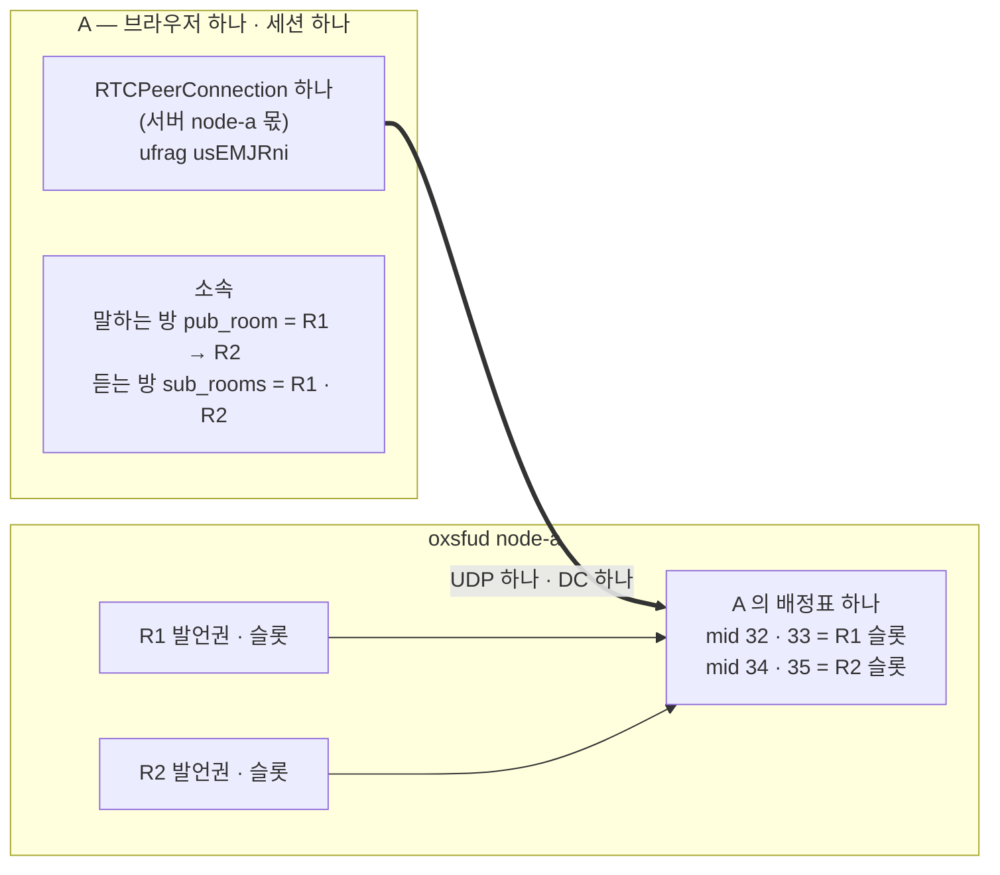
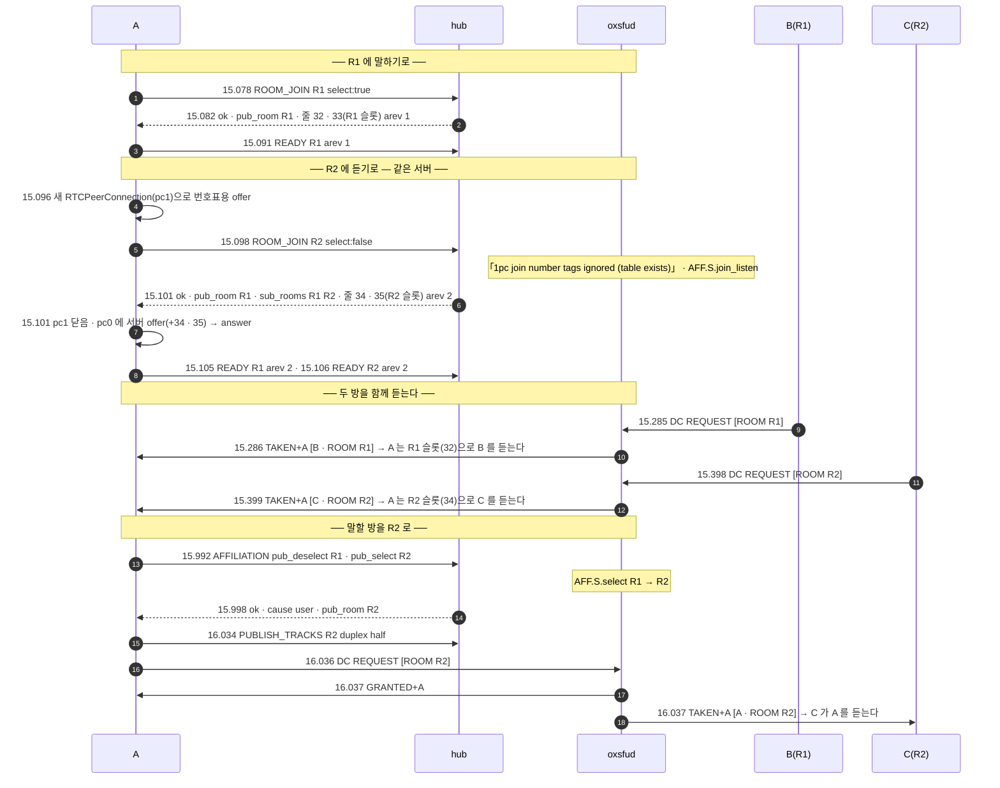

# 04. 다방 청취 · 발언 방 바꾸기

> author: kodeholic (powered by Claude) · created: 2026-11-03.
> ★**대조한 커밋** — 서버 `oxlens-sfu` `773ba81` · SDK `oxlens-sdk-web` `b65aa10`.
> ★**실측 회차** — `tour-20261103-140404`(탐침 `TOUR-04`) · 놓음 줄만 `tour-20261103-175523`. 값은 돌릴 때마다 바뀌고, 차례 · 모양은 같다.

## 0. 한 줄 목적 · 등장인물

**한 사람이 무전 방 둘을 동시에 듣고, 말할 방을 바꿔 말하기까지 — 연결은 몇 개고 무엇이 오가는가.**

| 이름 | 실제 값 | 무엇 |
|---|---|---|
| A | `tourmulti_A` | R1 에 말하기로 · R2 에 듣기로 들어간다 → 나중에 말할 방을 R2 로 바꾼다 |
| B | `tourmulti_B` | R1 에서 말하는 사람 |
| C | `tourmulti_C` | R2 에서 말하는 사람 |
| R1 · R2 | `qa_tourmulti_p5` · `qa_tourmulti_p6` | 둘 다 node-a(같은 미디어 서버) |

## 1. 큰 그림 — 방이 아니라 서버마다 연결 하나



- **연결(트랜스포트)은 방마다가 아니라 미디어 서버마다 하나다.** 같은 서버의 방을 몇 개 들어가도 RTCPeerConnection · ICE · DTLS · DC 가 하나고, 배정표에 방마다 슬롯 줄이 붙는다.
- **듣는 방은 여럿, 말하는 방은 하나.** 소속(`affiliation`) = `pub_room`(말하는 방 하나) + `sub_rooms`(듣는 방 목록). 바꾸는 op 가 `AFFILIATION`(0x0401 · [연:AFF.op.AFFILIATION](../protocol/05-aff.md#AFF.op.AFFILIATION))이다.
- 발언권 메시지는 DC 하나로 모든 방 것이 오간다 — MBCP 의 `ROOM` TLV 가 어느 방인지 가른다.

## 2. 전체 타임라인



## 3. 단계별

### 3-1. 같은 서버의 둘째 방 — 연결은 그대로, 줄만 는다

- 둘째 `ROOM_JOIN`(R2) 앞에 SDK 가 **새 RTCPeerConnection(pc1)을 만들어 offer 를 지었다가 버린다**. 입장하기 전에는 그 방이 어느 미디어 서버에 있는지 모르므로, 1pc 에서는 입장마다 새 연결로 브라우저의 PT 번호표를 만든다([연:RULE-ROOM-JOIN-START](../protocol/04-room.md#RULE-ROOM-JOIN-START) 3 · SDK `domain/room/core.ts` `sendJoin`). 이미 그 서버와 연결이 있으면 서버는 번호표를 무시하고(`ops/rooms.rs` 진단 줄 「1pc join number tags ignored (table exists)」) SDK 는 pc1 을 닫는다(15.101 `dc-close`).
- 응답의 배정표가 `arev 2` 로 늘어 R2 슬롯 줄 34 · 35 가 붙었다 — 기존 pc0 하나에 재협상으로 m-line 이 는다.
- ★**`READY` 는 방마다 하나** — 협상은 서버(연결) 단위로 한 번이지만 확인 신호는 방 단위다([연:RULE-SUB-READY-PROC](../protocol/08-sub.md#RULE-SUB-READY-PROC)). 같은 `arev 2` 로 R1 · R2 에 하나씩 보냈다(15.105 · 15.106).

| A 의 배정표(끝 · arev 2) | 줄 mid | 실린 트랙 |
|---|---|---|
| R1 슬롯 | 32 · 33 | `ptt-qa_tourmulti_p5-audio` · `-video` |
| R2 슬롯 | 34 · 35 | `ptt-qa_tourmulti_p6-audio` · `-video` |

### 3-2. 두 방을 함께 듣기

- B 가 R1 에서, C 가 R2 에서 각각 누르면 A 의 DC 로 `TAKEN` 이 둘 다 온다 — `ROOM` TLV 로 가른다. 미디어는 R1 슬롯(32) · R2 슬롯(34) 줄로 따로 와서 동시에 들린다(SDK 가 방마다 재생 · 음량 `room.audio`).
- B 와 C 의 놓음은 03 §3-5 와 같다 — `RELEASE+A` 에 서버의 `ACK`(`ACKTYPE 0400`)가 곧바로 와서 놓음이 끝난다(`FLR.C.PREL.rx_ACK_release` · 놓음 줄만 다시 잰 회차 `tour-20261103-175523`: B 35.436 → 35.437 · C 35.542 → 35.543). 이 장치 전에는 T100(500ms) 재전송을 거쳐 약 500ms 가 걸렸다.

### 3-3. 말할 방 바꾸기 — `AFFILIATION`

```
15.991 SDK A AFF NONE:R1 → SELECT:R1 | app | AFF.C.PUB.switch_same
15.992 WS  A send req AFFILIATION #9 {"pub_deselect":"qa_tourmulti_p5","pub_select":"qa_tourmulti_p6"}
15.994 SRV   node=node-a proc=sfu kind=ev spec=AFF.S.select user=tourmulti_A from=qa_tourmulti_p5 to=qa_tourmulti_p6 cause=AFFILIATION
15.997 SDK A AFF SELECT:R1 → NONE:R2 | AFFILIATION.res | AFF.C.PUB.res_moved
15.997 SDK A FLR R1 NOPERM → NOPERM | aff | FLR.C.any.pub_away
15.997 SDK A FLR R2 NOPERM → NOPERM | aff | FLR.C.any.pub_select
15.998 WS  A recv ok AFFILIATION #9 {"cause":"user","pub_room":"qa_tourmulti_p6","sub_rooms":["qa_tourmulti_p5","qa_tourmulti_p6"]}
```
- 같은 서버 안의 전환이라 왕복 한 번(6ms)이다(`AFF.C.PUB.switch_same`). 듣는 방은 그대로 둘이다.
- 이번 회차의 A 는 R1 에서 한 번도 말하지 않아 옮길 발행이 없었다 — 그래서 R2 에서 처음 누를 때 반이중 트랙을 새로 발행했다(16.034). 이미 발행이 있으면 소속을 옮길 때 그 발행이 새 방으로 옮겨진다(서버 `ops/media.rs` `move_pub`).
- 누르기부터 허가까지는 03 과 같다 — 처음 누름이라 마이크 잡기 · 협상 · `PUBLISH_TRACKS` 뒤 DC `REQUEST`(16.002 → 16.037, 35ms).

## 4. 소스 · 규격 좌표

| 무엇 | 서버 | SDK | 규격 |
|---|---|---|---|
| 둘째 방 입장 · 번호표 | `ops/rooms.rs` `join`(표가 있으면 번호표 무시) | `domain/room/core.ts` `sendJoin` | [연:RULE-ROOM-JOIN-START](../protocol/04-room.md#RULE-ROOM-JOIN-START) |
| 방마다 READY | `ops/media.rs` `ready` · `sub/mod.rs` `ready` | SUB 상태기 | [연:RULE-SUB-READY-PROC](../protocol/08-sub.md#RULE-SUB-READY-PROC) |
| 소속 바꾸기 | `ops/media.rs` `affiliation` · `move_pub` | `domain/aff`(AFF 상태기) | [연:AFF.op.AFFILIATION](../protocol/05-aff.md#AFF.op.AFFILIATION) |
| 방마다 발언권 | `ops/floor.rs`(방마다 floor · 타이머 태스크) | `domain/flr`(방마다 상태기) | `FLR.…` |

## 5. 스스로 확인하는 질문

<details><summary>1. A 가 방 둘을 듣는 동안 브라우저의 RTCPeerConnection 은 몇 개인가?</summary>

하나다(pc0). 둘째 입장 때 번호표용 pc1 을 잠깐 만들었다가 버린다. 연결은 미디어 서버마다 하나이고, 방이 늘면 그 연결의 배정표에 슬롯 줄이 는다.
</details>

<details><summary>2. 다른 서버(node)에 있는 방을 듣기로 들어가면?</summary>

그 서버와의 연결이 새로 하나 생긴다 — 번호표용으로 만든 새 연결이 그대로 그 서버의 연결이 된다. 방 위치를 hub 가 정하는 길은 06 장이다.
</details>
