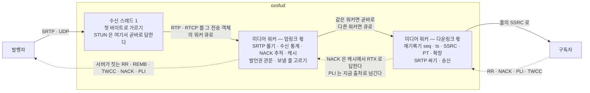
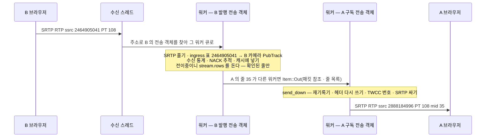
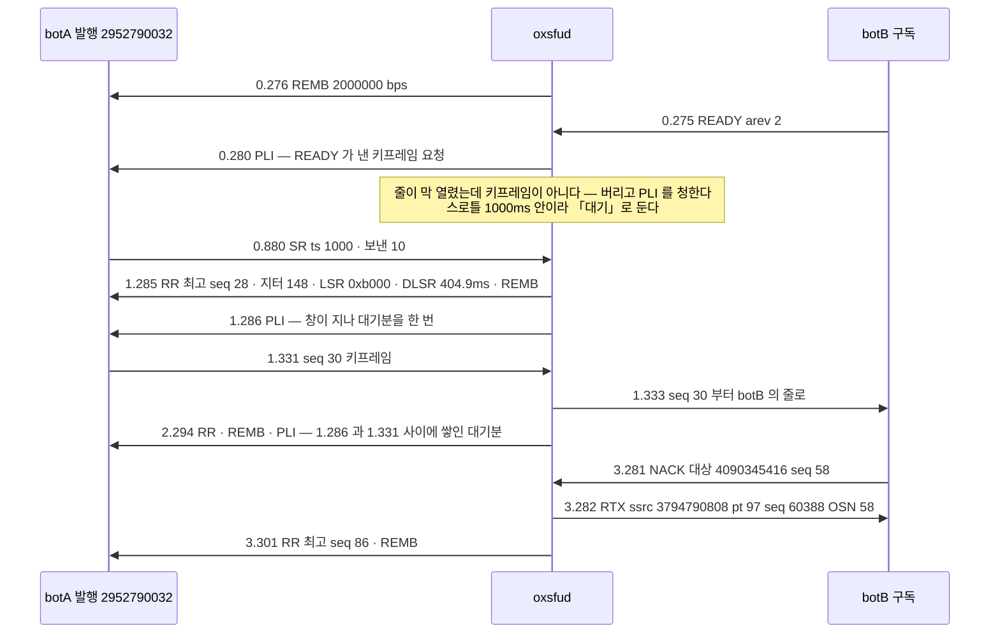
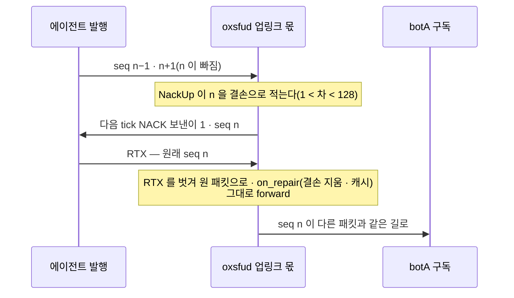
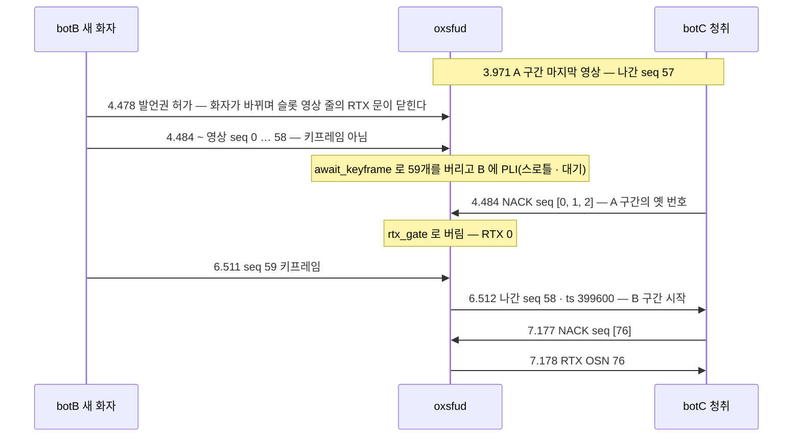

# 04. 서버 안의 패킷 길 — 수신 스레드 · 미디어 워커 · 재기록기 · RTCP 종단

> author: kodeholic (powered by Claude) · created: 2026-11-09.
> ★**대조한 커밋** — 서버 `oxlens-sfu` `c3642e8` · SDK `oxlens-sdk-web` `9f40557`(+탐침) · 2층 `oxlens-labs` `fc584ff`
> ★**실측 회차** — 2층 run-all `e2e-20261109-070257`(시나리오 `adv_loss` · `adv_rtcp` · `onepc_adv_loss` · `csrc_adv_loss` · `ptt_stale_nack` · `peer_agent_loss`) · 3층 탐침 `tour-learn-20261109` 의 `TOUR-02`. 값은 돌릴 때마다 바뀌고 차례 · 모양은 같다.

RTP · RTCP 는 SRTP 로 암호화되어 브라우저 탐침에는 안 보인다 — 패킷 바이트는 2층 봇 덤프(봇이 풀어 남긴 평문)로, 서버 표면 · 송수신 통계는 3층 탐침으로 그린다. 2층 시각은 봇이 시작한 뒤 경과 초, 3층 시각은 로컬 시각이다.

## 1. 30초 요약



- 받는 일은 **수신 스레드 하나**, 나머지(풀기 · 고르기 · 다시 쓰기 · 싸기 · 보내기)는 전송 객체마다 정해진 **미디어 워커**가 한다 — 이 회차 서버는 워커 2.
- 서버를 지나며 SSRC · PT · mid · seq · ts · 확장 헤더가 **줄의 것**으로 바뀌고 페이로드는 한 바이트도 안 바뀐다. 구독자는 발행자의 진짜 SSRC 를 끝내 모른다.
- RTCP 는 넘기지 않고 **끝낸다** — 서버가 스스로 짓는 것(RR · REMB · TWCC · NACK · PLI)과 번역하는 것(발행자 SR · 구독자 PLI) 둘뿐이다.

## 2. 등장인물 · 값

| 이름 | 이 회차 값 | 무엇 |
|---|---|---|
| 미디어 워커 · 제어 스레드 · 큐 한도 | `media-workers=2` · `control-threads=2` · `worker-queue-packets=6000` | 서버 기동 줄(node-a 07:02:56 `sfud boot …`)에 찍힌 해석 값. 맥 기본 워커 = min(코어 − 2, 2) — — |
| 정책 | `media.max_bitrate_bps=2000000` · `media.pli_throttle_high_ms=1000` · `media.pli_throttle_low_ms=500` | 같은 기동 줄 둘째 조각 |
| 3층 B 카메라(발행) | SSRC `2464905041` · RTX `3421347988` · PT 108(H264) · track `t8a5c4ff5410606b8` | B 의 SDP · `PUBLISH_TRACKS` · 송신 통계에만 나온다 |
| 3층 A 의 줄 35 | 다운링크 SSRC `2888184996` · RTX `4254884345` · PT 108/109 · `ox-m35` | 서버 표면 `rewrite` = `seq_off 0 · ts_off 0 · switches 0 · last_seq 31693` |
| 2층 botA 영상(발행) | SSRC `2952790032`(0xB0000010) · VP8 PT 96 · 키프레임 30프레임마다 · PLI 를 무시한다 | `adv_loss` |
| 2층 botB 의 줄 2 | SSRC `4090345416` · RTX `3794790808` · PT 96/97 | botA 영상을 실은 botB 의 줄(2pc 라 mid 가 0 부터) |
| 서버가 지은 RTCP | 보낸이 SSRC `1` | `rtcp/mod.rs` `SENDER_SSRC` — — |
| 소스 상수(이 회차가 잰 값 아님) | RR · REMB 1,000ms · TWCC 100ms · 재전송 캐시 1,024 · RTX 예산 200회/3초/사람 · 업링크 NACK 재시도 200ms · 포기 1,000ms · 추적 128 · 경계 창 2¹⁴ | — |

## 3. 정상 길

### 3-1. 데이터그램 하나 — 수신 스레드에서 워커로

수신 스레드(`fwd/rt.rs` `recv_loop`)는 UDP 소켓 · TCP 리슨 · TCP 연결을 한꺼번에 기다리고, 받은 것마다 `datagram` 이 **첫 바이트**로 가른다.

| 첫 바이트 | 무엇 | 수신 스레드가 하는 일 |
|---|---|---|
| 0 ~ 3 | STUN | ufrag 로 전송 객체를 찾고 비밀번호로 검증 → **곧바로 응답** · 이 주소를 그 전송 객체에 묶는다(`by_addr`) · `USE-CANDIDATE` 면 보낼 경로를 바꾼다. 실패는 `stun_unverified` |
| 20 ~ 63 | DTLS | 그 전송 객체의 DTLS 태스크(제어 런타임)로 |
| 128 ~ 191 | RTP · RTCP | 주소로 전송 객체를 찾아 **그 객체의 워커 큐**에 넣는다(`w.push(0, Item::In …)`). 모르는 주소는 `rtp_unknown_path` · 큐가 차면 `ingress_queue_full` |
| 그 밖 | — | `demux_unknown` |

- **전송 객체 = 워커 하나.** 만들 때 `pick_worker` 가 맡은 수가 가장 적은 워커에 정하고 바꾸지 않는다 — 발행 전송 객체는 발행 수끼리, 구독 전송 객체는 구독 수끼리 센다. 2pc 면 한 사람의 발행 · 구독이 다른 워커에 있을 수 있고 1pc 면 하나다(1pc · 2pc 의 모양은 [02](02_CONNECT_JOIN.md)).
- **STUN 을 워커 큐 뒤에 세우지 않는다.** 워커가 밀려도 연결 생존 응답(consent)은 수신 스레드가 곧바로 낸다.
- 워커(`fwd/mod.rs` `worker_loop`)는 제게 오는 링을 돌며 꺼내고, 10ms 마다 `rtcp::tick` 을 돌고, 일이 없으면 64번 돌다가 「잠듦」 표시를 세우고 최대 5ms 잔다. 넣는 쪽은 그 표시가 있을 때만 깨운다.

워커 안의 업링크 몫(`ingress` → `on_rtp` → `forward`):



3층 회차의 같은 길: B 카메라 발행 `07:35:34.062` → 서버 `SV-STATE-PUBLISH-STATE … to=Active cause=first_rtp` `.370`(첫 RTP) → 탐침 단계 `A.videoDecoded` `.429`. 그 끝의 송수신 통계(READY 가 낸 키프레임 요청 하나 포함)는 [03 §3-3](03_PUBLISH_SUBSCRIBE.md).

- 반이중이면 `forward` 가 `stream.rows` 대신 그 방 슬롯의 줄을 돌고, 화자가 아니면 `prefan_gate` 로 버린다 — 발언권 관문의 실체다(슬롯은 [08](08_SLOT_SPEAKER.md)).
- 줄을 고른 뒤 ★**목적지 워커마다 한 묶음**으로 넘긴다. 같은 워커면 넘기지 않고 곧바로 `send_down` 한다. 패킷 몸통은 참조 수를 세는 공유 버퍼(`Bytes`)라 워커 사이에 복사하지 않는다.

### 3-2. 헤더 다시 쓰기 — 바뀌는 것 · 그대로인 것

2층 `adv_loss` 의 같은 패킷 하나(botA 영상 seq 30 — 첫 키프레임)를 보내기 전 · 받은 뒤로 풀었다:

```
1.331 botA send rtp ssrc 2952790032 pt 96 seq 30 ts 90000   74B = 머리 12 + 페이로드 62 · 확장 없음
1.333 botB recv rtp ssrc 4090345416 pt 96 seq 30 ts 90000   90B = 머리 28 + 페이로드 62
      확장 id 1 (mid) "2" · id 5 (abs-send-time) 073e49 · id 6 (TWCC 번호) 0000
      페이로드 앞 6바이트 10 10 00 00 00 00 — 보낸 것과 같다
```

| 칸 | 바뀌나 | 무엇으로 | 소스 |
|---|---|---|---|
| SSRC | 바뀐다 | 줄의 다운링크 SSRC(`4090345416` · 3층은 `2888184996`) | `send_down` `row.ssrc` |
| PT | 바뀐다(byte1 하위 7비트만 · marker 는 원본) | 줄의 PT — 구독자 협상 산물 | `core::pt_byte1` |
| seq · ts | 바뀐다 | 재기록기(§3-3) — 이 회차는 오프셋 0 이라 값은 같다 | `rw.map` |
| CSRC | 구독자가 출처 표지를 켰을 때만 하나 붙는다 | 발행 출처 번호 — [08](08_SLOT_SPEAKER.md) | `conn.source_tag` |
| 확장 헤더 | 통째로 다시 짓는다 | 그 구독자의 표 — mid · abs-send-time · TWCC 번호 | `sub::ext::build` |
| 페이로드 · 패딩 | ★그대로 | 디코딩하지 않는다 | — |

A 가 받는 SDP(SDK 가 서버 몫을 지은 것)의 줄 35 에 실린 SSRC 는 `a=ssrc:2888184996` · `a=ssrc:4254884345`(RTX) — B 의 것이 아니라 줄의 것이다(그 절 전체는 [03 §3-2](03_PUBLISH_SUBSCRIBE.md)).

★B 의 진짜 SSRC `2464905041` 은 이 회차 기록 전체에서 세 곳에만 나온다 — B 의 local answer · B 의 `PUBLISH_TRACKS` · B 의 송신 통계. A 쪽 어디에도 없다. 구독자에게 보이는 SSRC 의 계약은 [연:RULE-LINK-DOWNLINK-SSRC](../protocol/09-link.md#RULE-LINK-DOWNLINK-SSRC) 이고, 확장을 통째로 다시 짓는 까닭(구독자마다 id 가 다르다)은 — 이다.

### 3-3. 재기록기 — 줄 하나에 오프셋 하나

`fwd/core.rs` `Rewriter` 가 드는 것은 넷뿐이다 — 지금 출처(`src`) · `seq_off` · `ts_off` · 「마지막」(나간 seq 중 가장 앞선 것의 seq · ts · 시각 · 덮는 길이). 출처가 바뀌는 첫 패킷에서만 오프셋을 다시 센다:

```
seq_off = 마지막.seq + 1 − 새 출처 첫 seq
ts_off  = 마지막.ts + max(마지막이 덮는 길이, 지난 시간 × 클럭) − 새 출처 첫 ts
경계    = 새 출처 첫 패킷이 나간 seq   (이보다 앞선 번호는 버린다 — §4-3)
```

실측 — 2층 `ptt_stale_nack` 의 슬롯 영상 줄(botC 가 받음). 화자가 A 에서 B 로 바뀌었다:

| | 출처 seq · ts | 나간 seq · ts | 시각 |
|---|---|---|---|
| A 의 마지막 패킷 | 57 · 171000 | 57 · 171000 | 3.971 |
| B 의 첫 키프레임 | 59 · 177000 | ★58 · 399600 | 6.512 |

- seq 는 57 → 58 로 **구멍 없이** 잇는다(`seq_off` = 58 − 59 = −1). —.
- ts 는 지난 시간만큼 벌어진다 — 3.971 → 6.512 의 2.54초 × 90,000 ≈ 228,600 → 171000 + 228600 = 399600. —.
- 한 출처 안에서는 오프셋이 그대로라 나가는 차례 = 들어온 차례다. 서버는 순서를 고치지 않는다.
- 슬롯의 경계가 언제 정해지는지(발언권 효과)는 [08](08_SLOT_SPEAKER.md), 시뮬캐스트 층이 바뀌는 것도 같은 오프셋 계산이다([05](05_SIMULCAST_BWE.md)).

### 3-4. RTCP 종단 — 짓는 것과 번역하는 것

`adv_loss`(영상) 한 회차의 RTCP 전부(botA 쪽 · botB 도 같은 꼴):



| 서버 → 발행자 | 이 회차 | 무엇 |
|---|---|---|
| RR | 3(1초마다) | 업링크 수신 통계 — RFC 3550 부록 A 그대로. LSR = 받은 SR 의 NTP 가운데 32비트 · DLSR = 그 SR 을 받고 지난 시간(404.9 → 1,413.6 → 2,419.9ms — 봇은 SR 을 한 번만 보냈다) |
| REMB | 4 | 값 = `min(수신 추정, max_bitrate_bps)` — 추정이 없어 2,000,000 |
| PLI | 3 | READY 1 + 대기 2. ★스로틀 창(h 1,000ms) 안에 들어온 인프라 요청(키프레임 기다림 · 출처 전환 · NACK 포기)은 버리지 않고 대기로 두었다가 창이 열리면 한 번 낸다 — — PLI 행 |
| TWCC | 0 | 봇이 업링크에 TWCC 확장을 안 실어서다 — 실으면 100ms 마다 짓는다(소스 `rtcp/mod.rs` `TWCC_MS` · 이 회차로 재지 않았다). 2층 덤프 전부에서 서버 → 발행 봇 TWCC 는 0 이었다. 반대 방향(구독자 → 서버)은 `sim_bwe_updown` 에서 botB 가 530개를 보냈다([05](05_SIMULCAST_BWE.md)) |

- ★**await_keyframe** — botA 는 seq 0 부터 106개를 보냈는데 botB 는 seq 30 부터 76개를 받았다. seq 0 키프레임은 botB 의 줄이 열리기(READY 0.275) 직전에 지나갔고, 열린 뒤 온 seq 1 ~ 29 는 키프레임이 아니라 서버가 버렸다(`send_down` — 줄에 아직 출처가 없거나 다른 출처면 영상은 키프레임부터) · 다음 키프레임을 기다렸다. 봇은 PLI 를 무시하고 30프레임마다만 키프레임을 내서 1초가 걸렸다. 브라우저는 PLI 를 받자마자 낸다(3층 B 의 `pliCount 1 · keyFramesEncoded 2`).
- **NACK 은 서버가 답한다** — NACK 의 대상은 botB 줄의 SSRC `4090345416` 이다. 서버는 그 SSRC 로 줄을 찾고(`sub` `row_by_ssrc`) 재기록기로 원래 seq 를 되찾아(`unmap_nack` — `seq_off` 를 뺀다) 업링크 캐시에서 꺼내, 줄의 RTX SSRC · RTX PT 로 싸서 보낸다. 페이로드 맨 앞 2바이트가 OSN(나간 seq 58)이다(RFC 4588). **1ms** · 발행자에게는 아무것도 가지 않는다 · 오디오 NACK 은 버린다(`nack_audio`).

**SR 번역 · RR 종단**(`adv_rtcp` — 음성):

```
0.890 botA send SR ssrc 2684354561 NTP 3758096384.a000 RTP ts 1000 보낸 패킷 10 바이트 1000
0.891 botB recv SR ssrc 1746562688 NTP 3758096384.a000 RTP ts 1000 보낸 패킷 27 바이트 1647
3.292 botA send RR 보낸이 3429109904 [ssrc 2523593052 …]           ← botA 가 받는 줄에 대한 RR
3.299 botA recv RR 보낸이 1 [ssrc 2684354561 최고 seq 137 · 지터 85]  ← 서버가 지은 RR 뿐
```

- SR 하나가 1ms 뒤 botB 에게 번역되어 간다 — SSRC 는 botB 줄의 것(`1746562688`), NTP 는 원본 그대로, RTP ts 는 재기록기 오프셋만큼(여기서는 0), ★보낸 패킷 · 바이트는 서버가 그 줄로 실제 보낸 수(27 · 1,647)다(`rtcp/mod.rs` `on_sr` · `build_sr`). 번역은 그 줄이 **지금 그 출처를 싣고 있을 때만** 한다.
- botA 의 RR(보낸이 `3429109904`)은 botB 에게 안 간다. 이 회차의 판정 `rtcp_terminate` 가 그것을 잰다.

## 4. 깨지는 길

### 4-1. 업링크에서 패킷이 빠졌다 — 서버가 NACK 으로 묻는다(`peer_agent_loss`)

서버사이드 SDK 에이전트가 영상 패킷 15개마다 하나를 일부러 안 보냈다(QA 스위치 · 보낸 기록에는 남긴다).



| 무엇 | 값 |
|---|---|
| 에이전트가 빠뜨린 것 · 다시 보낸 것 | `qa_send_dropped 19` · `rtx_sent 19`(에이전트 요약 `stats`) |
| botA 가 받은 영상 | 273개 · seq 62460 … 62732 — ★빈 번호 0 |
| 서버 수신 줄(07:20:06 · 트랙이 선 뒤 누적) | `packets_received=238 packets_lost=16 jitter=0.000515 nack_count=16` |

- **누가 먼저 아나** — 서버 업링크 몫. seq 가 건너뛰면 결손으로 적고 200ms 마다 다시 묻다가 1,000ms 가 지나면 포기하고 키프레임을 청한다(NACK 승급 — 이 회차에는 포기가 없었다).
- **사용자는** 아무것도 못 겪는다 — 구독자는 빈 번호 없이 받았다.
- ★`packets_lost=16` 은 메운 뒤에도 그대로다 — RTX 로 온 패킷은 수신 통계에 넣지 않는다(`on_repair` 는 NACK 추적 · 캐시만 고친다 · 「RTX 통계에서 반드시 제외」 —). 이 줄의 손실은 「망에서 빠진 수」이지 「구독자가 잃은 수」가 아니다.

### 4-2. 구독자 쪽에서 빠졌다 — 캐시에서 RTX(2pc · 1pc · 출처 표지)

| 회차 | NACK | RTX | 걸린 시간 |
|---|---|---|---|
| `adv_loss`(2pc) | 3.281 대상 4090345416 seq [58] | 3.282 ssrc 3794790808 pt 97 OSN 58 · 92B | 1ms |
| `onepc_adv_loss`(1pc) | 3.143 대상 4071587599 seq [57] | 3.144 ssrc 3536185244 pt 97 OSN 57 · 92B | 1ms |
| `csrc_adv_loss`(botB 출처 표지 켬) | 3.282 seq [172] | botB 3.283 · 56B · CC 1 · CSRC 131 / botA 3.282 · 52B · CC 0 | 1ms |

- 1pc 에서는 발행 · 구독 RTCP 가 한 전송 객체로 섞여 온다 — 서버가 복호한 평문을 패킷 단위로 갈라(SR → 발행 쪽 · RR / NACK / PLI / TWCC → 구독 쪽) 같은 길로 보낸다. 못 가르면 `rtcp_unresolved` 로 센다(— `1pc` 분해 행). 값은 2pc 와 같았다.
- 출처 표지를 켠 구독자의 RTX 에는 원 패킷의 출처 번호(botA 영상 `TRACK_EVENT` 의 `csrc 131`)가 그대로 실린다(RFC 4588 은 CC · CSRC 를 복사한다) — 4바이트가 더 길다. 출처 표지 자체는 [08](08_SLOT_SPEAKER.md).
- ★**못 메우는 경우** — 캐시에 없는 seq(`rtx_cache_miss`) · 그 사람의 3초 예산 200회를 넘은 NACK(`rtx_budget`) · 전환 경계 앞 seq(`rtx_gate` — §4-3)는 버리고 센다. 사용자에게는 짧은 화면 깨짐 → 구독 브라우저가 PLI 를 낸다.

### 4-3. 출처가 바뀌는 순간 — 키프레임 기다림 · 경계 앞 NACK(`ptt_stale_nack`)

botA → botB 로 화자가 바뀐다. botB 영상은 첫 키프레임을 일부러 늦게(60프레임마다 · 첫 프레임 건너뜀) 내고, 청취자 botC 는 바뀐 직후 **A 구간의 옛 seq** 를 NACK 한다.



- **무엇이 깨졌나** — 영상은 새 화자의 키프레임까지 2.03초(4.484 → 6.512) 멈췄다. 이 값은 재기록기가 새 출처를 처음 본 때 — ★새 화자의 첫 영상 패킷(4.484)부터 잰 것이다. 듣는 사람 쪽에서 ★앞 화자의 마지막 영상(3.971)부터 재면 2.54초다([08 §4-1](08_SLOT_SPEAKER.md) — 같은 창). 같은 동안 음성은 흘렀다(botC 가 받은 음성 슬롯은 회차 전체 288개 · seq 0 … 287 · 빈 번호 0 — 음성에는 키프레임 기다림이 없다).
- **누가 먼저 아나** — 서버. 새 출처의 첫 영상 패킷이 키프레임이 아니면 내보내지 않고(`await_keyframe`) PLI 를 청한다. 봇은 PLI 를 무시해 자연 키프레임까지 기다렸다 — 브라우저 발행자는 PLI 에 바로 답한다.
- **경계 앞 NACK** — 바뀐 직후의 옛 번호 NACK 은 RTX 로 답하지 않는다(판정 `rtx_gate_stale_nack` 초록). 단일 오프셋이라 옛 번호를 되돌리면 ★새 출처의 엉뚱한 패킷을 가리키기 때문이다. 키프레임 뒤의 새 번호 NACK(76)은 1ms 에 답했다(대조군 · 판정 `recovery_signal`).
- **경계 앞 번호의 늦은 패킷** — 새 출처에서 경계보다 앞 번호가 늦게 오면(예: RTX 로 메워진 #29 가 키프레임 #30 뒤에 도착) 내보내지 않는다(`pre_boundary`). 단일 오프셋이라 그 번호는 ★앞 출처가 이미 쓴 seq 와 겹친다. 이 회차로는 일으키지 않았다 — 원천 벡터 판과 옛 빌드 A/B(옛 재기록기가 #29 를 앞 출처의 마지막 seq 로 내보냄)로 확인한 것이다.
- **관측** — 이 버림들(`await_keyframe` · `rtx_gate` · `pre_boundary` · `rtx_cache_miss` · `rtx_budget`)은 로그 줄이 아니라 운영 표면 `/admin/drops` 의 계수다. 이 회차는 그 표면을 읽지 않았다(측정을 새로 하지 않는다).

## 5. 왜 이 모양인가

**미디어 워커 — 수신 스레드 1 · 워커 N.** 처음 재생성 판은 받기부터 구독자마다의 암호화 · 송신까지를 한 태스크가 했다. 용량 시험 1차에서 영상 구독 약 500줄에 코어 하나가 차고, 그 노드의 다른 방 발행자 STUN 응답까지 밀렸다. 그래서 받기만 하는 스레드 하나와 전송 객체마다 정해진 워커로 갈랐다.
- 얻은 것 — 같은 맥에서 한 태스크 판 천장 약 118 ~ 130k pps(소프트웨어 AES) · 약 247k pps(하드웨어 AES) → 워커 판 구독 1,500 에서 약 356k pps 손실 0(워커 6 · 하드웨어 AES). 넘침은 지연이 아니라 버림(`ingress_queue_full` · `egress_queue_full`)으로 드러난다.
- 잃은 것 — 코어당 효율이 떨어졌다(한 태스크 판 약 25만 pps/코어 → 이 판 약 11만 pps/코어 · 1,500). 맥은 동시 `sendto` 가 커널 안에서 줄을 서 워커를 2로 묶었고 그 대신 큰 방 서버 체류 p99 가 한 칸(≤ 50 → ≤ 100ms) 올랐다. 워커 하나가 죽으면 ★프로세스 전체를 내린다 — 쥔 재기록기 · SRTP 문맥이 사라진 워커를 산 척 두지 않으려는 것이고, 그 유닛의 모든 연결이 재구축으로 돌아온다([10](10_RECOVERY.md)).

> ★**우리만의 것 — RTCP 종단: 서버는 두 세션의 끝점이다**
> - **선택 배경** — 구독자 RR 을 발행자에게 넘기면 발행자가 ★남의 수신 품질로 비트레이트를 깎고, 서버가 SR 을 지어 보내면 수신 지터 버퍼가 폭등한다(— 증상). 그래서 발행자 쪽 세션과 구독자 쪽 세션을 서버가 각각 끝내고, 넘기는 것은 키프레임 요청(지금 출처로)과 SR(번역해서) 둘로 줄였다. SR 은 NTP 를 원본 그대로 두고 RTP ts 만 재기록기와 같은 오프셋으로 옮긴다.
> - **얻은 것** — 발행자가 받는 RR 은 구독자 수와 무관하게 업링크 스트림마다 1초에 하나다(`adv_loss` 3초에 3). 구독자 NACK 은 1ms 에 서버 캐시로 답하고 발행자에게 묻지 않는다(2pc · 1pc 둘 다). 인프라 PLI 까지 같은 스로틀 아래 두어 발행자에게 요청이 몰리지 않는다(이 회차 PLI 3 = READY 1 + 대기 2).
> - **잃은 것** — 서버가 물리 트랙마다 캐시 1,024 패킷 · 사람마다 RTX 예산 · 연결마다 TWCC 기록을 든다. 발행자는 ★나쁜 구독자 한 명의 품질을 못 본다 — 그 몫은 서버의 층 판단이 대신해야 한다([05](05_SIMULCAST_BWE.md)). RTX 를 통계에서 빼므로 메운 손실도 수신 줄에 남는다(§4-1 `packets_lost=16`).

> ★**우리만의 것 — 단일 스칼라 offset 재기록**
> - **선택 배경** — 옛 판은 입력 seq 범위마다 오프셋을 기억하는 지도(`SnRangeMap`)를 썼다. 발행자마다 seq 공간이 따로라 화자가 바뀔 때 옛 화자가 남긴 범위와 새 화자의 번호가 겹치면 낡은 오프셋이 나와 ★나가는 seq 가 역행했고(실측 15614 → 209), 수신 쪽이 그 패킷을 과거로 버려 PTT 음성이 끊겼다 — 그 지도를 걷고 줄마다 오프셋 하나로 바꿨다. 재도입은 금지다(모형 성질 — 는 기각 갈래 `rangemap` 에서 깨진다).
> - **얻은 것** — 줄 하나의 상태가 숫자 넷이다. 전환은 첫 패킷에서 덧셈 둘로 끝나고(§3-3 57 → 58), NACK 되돌림은 뺄셈 하나다. 출처가 몇 번 바뀌어도 나가는 seq 가 역행하지 않는다.
> - **잃은 것** — 경계 앞의 것은 되살리지 못한다 — 앞 출처의 늦은 패킷 · 옛 번호 NACK 은 버린다(§4-3 `rtx_gate` · `pre_boundary`). 프레임을 골라 버리는 계층(temporal) 전달을 들이는 순간 이 모형은 구멍을 남긴다 — 지금은 층을 키프레임에서 「갈아탈」 뿐 버리지 않아서 성립한다. 같은 출처가 비었던 줄에 다시 실리면 오프셋을 다시 세지 않아 나가는 seq 에 구멍이 남는다([06 §4-3](06_TRACK_ATTRS.md) 관찰).

## 6. 다른 SFU 는

★아래 「그쪽 방식」은 저쪽 소스를 정적으로 읽은 기록이다 — 「저쪽 소스에는 이렇게 적혀 있다(실측 아님)」.

| 축 | 그쪽 방식 | 우리 | 우리 쪽 장점 | 우리 쪽 대가 |
|---|---|---|---|---|
| 재기록 모형 | LiveKit — 전달 경로는 단일 오프셋 · 입력 범위 지도는 buffer 쪽에만(`livekit §9-3` · `§17-4`) / mediasoup — 스칼라 base + 버린 번호 집합으로 빈틈 없이(`mediasoup §5-2`) / JVB — 계층을 버리면 서버가 seq 공간을 직접 관리(`JVB §6-2`) | 줄마다 단일 오프셋 · 전환점에서만 다시 셈 · 경계 앞 버림 | 상태 넷 · 역행 없음 | 버리는 계층을 들이면 모형이 깨진다 · 경계 앞은 못 살린다 |
| 키프레임 요청 억제 | LiveKit — 층마다 low 500ms · mid · high 1s, PLI 를 보내면 키프레임 올 때까지 RTX 멈춤(`livekit §8-5`) / mediasoup — SSRC 마다 1,000ms 안 오면 재요청(`mediasoup §4-6`) / JVB — 수신자마다 + 출처 전체 2단(`JVB §7`) | 발행자 · 층마다 h 1,000 · l 500ms 하나 · 인프라 요청도 같은 스로틀 · 막힌 것은 창이 열리면 한 번 | 사건이 몰려도 발행자에게는 창마다 하나 — 발행자 엔진이 300ms 안 요청을 버려 헛도는 것을 막는다 | 쌓인 대기는 키프레임이 온 뒤에도 한 번 나간다(`adv_loss` 2.294) · PLI 와 RTX 를 묶지 않는다 |
| 재전송 버퍼 단위 | mediasoup — 개수 2,500 또는 시간 2,000ms(`mediasoup §7-1`) / Janus — 시간 + RTT 적응(`Janus §1-4`) / str0m — 3초 + 재전송 바이트 비율 0.15(`str0m §5-3`) | 개수 1,024 + 사람마다 200회/3초 예산 + 업링크 결손은 1초에 포기 | 한 구독자의 폭풍이 다른 참가자를 못 굶긴다 | 너무 늦은 재전송을 시간으로 거르지 않는다 |
| RTCP 주기 | mediasoup — 1.0 ~ 1.5배로 흩어 보낸다(`mediasoup §7-2`) / TWCC 주기 str0m 50 · mediasoup 100 · Janus 200ms(`str0m §12` · `mediasoup §6-3` · `Janus §4-6`) | RR · REMB 1초 고정 · TWCC 100ms | 단순 · 시험 재현이 쉽다 | 참가자가 매우 많을 때 동시 발신을 흩지 않는다(측정 전) |
| SR | LiveKit — 발행자 SR 을 SFU 시계로 정규화해 보낸다(`livekit §9-4`) | NTP 원본 · RTP 만 오프셋 · 보낸 수는 서버 것 | 출처의 NTP↔RTP 대응이 그대로라 립싱크 근거가 보존된다 | 서버 시계 기준 캡처 시각 같은 정규화 기능이 없다 |
| 실행 단위 | mediasoup — 코어마다 worker 프로세스(`mediasoup §1-1`) / Janus — 한 프로세스 · 루프 풀에 핸들 배정(`Janus §1-2`) / Mumble — 스레드 둘 · 락 하나(`Mumble §7`) | 한 프로세스 안 수신 스레드 1 · 워커 N(전송 객체 고정) · 제어 C | 한 스트림의 쓰는 쪽이 하나라 경합 없이 차례가 보존된다 | 워커 하나가 죽으면 그 유닛 전체를 내린다 |

## 7. 운영에서 보는 법

| 보고 싶은 것 | 어디서 | 이 회차의 실제 |
|---|---|---|
| 워커 수 · 큐 한도 · 정책 | 기동 줄 `spec=SV-STATE-UNIT-STATE … msg="sfud boot …"` | `media-workers=2 control-threads=2 worker-queue-packets=6000` · `media.pli_throttle_high_ms=1000 media.pli_throttle_low_ms=500` |
| 업링크 수신 · 손실 · NACK · PLI | `kind=stat` 트랙 줄(5초마다) | `track=tb630c37e31378caf ssrc=3602019141 packets_received=238 packets_lost=16 … nack_count=16 pli_count=2` |
| 구독자에게 보낸 · 재전송 | `kind=stat` 사람 줄 | `user=botA~peer_agent_loss packets_sent=645 … retransmitted_packets_sent=0` |
| 첫 RTP | `SV-STATE-PUBLISH-STATE … to=Active cause=first_rtp` | 3층 07:35:34.370 B 카메라 |
| 줄의 재기록 상태 | `GET /admin/users/{user}/media` 의 `rewrite` | `seq_off 0 · ts_off 0 · switches 0 · last_seq 31693` |
| 버린 것(사유마다) | `GET /admin/drops`(닫힌 이름 목록 — —) | 이 회차는 읽지 않았다 |
| 서버 체류 시간 | `GET /admin/transit`(누적 — 두 번 읽어 차로 본다) | 이 회차는 읽지 않았다 |

- 패킷 하나하나는 로그에 안 찍힌다 — 패킷 길의 사건은 「계수」(drops · transit · stat 줄)로만 보인다. 로그 줄 꼴과 판정기는 [17](17_OPERATIONS.md).

## 8. 소스 · 규격 좌표

| 무엇 | 서버(`oxsfud/src/`) | 규격 |
|---|---|---|
| 수신 스레드 · 첫 바이트 가르기 · STUN 응답 · 워커 넣기 | `fwd/rt.rs` `recv_loop` · `datagram` · `Worker::push` | — |
| 워커 배정 · 수 | `fwd/rt.rs` `Media::pick_worker` · `cfg/mod.rs` `default_workers` | — |
| 워커 루프 · 업링크 몫 · 줄 고르기 | `fwd/mod.rs` `worker_loop` · `ingress` · `on_rtp` · `forward` · `row_gate` | [연:RULE-SUB-EGRESS-ACKED](../protocol/08-sub.md#RULE-SUB-EGRESS-ACKED) |
| 다운링크 몫 · 헤더 다시 쓰기 · 키프레임 기다림 · 경계 앞 버림 | `fwd/mod.rs` `send_down` · `fwd/core.rs` `pt_byte1` · `sub/ext.rs` `build` | [연:RULE-LINK-DOWNLINK-SSRC](../protocol/09-link.md#RULE-LINK-DOWNLINK-SSRC) |
| 재기록기 | `fwd/core.rs` `Rewriter::map` · `unmap_nack` · `translate_sr_ts` · `BOUNDARY_WINDOW` | [연:RULE-LINK-SOURCE-SWITCH](../protocol/09-link.md#RULE-LINK-SOURCE-SWITCH) |
| RTCP 종단 · 주기 · SR 번역 · 1pc 분해 | `rtcp/mod.rs` `tick` · `uplink` · `on_rtcp` · `on_sr` · `on_rr` · `build_sr` | — |
| PLI 스로틀 · 대기 | `rtcp/mod.rs` `request_pli` · `pli_burst` | — |
| NACK → RTX | `rtcp/mod.rs` `send_rtx` · `budget_ok` · `send_built` | — |
| 업링크 NACK · 캐시 · RTX 벗기기 | `pub/mod.rs` `NackUp` · `Cache` · `on_ingress` · `on_repair` · `unwrap_rtx` | — |
| 버림 계수 · 체류 | `ops/mod.rs` `drops_json` · `ops/admin.rs` `transit` | — |

(패킷 길은 공개 규격 밖이다 — 클라가 보는 것은 줄의 SSRC · RTX SSRC 가 배정표에 실린다는 것([연:LINK.op.MLINE_EVENT](../protocol/09-link.md#LINK.op.MLINE_EVENT))과 출처 전환의 결과([연:RULE-LINK-SOURCE-SWITCH](../protocol/09-link.md#RULE-LINK-SOURCE-SWITCH))뿐이다.)

## 9. 스스로 확인하는 질문

<details><summary>1. 구독자가 셋이면 발행자가 받는 RR 은 1초에 몇 개인가?</summary>

업링크 스트림마다 하나다 — 서버가 업링크를 보고 짓는다(`adv_loss` 에서 3초에 3). 구독자 셋의 RR 은 서버에서 끝나고 각 줄의 손실 표지(`rr_loss`)로만 남는다.
</details>

<details><summary>2. 에이전트가 19개를 빠뜨렸는데 구독자는 빈 번호 없이 받았다. 서버 수신 줄의 `packets_lost=16` 은 틀린 값인가?</summary>

아니다. 그 줄은 「망에서 빠진 수」다 — RTX 로 메운 패킷은 수신 통계에 넣지 않는다. 그 줄(07:20:06) 시점까지 16개가 빠졌고 16번 NACK 했다. 구독자가 잃었는지는 구독자 쪽(받은 seq · 서버가 번역한 SR 의 보낸 수)으로 따로 본다.
</details>

<details><summary>3. 화자가 바뀐 직후 청취자가 옛 seq 0 · 1 · 2 를 NACK 했다. 서버가 그것을 RTX 로 답했다면 무엇이 나갔을까?</summary>

단일 오프셋이라 옛 번호를 지금 출처의 번호로 되돌리게 된다 — 새 화자의 엉뚱한 패킷이거나 캐시에 없는 번호다. 그래서 화자가 바뀌는 순간부터 새 출처의 첫 패킷이 나갈 때까지 RTX 문을 닫고(`rtx_gate`), 그 뒤로도 경계 앞 번호는 버린다.
</details>

<details><summary>4. 한 구독자의 줄이 다른 워커에 있으면 패킷은 복사되나?</summary>

몸통은 복사되지 않는다. 업링크 몫이 복호한 평문을 참조 수를 세는 공유 버퍼로 들고, 목적지 워커마다 묶음 하나(그 워커가 맡은 줄 목록)에 그 참조를 실어 넘긴다. 구독자마다의 헤더 · 암호문은 다운링크 몫 워커가 제 버퍼에서 새로 짓는다.
</details>
