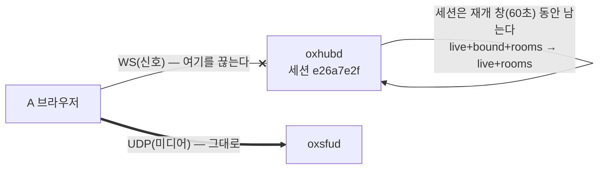
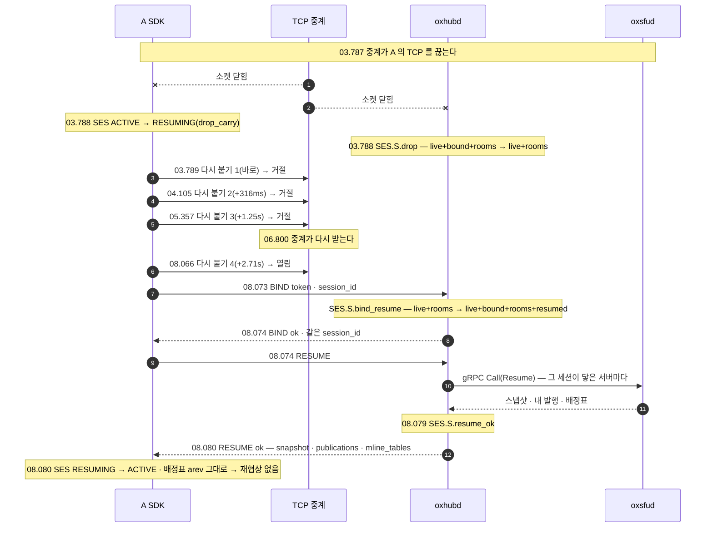

# 05. 끊김과 복구 — 신호가 끊겼다 돌아온다(RESUME)

> author: kodeholic (powered by Claude) · created: 2026-11-03.
> ★**대조한 커밋** — 서버 `oxlens-sfu` `c5ecb6d` · SDK `oxlens-sdk-web` `c14dfe8`.
> ★**실측 회차** — `tour-20261103-140701`(탐침 `TOUR-05`). 값은 돌릴 때마다 바뀌고, 차례 · 모양은 같다.

## 0. 한 줄 목적 · 등장인물

**통화 중에 신호(WebSocket)만 끊겼다가 4초 뒤 망이 돌아오면, 무엇이 오가고 미디어는 어떻게 되는가.**

| 이름 | 실제 값 | 무엇 |
|---|---|---|
| A | `tourcut_A` | 신호가 끊기는 사람 — 신호만 시험 프로세스의 TCP 중계를 거친다 |
| B | `tourcut_B` | 마이크를 켠 사람(A 가 듣는다) |
| 방 | `qa_tourcut_p0` · node-a | |
| 끊는 법 | 중계가 열린 TCP 를 끊고 4초 동안 새 연결을 받지 않는다 | 미디어(UDP)는 중계를 안 지난다 — 「신호만 끊김」 형상 |

## 1. 큰 그림 — 신호와 미디어는 따로 산다



- **신호가 끊겨도 세션은 바로 죽지 않는다.** hub 는 소켓만 떼고(`bound` 를 뺀다) 세션 · 방 소속은 재개 창(`resume_window_ms` 60초 — `BIND` 응답에 실려 온다) 동안 쥔다.
- **미디어 연결은 신호와 따로 산다.** WS 가 끊긴 동안에도 UDP · DTLS · DC 는 살아 있다 — 이 회차의 SDK 에는 미디어 연결(LINK) 전이가 하나도 없고, 서버의 `PeerState` 도 그대로다.
- 다시 붙은 SDK 는 같은 세션 id 로 `BIND` 하고 `RESUME` 한 번으로 **지금 상태**(방 스냅샷 · 배정표 · 내 발행)를 받는다 — 끊긴 동안의 통지를 하나씩 되보내지 않는다(SES.op.RESUME).

## 2. 전체 타임라인



## 3. 단계별

### 3-1. 끊김 — 양쪽이 1ms 안에 안다

```
03.788 SDK A SES session ACTIVE → RESUMING | ws.close | SES.C.any.drop_carry
03.788 SRV   proc=hub kind=ev spec=SES.S.drop session=e26a7e2f user=tourcut_A from=live+bound+rooms to=live+rooms cause=drop
```
- 이번 끊김은 TCP 가 닫혀 양쪽이 바로 알았다. 망이 소리 없이 죽으면(패킷만 안 오면) 하트비트(`heartbeat_interval` 10초)로 알게 된다.
- `RESUMING` 은 「세션을 이어받으려는 중」이다 — 앱에는 `session` 이벤트(`recovering: true`)로 보인다.

### 3-2. 다시 붙기 — 사다리를 탄다

| 시도 | 시각 | 앞 시도와 간격 | 결과 |
|---|---|---|---|
| 1 | 03.789 | 바로 | 거절(`ERR_CONNECTION_RESET`) |
| 2 | 04.105 | 316ms | 거절 |
| 3 | 05.357 | 1.25s | 거절 |
| 4 | 08.066 | 2.71s | 열림 |

- 간격은 백오프 사다리를 따른다([연:RULE-SES-BACKOFF-LADDER](../protocol/03-ses.md#RULE-SES-BACKOFF-LADDER) — 칸마다 대기 시간 · 지터가 더해진다 · 칸은 붙은 뒤 10초 안정해야 처음으로 돌아간다). 사다리 합계는 재개 창(60초)보다 짧아야 한다([연:COND-SES-WINDOW-OVER-BACKOFF](../protocol/03-ses.md#COND-SES-WINDOW-OVER-BACKOFF)).
- ★**망은 06.800 에 돌아왔지만 다음 칸(08.066)까지 1.27초를 기다렸다.** 사다리의 값이 이 구간을 정한다 — 끊김 4.0초 중 망이 실제로 없던 시간은 3.0초다.

### 3-3. 이어받기 — `BIND`(같은 세션 id) + `RESUME`

```
08.073 WS  A send req BIND #6 {"token":"…","client_ver":1,"pc_mode":"1pc","session_id":"f2a96193…"}
08.073 SRV   proc=hub spec=SES.S.bind_resume session=e26a7e2f from=live+rooms to=live+bound+rooms+resumed cause=BIND
08.074 WS  A recv ok  BIND #6 {"session_id":"f2a96193…", "resume_window_ms":60000, …}
08.074 WS  A send req RESUME #7 {}
08.079 SRV   proc=hub spec=SES.S.resume_ok session=e26a7e2f
08.080 SDK A SES RESUMING → ACTIVE | RESUME.res | SES.C.RESUMING.resume_ok
08.081 SDK A ROOM qa_tourcut_p0 JOINED → JOINED | RESUME.snapshot | ROOM.C.JOINED.resume_snapshot
08.081 SDK A LINK … OK → OK | table | LINK.C.any.table_carried_old
```
- `pid` 가 6 · 7 로 이어진다 — 같은 세션의 같은 SDK 이니 요청 번호도 이어 간다.
- `RESUME` 응답 = `snapshot`(방마다 나 · 참가자 · 트랙) · `publications`(그 서버의 내 발행 — 이번엔 빈 목록) · `mline_tables`(서버마다 배정표 — `arev 2` 줄 셋). hub 가 그 세션이 닿은 서버마다 gRPC `Resume` 을 불러 모은다(`oxhubd/src/ses/mod.rs` `resume`).
- ★**배정표의 `arev` 가 끊기기 전과 같아 미디어를 건드리지 않았다** — 재협상도 `READY` 도 없다([연:RULE-SES-RES-RESUME-OK](../protocol/03-ses.md#RULE-SES-RES-RESUME-OK) 3). 끊긴 동안 표가 바뀌었다면(누가 새로 발행) 구독 SDP 를 다시 지어 협상한 뒤 `READY` 했을 것이다.
- SDK 는 서버마다 셋을 대조한다 — 미디어 연결이 살아 있나 · 내 방이 스냅샷에 다 있나 · 내 발행이 `publications` 에 다 있나. 셋 다 참이면 이어 쓰고, 어긋난 서버만 재구축한다(같은 규칙 2 · 4).

## 4. 끊김의 갈래 — 이 장이 본 것과 안 본 것

| 끊긴 것 | 이어받는 길 | 이 장 |
|---|---|---|
| 신호(WS)만 · 재개 창 안 | `BIND`(session_id) + `RESUME` | ★실측 |
| 신호 · 재개 창 밖 | 세션이 사라졌다 — 새 `BIND` 와 방마다 다시 입장(세션 재구축) | 규격 SES 장 |
| 미디어 연결(ICE · DC) | 그 서버의 연결만 ICE restart → 재구축 사다리(SES 와 따로) | 규격 LINK 장 |
| 미디어 서버 재기동 | `epoch` 가 바뀐다 → 그 서버만 재구축 | [연:RULE-SES-RES-RESUME-OK](../protocol/03-ses.md#RULE-SES-RES-RESUME-OK) 1 · 4 |

## 5. 소스 · 규격 좌표

| 무엇 | 서버 | SDK | 규격 |
|---|---|---|---|
| 끊김 · 재개 창 | `oxhubd/src/ses/mod.rs`(`SES.S.drop` · `sweep` · `TWindow`) | `domain/ses/core.ts`(SES 상태기 · 백오프) | [연:RULE-SES-BACKOFF-LADDER](../protocol/03-ses.md#RULE-SES-BACKOFF-LADDER) |
| 이어받기 | `ses/mod.rs` `resume`(서버마다 gRPC Resume) · `oxsfud/src/ops/rooms.rs` `resume` | `domain/ses` · `domain/room`(`resume_snapshot`) · `domain/link`(`table_carried_old`) | SES.op.RESUME · [연:RULE-SES-RES-RESUME-OK](../protocol/03-ses.md#RULE-SES-RES-RESUME-OK) |

## 6. 스스로 확인하는 질문

<details><summary>1. 신호가 끊긴 4초 동안 A 는 B 의 소리를 들었나?</summary>

미디어 연결은 끊기지 않았다 — SDK 의 미디어 연결 전이가 없고 서버의 Peer 상태도 그대로다. 소리는 UDP 로 계속 왔다. 끊긴 것은 제어(통지 · 요청)뿐이다.
</details>

<details><summary>2. RESUME 뒤에 재협상이 없었던 까닭은?</summary>

`mline_tables` 의 `arev` 가 끊기기 전과 같았다. 같으면 미디어를 건드리지 않는 것이 규칙이다([연:RULE-SES-RES-RESUME-OK](../protocol/03-ses.md#RULE-SES-RES-RESUME-OK) 3).
</details>

<details><summary>3. 망이 돌아온 뒤 1.27초를 논 까닭은?</summary>

다시 붙기는 백오프 사다리의 다음 칸에서만 시도한다 — 지금 SDK 는 망이 돌아왔다는 브라우저 사건(`online`)을 듣지 않는다(`src` 에 그 리스너가 없다). 이 구간의 길이는 사다리의 값이 정한다.
</details>
