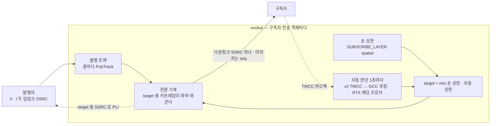
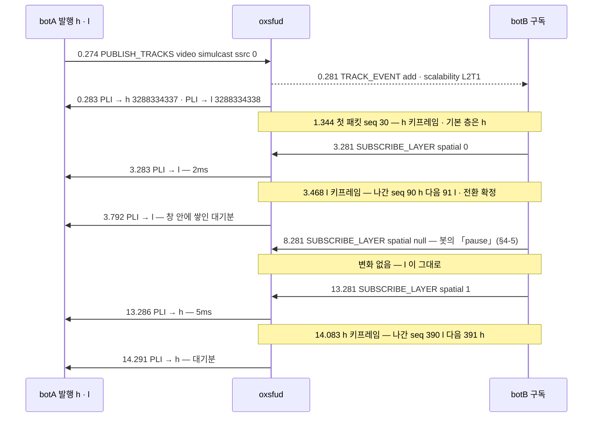
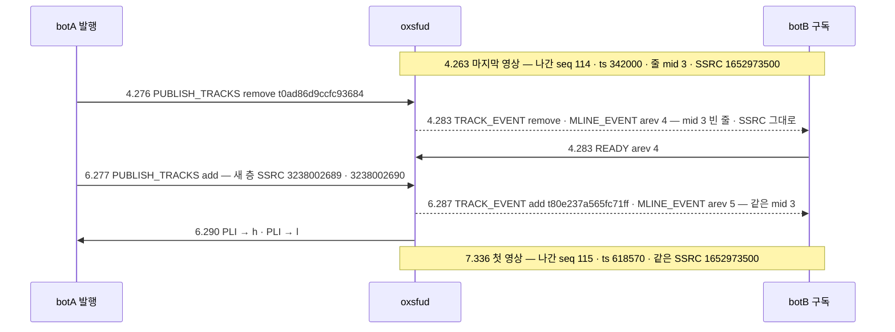

# 05. 시뮬캐스트 층 — 손 상한 · 서버의 자동 판단 · 키프레임에서 바뀐다

> author: kodeholic (powered by Claude) · created: 2026-11-09.
> ★**대조한 커밋** — 서버 `oxlens-sfu` `c3642e8` · 2층 `oxlens-labs` `fc584ff`
> ★**실측 회차** — 2층 run-all `e2e-20261109-070257`(시나리오 `sim_manual_layer` · `sim_bwe_updown` · `onepc_sim_bwe_updown` · `sim_bwe_nack` · `sim_bwe_probe_reject` · `conf_simulcast_repub`). 값은 돌릴 때마다 바뀌고 차례 · 모양은 같다.

층은 RTP 안에 있어 브라우저 탐침으로는 안 보인다 — 봇 덤프와 서버 로그로 그린다. 봇 발행자는 VP8 패킷을 두 층(`h` · `l`)으로 30fps 에 보내고 키프레임은 30프레임마다만 낸다(PLI 를 무시한다). 시각은 봇이 시작한 뒤 경과 초다. 서버 로그 시각은 「자동 판단 줄 바로 뒤 그 층으로 나간 PLI」로 봇 시각에 맞췄다.

## 1. 30초 요약



- 구독자 하나가 받는 층은 **두 상한의 작은 쪽**이다 — 구독자가 손으로 둔 상한(`spatial` 0 = l · 1 = h)과 서버의 자동 판단.
- 층이 바뀌는 순간은 ★**새 층의 키프레임**이다. 그 전까지는 지금 층을 그대로 보내 화면이 멎지 않는다.
- 구독자 쪽 SSRC 는 층과 무관하게 **하나**다 — 재기록기가 층을 「출처 전환」으로 다룬다([04 §3-3](04_PACKET_PATH.md)).

## 2. 등장인물 · 값

| 이름 | 이 회차 값 | 무엇 |
|---|---|---|
| botA 발행 | `PUBLISH_TRACKS` 의 `ssrc: 0` · `simulcast: true` · `rid_extmap_id: 10` | 서버가 첫 RTP 의 rid 로 층 SSRC 를 배운다 — [연:RULE-PUB-RID-TO-SPATIAL](../protocol/07-pub.md#RULE-PUB-RID-TO-SPATIAL) |
| 층 SSRC(업링크) | `sim_manual_layer` h `3288334337` · l `3288334338`(각 509 패킷) | 서버가 PLI 로 층을 가릴 때 쓴다 |
| botB 의 줄(다운링크) | `sim_manual_layer` mid 2 · SSRC `3455080838` — ★받은 영상 480 패킷이 모두 이 SSRC 하나 | 층이 바뀌어도 그대로 |
| `scalability` | `L2T1`(`TRACK_EVENT`) | 공간 2 · 시간 1 — [연:TRK.type.TrackEntry](../protocol/06-trk.md#TRK.type.TrackEntry) |
| 정책(서버 기동 줄) | `media.auto_layer=v2` · `media.bwe_mode=twcc` · `media.pli_throttle_high_ms=1000` · `media.pli_throttle_low_ms=500` · `media.max_bitrate_bps=2000000` | 기본은 `auto_layer=off` — 2층이 v2 로 띄운다 |
| 자동 판단 값(로그 `in.*`) | 수요 `in.demand=1980000` · 시작 추정 `in.estimate=300000` · 바닥 `30000` | 수요 = h 1,650,000 × 강등 여유 1.2 — — 수치 표 |
| 규격 수치(이 회차가 잰 값 아님) | 강등 = 4사유 중 하나가 2 tick 연속(tick 1초) · nack > 20/s · 승격 대기 15초(무너지면 ×2 · 상한 60초) · 프로브 2.5초 · 판정 4초 | — |

PLI 스로틀 · 대기의 동작 자체는 [04 §3-4](04_PACKET_PATH.md) 가 집이다 — 이 장은 층마다 값(h 1,000 · l 500ms)만 쓴다.

## 3. 정상 길

### 3-1. 손으로 고르기 — `sim_manual_layer`



| botB 가 받은 층(1초 칸) | 1 ~ 2 | 3 | 4 ~ 13 | 14 | 15 ~ 17 |
|---|---|---|---|---|---|
| 표지 | h 19 · 28 | h 14 · l 16 | l 28 ~ 29 | l 2 · h 26 | h 28 ~ 29 |

- ★**서버는 2 ~ 5ms 에 target 층의 SSRC 로 PLI 를 낸다**(target-rid PLI — h 에 청해서는 l 키프레임이 오지 않는다). 바뀌는 데 걸린 187ms(3.281 → 3.468) · 802ms(13.281 → 14.083)는 봇의 다음 자연 키프레임까지의 거리다 — ★전환 지연의 주인은 발행자 인코더다.
- **이어 쓰기** — h → l 에서 나간 seq 90 → 91 · ts 270000 → 270090(1ms × 90), l → h 에서 390 → 391 · ts 1167090 → 1170150(34ms). 두 층이 같은 프레임 시각을 쓰므로 ts 는 「지난 시간」만큼만 벌어진다([04 §3-3](04_PACKET_PATH.md) 의 식).
- **둘째 PLI(3.792 · 14.291)는 전환이 끝난 뒤 나갔다** — 전환 대기 중에 온 다른 층 패킷마다 서버가 target 층 PLI 를 청했고(`sim/mod.rs` `pass`), 스로틀 창(l 500 · h 1,000ms) 안이라 대기로 쌓였다가 창이 열리자 한 번 나간 것이다.
- 서버 로그에는 요청만 찍힌다(`CP-OP-SUBSCRIBE-LAYER … msg=ok`). 층 전환 자체는 패킷 단위라 로그 줄이 없다.

### 3-2. 서버가 판단하기 — `sim_bwe_updown`(v2)

botB 는 손 요청을 하나도 안 보낸다. 대신 TWCC 피드백(도착 시각)을 보내고, 36.4초부터는 도착 시각을 초당 200ms 씩 늦춰 보고한다(급성 버퍼 팽창을 합성 — 봇 기록 `synth` · 국면 `ramp`).

```
07:30:46.870 SV-RULE-SIM-TICK in.to=l in.loss=0.000 in.nack_rate=0.0 in.drops=0 in.v2=true in.estimate=300000  in.demand=1980000 msg="auto layer → l"   ← 3.314
   18.40 ~ 20.87  botB 가 받은 RTX(pt 97) 2,511개 — 패딩 프로브
07:31:06.979 SV-RULE-SIM-TICK in.to=h … in.estimate=2149668 in.demand=1980000 msg="auto layer → h"                                           ← 23.423
   36.386 봇 ramp 시작
07:31:22.087 SV-RULE-SIM-TICK in.to=l in.loss=0.000 in.nack_rate=0.0 in.drops=0 … in.estimate=30000 msg="auto layer → l"                     ← 38.531
   53.63 ~ 55.58  RTX 1,945개 — 다음 프로브(판정 4초 전인 55.6 에 회차가 끝나 결과 없음)
```

| 받은 층(2초 칸) | 0 ~ 2 | 2 ~ 4 | 4 ~ 22 | 22 ~ 24 | 24 ~ 38 | 38 ~ 40 | 40 ~ 54 |
|---|---|---|---|---|---|---|---|
| 표지 | h | h 42 · l 16 | l | l 41 · h 15 | h | h 39 · l 19 | l |

| 판단 | PLI | 실제 전환(나간 seq) |
|---|---|---|
| → l(추정 부족) | 3.314 · 3.824 → l | 3.456 · 90 h → 91 l |
| → h(프로브 실측 ≥ 수요) | 23.423 · 24.435 → h | 23.479 · 660 l → 661 h |
| → l(지연 기울기 과사용) | 38.530 · 39.041 · 39.545 → l | 39.345 · 1111 h → 1112 l |

- **강등은 빨리, 승격은 천천히.** 시작 추정 300,000 이 수요 1,980,000 에 못 미쳐 첫 판단 tick 들에서 곧 l 로 내렸다. 승격은 깨끗한 구간이 15초 이어진 뒤 ★**프로브로 실수신 속도를 재어 수요를 넘겼을 때만** 온다(2,149,668 ≥ 1,980,000) — 「못 잰 것은 0 이 아니라 없음」.
- **프로브는 구독자 영상 줄의 RTX 로 보낸 패딩**이다(pt 97 · OSN = 마지막 seq). 서버가 TWCC 번호를 새로 매겨 보내고, 구독자 피드백에서 「받았다고 한 바이트 ÷ 도착 구간」으로 속도를 잰다.
- **재강등은 지연 기울기다** — ramp 2.1초 뒤 손실 · NACK · drop 이 모두 0 인 채로 내렸다. GCC(지연 기울기 추정)가 과사용을 잡아 추정치가 바닥(30,000)까지 줄었다. v1(손실 기반)이었다면 손실이 난 뒤에야 내린다.
- 이 회차의 RTCP — 서버 → botA: REMB 55 · RR 108(층 둘 × 1초) · PLI 10. botB → 서버: TWCC 530(약 100ms 마다).

### 3-3. 1pc 도 같다 — `onepc_sim_bwe_updown`

1pc 에서는 구독자 TWCC 피드백이 발행 · 구독이 섞인 한 전송 객체로 올라온다 — 서버가 평문을 갈라 구독 쪽으로 보낸다([04 §4-2](04_PACKET_PATH.md)). 판단의 모양이 2pc 와 같았다:

| | 2pc | 1pc |
|---|---|---|
| → l · → h · → l(서버 로그) | 46.870 · 06.979 · 22.087 | 27.191 · 47.335 · 02.416 |
| 간격 | 20.109 · 15.108초 | 20.144 · 15.081초 |
| 승격 때 추정 | 2,149,668 | 2,142,388 |
| 실제 전환(봇 시각) | 3.456 · 23.479 · 39.345 | 3.317 · 23.375 · 39.230 |

## 4. 깨지는 길

### 4-1. 망이 막혔다 — 과사용 강등(`sim_bwe_updown` 38초)

- **무엇이 깨졌나** — 구독자 쪽 도착이 초당 200ms 씩 늦어진다(버퍼가 차오르는 모양). 아직 손실은 없다.
- **누가 먼저 아나** — 서버의 그 구독자 몫 GCC. TWCC 피드백의 도착 간격이 보낸 간격보다 벌어지는 기울기를 보고 2.1초 만에 판정했다(로그 `in.loss=0.000 in.nack_rate=0.0` · 추정 30,000).
- **무엇이 오가나** — 서버 → 발행자 l 층 PLI 셋(38.530 · 39.041 · 39.545 — 500ms 스로틀), botB 의 줄은 39.345 의 l 키프레임에서 바뀐다. 발행자의 h 송신은 그대로다 — 다른 구독자는 영향이 없다.
- **사용자는** 해상도가 떨어진 영상을 본다 — 멈춤은 없다(키프레임 전까지 h 를 계속 보냈다). 강등 15초 뒤 다음 승격 시도(53.63 프로브)가 섰지만 판정(4초) 전인 55.6 에 봇이 나가 결과는 이 회차에 없다.

### 4-2. 손실은 없는데 NACK 이 쏟아진다 — NACK 사유 강등(`sim_bwe_nack`)

botB 가 h 로 오른(23.492 → 23.528) 1초 뒤부터 ★손실 없이 NACK 만 초당 30개를 5초 몬다.

```
07:29:39.480 SV-RULE-SIM-TICK in.to=h … in.estimate=2204713 in.demand=1980000 msg="auto layer → h"                       ← 23.409
   24.574 botB NACK 폭주 시작 — 서버는 하나하나 캐시에서 RTX 로 답했다(1초 칸 RTX 28개씩 · 폭주 동안 140개)
07:29:42.505 SV-RULE-SIM-TICK in.to=l in.loss=0.000 in.nack_rate=29.0 in.drops=0 in.v2=true in.estimate=2204713 msg="auto layer → l"   ← 26.433
   26.720 나간 seq 751 h → 752 l(키프레임)
```

- **누가 먼저 아나** — 서버의 강등 사유 셋째(nack > 20/s)가 2 tick 연속 서서 폭주 시작 1.86초 뒤에 내렸다. ★추정치(2,204,713)는 수요보다 넉넉한 채였다 — 대역 추정만 봤다면 h 를 붙들고 RTX 로 대역을 더 먹었을 것이다(— 증상 「nack 사유를 세지 않으면」).
- 승격 직후 10초는 「추정 부족」 사유를 건너뛰는 유예인데, NACK 사유는 그 유예와 무관하게 선다 — 이 시나리오가 노린 곳이다.

### 4-3. 프로브가 실패했다 — 승격 불발(`sim_bwe_probe_reject`)

botB 가 프로브 패킷의 TWCC 번호를 「못 받음」으로 보고한다(허용된 유일한 유실 위조).

| 시각 | 일 |
|---|---|
| 07:30:06.095 | `auto layer → l`(추정 300,000) · 3.438 에 l 로 |
| 18.40 ~ 20.88 | 첫 프로브 RTX 2,565개 — 피드백에 하나도 안 잡힘 |
| 약 22.4(계산 — 시작 + 판정 4초) | 실측 「없음」 → 승격 안 함 · 깨끗한 구간을 다시 센다 |
| 37.55 ~ 40.03 | 둘째 프로브 2,565개 — 판정(4초) 전인 40.6 에 봇이 나가 결과 없음 |
| 끝(40초) | `auto layer → h` 줄 없음 · h 재유입 0(판정 `probe_gate_negative` 초록) |

- 「못 잰 것」을 0 으로 채우지 않고 「없음」으로 둔다 — 그래서 승격이 널뛰지 않는다. 대가는 망이 실제로 좋아도 피드백이 프로브를 못 실어 주면 영영 l 이라는 것이다(다음 프로브는 15초마다 다시 시도).

### 4-4. 발행자가 영상을 내렸다 다시 올렸다 — 재발행(`conf_simulcast_repub`)



- 새 트랙(새 `track_id` · 새 층 SSRC)이 **같은 줄 · 같은 다운링크 SSRC** 에 실렸고, 재기록기가 그것을 출처 전환으로 다뤄 seq 114 → 115 를 잇고 ts 를 지난 시간(3.073초 × 90,000 = 276,570)만큼 벌렸다. 첫 패킷 seq 115 는 h 키프레임이었다 — 구독자 디코더는 같은 수신기로 키프레임부터 다시 받을 뿐이다.
- **무엇이 깨질 수 있었나** — 다시 올린 트랙을 알리는 `TRACK_EVENT{add}` 가 빠지면 구독자 줄이 안 실려 검은 화면이다(3층에서 났던 회귀 — 이 시나리오가 지킨다). 이 회차는 초록이다.
- **사용자는** 마지막 영상(4.263)부터 다시 받기(7.336)까지 3.07초 영상이 없었다 — 그 가운데 다시 올린 뒤 첫 화면까지 1.05초(6.287 → 7.336)는 봇의 다음 키프레임까지였다. 브라우저 발행자는 PLI(6.290)에 바로 답한다.

### 4-5. 관찰 — 2층의 「pause」 축은 아직 죽어 있다(결함 단정 아님)

- 시나리오는 8초에 `pause` 를 요청하고 그 구간 수신 0 을 기대하지만, 봇은 pause 를 `spatial: null` 로 보낸다(`oxe2epy/bot/bot.py` `subscribe_layer` — `spatial = {"l": 0, "h": 1}.get(rid)` 가 pause 에 `None`). 검증기는 `spatial` 이 0 · 1 이 아닌 요청을 판정 목록에서 뺀다(`verifier/loader.py` — `rid = {0: "l", 1: "h"}.get(t.get("spatial"))` · `if owner and rid`). 그래서 8 ~ 13초에 l 이 초당 28개 그대로 흘렀는데 `manual_layer_follows` 는 초록이다.
- 서버는 옳게 동작했다 — 생략(null)한 칸은 바꾸지 않는다([연:RULE-SUB-LAYER-PROC](../protocol/08-sub.md#RULE-SUB-LAYER-PROC)). 와이어의 멈춤은 `spatial` 이 아니라 `paused: true` 라는 다른 칸이다([연:RULE-SUB-LAYER-PAUSED-AXIS](../protocol/08-sub.md#RULE-SUB-LAYER-PAUSED-AXIS)). 브라우저 SDK 의 `paused` 는 [06 §3-2](06_TRACK_ATTRS.md) 가 3층으로 잰다.

## 5. 왜 이 모양인가

- **층을 고르는 손잡이를 둘로 나누고 작은 쪽을 쓴다.** 구독자는 「얼마까지 받겠다」(화면 크기 · 보임)만 말하고, 「지금 망이 받쳐 주나」는 서버가 판단한다. 요청은 지정이 아니라 상한이다([연:RULE-SUB-LAYER-PROC](../protocol/08-sub.md#RULE-SUB-LAYER-PROC)). 구독자는 발행자의 `rid` 를 모르고 `spatial` 인덱스로만 지목한다([연:REJ-SUB-LAYER-NO-RID](../protocol/08-sub.md#REJ-SUB-LAYER-NO-RID) — 보내는 쪽 이름을 받는 쪽 제어에 끌어들이지 않는다).
- **키프레임에서만 바꾼다.** 층 전환을 출처 전환과 같은 길(재기록기 오프셋 다시 세기)로 태우므로, 새 층의 키프레임 전에 바꾸면 참조 프레임 없는 delta 가 디코더에 간다([연:RULE-LINK-SOURCE-SWITCH](../protocol/09-link.md#RULE-LINK-SOURCE-SWITCH)). 그래서 지연은 발행자 키프레임이 정하고, 서버가 쥔 것은 「target 층에 곧바로 PLI」뿐이다.
- **v1 에는 대역 추정이 없다.** 다운링크에 transport-cc 를 늘 실으므로 구독자 브라우저는 REMB 를 보내지 않는다 — v1 은 손실이 난 뒤에야 내린다(— v1 행). v2 가 서버 쪽에서 GCC 를 구독 전송 객체마다 돌리고, 서버가 나가는 TWCC 번호를 새로 매겨(발행자 번호를 그대로 두면 여러 발행자의 번호가 한 구독 전송로에 섞인다) 피드백을 제 것으로 만든다.
- **대가.** 판단은 구독자 하나 단위다 — 방 전체의 대역을 보는 주체가 없다. 승격은 깨끗한 15초 + 프로브 2.5초 + 판정 4초가 들어 이 회차에서 h 를 되찾는 데 20초가 걸렸다(3.456 → 23.479). 강등 판정 해상도는 약 2초(tick 1초 × 2연속)다. 게이트 드롭이 남긴 seq 구멍이 v1 의 손실 입력으로 되먹임될 수 있다는 구조적 가능성은 아직 재지 않았다(— 성립 조건).

## 6. 다른 SFU 는

★아래 「그쪽 방식」은 저쪽 소스를 정적으로 읽은 기록이다 — 「저쪽 소스에는 이렇게 적혀 있다(실측 아님)」.

| 축 | 그쪽 방식 | 우리 | 우리 쪽 장점 | 우리 쪽 대가 |
|---|---|---|---|---|
| 판단 단위 | LiveKit — 구독자 연결마다 할당기 하나 · 방 단위 공평성 없음(`livekit §10-1`) | 구독 전송 객체마다 | 같다 — 구독자 하나의 망만 본다 | 방 · 노드 총량은 아무도 안 본다 |
| 모자랄 때 누구부터 | LiveKit — 협조 반납 → 여유 → 다른 트랙에서 뺏기(`livekit §10-2`) / mediasoup — 전원에게 한 계단씩 뒤 우선순위만큼 반복 · 일괄 적용(`mediasoup §6-1`) | 트랙 하나의 오르내림만(h · l) | 단순 · 2층에서 결정적으로 재현된다 | 여러 영상 사이 배분을 안 한다 |
| 언제 다시 올리나 | LiveKit — 혼잡 3단 · 경고 단계에서는 올리지 않음(`livekit §10-3`) / mediasoup — BWE 로 내린 뒤 10초 고정(`mediasoup §5-3`) | 깨끗한 15초(무너지면 ×2 · 60초) + 프로브 실측 ≥ 수요 | 실측 없이 올리지 않는다 — 널뛰지 않는다 | 이 회차 20초 — 느리다 |
| 대역 추정을 하나 | Janus — 코어에 추정기가 없다 · 설정 값을 주기적으로 REMB 로(`Janus §4-7`) | 기본 `off`(손 상한만) · v2 는 GCC | 무전(음성 고정 비트레이트)은 추정 없이 선다 | v2 를 켜야 회의 영상이 망을 따른다 |
| 층이 말랐을 때 | Janus — 지금 층에 250ms 패킷이 없으면 한 단계 내림(`Janus §6-5`) | h 가 1초 넘게 뒤처지면 l 로(전환 기계 ⑤) · 판단은 2초 해상도 | 잡음에 덜 흔들린다 | 반응이 한 자릿수 배 느리다 |
| 전환 중 조각 | mediasoup — target 키프레임 첫 패킷보다 먼저 온 조각 30개를 보관(`mediasoup §5-3`) | 전환 대기 중 target 의 delta 는 버린다(지금 층은 계속 보낸다) | 상태가 하나 적다 | 키프레임이 여러 패킷이면 첫 조각을 놓칠 수 있는 구조(실측 없음) |
| 수신 수요를 발행자에게 | JVB — 아무도 안 보는 층은 발행자가 안 만들게 되먹인다(`JVB §3-2`) | 없다 — 발행자는 늘 두 층을 보낸다 | 클라 계약이 늘지 않는다 | 아무도 h 를 안 보는 방에서도 업링크 h 대역을 쓴다 |

## 7. 운영에서 보는 법

| 보고 싶은 것 | 어디서 | 이 회차의 실제 |
|---|---|---|
| 자동 판단이 왜 바꿨나 | `kind=diag spec=SV-RULE-SIM-TICK` 의 `in.to · in.loss · in.nack_rate · in.drops · in.v2 · in.estimate · in.demand` | `in.to=l … in.nack_rate=29.0 … in.estimate=2204713 msg="auto layer → l"` — 사유가 줄에서 바로 읽힌다 |
| 손 요청이 왔나 | hub `spec=CP-OP-SUBSCRIBE-LAYER … msg=ok` | 3층 TOUR-02 07:35:34.453 등 |
| 층마다 업링크 상태 | `kind=stat` 트랙 줄의 `rid=h` · `rid=l` | `bwe_reject` 07:30:11 `ssrc=3271557122 packets_received=232 … pli_count=3 rid=l` |
| 정책 | 기동 줄 `media.auto_layer=v2 media.bwe_mode=twcc` | node-a 07:02:56 |
| 층 전환 그 자체 | 로그 줄 없음 — 패킷 단위다. `GET /admin/users/{user}/media` 의 `rewrite.switches` 가 전환 수를 센다 | 이 회차는 읽지 않았다 |

- 「왜 화질이 떨어졌나」는 그 구독자의 `SV-RULE-SIM-TICK` 줄 하나로 답이 나온다 — 손실인가(`in.loss`) · 재전송 폭주인가(`in.nack_rate`) · 추정 부족인가(`in.estimate < in.demand`). 로그 줄 꼴은 [17](17_OPERATIONS.md).

## 8. 소스 · 규격 좌표

| 무엇 | 서버(`oxsfud/src/`) | 규격 |
|---|---|---|
| 손 상한 · 멈춤 · 우선순위 | `ops/media.rs` `subscribe_layer` → `sim/mod.rs` `subscribe_layer` · `sub/mod.rs` `set_pref` | [연:SUB.op.SUBSCRIBE_LAYER](../protocol/08-sub.md#SUB.op.SUBSCRIBE_LAYER) · [연:RULE-SUB-LAYER-PROC](../protocol/08-sub.md#RULE-SUB-LAYER-PROC) |
| 전환 기계 · target 층 PLI · 다시 청하기 | `sim/mod.rs` `retarget` · `pass` | [연:RULE-LINK-SOURCE-SWITCH](../protocol/09-link.md#RULE-LINK-SOURCE-SWITCH) |
| 자동 판단 · 프로브 · TWCC 소비 | `sim/mod.rs` `tick` · `probe` · `on_twcc` · `START_BPS` · `sim/core.rs` `Aimd` · `FLOOR_BPS` | — |
| 층 SSRC 배우기 | `pub/mod.rs` `learn` | [연:RULE-PUB-RID-TO-SPATIAL](../protocol/07-pub.md#RULE-PUB-RID-TO-SPATIAL) · [연:PUB.op.PUBLISH_TRACKS](../protocol/07-pub.md#PUB.op.PUBLISH_TRACKS) |
| 층 구조 통지 | `TRACK_EVENT` 의 `scalability` | [연:TRK.type.TrackEntry](../protocol/06-trk.md#TRK.type.TrackEntry) · [연:TRK.op.TRACK_EVENT](../protocol/06-trk.md#TRK.op.TRACK_EVENT) |
| 발행 SDP 의 층마다 키프레임 | (SDK 가 시뮬캐스트 발행 answer 에 `x-google-per-layer-pli=1`) | [연:RULE-LINK-SDP-PUB-MLINE](../protocol/09-link.md#RULE-LINK-SDP-PUB-MLINE) |

(자동 판단의 수치 · 식은 서버 정의서가 정본이다 — 공개 규격 밖. 클라가 아는 것은 `scalability` 와 `SUBSCRIBE_LAYER` 의 칸뿐이다.)

## 9. 스스로 확인하는 질문

<details><summary>1. 구독자가 l 을 골랐는데 서버는 2ms 에 PLI 를 냈다. 그런데 바뀌는 데는 187ms 가 걸렸다. 무엇을 기다렸나?</summary>

l 층의 키프레임이다. 봇 발행자는 PLI 를 무시하고 30프레임마다만 키프레임을 내서 다음 자연 키프레임(3.468)까지 기다렸다. 브라우저 발행자는 PLI 에 바로 키프레임을 낸다 — 전환 지연의 주인은 발행자 인코더다.
</details>

<details><summary>2. `sim_bwe_nack` 에서 추정치는 수요보다 넉넉했는데 왜 l 로 내렸나? 내리지 않았다면?</summary>

강등 사유 넷 중 nack(> 20/s)이 2 tick 연속 섰다(로그 `in.nack_rate=29.0`). 내리지 않았다면 손실이 RTX 로 메워져 RR 손실률에는 안 잡히는 구독자에게 h 를 붙든 채 NACK · RTX 가 대역을 더 먹는다 — 추정 하나만 보면 이 망을 못 알아본다.
</details>

<details><summary>3. `sim_bwe_probe_reject` 에서 서버는 왜 「프로브 실측 0」으로 판정해 버리지 않았나?</summary>

못 잰 것과 「쟀더니 0」을 가를 수 없게 되기 때문이다. 피드백이 프로브를 하나도 안 실어 오면 실측은 「없음」이고, 없음으로는 승격하지 않는다. 그 대신 15초 뒤 다시 잰다(37.55 둘째 프로브).
</details>

<details><summary>4. 발행자가 영상을 내렸다 새 SSRC 로 다시 올렸다. 구독자 브라우저는 SDP 를 다시 협상했나?</summary>

아니다. 같은 줄(mid 3) · 같은 다운링크 SSRC(1652973500)에 새 트랙이 실리고 `MLINE_EVENT` · `READY` 만 오갔다. 재기록기가 그것을 출처 전환으로 다뤄 seq 114 → 115 를 잇고 키프레임부터 보냈다.
</details>
