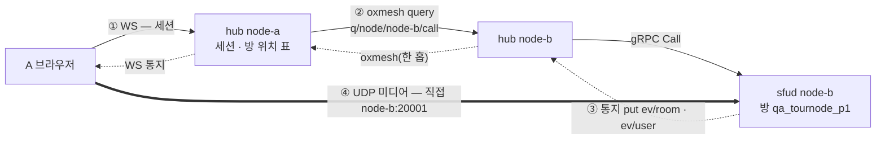
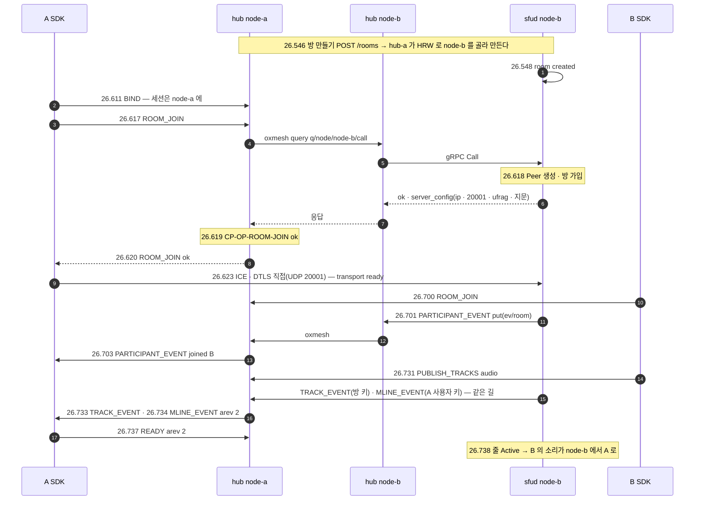

# 06. 다른 node 의 방 — hub 사이 oxmesh

> author: kodeholic (powered by Claude) · created: 2026-11-03.
> ★**대조한 커밋** — 서버 `oxlens-sfu` `c5ecb6d` · SDK `oxlens-sdk-web` `c14dfe8`.
> ★**실측 회차** — `tour-20261103-140404`(탐침 `TOUR-06`). 값은 돌릴 때마다 바뀌고, 차례 · 모양은 같다.

## 0. 한 줄 목적 · 등장인물

**클라는 node-a 의 hub 에 붙었는데 방은 node-b 에 있다 — 요청 · 통지 · 미디어가 각각 어느 길로 가는가.**

| 이름 | 실제 값 | 무엇 |
|---|---|---|
| A · B | `tournode_A` · `tournode_B` | 둘 다 node-a 의 hub(`127.0.0.1:1974`)에 붙는다 |
| 방 | `qa_tournode_p1` | node-b 에 놓인다(방 이름의 HRW) |
| node-a | hub `1974` · sfud UDP `20000` | 세션을 든 쪽 |
| node-b | sfud gRPC `50062` · UDP `20001` · 미디어 서버 신원 `f51e2c9e5d44302e` | 방을 든 쪽 |

## 1. 큰 그림 — 세 길이 다른 곳을 지난다



- **요청은 세션이 사는 hub 를 반드시 지난다.** 클라는 hub 하나(node-a)만 안다. hub-a 가 방 위치 표에서 node-b 를 찾아, oxmesh 로 hub-b 에 묻고, hub-b 가 자기 sfud 를 gRPC 로 부른다(— — node 안은 gRPC 하나, node 사이는 전부 버스).
- **통지는 반대 길이다.** sfud-b 가 `ev/room` · `ev/user` 키에 put → hub-b(router) → oxmesh → 그 키를 구독 중인 hub-a → WS.
- **미디어는 hub 를 안 지난다.** `ROOM_JOIN` 응답의 `server_config` 가 node-b 의 주소 · 포트(`20001`)를 주고, 브라우저는 거기로 ICE 를 직접 맺는다.

## 2. 전체 타임라인



## 3. 단계별

### 3-1. 방은 어디에 — 이름이 정한다

- 방을 만들 때 hub 가 살아 있는 node 들 가운데 **방 이름의 HRW(최고 무작위 가중) 점수**가 가장 높은 node 를 고른다(`oxhubd/src/bus/placement.rs` `pick` · `oxhubd/src/room/mod.rs`). 같은 이름이면 어느 hub 가 골라도 같은 node 다 — 시험도 이 함수를 그대로 옮겨 써서 node-b 에 놓이는 이름을 미리 골랐다.
- 방이 생기면 그 sfud 가 버스에 **방 토큰**(`room` · node · epoch)을 선언한다(`oxsfud/src/bus/mod.rs` `declare_room`). 모든 hub 가 토큰을 받아 「방 → node」 표를 든다(`oxhubd/src/bus/view.rs` `room_node`). 요청 길의 `room_route` 가 이 표다.

### 3-2. 요청 — hub 한 홉이 더

| | 같은 node(01) | 다른 node(이 장) |
|---|---|---|
| `ROOM_JOIN` 보냄 → sfud 가 Peer 생성 | .355 → .356 | .617 → .618 |
| → hub 가 결과를 찍음 → WS 응답 | .357 → .358 | .619 → .620 |
| 길 | hub-a → gRPC → sfud-a | hub-a → oxmesh → hub-b → gRPC → sfud-b |

- 한 기계 안의 세 node 라 oxmesh 한 홉은 ms 아래로 묻혔다(같은 node 와 다른 node 모두 왕복 3ms). 실제 망에서는 이 한 홉이 node 사이 지연만큼 는다.
- ★로그가 갈린다 — op 결과(`CP-OP-*`)와 세션 줄(`SES.S.*`)은 세션을 든 **node-a** 로그에, Peer · 소속 · 발행 · 구독 줄은 방을 든 **node-b** 로그에 찍힌다. 사건 하나를 따라갈 때는 두 로그를 시각으로 맞대야 한다(탐침은 세 node 로그를 다 자른다).

### 3-3. 통지 — 구독은 hub 가 방 단위로

- hub-a 는 자기 세션이 들어간 방의 키(`ev/room/{방}`)와 자기 세션의 사용자 키(`ev/user/{사용자}`)를 버스에서 구독한다(`oxhubd/src/bus/mod.rs` `interest`). 방에 처음 들어가는 세션이 생기면 구독을 열고, 마지막 세션이 나가면 닫는다.
- 그래서 sfud-b 의 put 이 hub-b 를 거쳐 hub-a 까지 온다(26.701 → 26.703). ★방 키와 사용자 키는 **따로 구독**하므로 `TRACK_EVENT`(방 키)와 `MLINE_EVENT`(사용자 키) 사이의 도착 차례는 정해지지 않는다 — 이 회차는 `TRACK_EVENT` 26.733 · `MLINE_EVENT` 26.734.

### 3-4. 미디어 — 직접

```
ROOM_JOIN 응답 server_config.ice = { ip: <서버 IP>, port: 20001, ufrag: …, … } · sfu_id f51e2c9e5d44302e
26.623 SRV node=node-b proc=sfu msg="transport ready (dtls+srtp) conn 25"
26.678 SRV node=node-b proc=sfu spec=SV-STATE-PEER-STATE user=tournode_A from=Suspect to=Alive cause=nominated_new_pair
```
- SDK 의 미디어 연결은 미디어 서버마다 하나다(04 장) — node-b 의 연결은 node-a 의 연결과 따로인 RTCPeerConnection · ICE · DTLS 다. 한 사람이 node-a 와 node-b 의 방을 함께 들으면 연결이 둘이다.

## 4. 소스 · 규격 좌표

| 무엇 | 서버 | 규격 |
|---|---|---|
| 배치(HRW) | `oxhubd/src/bus/placement.rs` · `oxhubd/src/room/mod.rs` | — |
| 방 토큰 · 방 위치 표 | `oxsfud/src/bus/mod.rs` `declare_room` · `oxhubd/src/bus/view.rs` | — |
| node 사이 요청 | `oxhubd/src/bus/mod.rs` `call` · `query` · `oxhubd/src/ops/mod.rs` `answer` | — |
| 통지 구독 | `oxhubd/src/bus/mod.rs` `interest` | — |
| 버스 자체 | `crates/oxmesh`(router 직접 그물 · 한 홉 · 레인 넷) | — |

(버스 · 배치의 계약은 서버 정의서에 있다 — 공개 규격 밖.)

## 5. 스스로 확인하는 질문

<details><summary>1. node-b 의 hub 가 죽으면 이 방은?</summary>

node 하나 = hub + sfud 이고 hub 가 sfud 의 supervisor 다. hub-b 가 죽으면 sfud-b 도 내려가고(stdin 생존 채널), 방 토큰이 버스에서 사라져 hub-a 의 방 위치 표에서 빠진다 — 그 방은 없어진다. 클라는 그 미디어 서버의 연결을 잃고 복구 규칙(05 장 표의 마지막 두 행)을 탄다. (이 회차로 재지 않았다 — 소스 경로로 적은 것이다: `oxsfud/src/main.rs` 부모 생존 채널 · `oxhubd/src/ses/mod.rs` `room_dropped`.)
</details>

<details><summary>2. A 가 node-a 의 방과 node-b 의 방을 함께 들으면 WS 는 몇 개인가?</summary>

하나다 — 세션은 hub-a 에 하나다. 미디어 연결만 서버마다 하나씩, 둘이다.
</details>
