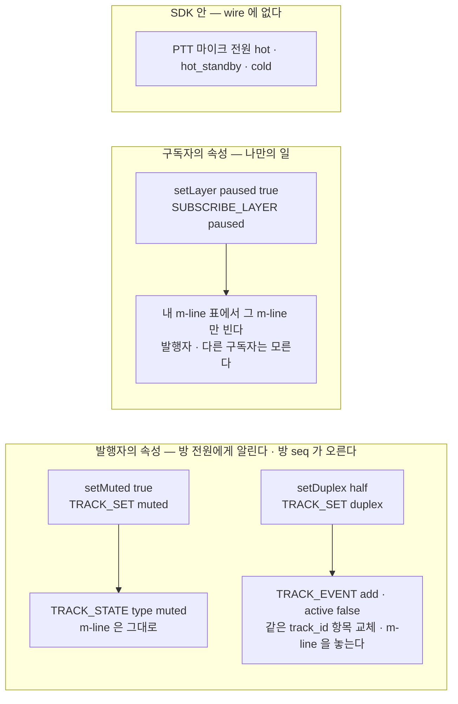
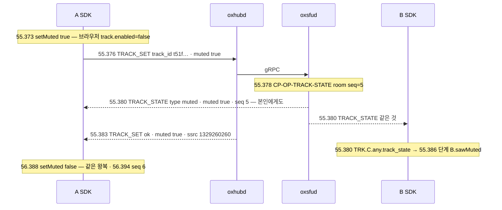
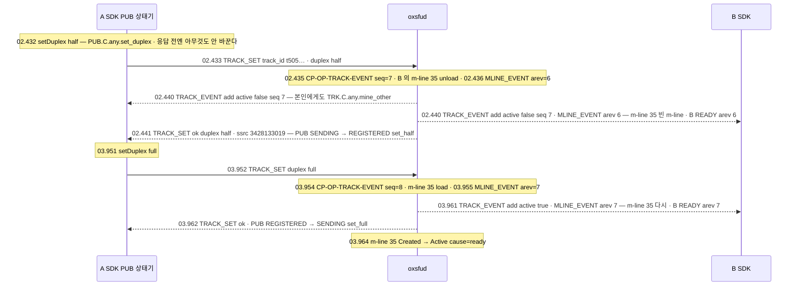
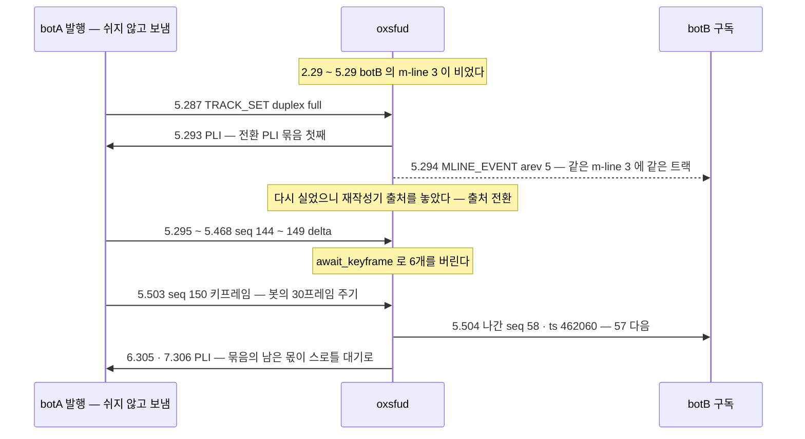

# 06. 트랙 속성 — 음소거 · 영상 멈춤 · 트랙 단위 duplex(회의 ↔ PTT)

> author: kodeholic (powered by Claude) · created: 2026-11-09 · 고침: 2026-11-09(새 회차 · 표준 용어).
> ★**대조한 커밋** — 서버 `oxlens-sfu` `1ef7265` · SDK `oxlens-sdk-web` `de8c4a9`(+탐침) · 2층 `oxlens-labs` `a68d2de`
> ★**실측 회차** — 3층 탐침 `tour-learn` 20261109 둘째 판의 `TOUR-06` · 2층 run-all `e2e-20261109-132317`(시나리오 `conf_duplex` · `conf_simulcast` · `adv_wire_reject`). 값은 돌릴 때마다 바뀌고 차례 · 모양은 같다.

3층 시각은 로컬 시각(초.밀리초)이다. 2층 시각은 봇이 시작한 뒤 경과 초다. 3층 브라우저는 가짜 장치로 영상을 낸다. 용어 대응은 [00 용어](00_INDEX.md#표준-용어).

## 1. 30초 요약



- **누구의 속성인가가 길을 정한다.** 음소거와 회의 ↔ PTT 전환은 발행자의 사실이다. 그래서 방 전원에게 통지가 가고 방 `seq` 가 오른다. 영상 멈춤은 구독자 자신의 선택이다. 그래서 내 m-line 표에만 일어난다.
- ★**회의 ↔ PTT 는 같은 트랙 하나의 속성이다.** 트랙을 내리고 새로 올리지 않는다. `TRACK_EVENT{add}` 한 번으로 끝난다(같은 `track_id` 의 `active` 교체). SDP 재협상이 없다.
- 비활성 트랙(`active:false` — PTT 로 쉬는 트랙)은 구독 m-line 을 놓는다. 돌아오면 m-line 이 다시 실린다. 서버는 그것을 출처 전환으로 다뤄 키프레임부터 보낸다(20261109 고침 · §4-3).

## 2. 등장인물 · 값

| 이름 | 이 회차 값 | 무엇 |
|---|---|---|
| A | `tourattr_A` · 방 `qa_tourattr_p1` · 1pc · 마이크 `t51fc7e1466558364`(SSRC 1329260260) · 카메라 `t505c4172c6565045`(SSRC 3428133019 · H264 · 시뮬캐스트 아님) | 속성을 바꾸는 발행자 |
| B | `tourattr_B` · 같은 방 · adaptiveStream 끔 | 받는 쪽 — m-line 32 · 33(PTT 슬롯) · 34(A 마이크 · SSRC 2295341479) · 35(A 카메라 · SSRC 3093054839) |
| P · L | `tourattr_P` · `tourattr_L` · PTT 방 `qa_tourattr_p3` | 마이크 전원 — [09](09_MIC_COST.md) |
| 2층 botA · botB | `conf_duplex` — botA 영상 SSRC 2952790017(0xB0000001) · track `t7098ed8ecdf07af4` · botB 의 m-line mid 3 · SSRC 2764856824 | RTP 가 실제로 멎고 다시 흐르는지 |
| 네 축 | `TRACK_SET{muted}` · `SUBSCRIBE_LAYER{paused}` · `TRACK_SET{duplex}` · SDK 안의 마이크 전원 | 앞 셋은 wire([연:PUB.op.TRACK_SET](../protocol/07-pub.md#PUB.op.TRACK_SET) · [연:SUB.op.SUBSCRIBE_LAYER](../protocol/08-sub.md#SUB.op.SUBSCRIBE_LAYER)) · 넷째는 SDK 안 |

## 3. 정상 길

### 3-1. 음소거 — `TRACK_SET{muted}` → `TRACK_STATE`



| 무엇 | 값 |
|---|---|
| 요청 → 통지 → 응답 | 55.376 → 55.380 → 55.383(해제는 56.392 → 56.397 → 56.398) |
| 통지 대상 | 방 전원 — 본인 A 도 받는다(SDK 전이 `TRK.C.any.track_state` 가 A · B 같은 ms) |
| 방 `seq` | 4 → 5(음소거) → 6(해제) |
| m-line 표 · RTP | 그대로 — m-line 34 는 남는다. 서버는 음소거 트랙의 RTP 를 거르지 않는다. 브라우저가 `enabled=false` 로 무음 프레임을 보낸다 |

- 통지가 응답보다 먼저 나간다. 서버는 방 전원에게 알린 뒤 요청자에게 답한다.
- `TRACK_STATE` 의 `type` 은 `muted` 하나다. 「받는 쪽이 스스로 알 수 없는 것」만 통지한다([연:TRK.op.TRACK_STATE](../protocol/06-trk.md#TRK.op.TRACK_STATE)).
- ★음소거는 full-duplex 트랙에만 있다. half-duplex 는 floor control 의 전달 게이트가 송출을 정한다. 그래서 음소거가 없다([연:PROP-TRK-MUTED-FULL-ONLY](../protocol/06-trk.md#PROP-TRK-MUTED-FULL-ONLY) · §4-2).

### 3-2. 영상 멈춤 — `SUBSCRIBE_LAYER{paused}` · 내 m-line 표만

```
57.403 단계 B.pauseVideo
57.407 B→ SUBSCRIBE_LAYER {targets:[{track_id t505c4172c6565045, paused:true}]}
57.410 SRV SV-STATE-SUBSCRIBE-STATE user=tourattr_B key=t505c4172c6565045 from=Active to=- cause=unload
57.410 SRV CP-OP-MLINE-EVENT user=tourattr_B arev=4
57.414 B← MLINE_EVENT arev 4 — m-line 35: track_id 없음 · SSRC 3093054839 는 그대로     ← 빈 m-line
57.416 B← SUBSCRIBE_LAYER ok   ·   B→ READY arev 4(m-line 수가 그대로라 SDP 재협상 없음 · SDK SUB.C.any.table_rebound)
59.921 B→ SUBSCRIBE_LAYER {paused:false}
59.924 SRV SV-STATE-SUBSCRIBE-STATE … key=t505c4172c6565045 from=- to=Created cause=load
59.926 B← MLINE_EVENT arev 5 — m-line 35 에 t505c4172c6565045 가 다시 실린다 · 59.927 READY arev 5
59.928 SRV SV-STATE-SUBSCRIBE-STATE user=tourattr_B key=t505c4172c6565045 from=Created to=Active cause=ready
```

- **멈춤은 m-line 을 비운다.** 멈춘 트랙은 m-line 표의 후보에서 빠진다(`sub/mod.rs` `set_pref`). 그 m-line 은 빈 m-line 이 되어 같은 kind 의 다른 트랙이 쓸 수 있다([연:RULE-SUB-FILL](../protocol/08-sub.md#RULE-SUB-FILL)). 빈 m-line · 재배정은 [03](03_PUBLISH_SUBSCRIBE.md) 에서 다룬다.
- 비우고 다시 싣는 것이 이제 로그 두 줄로 보인다 — `cause=unload` · `cause=load`(20261109 고침).
- **A 는 모른다.** 57.4 ~ 62.4 사이 A 의 WS 에는 프레임이 하나도 없었다. A 의 송신은 그대로다. 방 `seq` 도 6 그대로다.
- 와이어의 멈춤은 `paused` 라는 따로 된 칸이다. 레이어 상한(`spatial`)과 섞지 않는다([연:RULE-SUB-LAYER-PAUSED-AXIS](../protocol/08-sub.md#RULE-SUB-LAYER-PAUSED-AXIS)). 시뮬캐스트 영상의 멈춤 · 해제는 [05 §3-1](05_SIMULCAST_BWE.md) 이 2층으로 잰다.

### 3-3. 회의 → PTT → 회의 — `TRACK_SET{duplex}` · 항목 교체 하나



(SDK 전이 시각과 WS 프레임 시각이 1 ~ 3ms 어긋난다. WS 는 시험 프로세스가 본 시각이다.)

| 무엇 | half 로 | full 로 |
|---|---|---|
| 통지 | `TRACK_EVENT{add, active:false}` 하나(seq 7) | `TRACK_EVENT{add, active:true}` 하나(seq 8) |
| B 의 m-line 표 | arev 6 — m-line 35 빈 m-line | arev 7 — m-line 35 에 다시(같은 mid · 같은 SSRC) |
| 요청 → 서버 통지 → 응답 | 02.433 → .435 → .441 | 03.952 → .954 → .962 |
| A 의 발행 상태기 | `SENDING → REGISTERED`(`PUB.C.SENDING.set_half`) — half-duplex 는 Floor Granted 동안만 보낸다 | `REGISTERED → SENDING`(`PUB.C.REGISTERED.set_full`) |
| B 가 보는 것 | `active=false` — 화면을 내린다 · m-line 은 그대로 | `active=true` · 키프레임부터 영상 |

실제 프레임(B 가 받은 half 통지):
```
TRACK_EVENT {"action":"add","room_id":"qa_tourattr_p1","tracks":[{"active":false,"codec":"H264","csrc":31,…,
             "kind":"video","muted":false,…,"source":"camera","track_id":"t505c4172c6565045","type":"individual","user_id":"tourattr_A"}],
             "version":{"epoch":"d6c9ad052c4a12ae","seq":7}}
```

- **전환은 프레임 하나다.** `remove` + `add` 둘이 아니다. 같은 `track_id` 항목의 `active` 만 바꿔 교체한다([연:RULE-ROOM-DUPLEX-ONE-ADD](../protocol/04-room.md#RULE-ROOM-DUPLEX-ONE-ADD) · [연:RULE-TRK-FIVE-RULES](../protocol/06-trk.md#RULE-TRK-FIVE-RULES)). 트랙 `type` 은 `individual` 그대로다.
- **비활성 트랙은 m-line 이 없다.** half 가 되는 순간 서버가 B 의 m-line 35 를 놓는다. 되돌리면 이 회차처럼 같은 m-line 에 다시 실린다. 다른 m-line 에 실릴 수도 있다([연:RULE-PUB-SET-PROC](../protocol/07-pub.md#RULE-PUB-SET-PROC)).
- SDK 는 통지가 아니라 응답(`set_half` · `set_full`)이 와야 게이트 · 전원을 바꾼다.
- `duplex` 가 적용되면 `muted` 는 `false` 로 돌아간다(`ops/media.rs` `set_duplex_of` 의 `st.muted.store(false)`). 음소거된 카메라를 PTT 로 바꾼 뒤 Floor Granted 를 받아 검은 화면이 나가는 결말을 막는다.
- 이 회차 끝의 B m-line 35 재작성기 상태는 `switches 2 · seq_off 65404 · ts_off 1080` 이었다. 멈춤 해제와 full 복귀, 두 번 다시 실린 것을 출처 전환으로 셌다. 옛 회차는 같은 길을 지나고도 `switches 0 · seq_off 0` 이었다(§4-3).

**RTP 가 실제로 멎고 다시 흐르는 것**(2층 `conf_duplex`):

| 1초 칸 | 0 | 1 | 2 | 3 | 4 | 5 | 6 | 7 |
|---|---|---|---|---|---|---|---|---|
| botA 가 보낸 영상 | 21 | 29 | 29 | 28 | 29 | 29 | 28 | 29 |
| botB 가 받은 영상 | — | 20 | 8 | 0 | 0 | 15 | 28 | 29 |

```
2.287 botA → TRACK_SET {ssrc 2952790017, duplex: half}
2.294 botB ← TRACK_EVENT active:false seq 6 · MLINE_EVENT arev 4(mid 3 빈 m-line) · → READY arev 4
5.287 botA → TRACK_SET {duplex: full}
5.293 botB ← TRACK_EVENT active:true seq 7 · 5.294 MLINE_EVENT arev 5(mid 3 다시) · → READY arev 5
5.504 botB ← 첫 영상 — 키프레임
```

botA 는 그동안 보내기를 멈추지 않았다. 서버가 botB 의 m-line 으로 안 보낸 것이다.

### 3-4. 마이크 전원

PTT 마이크에는 세 상태가 있다 — hot · hot_standby · cold(말하지 않은 지 30초 뒤 장치 반납). 서버가 모르는 SDK 안의 일이다.

이 회차도 P 의 `mic` 가 14:38:07.447 hot_standby → 14:38:37.399 cold 로 바뀌었다. 그동안 P 의 WS 에는 10초 `HEARTBEAT` 셋뿐이었다. 발행 · m-line 표 프레임은 없었다. 비용 · 실측은 [09](09_MIC_COST.md) 에서 다룬다.

## 4. 깨지는 길

### 4-1. muted 와 duplex 를 한 요청에 — `1007 FIELD_CONFLICT`(`adv_wire_reject`)

```
4.703 botA → TRACK_SET {room_id, track_id "tr-아무거나", muted: true, duplex: "half"}
      botA ← 실패 1007 FIELD_CONFLICT · permanent true
13:32:30.018 proc=hub kind=ev spec=CP-CODE-FIELD-CONFLICT session=8bed2462 user=botA~adv_wire_reject op=TRACK_SET msg="muted xor duplex"
```

- 둘은 배타다. 둘 다 없거나 둘 다 있으면 거절이다([연:RULE-PUB-SET-EXCLUSIVE](../protocol/07-pub.md#RULE-PUB-SET-EXCLUSIVE)).
- ★없는 `track_id` 인데 `3005 TRACK_NOT_FOUND` 가 아니라 `1007` 이 왔다. 서버가 방 확인 다음 배타 검사를 트랙 찾기보다 먼저 한다(`ops/media.rs` `track_set`). 꼴이 틀린 요청은 대상을 찾기 전에 막힌다.
- 거절 줄이 사유(`msg="muted xor duplex"`)까지 남는다. 실패 응답은 늘 `CP-CODE-*` 한 줄이다(20261109 · [12](12_ERRORS.md)).
- **사용자는** 아무것도 바뀌지 않은 채 실패를 받는다. `permanent` 라 같은 요청을 다시 보내도 같다. 앱이 둘을 따로 보내야 한다.

### 4-2. 그 트랙엔 안 되는 조작 — `3006 TRACK_OP_UNSUPPORTED`(`conf_simulcast`)

```
10.287 botA → TRACK_SET {track_id <시뮬캐스트 영상>, duplex: "half"}
       botA ← 실패 3006 TRACK_OP_UNSUPPORTED · permanent true
13:33:40.068 proc=hub kind=ev spec=CP-CODE-TRACK-OP-UNSUPPORTED session=eaaadc9d user=botA~conf_simulcast op=TRACK_SET msg="simulcast duplex"
```

- 시뮬캐스트 트랙은 PTT 로 바꿀 수 없다(`set_duplex_of` — `simulcast duplex`).
- 같은 번호가 half-duplex 트랙에 `muted` 를 보낼 때도 나온다(`track_set` — `muted on half`). 그 갈래는 이 회차로 일으키지 않았다(소스 경로로 적은 것).
- ★계약 — `3006` 을 받으면 「바뀌지 않았다」로 확정한다. 시뮬캐스트를 끄기 전에는 다시 시도하지 않는다. 다른 실패와 못 가르면 영원히 재시도한다([연:R-PUB-SET-SYMPTOMS](../protocol/07-pub.md#R-PUB-SET-SYMPTOMS)).
- 2층 시나리오는 시뮬캐스트가 이미 흐르는 판의 끝에 이 요청을 붙였다. 거절이 미디어에 아무 영향도 없음을 같은 회차의 정합 판정(초록)으로 함께 보였다.

### 4-3. 다시 실린 m-line 의 첫 패킷 — 이제 키프레임(20261109 고침)

옛 회차에서 이 길이 깨져 있었다. 지금은 고쳐졌다. 둘을 나란히 본다.

`conf_duplex` 에서 full 로 돌아온 뒤 botB 가 받은 영상을 seq 로 이어 보면:

| | 옛 회차(서버 `c3642e8`) | 이 회차(서버 `1ef7265`) |
|---|---|---|
| half 직전 마지막 | 2.259 · 나간 seq 57 · delta | 2.270 · 나간 seq 57 · delta |
| full 뒤 첫 패킷 | 5.290 · 나간 seq 144 · delta | 5.504 · 나간 seq 58 · 키프레임 |
| 그 사이 seq 구멍 | 58 ~ 143(86개) | 없음(57 → 58) |
| 첫 키프레임 | 5.501 · seq 150 | 5.504 · 첫 패킷 그 자체 |
| botB 가 받은 영상 | — | 109개 · seq 30 … 138 · 빈 번호 0 |

VP8 머리 바이트의 맨 아래 비트 P 로 갈랐다(1 = delta · 0 = 키프레임).



- **옛 회차에 무엇이 일어났나** — 재작성기는 「출처가 바뀔 때」만 오프셋을 다시 세고 키프레임을 기다린다([04 §3-3](04_PACKET_PATH.md)). 쉬었다 돌아온 m-line 은 출처(같은 트랙)가 그대로라 둘 다 하지 않았다.
- 그래서 seq 구멍 86개를 남긴 채 delta 가 먼저 나갔다. 구독자 디코더는 참조 프레임 없는 delta 를 받았다. 2층에서 211ms(5.290 → 5.501) 동안 쓸 수 없는 영상이었다.
- 서버는 PLI 묶음(0 · 500 · 1,500ms — `rtcp::pli_burst`)을 냈지만 그 키프레임이 오기 전 delta 를 막지는 않았다.
- 규격과 어긋났다. — 는 「구멍을 남기는 예외는 게이트 드롭 하나」라고 한다. 이 구멍은 그 밖이었다.
- **고침(서버 `f6bbf02`)** — m-line 에 트랙을 새로 실으면(다른 트랙이든, 비었다가 같은 트랙이든) 재작성기의 출처를 놓는다(`ops/media.rs` `apply_changes` 의 `rw.src = None`). 다음 첫 패킷이 출처 전환으로 다뤄진다. 키프레임을 기다리고 오프셋을 다시 센다.
- **이 회차의 결과** — botA 가 full 직후 보낸 delta 6개(seq 144 ~ 149)는 버려졌다. 첫 키프레임(seq 150)이 나간 seq 58 로 나갔다. seq 는 57 → 58 로 잇고 ts 는 3.234초만큼 벌어졌다(171000 → 462060).
- **사용자는** full 요청(5.287)부터 첫 화면(5.504)까지 217ms 를 기다렸다. 봇의 다음 자연 키프레임까지다. 그동안 깨진 화면은 없다. 브라우저 발행자는 PLI(5.293)에 곧바로 키프레임을 내 창이 더 짧다.
- **3층에서도 보인다** — TOUR-06 끝의 B m-line 35 재작성기가 `switches 2` 였다(옛 회차 0). B 의 영상 수신 통계는 `freezeCount 2 · keyFramesDecoded 6 · nackCount 0 · pliCount 0` 이었다(옛 회차 `keyFramesDecoded 8 · nackCount 1`). 멈춤 둘이 m-line 다시 싣기 둘(§3-2 · §3-3)과 수는 같다. 인과는 이 회차로 가르지 않았다.

### 4-4. 늦게 온 옛 READY 응답을 버린다 — 경합(회차마다 다름)

이 장면은 기준 회차에는 있었고 이 회차에는 없었다. 고정된 사실이 아니라 차례 경합이다.

- **기준 회차** — A 가 마이크와 카메라를 연달아 켰다. B 는 `MLINE_EVENT` arev 2 를 받고 `READY{arev 2}` 를 냈다. 그 응답이 오기 전에 arev 3 이 와서 SDK 가 이미 arev 3 을 기다리고 있었다.
- 늦게 온 arev 2 응답은 SDK 전이 `SUB.C.any.ready_res_old` 로 버려졌다. 곧이어 `READY{arev 3}` 응답이 `ready_ok` 로 닫았다. B 의 `READY` 요청 · 응답은 8 쌍이었다.
- **이 회차** — arev 2 와 arev 3 이 3ms 사이(53.503 · 53.506)로 왔다. SDK 는 둘을 한 협상으로 묶어 `READY{arev 3}` 하나만 냈다(53.509). 옛 응답이 생기지 않았다. 요청 · 응답은 7 쌍이다.
- 어느 쪽이든 결말은 같다 — 서버의 `acked` 는 마지막 표(arev 3)다. 응답에는 차례가 있어 SDK 가 옛 것을 가려낸다.

## 5. 왜 이 모양인가

- **누구의 속성인가로 길을 나눴다.**
  - 발행자의 사실(음소거 · 회의 ↔ PTT)은 다른 사람 화면이 알아야 한다. 그래서 방 통지 + `seq++` 다.
  - 구독자의 선택(멈춤)은 발행자도 다른 구독자도 알 필요가 없다. 그래서 내 m-line 표 하나다.
  - 장치 전원은 서버가 알 것이 없다. 그래서 SDK 안이다.
- 그래서 음소거는 「m-line 은 두고 표시만」, 멈춤 · PTT 는 「m-line 을 비운다」로 결말이 갈린다.
- **음소거는 full-duplex 에만.** half-duplex 의 송출은 floor control 의 전달 게이트 하나가 정한다. 둘째 스위치를 두면 「Floor Granted 를 받았는데 무음」이라는 상태가 생긴다([연:PROP-TRK-MUTED-FULL-ONLY](../protocol/06-trk.md#PROP-TRK-MUTED-FULL-ONLY)). 같은 까닭으로 duplex 를 바꾸면 `muted` 를 지운다.
- **m-line 을 비우면 돌아올 때 출처 전환이다.** 비운 동안 무슨 패킷이 지나갔는지 구독자는 모른다. 그래서 돌아온 첫 패킷은 「새 출처」와 같은 조건 — 키프레임부터 · 이어지는 seq — 이어야 한다. 이 원칙을 같은 트랙의 다시 싣기에도 적용한 것이 20261109 의 고침이다(§4-3).

> ★**우리만의 것 — 트랙 단위 duplex: 회의와 PTT 를 같은 트랙 하나로**
> - **선택 배경** — 옛 판에는 방이 「회의 방」 · 「PTT 방」 모드를 들었다. 방 모드를 걷고 half-duplex · full-duplex 를 트랙의 종류로 내렸다. 그러자 같은 방 안에서 한 트랙을 PTT ↔ 회의로 바꾸는 일이 「트랙 속성 하나 바꾸기」가 되었다. 새 전달 로직이 없다. 그 트랙이 타는 길(PTT 슬롯 · 개별 m-line)만 바뀐다. 기존 무전 시스템은 1:1 승격을 별도 세션으로 열거나(3GPP MCPTT Private Call) 채널을 떠나야 한다(TETRA · P25). 몇몇은 지원하지 않는다. 이것은 우리 기록의 조사다(실측 아님). 처음에는 전환을 `TRACK_STATE{duplex}` 로 알렸다. 그러나 같은 사실을 번호를 안 올린 채 한 번 더 보내는 프레임이라 받는 쪽 규칙에 늘 버려졌다. 지금은 `TRACK_EVENT{add}` 하나로 알린다([연:RULE-ROOM-DUPLEX-ONE-ADD](../protocol/04-room.md#RULE-ROOM-DUPLEX-ONE-ADD)).
> - **얻은 것** — 전환이 프레임 하나 · `seq` 한 칸이다. 요청에서 서버 통지까지 2ms(02.433 → .435 · 03.952 → .954), 응답까지 8 ~ 10ms 다. `track_id` · 발행 트랜시버 · SDP 가 그대로다. A 의 발행 상태기는 `SENDING ↔ REGISTERED` 만 오갔다. B 는 `MLINE_EVENT` · `READY` 만 오갔다. PTT 로 쉬는 동안 같은 방 청취는 그대로 이어진다.
> - **잃은 것** — 시뮬캐스트 트랙은 바꿀 수 없다(`3006` · §4-2 실측). 비활성 트랙은 구독 m-line 을 놓는다. 그래서 돌아올 때 재배정 · `READY` · 키프레임 기다림이 다시 든다(2층 217ms). 상태가 얽혀 규칙이 늘었다 — 배타(`1007`) · half-duplex 음소거 금지(`3006`) · duplex 적용 시 `muted` 초기화 · 전환 응답을 기다리는 사이 방을 잃으면 응답으로 남길지 정하는 규칙([연:RULE-PUB-SET-PROC](../protocol/07-pub.md#RULE-PUB-SET-PROC) 마지막 항). 그리고 다시 싣기를 출처 전환으로 빠짐없이 다뤄야 한다 — 빠뜨려 delta 첫 패킷이 나간 일이 있다(§4-3).

## 6. 다른 SFU 는

아래 「그쪽 방식」은 저쪽 소스를 정적으로 읽은 기록이다 — 「저쪽 소스에는 이렇게 적혀 있다(실측 아님)」.

| 축 | 그쪽 방식 | 우리 | 우리 쪽 장점 | 우리 쪽 대가 |
|---|---|---|---|---|
| 구독자가 영상을 안 받기 | mediasoup — Consumer 를 `paused: true` 로 만들라고 API 주석이 권한다(`mediasoup §5-4`) | `SUBSCRIBE_LAYER{paused}` → 그 m-line 을 비운다 | 빈 m-line 을 다른 트랙이 쓴다 — 상한 안에서 받을 것을 고른다 | 해제 때 m-line 다시 싣기 · 키프레임 기다림 |
| 발행자 음소거 | LiveKit — 전달기가 멈춤 사유를 `MUTED`(구독자) · `PUB_MUTED`(발행자)로 가른다(`livekit §9-3`) · 음소거 중 패딩 · 공백 프레임(`livekit §9-4`) / mediasoup — 멈춘 Producer 도 통계는 쌓고 전달만 안 한다(`mediasoup §4-4`) | 서버는 RTP 를 거르지 않고 통지만 · 브라우저가 무음 프레임 | 서버 상태가 하나 적다 | 음소거 중에도 대역을 쓴다 · 공백 프레임으로 디코더를 정리하지 않는다 |
| 회의 ↔ PTT | LiveKit · mediasoup 에는 floor control 개념이 없다(대장 G4 — 누구나 발행) / Janus audiobridge 는 `mute` 와 `suspend` 를 따로 둔다(`Janus §7-5` — 믹서) | 같은 트랙의 `duplex` 속성 · `TRACK_EVENT{add}` 하나 | 한 방에서 회의와 PTT 를 트랙마다 섞는다 · 재협상 없음 | 시뮬캐스트와 함께 못 쓴다 · 다시 싣기 비용 |

## 7. 운영에서 보는 법

| 사건 | 서버 로그 줄(이 회차) |
|---|---|
| 음소거 · 해제 | `proc=sfu kind=ev spec=CP-OP-TRACK-STATE room=qa_tourattr_p1 seq=5` · hub `spec=CP-OP-TRACK-SET … msg=ok` |
| 영상 멈춤 · 해제 | `spec=SV-STATE-SUBSCRIBE-STATE user=tourattr_B key=t505c4172c6565045 from=Active to=- cause=unload` · `… from=- to=Created cause=load` · `spec=CP-OP-MLINE-EVENT session=1607a1aa user=tourattr_B arev=4` · hub `spec=CP-OP-SUBSCRIBE-LAYER … msg=ok` — 멈춤에는 방 줄(`TRACK-STATE` · `TRACK-EVENT`)이 없다 |
| 회의 ↔ PTT | `spec=CP-OP-TRACK-EVENT room=qa_tourattr_p1 seq=7` · 구독자마다 `cause=unload` / `cause=load` · `spec=CP-OP-MLINE-EVENT … arev=6` · hub `spec=CP-OP-TRACK-SET … msg=ok` |
| m-line 이 다시 열림 | `spec=SV-STATE-SUBSCRIBE-STATE user=tourattr_B key=t505c4172c6565045 from=Created to=Active cause=ready` |
| 거절 | `spec=CP-CODE-FIELD-CONFLICT … op=TRACK_SET msg="muted xor duplex"` 꼴 |
| m-line 의 재작성 상태 | `GET /admin/users/{user}/media` 의 `rewrite`(`switches` · `seq_off`) — 다시 싣기마다 `switches` 가 하나씩 오른다(이 회차 2) |

- SDK 쪽은 전이 라벨로 같은 사건이 찍힌다 — `PUB.C.SENDING.set_half` · `PUB.C.REGISTERED.set_full` · `TRK.C.any.track_state` · `TRK.C.any.mine_other` · `SUB.C.any.table_rebound` · (경합 때) `SUB.C.any.ready_res_old`. 라벨이 어디서 오는지는 [15](15_SDK_INSIDE.md). 로그 줄 꼴과 이벤트 이력은 [17](17_OPERATIONS.md).
- 거절(§4-1 · §4-2)은 응답 실패다. 버림 계수가 아니라 실패 번호 계수(`code_1007` · `code_3006` 꼴)로 센다(— 머리).

## 8. 소스 · 규격 좌표

| 무엇 | 서버(`oxsfud/src/`) | SDK(`oxlens-sdk-web/src/`) | 규격 |
|---|---|---|---|
| 음소거 | `ops/media.rs` `track_set`(배타 → 트랙 찾기 → `muted on half` → `TRACK_STATE` 방 전원) | `api/handles.ts` `setMuted` → `domain/pub/local.ts` `setMuted` · 받는 쪽 `domain/trk/remote.ts` | [연:PUB.op.TRACK_SET](../protocol/07-pub.md#PUB.op.TRACK_SET) · [연:TRK.op.TRACK_STATE](../protocol/06-trk.md#TRK.op.TRACK_STATE) · [연:PROP-TRK-MUTED-FULL-ONLY](../protocol/06-trk.md#PROP-TRK-MUTED-FULL-ONLY) · [연:RULE-PUB-SET-EXCLUSIVE](../protocol/07-pub.md#RULE-PUB-SET-EXCLUSIVE) |
| 영상 멈춤 · 상한 · 우선순위 | `ops/media.rs` `subscribe_layer` → `sub/mod.rs` `set_pref` · `sync` | `api/handles.ts` `setLayer` → `domain/trk/remote.ts` `setLayer` · `adapt` | [연:SUB.op.SUBSCRIBE_LAYER](../protocol/08-sub.md#SUB.op.SUBSCRIBE_LAYER) · [연:RULE-SUB-LAYER-PAUSED-AXIS](../protocol/08-sub.md#RULE-SUB-LAYER-PAUSED-AXIS) · [연:RULE-SUB-FILL](../protocol/08-sub.md#RULE-SUB-FILL) |
| 회의 ↔ PTT | `ops/media.rs` `set_duplex_of`(시뮬캐스트 거절 · `muted` 초기화 · `TRACK_EVENT{add}` · `resync_room` · full 이면 `rtcp::pli_burst`) | `domain/pub/local.ts` `setDuplex` · `sendDuplex` · `duplexApplied` | [연:RULE-PUB-SET-PROC](../protocol/07-pub.md#RULE-PUB-SET-PROC) · [연:RULE-ROOM-DUPLEX-ONE-ADD](../protocol/04-room.md#RULE-ROOM-DUPLEX-ONE-ADD) · [연:RULE-TRK-FIVE-RULES](../protocol/06-trk.md#RULE-TRK-FIVE-RULES) |
| m-line 을 놓고 다시 싣기 | `ops/media.rs` `apply_changes`(m-line 의 출처를 비움 · 새로 실으면 재작성기 `rw.src = None`) · `resync_peer`(load · unload 줄) · 재작성기 `fwd/core.rs` `Rewriter` | `domain/link`(m-line 표 다시 받기) | [연:LINK.op.MLINE_EVENT](../protocol/09-link.md#LINK.op.MLINE_EVENT) |
| 마이크 전원 | — | `domain/pub/local.ts` | — — [09](09_MIC_COST.md) |

## 9. 스스로 확인하는 질문

<details><summary>1. 음소거와 영상 멈춤은 둘 다 「안 보인다 · 안 들린다」인데 왜 하나는 방 전원에게 알리고 하나는 아무에게도 안 알리나?</summary>

음소거는 발행자의 사실이다. 다른 사람 화면에 「음소거」를 그려야 하고 받는 쪽이 스스로 알 수 없다. 멈춤은 구독자 자신의 선택이다. 발행자는 계속 보내고 다른 구독자와 무관하다. 그래서 앞은 `TRACK_STATE` + `seq++`(5 → 6)이고, 뒤는 내 m-line 표의 `MLINE_EVENT` 뿐이다. 방 `seq` 는 그대로다.
</details>

<details><summary>2. 카메라를 PTT 로 바꿨다 되돌렸다. B 의 SDP 는 바뀌었나? 트랙 id 는?</summary>

둘 다 그대로다. m-line 35 가 비었다 다시 실렸을 뿐 m-line 수가 같다. `MLINE_EVENT` · `READY` 만 오갔다. 통지는 같은 `track_id`(`t505c4172c6565045`)의 항목 교체(`TRACK_EVENT{add}` · `active` false → true) 둘이다.
</details>

<details><summary>3. muted 와 duplex 를 한 번에 보냈더니 없는 track_id 인데도 1007 이 왔다. 왜 3005 가 아닌가?</summary>

서버가 요청의 꼴(둘은 배타)을 대상 트랙을 찾기 전에 검사하기 때문이다. 꼴이 틀린 요청은 무엇을 가리키든 같은 답이다. `permanent` 이므로 다시 보내지 말고 둘로 나눠 보낸다.
</details>

<details><summary>4. PTT 로 쉬던 카메라가 회의로 돌아왔다. 구독자가 받은 첫 패킷은 키프레임인가?</summary>

이 회차는 그렇다. 2층 `conf_duplex` 의 첫 패킷(5.504 · 나간 seq 58)이 키프레임이었고 seq 구멍도 없었다. 서버가 m-line 에 다시 실을 때 재작성기의 출처를 놓아 출처 전환으로 다뤘기 때문이다(20261109 고침). 옛 회차는 출처가 같다고 보아 delta(seq 144)가 먼저 나가고 구멍 86개가 남았다(§4-3).
</details>

<details><summary>5. B 가 `READY` 응답을 받았는데 SDK 가 그것을 버렸다. 고장인가?</summary>

아니다. 응답이 가리키는 arev 가 SDK 가 지금 기다리는 표보다 옛것이면 버린다(`SUB.C.any.ready_res_old`). 표 두 장이 몇 ms 사이로 오면 생기는 경합이다. 기준 회차에는 있었고 이 회차에는 없었다. 어느 쪽이든 서버의 `acked` 는 마지막 표다(§4-4).
</details>
