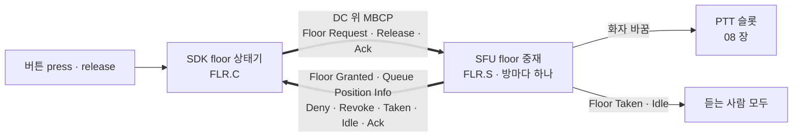
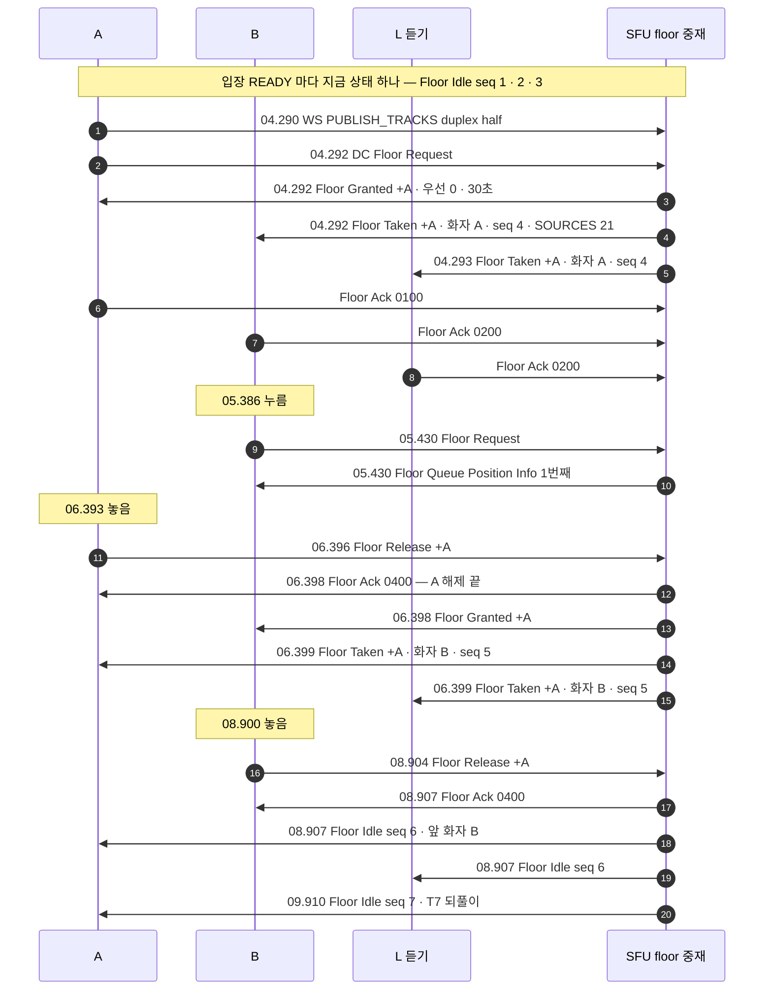
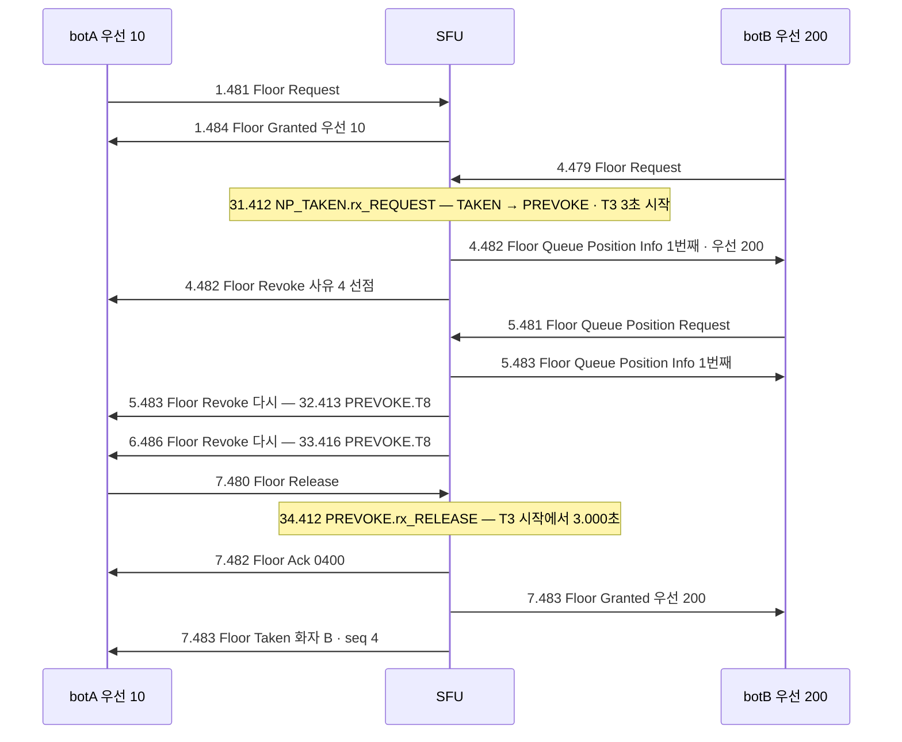
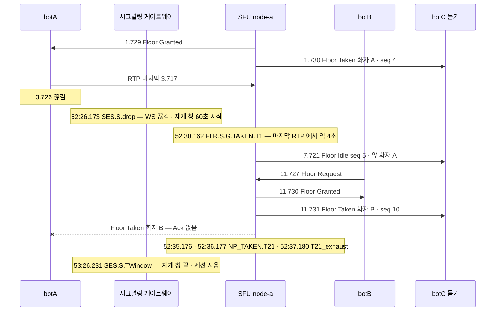

# 07. floor control — 요청 · 허가 · 대기열 · 승계 · 해제

> author: kodeholic (powered by Claude) · created: 2026-11-09.
> ★**대조한 커밋** — 서버 `oxlens-sfu` `1ef7265` · SDK `oxlens-sdk-web` `de8c4a9`(+탐침) · 2층 `oxlens-labs` `a68d2de`
> ★**실측 회차** — 3층 `tour-learn` 20261109 둘째 판(탐침 `TOUR-07`) · 2층 `e2e-20261109-132317`(`ptt_preempt` · `adv_floor_failover` · `adv_floor_multi_dest`). 값은 돌릴 때마다 바뀌고, 차례 · 모양은 같다.

## 1. 30초 요약



- 「한 번에 한 사람만 말한다」는 floor control(발언권 제어)로 지킨다. 메시지 번호 · ACK · 타이머 · 사유 코드는 3GPP TS 24.380(MBCP) 원문 그대로다. 바꾼 것은 전달 수단 하나 — **WebSocket 이 아니라 데이터 채널(DC)** 이다([연:RULE-FLR-MBCP-COMPLY](../protocol/10-flr.md#RULE-FLR-MBCP-COMPLY)).
- **SFU 가 중재한다.** 아무도 안 말하면 곧바로 Floor Granted, 누가 말하는 중이면 대기열에 넣는다. Floor Release 가 오면 대기열 맨 앞에 넘긴다(이 회차 2ms).
- 깨지는 길은 셋을 실측했다 — 우선순위 선점(Floor Revoke 사유 4), 해제 없이 사라진 화자(T1 4초 만료), 남의 방을 지목한 요청(Floor Deny 255).

## 2. 등장인물 · 값

| 이름 | 값 | 무엇 |
|---|---|---|
| A | `tourptt_A` · 말하기 | 먼저 누르는 사람 |
| B | `tourptt_B` · 말하기 | A 가 말하는 중에 누르는 사람 |
| L | `tourptt_L` · 듣기(`select:false`) | 듣기만 한다 — 그래도 DC 를 연다 |
| 방 | `qa_tourptt_p2` · node-a · 1pc 셋 | |
| 시각 | 14:37:03 ~ 14:37:10(KST) — 아래는 초.밀리초만 | DC 시각은 브라우저가 찍은 것 |

메시지 이름은 TS 24.380 이름을 쓴다. 번호는 원문 Table 8.2.2.1-1 그대로다([연:RULE-FLR-MSG-TYPES](../protocol/10-flr.md#RULE-FLR-MSG-TYPES)). 와이어 이름은 서버 `oxsig/src/floor.rs` 와 SDK `floor_consts.ts` 의 상수 이름이다. 규격 산문은 `QINFO` · `QPOS_REQ` 를 `FLOOR_QUEUE_INFO` · `FLOOR_QUEUE_POS_REQUEST` 로도 적는다. 묶음 전체의 용어는 [표준 용어](00_INDEX.md#표준-용어).

| TS 24.380 이름 | 와이어 | 번호 | 뜻 |
|---|---|---|---|
| Floor Request | `REQUEST` | 0 | 말하게 해 달라 |
| Floor Granted | `GRANTED` | 1 | 허가 — 지금부터 말해도 된다 |
| Floor Taken | `TAKEN` | 2 | 다른 사람이 floor 를 가졌다(듣는 사람에게) |
| Floor Deny | `DENY` | 3 | 거절 — 사유 코드를 싣는다 |
| Floor Release | `RELEASE` | 4 | 다 말했다 |
| Floor Idle | `IDLE` | 5 | 아무도 안 말한다 |
| Floor Revoke | `REVOKE` | 6 | 회수 — 말하던 사람에게서 floor 를 거둔다 |
| Floor Queue Position Request | `QPOS_REQ` | 8 | 내 대기열 순위를 알려 달라 |
| Floor Queue Position Info | `QINFO` | 9 | 대기열 순위 |
| Floor Ack | `ACK` | 10 | 받았다 |

| 잰 것(이 회차) | 값 |
|---|---|
| A 누름(STEP) → Floor Granted | 04.275 → 04.292 = **17ms**(첫 누름이라 마이크 잡기 · `PUBLISH_TRACKS` 포함) |
| Floor Request → Floor Granted | 04.292 → 04.292 — 같은 ms |
| A Floor Release → B Floor Granted(대기열 승계) | 06.396 → 06.398 = **2ms** |
| B Floor Release → B 가 받은 Floor Ack(`0400`) | 08.904 → 08.907 = **3ms** |
| 끝 통계 — 슬롯 오디오 받은 패킷 | A 125 · B 91 · L 214 |

| 규격 값(정본은 [연:FLR.wire](../protocol/10-flr.md#FLR.wire) 의 타이머 표) | |
|---|---|
| `T101` · `T100` · `T104` | 0.5초 · 재전송 `C` 3번 — 클라 |
| `T1` · `T2` · `T3` | 4초(RTP 없음) · 30초(발화 상한) · 3초(회수 유예) — 서버 |
| `T7` · `T8` · `T20` · `T21` | 1초 — Floor Idle · Revoke · 승계 Granted · Taken 재전송. `C7` 10 · `C8` 3 · `C20` 3 · `C21` 3 |
| `T9` | 3초 — 상한 초과(사유 2)로 회수된 사람의 재요청 막기 |

## 3. 정상 길

### 3-1. 한 장으로

`+A` 는 「Floor Ack 을 보내라」는 비트다(원문의 Acknowledgement 요구).



### 3-2. 프레임 한 통 — DC 4바이트 머리 + MBCP

L 이 받은 Floor Taken 한 통이다.

```
04.293 DC L recv MBCP TAKEN+A [SPEAKER=tourptt_A · SEQ=0004 · ROOM=qa_tourptt_p2 · SOURCES=00000015]
  01 01 0026 | 12 04 | 04 09 746f75727074745f41 | 08 02 0004 | 1d 0d 71615f…7032 | 1f 04 00000015
  │  │  │      │  │    │                        │            │                   └ TLV 31 SOURCES — 화자 트랙의 CSRC 21
  │  │  │      │  │    │                        │            └ TLV 29 ROOM 13바이트
  │  │  │      │  │    │                        └ TLV 8 SEQ = 4
  │  │  │      │  │    └ TLV 4 SPEAKER 9바이트 "tourptt_A"
  │  │  │      │  └ TLV 4개
  │  │  │      └ 0x12 = A 비트(0x10) + 종류 2 Floor Taken
  │  │  └ 길이 38
  │  └ svc 1 = floor control
  └ ver 1
```

- 종류 번호는 §2 표 그대로다.
- `ROOM`(29)은 SFU 가 보내는 floor 메시지 전부에 실린다. DC 는 방마다가 아니라 SFU 마다 하나다. 그래서 여러 방의 통지가 한 통로로 섞여 오고, `ROOM` 으로 가른다(다방은 [08](08_SLOT_SPEAKER.md)).
- `SEQ` 는 Floor Idle · Floor Taken 에만 있다. 방마다 1 씩 오른다. 재전송(T7 · T21)도 새로 보내는 것이라 올린다. **클라는 이 번호를 견주지 않는다**([연:RULE-FLR-SEQ](../protocol/10-flr.md#RULE-FLR-SEQ)).
- `SOURCES`(31)는 원문 밖 자체 확장이다. 화자의 half-duplex 발행 트랙에 SFU 가 매긴 CSRC 다. 쓰임은 [08 §3-3](08_SLOT_SPEAKER.md).

### 3-3. Floor Request — 마이크는 누를 때 잡는다

```
04.275 STEP A.press
04.287 SDK A PUB audio:microphone IDLE → STAGED          | PUB.C.IDLE.on            (마이크 잡기)
04.290 WS  A send PUBLISH_TRACKS {"duplex":"half", …}                               (mid 0)
04.291 SDK A PUB td66fdd6932fcb15c STAGED → REGISTERED   | PUB.C.STAGED.pub_ok
04.292 DC  A send REQUEST [ROOM]
04.292 DC  A recv GRANTED+A [PRIORITY=0000 · DURATION=001e]
04.292 SDK A FLR NOPERM → PREQ → PERM                    | FLR.C.NOPERM.press · FLR.C.PREQ.rx_GRANTED
04.292 SRV   spec=FLR.S.P.NP_IDLE.rx_REQUEST … floor_sequence=9 … from=IDLE to=TAKEN
04.293 SDK A PUB REGISTERED → SENDING                    | PUB.C.REGISTERED.floor_open  (게이트 열림)
04.394 SRV   spec=SV-STATE-PUBLISH-STATE from=Intended to=Active cause=first_rtp
```

- half-duplex 트랙은 **Floor Granted 가 나야 RTP 를 보낸다.** 등록(`REGISTERED`)과 송출(`SENDING`)이 나뉘어 있다.
- SFU 에도 같은 게이트가 있다. 화자가 아닌 사람의 half-duplex RTP 는 버린다(`prefan_gate`, [08](08_SLOT_SPEAKER.md)). 강제하는 것은 통지가 아니라 이 게이트다([연:RULE-FLR-TRANSPORT-DC](../protocol/10-flr.md#RULE-FLR-TRANSPORT-DC)).
- Floor Granted(04.292) 뒤 A 의 첫 RTP 가 SFU 에 닿기까지 102ms 걸렸다(04.394). 브라우저가 인코더를 띄우는 시간이다.
- 그 사이 듣는 쪽 슬롯에는 SFU 가 지은 예열 무음이 흐른다. B 의 첫 슬롯 패킷 `FLR.C.NOPERM.rtp_rx` 가 04.293 이다. 예열은 [08](08_SLOT_SPEAKER.md) 몫이다.
- Floor Granted 의 Ack(`0100`)에는 SFU 가 답하지 않는다. 받았다는 사실만 본다. 로그 줄이 `FLR.S.gate.ack_drop` 이다([연:DEV-FLR-ACK-DROP](../protocol/10-flr.md#DEV-FLR-ACK-DROP)).
- 반면 Floor Taken 의 Ack(`0200`)은 `FLR.S.P.NP_TAKEN.rx_ACK_taken` 줄을 남긴다. 그 사람의 T21 재전송을 멈춘다.

### 3-4. 대기열 · 승계 — 쉬지 않고 대기열 맨 앞에게

```
05.430 DC  B send REQUEST
05.430 DC  B recv QINFO [QINFO=0100]                    ← 대기열 1번째 · 우선 0
05.430 SRV   spec=FLR.S.P.NP_TAKEN.rx_REQUEST from=TAKEN to=TAKEN
06.396 DC  A send RELEASE+A
06.397 SRV   spec=FLR.S.P.PERMITTED.rx_RELEASE from=TAKEN to=TAKEN      ← IDLE 을 거치지 않는다
06.398 DC  B recv GRANTED+A · A recv ACK 0400
06.399 DC  A · L recv TAKEN+A [SPEAKER=tourptt_B · SEQ=0005 · SOURCES=00000016]
06.399 SDK B FLR QUEUED → QUEUED | rx.GRANTED | FLR.C.QUEUED.rx_GRANTED
06.399 SDK B FLR QUEUED → PERM   | hold       | FLR.C.QUEUED.intent      ← 버튼이 눌린 채라 곧바로 수락
06.414 SRV   spec=FLR.S.P.PERMITTED.rx_RTP (B 첫 RTP)
```

- 누가 말하는 중에 온 Floor Request 는 거절하지 않는다. 대기열(queue)에 넣는다. 큐는 늘 켠다([연:R-FLR-QUEUE-ALWAYS](../protocol/10-flr.md#R-FLR-QUEUE-ALWAYS)). 대기열이 차면 그때 Floor Deny 사유 7 이다.
- Floor Release 가 오면 Floor Idle 을 거치지 않고 대기열 맨 앞에게 넘긴다. 이것이 대기열 승계다([연:FLR.S.G.IDLE.enter_succession](../protocol/10-flr.md#FLR.S.G.IDLE.enter_succession)). 듣는 L 은 Floor Idle 없이 Floor Taken(화자 B)만 받는다.
- 대기열에서 받은 Floor Granted 는 `queued` 에 머물며 사용자 의지를 기다린다(T132 2초). 누르고 말하기(hold)는 버튼이 눌린 것이 곧 의지다. 그래서 같은 ms 에 수락했다([연:RULE-FLR-PROC-QUEUED-ACCEPT](../protocol/10-flr.md#RULE-FLR-PROC-QUEUED-ACCEPT)).
- 승계로 준 Floor Granted 는 T20 으로 재전송된다.

### 3-5. Floor Release — 해제한 사람에게는 Floor Idle 대신 Floor Ack

```
08.904 DC  B send RELEASE+A                      SDK B FLR PERM → PREL | FLR.C.PERM.release
08.905 SDK B PUB SENDING → REGISTERED | mic.close | PUB.C.SENDING.floor_close
08.906 SRV   spec=FLR.S.P.PERMITTED.rx_RELEASE from=TAKEN to=IDLE
08.907 DC  B recv ACK [ACKTYPE=0400]             SDK B FLR PREL → NOPERM | FLR.C.PREL.rx_ACK_release
08.907 DC  A · L recv IDLE [SEQ=0006 · PREV=tourptt_B]
09.909 SRV   spec=FLR.S.G.IDLE.T7
09.910 DC  A · B · L recv IDLE [SEQ=0007]
```

- SFU 는 IDLE 로 들어가며 방 사람 모두에게 Floor Idle 을 돌린다. 단 **해제한 사람에게는 보내지 않는다**([연:FLR.S.P.PERMITTED.a_IDLE](../protocol/10-flr.md#FLR.S.P.PERMITTED.a_IDLE) — 원문 6.3.5.5.4).
- 그래서 클라는 Floor Release 에 A 비트를 세운다. SFU 의 Floor Ack(`0400`)을 「해제 끝」으로 다룬다([연:DEV-FLR-RELEASE-ACK](../protocol/10-flr.md#DEV-FLR-RELEASE-ACK)). 해제 완료가 왕복 하나(3ms)다. 이 Ack 이 없던 때의 512ms 는 §5 표에 있다.
- 이 Ack 이 사라질 수 있다(DC 는 `ordered:false` · 재전송 0). 그때의 T100 재전송은 §4-4 에 있다.
- IDLE 동안 SFU 는 1초마다 Floor Idle 을 되풀이한다(T7). 늦게 들어오거나 하나를 놓친 사람도 결국 받는다. 2층 `ptt_preempt` 끝에서 세면 되풀이 9번 뒤 멈췄다(처음 한 통과 합쳐 10통 = `C7`).
- 끝난 뒤 방 표면(`/admin/rooms/{id}/snapshot` 의 `floor`)은 `state IDLE · speaker null · queue [] · timers [T7]` 였다.

## 4. 깨지는 길

### 4-1. 우선순위가 높은 사람이 뺏는다 — 선점 · 회수 유예 T3

2층 `ptt_preempt` — botA(우선순위 10)가 말하는 중에 botB(200)가 누른다. 메시지 줄의 숫자는 봇 덤프의 경과 초다. `Note` 의 숫자는 서버 로그 시각(13:48:초)이다.



- **무엇이 깨졌나** — 말하던 사람이 말하는 도중 floor 를 잃는다.
- 선점은 「뺏어서 바로 주지 않는다」. 지금 화자에게 Floor Revoke(사유 4)를 보낸다. 선점자는 대기열 맨 앞에 세운다. 지금 화자의 Floor Release 나 T3 만료 때 넘긴다([연:RULE-FLR-PREEMPT](../protocol/10-flr.md#RULE-FLR-PREEMPT)).
- **누가 먼저 아나** — SFU(중재)와 선점자(Floor Queue Position Info 1번째)다. 지금 화자는 Floor Revoke 로 안다.
- **무엇이 오가나** — 이 봇은 Floor Revoke 를 받아도 시나리오가 정한 7.480 까지 놓지 않는다. 그래서 SFU 가 Floor Revoke 를 1초마다 두 번 더 보냈다(모두 세 통 — `C8` 3). 선점자는 **3.0초** 기다렸다.
- 그 사이 선점자는 Floor Queue Position Request(번호 8)로 순위를 다시 물었다. SFU 는 Floor Queue Position Info 로 답했다(`FLR.S.P.NP_TAKEN.rx_QPOS_REQ`).
- SDK 는 Floor Revoke 를 받으면 곧바로 Floor Release 를 보낸다([연:RULE-FLR-PROC-REVOKE](../protocol/10-flr.md#RULE-FLR-PROC-REVOKE)). 정상이면 이 대기는 왕복 하나다.
- 3초를 다 쓰는 것은 회수 통지가 사라졌거나 화자가 답하지 않을 때뿐이다. 이 3초는 「화자는 말한다고 믿는데 아무도 못 듣는」 틈을 덮는 창이다([연:R-FLR-T3-GRACE](../protocol/10-flr.md#R-FLR-T3-GRACE)).
- **사용자는 무엇을 겪나** — A 는 회수 사유 4 를 본다(다시 눌러도 또 뺏긴다). 사유 2(상한 초과 — T9 3초 뒤 다시 누르면 된다)와 처방이 반대라 사유를 가른다.
- 선점자 B 는 Floor Queue Position Info 를 거절로 읽으면 안 된다. 누르고 말하기면 버튼이 눌린 채라, Floor Granted 가 오는 순간 열린다.
- 기본 배치에서는 선점이 일어나지 않는다. 모두 우선순위 0 이면 `>` 가 성립하지 않아 전원 같은 대기열이다([연:DEV-FLR-PREEMPT-RELATIVE](../protocol/10-flr.md#DEV-FLR-PREEMPT-RELATIVE)).

### 4-2. 화자가 해제 없이 사라진다 — T1 만료 · 죽은 사람에게 가는 Floor Taken

2층 `adv_floor_failover` — botA 가 floor 를 쥔 채 3.726 에 프로세스째 끊긴다. `ROOM_LEAVE` 도 Floor Release 도 없다. botC 는 듣기만 한다. 메시지 줄의 숫자는 덤프 경과 초다. `Note` 의 숫자는 서버 로그 시각(13:분:초)이다. 서버 시각 = 덤프 경과 + 13:52:22.446.



- **무엇이 깨졌나** — floor 를 쥔 사람이 사라졌다. 그런데 중재 상태기는 아직 그를 화자로 안다.
- **누가 먼저 아나** — 시그널링 게이트웨이(`oxhubd`)가 먼저 안다. WS 끊김 `SES.S.drop` 이 끊김과 같은 ms 다.
- 그러나 **floor control 은 WS 를 보지 않는다.** floor 는 미디어 쪽 DC 위로 가고, WS 는 시그널링일 뿐이다. 그래서 WS 만 끊겼다 `RESUME` 한 화자는 floor 를 그대로 쥐고 있다([연:RULE-FLR-SERVER-EVENTS](../protocol/10-flr.md#RULE-FLR-SERVER-EVENTS)). floor 를 푸는 근거는 RTP 가 4초 안 온 것(T1) 하나다. T1 만료는 Floor Revoke 없이 곧바로 IDLE 로 간다.
- 마지막 RTP 는 3.717 이다. SFU 의 T1 줄은 7.716(서버 시각 52:30.162)이고, 듣는 쪽 Floor Idle 은 7.721 이다.
- **무엇이 오가나** — T1 만료 뒤 B 가 Floor Granted 를 받자 SFU 는 죽은 A 에게도 Floor Taken(+A)을 보낸다. Ack 이 안 오니 T21 로 1초마다 두 번 더 보낸다. 세 번째 만료에서 그만둔다(`T21_exhaust`). Ack 유실 재전송이 실측으로 보인 것이다([연:DEV-FLR-TAKEN-ACK](../protocol/10-flr.md#DEV-FLR-TAKEN-ACK)).
- 그 재전송도 `SEQ` 를 올린다. 그래서 C 가 받은 다음 Floor Idle 은 seq 11 · 12 를 건너뛴 13 이다(16.729).
- **사용자는 무엇을 겪나** — 듣는 사람은 3.7초부터 4초 동안 **화자 표시는 A 인데 소리가 없다.** 그 4초 동안 다른 사람이 누르면 대기열에 선다.
- T1 만료 뒤에는 SFU 가 지은 해제 무음 3 프레임이 온다(7.720 · 7.743 · 7.766 · seq 92 · 93 · 94). ts 는 87360 → 279504 로 4.0초만큼 건너뛴다. Floor Idle(7.721)도 그 사이에 온다.


### 4-3. 남의 방을 지목하거나 방을 안 적은 요청

2층 `adv_floor_multi_dest` — botADV 는 roomP 에만 들어가 있다. roomQ 는 남의 방이다.

| 덤프 경과 | 보낸 것 | 받은 것 | 서버 로그 |
|---|---|---|---|
| 1.973 | Floor Request `ROOM=roomQ`(남의 방) | 1.975 Floor Deny 사유 255 · `REASON "not_in_room"` | `FLR.S.gate.not_in_room` |
| 2.973 | Floor Request `ROOM` 없음 | **무응답** | 없음 — `/admin/drops` 의 `dc_no_room` 만 오른다 |
| 3.973 | Floor Request `ROOM=roomP` | 3.976 Floor Granted | `FLR.S.P.NP_IDLE.rx_REQUEST` |

- 방을 고를 수 없는 요청에는 **돌려줄 방이 없어** 답하지 않는다. 조용히 첫 방을 고르지 않는다. 클라는 T101 재전송 3번 뒤 「응답 없음」(`lastEnd:'no_response'`)을 본다.
- 셋째 줄이 있어야 둘이 갈린다. 「거부됐다」와 「봇이 애초에 요청을 못 보냈다」다. 같은 봇이 정상 요청으로는 Floor Granted 를 받는다.

### 4-4. 이 회차로 재지 않은 셋

| 깨짐 | 규격이 정한 결과 | 왜 위험한가 |
|---|---|---|
| ★DC 만 끊김(미디어는 산다) | SFU 는 T1 · T2 만 봐서 **회수하지 않는다.** 클라는 `trusted:false` 로 보이고 DC 를 다시 연다. 다 쓰면 그 SFU 와 재연결(rebuild)한다([연:RULE-FLR-PROC-DC-DOWN](../protocol/10-flr.md#RULE-FLR-PROC-DC-DOWN)) | 양쪽이 다르게 아는 유일한 칸이다. 말한다고 믿는데 남의 화면에 이름이 안 뜬다. 미디어 지표로 안 잡힌다([연:R-FLR-DC-ONLY-DOWN](../protocol/10-flr.md#R-FLR-DC-ONLY-DOWN)) |
| half-duplex 발행 없이 요청 | Floor Deny 사유 5(수신 전용) — 무시하지 않는다([연:R-FLR-DENY-RECVONLY](../protocol/10-flr.md#R-FLR-DENY-RECVONLY)). SFU 는 요청을 받는 그때 발행 쪽 사실을 읽는다(사본 없음) | 무시하면 클라가 T101 × 3 을 헛되이 쓰고 사유를 못 보인다 |
| 해제의 Floor Ack 유실 | T100 0.5초마다 Floor Release 재전송 · C100 다 쓰면 해제된 것으로 친다 | 「해제 중」 동안 다시 누른 것이 버려진다([연:R-FLR-PRESS-DROP](../protocol/10-flr.md#R-FLR-PRESS-DROP)) |


## 5. 왜 이 모양인가

> ★**우리만의 것 — WebRTC 위의 half-duplex 무전**
> - **선택 배경** — 업무 무전은 한 번에 한 사람 · 우선순위 · 대기열 · 선점이 본질이다([연:RULE-FLR-TIMERS](../protocol/10-flr.md#RULE-FLR-TIMERS) 「우선순위·큐 기반 제어가 규율형 무전의 본질」). 소스를 읽어 본 WebRTC 서버들(LiveKit · mediasoup · Janus · JVB)에는 floor control 이 없다. 화자는 관측해서 판정할 대상일 뿐이다(§6). 그래서 새로 짓지 않았다. 공공안전 무전 표준(3GPP TS 24.380)을 메시지 번호 · ACK · 타이머 · 사유 코드까지 원문대로 옮겼다. 바꾼 것은 RTCP APP 패킷 대신 DC 에 싣는 것 하나다([연:RULE-FLR-MBCP-COMPLY](../protocol/10-flr.md#RULE-FLR-MBCP-COMPLY)).
> - **얻은 것** — SFU 가 권위로 중재하고 ms 안에 끝난다. 이 회차에서 요청 → Floor Granted 는 같은 ms, 해제 → 다음 사람 Floor Granted 2ms, 해제 완료 3ms 였다(같은 기계라 망 왕복이 거의 0 이다. 실제 망에서는 왕복 하나가 더해진다). 대기열 · 선점 · 회수 유예 · 사유 코드가 원문 절 번호와 한 줄씩 맞물린다. 원문을 옆에 놓고 검증할 수 있다.
> - **잃은 것** — ①**DC 가 없는 청취자는 floor 통지를 못 받는다.** WS 로 floor 를 보내던 길(`FLOOR_MBCP`)을 철거하며 받아들인 대가다. 그래서 청취 전용도 SFU 마다 트랙 없는 발행 PeerConnection 과 DC 를 세운다([연:RULE-LINK-SDP-DC-OPENER](../protocol/09-link.md#RULE-LINK-SDP-DC-OPENER)). 2pc 면 그만큼 연결과 STUN 동의 검사가 는다([09](09_MIC_COST.md)). 2층 봇이 이 규칙을 어기고 홈 SFU 에만 DC 를 열었을 때, 다른 SFU 방의 Floor Taken 을 0번 받았다([08 §4-3](08_SLOT_SPEAKER.md)). ②**영상 무전은 보류했다.** 한 연결로 음성 · 영상을 같이 보내면 화자 전환마다 영상 키프레임 묶음이 음성 송신을 민다. 수신 NetEQ 누적 지연 p99 가 264ms 로 커졌다(영상만 끄면 42ms — 예전 실측 · 이번 회차 아님). 그 레버(브라우저 송신 페이서)는 앱이 쥘 수 없다. ③명시 요청이라 첫 음절 앞에 왕복 하나가 붙는다. 「먼저 보내는 사람이 화자」인 암묵형(SvxLink)보다 늦다.


| 다른 길 | 버린 이유 |
|---|---|
| WS 로도 floor 를 보낸다(폴백) | 두면 두 문장이 둘 다 거짓이 된다 — 「WS 가 끊겨도 floor 는 산다」와 「`RESUME` 스냅샷에 floor 가 없다」. 런타임 전환의 방아쇠가 망 문제와 구분되지 않는다([연:RULE-FLR-TRANSPORT-DC](../protocol/10-flr.md#RULE-FLR-TRANSPORT-DC)) |
| 먼저 보내는 사람이 화자(암묵형) | 대기열 · 우선순위 · 선점을 표현할 곳이 없다 |
| 발성 감지(VAD)로 화자 표시 | 화자 표시는 floor control 한 축이다. 소리 크기로 그리지 않는다([연:RULE-FLR-NO-VAD](../protocol/10-flr.md#RULE-FLR-NO-VAD)) |
| 두 사람 동시 발화(multi-talker) | 오디오 슬롯 하나 구조가 두 화자를 못 받는다([연:REJ-FLR-MULTI-TALKER](../protocol/10-flr.md#REJ-FLR-MULTI-TALKER)) |
| 큐 없이 거절(사유 1) | 대기열에 설 수 있는 사람이 포기한다([연:R-FLR-QUEUE-ALWAYS](../protocol/10-flr.md#R-FLR-QUEUE-ALWAYS)) |
| A 비트 없는 Floor Release | 해제한 사람이 매번 T100 을 다 기다린다 — 실측 512ms 의 「해제 중」([연:R-FLR-RELEASE-ACK](../protocol/10-flr.md#R-FLR-RELEASE-ACK)) |

## 6. 다른 SFU 는

★아래 「그쪽 방식」은 각 프로젝트 소스를 정적으로 읽은 대장에서 옮겼다. **「저쪽 소스에는 이렇게 적혀 있다」이지 실측이 아니다.**

| 상대 | 그쪽 방식 | 우리 | 우리 쪽 장점 | 우리 쪽 대가 |
|---|---|---|---|---|
| LiveKit | floor control 이 없다. 오디오 레벨로 화자를 **판정**한다 — 400ms 창에서 40% 넘게 -35dBov 를 넘으면 active(`livekit §4-4`) | SFU 가 Floor Granted한 한 사람만 흐른다 | 동시 발화가 구조적으로 없다 · 화자 표시가 중재 결과와 같다 | 요청 왕복 · 중재 상태기를 우리가 든다 |
| mediasoup | 관측자 둘(음량 목록 · 지배 화자 1명) — 판정일 뿐 게이트가 아니다(`mediasoup §11`) | 게이트 + 통지 | 게이트가 권위라 표시와 소리가 어긋나지 않는다 | 회의 쪽 음량 관측은 따로 든다 |
| Janus | videoroom 은 floor control 없음 · audiobridge 는 서버가 **섞는다**(N-1 믹싱 · 디코드 → 재인코드, `Janus §7-4`) | 섞지 않고 한 사람만 통과 | 코덱 해석 · 재인코드 비용이 0 | 둘이 동시에 말하는 것을 들려줄 수 없다 |
| JVB | 에너지 순위로 입구에서 자른다 — 상위 3 + 지배 화자(`JVB §4-2` — 설정 `route-loudest-only` 를 켰을 때 · 기본은 꺼짐) | floor 로 자른다 | 「누가 흐르나」가 정책이 아니라 계약이다 | — |
| Mumble | 클라가 판정(VAD · PTT 키) · 서버는 동시 발화를 막지 않고 우선 발언자 감쇠는 클라가 한다(`Mumble §9-1` · `§10-1`) · 발화 끝은 미디어의 `is_terminator`(`§2-4`) | SFU 권위 · 끝은 제어(Floor Release) | 대기열 · 선점 · 회수가 있다 | 미디어(마지막 소리)와 제어(Floor Idle)가 다른 길 · 다른 속도로 온다 |
| SvxLink | 암묵 — talker 가 비어 있으면 먼저 보낸 노드가 talker(`SvxLink §2-2`) · 화자 통지는 「정보 제공 전용」이라 오디오가 먼저 올 수 있다(`§1-3`) · 3초 오디오 공백 회수 + 상한 초과 뒤 60초 차단(`§2-3`) | 명시 요청 · 통지 권위는 DC · 강제 권위는 SFU 게이트 | 우선순위 · 대기열 · 선점 | 첫 음절 앞 왕복 하나. 차단은 우리도 둔다 — 사유 2 뒤 T9 3초([연:RULE-FLR-T9-VALUE](../protocol/10-flr.md#RULE-FLR-T9-VALUE)) |
| Zello Work | 비상 호출 — 5초 카운트다운 뒤 10초 무중단 오디오를 지정 비상 채널로 · 기본은 발신자만 해제(조사 기록 §4-4) | 우선순위 선점(Floor Revoke 사유 4) | 방 안의 누구든 값으로 뺏을 수 있다 | 「무중단 10초」 같은 보장 시간은 계약에 없다 |


## 7. 운영에서 보는 법

| 보고 싶은 것 | 어디서 | 실제 모양(이 회차) |
|---|---|---|
| 중재 전이 | 서버 로그 `kind=ev spec=FLR.S.…` — 중재마다 한 줄. `from` · `to` 는 방 전체 상태(IDLE · TAKEN · PREVOKE) | `spec=FLR.S.P.NP_IDLE.rx_REQUEST … room=qa_tourptt_p2 user=tourptt_A floor_sequence=9 mbcp_seq=0 area=FLR … from=IDLE to=TAKEN cause=server_rx`(이 탐침 서버에선 `mbcp_seq` 가 0 — 아래 · 지금은 와이어 `SEQ` 값) |
| 타이머 만료 | 같은 줄 · `cause=t1` · `t7` · `t8` · `t21` | `spec=FLR.S.G.TAKEN.T1 room=… floor_sequence=18 … from=TAKEN to=IDLE cause=t1` |
| 지금 화자 · 대기열 · 걸린 타이머 | `GET /admin/rooms/{id}/snapshot` 의 `floor` | `{"state":"IDLE","speaker":null,"queue":[],"timers":[{"name":"T7","at":…}],"first_rtp_at":…,"last_rtp_at":…}` |
| 버려진 floor 프레임 | `GET /admin/drops` 의 `dc_bad_frame` · `dc_unknown_svc` · `dc_no_room` | 4-3 의 방 없는 요청은 `dc_no_room` 으로 센다(소스 `ops/floor.rs` `dc_in` — 이 회차는 계수를 읽지 않았다) |
| 클라 쪽 | SDK 전이 라벨 `FLR.C.…` · `ptt.state`(`phase` · `lastEnd` · `lastDeny` · `lastRevoke` · `trusted`) | `FLR.C.PREL.rx_ACK_release` · `FLR.C.QUEUED.intent` |

- floor 줄에는 상관 키 둘이 붙는다(20261109 고침 · 지금 실측). `floor_sequence` 는 방마다 floor 사건 계수다. TOUR-07 에서 입장 `FLR.S.ws.join` 의 1 부터 끝 T7 의 32 까지 한 방에서 이어졌다. 장비가 여러 대여도 이 번호로 사건 차례를 다시 가른다.
- `mbcp_seq` 는 Floor Idle · Floor Taken 을 낸 줄에 붙는다. 값은 와이어 `SEQ` 와 같다. 예(2층 `csrc_ptt_av`, 한 방):
  - 입장 Floor Idle 셋 — `FLR.S.P.join.idle … floor_sequence=3 mbcp_seq=1` · `6 · 2` · `9 · 3`
    - 이 셋은 봇에 대부분 닿지 않았다. 2층 봇은 입장 뒤에 DataChannel 을 열고(`setup_floor_dc`), 그 전에 간 floor 메시지는 닿지 않는다. 브라우저는 입장 offer 에 DataChannel 을 실어 입장 Floor Idle 을 받는다([15 §3-3](15_SDK_INSIDE.md)).
  - A 의 Floor Request 에 낸 Floor Taken — `FLR.S.P.NP_IDLE.rx_REQUEST … floor_sequence=10 mbcp_seq=4`. 듣는 봇이 받은 Floor Taken 의 `SEQ` 도 4 다.
  - A 해제 → Floor Idle `5` · B 요청 → Floor Taken `6` · B 해제 → `7` · 쉬는 동안 T7 되풀이 `8`
- 두 번호는 오르는 빠르기가 다르다. `floor_sequence` 는 floor 사건마다(ACK · 타이머 포함), `mbcp_seq` 는 Floor Idle · Floor Taken 을 낼 때만 오른다.
- 이 장 탐침(TOUR-07)을 잰 서버는 `mbcp_seq` 를 늘 0 으로 찍었다. 다른 칸을 실은 결함이었고 같은 날 고쳤다(지금 실측은 위 2층 회차).
- `floor.timers` 는 「왜 아직 floor 가 풀리지 않나」를 밖에서 볼 재료다. `T1` 의 `at` 은 `last_rtp_at + 4초` 로 밀린 값이 나온다.
- floor 줄은 `ev` 종류라 늘 남는다. 로그 줄 꼴 · 세션 지문 · `/admin/history` 로 한 사람의 사슬을 거는 법은 [17](17_OPERATIONS.md).


## 8. 소스 · 규격 좌표

| 무엇 | 서버(`oxlens-sfu/crates`) | SDK(`oxlens-sdk-web/src`) | 규격 |
|---|---|---|---|
| DC 프레임 · MBCP 꼴 | `oxsig/src/dc.rs` · `oxsig/src/floor.rs`(`tlv::SOURCES` · `taken`) | `internal/wire/floor_codec.ts` · `floor_consts.ts` · `internal/flr/mbcp.ts` | [연:TRN.frame.DC](../protocol/02-trn.md#TRN.frame.DC) · [연:RULE-FLR-TLV](../protocol/10-flr.md#RULE-FLR-TLV) |
| 중재 상태기 | `oxsfud/src/flr/core.rs`(`server_rx` · `arb_preempt` · `arb_rel` · `t1` · `t21`) | — | `FLR.S.…` 표 · [연:RULE-FLR-PREEMPT](../protocol/10-flr.md#RULE-FLR-PREEMPT) |
| 집행 · 타이머 · DC 입구 · 로그 줄 | `oxsfud/src/ops/floor.rs`(`dc_in` · `timer_task` · `fire_due` · `snapshot` · `trace`) | — | [연:RULE-FLR-TIMERS](../protocol/10-flr.md#RULE-FLR-TIMERS) |
| 클라 상태기 · 마이크 게이트 | — | `domain/flr/core.ts`(`FloorCore`) · `domain/pub/local.ts`(`floorOpen`) | `FLR.C.…` 표 |
| 버림 계수 | `oxsfud/src/ops/mod.rs`(`DROP_NAMES` · `drops_json`) · `ops/admin.rs`(`/admin/drops`) | — | — |

## 9. 스스로 확인하는 질문

<details><summary>1. 듣기만 하는 L 은 발행이 없는데 왜 DC 를 여나?</summary>

Floor Taken · Floor Idle 이 DC 로만 오기 때문이다. WS 로 오는 길은 철거했다. DC 가 없으면 소리는 슬롯으로 들려도 누가 말하는지 영영 모른다. 그래서 청취 전용도 트랙 없는 발행 PeerConnection 을 세우고 그 위에 DC 를 둔다([연:RULE-LINK-SDP-DC-OPENER](../protocol/09-link.md#RULE-LINK-SDP-DC-OPENER)). 듣는 방이 다른 SFU 에 있으면 그 SFU 에도 둔다.
</details>

<details><summary>2. 해제한 B 는 Floor Idle 을 못 받는데 어떻게 해제가 끝난 줄 아나? Ack 이 사라지면?</summary>

Floor Release 에 A 비트를 세운다. SFU 가 그 Floor Release 에 Floor Ack(`0400`)으로 답한다. 그것이 해제 끝이다(이 회차 3ms). SFU 는 해제한 사람에게 Floor Idle 을 보내지 않는다(원문 6.3.5.5.4). Ack 이 사라지면 T100(0.5초)마다 Floor Release 를 다시 보낸다. 3번을 다 쓰면 해제된 것으로 친다.
</details>

<details><summary>3. 화자가 프로세스째 사라졌는데 시그널링 게이트웨이는 같은 ms 에 알았다. floor 는 왜 4초 뒤에야 풀렸나?</summary>

floor control 은 WS 를 보지 않기 때문이다. WS 만 끊긴 사람은 미디어가 살아 있으면 계속 말하고 있다([연:RULE-FLR-SERVER-EVENTS](../protocol/10-flr.md#RULE-FLR-SERVER-EVENTS)). floor 를 푸는 근거는 RTP 가 T1(4초) 동안 안 온 것 하나다. 2층 `adv_floor_failover` 에서 마지막 RTP 3.717 → 듣는 쪽 Floor Idle 7.721 이었다.
</details>

<details><summary>4. 선점당한 봇은 왜 Floor Revoke 를 세 번 받았고, 선점자는 왜 3초를 기다렸나?</summary>

봇이 Floor Revoke 에 곧바로 Floor Release 하지 않았기 때문이다. SFU 는 T8(1초)마다 Floor Revoke 를 다시 보낸다(C8 3번). 회수 유예 T3(3초) 동안은 지금 화자의 소리를 계속 흘린다. SDK 라면 받자마자 해제하므로 대기는 왕복 하나다. 3초는 회수 통지가 사라졌을 때를 덮는 창이다.
</details>

<details><summary>5. 2층에서 죽은 A 에게 간 Floor Taken 은 몇 번이었고, 왜 C 의 다음 Floor Idle 번호가 건너뛰었나?</summary>

세 번이다 — 처음 한 번 + T21 재전송 둘(`NP_TAKEN.T21` 두 줄). 그 뒤 `T21_exhaust` 로 멈췄다. 재전송도 새 메시지라 `SEQ` 를 올린다. 그래서 seq 11 · 12 를 A 몫으로 썼고, C 의 다음 Floor Idle 은 13 이다. 클라는 이 번호를 견주지 않으니 건너뜀은 문제가 아니다.
</details>

<details><summary>6. 서버 로그만으로 TOUR-07 의 두 Floor Taken(화자 A · 화자 B)을 차례대로 짚으려면 어느 키를 보나?</summary>

같은 방의 `floor_sequence` 다. 화자 A Floor Granted 줄은 9, A 해제 · B 승계 줄은 18 이다. 이 번호는 방마다 하나씩 오르는 SFU 계수라 시계가 다른 장비 사이에서도 차례가 갈린다. 와이어 `SEQ` 와 같은 `mbcp_seq` 로도 짚을 수 있다(Floor Taken 둘은 서로 다른 값). 다만 이 탐침을 잰 서버는 `mbcp_seq` 를 0 으로 찍던 판이라 TOUR-07 에서는 `floor_sequence` 만 쓸 수 있었다(같은 날 고침).
</details>
