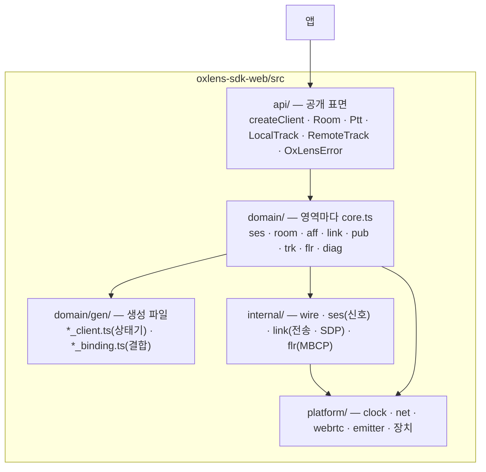
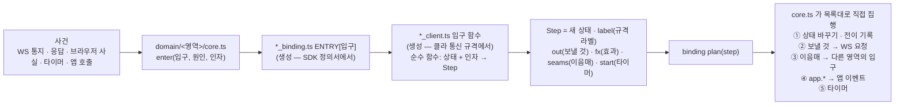
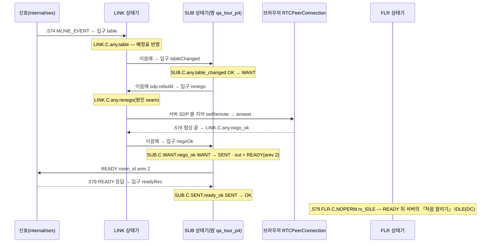

# 07. SDK 안쪽 — 생성 상태기 · 결합 · 집행

> author: kodeholic (powered by Claude) · created: 2026-11-03.
> ★**대조한 커밋** — SDK `oxlens-sdk-web` `c14dfe8`.
> ★**실측 회차** — 01 · 03 · 05 장의 탐침 회차에 찍힌 SDK 전이.

## 0. 한 줄 목적

**앞 장들의 SDK 전이 줄(`SUB.C.WANT.nego_ok` 같은)이 SDK 안에서 어디서 나오고, 통지 하나가 어떻게 여러 상태기를 건너 `READY` 가 되는가.**

## 1. 층 — 위에서 아래로만

- 의존은 위에서 아래 한 방향뿐이고, `npm run arch` 가 어기면 게이트를 빨갛게 한다(CONTRIBUTING).
- 영역 나눔은 클라 통신 규격의 장과 같다 — 세션(SES) · 방(ROOM) · 소속(AFF) · 미디어 연결(LINK) · 구독(SUB) · 발행(PUB) · 트랙(TRK) · 발언권(FLR).

## 2. 상태기 한 걸음 — 생성 · 결합 · 집행

- **상태기는 생성 파일이다.** 규격 저장소의 클라 통신 규격 원천에서 상태기(`*_client.ts`)를, SDK 정의서 원천에서 결합(`*_binding.ts`)을 짓는다 — 「손으로 고치지 않는다」가 파일 머리에 있다. 같은 원천에서 TLA+ 검증 모형도 짓는다(서버 README 「How it is built」).
- **입구 함수는 순수 함수다.** 지금 상태와 인자를 받아 `Step` 을 돌려줄 뿐, 소켓도 타이머도 건드리지 않는다. 받을 수 없는 사건이면 `null` — SDK 는 그것을 「받지 않는 사건」으로 적는다(`impossible`).
- **집행은 손으로 쓴 `core.ts` 가 직접 한다.** 콜백을 주입하지 않는다 — `plan()` 이 돌려준 목록(보낼 것 · 이음매 · 이벤트 · 타이머)을 차례대로 부른다. 그래서 흐름을 소스에서 따라갈 수 있다(SDK `domain/aff/core.ts` `enter` · `step` 이 가장 짧은 본보기).
- **전이 기록이 `Step.label` 이다.** 앞 장의 SDK 전이 줄 `SUB qa_tour_p4 WANT → SENT | nego | SUB.C.WANT.nego_ok` = 영역 · 키 · 이전 → 새 상태 · 원인 · 규격 라벨. 앱은 `client.diagnostics.on('transition', …)` 으로 같은 줄을 받는다.

## 3. 이음매 — 통지 하나가 상태기 셋을 건넌다(01 실측)

A 가 B 의 마이크 줄(`MLINE_EVENT arev 2`)을 받고 `READY` 를 보내기까지, A 의 SDK 안에서 일어난 일이다.

- **이음매(seam)** — 한 영역의 걸음이 다른 영역에 사건을 넘기는 것. 어느 영역의 어느 입구로 가는지는 생성 파일이 정한다(예: `sub_client.ts` 의 `SEAMS = { 'sdp.rebuild': { to: 'LINK', react: ['CRenego'] } }`). 그래서 「SUB 가 바뀌면 SDP 를 다시 짓는다」가 손 코드의 판단이 아니라 규격의 줄이다.
- 같은 순간 방(ROOM)과 트랙(TRK)도 걸었다 — `TRACK_EVENT` → `ROOM.C.JOINED.delta_apply_track` → `TRK.C.any.track_event` → 줄이 서면 앱에 `track`(01 §3-5).

## 4. 영역마다 상태

| 영역 | 상태(생성 파일의 타입) | 앞 장에서 본 전이 |
|---|---|---|
| SES | 연결 `DISCONNECTED · CONNECTING · ACTIVE · RESUMING` · 소켓 · 기다리는 응답 · 백오프 칸 | `SES.C.CONNECTING.bind_ok`(01) · `SES.C.any.drop_carry` · `SES.C.RESUMING.resume_ok`(05) |
| ROOM | 방 `NONE · JOINING · JOINED · LEAVING` · 보관본 `seq` · `epoch` | `ROOM.C.JOINING.join_ok` · `ROOM.C.JOINED.resume_snapshot`(05) |
| AFF | 발행 방 · 기다리는 응답 `NONE · SELECT · DESELECT · JOIN` · 옮길 방 | `AFF.C.PUB.switch_same` · `AFF.C.PUB.res_moved`(04) |
| LINK | 복구 단계 `OK · WAIT · CHECK · RESTART · APPLY · REOPEN · REBUILD · NONE` · ICE · DC | `LINK.C.any.renego_queued`(01) · `LINK.C.any.table_carried_old`(05) |
| SUB | 방마다 READY `NONE · WANT · SENT · OK` | 위 §3 |
| PUB | 트랙마다 `IDLE · STAGED · REGISTERED · SENDING` · 반이중 | `PUB.C.STAGED.pub_ok`(01) · `PUB.C.REGISTERED.floor_open`(03) |
| TRK | 트랙 층 · muted | `TRK.C.any.track_event`(01) |
| FLR | 방마다 `NOPERM · PREQ · PERM · PREL · QUEUED …` | `FLR.C.NOPERM.press` · `FLR.C.PREL.rx_ACK_release`(03) |

## 5. 손 코드가 맡는 것 — 생성 파일 밖

- **브라우저와의 손잡이** — getUserMedia · RTCPeerConnection · DC · 엘리먼트 가시성(`platform/` · `internal/link`). 상태기는 「협상이 끝났다」 같은 사실만 입구로 받는다.
- **서버 쪽 SDP 짓기** — 서버가 SDP 를 안 주므로 `server_config` · 배정표로 SDK 가 짓는다(`internal/link/sdp.ts` · 01 §3-2).
- **wire 부호화** — WS 프레임 8바이트 머리(`internal/ses/signaling.ts`) · MBCP(`internal/flr` · `internal/wire/floor_codec.ts` — 이것은 생성 파일).
- **앱 표면** — `api/` 의 핸들이 사건을 앱 말로 옮긴다(`track` · `trackUnreachable` · `session` · `ptt.state` …).

## 6. 스스로 확인하는 질문

1. 전이 줄의 라벨(`SUB.C.WANT.nego_ok`)은 누가 정했나?

규격이다. 생성 상태기의 `Step.label` 이 그대로 찍힌다. 클라 통신 규격의 SUB 장 표에서 같은 라벨을 찾으면 그 줄의 조건 · 동작 · 근거가 나온다.

2. MLINE_EVENT 를 받은 SDK 가 READY 를 보내기로 한 판단은 어디에 있나?

손 코드가 아니다 — SUB 상태기의 `negoOk` 입구가 `out = READY` 를 돌려준다. 손 코드(`core.ts`)는 그 목록대로 보낼 뿐이다. 그 앞의 「배정표가 바뀌면 SDP 를 다시 짓는다」도 이음매 `sdp.rebuild` 로 생성 파일에 있다.

