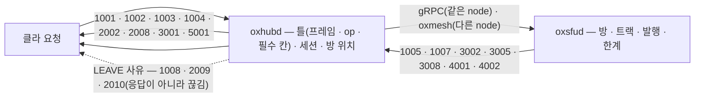
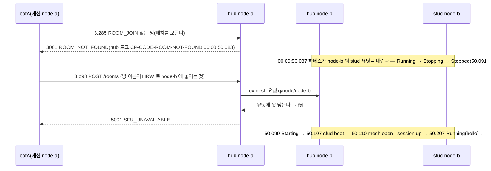

# 08. 실패와 거절 — 번호 하나에 뜻 하나 · 누가 어디서 거절하나

> author: kodeholic (powered by Claude) · created: 2026-11-04.
> ★**대조한 커밋** — 서버 `oxlens-sfu` `45fc07d` · 2층 하네스 `oxlens-labs` `8a0bff9`.
> ★**실측 회차** — 2층 하네스(헤드리스 봇)의 시나리오 `adv_wire_reject` · `adv_authz` · `adv_resource` · `adv_node_down` 한 회차씩. 봇이 일부러 어긋나게 보내고 서버가 어느 사유로 거절하는지 받아 적었다.
> 01~07 은 전부 성공 경로다. 이 장은 거절 응답(`flags=10`) · 끊김 사유(`LEAVE`) · 한계 · 서버 사정이 실제로 어떤 번호로 오고, 그 번호를 hub 가 찍는지 sfud 가 찍는지를 본다. 시각은 봇이 시작한 뒤 경과 초다.

## 0. 한 줄 목적 · 등장인물

**틀린 요청 · 권한 없는 요청 · 한계를 넘는 요청 · 서버가 못 닿는 요청이 각각 어떤 번호로 돌아오고, 그 번호만 보고 클라가 무엇을 해야 하는지 알 수 있는가.**

| 이름 | 실제 값 | 무엇 |
|---|---|---|
| `adv_wire_reject` | botA · botB(2pc) · botC(1pc) 가 한 방에 든 뒤 botA 가 탐침 19발을 쏜다 | 사유 표 — 한 연결로 닿는 것 · `BIND` 전에만 닿는 것 · HTTP 로만 닿는 것 |
| `adv_authz` | botADV(방 X) 가 안 들어간 방 Y 에 발행 · botB · botC(방 Y) 는 정상 | 권한 — 거절 + 대상 무변 |
| `adv_resource` | botADV 가 한 요청에 트랙 300 · botADV2 가 8개씩 5번 | 한계 — 요청당 · 사람당 누적 |
| `adv_node_down` | botA · botB 가 방에 든 뒤 하네스가 **다른 node 의 sfud 유닛**을 내린다 | 서버 사정 — 모르는 방(3001) 과 못 닿는 node(5001) 를 가른다 |

## 1. 큰 그림 — 앞자리가 「무엇을 고쳐야 하나」다



- **응답 실패는 `flags=10` 프레임 하나다** — `{code, name, permanent, details?}`([연:ERR.type.Failure](../protocol/11-err.md#ERR.type.Failure)). 번호 앞자리가 할 일을 정한다: 1xxx 클라 버그(고치기 전엔 같다) · 2xxx 신원(새 토큰) · 3xxx 지금 상태에서 안 된다(상태를 바꾸고 다시) · 4xxx 한계(줄이거나 기다린다) · 5xxx 서버 사정(기다렸다 다시) — [연:ERR.band.1](../protocol/11-err.md#ERR.band.1) ~ [연:ERR.band.5](../protocol/11-err.md#ERR.band.5).
- **번호 하나에 뜻 하나다.** 같은 번호 공간을 응답과 `LEAVE` 사유가 함께 쓴다 — `1008` · `2009` · `2010` 은 응답이 아니라 서버가 끊을 때 실어 보내는 사유다([연:RULE-ERR-ONE-NUMBER-ONE-MEANING](../protocol/11-err.md#RULE-ERR-ONE-NUMBER-ONE-MEANING)).
- **hub 가 먼저 거른다.** 프레임 · op · 필수 칸 · 세션 · 방 위치는 hub 가 보고, sfud 까지 안 간다. 방 안의 일(트랙 · 코덱 · 한계)은 sfud 가 판정하고 hub 는 그 실패를 그대로 돌려준다. ★어느 쪽이 판정했든 hub 로그에 `CP-CODE-<이름>` 한 줄이 찍힌다(`oxhubd/src/ses/mod.rs` — 실패 응답을 내보내는 자리).

## 2. 사유 표 — `adv_wire_reject` 19발(4.39 ~ 5.64초 · 55ms 간격)

| 보낸 것 | 코드 · 이름 | `permanent` | 누가 판정 | 이 회차 |
|---|---|---|---|---|
| op `0x7FFF`(없는 op) | `1001 UNKNOWN_OP` | ✔ | hub(`ses/conn.rs` — sfud 에 넘기기 전) | 4.390 |
| `ROOM_JOIN{room_id: 12345}`(형이 틀림) | `1002 INVALID_PAYLOAD` | ✔ | hub(`ses/mod.rs` — 로그 `msg=room_id`) | 4.442 |
| `ROOM_JOIN{}`(필수 칸 없음) | `1003 MISSING_FIELD` | ✔ | hub | 4.495 |
| `ROOM_JOIN` 없는 방 | `3001 ROOM_NOT_FOUND` | ✗ | hub(방 위치 표에 없다 — `room_route`) | 4.547 |
| `PUBLISH_TRACKS` video 인데 `codec` 없음 | `1005 CODEC_REQUIRED` | ✔ | sfud(`details.supported` 에 지원 코덱 전량) | 4.604 |
| `PUBLISH_TRACKS remove` 남의 `track_id` | `3005 TRACK_NOT_FOUND` | ✗ | sfud | 4.660 |
| `TRACK_SET{muted, duplex}` 둘 다 | `1007 FIELD_CONFLICT` | ✔ | sfud(`ops/media.rs` `track_set` — 로그 `msg="muted xor duplex"`) | 4.717 |
| `BIND{client_ver: 99}` | `1004 VERSION_MISMATCH` | ✔ | hub — ★연결이 아예 안 선다 | 4.776 |
| `BIND` 위조 토큰 | `2002 TOKEN_INVALID` | ✔ | hub | 4.834 |
| HTTP `/auth/token` 틀린 비밀 | `2004 INVALID_API_KEY` | ✔ | hub HTTP | 4.891 |
| HTTP `/auth/token` 계정이 허용 안 한 `hidden` | `2005 CLAIM_NOT_ALLOWED` | ✔ | hub HTTP | 4.947 |
| HTTP `/auth/token` `participant_type: 9` | `1002 INVALID_PAYLOAD` | ✔ | hub HTTP | 5.000 |
| HTTP `GET /rooms` 세션 헤더가 없는 세션 | `2008 SESSION_NOT_FOUND` | ✗ | hub HTTP | 5.056 |
| WS text 프레임(바이너리여야 한다) | `1008 PROTOCOL_ERROR` | — | hub · ★`LEAVE` 사유 — 끊긴다 | 5.113 |
| 같은 신원으로 다시 `BIND` | `2010 DUPLICATE_SESSION` | — | hub · ★옛 연결이 `LEAVE` 를 받는다(새 것이 성공) | 5.382 |
| 운영 `cut` | `2009 SESSION_REVOKED` | — | hub · `LEAVE` 사유(로그 `SES.S.drop_reclaim cause=cut`) | 5.445 |
| 1pc 가 자기 다운링크 SSRC 로 발행 | `3008 SSRC_COLLISION` | ✔ | sfud(한 BUNDLE 의 SSRC 공간) | 5.503 |
| HTTP 확인값이 낡음(C 평면) | `3009 PRECONDITION_FAILED` | ✗ | hub HTTP(`409`) | 5.563 |
| 정원 1 방에 둘째 입장 | `4001 ROOM_FULL` | ✗ | sfud(`details.capacity`) | 5.637 |

- 19발 전부 기대 코드와 같았다(`reject_probe` 기록의 `expect` = `got_code`). 응답은 모두 ms 안이다 — 55ms 간격은 하네스가 둔 것이다.
- `1002` 와 `1003` 은 op 를 가리지 않는다 — 칸이 없으면 `1003`, 있는데 형이 틀리면 `1002`([연:RULE-ERR-ONE-NUMBER-ONE-MEANING](../protocol/11-err.md#RULE-ERR-ONE-NUMBER-ONE-MEANING)). HTTP 의 `participant_type: 9` 도 같은 `1002` 다.
- `2010` 은 뒤에 온 사람이 이기는 축출이다 — 로그에 `dupprobe` 의 `SES.S.bind_new` 가 둘 찍히고 앞 세션이 `SES.S.drop` 된다. 「세션 중복은 실패가 아니라 축출」([연:ERR.band.2](../protocol/11-err.md#ERR.band.2) 의 `2007` 폐기 사유).

hub 로그(한 줄씩 — `CP-CODE-<이름>` · `op=` · 칸 이름이 `msg=`):
```
23:49:28.455 proc=hub kind=ev spec=CP-CODE-INVALID-PAYLOAD session=16b68012 user=botA op=ROOM_JOIN msg=room_id
23:49:28.508 proc=hub kind=ev spec=CP-CODE-MISSING-FIELD  session=16b68012 user=botA op=ROOM_JOIN msg=room_id
23:49:28.559 proc=hub kind=ev spec=CP-CODE-ROOM-NOT-FOUND session=16b68012 user=botA op=ROOM_JOIN
23:49:28.617 proc=hub kind=ev spec=CP-CODE-CODEC-REQUIRED session=16b68012 user=botA op=PUBLISH_TRACKS
23:49:28.731 proc=hub kind=ev spec=CP-CODE-FIELD-CONFLICT session=16b68012 user=botA op=TRACK_SET msg="muted xor duplex"
23:49:29.457 proc=hub kind=ev spec=SES.S.drop_reclaim   session=0c1d3a7b user=cutprobe from=live+bound to=- cause=cut
23:49:29.517 proc=hub kind=ev spec=CP-CODE-SSRC-COLLISION session=e0bf3e14 user=botC op=PUBLISH_TRACKS
23:49:29.650 proc=hub kind=ev spec=CP-CODE-ROOM-FULL      session=16b68012 user=botA op=ROOM_JOIN
```

## 3. 권한 — 안 들어간 방에 발행(`adv_authz`)

```
0.395 botADV send PUBLISH_TRACKS room_id roomY(안 들어감) audio ssrc 2902458369
0.400 botADV recv PUBLISH_TRACKS {code 3002, name NOT_IN_ROOM, permanent false}     ← 5ms
0.400 botB   send PUBLISH_TRACKS room_id roomY(정상)
0.403 botB · botC recv TRACK_EVENT add(botB 의 트랙) · botC MLINE_EVENT arev 2 · READY
```
- 거절은 `3002`(지금 상태에서 안 된다 — 들어가고 다시). `2006 NOT_AUTHORIZED` 가 아니다 — 그것은 토큰의 `permission` 비트가 막은 종류를 올릴 때다([연:ERR.band.2](../protocol/11-err.md#ERR.band.2)).
- ★**대상이 안 변했다** — botC 가 받은 트랙은 botB 것 하나뿐이고, botADV 의 SSRC `2902458369` 는 botC 의 수신에 한 패킷도 없다(하네스 등식 `authz_denied` · `isolation`). hub 로그 `CP-CODE-NOT-IN-ROOM … op=PUBLISH_TRACKS`.

## 4. 한계 — 트랙 수(`adv_resource`)

```
0.563 botADV  send PUBLISH_TRACKS tracks[300]
0.580 botADV  recv {code 4002 TRACK_LIMIT, details {current 300, limit 8}}        ← 17ms · 요청당 8
0.580 botADV2 send PUBLISH_TRACKS tracks[8]   → 0.583 ok · track_id 8개
0.583 botADV2 send PUBLISH_TRACKS tracks[8]   → 0.587 ok · track_id 8개 (누적 16)
0.587 botADV2 send PUBLISH_TRACKS tracks[8]   → {code 4002, details {current 24, limit 16}}   ← 누적 16 을 넘는다
      … 같은 거절 둘 더(5번 중 3번 거절)
```
- 한계는 둘이다 — 요청당 8 · 사람당 활성 16([연:ERR.band.4](../protocol/11-err.md#ERR.band.4) `4002` — `details.limit` · `details.current`). `current` 는 「받아들이면 되는 수」(16 + 8 = 24)다.
- ★**일부도 안 받는다** — 300 을 보내면 8 만 받아 주는 것이 아니라 전체 거절이다. 정상 봇 botB · botC 의 발행 · 수신은 그대로다.
- hub 로그 `CP-CODE-TRACK-LIMIT` 넷(botADV 하나 · botADV2 셋).

## 5. 서버 사정 — 모르는 방과 못 닿는 node(`adv_node_down`)



- **`3001` 과 `5001` 은 다른 말이다.** 배치를 **모르는** 방(방 위치 표에 없다)은 `3001` — 클라는 「방이 없다」고 안내하면 된다. 배치는 아는데 그 node 에 **못 붙는** 것이 `5001` — 기다렸다 다시다([연:ERR.band.5](../protocol/11-err.md#ERR.band.5)). 하네스는 같은 이름으로 유닛을 내리기 전 · 뒤 두 번 물어 이 둘을 가른다.
- ★**관문은 빈 성공으로 답하지 않는다** — node-b 의 hub 가 제 sfud 에 못 닿으면 그 실패를 그대로 `fail` 로 답한다. 안 그러면 「방은 없는데 `POST /rooms` 가 201」이 된다(서버 정의서 node 간 요청 규칙 — 구판에서 실제로 났던 일).
- 유닛 하나가 죽어도 node 는 살아 있다 — hub-b 는 그대로고 supervisor 가 120ms 만에 새 유닛을 띄운다(12 장 §3-2). 그 창에 그 node 의 방으로 온 요청만 `5001` 이다.

## 6. `LEAVE` 사유 — 응답이 아니라 끊김

| 사유 | 언제 | 클라가 할 일 |
|---|---|---|
| `1008 PROTOCOL_ERROR` | 프레임 손상 · text 프레임 · 크기 초과 · 묶인 소켓의 둘째 `BIND` | 클라 버그 — 다시 붙지 않는다 |
| `2001 NOT_BOUND` | `BIND` 전에 다른 op | 클라 버그([연:SES.S.pre_bind_other](../protocol/03-ses.md#SES.S.pre_bind_other) — 응답 없이 끊는다) |
| `2009 SESSION_REVOKED` | 운영자가 끊었다(`cut`) | 세션 폐기 · 붙어도 된다 |
| `2010 DUPLICATE_SESSION` | 같은 신원이 다른 데서 들어왔다 | 붙지 마라 |
| `4006` · `4007` · `4008` | ACK 30초 · 밀림 1,000 · 아무것도 안 보냄 30초 | 흐름 제어 — [연:RULE-TRN-FLOW-CONTROL](../protocol/02-trn.md#RULE-TRN-FLOW-CONTROL) |
| `5004 SERVER_SHUTDOWN` | 서버가 내려간다 | 백오프로 같은 곳에 |

이 회차는 `1008` · `2009` · `2010` 셋을 쐈다. 끊김 뒤의 복구 사다리는 05 장이다.

## 7. 소스 · 규격 좌표

| 무엇 | 서버 | 규격 |
|---|---|---|
| 코드 표(번호 · 이름 · `permanent`) | `crates/oxsig/src/code.rs` | [연:ERR.band.1](../protocol/11-err.md#ERR.band.1) ~ [연:ERR.band.5](../protocol/11-err.md#ERR.band.5) · [연:ERR.type.Failure](../protocol/11-err.md#ERR.type.Failure) |
| hub 가 거르는 것 — op · 틀 · 필수 칸 · 방 위치 | `oxhubd/src/ses/conn.rs`(`UnknownOp`) · `ses/mod.rs`(`room_id` 검사 · `room_route` → `3001`) | [연:RULE-ERR-ONE-NUMBER-ONE-MEANING](../protocol/11-err.md#RULE-ERR-ONE-NUMBER-ONE-MEANING) |
| 실패 응답 로그 `CP-CODE-*` | `oxhubd/src/ses/mod.rs` | — |
| sfud 가 판정하는 것 — 코덱 · 트랙 · 한계 · 배타 | `oxsfud/src/ops/media.rs`(`publish` · `track_set` · `subscribe_layer`) | [연:PUB.op.PUBLISH_TRACKS](../protocol/07-pub.md#PUB.op.PUBLISH_TRACKS) · [연:RULE-PUB-SET-EXCLUSIVE](../protocol/07-pub.md#RULE-PUB-SET-EXCLUSIVE) |
| node 간 요청 실패 → `5001` · `5002` | `oxhubd/src/bus/mod.rs` `call` · `query` · `ops/mod.rs` `answer` | — |

## 8. 스스로 확인하는 질문

<details><summary>1. 같은 사람이 폰과 PC 에서 동시에 들어오면?</summary>

뒤에 온 쪽이 이긴다. 새 `BIND` 가 성공하고 앞 연결이 `LEAVE 2010` 을 받는다. 앞 연결은 다시 붙지 말아야 한다 — 붙으면 또 뒤 연결을 쫓아낸다.
</details>

<details><summary>2. `3001` 을 받았다. 서버가 죽은 건가?</summary>

아니다. hub 가 그 방의 위치를 모른다는 뜻이고, 서버는 멀쩡하다. 서버가 못 닿는 것은 `5001` 이고 그때는 기다렸다 다시 보낸다. 둘을 합치면 앱이 「방이 없다」고 잘못 안내한다.
</details>

<details><summary>3. 트랙 300 개를 보냈더니 `4002` 다. 8 개는 받아 줬나?</summary>

아니다 — 전체 거절이다. `details.limit 8` 로 나눠 다시 보내야 하고, 사람당 활성 16 도 넘지 못한다(그때의 `details.current` 는 「받아들이면 되는 수」다).
</details>
