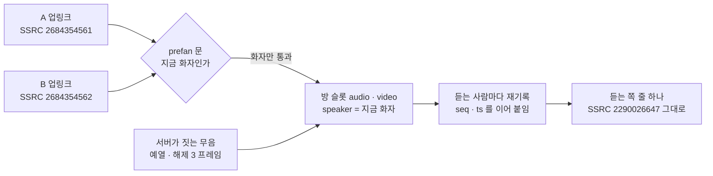
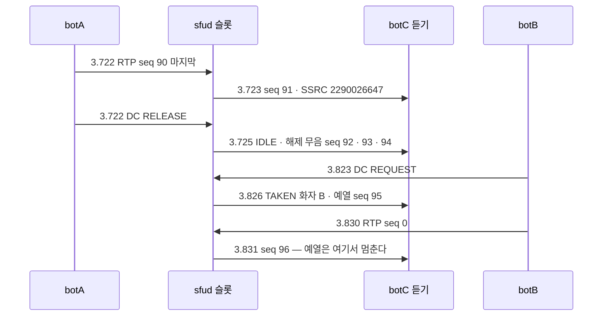
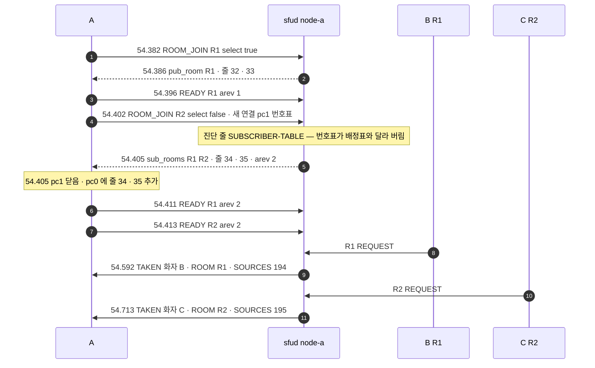
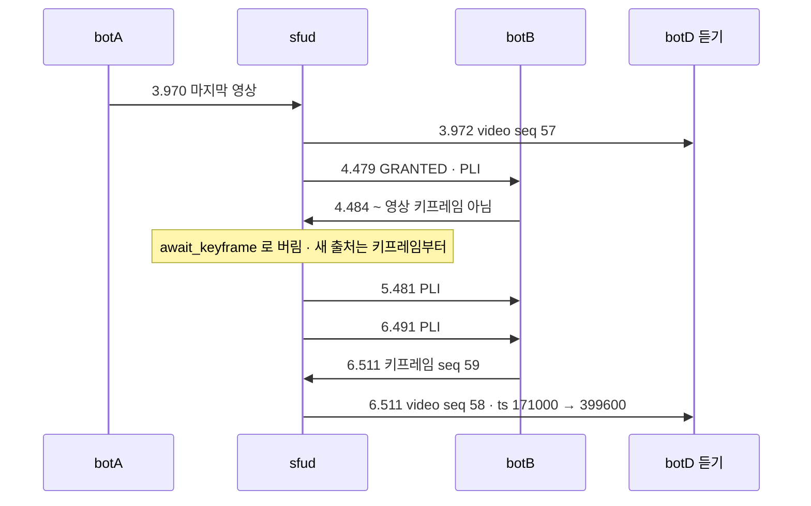

# 08. 슬롯 · 화자 — 줄 하나로 여러 화자 · 출처 표지 · 다방 청취 · 발언 방 바꾸기

> author: kodeholic (powered by Claude) · created: 2026-11-09.
> ★**대조한 커밋** — 서버 `oxlens-sfu` `c3642e8` · SDK `oxlens-sdk-web` `9f40557`(+탐침) · 2층 `oxlens-labs` `fc584ff`
> ★**실측 회차** — 3층 `tour-learn-20261109`(탐침 `TOUR-08`) · 2층 `e2e-20261109-070257`(`ptt_voice_seam` · `csrc_ptt_av` · `csrc_conf_av` · `ptt_stale_nack` · `ptt_multiroom` · `ptt_scope_relay`). 값은 돌릴 때마다 바뀌고, 차례 · 모양은 같다.

## 1. 30초 요약



- 무전 방은 오디오 · 비디오 **슬롯** 하나씩을 갖는다. 입장하면 듣는 사람마다 슬롯 줄(1pc 에서 mid 32 · 33)이 실리고, **화자가 몇 번 바뀌어도 그 줄의 SSRC · mid 는 그대로**다 — 화자 전환에 신호도 재협상도 없다.
- 「누가 말하나」는 패킷이 아니라 발언권 통지(`TAKEN`)가 준다. 패킷 하나하나의 신원이 필요한 받는 쪽(녹음 · 녹화)은 `source_tag` 를 켜고 **CSRC** 로 받는다.
- 한 사람이 여러 방을 듣고(다방 청취) 말할 방 하나를 고른다(`AFFILIATION`). 같은 서버의 방은 연결 하나에 줄만 는다.

## 2. 등장인물 · 값

| 이름 | 값 | 무엇 |
|---|---|---|
| 3층 A | `tourmulti_A` | R1 에 말하기 · R2 에 듣기로 들어간 뒤 말할 방을 R2 로 바꾼다 |
| 3층 B · C | `tourmulti_B` · `tourmulti_C` | R1 · R2 에서 말하는 사람 |
| R1 · R2 | `qa_tourmulti_p5` · `qa_tourmulti_p6` | 둘 다 node-a · 1pc |
| 2층 봇 | `ptt_voice_seam` botA · botB(화자) · botC(듣기) · `csrc_ptt_av` 같은 꼴 + botC 만 `source_tag:true` | 2pc |

| 잰 것 | 값 |
|---|---|
| 화자 전환 동안 듣는 쪽 오디오 SSRC(`ptt_voice_seam` botC) | `2290026647` 하나 · seq 0 → 186 구멍 없음 |
| 앞 화자 마지막 패킷 → 해제 무음 3 → 예열 1 → 새 화자 첫 패킷 | 3.723 → 3.725 · 3.746 · 3.770 → 3.826 → 3.831 |
| 출처 번호(CSRC) — `csrc_ptt_av` | A 오디오 64 · 비디오 65 · B 오디오 66 · 비디오 67 |
| 말할 방 바꾸기(같은 서버) `AFFILIATION` 왕복 | 55.295 → 55.301 = **6ms** |
| 새 화자 첫 키프레임까지 듣는 쪽 영상 공백(`ptt_stale_nack` · 앞 화자 마지막 영상부터) | 3.972 → 6.511 = **2.54초** |

## 3. 정상 길

### 3-1. 화자가 바뀌어도 줄 하나 — 경계의 패킷

2층 `ptt_voice_seam` — A 가 3.722 에 놓고 B 가 3.823 에 누른다. 듣는 botC 의 오디오 줄:

| 경과 | 보낸 쪽 | 듣는 쪽 seq | ts | 크기 | 무엇 |
|---|---|---|---|---|---|
| 3.723 | A seq 90 | 91 | 87360 | 51 | A 의 마지막 소리 |
| 3.725 · 3.746 · 3.770 | 서버 | 92 · 93 · 94 | 88320 · 89280 · 90240 | 31 | ★해제 무음 3 프레임(opus 무음 `f8 ff fe`) |
| 3.826 | 서버 | 95 | 92976 | 31 | ★예열 — 쉼에서 허가로 갈 때 |
| 3.831 | B seq 0 | 96 | 93936 | 51 | B 의 첫 소리 |



- **seq 는 「마지막」 바로 뒤로 구멍 없이**, **ts 는 지난 서버 시각만큼** 잇는다 — 3.770 → 3.826 = 56ms, ts 90240 → 92976 = 2736 틱(= 57ms × 48). 듣는 브라우저 입장에서는 한 사람이 잠깐 쉬었다 다시 말한 것과 같다. 오프셋 하나로 잇는 재기록기 자체는 [04](04_PACKET_PATH.md) 몫이다([연:RULE-LINK-SOURCE-SWITCH](../protocol/09-link.md#RULE-LINK-SOURCE-SWITCH)).
- **해제 무음 3 프레임**은 놓은 순간 지터 버퍼를 조용히 닫고, **예열**은 허가 순간부터 화자의 첫 RTP 가 문을 지날 때까지 20ms 마다 무음을 넣어 버퍼를 데운다(최대 250 프레임). 여기서는 B 의 첫 RTP 가 5ms 만에 와서 한 프레임으로 끝났다. 둘 다 **화자 본인에게는 안 보낸다**(자기 소리가 되돌아오지 않게).
- 예열은 **쉼(IDLE)에서 허가로 갈 때만**이다 — 줄에서 넘겨받는 승계([07 §3-4](07_FLOOR.md))는 슬롯이 이미 흐르고 있어 예열 없이 새 화자 RTP 로 잇는다.
- 슬롯 트랙 둘은 방이 생길 때 생기고 방이 없어질 때까지 남는다 — 입장 응답부터 목록에 있고 반이중 발행이나 화자가 슬롯을 만들거나 지우지 않는다([연:RULE-TRK-SLOT-LIFE](../protocol/06-trk.md#RULE-TRK-SLOT-LIFE)). 반이중 발행은 트랙 목록에 안 오른다.

### 3-2. 화자 아닌 사람의 소리는 문에서 버린다

서버 `fwd/mod.rs` `forward` 의 반이중 갈래는 패킷마다 「이 사람이 지금 슬롯 화자인가」를 본다. 아니면 `prefan_gate` 로 세고 버린다. 그래서 허가 전에 마이크가 새거나, 놓은 뒤 늦게 도착한 앞 화자 패킷은 듣는 쪽에 가지 않는다. 화자 결합 · 해제는 판정 번호를 들고 다녀서, 집행 차례가 뒤바뀌어도(앞 사람 해제가 새 사람 결합 뒤에 닿아도) 슬롯은 판정 차례의 결과를 갖는다(`flr/bind.rs` `Slot::apply`).

### 3-3. CSRC 화자 표지 — 패킷마다 「누구 것인가」

2층 `csrc_ptt_av` — botC 만 `BIND` 에 `"source_tag": true` 를 실었다. botC 의 오디오 슬롯 줄(SSRC `247369899` 하나):

```
 1.732 seq 0    csrc []    len 31   ← 예열(서버가 지음)
 1.751 seq 1    csrc [64]  len 55   ← A 오디오
 5.719 seq 185  csrc [64]  len 55   ← A 마지막
 5.732 seq 186  csrc []    len 31   ← 해제 무음 ×3(186 · 187 · 188)
 6.232 seq 189  csrc []    len 31   ← 예열
 6.236 seq 190  csrc [66]  len 55   ← B 오디오
10.231 seq 377  csrc []    len 31   ← 해제 무음 ×3
```
비디오 슬롯 줄(SSRC `3591667892`)도 같다 — A 구간 CSRC 65 · B 구간 67 · seq 0 → 695 구멍 없음.

- 대응표는 `TAKEN` 의 `SOURCES` 가 준다 — 화자 A 의 `TAKEN` 이 `[64, 65]`, B 의 것이 `[66, 67]` 을 실었다([연:RULE-FLR-SLOT-SOURCES](../protocol/10-flr.md#RULE-FLR-SLOT-SOURCES)). 반이중 발행은 트랙 목록에 없어 거기서 찾을 수 없기 때문이다. 전이중은 트랙 목록 항목의 `csrc` 가 같은 값이다 — `csrc_conf_av` 에서 `TRACK_EVENT` 의 `csrc` 41 · 42 · 43 · 44 가 패킷 CSRC 와 같았다([연:RULE-TRK-CSRC](../protocol/06-trk.md#RULE-TRK-CSRC)).
- ★**패킷 경계는 통지가 아니라 CSRC 가 정한다.** 통지와 미디어는 순서 약속이 없다 — 받는 쪽은 통지로 「번호 → 사람」만 배우고 어느 패킷이 누구 것인지는 패킷의 CSRC 로 가른다. **CSRC 가 없는 패킷 = 서버가 지은 것**(예열 · 해제 무음)이다.
- 켜지 않은 연결은 늘 CC = 0 이다 — 같은 회차의 botA · botB 는 CSRC 를 한 번도 받지 않았다. 지금 브라우저 SDK 는 켜지 않는다(3층 `BIND` 응답 `"source_tag":false`). 켜는 쪽은 녹음 · 녹화 · 에이전트(서버사이드 SDK — [16](16_OXPEER.md))다([연:RULE-SES-SOURCE-TAG-SESSION](../protocol/03-ses.md#RULE-SES-SOURCE-TAG-SESSION)).
- 출처 번호는 **그 미디어 서버 안에서** 트랙마다 다르고 트랙이 사는 동안 같다 — 같은 3층 회차에서 B · C · A 의 반이중 트랙이 194 · 195 · 196 을 받았다(방이 달라도 한 서버라 겹치지 않는다).

### 3-4. 다방 청취 — 같은 서버의 둘째 방은 줄만 는다



- **연결은 방마다가 아니라 미디어 서버마다 하나다.** 둘째 입장 앞에 SDK 가 새 연결(pc1)로 번호표 offer 를 지어 보내지만, 그 서버와 연결이 이미 있으면 서버는 번호표를 버리고(진단 줄 `SV-IMPL-SUB-SUBSCRIBER-TABLE … ignored`) SDK 는 pc1 을 닫는다. 그 뒤로는 pc0 하나에 R2 슬롯 줄 34 · 35 가 붙는다([연:RULE-ROOM-JOIN-START](../protocol/04-room.md#RULE-ROOM-JOIN-START)).
- `READY` 는 **방마다 하나**다 — 협상은 연결 단위로 한 번이지만 확인은 방 단위다([연:RULE-SUB-READY-PROC](../protocol/08-sub.md#RULE-SUB-READY-PROC)).
- 두 방의 발언권 통지가 DC 하나로 섞여 오고 `ROOM` TLV 가 가른다. 소리는 R1 슬롯(32) · R2 슬롯(34) 줄로 따로 와서 동시에 들린다 — 끝 통계 A 의 R1 슬롯 8 패킷 · R2 슬롯 8 패킷.
- 다른 node 의 방을 들으면 그 서버와의 연결이 하나 더 생긴다 — 방 위치를 정하는 길은 [13](13_MULTI_NODE.md).

### 3-5. 말할 방 바꾸기 — `AFFILIATION`

```
55.294 SDK A AFF NONE:R1 → SELECT:R1 | app | AFF.C.PUB.switch_same
55.295 WS  A send AFFILIATION {"pub_deselect":"qa_tourmulti_p5", "pub_select":"qa_tourmulti_p6", …join_id}
55.297 SRV   spec=FLR.S.ws.pub_away  room=qa_tourmulti_p5
55.297 SRV   spec=FLR.S.ws.pub_select room=qa_tourmulti_p6
55.297 SRV   spec=AFF.S.select from=qa_tourmulti_p5 to=qa_tourmulti_p6 cause=AFFILIATION
55.301 WS  A recv ok {"cause":"user","pub_room":"qa_tourmulti_p6","sub_rooms":["qa_tourmulti_p5","qa_tourmulti_p6"]}
55.304 STEP A.press.R2  →  55.337 PUBLISH_TRACKS R2 half  →  55.339 REQUEST [ROOM R2]  →  55.340 GRANTED
55.340 DC  C recv TAKEN+A [SPEAKER=tourmulti_A · ROOM=qa_tourmulti_p6 · SOURCES=000000c4]
```

- 듣는 방은 그대로 둘이고 말하는 방만 R1 → R2 로 옮겼다. 같은 서버 안이라 왕복 한 번(6ms)이다. 슬롯은 방 소유라 배관이 이미 모든 방에 있다 — 값 하나를 바꾸면 발언 방이 바뀐다([연:AFF.op.AFFILIATION](../protocol/05-aff.md#AFF.op.AFFILIATION)).
- 옛 방에 발언권 · 줄이 있었다면 옮기는 순간 그 방 `RELEASE` 와 같다([연:RULE-FLR-SERVER-EVENTS](../protocol/10-flr.md#RULE-FLR-SERVER-EVENTS)). 이 A 는 R1 에서 말한 적이 없어 옮길 발행이 없었고, R2 에서 처음 누를 때 반이중 트랙을 새로 발행했다(누름 → 허가 36ms).
- **다른 node 로 옮기면** — 2층 `ptt_scope_relay`(방 셋이 서로 다른 node)에서 botS 는 `AFFILIATION` 왕복 6ms 뒤 172ms 지나 새 서버에 `PUBLISH_TRACKS` 를 보냈고(그 서버로 발행 연결 · DC 를 옮기는 시간), 거기서 `REQUEST` → `GRANTED` 2ms 였다. 같은 업링크 SSRC 인데 방마다 출처 번호가 116 · 170 · 81 로 달랐다 — 출처 번호는 서버마다 따로 낸다.

## 4. 깨지는 길

### 4-1. 새 화자의 첫 키프레임이 늦다 — 듣는 쪽 영상 2.5초 공백

2층 `ptt_stale_nack` — B 의 봇은 일부러 첫 키프레임을 약 2초 뒤에 낸다(PLI 에 답하지 않는다). 듣는 botD 의 비디오 슬롯 줄:



- **무엇이 깨졌나** — 영상은 새 출처의 키프레임부터 싣는다(델타 프레임은 앞 화자 그림 위에 그려져 깨진다). 새 화자가 키프레임을 늦게 내면 그동안 듣는 쪽 영상 줄은 비어 있다.
- **누가 먼저 아나** — 서버. 허가 순간 화자 영상에 PLI 묶음을 걸고(0 · 500 · 1,500ms — 500ms 몫은 PLI 스로틀에 걸려 미뤄졌다, 스로틀은 [04](04_PACKET_PATH.md)), 키프레임이 아닌 패킷은 `await_keyframe` 로 세며 버릴 때마다 PLI 를 다시 요청한다.
- **무엇이 오가나** — 오디오 줄은 4.484 부터 B 의 소리를 그대로 받는다. 영상 줄은 3.972 → 6.511 동안 패킷이 없고, 다시 올 때 seq 는 57 → 58 로 구멍이 없으며 ts 는 지난 시간(2.54초 = 228600 틱)만큼 건너뛴다.
- **2.54초의 기준점** — 듣는 사람이 겪는 공백이라 ★앞 화자의 마지막 영상(3.972)부터 잰다. 같은 회차를 [04 §4-3](04_PACKET_PATH.md) 은 재기록기 쪽에서 ★새 화자의 첫 영상 패킷(4.484)부터 재어 2.03초라 적는다 — 같은 창이다.
- **사용자는 무엇을 겪나** — 새 화자의 목소리는 바로 들리는데 그림은 2.5초 늦게 나온다. 정상 브라우저는 PLI 에 바로 키프레임을 내므로 이 창은 왕복 하나 수준이다 — 이 시나리오는 그 창을 일부러 넓혀 다음 깨짐을 겨눈다.
- 같은 창에서 같은 방의 botC 가 앞 화자 구간의 옛 번호를 NACK 했고 서버는 RTX 로 답하지 않았다 — 경계 앞 NACK · 경계 앞 번호 버림은 재기록기 몫이라 [04 §4-3](04_PACKET_PATH.md) 에 있다.

### 4-2. 경계에서 늦게 온 패킷 — 이 회차로 재지 않았다

슬롯 쪽 갈래는 하나다 — ★앞 화자의 패킷이 화자가 바뀐 뒤 도착하면 슬롯 화자가 아니므로 문에서 버린다(§3-2 · `/admin/drops` `prefan_gate`). 새 화자의 패킷이 경계보다 앞 번호로 늦게 오는 갈래(`pre_boundary`)와 경계 앞 seq 의 NACK(`rtx_gate` · 경계 창 2¹⁴)은 재기록기 몫이다 — [04 §4-3](04_PACKET_PATH.md). 슬롯에서 덧붙일 사실은 하나다: 경계 앞 번호를 내보내면 출처 표지를 켠 녹음기가 같은 seq 에 출처 둘을 본다 — 그래서 그 버림이 출처 표지와 함께 들어왔다([연:RULE-LINK-SOURCE-SWITCH](../protocol/09-link.md#RULE-LINK-SOURCE-SWITCH)).

### 4-3. 다른 node 의 방을 듣는 사람에게 화자 통지가 안 온다

2층 `ptt_multiroom` — botZ 는 X 방(home)과 Y 방을 함께 듣는다. 두 방은 서로 다른 node 다.

| 경과 | 방 | 화자 | botZ 가 받은 통지 | botZ 가 받은 소리 |
|---|---|---|---|---|
| 1.794 | X | botA 허가 | `TAKEN` 화자 A (1.793) · `IDLE` 들 | X 슬롯 96 패킷 |
| 4.292 | Y | botB 허가 | **없음** — `TAKEN` · `IDLE` 0통 | Y 슬롯 97 패킷 |

- **무엇이 깨졌나** — 발언권 통지는 그 방 서버의 DC 로만 간다. botZ 는 Y 서버와 구독 연결만 있고 DC 는 home(X) 서버 연결에만 있다. Y 서버는 botZ 몫의 통지를 DC 가 설 때까지 쌓아 두고(64통 · 넘치면 오래된 것부터 버리며 `dc_backlog_full` 로 센다 — 소스 `oxsfud/src/aux/mod.rs` `dc_send`), 그 DC 는 끝내 서지 않는다.
- **누가 먼저 아나** — 오류로 아는 곳은 없다. 미디어는 정상이라 미디어 지표로 안 잡힌다. 흔적은 Y 서버 로그 하나다 — `TAKEN+A` 의 ACK 이 안 와서 T21 재전송 줄이 그 청취자에게 찍힌다:
  ```
  07:28:01.115 node=node-c proc=sfu kind=ev spec=FLR.S.P.NP_TAKEN.T21 room=ptt_mr_y_… user=botZ~ptt_multiroom from=TAKEN to=TAKEN cause=t21
  ```
- **사용자는 무엇을 겪나** — Y 방의 **소리는 들리는데 누가 말하는지 안 보인다**([연:R-FLR-TAKEN-ACK](../protocol/10-flr.md#R-FLR-TAKEN-ACK) 「없으면」). WS 로 발언권을 보내던 길을 철거할 때 받아들인 대가다 — [07 §5](07_FLOOR.md).


## 5. 왜 이 모양인가

> ★**우리만의 것 — 슬롯(화자가 바뀌어도 줄 하나)**
> - **선택 배경** — 무전 방은 화자가 바뀌는 것이 본업이다. 화자마다 줄을 열면 전환마다 m-line 이 생기고 SDP 재협상이 돈다. 그래서 방에 오디오 · 비디오 슬롯 하나씩을 두고 서버가 출처를 갈아 끼운다 — 줄 돌려쓰기의 선례는 Jitsi 의 SSRC 다시 쓰기다([연:R-SUB-FILL-WHY](../protocol/08-sub.md#R-SUB-FILL-WHY)).
> - **얻은 것** — 화자 전환에 신호 0 · 재협상 0. `ptt_voice_seam` 에서 앞 화자 마지막 → 새 화자 첫 패킷이 SSRC 하나 · seq 91 → 96 구멍 없이 이어졌고, 3층 TOUR-07 에서 L 은 두 화자를 mid 32 하나로 213 패킷 받았다([07](07_FLOOR.md)). 듣는 쪽 지터 버퍼도 한 줄이라 화자마다 새로 데우지 않는다.
> - **잃은 것** — ①패킷만으로는 누가 말하는지 모른다 — 통지(`TAKEN`)를 따로 받아야 하고, 녹음처럼 패킷마다 신원이 필요한 곳을 위해 출처 표지(CSRC)를 나중에 더했다(4바이트 · 켠 연결만). ②영상은 새 화자 키프레임까지 빈다 — 실측 2.54초(일부러 늦춘 판). ③두 사람이 동시에 말할 수 없다([연:REJ-FLR-MULTI-TALKER](../protocol/10-flr.md#REJ-FLR-MULTI-TALKER)). ④경계 근처에서 늦게 온 패킷은 버린다(`prefan_gate` · `pre_boundary`).

| 다른 길 | 버린 이유 |
|---|---|
| 화자마다 줄(전이중처럼) | 전환마다 재협상 · 듣는 쪽이 줄을 갈아 탄다 · 지터 버퍼를 매번 새로 데운다 |
| 서버가 섞어 한 줄로(믹서) | 디코드 · 재인코드 비용과 코덱 해석이 서버로 들어온다 |
| 재기록을 입력 seq 마다 범위표로 | 출처가 바뀔 때 오프셋이 부딪혀 나가는 seq 가 거꾸로 간다 — PTT 음성 끊김 실사고로 폐기(재기록기는 [04](04_PACKET_PATH.md)) |
| 출처 표지를 사설 헤더 확장으로 | 표준(RFC 3550 의 CSRC — 「SSRC 가 같아도 지금 화자를 가리키려고」)이 이미 같은 일을 한다. 대가는 CNAME 을 넘기지 않는 이탈 하나 · 4바이트 |
| 화자 표지를 통지와 맞대 경계 판정 | 통지와 미디어는 순서 약속이 없어 경계 패킷이 틀린다 — 패킷의 CSRC 가 정본([연:RULE-TRK-CSRC](../protocol/06-trk.md#RULE-TRK-CSRC)) |
| 청취자의 같은 사람 중복을 서버가 합침 | 앱이 사용자 이름으로 렌더한다 — 서버는 단순하게 둔다 |


## 6. 다른 SFU 는

★「그쪽 방식」은 소스 · 문서를 정적으로 읽은 대장과 조사 기록에서 옮겼다 — **「저쪽에는 이렇게 적혀 있다」이지 실측이 아니다.**

| 상대 | 그쪽 방식 | 우리 | 우리 쪽 장점 | 우리 쪽 대가 |
|---|---|---|---|---|
| Jitsi(JVB) | 받는 줄의 SSRC 를 다시 써 돌려쓴다 · 경주는 줄을 여유 있게 둬서 확률로 줄인다 · 음성은 「어차피 섞어 튼다」로 신원을 안 따진다(조사 기록) | 슬롯 + `READY{arev}` 로 확인된 차례 · 신원은 CSRC | 녹음처럼 섞지 않는 소비처도 패킷마다 신원을 안다 | 출처 번호 표를 우리가 낸다 |
| LiveKit · mediasoup | 녹화는 트랙 하나 = 구독 하나로 결합을 고정한다(띠 안 신원 없음) · mediasoup Consumer 는 Producer 하나에 평생 묶인다(조사 기록) | 결합이 바뀌는 것이 뼈대(슬롯 · 재배정)라 띠 안 신원(CSRC) | 줄 수가 화자 수와 무관 | 결합 고정의 단순함은 없다 |
| Google Meet 미디어 API | 프레임의 CSRC 가 참가자 신원 · SSRC 는 디버그용 · 실제 음성 전의 무음 프레임에는 CSRC 가 없다(조사 기록) | 같다 — 서버가 지은 무음은 CC = 0 | 표준 장치 그대로 | — |
| Mumble | 듣기 전용 채널 청취(`ChannelListener`)가 멤버십과 다른 축 · 권한(`Listen`)도 따로 · 방마다 음량(`Mumble §5`) · 같은 사람이 여러 경로로 오면 서버가 합친다(`§6-3`) | `sub_rooms` 로 N 방 청취 · 권한은 입장과 같다 · 합치지 않는다 | 서버가 단순 | 방마다 음량 · 청취 전용 권한이 계약에 없다 |
| SvxLink | 말할 곳 `SelectTG`(하나)와 들을 곳 `TgMonitor`(집합)를 가른다 · 선택은 30초 무활동이면 기본으로 돌아간다(`SvxLink §3`) | `pub_room` 하나 + `sub_rooms` 집합 — 같은 축 | 업계 정본과 같은 모양 | 임시 선택 · 자동 복귀가 없다 |
| JVB | 수신자가 이름으로 `include` · `exclude` 를 고른다(`JVB §5`) | 청취 단위가 방 | 단순 | 「이 방에서 이 사람만」은 못 한다 |
| Zello Work | 채널 4종 — Team · Dynamic · Hidden · Dispatch(작업 큐 → 1:1 전환) · 역할에 `listen_only` · `to`(말할 대상 제한)(조사 기록 §4-1 · §4-3) | 방 하나 종류 | 단순 | Dispatch 같은 큐형 채널 · 말할 대상 제한이 없다 |


## 7. 운영에서 보는 법

| 보고 싶은 것 | 어디서 | 실제 모양(이 회차) |
|---|---|---|
| 말할 방 · 들을 방 | 서버 로그 `spec=AFF.S.…` | `spec=AFF.S.select … from=qa_tourmulti_p5 to=qa_tourmulti_p6 cause=AFFILIATION` · 듣기 입장 `AFF.S.join_listen` |
| 옛 방 · 새 방의 발언권 입구 | `spec=FLR.S.ws.pub_away` · `FLR.S.ws.pub_select` | 위 3-5 |
| 둘째 입장의 번호표를 버림 | `kind=diag spec=SV-IMPL-SUB-SUBSCRIBER-TABLE` | `in.differs=vp9/90000:98>100 msg="1pc join number tags differ from the table, ignored"` |
| 슬롯의 지금 화자 · 트랙 출처 번호 | `GET /admin/rooms/{id}/snapshot` 의 `slots` · `tracks[].csrc` | 쉬는 방 `"slots":{"audio":null,"video":null}`(TOUR-07 · 08 끝) · 전이중 트랙 `"csrc":201`(TOUR-06 A 마이크) |
| 문 · 경계에서 버린 패킷 | `GET /admin/drops` 의 `prefan_gate` · `pre_boundary` · `await_keyframe` · `rtx_gate` | 이 회차는 계수를 읽지 않았다 |
| 클라 쪽 | SDK 전이 `AFF.C.PUB.switch_same` · `AFF.C.PUB.res_moved` · `FLR.C.any.pub_away` · `FLR.C.NOPERM.rtp_rx` · `ptt` 의 `speaker` 이벤트 | 위 3-5 |

- 슬롯 패킷 한 통 한 통은 로그에 남지 않는다 — 버림은 계수로만, 흐름은 `kind=stat` 줄로 본다. 줄 꼴과 사람 하나의 사슬을 거는 법은 [17](17_OPERATIONS.md).


## 8. 소스 · 규격 좌표

| 무엇 | 서버(`oxlens-sfu/crates`) | SDK(`oxlens-sdk-web/src`) | 규격 |
|---|---|---|---|
| 슬롯 · 문 · 출처 바꿈 | `oxsfud/src/fwd/mod.rs`(`SlotFan` · `forward` 반이중 갈래 · `send_down` 의 `await_keyframe` · `pre_boundary` · CSRC) | — | [연:RULE-LINK-SOURCE-SWITCH](../protocol/09-link.md#RULE-LINK-SOURCE-SWITCH) · [연:RULE-LINK-DOWNLINK-SSRC](../protocol/09-link.md#RULE-LINK-DOWNLINK-SSRC) |
| 재기록기 경계 · 창 | [04 §8](04_PACKET_PATH.md) | — | [연:RULE-LINK-EGRESS-REWRITE](../protocol/09-link.md#RULE-LINK-EGRESS-REWRITE) ⑤ |
| 화자 결합 · 예열 · 해제 무음 · PLI 묶음 | `oxsfud/src/ops/floor.rs`(`bind_media` · `release_media` · `push_frames` · `slot_sources` · `pli_while_bound`) · `flr/bind.rs`(`Slot::apply`) · `fwd/mod.rs`(`PRIME_FRAMES` · `SILENCE_FRAMES` · `OPUS_SILENCE`) | — | — |
| `TAKEN` 의 `SOURCES` | `oxsig/src/floor.rs`(`tlv::SOURCES` · `taken`) | `internal/wire/floor_consts.ts`(`Tlv.SOURCES`) | [연:RULE-FLR-SLOT-SOURCES](../protocol/10-flr.md#RULE-FLR-SLOT-SOURCES) |
| 소속 · 말할 방 | `oxsfud/src/ops/media.rs`(`affiliation` · `move_pub`) | `domain/aff/core.ts` | [연:AFF.op.AFFILIATION](../protocol/05-aff.md#AFF.op.AFFILIATION) |
| PLI 묶음 상수 | `oxsfud/src/rtcp/mod.rs`(`PLI_BURST_MS` · `request_pli`) | — | |

## 9. 스스로 확인하는 질문

<details><summary>1. A 에서 B 로 화자가 바뀔 때 듣는 브라우저는 재협상을 하나? 무엇이 바뀌고 무엇이 그대로인가?</summary>

안 한다. SSRC · mid · PT 가 그대로다. 바뀌는 것은 패킷의 내용(출처)뿐이고, seq 는 앞 줄 바로 뒤로 · ts 는 지난 시간만큼 이어진다(`ptt_voice_seam` seq 91 → 96 · ts 87360 → 93936). 사이에 서버가 지은 해제 무음 3 프레임과 예열 1 프레임이 끼었다.
</details>

<details><summary>2. 출처 표지를 켠 녹음기가 CSRC 가 없는 패킷을 받았다. 무엇인가? 어느 발행 파일에 넣나?</summary>

서버가 지은 패킷이다 — 예열이나 해제 무음. 어느 발행 트랙에도 넣지 않는다([연:RULE-TRK-CSRC](../protocol/06-trk.md#RULE-TRK-CSRC)). `csrc_ptt_av` 에서 seq 0 · 186~189 · 377~379 가 그랬고 길이도 31바이트로 화자 패킷(55)과 달랐다.
</details>

<details><summary>3. 새 화자의 목소리는 바로 들리는데 영상은 2.5초 늦었다. 서버는 그 사이 무엇을 했나?</summary>

키프레임이 아닌 새 화자 영상은 `await_keyframe` 로 버리고 PLI 를 보냈다(4.479 · 5.481 · 6.491). 키프레임(6.511)이 오자 그것부터 실었고 seq 는 57 → 58 로 이어졌다. 2.5초는 앞 화자 마지막 영상(3.972)부터 잰 공백이다. 그 창 안의 옛 번호 NACK 을 왜 버렸는지는 [04 §4-3](04_PACKET_PATH.md).
</details>

<details><summary>4. 같은 서버의 R1 · R2 를 듣는 A 는 연결이 몇 개이고 READY 는 몇 번 보냈나? 다른 node 의 방이면?</summary>

연결 하나(pc0) — 둘째 입장 때 번호표용 pc1 을 잠깐 만들었다 닫는다. `READY` 는 방마다 하나라 둘째 입장 뒤 R1 · R2 에 `arev 2` 로 하나씩 보냈다. 다른 node 의 방이면 그 서버와 연결이 하나 더 생긴다 — 그리고 2층 `ptt_multiroom` 처럼 그 연결에 DC 가 없으면 그 방의 화자 통지를 못 받는다.
</details>

<details><summary>5. 다방 청취자가 Y 방 소리는 듣는데 화자 이름이 안 뜬다. 어디부터 보나?</summary>

그 방이 어느 서버에 있는지와 그 서버 연결에 DC 가 열렸는지를 본다. 통지는 그 방 서버의 DC 로만 가고, DC 가 없으면 서버가 쌓아 둔 채 끝내 못 보낸다. 미디어 지표로는 안 잡힌다 — 그 방 서버 로그에서 그 사람에게 `FLR.S.P.NP_TAKEN.T21`(ACK 이 안 와 다시 보냄) 줄이 찍히는지 본다. 2층 `ptt_multiroom` 에서 botZ 는 X 방 `TAKEN` 1통 · Y 방 0통이었고 Y 서버에 그 T21 줄이 있었다.
</details>
