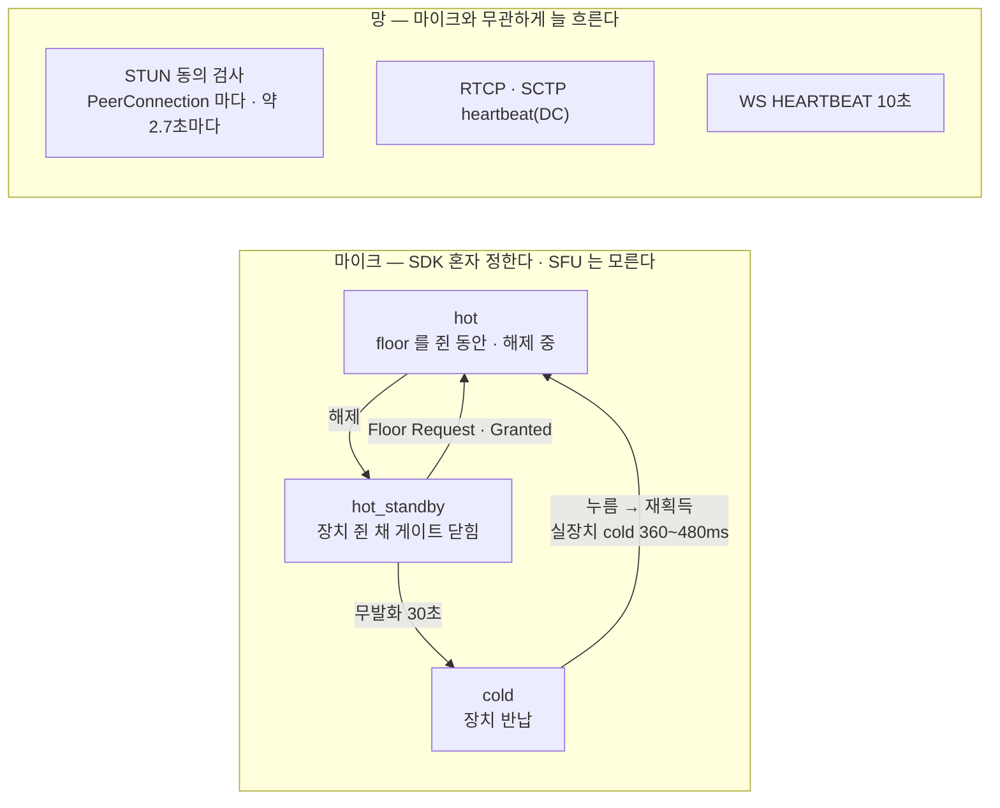
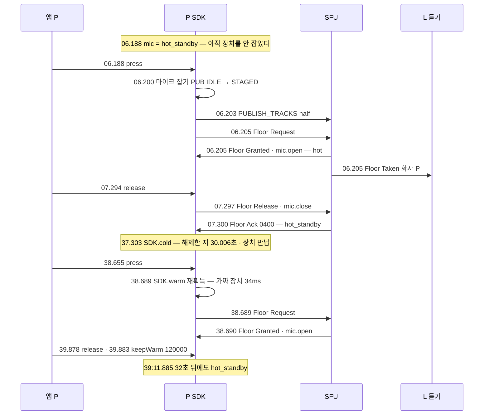
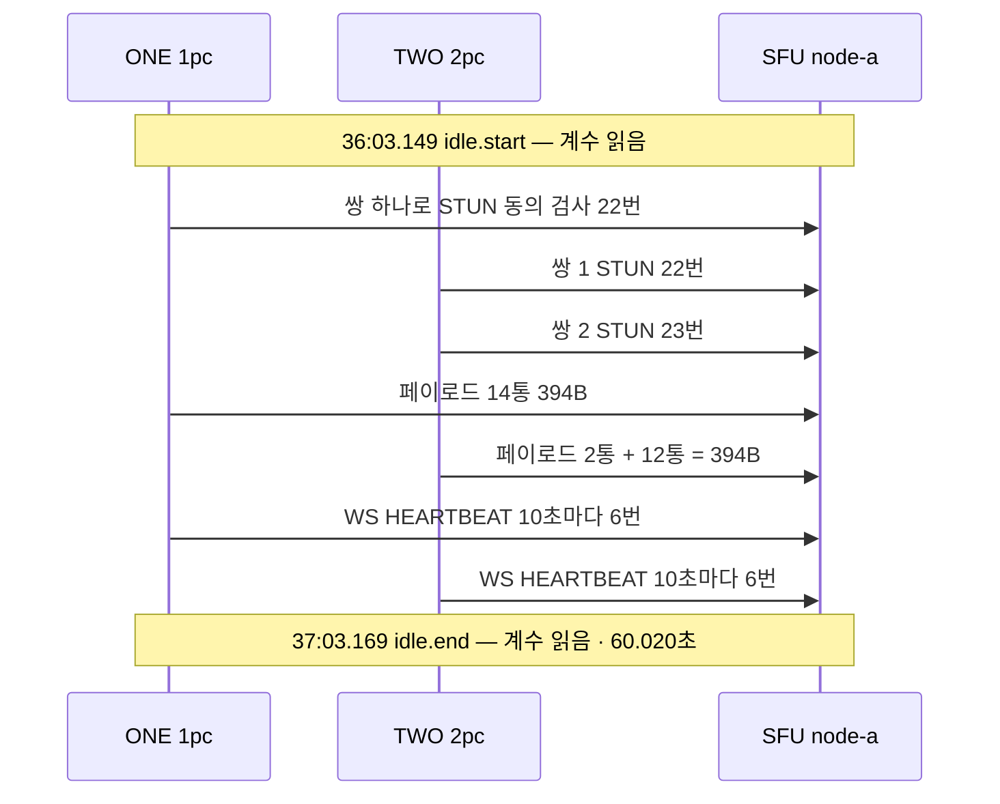
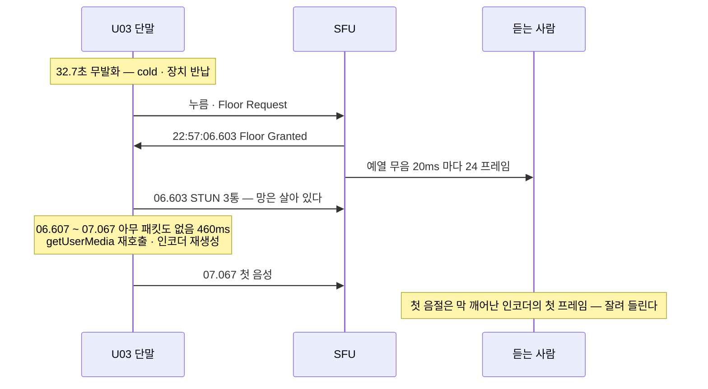

# 09. 마이크 전원 · 상시 대기 비용 — hot · hot_standby · cold 와 1pc 대 2pc

> author: kodeholic (powered by Claude) · created: 2026-11-09.
> ★**대조한 커밋** — 서버 `oxlens-sfu` `1ef7265` · SDK `oxlens-sdk-web` `de8c4a9`(+탐침) · 2층 `oxlens-labs` `a68d2de`
> ★**실측 회차** — 3층 `tour-learn` 20261109 둘째 판(탐침 `TOUR-09` · `TOUR-06` 끝 부분) · 2층 `e2e-20261109-132317`(`peer_recorder_freeze`). 실장치 재획득 시간은 20260624 실측. 값은 돌릴 때마다 바뀌고, 차례 · 모양은 같다.

## 1. 30초 요약



- 마이크는 누를 때 잡고, 30초 쉬면 OS 에 돌려준다(`cold`). 대가는 다음 첫 음절이다. 실장치에서 cold 재획득이 360~480ms 걸렸다(20260624 실측). `keepWarm(ms)` 이 반납을 미룬다.
- 마이크를 꺼도 망 keepalive 는 줄지 않는다. 그중 STUN 동의 검사(ICE consent freshness · RFC 7675)는 **PeerConnection 수만큼** 나간다. 60초 동안 1pc 22번 · 2pc 45번이었다. 그래서 1pc 를 지향한다.
- STUN 을 뺀 나머지(RTCP · DC 를 싣는 SCTP 의 heartbeat)는 1pc 와 2pc 가 **같았다**(보냄 394B · 받음 130B). 1pc 가 줄이는 것은 STUN 몫이다. 규격 문장도 「상시 비용 반」에서 「STUN 몫 반」으로 고쳤다(20261109 고침 · 지금 실측과 맞음).

## 2. 등장인물 · 값

| 이름 | 값 | 무엇 |
|---|---|---|
| ONE | `touridle_ONE` · 1pc · 듣기 | PeerConnection 하나 |
| TWO | `touridle_TWO` · 2pc · 듣기 | 발행 PeerConnection(DC 만) + 구독 PeerConnection |
| 방 | `qa_touridle_p2` · node-a | 둘 다 마이크 없음 · 발언 0 |
| P · L | `tourattr_P` 말하기 · `tourattr_L` 듣기 · 1pc | 마이크 전원 탐침(`TOUR-06` 끝 부분 · 방 `qa_tourattr_p3`) |

**입장 협상 횟수** — ONE 3 · TWO 2(모양 기준 `nego`).

- TWO 의 둘은 발행 PeerConnection 의 offer/answer 하나(`m=application` 만)와 구독 PeerConnection 의 offer/answer 하나다.
- 기준 회차(`tour-learn` 20261109 첫째 판)에서 TWO 는 3번이었다. 구독 PeerConnection 에 같은 offer 를 한 번 더 적용했기 때문이다. 2pc 는 발행 쪽을 고칠 때 구독 SDP 를 열지 않는다는 규칙과 어긋났고, SDK 에서 고쳤다(20261109 고침 · 지금 실측). 협상 차례 자체는 [02](02_CONNECT_JOIN.md) 몫이다.

**상시 대기 60.020초 — candidate pair 계수의 차(after − before)**

| | ONE(1pc) | TWO 쌍 1 | TWO 쌍 2 | TWO 합 |
|---|---|---|---|---|
| 지명된(nominated) 쌍 수 | 1 | | | 2 |
| STUN 동의 검사 보냄(`consentRequestsSent`) | **22** | 22 | 23 | **45** |
| 그 응답 받음(`responsesReceived`) | 22 | 22 | 23 | 45 |
| 페이로드 보냄 `bytesSent` · 패킷 | **394B** · 14 | 130B · 2 | 264B · 12 | **394B** · 14 |
| 페이로드 받음 `bytesReceived` · 패킷 | **130B** · 2 | 130B · 2 | 0B · 0 | **130B** · 2 |

- W3C 의 candidate-pair `bytesSent` · `bytesReceived` 는 IP · UDP 머리와 STUN 연결 검사를 빼고 센다. 그래서 STUN 은 바이트가 아니라 **횟수로** 견준다.
- 이 회차는 STUN 바이트를 재지 않았다. 그래서 kbps 총량은 이 표로 낼 수 없다.
- 페이로드의 종류(RTCP · SCTP heartbeat)는 이 회차가 가르지 않았다. TWO 의 쌍 1 은 2통을 주고받았고, 쌍 2 는 12통을 보내기만 했다. 1pc 는 그 둘이 한 쌍에 실렸다.
- STUN 동의 검사 간격은 60.020초 ÷ 22 ≈ **2.7초**다. 브라우저가 정한다 — 앱이 못 바꾼다.
- WS 는 이 표 밖이다. 두 사람 다 `HEARTBEAT` 를 10초마다 6번 주고받았다(`heartbeat_interval 10000` · [연:RULE-SES-HEARTBEAT](../protocol/03-ses.md#RULE-SES-HEARTBEAT)). 1pc 와 2pc 가 같다.

| 기록 값(20260624 · 옛 서버 · 2pc · 무발화 32.7초 pcap) | |
|---|---|
| 1 사람 합계 | **1.32 kbps** ≈ 13.5 MB/일 ≈ **406 MB/월**(host 후보만 — **하한**) |
| 나눔 | STUN **61%** · RTCP 31% · DTLS/DC 7% · RTP 음성 1% |
| cold 재획득(Floor Granted → 첫 음성) | **480 · 360 · 460ms**(무발화 32.7 · 46.4 · 60.0초 뒤) = cold 실측 360~480ms · hot_standby 는 20~60ms · 입장 직후 첫 획득(gen1)은 640ms — cold 와는 따로 센다 |

## 3. 정상 길

### 3-1. 마이크 전원 세 상태 — 실측 시각

`TOUR-06` 끝 부분이다(14:38 ~ 14:39 KST · 초.밀리초). `mic` 은 탐침이 250ms 마다 `ptt.state.mic` 를 읽은 것이다. 정확한 전이 시각은 SDK 전이 기록(`SDK.cold` · `SDK.warm`)이다.



| 상태 | 언제 | 장치 | RTP |
|---|---|---|---|
| `hot` | floor 를 쥔 동안 · 해제 중(`has_permission` · `pending_release`) | 쥠 · 게이트 열림 | 나감 |
| `hot_standby` | 그 밖 — 입장 직후(아직 안 잡음) · 해제 · 거절 뒤 | 쥠 · 게이트 닫힘 | 안 나감 |
| `cold` | 그 SFU 의 floor 가 **전부** `no_permission` 인 채 30초 | 반납(`MediaStreamTrack.stop()` — 표시등 꺼짐) | 안 나감 |

- `cold` 시계는 요청 응답을 기다리거나 **대기열에 서 있는 동안은 반납에 이르지 않는다.** 곧 말할 사람이기 때문이다.
- 거절 · 철회로 `no_permission` 에 돌아온 순간부터 30초를 다시 센다.
- 30초는 정책 값 `micColdAfterMs`(SDK 기본값 30000)다. `keepWarm(ms)` 은 그 시계를 `ms` 로 다시 건다. 지령대처럼 늘 말하는 곳에서 쓴다.
- 이 회차는 `keepWarm(120000)` 뒤 32초가 지나도 `hot_standby` 였다.
- 앱이나 외부가 소유한 트랙(`owner` 가 `sdk` 가 아님)은 내려가지 않는다. SDK 가 앱의 오디오 파이프라인을 끊지 않는다.

### 3-2. SFU 는 모른다

전원 세 상태 어느 전이에도 WS 프레임이 없다.

- 발행 트랙은 `REGISTERED` 그대로다. floor · 대기열도 그대로다.
- half-duplex 는 게이트가 열릴 때만 sender 에 소스를 얹는다(`replaceTrack` — 재발행 없음 · SSRC 그대로).
- 그래서 `cold` 에서 다시 누르면 SFU 가 보는 것은 평소와 같은 Floor Request 한 통이다(38.689). 차이는 그 앞, 클라 안에서 재획득을 기다린 시간뿐이다.

### 3-3. 상시 대기 60초 — 1pc 와 2pc 를 한 방에서

`TOUR-09` 는 ONE(1pc) · TWO(2pc)를 같은 방에 듣기로 넣는다. 5초 기다린 뒤 60초 동안 아무것도 하지 않는다. 그 앞뒤에 각자 모든 candidate pair 의 계수를 읽었다.



- STUN 동의 검사(ICE consent freshness · RFC 7675)는 **PeerConnection 마다** 돈다. 2pc 는 PeerConnection 이 둘이라 두 벌이다. 이것이 1pc 를 지향하는 이유의 실측이다([연:RULE-LINK-SDP-PC-COUNT](../protocol/09-link.md#RULE-LINK-SDP-PC-COUNT)).
- STUN 을 뺀 페이로드는 두 꼴이 바이트까지 같았다(보냄 394B · 받음 130B). PeerConnection 이 하나든 둘이든 같은 RTCP · SCTP heartbeat 가 나간다. 1pc 는 그것을 한 쌍에 실을 뿐이다.
- `tour-learn` 20261109 첫째 판과 둘째 판의 계수 차가 칸마다 같았다. 대기 중의 keepalive 는 흔들림이 거의 없다.

## 4. 깨지는 길

### 4-1. cold 에서 누르면 첫 음절이 잘린다

이 회차(`TOUR-06`)의 재획득은 34ms 였다(누름 38.655 → `SDK.warm` 38.689). 가짜 장치라 **이 숫자를 믿지 말 것.** 실장치는 20260624 의 서버 로그 · pcap 이 답한다.



- **무엇이 깨졌나** — Floor Granted 는 즉시 났는데 단말이 보낼 소리가 없다. 장치 재획득 + 인코더 재생성 + 첫 프레임이 460ms 걸렸다.
- **누가 먼저 아나** — SFU 가 예열 프레임 수로 안다. Floor Granted 에서 첫 실제 음성 사이를 20ms 마다 메운 수다. 24 프레임 ≈ 480ms, 18 ≈ 360ms, 23 ≈ 460ms 였다. 같은 날 hot_standby 에서 누른 Floor Granted 는 1~3 프레임(20~60ms)이었다.
- **사용자는 무엇을 겪나** — 듣는 사람은 예열 무음으로 공백 없이 이어 듣는다. 그러나 화자의 첫 음절이 잘린다. 예열로는 못 살린다 — 잘리는 것은 단말 안에서다.
- **처방** — 자주 말하는 곳은 `keepWarm(ms)` 으로 `cold` 를 미룬다(전력과 맞바꾼다).
- `ptt.enable()` 은 다른 일이다. 입장 뒤 **처음** 누를 때의 마이크 잡기 · half-duplex 발행을 미리 해 둔다.

### 4-2. 마이크를 꺼도 망 비용은 안 준다

`TOUR-09` 의 두 사람은 마이크가 아예 없다. 그래도 60초에 STUN 22 · 45번과 페이로드 394B 를 보냈다. 20260624 의 나눔도 같은 말을 한다. 마이크 몫(RTP 음성)은 1% 이고, 99% 가 keepalive 다.

- **왜 STUN 을 못 끄나** — 브라우저는 동의 응답이 끊기면 그 PeerConnection 으로 미디어를 멈춘다(ICE consent).
- SFU 도 확인된 STUN 이 30초 안 오면 그 트랜스포트를 `Suspect` 로 본다(소스 `oxsfud/src/link/mod.rs` `UDP_PAIR_EXPIRE_MS` 30000 · `ops/timers.rs` `liveness`).
- 2층 `peer_recorder_freeze` 는 녹음기(서버사이드 SDK) 프로세스를 35초 얼린다(SIGSTOP). 얼린 13:43:48.141 에서 28.6초 뒤 이 줄이 났다. 발행 · 구독 트랜스포트 둘 다다.
  ```
  13:44:16.778 node=node-b proc=sfu kind=ev spec=SV-STATE-PEER-STATE user=oxpeer~peer_recorder_freeze area=LINK key=publish from=Alive to=Suspect cause=pair_expired
  13:44:16.778 node=node-b proc=sfu kind=ev spec=SV-STATE-PEER-STATE user=oxpeer~peer_recorder_freeze area=LINK key=subscribe from=Alive to=Suspect cause=pair_expired
  ```
- 얼림이 풀리자 STUN 이 다시 와서 6.4초 뒤 `Suspect → Alive` 로 돌아왔다(13:44:23.142). 그 뒤 복구는 [10](10_RECOVERY.md) 몫이다.
- **사용자는 무엇을 겪나** — 종일 켜둔 단말에서 말을 안 해도 데이터 요금이 나간다.
- 웹은 동의 검사 간격 · 후보 수 · RTCP 간격을 못 만진다. PeerConnection 수를 줄이는 것(1pc)이 웹에서 쥘 수 있는 유일한 손잡이다.

### 4-3. 대기열에 선 동안 cold 에 들어가면 — 이 회차로 재지 않았다

규격이 적은 증상이다. 대기열에 선 동안 30초가 지나 장치를 반납하면, **Floor Granted 를 받는 순간** 재획득이 걸려 첫 음절이 잘린다(— — 20261103 코드 읽기에서 드러났다).

- 규격이 적은 360~640ms 는 20260624 표 전체 범위다(입장 직후 첫 획득 640ms 포함). cold 재획득 실측만 보면 360~480ms 다.
- 지금 SDK 는 반납 직전에 확인한다. 그 SFU 의 floor 중 하나라도 「곧 말할」 상태(요청 응답 대기 · 대기열)면 반납하지 않고 시계를 다시 건다(`domain/pub/local.ts` `goCold`).

## 5. 왜 이 모양인가

> ★**우리만의 것 — 무전 상시 대기를 1pc 로**
> - **선택 배경** — 무전 단말은 종일 켜두는 물건이다. 그래서 말하는 시간보다 **기다리는 시간의 비용**이 지배한다. 그 비용의 대부분이 PeerConnection 마다 나가는 keepalive 다(20260624 2pc 실측 — STUN 61% · RTCP 31% · DTLS/DC 7% · 음성 1%). 그래서 발행 · 구독을 PeerConnection 하나에 싣는 1pc 를 지향점으로, 2pc 를 호환 기준선으로 둔다([연:RULE-LINK-SDP-PC-COUNT](../protocol/09-link.md#RULE-LINK-SDP-PC-COUNT)). 1pc 와 2pc 의 방향 · SDP 는 [02](02_CONNECT_JOIN.md).
> - **얻은 것** — 60초 무발화에 **STUN 동의 검사 22번 대 45번**, 반이다(`TOUR-09`). 2pc 에서 가장 큰 몫(61%)이 STUN 이었으니 그 몫이 그대로 반이 된다. 2pc 는 입장 협상도 PeerConnection 마다 한 번씩 든다(이 회차 TWO 2번).
> - **잃은 것** — ①**STUN 밖의 몫은 줄지 않았다.** 페이로드는 1pc · 2pc 모두 보냄 394B · 받음 130B 로 같았다. 그래서 규격 문장을 「상시 비용 반」에서 「STUN 몫(61%) 반」으로 고쳤다(20261109). ②**그래도 무전 전용 프로토콜보다 크다.** STUN 과 IP · UDP 머리를 빼고 페이로드만 세도 시간당 약 31kB((394 + 130)B × 60)다. Zello 가 밝힌 대기 소비(시간당 20kB · 0.044 kbps)보다 많다. Zello 는 ICE · RTCP · DTLS 가 아예 없다. ③마이크 절전의 대가는 첫 음절이다(실장치 cold 재획득 360~480ms · 입장 직후 첫 획득 640ms 는 따로 센다).

| 다른 길 | 버린 이유 |
|---|---|
| `cold` 때 PeerConnection 도 닫는다 | keepalive 는 0 이 되지만 말할 때 ICE + DTLS 를 다시 세워야 한다. 이미 460ms 인 재획득에 수백ms~초가 더 붙는다 |
| 동의 검사 · RTCP 간격을 늘린다 | 웹에서는 브라우저 몫이라 못 한다. 늘리면 끊김을 늦게 안다 — 네이티브 SDK 에서 쥘 손잡이다 |
| 마이크를 늘 `hot_standby` 로 | 첫 음절은 지키지만 장치 점유 · 전력이 계속 나간다 — 앱이 원하면 `keepWarm` 으로 고른다 |
| SFU 에 마이크 상태를 알린다 | SFU 가 쓸 데가 없다. floor · 발행 상태가 그대로라 중재에 영향이 없다 |


## 6. 다른 SFU 는

★「그쪽 방식」은 소스를 정적으로 읽은 대장과 공개 문서 조사에서 옮겼다. **「저쪽에는 이렇게 적혀 있다」이지 실측이 아니다.**

| 상대 | 그쪽 방식 | 우리 | 우리 쪽 장점 | 우리 쪽 대가 |
|---|---|---|---|---|
| Zello Work | 자체 프로토콜 — ICE · RTCP · DTLS 없음 · 대기 시간당 20kB(0.044 kbps) · 관리자가 keep-alive 간격(모바일 · WiFi 따로) · 「기기를 깨워 연결 유지」 · 「모바일은 TCP 만」(데이터를 줄이지만 지연이 는다)을 원격으로 민다(조사 기록 §5-2 · §5-3 · §5-4) | WebRTC 표준 그대로 · 1pc 로 PeerConnection 수만 줄인다 | 브라우저에서 설치 없이 돈다 · 암호 · 혼잡 제어를 표준으로 얻는다 | 대기 비용이 크다 · 단말 전력 손잡이(기기 깨우기)가 웹에는 없다 |
| mediasoup | ICE Lite 서버 · 동의 검사 시한을 앱이 정한다(`iceConsentTimeout` 기본 30초 · 범위 10~60, `mediasoup §8-2`) | SFU 는 확인된 STUN 30초로 트랜스포트 생존을 본다(소스 상수) | 같은 축 | 값이 설정이 아니라 상수다 |
| Janus | ICE 표면이 가장 넓다 — `ice_consent_freshness` · `ice_keepalive_conncheck` 를 설정으로 켠다(`Janus §1-3`) | 브라우저가 보내는 동의 검사에 답한다 | — | 서버 쪽 keepalive 손잡이가 없다 |
| Mumble | 클라가 발화를 판정한다(VAD · PTT 키 · 짧게 두 번 누르면 떼도 유지) — 마이크 전원 축은 대장에 없다(`Mumble §9-1`) | SFU 권위 floor control + SDK 마이크 전원 셋 | 전원이 floor 상태를 보고 내려간다(대기열에 선 동안 안 내려감) | — |


## 7. 운영에서 보는 법

| 보고 싶은 것 | 어디서 | 실제 모양(이 회차) |
|---|---|---|
| 마이크 전원 전이 | SDK 전이 기록 — 영역 `PUB`, 라벨 `SDK.cold` · `SDK.warm`, 원인 `mic_power` | `SDK P PUB te1cea946a229fef1 REGISTERED → REGISTERED \| mic_power \| SDK.cold` |
| 지금 전원 | `ptt.state.mic`(`hot` · `hot_standby` · `cold`) | 위 3-1 |
| SFU 쪽 | **없다** — 전원 전이에 서버 로그 줄이 없다. SFU 는 floor 줄(`FLR.S.…`)과 발행 첫 RTP(`SV-STATE-PUBLISH-STATE … cause=first_rtp`)만 본다 | |
| 트랜스포트 생존(keepalive 가 끊겼을 때) | 서버 로그 `SV-STATE-PEER-STATE … from=Alive to=Suspect cause=pair_expired` · 진단 `SV-IMPL-LINK-PEER-STATE … in.dwell_ms` | 4-2 의 줄 · 진단 `in.dwell_ms=32644`(Alive 로 지낸 시간) |
| keepalive 계수 | 브라우저 `getStats()` 의 candidate-pair(`consentRequestsSent` · `bytesSent` · `bytesReceived`) | 위 2 절 표 |

- 「첫 음절이 잘린다」는 서버 로그만으로는 못 본다. 단서는 Floor Granted 줄과 그 사람의 `first_rtp` 줄 사이 간격이다. 예열이 그만큼 돌았다.
- 로그 줄 꼴 · 사람 하나의 사슬은 [17](17_OPERATIONS.md).

## 8. 소스 · 규격 좌표

| 무엇 | SDK(`oxlens-sdk-web/src`) | 서버(`oxlens-sfu/crates`) | 규격 |
|---|---|---|---|
| 전원 시계 · 반납 · 데우기 | `domain/pub/local.ts`(`armCold` · `keepWarm` · `goCold` · `warm`) | — | — |
| `ptt.state.mic` · `keepWarm` 손잡이 | `domain/flr/core.ts`(`mic`) · `api/handles.ts`(`keepWarm`) · `domain/pub/registry.ts`(`halfMicCold`) | — | — |
| 30초 기본값 | `domain/gen/sdk_defaults.ts`(`micColdAfterMs: 30000`) | — | 정책서 |
| 트랜스포트 생존(STUN 30초) | — | `oxsfud/src/link/mod.rs`(`UDP_PAIR_EXPIRE_MS` · `touch_pair` · `path_alive`) · `oxsfud/src/fwd/rt.rs`(검증된 STUN 만 `touch_pair`) · `oxsfud/src/ops/timers.rs`(`liveness`) | |
| WS `HEARTBEAT` | — | `oxhubd/src/ses/mod.rs`(`heartbeat_interval`) | [연:RULE-SES-HEARTBEAT](../protocol/03-ses.md#RULE-SES-HEARTBEAT) |
| 1pc 지향 · 대기 비용 | — | — | [연:RULE-LINK-SDP-PC-COUNT](../protocol/09-link.md#RULE-LINK-SDP-PC-COUNT) · [연:RULE-LINK-SDP-1PC](../protocol/09-link.md#RULE-LINK-SDP-1PC) |
| 탐침 계수 | `qa/qa.js`(`icePairs`) · `qa/live/tests/probe/tour_capture.spec.ts`(`TOUR-09`) | — | |

## 9. 스스로 확인하는 질문

<details><summary>1. P 가 해제하고 30초 쉬자 cold 가 됐다. 그 사이 SFU 로 무엇이 갔나?</summary>

아무것도 — 전원 전이는 SDK 안의 일이다. SFU 에게 P 는 여전히 half-duplex 트랙을 등록한 채 floor 가 없는 사람이다. 다시 누르면 SFU 는 평소와 같은 Floor Request 한 통을 본다(38.689).
</details>

<details><summary>2. 1pc 로 바꾸면 상시 대기 비용이 반이 되나?</summary>

STUN 동의 검사 횟수는 반이 된다(60초 22번 대 45번). 그러나 STUN 을 뺀 페이로드는 같았다(보냄 394B · 받음 130B). 줄어드는 것은 STUN 몫이고, 그 몫이 2pc 합계의 61%(20260624)였다. 그래서 규격 문장도 「STUN 몫 반」이다.
</details>

<details><summary>3. cold 에서 누른 사람의 첫 음절이 잘렸다. 서버 쪽 무엇으로 짐작하나?</summary>

Floor Granted 에서 그 화자의 첫 RTP 까지의 간격이다. 예열 무음이 그동안 20ms 마다 돌았다. 20260624 에 cold 재획득은 18~24 프레임 — 실측 360~480ms 였다(입장 직후 첫 획득 640ms 는 따로 센다). hot_standby 는 1~3 프레임(20~60ms)이었다. SFU 는 전원 상태를 모르니 이 간격이 유일한 단서다.
</details>

<details><summary>4. 데이터를 아끼려고 STUN 동의 검사를 멈추면 무엇이 깨지나?</summary>

브라우저는 동의가 끊기면 미디어를 멈춘다. SFU 는 확인된 STUN 이 30초 안 오면 그 트랜스포트를 `Suspect` 로 본다(`pair_expired`). 2층 `peer_recorder_freeze` 에서 프로세스를 얼린 뒤 28.6초 만에 그 줄이 났다. 웹에서는 간격을 바꿀 수도 없다. PeerConnection 수를 줄이는 것이 쥘 수 있는 손잡이다.
</details>

<details><summary>5. 2pc 청취자의 입장 협상은 몇 번이어야 맞나? 3번이 나왔다면 무엇을 의심하나?</summary>

2번이다 — 발행 PeerConnection(`m=application` 만) 하나, 구독 PeerConnection 하나. 3번이면 발행 쪽 협상 때 구독 SDP 를 다시 연 것이다. 2pc 는 발행 쪽을 고칠 때 구독 SDP 를 열지 않는다. 기준 회차가 바로 그 모양(3번)이었고, SDK 를 고친 뒤 2번이 됐다.
</details>
