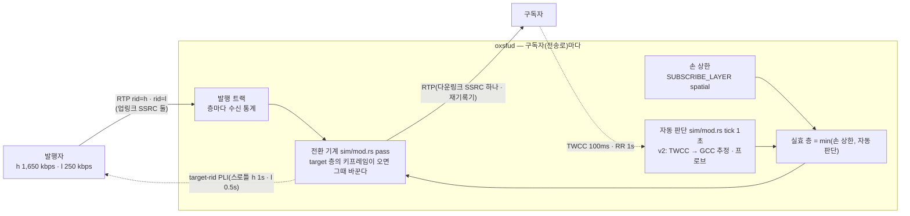
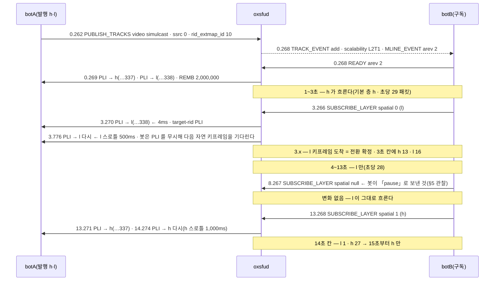

# 09. 시뮬캐스트 층 — 구독자가 고르고 · 서버가 판단하고 · 키프레임에서 바뀐다

> author: kodeholic (powered by Claude) · created: 2026-11-04.
> ★**대조한 커밋** — 서버 `oxlens-sfu` `45fc07d` · 2층 하네스 `oxlens-labs` `8a0bff9`.
> ★**실측 회차** — 2층 하네스(헤드리스 봇)의 시나리오 `sim_manual_layer` · `sim_bwe_updown` 한 회차씩. 봇은 정해진 VP8 패킷을 두 층(h · l)으로 보내고, 받은 패킷의 페이로드 표지로 어느 층이 왔는지 센다.
> 층은 RTP 안에 있어 브라우저 탐침으로는 안 보인다 — 이 장은 봇 덤프와 서버 로그로 그린다. 시각은 봇이 시작한 뒤 경과 초다.

## 0. 한 줄 목적 · 등장인물

**발행자가 영상을 두 층(h 큰 것 · l 작은 것)으로 올릴 때, 구독자 하나가 받는 층은 누가 어떻게 정하고, 바뀌는 순간에 무엇이 오가나 — 손으로 고르기(`SUBSCRIBE_LAYER`)와 서버의 자동 판단(대역 추정) 두 축.**

| 이름 | 실제 값 | 무엇 |
|---|---|---|
| botA | 발행 — VP8 시뮬캐스트 · `ssrc: 0`(서버가 첫 RTP 의 rid 로 배운다) · rid 확장 id 10 | 층 h · l 을 30fps 로 · 키프레임은 30프레임마다(PLI 를 무시한다) |
| botB | 구독 | `sim_manual_layer` 에서는 손으로 고른다 · `sim_bwe_updown` 에서는 TWCC 피드백만 보낸다 |
| 업링크 SSRC | h `3288334337` · l `3288334338`(수동 회차) | 서버가 PLI 를 보낼 때 층을 이 SSRC 로 가린다 |
| 다운링크 SSRC | `2697078915`(수동 회차 · botB 의 줄) | ★**층이 바뀌어도 하나다** — 구독자는 층을 SSRC 로 못 가린다 · 페이로드 안의 것이 바뀔 뿐 |
| `scalability` | `L2T1` | `TRACK_EVENT` 가 싣는 층 구조(공간 2 · 시간 1 — [연:TRK.op.TRACK_EVENT](../protocol/06-trk.md#TRK.op.TRACK_EVENT)) |

## 1. 큰 그림 — 두 상한의 min



- **층을 고르는 입력은 둘이다.** 구독자가 손으로 둔 상한(`spatial` 0 = l · 1 = h)과 서버의 자동 판단. 실효 층은 둘의 작은 쪽이다 — 손이 h 를 허용해도 대역이 모자라면 l 이고, 자동이 h 를 주고 싶어도 손이 l 이면 l 이다(—). 정책 `auto_layer` 가 `off` 면 자동 판단만 꺼지고 손 상한 · 전환 기계는 그대로 돈다.
- **바뀌는 순간은 키프레임이다.** target 층을 정하면 서버는 그 층의 업링크 SSRC 로 PLI 를 청하고, ★그 층의 키프레임이 도착한 패킷에서 전환을 확정한다. 그 전까지는 지금 층을 그대로 보낸다 — 구독자 화면이 멎지 않는다([연:RULE-LINK-SOURCE-SWITCH](../protocol/09-link.md#RULE-LINK-SOURCE-SWITCH)).
- **구독자 쪽에는 SSRC 가 하나다.** 재기록기가 h · l 어느 것이든 줄의 다운링크 SSRC · 이어지는 seq 로 다시 쓴다(02 장 · 01 §3-6). 구독자 디코더는 해상도가 바뀐 키프레임을 받을 뿐이다.

## 2. 손으로 고르기 — `sim_manual_layer`



| 단계 | 요청 | 서버 PLI | 받는 층이 바뀜 | 걸린 시간 |
|---|---|---|---|---|
| h → l | 3.266 | 3.270(+4ms) · 3.776 | 3.3 무렵(3초 칸에 h 13 · l 16) | 약 0.5초 안 |
| l → h | 13.268 | 13.271(+3ms) · 14.274 | 14초 칸에 l 1 · h 27 | 약 0.8초 |

- ★**바뀌는 데 걸리는 시간은 서버가 아니라 발행자의 키프레임이 정한다.** 서버는 요청 3~4ms 뒤에 PLI 를 냈다. 봇은 PLI 를 무시하고 30프레임마다만 키프레임을 내므로, 전환은 다음 자연 키프레임(최대 1초)까지 기다렸다. 브라우저 발행자는 PLI 를 받자마자 키프레임을 내 더 빠르다 — 3층 `sim_layer` 시험이 「폭이 바뀔 때까지 ≤ 3초(스로틀 창 + 인코딩 지연)」를 잰다.
- ★**PLI 가 두 번인 까닭** — 첫 PLI 뒤 target 키프레임이 안 오면 스로틀이 허락하는 가장 이른 때 다시 청한다(— ④). l 은 500ms · h 는 1,000ms 뒤다(02 §2-1 과 같은 스로틀 — 정책 `pli_throttle_low_ms` · `pli_throttle_high_ms`).
- 서버 로그에는 요청만 찍힌다 — hub `CP-OP-SUBSCRIBE-LAYER … msg=ok` 셋(00:00:13.370 · 18.371 · 23.372). 층 전환 자체는 패킷 단위라 로그가 없다 — 보려면 덤프의 페이로드 표지다.

## 3. 서버가 판단하기 — `sim_bwe_updown`(자동 v2)

봇 B 는 손 요청을 하나도 안 보낸다. 대신 TWCC 피드백(도착 시각)을 보내고, 35초부터는 도착 시각을 초당 200ms 씩 늦춰 보고한다(급성 버퍼 팽창을 합성 — 봇 `synth` 기록). 서버의 자동 판단이 층을 세 번 바꿨다:

```
23:59:14.600 botB 줄 Active(READY)                    ← 회차 시작(rel 0.28)
23:59:17.622 sfu diag "auto layer → l (loss 0.000 nack/s 0.0 drops 0 v2 true)"   ← rel 3.3  추정 부족(시작 추정 300 kbps < 수요)
   18~21초  RTX 패딩 프로브 — botB 가 받은 pt 97 패킷 1,620 + 945(초당 수백)   ← 실수신 속도를 재는 프로브
23:59:37.770 sfu diag "auto layer → h"                 ← rel 23.4  프로브 실측 ≥ 수요 → 승격
   36.4초   봇 ramp 시작(도착 지연 +200ms/s)
23:59:52.879 sfu diag "auto layer → l"                 ← rel 38.6  GCC 과사용 → 재강등
   52~54초  프로브 다시(끝)
```

| 받는 층(봇 B · 2초 칸) | 0~2 | 2~4 | 4~22 | 22~38 | 38~54 |
|---|---|---|---|---|---|
| 표지 | h | h 42 · l 16 | l | h(22초 칸 l 42 · h 15) | l |

- **강등은 빨리, 승격은 천천히.** 시작 추정이 300 kbps 라 첫 tick 에서 h 수요(1,650 kbps × headroom)에 못 미쳐 3초 만에 l 로 내려갔다. 승격은 clean 유지 + backoff(15초) 뒤 ★**프로브로 실수신을 재어 수요를 넘겼을 때만** 온다(— — 「못 잰 것은 0 이 아니라 없음」). 그래서 18초에 프로브가 돌고 23초에 h 가 섰다.
- **프로브는 구독자의 영상 줄 RTX 로 보낸다.** 봇 B 가 받은 `pt 97`(RTX PT) 패킷이 그것이다 — 실제 영상이 아니라 패딩이고, 서버가 twcc 번호를 새로 찍어 보낸 뒤 봇의 피드백에서 「받았다고 한 바이트 ÷ 도착 구간」으로 속도를 잰다.
- **재강등은 지연 기울기다.** 봇이 도착 시각을 늦추기 시작한 지 2.2초 뒤 l 로 내려갔다 — 손실 · NACK · drop 이 모두 0 인 채로(로그의 `loss 0.000 nack/s 0.0 drops 0`). v2 의 GCC(지연 기울기 추정)가 과사용을 잡은 것이고, v1 이었다면 손실이 난 뒤에야 내려갔을 것이다(— v1 · v2 차이).
- 이 회차의 RTCP — 서버 → botA: REMB 55(1초마다) · RR 108(층 둘 × 1초) · PLI 10. botB → 서버: TWCC 530(약 100ms 마다).

## 4. 3층에서 보이는 것(브라우저 발행자)

3층 시험 `sim_layer` 와 탐침 `pli_per_layer` 가 같은 축을 실 인코더로 잰다 —
- 브라우저 발행자는 PLI 에 바로 키프레임을 내므로 손 전환이 3초 안에 선다(시험의 상한). 자동 승격까지는 15초대(20261031 실측 14.4초 — backoff 15초 안).
- ★발행자 쪽 SDP 의 `x-google-per-layer-pli=1` 이 있어야 **청한 층만** 키프레임을 낸다. 없으면 l 에 청해도 h 까지 키프레임을 내고 300ms 안의 다른 층 요청은 버린다([연:RULE-LINK-SDP-PUB-MLINE](../protocol/09-link.md#RULE-LINK-SDP-PUB-MLINE) — SDK 가 시뮬캐스트 발행 answer 에 싣는다 · 탐침 실측 20261028).
- 업링크 상한(정책 `max_bitrate_bps`)이 층 합보다 작으면 발행자 송신 추정이 거기 묶여 h 가 몇 초에 한 프레임이 된다 — 3층이 그것을 잰다(기본 2,000,000).

## 5. 관찰 — 이 회차가 드러낸 것(결함 단정 아님)

- ★**2층의 「pause」 축이 죽어 있다.** 시나리오는 8초에 `pause` 를 요청하고 그 구간 수신 0 을 기대하지만, 봇은 pause 를 `spatial: null` 로 보내고(`oxe2epy/bot/bot.py` `subscribe_layer` — `{"l": 0, "h": 1}.get(rid)` 가 pause 에 None) 검증기는 `spatial` 이 0 · 1 이 아닌 요청을 ★판정 목록에서 뺀다(`verifier/loader.py` — `rid = {0: "l", 1: "h"}.get(spatial)` · `if owner and rid`). 그래서 8~13초에 l 이 초당 28 패킷 그대로 흘렀는데 `manual_layer_follows` 는 초록이었다. 와이어의 멈춤은 `paused: true` 라는 별개 칸이다([연:SUB.op.SUBSCRIBE_LAYER](../protocol/08-sub.md#SUB.op.SUBSCRIBE_LAYER) — `spatial` 은 상한 · `paused` 는 전달 정지). 서버는 옳게 동작했다(null 상한 = 상한 없음). 11 장이 브라우저 SDK 의 `paused: true` 를 실측한다.

## 6. 소스 · 규격 좌표

| 무엇 | 서버 | 규격 |
|---|---|---|
| 손 상한 · 멈춤 · 우선순위 | `oxsfud/src/ops/media.rs` `subscribe_layer` → `sub/mod.rs` `set_pref` · `sim/mod.rs` `subscribe_layer` | [연:SUB.op.SUBSCRIBE_LAYER](../protocol/08-sub.md#SUB.op.SUBSCRIBE_LAYER) |
| 전환 기계(키프레임에서) · target-rid PLI · 재요청 | `sim/mod.rs` `retarget` · `pass` | [연:RULE-LINK-SOURCE-SWITCH](../protocol/09-link.md#RULE-LINK-SOURCE-SWITCH) |
| 자동 판단 tick · 강등 4사유 · 승격 backoff · 프로브 | `sim/mod.rs` `tick` · `probe` · `on_twcc` · `sim/core.rs`(`Aimd` · `Trendline`) | — |
| 층 SSRC 배우기(ssrc 0 · rid) | `pub/mod.rs` | [연:PUB.op.PUBLISH_TRACKS](../protocol/07-pub.md#PUB.op.PUBLISH_TRACKS) |
| 층 구조 통지 | `TRACK_EVENT.scalability` | [연:TRK.op.TRACK_EVENT](../protocol/06-trk.md#TRK.op.TRACK_EVENT) |

(자동 판단의 수치 · 식은 서버 정의서가 정본이다 — 공개 규격 밖. 클라가 아는 것은 `scalability` 와 `SUBSCRIBE_LAYER` 의 세 칸뿐이다.)

## 7. 스스로 확인하는 질문

<details><summary>1. 구독자가 l 을 골랐는데 왜 0.5초나 걸렸나?</summary>

서버는 4ms 만에 l 층 SSRC 로 PLI 를 냈다. 전환은 l 의 키프레임이 와야 확정되는데, 봇 발행자는 PLI 를 무시하고 30프레임마다만 키프레임을 낸다. 브라우저 발행자였다면 PLI 직후 키프레임이 와서 훨씬 빠르다 — 전환 지연의 주인은 발행자 인코더다.
</details>

<details><summary>2. 자동 판단이 l 로 내렸는데 손실 · NACK 이 0 이었다. 무엇을 본 것인가?</summary>

v2 의 지연 기울기(GCC)다. 봇이 도착 시각을 초당 200ms 씩 늦춰 보고하자 기울기가 문턱을 넘어 과사용으로 판정했다. 손실은 그 뒤에나 날 것이고, v1 은 그때 가서야 내린다.
</details>

<details><summary>3. 구독자 브라우저는 지금 어느 층을 받는지 어떻게 아나?</summary>

SSRC 로는 모른다 — 다운링크 SSRC 는 하나다. 디코딩된 프레임의 폭(`frameWidth`)이 바뀐다. 3층 `sim_layer` 가 그것으로 판정한다.
</details>
