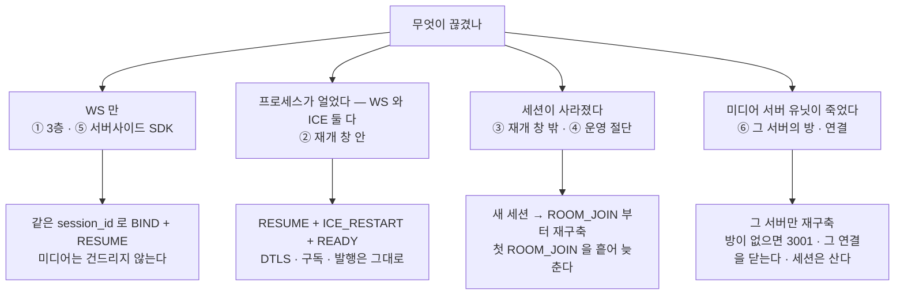
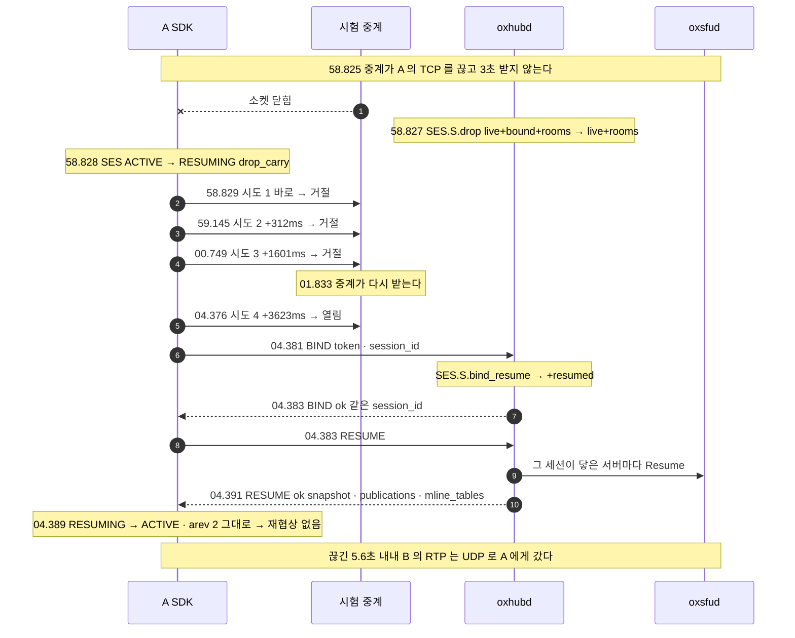
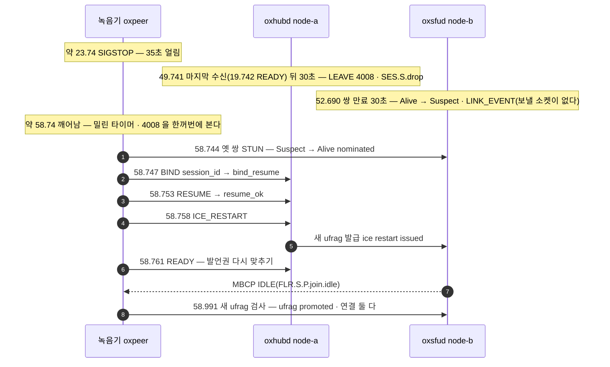
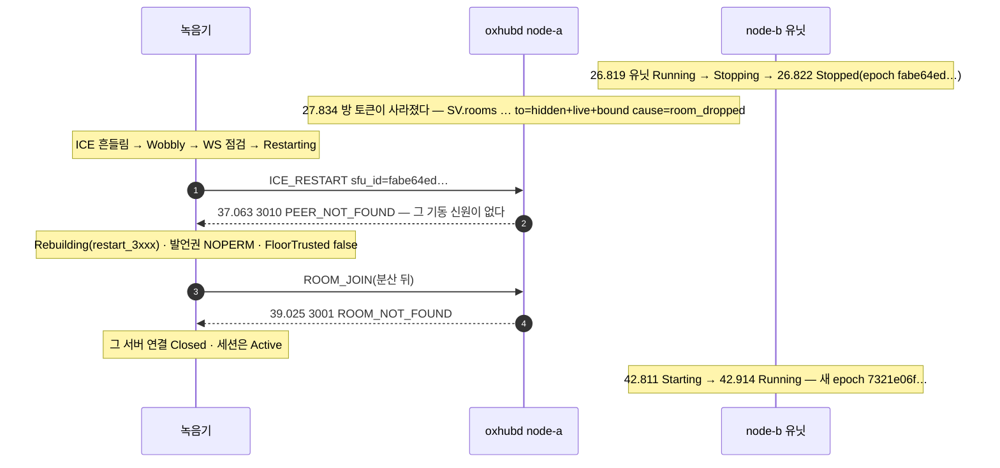

# 10. 끊김과 복구 — 끊긴 층만 고친다

> author: kodeholic (powered by Claude) · created: 2026-11-09.
> ★**대조한 커밋** — 서버 `oxlens-sfu` `c3642e8` · SDK `oxlens-sdk-web` `9f40557`(+탐침) · 2층 `oxlens-labs` `fc584ff` · oxpeer `93df1c6`
> ★**실측 회차** — 3층 탐침 `TOUR-10` 한 회차 · 2층 시나리오 `peer_recorder_*` · `peer_agent_*` · `adv_idle_survives` 한 회차씩. 값은 돌릴 때마다 바뀌고 차례 · 모양은 같다.

## 1. 30초 요약



- **끊김은 층으로 가른다** — 신호(WS) · 미디어 연결(ICE) · 세션 · 서버 상태. 가장 아래에서 고장 난 층만 고친다([연:RULE-LINK-RECOVERY-TIERS](../protocol/09-link.md#RULE-LINK-RECOVERY-TIERS)). 층이 위로 갈수록 값이 커진다.
- **실측 값** — WS 만 끊기면 왕복 한 번(10ms) · 35초 얼었다 깨면 250ms · 창 밖이면 새 세션과 재구축(0.4~3초, 대부분 일부러 흩어 늦춘 시간) · 유닛이 죽으면 그 서버의 방을 잃는다(`3001`).
- **무발화는 끊김이 아니다** — 35초 동안 한 패킷도 안 보낸 구독자가 회수되지 않았다(⑦). 생존은 미디어가 아니라 STUN · 하트비트가 붙든다.

## 2. 등장인물 · 값

| 이름 | 실제 값 | 무엇 |
|---|---|---|
| A · B(3층) | `tourcut_A` · `tourcut_B` · 방 `qa_tourcut_p0` · node-a · `1pc` | A 의 신호만 시험 중계를 지나 3.0초 끊긴다 · B 는 마이크를 켜고 A 가 듣는다 · 미디어(UDP)는 중계를 안 지난다 |
| 녹음기 | `oxpeer~peer_recorder_*` · 투명(hidden) · `2pc` | 서버사이드 SDK([16 장](16_OXPEER.md)) — 얼리고 · 끊고 · 유닛을 내리는 대상. 앞뒤로 봇이 말해 끊김이 녹음에 남는지 본다 |
| 에이전트 | `agent~peer_agent_*` · 표지 음성을 발행 | 발행자 쪽 복구 — 발행이 이어지나 · 다시 발행하나 |
| 봇 | `botA` · `botB`(발화) · `botC`(청취) | 2층 하네스 `oxe2epy` 의 헤드리스 봇 |

| 값 | 얼마 | 어디서 |
|---|---|---|
| 하트비트 주기 | 10,000ms | `BIND` 응답 `heartbeat_interval`(실측) |
| 하트비트 시한(hub) | 30,000ms — 넘으면 `LEAVE 4008` | 이 회차로 재지 않은 설정값 — `common/src/policy.rs` 기본값. 실측 drop 은 마지막 수신 30.0초 뒤(§3-3) |
| 재개 창 | 60,000ms | `BIND` 응답 `resume_window_ms`(실측). 실측 `SES.S.TWindow` 는 drop 뒤 60.01~61.01초(이 회차 서버 로그의 `drop` → `TWindow` 485 쌍) — hub 청소가 1초 주기다 |
| 재접속 사다리 | 0 · 300 · 1200 · 2700 · 4800 · 7000×5ms · 셋째 시도부터 지터 0~1000ms | [연:RULE-SES-BACKOFF-LADDER](../protocol/03-ses.md#RULE-SES-BACKOFF-LADDER) · [연:R-SES-TBIND-ADDS](../protocol/03-ses.md#R-SES-TBIND-ADDS) |
| 사다리 처음으로 | 붙은 뒤 10,000ms 안정 | [연:RULE-SES-BACKOFF-LADDER](../protocol/03-ses.md#RULE-SES-BACKOFF-LADDER)(`T-stable`) |
| UDP 쌍 만료(서버) | 30,000ms → `Suspect` + `LINK_EVENT` | `oxsfud/src/link/mod.rs` `UDP_PAIR_EXPIRE_MS` |
| 흔들림 기다림 · WS 점검 · 재시작 시한 | 2,000 · 2,000 · 5,000ms | SDK 기본값(`wobblyGraceMs` · `wsProbeTimeoutMs` · `iceRestartTimeoutMs`) — oxpeer 도 같은 원천에서 생성 |
| 재구축 첫 `ROOM_JOIN` 분산 | 0~5,000ms 균등 | [연:RULE-SES-REBUILD-JITTER](../protocol/03-ses.md#RULE-SES-REBUILD-JITTER) · 기본값 `massJitterMs` |

**끊김 사다리 — 이 장의 일곱 칸(실측)**

| 칸 | 일으킨 것 | 끊긴 것 | 누가 먼저 아나 | 잇는 길 | 걸린 시간 |
|---|---|---|---|---|---|
| ① | TCP 중계가 A 의 신호를 3.0초 막음(3층) | WS | 양쪽 1ms 안(TCP 닫힘) | `BIND`(session_id) + `RESUME` | 끊김 → `ACTIVE` 5.56초(망 없음 3.01 + 사다리 대기 2.54) |
| ② | 녹음기 프로세스 35초 얼림 | WS + ICE | hub(30초 하트비트) · sfud(30초 쌍 만료) | `RESUME` → `ICE_RESTART` → `READY` | 깨어남 → 재시작 끝 250ms |
| ③ | 95초 얼림 | 세션 | hub — 재개 창 만료(`TWindow`) | 새 `BIND` → 재구축 | 깨어남 → 연결 수립 428ms(분산 409ms 포함) |
| ④ | 운영 절단 `/admin/users/{user}/cut` | 세션 | 서버(운영자) → `LEAVE 2009` | 새 `BIND` → 재구축 → 에이전트는 다시 발행 | 녹음기 2.99초 · 에이전트 0.78초(대부분 분산) |
| ⑤ | WS 만(녹음기 · 에이전트) | WS | 양쪽 | `BIND` + `RESUME`(첫 칸) | drop → `resume_ok` 10ms · 12ms |
| ⑥ | 방을 든 미디어 유닛을 내림 | 그 서버의 방 · Peer | hub(방 토큰 1.0초) · SDK(ICE) | `ICE_RESTART` → `3010` → 재구축 → `3001` → 그 연결 닫음 | 유닛 정지 → `3001` 12.2초 · 세션은 산다 |
| ⑦ | 35초 무발화(발행 0) | 없음 | — | STUN consent · `HEARTBEAT` | 회수 0 · 받은 패킷 1600 |

## 3. 정상 길 — 사다리 일곱 칸

### 3-1. ① 신호만 끊김 — `RESUME` 한 번(3층 `TOUR-10`)



```
58.827 SRV   proc=hub spec=SES.S.drop session=2fd1fc9a user=tourcut_A from=live+bound+rooms to=live+rooms cause=drop in.c=0
58.828 SDK A SES session ACTIVE → RESUMING | ws.close | SES.C.any.drop_carry
04.381 SRV   proc=hub spec=SES.S.bind_resume session=2fd1fc9a from=live+rooms to=live+bound+rooms+resumed cause=BIND
04.388 SRV   proc=hub spec=SES.S.resume_ok session=2fd1fc9a
04.389 SDK A SES session RESUMING → ACTIVE | RESUME.res | SES.C.RESUMING.resume_ok
04.391 SDK A TRK qa_tourcut_p0 - → - | ROOM.C.JOINED.resume_snapshot | TRK.C.any.snapshot_same
04.391 SDK A LINK 8701a55ebcdd350f OK → OK | table | LINK.C.any.table_carried_old
```

- **미디어는 끊긴 적이 없다.** 서버가 A 에게 내보낸 수(stat 줄 `packets_sent`)는 B 가 마이크를 켠 57.32 부터 끊김 한가운데인 01.254 까지 196 — 초당 50 그대로 — 이고, 06.254 에 449 다. A 가 받은 B 의 소리는 499 패킷 · 감춘 표본(`concealed`) 0 이다. 끊긴 것은 제어(통지 · 요청)뿐이다.
- **사다리 칸** — 기다림은 300 · 1200 · 2700ms 에 지터가 붙은 값이다(셋째 시도 +401 · 넷째 +923ms). 망은 01.833 에 돌아왔지만 다음 칸(04.376)까지 2.54초를 기다렸다 — §4-4.
- **`RESUME` 은 조회다** — 응답은 `snapshot`(나 · 참가자 · 트랙) · `publications`(A 는 발행이 없어 `[]`) · `mline_tables`(`arev 2` · 줄 셋) 셋이다. SDK 는 서버마다 셋을 대조한다([연:RULE-SES-RES-RESUME-OK](../protocol/03-ses.md#RULE-SES-RES-RESUME-OK)) — 미디어 연결이 살아 있나 · 내 방이 스냅샷에 다 있나 · 내 발행이 `publications` 에 다 있나. 셋 다 참이고 `arev` 가 그대로라 재협상도 `READY` 도 없다.
- **B 는 아무것도 못 느꼈다** — 끊긴 동안 B 에게 `PARTICIPANT_EVENT` 가 하나도 안 갔다. 세션 · 방 소속은 재개 창 동안 hub 에 남는다(`live+rooms`).

### 3-2. ⑤ WS 만 — 서버사이드 SDK 도 같은 길

녹음기(방은 node-c 의 sfud · 세션은 node-a 의 hub):

```
07:27:27.021 node-a proc=hub spec=SES.S.drop        session=0c609836 user=oxpeer~peer_recorder_ws_cut from=hidden+live+bound+rooms to=hidden+live+rooms cause=drop in.c=0
07:27:27.025 node-a proc=hub spec=SES.S.bind_resume session=0c609836 from=hidden+live+rooms to=hidden+live+bound+rooms+resumed cause=BIND
07:27:27.031 node-a proc=hub spec=SES.S.resume_ok   session=0c609836
```

- drop → `resume_ok` 10ms. 시험 중계가 다시 붙는 연결을 바로 받아 사다리 첫 칸(0ms)에서 붙었다. ★**sfud 로그에는 그 사이 한 줄도 없다** — 미디어 서버는 신호가 끊긴 줄 모른다.
- 끊김은 botA 발언 한가운데(2.5초)였다. 녹음 파일 하나에 botA 발언이 seq 1~183 · 183 패킷 · 잃은 0 으로 이어 들어갔다 — 발언권(DC)과 미디어(UDP)는 끊긴 적이 없다.
- 에이전트(`peer_agent_ws_cut`) — 세션 `Resuming` → `Active` 13ms · hub drop → `resume_ok` 12ms. 발행은 `publications` 와 맞대 그대로 두고 다시 발행하지 않았다(`published` 하나). 청취 봇은 100ms 넘는 수신 공백이 없다(600 패킷 · 0.718~12.699초).

### 3-3. ② 재개 창 안에서 프로세스가 35초 얼었다 — `RESUME` + ICE 재시작



- **누가 먼저 아나** — hub 가 먼저(하트비트 시한 30초, 49.741) · sfud 가 3초 뒤(UDP 쌍 30초, 52.690). 얼어 있는 녹음기는 아무것도 모른다.
- **깨어나서 무엇을 하나** — 깨어남은 사건이다([연:RULE-LINK-RECOVERY-WAKE](../protocol/09-link.md#RULE-LINK-RECOVERY-WAKE)). 밀린 타이머를 시한 초과로 세지 않고 처음부터 다시 판정한다. 녹음기 사건 차례: 연결 `Restarting` → 세션 `Resuming`(사유 `4008 HEARTBEAT_TIMEOUT` — hub 가 끊기 전에 보낸 `LEAVE` 를 깨어나 읽었다) → `Active` → 연결 `Up`.
- **ICE 재시작은 왜** — 녹음기 사건 차례에서 연결 `Restarting`(시도 1)이 세션 `Resuming` 보다 먼저 나온다 — 깨어난 연결 층이 제 ICE 상태로 재시작을 골랐다. 서버 쪽 옛 쌍은 깨어난 약 3ms 뒤 STUN 으로 `Alive` 에 돌아왔지만 재시작은 그대로 갔다. 재시작은 DTLS · 구독 · 발행 · 발언권을 그대로 두고 자격만 바꾸는 싼 칸이다([연:R-SES-ICE-RESTART-WHY](../protocol/03-ses.md#R-SES-ICE-RESTART-WHY)) — 이 회차 234ms(발급 58.757 → 승격 58.991).
- **`READY` 를 다시 보낸 까닭** — 끊긴 동안의 DC 통지는 재전송되지 않는다. 방마다 `READY` 를 다시 보내 서버가 지금 발언권 상태(`IDLE`)를 처음 알리듯 보내게 한다([연:RULE-LINK-RECOVERY-RESYNC](../protocol/09-link.md#RULE-LINK-RECOVERY-RESYNC)).
- 깨어난 뒤 botB 발언이 139 패킷 · 잃은 0 으로 녹음됐다. `rebuilt 0` — 재구축 없이 이어받았다.

### 3-4. ③ 재개 창 밖 — 95초 얼림 → 세션 재구축

```
07:24:53.299 node-a proc=hub spec=SES.S.drop    session=915c6956 from=hidden+live+bound+rooms to=hidden+live+rooms cause=drop
07:24:56.256 node-a proc=sfu spec=SV-STATE-PEER-STATE session=915c6956 key=publish from=Alive to=Suspect cause=pair_expired
07:25:53.869 node-a proc=hub spec=SES.S.TWindow session=915c6956 from=hidden+live+rooms to=- cause=TWindow      ← drop 뒤 60.57초
07:25:53.873 node-a proc=sfu spec=SV-STATE-PEER-STATE session=915c6956 key=publish from=Suspect to=- cause=session_gone
07:26:02.306 node-a proc=hub spec=SES.S.bind_new session=fcdedaa8 from=- to=hidden+live+bound cause=BIND          ← 깨어난 약 8ms 뒤 · 새 세션
07:26:02.716 node-a proc=hub spec=CP-OP-ROOM-JOIN session=fcdedaa8 msg=ok                                        ← 분산 409ms
07:26:02.726 node-a proc=sfu spec=SV-RULE-LINK-TRANSPORT session=fcdedaa8 msg="transport ready (dtls+srtp) publish"
```

- 깨어난 녹음기는 끊긴 줄 모르고 보관한 `session_id` 로 `BIND` 했다 → 서버는 그 세션을 이미 버렸다 → 응답의 `session_id` 가 다르다. 이것이 세션 재구축의 방아쇠 ②다([연:RULE-SES-REBUILD](../protocol/03-ses.md#RULE-SES-REBUILD)) — `RESUME` 을 아예 안 보낸다.
- 재구축 차례 — 발언권을 `has no permission` 으로 내리고 · 방 보관본을 버리고 · 미디어 연결을 전부 닫고 · `ROOM_JOIN` 부터 다시. 첫 `ROOM_JOIN` 은 0~5초 균등으로 흩어 늦춘다 — 이 회차 409ms.
- 녹음기 연결 흐름 `Connecting → Up → Restarting → Closed → Connecting → Up` · `joined 2` · `rebuilt 1`. 다음 botB 발언 140 패킷 · 잃은 0.

### 3-5. ④ 운영 절단 — `LEAVE 2009` → 재구축 · 에이전트는 다시 발행

```
07:27:05.988 node-a proc=hub spec=SES.S.drop_reclaim session=01c8dd31 user=oxpeer~peer_recorder_session_cut from=hidden+live+bound+rooms to=- cause=cut
07:27:05.993 node-a proc=hub spec=SES.S.bind_new     session=4eed56c3 user=oxpeer~peer_recorder_session_cut cause=BIND   ← 5ms
07:27:08.969 node-a proc=hub spec=CP-OP-ROOM-JOIN    session=4eed56c3 msg=ok                                              ← 분산 2,975ms(sfud 가 ROOM_JOIN 을 받은 08.968 까지)
```

| | 녹음기(투명) | 에이전트(보이는 참가자) |
|---|---|---|
| 절단 → 새 `BIND` | 5ms | 4ms(07:20:48.196 → 48.200) |
| 새 `BIND` → `ROOM_JOIN` | 2,975ms | 757ms |
| 그 뒤 | 구독만 다시 · 다음 발언 140 패킷 · 잃은 0 | `PUBLISH_TRACKS` 새 `track_id`(`t0340079…` → `t1d53114…`) · 첫 RTP 48.971 |
| 남이 본 것 | ★없음 — 투명 참가자는 퇴장 · 입장 통지가 안 나간다 | 청취 봇: `TRACK_EVENT remove` · `PARTICIPANT_EVENT left`(3.717) → `joined` · 새 트랙 csrc 70 → 71(4.474) · 수신 공백 774ms |

- 세션이 끊긴 이유는 `LEAVE 2009 SESSION_REVOKED` 로 온다 — 녹음기 사건 `reason (2009, "SESSION_REVOKED")`. 번호 뜻은 [12 장](12_ERRORS.md).
- 에이전트의 발행은 세션과 함께 서버에서 풀렸다 — 재구축 끝에 다시 발행한다(그 발행 방이 지금 붙은 서버를 다시 읽는다). 듣는 쪽 공백 774ms 의 대부분은 분산 757ms 다.

### 3-6. ⑥ 미디어 서버 유닛이 죽었다 — 그 서버만 재구축 → 방 없음



- **누가 먼저 아나** — hub 가 1.0초 만에 방 토큰이 사라진 것을 보고 세션에서 그 방을 뺀다(`room_dropped`). 녹음기는 ICE 로 안다 — 기다림 · WS 점검 · 재시작까지 유닛 정지 뒤 10.2초(이 회차는 그 안을 쪼개 재지 않았다).
- **왜 `3010` 인가** — `ICE_RESTART` 는 `sfu_id`(그 미디어 서버의 기동 신원 `epoch`)로 서버를 찾는다. 유닛이 죽으면 그 신원이 없어지고, 다시 떠도 새 신원이다 — 옛 연결은 어느 서버도 모른다. `3xxx` 는 「치료 불가 확정」이라 그 서버만 재구축으로 올라간다([연:RULE-LINK-RECOVERY-REBUILD](../protocol/09-link.md#RULE-LINK-RECOVERY-REBUILD) ①).
- **방은 유닛 메모리에 있었다** — 다시 들어가기는 `3001` 로 끝나고 그 서버 연결을 닫는다. ★세션은 산다(끝까지 `SES.S.leave` 만 찍힌다). 방 다시 만들기는 이 계약 밖이다. 유닛 로그 줄을 읽는 법은 [14 장](14_OXMESH.md), `3010` · `3001` 의 뜻은 [12 장](12_ERRORS.md).

### 3-7. ⑦ 무발화 생존 — 35초 동안 한 패킷도 안 보낸 구독자

```
 0.287 botB  send sig  READY arev 2
— RTP 묶음 —
  botA  send ssrc 2684354657 pt 111 개수 1601 seq 0…1600 경과 0.287…35.283
  botB  recv ssrc 1720982297 pt 111 개수 1600 seq 1…1600 경과 0.310…35.284
```

- botB 는 발행이 없다. 35초 동안 서버 로그에 botB 의 `Suspect` 가 한 줄도 없다 — 쌍 생존은 미디어가 아니라 ★**검증된 STUN 검사**로 갱신되고, 세션 생존은 `HEARTBEAT` 다. 끝은 봇이 스스로 나간 `ROOM_LEAVE` 다.
- 이 생존의 값(상시 STUN · 하트비트 비용)은 [09 장](09_MIC_COST.md).

## 4. 깨지는 길 — 한 단계 더 나쁜 경우

### 4-1. 끊긴 동안 나간 통지는 사라진다

②에서 sfud 는 52.690 에 `LINK_EVENT` 를 냈지만(`CP-OP-LINK-EVENT`), hub 는 49.741 에 이미 소켓을 뗐다 — 받을 곳이 없다. `RESUME` 은 끊긴 동안의 통지를 되보내지 않는다([연:R-SES-RESUME-NO-REPORT](../protocol/03-ses.md#R-SES-RESUME-NO-REPORT)). 따라잡는 수단은 스냅샷(방 · 트랙) · 배정표(`arev`) · 방마다 `READY`(발언권) 셋뿐이다.
- **사용자가 겪는 것** — 셋 중 하나를 빠뜨리면 끊긴 동안 들어온 사람이 명단에 없고, 그 사이 올라온 트랙이 영영 안 붙는다([연:R-SES-RESUME-SYMPTOMS](../protocol/03-ses.md#R-SES-RESUME-SYMPTOMS)).
- **보는 법** — hub 는 소켓 없는 세션에 나간 통지를 `/admin/drops` 의 `notice_no_socket` 으로 센다(이 회차 값은 읽지 않았다).

### 4-2. 끊긴 까닭이 서버 로그에서 빠진다(결함 의심)

②에서 hub 는 하트비트 시한에 `LEAVE 4008` 을 보냈고 녹음기는 깨어나 그 사유를 읽었다(`reason (4008, "HEARTBEAT_TIMEOUT")`). 그런데 hub 의 끊김 줄은 이렇다:
```
07:23:49.741 node-a proc=hub spec=SES.S.drop session=ef4ed18e user=oxpeer~peer_recorder_freeze ... cause=drop in.c=0
```
`in.c` 는 끊을 때 보낸 사유 번호 칸이다 — ①의 TCP 닫힘(`in.c=0`)과 ②의 하트비트 시한이 로그에서 같은 꼴이 된다. 소스로 읽은 원인: `oxhubd/src/ses/conn.rs` 는 읽기 고리를 빠져나온 뒤 `leave_code` 를 읽는데, 그 값은 쓰기 태스크가 `LEAVE` 를 실제로 보낸 뒤에야 채운다 — 읽기가 먼저 끝나면 0 이다. 사용자는 아무것도 못 느낀다. 운영자가 「하트비트로 끊겼나 망이 끊겼나」를 hub 로그만으로 못 가른다.

### 4-3. 과부하가 재개 창을 밀어낸다(규격 산수 — 이 회차로 재지 않았다)

사다리 기다림만 더하면 44초 · 지터 최악 52초로 창(60초) 안이다 — 창이 사다리 합계보다 길어야 한다는 성립 조건이다([연:COND-SES-WINDOW-OVER-BACKOFF](../protocol/03-ses.md#COND-SES-WINDOW-OVER-BACKOFF)). 그런데 서버가 죽은 것이 아니라 느리기만 하면 시도마다 `T-bind`(10초)가 붙어 최악 152초가 된다([연:R-SES-TBIND-ADDS](../protocol/03-ses.md#R-SES-TBIND-ADDS)). 그래서 클라는 보내기 전에 끊긴 뒤 경과를 보고, 창을 넘었으면 `RESUME` 왕복을 태우지 않고 바로 재구축한다([연:RULE-SES-CLIENT-WATCHES-CLOCK](../protocol/03-ses.md#RULE-SES-CLIENT-WATCHES-CLOCK)). 안 보면 로그에 「세션이 없다」만 남고 원인이 과부하로 안 보인다.

### 4-4. 망이 돌아왔는데 논다

①에서 망은 01.833 에 돌아왔지만 SDK 는 다음 칸 04.376 까지 2.54초를 기다렸다. 지금 SDK 는 브라우저의 `online` 사건을 듣지 않는다(`src` 에 리스너가 없다 — `platform/env.ts` 는 `navigator.onLine` 을 환경 보고에만 읽는다). 사다리 뒤쪽 칸에서 끊김이 풀리면 이 공백은 최대 7초 + 지터 1초까지 는다. 규격은 `online` 을 WS 점검의 방아쇠로 든다([연:RULE-LINK-RECOVERY-WS-FIRST](../protocol/09-link.md#RULE-LINK-RECOVERY-WS-FIRST)) — 재접속 사다리를 당기는 쓰임은 정하지 않았다.

## 5. 왜 이 모양인가

- **복구는 세 단이다**([연:RULE-SES-RESUME-SIGNAL-ONLY](../protocol/03-ses.md#RULE-SES-RESUME-SIGNAL-ONLY)) — 시그널 복구(`RESUME`) · ICE 재시작 · 재구축. 재구축은 DTLS · 구독 · 발행 · 발언권을 전부 버리고 다시 짓는다. ICE 재시작은 그 값을 치르지 않는다 — 서버 후보는 host 하나라 「다시 뚫을」 경로가 없고, 되살리는 것은 브라우저 안의 연결 상태다([연:R-SES-ICE-RESTART-WHY](../protocol/03-ses.md#R-SES-ICE-RESTART-WHY)).
- **버린 길 — 단 구분 없는 take-over.** 2026년 8월 말의 구판은 복구 단이 없었다 — `ROOM_JOIN` 이 `AlreadyInRoom` 이면 옛 참가자를 쫓아내고 새로 짓는 하나뿐이었고, ICE 재시작은 기각돼 있었다(선행 사례 대장 2-1 「우리 현행」 칸). 그 구조에서는 WS 만 흔들려도 영상이 끊겼다 붙는다([연:R-SES-RESUME-SYMPTOMS](../protocol/03-ses.md#R-SES-RESUME-SYMPTOMS) — 미디어가 살아 있는데 `RESUME` 을 안 보내면 복구가 아니라 재구축이다).
- **버린 길 — 클라가 자기 상태를 신고.** LiveKit 의 `SyncState` 꼴(클라가 살아 있는 방 · 발행을 신고하고 서버가 방마다 판정)은 채택하지 않았다 — 클라가 죽은 방을 산 것으로 신고하면 「서버는 보내고 있다고 알고 클라는 못 받는」 무증상 실패가 된다([연:R-SES-RESUME-NO-REPORT](../protocol/03-ses.md#R-SES-RESUME-NO-REPORT)).
- **흔들릴 때마다 재구축하지 않는다** — 발언권 · 구독 · 발행이 매번 리셋되고 멀쩡한 방까지 끊긴다([연:R-LINK-RECOVERY-SYMPTOMS](../protocol/09-link.md#R-LINK-RECOVERY-SYMPTOMS)). 재구축 첫 `ROOM_JOIN` 은 흩어 늦춘다 — 서버 하나가 다시 뜬 순간 단말 전부가 같은 틱에 몰리면 막 뜬 서버가 다시 눕는다([연:RULE-SES-REBUILD-JITTER](../protocol/03-ses.md#RULE-SES-REBUILD-JITTER)).

> ★**우리만의 것 — 신호와 미디어가 따로 산다**
> - **선택 배경** — WS(TCP)와 미디어(UDP)는 다른 경로라 따로 끊긴다. 신호가 끊겼다고 미디어를 버리면 짧은 흔들림마다 영상 · 음성이 끊긴다. 그래서 세션 수명을 소켓 수명보다 길게(재개 창 60초) 두고, 다시 붙으면 `RESUME` 한 번으로 **지금 상태**를 받는다 — 끊긴 동안의 통지를 하나씩 되보내지 않는다.
> - **얻은 것** — ①에서 신호가 5.6초 끊긴 동안 소리는 499 패킷 · 감춘 표본 0 으로 이어졌고 재협상은 0 이다. ⑤에서 녹음 파일 하나가 끊김을 가로질러 잃은 0 으로 이어졌다. 이어받기 왕복은 6~10ms 다.
> - **잃은 것** — 끊긴 동안 나간 통지는 사라진다(§4-1) — 따라잡기 재료 셋(스냅샷 · 배정표 · `READY`)을 SDK 가 빠짐없이 대조해야 한다. 재개 창 동안 서버는 죽었을지 모를 세션의 방 소속 · Peer 를 쥐고 있다(③에서 60.57초).

> ★**우리만의 것 — 복구 단위는 미디어 서버마다 연결이다**
> - **선택 배경** — ([연:RULE-LINK-RECOVERY-UNIT](../protocol/09-link.md#RULE-LINK-RECOVERY-UNIT)) 한 미디어 서버가 살면 그 서버의 방은 다 살고, 죽으면 다 죽는다. 방 하나만 죽는 경우는 어차피 `3001` 로 못 살린다. 그래서 대조 · 수리 · 재구축을 방이 아니라 서버 단위로 한다. 연결이 방마다가 아니라 서버마다 하나인 사실은 [08 장](08_SLOT_SPEAKER.md).
> - **얻은 것** — ⑥에서 미디어 유닛이 죽었는데 세션은 끝까지 살았다 — 그 서버 연결만 닫았다. 다른 서버의 방 · 발행은 손대지 않는다(이 회차는 서버가 하나라 다른 서버 방이 없었다 — 이 갈래는 재지 않았다).
> - **잃은 것** — 방 상태가 유닛 메모리에 있어 유닛이 죽으면 방을 잃는다 — 녹음기는 `3001` 을 받고 그 방에서 빠졌다(유닛은 3.8초 뒤 새 신원으로 돌아왔다). 재구축 첫 `ROOM_JOIN` 이 최대 5초 늦는다(실측 409 · 757 · 2,975ms).

## 6. 다른 SFU 는

> 저쪽 소스에는 이렇게 적혀 있다(실측 아님) — 선행 사례 대장이 소스를 정적으로 읽은 것이다.

| 상대 | 그쪽 방식 | 우리 | 우리 쪽 장점 | 우리 쪽 대가 |
|---|---|---|---|---|
| LiveKit(`livekit §6-1`~`§6-3`) | resume · ICE restart · full reconnect 3단. resume 은 클라의 `SyncState` 신고와 대조 — 서버가 모르는 발행이 하나라도 있으면 full | 같은 3단 · `RESUME` 은 신고 없는 조회 | 클라가 틀리게 신고하는 실패 모드가 없다 | 대조를 SDK 가 진다(서버마다 셋) |
| LiveKit(`livekit §7-3`) | 시그널이 최근에 살아 있지 않으면 ICE 폴백을 안 한다 | ICE 재시작 앞에서 WS 부터 점검(`HEARTBEAT` · 2초) | 망 단절을 ICE 고장으로 오판하지 않는다 | 재시작이 점검 시간만큼 늦다 |
| mediasoup(`mediasoup §0` · `§8-2`) | `RESTART_ICE` 원시 연산 하나 · 언제 부를지는 앱 몫 · consent 시한 기본 30초 | 사다리 · 단 · 단위까지 계약에 있다 · 쌍 만료 30초 | 앱이 복구를 짜지 않는다 · 브라우저 SDK 와 oxpeer 가 같은 원천에서 같은 길 | 정책을 바꾸려면 계약을 바꾼다 |
| Janus(`Janus §2-1`) | `claim` — 끊긴 세션을 다른 연결 · 다른 전송(HTTP 등)이 인계 · `reclaim_session_timeout` | 같은 `session_id` 로 `BIND` — 같은 세션의 새 소켓 · WS 하나 | 계약이 좁다 | 전송을 갈아 끼워 인계하지 못한다 |
| str0m(`str0m §8-1`) | ICE 에 `Failed` 가 일부러 없다 — 포기 판단은 상위 몫 | 클라는 사다리로 · 서버는 재개 창(세션) · 쌍 만료(연결)로 판단 | 포기 시각이 계약 값으로 정해진다 | 그 값이 틀리면 둘 다 고쳐야 한다([연:COND-SES-WINDOW-OVER-BACKOFF](../protocol/03-ses.md#COND-SES-WINDOW-OVER-BACKOFF)) |
| Jitsi JVB(`JVB §9`) | make-before-break — ICE agent 둘을 나란히 · 전환 뒤 3초 옛 agent 유지 · 새 agent 대기 20초 | 전송 객체 하나가 옛 · 새 ufrag 를 함께 받다 새 것으로 검사가 오면 옛 것을 내린다 | 소켓 · 객체 하나로 겹친다 · ②에서 234ms | 자격 벌마다 최대 둘 — 그 사이 또 오면 대기분을 바꾼다 |
| Mumble(`Mumble §1-3`) | 서버 인증서 지문마다 UDP/TCP 판정을 기억해 다음 접속에 복원 | 기억하지 않는다 — 매 접속 백지 | 상태가 없다 | 첫 미디어까지 시간을 아끼지 못한다 |

## 7. 운영에서 보는 법

| 사건 | 줄(실측) | 어디 |
|---|---|---|
| WS 끊김 | `spec=SES.S.drop … cause=drop in.c=<사유>` — §4-2 의 결함으로 지금은 0 이 찍힐 수 있다 | hub |
| 이어받기 | `SES.S.bind_resume` → `SES.S.resume_ok` · `CP-OP-RESUME msg=ok` | hub |
| 재개 창 만료 | `SES.S.TWindow … to=- cause=TWindow` → sfud `cause=session_gone` | hub · sfud |
| 운영 절단 | `SES.S.drop_reclaim … cause=cut` | hub(`POST /admin/users/{user}/cut`) |
| 미디어 연결 흔들림 | `SV-STATE-PEER-STATE … from=Alive to=Suspect cause=pair_expired` · `CP-OP-LINK-EVENT` | sfud |
| ICE 재시작 | `SV-IMPL-LINK-ICE-RESTART msg="ice restart issued …"` → `"ufrag promoted …"` · `cause=ice_restart_checked` | sfud |
| 유닛 죽음 뒤 | `SV.rooms … cause=room_dropped` · `CP-CODE-PEER-NOT-FOUND op=ICE_RESTART` · `CP-CODE-ROOM-NOT-FOUND op=ROOM_JOIN` | hub |
| 재구축 | 같은 사용자의 `SES.S.bind_new`(새 세션 지문) → `CP-OP-ROOM-JOIN` | hub |

- SDK 쪽은 전이 라벨로 보인다 — `SES.C.any.drop_carry` · `SES.C.any.Backoff` · `SES.C.RESUMING.bind_same` · `SES.C.RESUMING.resume_ok` · `ROOM.C.JOINED.resume_snapshot` · `LINK.C.any.table_carried_old`. 앱 이벤트는 `session { state: 'resuming', recovering: true }` → `active`.
- 한 사용자의 끊김 · 복구를 시간 차례로 모아 보는 것(`/admin/history` · `oxadmin history <user>`)과 세션 지문(통화 번호)은 [17 장](17_OPERATIONS.md).

## 8. 소스 · 규격 좌표

| 무엇 | 서버 | SDK · oxpeer | 규격 |
|---|---|---|---|
| 끊김 · 재개 창 · 이어받기 | `oxhubd/src/ses/mod.rs` `socket_dropped` · `sweep` · `resume` · `ops/mod.rs` `sweeper`(1초) · `oxsfud/src/ops/rooms.rs` `resume` | `src/domain/ses/core.ts` · `ses/clock.ts`(사다리 계산) · `domain/gen/session_client.ts` `LADDER` | [연:RULE-SES-RESUME-SIGNAL-ONLY](../protocol/03-ses.md#RULE-SES-RESUME-SIGNAL-ONLY) · [연:RULE-SES-RES-RESUME-OK](../protocol/03-ses.md#RULE-SES-RES-RESUME-OK) · [연:RULE-SES-BACKOFF-LADDER](../protocol/03-ses.md#RULE-SES-BACKOFF-LADDER) |
| 하트비트 시한 → `LEAVE 4008` | `oxhubd/src/ses/conn.rs`(읽기 고리 시한 · `leave_code`) · `common/src/policy.rs` | — | [연:RULE-SES-HEARTBEAT](../protocol/03-ses.md#RULE-SES-HEARTBEAT) |
| 쌍 생존 · `LINK_EVENT` | `oxsfud/src/link/mod.rs` `UDP_PAIR_EXPIRE_MS` · `path_alive` · `oxsfud/src/ops/timers.rs` `liveness` | — | — |
| ICE 재시작 | `oxhubd/src/ses/mod.rs` `route`(`node_of_epoch` → `3010`) · `oxsfud/src/ops/media.rs` `ice_restart` | `src/domain/link/core.ts` · oxpeer `src/generated/link_client.rs`(`LINK.C.RESTART.restart_3xxx`) | [연:RULE-LINK-RECOVERY-TIERS](../protocol/09-link.md#RULE-LINK-RECOVERY-TIERS) · [연:RULE-LINK-RECOVERY-WS-FIRST](../protocol/09-link.md#RULE-LINK-RECOVERY-WS-FIRST) |
| 재구축 · 분산 | `oxhubd/src/ses/mod.rs` `cut` · `dispose` · `room_dropped` | `src/domain/gen/sdk_defaults.ts`(`massJitterMs` 등) · oxpeer `src/core/ses.rs` | [연:RULE-SES-REBUILD](../protocol/03-ses.md#RULE-SES-REBUILD) · [연:RULE-LINK-RECOVERY-REBUILD](../protocol/09-link.md#RULE-LINK-RECOVERY-REBUILD) · [연:RULE-SES-REBUILD-JITTER](../protocol/03-ses.md#RULE-SES-REBUILD-JITTER) |
| 운영 표면 | `oxhubd/src/ops/http.rs`(`/admin/users/:user/cut` · `/admin/drops`) · `ops/admin.rs` `drops` | — | — |

## 9. 스스로 확인하는 질문

<details><summary>1. ①에서 신호가 5.6초 끊긴 동안 A 는 B 의 소리를 들었나?</summary>

들었다. 서버가 A 에게 보낸 수는 끊김 중에도 196 → 449 로 올랐고, A 는 499 패킷을 감춘 표본 0 으로 받았다. 끊긴 것은 WS(제어)뿐이고 미디어는 UDP 로 따로 산다.
</details>

<details><summary>2. ②는 이어받기로, ③은 재구축으로 갔다. 두 회차를 가른 값은?</summary>

재개 창(60초)이다. 창은 hub 가 소켓을 뗀 순간(하트비트 시한 30초가 지난 때)부터 잰다. 35초 얼림은 drop 뒤 9초 만에 깨어나 창 안이었고, 95초 얼림은 drop 뒤 60.57초에 `TWindow` 로 세션이 지워진 뒤 깨어났다 — 보관한 `session_id` 로 `BIND` 하자 새 세션이 와서 재구축했다.
</details>

<details><summary>3. ⑥에서 녹음기는 왜 유닛이 돌아오기를 기다리지 않고 그 방을 포기했나?</summary>

기다려도 소용이 없다. `ICE_RESTART` 는 옛 기동 신원(`epoch`)으로 서버를 찾는데, 돌아온 유닛은 새 신원이다 — `3010` 은 「서버가 그 연결을 모른다」는 확정이다. 방도 유닛 메모리와 함께 사라져 다시 들어가기가 `3001` 이다. 세션은 그대로 두고 그 서버 연결만 닫는 것이 규칙이다.
</details>

<details><summary>4. (깨지는 길) ②의 서버 로그만 보고 「하트비트 시한으로 끊겼다」고 말할 수 있나?</summary>

지금은 못 한다. hub 는 `LEAVE 4008` 을 보냈지만 끊김 줄은 `in.c=0` 이라 TCP 가 그냥 닫힌 ①과 같은 꼴이다(§4-2). 끊긴 시각이 마지막 수신 뒤 정확히 30초라는 것으로 짐작할 뿐이다. 클라(녹음기) 쪽 사건에는 `4008` 이 남아 있다.
</details>
