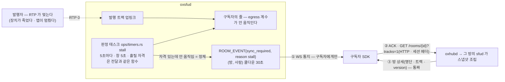
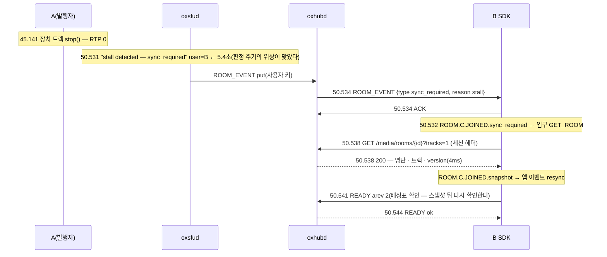

# 10. 전달 정체 — 흐르던 것이 멎으면 서버가 알리고 클라가 방을 다시 받는다

> author: kodeholic (powered by Claude) · created: 2026-11-04.
> ★**대조한 커밋** — 서버 `oxlens-sfu` `45fc07d` · 2층 하네스 `oxlens-labs` `8a0bff9` · SDK `oxlens-sdk-web`(3층 탐침 `TOUR-10` — §4).
> ★**실측 회차** — 2층 하네스(헤드리스 봇)의 시나리오 `adv_stall_resync` · `adv_stall_detect` 한 회차씩(서버가 언제 알리나) · 3층 탐침 `TOUR-10` 한 회차(브라우저 SDK 가 무엇을 하나).
> 시각은 2층은 봇이 시작한 뒤 경과 초 · 3층은 로컬 시각이다.

## 0. 한 줄 목적 · 등장인물

**발행자가 보내던 RTP 가 멎었는데 아무도 나가지 않았다 — 서버는 언제 그것을 「정체」로 판정해 누구에게 알리고, SDK 는 그 통지로 무엇을 하는가.**

| 이름 | 실제 값 | 무엇 |
|---|---|---|
| botA | 발행 — opus · SSRC `2684354689` · 6초까지만 보낸다(하네스 `fault drop 1.0 at 6.0`) | 멎는 발행자 — 나가지 않고 · 음소거도 아니고 · 배관은 그대로 |
| botB | 순수 구독 | ★이 사람에게 통지가 온다(발행자에게가 아니다) |
| 창 · 주기 | 판정 창 5,000ms · 판정 주기 5,000ms | 둘이 같아 감지 상한은 2주기가 아니라 ★**3주기(15초)** |
| 쿨다운 | (방, 사람) 30초 | 같은 사람에게 되풀이 통지하지 않는다 — [연:ROOM.ledger.TStall](../protocol/04-room.md#ROOM.ledger.TStall) |

## 1. 큰 그림 — 세 축을 한 번에 지난다



- **정체는 「자격이 있는데 안 흐른다」다.** 발행자가 나갔거나(배관이 걷힌다) 음소거 · 멈춤(`paused`) · 무전의 무음 화자처럼 안 흐르는 것이 계약인 창은 판정 밖이다 — 서버는 전달이 쓰는 자격 판정 함수를 그대로 부른다(서버 정의서 정체 감지 규칙 · 조건을 옮겨 적지 않는다).
- **알리는 상대는 구독자다.** 발행자는 멎은 줄도 모른다 — 서버가 짓는 RR 은 계속 오고 손실 0 이다(§2 표). 구독자가 `ROOM_EVENT{sync_required}` 를 받아 방을 통짜로 다시 받는다([연:ROOM.op.ROOM_EVENT](../protocol/04-room.md#ROOM.op.ROOM_EVENT) · [연:ROOM.http.GET_ROOM](../protocol/04-room.md#ROOM.http.GET_ROOM)).
- **다시 받는 것은 사실 확인이다.** 스냅샷에 그 트랙이 그대로 있으면 「발행자는 있는데 안 보낸다」는 것이 확정된다 — 앱이 그것을 알고 표시할 수 있다. `version` 을 견주지 않는다(payload 가 없다 — [연:ROOM.C.JOINED.sync_required](../protocol/04-room.md#ROOM.C.JOINED.sync_required)).

## 2. 서버가 언제 알리나 — `adv_stall_resync`

```
 0.297 botB   send READY arev 2                    ← 창의 시작점(구독자의 첫 READY)
 0.321~5.980 botB recv RTP ssrc 2370391549 seq 1…260   ← botA 가 보낸 261 중 260
 5.979 botA   마지막 RTP(seq 260) — 그 뒤 0
 6.366 botA   recv RR 보낸이 1 [최고 seq 260 · 잃은 0 · 지터 80]   ← 서버가 짓는 RR 은 계속 온다 · 값이 멈춰 있을 뿐
 7.368 … 17.419 RR 매초 — 최고 seq 260 그대로 · DLSR 만 는다
18.200 botB   recv ROOM_EVENT {type sync_required, reason stall, room_id …}   ← 멎은 지 12.2초
```
서버 로그(sfud · 23:49:15.572 = 봇 기준 18.2초):
```
23:49:15.572 proc=sfu kind=diag room=stall_resync_… user=botB~adv_stall_resync msg="stall detected — sync_required"
```

| 무엇 | 값 | 왜 |
|---|---|---|
| 멎은 때 → 통지 | 12.2초 | 판정 주기 5초가 멎은 뒤 세 번째 회차에서 창(5초)을 채웠다 — 한 회차가 1ms 만 모자라도 다음 회차로 밀리므로 상한은 15초(서버 정의서 「창과 주기가 같다」) |
| 통지 대상 | botB 만 | 로그의 `user=` 가 구독자다. botA 에게는 아무것도 안 간다 |
| 발행자가 보는 것 | RR 매초 · 최고 seq 260 고정 · 잃은 0 | 서버 쪽 세션의 끝점이 서버라(02 장) 「안 보냈다」는 손실로 안 잡힌다 |

**처음부터 안 보내는 판(`adv_stall_detect`)** — botA 가 발행만 하고 RTP 를 한 패킷도 안 보낸다. botB `READY` 0.282 → `sync_required` 8.323. 창의 시작점이 구독자의 첫 `READY` 이고 그 뒤 첫 회차(약 3초 뒤)는 창을 못 채워 넘어가고, 다음 회차(8초)에 판정했다. 영상이면 시작점이 「첫 RTP 도착」이라 카메라 워밍업은 정체가 아니다([연:DEV-PUB-STALL-FROM-RTP](../protocol/07-pub.md#DEV-PUB-STALL-FROM-RTP)).

## 3. 무엇이 정체가 아닌가 — 판정 밖의 창

| 안 흐르는데 정체가 아닌 것 | 왜 |
|---|---|
| 발행자가 나갔다 | 배관이 같이 걷힌다 — `TRACK_EVENT{remove}` 로 안다(01 §3-8) |
| 음소거(`muted`) · 멈춤(`paused`) · 자동 층 `Pause` | 안 흐르는 것이 계약이다(11 장) |
| 무전 화자가 말을 안 한다 | 무음 화자는 발언권 타이머(T1)가 다룬다(03 장) — 슬롯 줄은 그 창 안에 화자 RTP 가 지났을 때만 판정한다 |
| 클라 쪽 하향이 죽었다 | 서버 egress 계수는 오른다 — 이것은 쌍별 생존 → `LINK_EVENT` 길이고 클라 ICE 가 먼저 안다(05 장 표) |

## 4. 브라우저 SDK 가 무엇을 하나 — 3층 `TOUR-10`


A 가 `talk` 로 들어가 마이크를 켜고, B 는 `listen` 으로 듣는다. 2초 뒤 A 의 장치 트랙을 죽인다(`MediaStreamTrack.stop()` — 등록 · 배관은 그대로 · RTP 만 멎는다. 크로뮴은 바로 멎고, 파이어폭스는 무음 RTP 를 계속 보내 이 자극이 안 먹는다).



| 무엇 | 값 |
|---|---|
| 멎은 때 → 서버 판정 | 5.4초 — 2층 회차(§2)는 12.2초였다. 같은 서버 · 같은 창이고, 판정 주기(5초)의 위상이 어디 걸리느냐의 차이다. 상한은 15초 |
| 통지 → 다시 받기 → 응답 | 4ms(같은 기계) — SDK 는 ACK 와 동시에 `GET` 을 낸다 |
| 스냅샷 뒤 | 명단 · 트랙 층을 통째로 바꾸고(`ROOM.C.JOINED.snapshot`) `READY` 를 한 번 더 낸다 — 배정표는 안 바뀌었으므로 재협상은 없다 |
| 앱이 보는 것 | `room.on('resync')` 하나 · 트랙 목록에 A 의 트랙이 그대로(발행자는 있는데 안 보낸다) |


## 5. 소스 · 규격 좌표

| 무엇 | 서버 | SDK | 규격 |
|---|---|---|---|
| 판정 태스크 · 창 · 시작점 · 쿨다운 | `oxsfud/src/ops/timers.rs` `stall` · `sync_required` | — | [연:RULE-ROOM-TIMERS-MEDIA](../protocol/04-room.md#RULE-ROOM-TIMERS-MEDIA) · [연:ROOM.ledger.TStall](../protocol/04-room.md#ROOM.ledger.TStall) |
| 통지 | `ROOM_EVENT{type: sync_required, reason: stall}` | `domain/room/core.ts` — 생성 상태기 `ROOM.C.JOINED.sync_required` → `GET_ROOM` | [연:ROOM.op.ROOM_EVENT](../protocol/04-room.md#ROOM.op.ROOM_EVENT) · [연:ROOM.C.JOINED.sync_required](../protocol/04-room.md#ROOM.C.JOINED.sync_required) |
| 다시 받기 | hub 가 그 방의 sfud 에 스냅샷 조립을 시킨다(`RESUME` 과 같은 조립 하나) | `domain/room/core.ts` `resync`(HTTP · 세션 헤더) → 입구 `snapshot` → 앱 이벤트 `resync` | [연:ROOM.http.GET_ROOM](../protocol/04-room.md#ROOM.http.GET_ROOM) |

## 6. 스스로 확인하는 질문

<details><summary>1. 발행자가 멎었는데 왜 발행자가 아니라 구독자에게 알리나?</summary>

서버가 아는 사실은 「이 구독자의 줄이 안 움직인다」다. 발행자 쪽에서 보면 서버가 짓는 RR 이 손실 0 으로 계속 와서 아무 이상이 없다. 구독자가 방을 다시 받으면 그 트랙이 여전히 있다는 사실(발행자는 있는데 안 보낸다)이 확정되고, 앱이 그것을 표시할 수 있다.
</details>

<details><summary>2. 멎은 지 12초나 지나 알렸다. 더 빨리 못 하나?</summary>

창(5초)과 주기(5초)가 같아서 한 회차가 1ms 모자라면 통째로 밀린다 — 상한이 15초다. 창을 줄이면 무전의 무음 창 같은 정상이 오탐으로 잡힌다. 값을 바꾸려면 둘을 함께 봐야 한다는 것이 서버 정의서의 지침이다.
</details>

<details><summary>3. 같은 사람에게 5초마다 또 오나?</summary>

아니다 — (방, 사람)마다 30초 쿨다운이다. 다시 받았는데도 안 흐르면 30초 뒤에 또 온다.
</details>
