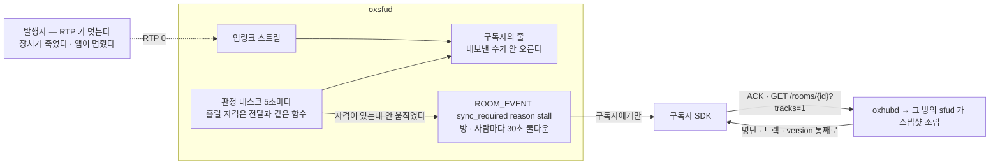
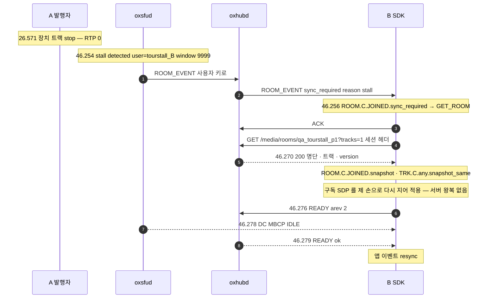

# 11. 전달 정체 — 흐르던 것이 멎으면 구독자가 방을 다시 받는다

> author: kodeholic (powered by Claude) · created: 2026-11-09.
> ★**대조한 커밋** — 서버 `oxlens-sfu` `c3642e8` · SDK `oxlens-sdk-web` `9f40557`(+탐침) · 2층 `oxlens-labs` `fc584ff`
> ★**실측 회차** — 2층 시나리오 `adv_stall_resync` · `adv_stall_detect` 한 회차씩(서버가 언제 알리나) · 3층 탐침 `TOUR-11` 한 회차(브라우저 SDK 가 무엇을 하나). 값은 돌릴 때마다 바뀌고 차례 · 모양은 같다.

## 1. 30초 요약



- **정체는 「흘릴 자격이 있는데 안 흐른다」다.** 나갔거나 · 음소거거나 · 무전 화자가 말을 안 하는 것처럼 안 흐르는 것이 계약인 창은 판정 밖이다 — 서버는 전달이 쓰는 자격 판정을 그대로 부른다.
- **알리는 상대는 구독자다.** 발행자는 멎은 줄도 모른다 — 서버가 짓는 RR 이 손실 0 으로 계속 간다. 구독자가 방을 다시 받아 「트랙은 그대로인데 안 온다」를 확정한다.
- **실측 값** — 멎은 뒤 알림까지 2층 11.2초 · 3층 19.7초. 판정 창과 주기가 같아 1ms 만 모자라도 한 주기(5초)가 통째로 밀린다 — 3층 회차는 그것이 두 번 겹쳐 규격 상한을 넘었다(§4-1).

## 2. 등장인물 · 값

| 이름 | 실제 값 | 무엇 |
|---|---|---|
| botA(2층) | opus 발행 · SSRC `2684354689` · 6초에 송신을 끊는다(`fault drop 1.0 at 6.0`) | 멎는 발행자 — 나가지 않고 · 음소거도 아니고 · 배관은 그대로 |
| botB(2층) | 순수 구독 | ★통지를 받는 쪽 |
| A · B(3층) | `tourstall_A`(`talk` · 마이크) · `tourstall_B`(`listen`) · 방 `qa_tourstall_p1` · node-a | A 의 장치 트랙을 `MediaStreamTrack.stop()` 으로 죽인다 — 등록 · 배관은 그대로 · RTP 만 멎는다 |

| 값 | 얼마 | 어디서 |
|---|---|---|
| 판정 주기 · 창 | 둘 다 5,000ms | `oxsfud/src/ops/timers.rs` `STALL_MS` |
| ★감지 상한(규격) | 「2주기가 아니라 3주기(≈15초)」 — 창과 주기가 같아 한 회차가 1ms 만 모자라도 다음 회차로 밀린다 | 이 장이 이 값의 집이다(다른 장은 링크) |
| 쿨다운 | (방, 사람)마다 30,000ms | [연:ROOM.ledger.TStall](../protocol/04-room.md#ROOM.ledger.TStall) · `STALL_COOL_MS` |
| 창의 시작점 | 구독자의 첫 `READY` · 전이중 개인 영상은 첫 RTP 도착 · 슬롯 줄은 지금 화자의 허가 시각 | [연:DEV-PUB-STALL-FROM-RTP](../protocol/07-pub.md#DEV-PUB-STALL-FROM-RTP) |

| 회차 | 멎은 때 | 알림 | 걸린 시간 | 판정 줄 `in.window_ms` |
|---|---|---|---|---|
| 2층 `adv_stall_resync` | 5.997(마지막 RTP) | 17.215 | 11.2초 | 10000 |
| 2층 `adv_stall_detect` | 처음부터 0 · 첫 `READY` 17.447 | 29.865 | 12.4초(첫 `READY` 뒤) | 9999 |
| 3층 `TOUR-11` | 약 26.57 | 46.254 | 19.7초 | 9999 |
| 같은 날 서버 로그 전량 | — | 판정 줄 31개 | — | 5000~5002 가 15 · 9997~10000 이 16 |

★`in.window_ms` 는 판정한 창의 실제 길이다. 10000 근처면 그 앞 회차가 1ms 모자라 한 주기를 넘긴 것이다 — 같은 날 판정의 절반이 그랬다.

## 3. 정상 길

### 3-1. 서버가 언제 · 누구에게 알리나 — `adv_stall_resync`

```
 0.285 botB  send READY arev 2                                       ← 시작점은 첫 READY(0.017)
 0.309~5.998 botB recv RTP ssrc 2609206239 seq 1…261                 ← botA 가 보낸 262 중 261
 5.997 botA  마지막 RTP(seq 261) — 그 뒤 0
 6.333 botA  recv RR [최고 seq 261 · 잃은 0 · 지터 93 · DLSR 844.9ms] · REMB 2000000
 7.344 … 13.391 botA recv RR 매초 — 최고 seq 261 그대로 · DLSR 만 는다
17.215 botB  recv ROOM_EVENT {"reason":"stall","room_id":"stall_resync_…","type":"sync_required"}
```
서버 로그(sfud node-a):
```
07:11:41.258 proc=sfu kind=stat user=botB~adv_stall_resync packets_sent=261 …   ← 이 뒤로 261 그대로
07:11:51.258 proc=sfu kind=diag spec=SV-IMPL-ROOM-STALL user=botB~adv_stall_resync track=t63060bcedea1fd57 in.start=1794175894062 in.window_ms=10000 msg="stall detected — sync_required"
07:11:51.258 proc=sfu kind=ev   spec=CP-OP-ROOM-EVENT   user=botB~adv_stall_resync
```

- **통지는 구독자에게만** — 판정 줄의 `user=` 는 botB 다. botA 에게는 아무것도 안 간다. botA 가 받는 RR 은 손실 0 · 최고 seq 고정이다 — 서버 쪽 RTP 세션의 끝점이 서버라([04 장](04_PACKET_PATH.md)) 「안 보냈다」는 손실로 안 잡힌다.
- **11.2초** — 판정 창이 10,000ms 였다(`in.window_ms`). 마지막 RTP 는 KST 40.042(봇 기준 5.997)다. 41.258 회차는 그 앞 5초 동안 흐른 것(87 → 261)을 보고 「흘렀다」며 창을 새로 열었고, 이 창이 다음 46.258 회차에 1ms 모자라(4,999ms) 판정 없이 넘어간 뒤 51.258 회차에 10초짜리 창으로 판정했다. 모자람이 없었다면 46.258 — 멎은 뒤 6.2초에 알렸다.
- `in.start` 는 창의 시작점(botB 의 첫 `READY` 시각 — 34.062 = 봇 기준 0.017)이다. 창은 이 뒤에서만 잰다.

### 3-2. 처음부터 안 보내면 — `adv_stall_detect`

botA 가 발행만 하고 RTP 를 한 패킷도 안 보낸다. sfud 의 발행 상태는 `Created → Intended` 에서 멈춘다(`first_rtp` 가 없다).
```
07:11:17.447 proc=hub spec=CP-OP-READY user=botB~adv_stall_detect arev=1        ← 시작점
07:11:29.864 proc=sfu spec=SV-IMPL-ROOM-STALL user=botB~adv_stall_detect in.start=1794175877447 in.window_ms=9999
```
- 판정 파일에서 이 판은 `identity_5point` · `send_honest` 가 빨강이다 — 보낸 것이 없으니 정상이고, 이 판이 보는 것은 `stall_sync_required` 하나다.
- audio 줄은 시작점이 `READY` 라 「처음부터 0」도 정체다. 영상이면 시작점이 첫 RTP 도착이라 카메라가 아직 데워지는 중인 무패킷은 정체가 아니다([연:DEV-PUB-STALL-FROM-RTP](../protocol/07-pub.md#DEV-PUB-STALL-FROM-RTP)).

### 3-3. 브라우저 SDK 가 무엇을 하나 — 3층 `TOUR-11`



```
46.256 SDK B ROOM qa_tourstall_p1 JOINED → JOINED | ROOM_EVENT.sync_required | ROOM.C.JOINED.sync_required
46.270 SDK B ROOM qa_tourstall_p1 JOINED → JOINED | GET_ROOM.res | ROOM.C.JOINED.snapshot
46.270 SDK B TRK qa_tourstall_p1 - → - | ROOM.C.JOINED.snapshot | TRK.C.any.snapshot_same
46.270 SDK B SUB qa_tourstall_p1 OK → WANT | ROOM.C.JOINED.snapshot | SUB.C.any.ready_want
46.270 HTTP B GET /media/rooms/qa_tourstall_p1?tracks=1 200
46.276 WS  B send req READY #8 {"room_id":"qa_tourstall_p1","arev":2,"join_id":"fba46b302e4b5f46"}
```

- **통지 → 다시 받기 → 확인이 25ms 안이다**(같은 기계). SDK 는 `ACK` 와 함께 `GET` 을 낸다. `version` 을 견주지 않는다 — `sync_required` 에는 견줄 payload 가 없다.
- **스냅샷이 같았다**(`snapshot_same`) — A 의 트랙이 그대로 있다. 「발행자는 있는데 안 보낸다」가 확정된다. 앱이 보는 것은 `room.on('resync')` 하나다.
- **스냅샷 뒤 `READY` 를 한 번 더** — 배정표(`arev 2`)는 그대로지만 SDK 는 구독 줄을 다시 지어 적용하고 `READY` 로 확인했다(SDP 를 서버가 주지 않는다는 사실은 [02 장](02_CONNECT_JOIN.md)). 서버는 그 `READY` 에 발언권 상태(`IDLE`)를 DC 로 다시 알렸다.
- 같은 `GET /rooms/{id}?tracks=1` 은 방 목록 `seq` 에 구멍이 났을 때도 쓴다 — 그 길은 [03 장](03_PUBLISH_SUBSCRIBE.md).

## 4. 깨지는 길

### 4-1. 규격 상한을 넘었다 — 1ms 모자람이 두 번(3층 `TOUR-11`, 결함 의심)

3층 회차는 멎은 뒤 19.7초에 알렸다 — §2 의 규격 상한보다 4.7초 길다. 발행자 stat 줄과 판정 줄로 짠 재구성:

```
07:37:26.254 stat tourstall_A packets_received=89
07:37:26.571 장치 트랙 stop                                  ← 16 패킷 더 받고 멎었다
07:37:31.252 stat tourstall_A packets_received=105            ← 이 뒤로 105 그대로
07:37:46.253 SV-IMPL-ROOM-STALL user=tourstall_B in.window_ms=9999   ← 창이 36.25 무렵에 열렸다
```

| 판정 회차(≈) | 창 | 한 일 |
|---|---|---|
| 26.25 | — | 창을 연다(그때까지 낸 수를 적어 둔다) |
| 31.25 | 4,999ms — 1ms 모자람 | 판정 없이 넘어간다 · 창도 그대로 |
| 36.25 | 약 10,000ms | 26.25 이후 26.57 까지 흐른 16 패킷이 보인다 → 「흘렀다」 · 창을 새로 연다 |
| 41.25 | 4,999ms — 또 모자람 | 넘어간다 |
| 46.25 | 9,999ms | 그대로 → 판정 |

- **무엇이 깨졌나** — 창을 연 회차와 판정하는 회차가 둘 다 1ms 모자라면 감지는 4주기(≈20초)까지 간다. 규격은 「한 회차가 밀린다」만 셈에 넣었다. 판정은 벽시계 ms(`now_ms`)로 재고 주기는 단조 시계로 돈다 — 같은 날 판정 31개 중 16개가 한 회차 밀렸다(§2).
- **누가 먼저 아나** — 아무도 못 안다. 발행자에게는 손실 0 의 RR 이 가고, 구독자는 소리가 끊긴 채 통지를 기다린다.
- **사용자가 겪는 것** — 듣는 사람 화면에는 A 가 말하는 중인데 소리가 없는 채로 최대 20초가 간다. 앱이 그 사이 할 수 있는 것은 없다(트랙 · 연결은 다 정상이다).

### 4-2. 정체로 잡으면 안 되는 것 — 오탐을 막는 창

지금 소스 `eligible_from` 이 판정 밖으로 빼는 것이다. ★정본은 「전달 자격 판정 하나를 그대로 부른다」는 규칙이고 이 표는 설명용이다 — 조건을 따로 옮겨 적으면 사본이 어긋난다(서버 재생성 7회차에 발행 방이 아닌 트랙을 빠뜨려 쉬는 트랙에 헛 재동기 지시가 나갔다).

| 안 흐르는데 정체가 아닌 것 | 왜 | 어디서 다루나 |
|---|---|---|
| 구독자의 연결이 `Alive` 가 아니다 | 하향이 죽은 것은 서버 egress 계수로 못 본다 — 쌍 생존 → `LINK_EVENT` 길이다 | [10 장](10_RECOVERY.md) |
| 첫 `READY` 전 · 줄이 닫혔다 · `paused` · 자동 층 `Pause` | 서버가 스스로 멈춘 흐름이다 | [05](05_SIMULCAST_BWE.md) · [06](06_TRACK_ATTRS.md) |
| 발행 방이 아니다 · 전달 게이트가 막는다 | 흘릴 자격이 없다 | [06](06_TRACK_ATTRS.md) |
| 영상 첫 RTP 전 | 카메라 워밍업이다 | [연:DEV-PUB-STALL-FROM-RTP](../protocol/07-pub.md#DEV-PUB-STALL-FROM-RTP) |
| 반이중 개인 발행 | 개인 줄로 흐르지 않는다 | [06](06_TRACK_ATTRS.md) |
| 슬롯 줄 — 화자가 없다 · 내가 화자다 · 화자 RTP 가 창 안에 없다 | ★화자의 무음은 정체가 아니다 — 말을 멈춘 화자 · 급사한 화자는 발언권 타이머가 회수한다. 이것을 전이중처럼 판정하면 회수 전 무음 창에 듣던 사람 전원에게 재동기 지시가 나간다(2층 `adv_floor_failover` 표본 11 중 9) | [07 장](07_FLOOR.md) |
| 발행자가 나갔다 | 배관이 같이 걷힌다 — `TRACK_EVENT remove` 로 안다 | [03 장](03_PUBLISH_SUBSCRIBE.md) |

### 4-3. 다시 받아도 안 흐르면

다시 받기는 사실 확인이지 치료가 아니다 — 발행자 장치가 죽어 있으면 스냅샷 뒤에도 0 이다. 같은 (방, 사람)에는 30초 쿨다운 뒤 또 알린다([연:ROOM.ledger.TStall](../protocol/04-room.md#ROOM.ledger.TStall)). 이 회차들은 첫 알림 뒤 곧 끝나 둘째 알림은 재지 않았다. 고치는 것은 발행자 쪽이다 — 앱이 「발행자는 있는데 안 보낸다」를 표시하고, 발행자 쪽 SDK 가 장치를 다시 얻는다.

## 5. 왜 이 모양인가

- **판정은 서버가 해석까지 한다** — 「1.5초 무패킷」 같은 사실만 내면(아래 str0m) 정당한 무음(음소거 · DTX · 무전 무음 화자)과 가를 수 없어 상위가 다시 가려야 한다. 우리 서버는 전달 자격을 아는 유일한 곳이라 거기서 거른다. 대신 자격 판정이 바뀌면 정체 판정도 같이 바뀌어야 한다 — 그래서 함수를 하나만 둔다.
- **구독자에게 알린다** — 서버가 아는 사실은 「이 구독자의 줄이 안 움직인다」다. 발행자 쪽에서 보면 아무 이상이 없다(손실 0 RR).
- **WS 통지 + HTTP 다시 받기** — 통지는 `payload` 없이 「어긋났다」만 싣고, 받는 쪽이 `GET /rooms/{id}?tracks=1`([연:ROOM.http.GET_ROOM](../protocol/04-room.md#ROOM.http.GET_ROOM))로 통째로 받는다. 스냅샷 조립은 `RESUME` 과 같은 조립 하나다. `sync_required` 를 무시하면 멎은 채로 굳는다([연:ROOM.C.JOINED.sync_required](../protocol/04-room.md#ROOM.C.JOINED.sync_required)).
- **버린 길과 겪은 일** — 2026년 8월 말의 구판은 전용 op `TRACK_STALLED`(0x2105)에 정당 사유 여섯을 소스에만 적어 두었다(선행 사례 대장 2-6). 그 사이 사람 상태를 정수로 비교하던 가드가 상태 정의가 바뀐 뒤 정상 사람을 전원 건너뛰어 ★한 달 동안 감지가 죽어 있었고 아무도 몰랐다(2026년 7월 11일 ~ 8월 15일 · 2층 `adv_stall_detect` 머리 기록). 그 뒤 `adv_stall_resync` 가 「정상으로 흐르다 멎는」 판을 따로 세웠다 — 처음부터 0 인 판은 다른 등식이 다 빨개져 감지 빨강이 가려지기 때문이다.

> ★**우리만의 것 — 정체를 전달 자격과 한 함수로 판정한다**
> - **선택 배경** — 「안 흐른다」의 절반 이상은 정상이다(음소거 · 멈춤 · 무전 무음). 따로 목록을 두면 목록이 전달 규칙과 어긋난다.
> - **얻은 것** — 전달이 막는 것은 정체가 아니고, 전달이 흘려야 하는데 안 흐른 것만 정체다. 이 회차 2층 87 시나리오 전부에서 판정 `stall_no_false_alarm`(정체를 안 만든 판에 재동기 지시가 오면 빨강)이 초록이다 — 무전 · 음소거 · 멈춤 · 다방을 다 지나도 헛 통지 0.
> - **잃은 것** — 판정이 느리다 — 2층 11.2 · 12.4초, 3층 19.7초. 창을 줄이면 무전 무음 창 같은 정상이 오탐으로 잡힌다. 구독자의 하향이 죽은 경우는 원리상 못 본다(§4-2 첫 줄).

## 6. 다른 SFU 는

> 저쪽 소스에는 이렇게 적혀 있다(실측 아님).

| 상대 | 그쪽 방식 | 우리 | 우리 쪽 장점 | 우리 쪽 대가 |
|---|---|---|---|---|
| str0m(`str0m §4-5`) | `pause_threshold` 기본 1.5초 무패킷 → `StreamPaused` 사건 · 정당한 무음과 가르지 않는다(상위 몫) | 서버가 자격까지 보고 5초 창 · 구독자에게 통지 | 무음 · 멈춤에 헛 통지가 없다 | 감지가 느리다(11~20초) |
| LiveKit(`livekit §8-3`) | seq · 타임스탬프 불연속을 새 스트림으로 보고 다운트랙 전체 재동기 — 기본 꺼짐(오판하면 멀쩡한 스트림을 통째로 재동기) | 불연속은 재기록기가 흡수([04 장](04_PACKET_PATH.md)) · 재동기는 「안 흐름」에만 | 불연속 오판으로 재동기하지 않는다 | — |
| LiveKit(`livekit §9-1`) | 구독 실패 3분류 — 권한 · 수신기 부재는 계속 재시도 · 트랙 없음은 1분 뒤 포기 · 그 밖은 시한(그쪽 상수 15,000ms)을 넘으면 full reconnect 후보 | 분류 없이 「다시 받아 사실 확인」 한 길 | 길이 하나다 | 포기 · 치명 경계가 없다 — 앱이 판단한다 |

## 7. 운영에서 보는 법

| 무엇 | 줄(실측) |
|---|---|
| 판정 | `kind=diag spec=SV-IMPL-ROOM-STALL user=<구독자> track=<트랙> in.start=<시작점 ms> in.window_ms=<창>` — `in.window_ms` 가 10000 근처면 한 회차 밀린 것 |
| 통지 | `kind=ev spec=CP-OP-ROOM-EVENT user=<구독자>` |
| 멎은 것 | 발행자 `kind=stat … packets_received=` 가 같은 값으로 이어진다 · 구독자 `kind=stat … packets_sent=` 도 같은 값 |
| 다시 받은 뒤 | `CP-OP-READY arev=<그대로>` — ★`GET /rooms` 재동기 자체는 hub 로그에 줄이 없다. 재동기를 했는지는 그 뒤 `READY` 로만 보인다 |

- SDK 전이 라벨 — `ROOM.C.JOINED.sync_required` → `ROOM.C.JOINED.snapshot`(`TRK.C.any.snapshot_same` 면 트랙 무변) → `SUB.C.any.ready_want`. 앱 이벤트 `resync`.
- stat 줄 주기 · 사건 이력에서 한 사용자의 판정 줄을 모아 보는 법은 [17 장](17_OPERATIONS.md).

## 8. 소스 · 규격 좌표

| 무엇 | 서버 | SDK | 규격 |
|---|---|---|---|
| 판정 태스크 · 창 · 시작점 · 쿨다운 | `oxsfud/src/ops/timers.rs` `stall` · `eligible_from` · `sync_required` · `STALL_MS` · `STALL_COOL_MS` | — | [연:RULE-ROOM-TIMERS-MEDIA](../protocol/04-room.md#RULE-ROOM-TIMERS-MEDIA) · [연:ROOM.ledger.TStall](../protocol/04-room.md#ROOM.ledger.TStall) |
| 통지 | `ROOM_EVENT{type: sync_required, reason: stall}` | `src/domain/room/core.ts`(입구 `sync_required` → `GET_ROOM`) | [연:ROOM.op.ROOM_EVENT](../protocol/04-room.md#ROOM.op.ROOM_EVENT) · [연:ROOM.S.sync_required](../protocol/04-room.md#ROOM.S.sync_required) · [연:ROOM.C.JOINED.sync_required](../protocol/04-room.md#ROOM.C.JOINED.sync_required) |
| 다시 받기 | hub HTTP → 그 방의 sfud 가 스냅샷 조립(`oxsfud/src/ops/rooms.rs` `snapshot_of`) | `src/domain/room/core.ts` `resync` → 입구 `snapshot` → 앱 이벤트 `resync` | [연:ROOM.http.GET_ROOM](../protocol/04-room.md#ROOM.http.GET_ROOM) · [연:RULE-ROOM-DETAIL-FIELDS](../protocol/04-room.md#RULE-ROOM-DETAIL-FIELDS) |

## 9. 스스로 확인하는 질문

<details><summary>1. 발행자가 멎었는데 왜 발행자가 아니라 구독자에게 알리나?</summary>

서버가 아는 사실은 「이 구독자의 줄이 안 움직인다」다. 발행자 쪽에서는 서버가 짓는 RR 이 손실 0 으로 계속 와서 이상이 없다(§3-1 — 최고 seq 261 고정). 구독자가 방을 다시 받으면 트랙이 그대로라는 것, 즉 발행자는 있는데 안 보낸다는 것이 확정되고 앱이 그것을 표시할 수 있다.
</details>

<details><summary>2. 판정 줄의 `in.window_ms=10000` 은 무엇을 말하나?</summary>

판정한 창이 5초가 아니라 10초였다 — 그 앞 회차에서 창이 4,999ms 로 1ms 모자라 판정 없이 넘어갔다는 뜻이다. 판정은 벽시계 ms 로 재고 주기는 단조 시계로 돌아서 생긴다. 같은 날 판정 31개 중 16개가 그랬다.
</details>

<details><summary>3. (깨지는 길) 3층 회차는 왜 19.7초나 걸렸나?</summary>

1ms 모자람이 두 번 겹쳤다(§4-1). 멎기 직전에 연 창이 다음 회차에 모자라 넘어갔고, 그다음 회차는 멎기 전 0.3초 동안 흐른 16 패킷을 보고 「흘렀다」며 창을 새로 열었다. 새 창도 다음 회차에 모자라 한 번 더 넘어간 뒤에야 판정했다. 규격이 적은 상한은 한 번 밀리는 경우만 셈한 것이다.
</details>

<details><summary>4. 무전 화자가 말을 멈추면 듣는 사람에게 `sync_required` 가 오나?</summary>

안 온다. 슬롯 줄은 그 창 안에 화자 RTP 가 게이트를 지났을 때만 판정한다. 화자의 무음은 발언권 타이머가 다룬다([07 장](07_FLOOR.md)) — 같은 규칙으로 판정하면 회수 전 무음 창에 듣던 사람 전원에게 헛 재동기 지시가 나간다.
</details>
