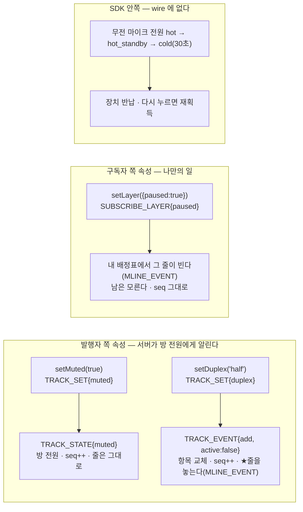
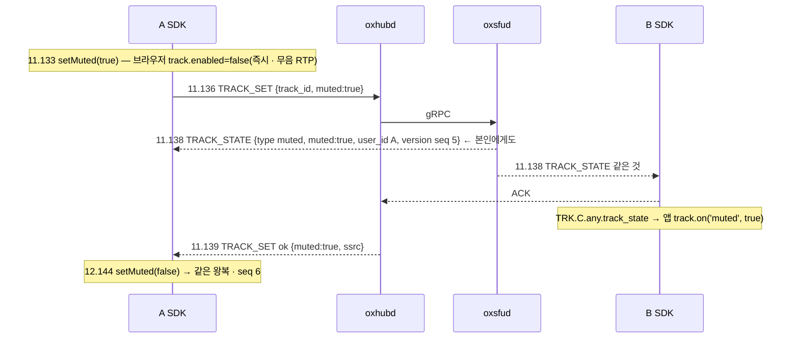
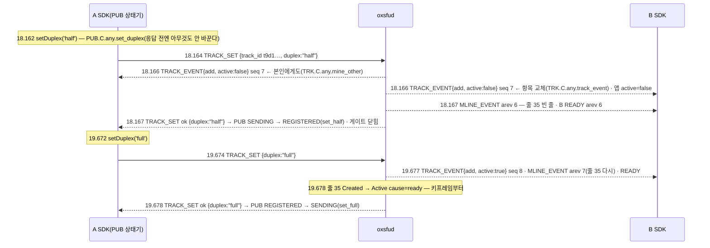

# 11. 트랙 속성을 산 채로 — 음소거 · 영상 멈춤 · 회의↔무전 전환 · 마이크 전원

> author: kodeholic (powered by Claude) · created: 2026-11-04.
> ★**대조한 커밋** — 서버 `oxlens-sfu` `45fc07d` · SDK `oxlens-sdk-web` `a45a229`(+ 탐침 · QA 손잡이 추가 커밋) · 2층 하네스 `oxlens-labs` `8a0bff9`(§4 duplex).
> ★**실측 회차** — `tour-20261104-192724`(탐침 `TOUR-11`) 와 2층 시나리오 `conf_duplex` 한 회차. 값은 돌릴 때마다 바뀌고, 차례 · 모양은 같다.
> 3층 시각은 로컬 시각(초.밀리초) · 2층 시각은 봇이 시작한 뒤 경과 초다. ★3층 브라우저는 가짜 장치(크로뮴 `--use-fake-device-for-media-stream`)라 마이크 재획득 비용이 안 보인다 — §6.

## 0. 한 줄 목적 · 등장인물

**발행 · 구독이 선 채로 트랙의 속성 하나를 바꾸면 — 내 마이크를 음소거하면 · 상대 영상을 안 받기로 하면 · 카메라를 회의용에서 무전용으로 바꾸면 · 무전 마이크를 30초 안 쓰면 — 무엇이 오가고 배정표 · RTP · 앱 이벤트는 어떻게 되나.**

| 이름 | 실제 값 | 무엇 |
|---|---|---|
| A | `tourattr_A` · 방 `qa_tourattr_p1` · 마이크 `t0529922ed3da2281` · 카메라 `t9d196de3e2fbec61`(시뮬캐스트 없음) | 속성을 바꾸는 발행자 |
| B | `tourattr_B` · 같은 방 · adaptiveStream 끔 | 받는 쪽 — 줄 34(audio) · 35(video) |
| P · L | `tourattr_P`(말하기) · `tourattr_L`(듣기) · 무전 방 `qa_tourattr_p3` | 마이크 전원(§5) |
| 네 축 | `TRACK_SET{muted}` · `SUBSCRIBE_LAYER{paused}` · `TRACK_SET{duplex}` · SDK 안의 `mic` 전원 | 앞 셋은 wire · 넷째는 SDK 안쪽(wire 에 없다) |

## 1. 큰 그림 — 누구의 속성인가가 길을 정한다



- **발행자 속성은 방의 사실이다.** 음소거 · 회의↔무전 전환은 그 방 전원에게 통지가 가고 방 `version.seq` 가 오른다([연:RULE-TRK-FIVE-RULES](../protocol/06-trk.md#RULE-TRK-FIVE-RULES) ② — seq++ ⟺ 명단 또는 트랙 층이 바뀌었다). 둘의 차이는 ★줄이다: 음소거는 줄을 두고 표시만 바꾸고, 전환은 「쉬는 트랙」이 되어 줄이 빈다([연:TRK.op.TRACK_STATE](../protocol/06-trk.md#TRK.op.TRACK_STATE) · [연:RULE-PUB-SET-PROC](../protocol/07-pub.md#RULE-PUB-SET-PROC)).
- **구독자 속성은 내 일이다.** 영상을 안 받기로 한 것은 내 배정표에만 일어난다 — 발행자도 다른 구독자도 모르고 방 `seq` 도 그대로다([연:SUB.op.SUBSCRIBE_LAYER](../protocol/08-sub.md#SUB.op.SUBSCRIBE_LAYER)).
- **마이크 전원은 SDK 안의 일이다.** 서버는 모른다 — 발행 트랙 · 줄 · 발언권 어느 것도 안 바뀐다. 장치를 반납하고 되찾는 것뿐이다.

## 2. 음소거 — `TRACK_SET{muted}` → `TRACK_STATE`



| 무엇 | 값 |
|---|---|
| 요청 → 통지 | 2ms(서버가 방 전원에게 `TRACK_STATE` 를 먼저 내고 응답은 그 뒤 1ms) |
| 통지 대상 | ★방 전원 — 본인 A 도 받는다(A 의 SDK 전이 `TRK.C.any.track_state` 가 B 와 같은 ms) |
| 방 `seq` | 4 → 5(음소거) → 6(해제) — 트랙 층이 바뀌었다 |
| 배정표 | 그대로(arev 3) — 줄 34 는 남는다 · B 의 수신기도 그대로 |
| RTP | 브라우저가 `enabled=false` 로 무음 패킷을 보낸다(인코더는 돈다 · 상행 RTP 는 0 이 아니다) — A 의 송신 통계가 계속 오른다 |
| B 가 보는 것 | `track.muted` · 앱 이벤트 `muted` · 영상이면 아바타로 바꿀 자리([연:TRK.op.TRACK_STATE](../protocol/06-trk.md#TRK.op.TRACK_STATE) 표) |

- `TRACK_STATE` 의 `type` 은 `muted` 하나다 — 「받는 쪽이 스스로 알 수 없는 것」만 통지다([연:TRK.op.TRACK_STATE](../protocol/06-trk.md#TRK.op.TRACK_STATE)). 반이중 트랙에는 음소거가 없다(`3006` — 08 장) — 송출 여부는 발언권 게이트 하나가 정한다.
- 서버는 스냅샷에도 `muted` 를 싣는다 — 늦게 들어온 사람도 안다([연:RULE-TRK-FIVE-RULES](../protocol/06-trk.md#RULE-TRK-FIVE-RULES) ⑤ · [연:PROP-TRK-MUTED-FULL-ONLY](../protocol/06-trk.md#PROP-TRK-MUTED-FULL-ONLY)).

## 3. 영상 멈춤 — `SUBSCRIBE_LAYER{paused}` · 내 배정표만

```
13.152 B  setLayer(cam, {paused:true})                    SDK SUB.C.any.layer
13.154 B→ SUBSCRIBE_LAYER {targets:[{track_id t9d1…, paused:true}]}
13.156 B← ok · SDK SUB.C.any.layer_res
13.157 B← MLINE_EVENT arev 4 — 줄 35(video) 가 ★빈 줄(track_id 없음)      ← 서버가 그 줄을 놓았다
13.157 B→ READY arev 4(배정표는 바뀌었지만 m-line 수는 그대로라 SDP 재협상 없음 · SDK SUB.C.any.table_rebound → ready_ok)
15.658 B  setLayer(cam, {paused:false})
15.663 B← MLINE_EVENT arev 5 — 줄 35 에 t9d1… 가 다시 실린다 · READY arev 5
15.663 SRV SV-STATE-SUBSCRIBE-STATE user=B key=t9d1… from=Created to=Active cause=ready   ← 줄이 새로 서서 PLI · 키프레임부터
15.662 B  앱 이벤트 track(같은 id — 수신기가 다시 붙는다)
```
- **멈춤은 줄을 비운다.** 멈춘 트랙은 배정표 후보에서 빠지고(`sub/mod.rs` — `!c.paused`) 그 자리는 빈 줄이 되어 같은 kind 의 다른 트랙이 쓸 수 있다([연:RULE-SUB-FILL](../protocol/08-sub.md#RULE-SUB-FILL)). 되돌리면 줄이 다시 실리고 서버가 키프레임부터 보낸다(READY → PLI — 01 §3-5).
- **A 는 모른다.** A 의 WS 에는 아무것도 안 왔고 A 의 송신은 그대로다 — 서버가 B 의 줄로만 안 보낸다. 방 `seq` 는 그대로(4 → 4).
- 같은 op 로 층 상한(`spatial`) · 우선순위(`priority`)도 함께 낸다 — adaptiveStream 이 켜진 SDK 는 타일이 480px 미만이거나 안 보이면 이 op 을 스스로 낸다(01 §3-7). 이 회차는 그것을 끄고 손으로 냈다. 09 장 §5 — 2층 봇은 이 칸을 못 보낸다.

## 4. 회의 → 무전 → 회의 — `TRACK_SET{duplex}` · 항목 교체 하나



| 무엇 | half 로 | full 로 |
|---|---|---|
| 통지 | `TRACK_EVENT{add, active:false}` 하나(seq 7) | `TRACK_EVENT{add, active:true}` 하나(seq 8) |
| 배정표(B) | arev 6 — 줄 35 빈 줄 | arev 7 — 줄 35 에 다시(같은 자리) |
| 요청 → 통지 → 응답 | 2 → 3ms | 3 → 4ms |
| A 의 PUB 상태기 | `SENDING → REGISTERED`(`PUB.C.SENDING.set_half`) — 반이중은 발언권이 열 때만 보낸다 | `REGISTERED → SENDING`(`PUB.C.REGISTERED.set_full`) |
| B 가 보는 것 | `track.active=false` · 앱 이벤트 `active` — 화면을 내린다 · m-line 은 그대로 | `active=true` · 키프레임 뒤 영상 |

- **전환은 프레임 하나다** — `remove`+`add` 둘이 아니라 같은 `track_id` 의 항목을 `active` 만 바꿔 교체한다([연:RULE-ROOM-DUPLEX-ONE-ADD](../protocol/04-room.md#RULE-ROOM-DUPLEX-ONE-ADD) · [연:RULE-TRK-FIVE-RULES](../protocol/06-trk.md#RULE-TRK-FIVE-RULES) ④). 트랙 `type` 은 안 바뀐다 — `individual` 그대로다.
- **쉬는 트랙은 줄이 없다.** half 가 되는 순간 서버가 B 의 줄 35 를 놓고 빈 줄로 둔다 — 멈춤(§3)과 같은 결말이고, 되돌리면 같은 자리(이 회차) 또는 다른 자리에 다시 실린다([연:RULE-PUB-SET-PROC](../protocol/07-pub.md#RULE-PUB-SET-PROC)).
- **응답이 통지보다 늦다.** 서버는 방 전원에게 통지를 먼저 내고 요청자에게 응답한다 — 음소거(§2)와 같다. SDK 는 응답(`set_half` · `set_full`)이 와야 게이트 · 전원을 바꾼다 — 통지만으로 바꾸지 않는다.
- `duplex` 가 적용되면 `muted` 는 `false` 로 돌아간다([연:RULE-PUB-SET-PROC](../protocol/07-pub.md#RULE-PUB-SET-PROC)) — 음소거된 카메라를 무전으로 바꿨다가 허가를 받으면 검은 화면이 나가는 결말을 막는다.

**RTP 가 실제로 멎고 다시 흐르는 것**(2층 `conf_duplex` — 봇은 RTP 를 그대로 센다):
```
2.288 botA send TRACK_SET {ssrc …, duplex: half}    → 2.295 TRACK_EVENT active:false(둘 다) · 2.296 MLINE_EVENT arev 4 · 응답
5.287 botA send TRACK_SET {duplex: full}            → 5.294 TRACK_EVENT active:true · MLINE_EVENT arev 5 · 응답
botB 가 받은 영상 RTP(초마다): 1초 20 · 2초 8 · 3~4초 0 · 5초 20 · 6~7초 29   ← 2.3 에 멎고 5.3 에 돌아온다
```
봇 A 는 그동안 보내기를 멈추지 않았다 — 서버가 B 의 줄로 안 보낸 것이다(쉬는 트랙).

## 5. 마이크 전원 — SDK 안의 세 상태

무전 방에서 P 가 누르고 놓고 30초를 쉰다. `ptt.state.mic` 를 250ms 마다 읽어 바뀐 때를 적었다.

```
21.972 P 누름 — PUB IDLE → STAGED(마이크 획득) → nego → PUBLISH_TRACKS half → REGISTERED(21.996)
21.996 FLR NOPERM → PREQ → 21.998 PERM(GRANTED) → PUB REGISTERED → SENDING(mic.open — 게이트 열림)  mic = hot
23.085 P 놓음 → 23.087 ACK → PUB SENDING → REGISTERED(mic.close)                                   mic = hot_standby
53.097 PUB … | mic_power | SDK.cold   ← 놓은 지 30.01초 · 장치 반납(트랙 stop · 표시등 꺼짐)           mic = cold
54.294 P 다시 누름 → 54.318 SDK.warm(재획득 — 가짜 장치라 24ms) → 54.320 GRANTED · mic.open          mic = hot
54.510 L 에 슬롯 패킷이 다시 흐른다
55.511 P 놓음 → hot_standby · 55.515 keepWarm(120,000)
87.520 32초 뒤에도 hot_standby — 안 내려갔다
```

| 상태 | 뜻 | 장치 | 들어가는 때 |
|---|---|---|---|
| `hot` | 허가 중 · 놓는 중(`has_permission` · `pending_release`) | 점유 · 게이트 열림 · RTP 나감 | 허가 |
| `hot_standby` | 그 밖 — 트랙은 살아 있고 장치를 쥔 채 | 점유 · 게이트 닫힘 | 놓음 · 거절 · 입장 직후 |
| `cold` | 무발화 30초 | ★반납(`MediaStreamTrack.stop()`) | 그 서버의 발언권이 전부 `no_permission` 인 채 30초 — 줄 서는 동안은 안 내려간다 |

- **서버는 모른다.** 전원 세 상태 어느 전이에도 WS 프레임이 없다 — 발행 트랙(`REGISTERED`) · 줄 · 발언권이 그대로다. 반이중은 발언권이 열 때만 `replaceTrack` 으로 소스를 얹으므로(— 셋째 축) 서버 쪽에서 장치 유무는 보이지 않는다.
- **cold 의 대가는 첫 음절이다.** 실장치는 재획득에 360~640ms(실측 20260624 · 정책서 `micColdAfterMs` 행) 가 들어 cold 에서 누르면 첫 음절이 잘린다. 이 회차는 가짜 장치라 24ms 다 — ★숫자를 믿지 말 것. `keepWarm(ms)` 가 그것을 미룬다(지령대처럼 늘 쓰는 자리).
- 입장 직후 `mic` 가 `hot_standby` 로 읽힌 것(21.972 · 아직 마이크를 안 잡았을 때)은 「cold 가 아니다」의 뜻이다 — 첫 누름이 획득부터 한다(`PUB.C.IDLE.on`). 03 장 §3-2 「마이크는 누를 때 잡는다」.

## 6. 소스 · 규격 좌표

| 무엇 | 서버 | SDK | 규격 |
|---|---|---|---|
| 음소거 | `oxsfud/src/ops/media.rs` `track_set` → `TRACK_STATE` 방 전원 | `domain/pub/local.ts` `setMuted`(`enabled` + `TRACK_SET`) · 받는 쪽 TRK 상태기 `track_state` | [연:PUB.op.TRACK_SET](../protocol/07-pub.md#PUB.op.TRACK_SET) · [연:TRK.op.TRACK_STATE](../protocol/06-trk.md#TRK.op.TRACK_STATE) · [연:PROP-TRK-MUTED-FULL-ONLY](../protocol/06-trk.md#PROP-TRK-MUTED-FULL-ONLY) |
| 영상 멈춤 · 상한 · 우선순위 | `ops/media.rs` `subscribe_layer` → `sub/mod.rs` `set_pref` · `sync`(멈춘 트랙은 후보 밖) | `domain/trk/remote.ts` `setLayer` · `adapt`(adaptiveStream) · SUB 상태기 `layer` | [연:SUB.op.SUBSCRIBE_LAYER](../protocol/08-sub.md#SUB.op.SUBSCRIBE_LAYER) · [연:RULE-SUB-FILL](../protocol/08-sub.md#RULE-SUB-FILL) |
| 회의↔무전 전환 | `ops/media.rs` `track_set`(duplex) → `TRACK_EVENT{add}` 항목 교체 · 줄 놓기 | `domain/pub/local.ts` `setDuplex` · `sendDuplex` · `duplexApplied` · PUB 상태기 `set_half` · `set_full` | [연:RULE-PUB-SET-PROC](../protocol/07-pub.md#RULE-PUB-SET-PROC) · [연:RULE-ROOM-DUPLEX-ONE-ADD](../protocol/04-room.md#RULE-ROOM-DUPLEX-ONE-ADD) · [연:RULE-TRK-FIVE-RULES](../protocol/06-trk.md#RULE-TRK-FIVE-RULES) |
| 마이크 전원 | — | `domain/pub/local.ts` `armCold` · `goCold` · `warm` · `keepWarm` · `floorOpen` · `floorClose` · `domain/flr/core.ts` `mic` | 정책 `sdk.micColdAfterMs` |

## 7. 스스로 확인하는 질문

<details><summary>1. 음소거와 영상 멈춤은 둘 다 「안 받는다」인데 왜 하나는 방 전원에게 알리고 하나는 아무에게도 안 알리나?</summary>

음소거는 발행자의 사실이다 — 다른 사람 화면에 「음소거」를 표시해야 하고 받는 쪽이 스스로 알 수 없다. 멈춤은 구독자 자신의 선택이다 — 발행자가 알 필요가 없고(계속 보낸다) 다른 구독자와 무관하다. 그래서 앞은 `TRACK_STATE` + `seq++`, 뒤는 내 배정표의 `MLINE_EVENT` 뿐이다.
</details>

<details><summary>2. 무전으로 바꾼 카메라의 줄이 빈 줄이 됐다. B 의 SDP 는 바뀌었나?</summary>

아니다. m-line 수는 그대로고 줄에 실린 트랙만 빠졌다 — `MLINE_EVENT` 와 `READY` 만 오갔고 SDP 재협상은 없다. 그 빈 줄은 같은 kind 의 다른 트랙이 쓸 수 있고, 되돌릴 때 같은 자리나 다른 자리에 다시 실린다.
</details>

<details><summary>3. cold 에서 누르면 상대가 첫 음절을 못 듣는다. 서버가 늦은 건가?</summary>

아니다. 서버는 허가를 2ms 에 줬다. 늦는 것은 클라의 마이크 재획득(실장치 360~640ms)이고 서버는 그 사이를 모른다. 늘 쓰는 자리는 `keepWarm` 으로 cold 를 미룬다.
</details>
