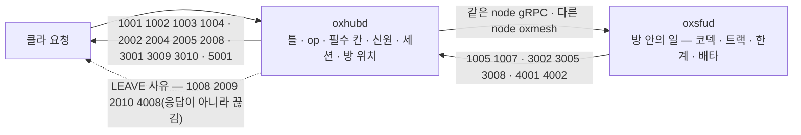
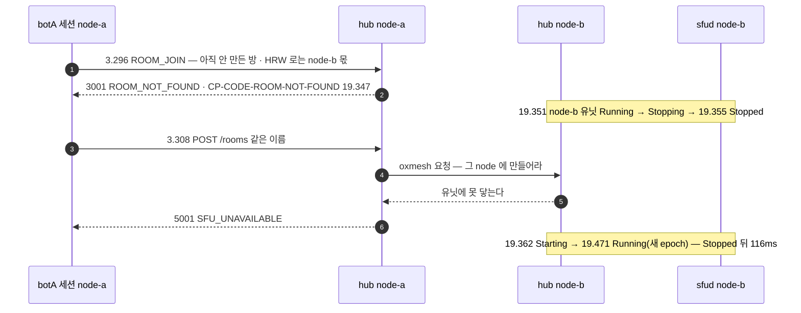

# 12. 실패 코드 — 번호 하나에 뜻 하나 · 첫 숫자가 할 일

> author: kodeholic (powered by Claude) · created: 2026-11-09.
> ★**대조한 커밋** — 서버 `oxlens-sfu` `c3642e8` · SDK `oxlens-sdk-web` `9f40557` · 2층 `oxlens-labs` `fc584ff` · oxpeer `93df1c6`
> ★**실측 회차** — 2층 시나리오 `adv_wire_reject` · `adv_authz` · `adv_resource` · `adv_node_down` · `peer_recorder_unit_down` 한 회차씩. 봇이 일부러 어긋나게 보내고 서버가 어느 번호로 거절하는지 받아 적었다. 값은 돌릴 때마다 바뀌고 차례 · 모양은 같다.

## 1. 30초 요약



- **실패는 `flags=10` 프레임 하나 · body `{code, name, permanent, details?}`**([연:ERR.type.Failure](../protocol/11-err.md#ERR.type.Failure)). ★**첫 숫자가 할 일이다** — 1 클라 버그(고치기 전엔 같다) · 2 신원(새 토큰) · 3 지금 상태에서 안 된다 · 4 한계(줄이거나 기다린다) · 5 서버 사정(기다렸다 다시)([연:ERR.band.1](../protocol/11-err.md#ERR.band.1) ~ [연:ERR.band.5](../protocol/11-err.md#ERR.band.5)).
- **번호 하나에 뜻 하나** — 응답과 끊김 사유(`LEAVE`)가 같은 번호 공간을 쓴다([연:RULE-ERR-ONE-NUMBER-ONE-MEANING](../protocol/11-err.md#RULE-ERR-ONE-NUMBER-ONE-MEANING)). 모르는 번호가 와도 첫 숫자로 판단하면 안 깨진다.
- **실측** — 봇이 쏜 19발이 전부 기대한 번호로 돌아왔다. 다만 서버 로그에 줄이 남는 것은 그중 11발이다(§4-3).

## 2. 등장인물 · 값

| 시나리오 | 무엇을 하나 |
|---|---|
| `adv_wire_reject` | botA · botB(2pc) · botC(1pc)가 한 방에 든 뒤 탐침 19발(4.369 ~ 5.608초 · 약 55ms 간격)을 쏜다 — 한 연결로 닿는 것 · `BIND` 에서만 닿는 것 · HTTP 로만 닿는 것 · 끊김 사유 |
| `adv_authz` | botADV(방 X)가 안 들어간 방 Y 에 발행 · botB 는 방 Y 에서 정상 발행 · botC 는 방 Y 청취 |
| `adv_resource` | botADV 가 한 요청에 트랙 300 · botADV2 가 8개씩 5번 |
| `adv_node_down` | 방에 든 뒤 이 판의 방을 안 든 node 의 sfud 유닛을 내렸다 올린다 — 같은 방 이름으로 내리기 전 · 뒤에 묻는다 |
| `peer_recorder_unit_down` | 녹음기가 든 방의 유닛을 내린다 — 복구 중에 오는 번호(흐름은 [10 §3-6](10_RECOVERY.md)) |

**번호표 — 지금 소스**(`crates/oxsig/src/code.rs` · 39개 · 폐기 셋 2007 · 3003 · 3007 은 번호를 비워 둔다)

| 첫 숫자 | 번호(이 회차에 실제로 받은 것은 굵게) | `permanent` | 할 일 |
|---|---|---|---|
| 1 클라 버그 | **1001** UNKNOWN_OP · **1002** INVALID_PAYLOAD · **1003** MISSING_FIELD · **1004** VERSION_MISMATCH · **1005** CODEC_REQUIRED · 1006 CODEC_MISMATCH · **1007** FIELD_CONFLICT · **1008** PROTOCOL_ERROR | 전부 참 | 다시 보내지 않는다 · 앱에 버그로 |
| 2 신원 | 2001 NOT_BOUND · **2002** TOKEN_INVALID · 2003 TOKEN_EXPIRED · **2004** INVALID_API_KEY · **2005** CLAIM_NOT_ALLOWED · 2006 NOT_AUTHORIZED · **2008** SESSION_NOT_FOUND · **2009** SESSION_REVOKED · **2010** DUPLICATE_SESSION | 2001 · 2003 · 2008 거짓 · 2009 · 2010 없음(LEAVE) · 나머지 참 | 2003 만 새 토큰으로 다시 |
| 3 상태 | **3001** ROOM_NOT_FOUND · **3002** NOT_IN_ROOM · 3004 ROOM_NOT_EMPTY · **3005** TRACK_NOT_FOUND · 3006 TRACK_OP_UNSUPPORTED · **3008** SSRC_COLLISION · **3009** PRECONDITION_FAILED · **3010** PEER_NOT_FOUND · 3011 NOT_PUB_ROOM | 3006 · 3008 참 · 나머지 거짓 | 상태를 바꾼 뒤 다시 |
| 4 한계 | **4001** ROOM_FULL · **4002** TRACK_LIMIT · 4003 QUOTA_EXCEEDED · 4004 LISTEN_LIMIT · 4005 MID_LIMIT · 4006 FLOW_TIMEOUT · 4007 FLOW_OVERFLOW · **4008** HEARTBEAT_TIMEOUT · 4009 OVERLOADED | 4006~4008 없음(LEAVE) · 나머지 거짓 | 줄이거나 기다린다 · 4009 는 `retry_after_ms` 를 하한으로 |
| 5 서버 | **5001** SFU_UNAVAILABLE · 5002 SFU_ERROR · 5003 INTERNAL_ERROR · 5004 SERVER_SHUTDOWN | 5004 없음(LEAVE) · 나머지 거짓 | 기다렸다 다시 |

★`permanent` 는 **모르는 번호용**이다([연:RULE-ERR-PERMANENT-FOR-UNKNOWN](../protocol/11-err.md#RULE-ERR-PERMANENT-FOR-UNKNOWN)) — 같은 첫 숫자 안에서 갈리는 것(2002 ↔ 2003 · 3006 ↔ 나머지)을 덮는다. `LEAVE` 로만 오는 사유는 이 칸이 없다([연:DEV-ERR-LEAVE-PERMANENT-NULL](../protocol/11-err.md#DEV-ERR-LEAVE-PERMANENT-NULL)) — 사유가 닫힌 집합이라 표가 답한다.

## 3. 정상 길 — 거절이 제대로 오는 길

### 3-1. 사유 표 — `adv_wire_reject` 19발

| 보낸 것 | 받은 번호 | `permanent` | 누가 판정 | 서버 로그 줄 |
|---|---|---|---|---|
| op `0x7FFF`(없는 op) | 1001 | 참 | hub `ses/conn.rs`(sfud 에 넘기기 전) | ✗ |
| `ROOM_JOIN{room_id: 12345}`(형이 틀림) | 1002 | 참 | hub | `CP-CODE-INVALID-PAYLOAD … msg=room_id` |
| `ROOM_JOIN{}`(칸 없음) | 1003 | 참 | hub | `CP-CODE-MISSING-FIELD … msg=room_id` |
| `ROOM_JOIN` 없는 방 | 3001 | 거짓 | hub(방 위치 표에 없다) | `CP-CODE-ROOM-NOT-FOUND` |
| video 발행인데 `codec` 없음 | 1005 | 참 | sfud(`details.supported` 에 지원 코덱 전량) | `CP-CODE-CODEC-REQUIRED` |
| 남의 `track_id` 를 `remove` | 3005 | 거짓 | sfud | `CP-CODE-TRACK-NOT-FOUND` |
| `TRACK_SET{muted, duplex}` 둘 다 | 1007 | 참 | sfud | `CP-CODE-FIELD-CONFLICT … msg="muted xor duplex"` |
| `BIND{client_ver: 99}` | 1004 | 참 | hub — 연결이 아예 안 선다 | ✗ |
| `BIND` 위조 토큰 | 2002 | 참 | hub | `SES.S.bind_2002 key=- cause=BIND`(사용자 없음) |
| HTTP `/auth/token` 틀린 비밀 | 2004 | 참 | hub HTTP | ✗ |
| HTTP `/auth/token` 계정이 허용 안 한 `hidden` | 2005 | 참 | hub HTTP | ✗ |
| HTTP `/auth/token` `participant_type: 9` | 1002 | 참 | hub HTTP | ✗ |
| HTTP `GET /rooms` 없는 세션 헤더 | 2008 | 거짓 | hub HTTP | ✗ |
| WS text 프레임 | 1008 | 없음 | hub · ★`LEAVE` — 끊긴다 | ✗ |
| 같은 신원으로 또 `BIND` | 2010 | 없음 | hub · ★옛 연결이 `LEAVE` 를 받는다(새 것이 이긴다) | `SES.S.bind_new` 두 줄(05.815 · 05.822) |
| 운영 절단 | 2009 | 없음 | hub · `LEAVE` | `SES.S.drop_reclaim … cause=cut` |
| 1pc 가 자기 다운링크 SSRC 로 발행 | 3008 | 참 | sfud(한 BUNDLE 의 SSRC 공간) | `CP-CODE-SSRC-COLLISION` |
| HTTP 되돌릴 수 없는 운영 동작에 낡은 확인값(`/admin/rooms/{room}/destroy?if_version=x:1`) | 3009 | 거짓 | hub HTTP | ✗ |
| 정원 1 방에 둘째 입장 | 4001 | 거짓 | sfud(`details.capacity`) | `CP-CODE-ROOM-FULL` |

```
07:12:05.093 node-a proc=hub kind=ev spec=CP-CODE-INVALID-PAYLOAD session=d3579e5a user=botA~adv_wire_reject op=ROOM_JOIN msg=room_id
07:12:05.146 node-a proc=hub kind=ev spec=CP-CODE-MISSING-FIELD   session=d3579e5a user=botA~adv_wire_reject op=ROOM_JOIN msg=room_id
07:12:05.364 node-a proc=hub kind=ev spec=CP-CODE-FIELD-CONFLICT  session=d3579e5a user=botA~adv_wire_reject op=TRACK_SET msg="muted xor duplex"
07:12:05.480 node-a proc=hub kind=ev spec=SES.S.bind_2002 area=SES key=- from=- to=- cause=BIND
07:12:06.088 node-a proc=hub kind=ev spec=SES.S.drop_reclaim session=e603ee29 user=cutprobe~adv_wire_reject from=live+bound to=- cause=cut
```

- **19발 전부 기대한 번호와 같았다**(`reject_probe` 의 `expect` = `got_code`). 응답은 모두 ms 안이다.
- **1002 와 1003 은 op 를 가리지 않는다** — 칸이 없으면 1003 · 있는데 형이 틀리면 1002 다. HTTP 의 `participant_type: 9` 도 같은 1002 다([연:RULE-ERR-ONE-NUMBER-ONE-MEANING](../protocol/11-err.md#RULE-ERR-ONE-NUMBER-ONE-MEANING)). 칸이 빠졌을 때의 번호를 따로 정한 칸만 예외다 — video `codec` 은 1005.
- **어느 쪽이 판정했든 WS op 실패는 hub 가 한 줄을 찍는다** — sfud 가 판정한 1005 · 3005 · 1007 · 3008 · 4001 도 hub 의 `CP-CODE-<이름>` 이다(`oxhubd/src/ses/mod.rs` `handle_request`). 그 밖의 길은 §4-3.

### 3-2. 권한 — 안 들어간 방에 발행(`adv_authz`)

```
0.422 botADV send PUBLISH_TRACKS {"room_id":"roomY_…", tracks:[audio ssrc 2902458369]}   ← botADV 는 방 X 에만 있다
0.427 botADV recv PUBLISH_TRACKS {"code":3002,"name":"NOT_IN_ROOM","permanent":false}     ← 5ms
0.427 botB   send PUBLISH_TRACKS(방 Y · 정상) → 0.431 botC recv TRACK_EVENT add · MLINE_EVENT arev 2
— RTP 묶음 —
  botC recv ssrc 16798210 개수 229 …   ← botB 것 하나뿐 · botADV 의 SSRC 는 한 패킷도 없다
```
- 거절은 3002(들어가고 다시)다. 2006 NOT_AUTHORIZED 가 아니다 — 그것은 토큰의 권한 비트가 막은 종류를 올릴 때다([연:ERR.band.2](../protocol/11-err.md#ERR.band.2)).
- ★**대상이 안 변했다** — botC 가 받은 트랙은 botB 것 하나다. hub 로그 `CP-CODE-NOT-IN-ROOM … op=PUBLISH_TRACKS`.

### 3-3. 한계 — 트랙 수(`adv_resource`)

```
0.563 botADV  send PUBLISH_TRACKS tracks[300]
0.580 botADV  recv {"code":4002,"name":"TRACK_LIMIT","permanent":false,"details":{"current":300,"limit":8}}   ← 17ms · 요청당 8
0.580 botADV2 send tracks[8] → 0.584 ok · track_id 8개
0.584 botADV2 send tracks[8] → 0.587 ok · track_id 8개(누적 16)
0.587 botADV2 send tracks[8] → 0.590 {"code":4002,…,"details":{"current":24,"limit":16}}   ← 사람당 활성 16
      … 0.592 · 0.593 같은 거절 둘 더
```
- 한계는 둘이다 — 요청당 8 · 사람당 활성 16(`oxsfud/src/ops/media.rs` `PER_REQUEST` · `PER_PERSON`). `details.current` 는 「받아들이면 되는 수」(16 + 8 = 24)다.
- ★**일부만 받지 않는다** — 300 을 보내면 8 만 받는 것이 아니라 통째로 거절이다. 정상 봇 botB · botC 의 발행 · 수신은 그대로다. hub 로그 `CP-CODE-TRACK-LIMIT` 넷.

### 3-4. 끊김 사유 — `LEAVE` 는 응답이 아니다

| 사유 | 언제 | 이 회차 | 클라가 할 일 |
|---|---|---|---|
| 1008 PROTOCOL_ERROR | 프레임 손상 · text 프레임 · 묶인 소켓의 둘째 `BIND` | `adv_wire_reject` | 클라 버그 — 다시 붙지 않는다 |
| 2001 NOT_BOUND | `BIND` 전에 다른 op(응답 없이 끊는다 — [연:SES.S.pre_bind_other](../protocol/03-ses.md#SES.S.pre_bind_other)) | 재지 않았다 | 클라 버그 |
| 2009 SESSION_REVOKED | 운영 절단 | `adv_wire_reject` · `peer_*_session_cut` | 세션을 버리고 새로 붙어도 된다 → 재구축([10 장](10_RECOVERY.md) ④) |
| 2010 DUPLICATE_SESSION | 같은 신원이 다른 데서 들어왔다 | `adv_wire_reject` | 붙지 마라 — 붙으면 또 쫓아낸다 |
| 4006 · 4007 | 통지 ACK 시한 · 밀린 통지 상한([연:RULE-TRN-FLOW-CONTROL](../protocol/02-trn.md#RULE-TRN-FLOW-CONTROL)) | 재지 않았다 | 흐름 제어 — 다시 붙는다 |
| 4008 HEARTBEAT_TIMEOUT | 아무것도 안 받은 채 시한이 지났다 | `peer_recorder_freeze`(녹음기가 깨어나 읽었다) | 다시 붙는다 → 이어받기([10 장](10_RECOVERY.md) ②) |
| 5004 SERVER_SHUTDOWN | 서버가 내려간다 | 재지 않았다 | 사다리로 같은 곳에 |

- 끊김의 사유는 이 프레임 하나가 나른다 — WS Close 에는 코드를 두지 않는다([연:RULE-SES-LEAVE-CARRIES-REASON](../protocol/03-ses.md#RULE-SES-LEAVE-CARRIES-REASON) · [연:RULE-ERR-CLOSE-EMPTY](../protocol/11-err.md#RULE-ERR-CLOSE-EMPTY)). 전송을 바꿔도 사유 계약은 그대로 선다.
- 발언권 거절 · 회수는 이 번호 공간 밖이다 — DC 의 `DENY` · `REVOKE` 사유로 온다([연:RULE-ERR-FLOOR-OUTSIDE](../protocol/11-err.md#RULE-ERR-FLOOR-OUTSIDE) · [07 장](07_FLOOR.md)).

## 4. 깨지는 길

### 4-1. 모르는 방(3001)과 못 닿는 node(5001) — `adv_node_down`



- **3001 과 5001 은 다른 말이다.** 배치를 **모르는** 방은 3001 — 앱은 「방이 없다」고 안내하면 된다. 배치는 아는데 그 node 에 **못 붙는** 것이 5001 — 기다렸다 다시다([연:ERR.band.5](../protocol/11-err.md#ERR.band.5)). 둘을 합치면 앱이 서버 사정을 「방이 없다」로 잘못 안내한다.
- ★5001 이 사는 곳은 **방 만들기**다. 이미 있던 방의 유닛이 죽으면 그 node 의 배치가 풀려 「배치를 모르는 방」이 되고, 그 뒤 그 방 op 은 5001 이 아니라 3001 이다(2층 `oxe2epy` 시나리오 머리 기록). 아래 §4-2 의 녹음기가 받은 3001 이 그것이다.
- **관문은 빈 성공으로 답하지 않는다** — node-b 의 hub 가 제 sfud 에 못 닿으면 그 실패를 그대로 돌려준다. 안 그러면 「방은 없는데 `POST /rooms` 가 201」이 된다. 유닛 하나가 죽어도 node-b 의 hub 는 살아 있고, 116ms 창에 그 node 로 온 요청만 5001 이다. 유닛 줄을 읽는 법은 [14 장](14_OXMESH.md).
- 여러 node 에서 방이 어디 있나는 [13 장](13_MULTI_NODE.md).

### 4-2. 복구 중에 오는 번호 — 첫 숫자로만 판단한다(`peer_recorder_unit_down`)

녹음기가 든 방의 미디어 유닛이 죽자 녹음기는 `ICE_RESTART` 에 `3010 PEER_NOT_FOUND` 를, 재구축의 `ROOM_JOIN` 에 `3001 ROOM_NOT_FOUND`(`permanent: false`)를 받았다. 흐름 · 서버 줄 · 시각은 집인 [10 §3-6](10_RECOVERY.md) 에 있다 — 여기서 볼 것은 그 두 번호를 어떻게 읽었나다.

- **SDK 는 번호마다 칸을 두지 않는다** — 미디어 연결 수리에서 응답은 첫 숫자의 뜻으로만 받는다([연:RULE-LINK-RECOVERY-TIERS](../protocol/09-link.md#RULE-LINK-RECOVERY-TIERS)): `3xxx` = 치료 불가 확정 → 그 서버만 재구축 · `5xxx` = 같은 치료를 간격을 벌려 다시 · 답 없음 = WS 증상 · `1xxx` = 클라 버그. 그래서 `3010` 이 오자 재시도 없이 재구축으로 올라갔고, 재구축의 `ROOM_JOIN` 이 `3001` 이라 그 서버 연결을 닫았다. 번호가 늘어도 칸이 비지 않는다 — SDK 에 `3010` 전용 갈래가 없어도 맞게 움직였다.
- **`3001` 이 `5001` 이 아닌 까닭** — 유닛이 죽으면 그 node 의 배치가 풀려 「배치를 모르는 방」이 된다(§4-1). 그래서 「기다렸다 다시」(5)가 아니라 「지금 상태에서 안 된다」(3)로 왔다.

### 4-3. 한 단계 더 나쁜 경우 — 클라는 받았는데 서버 로그에는 없다

19발 가운데 서버 로그에 줄이 남는 것은 11발이다 — `CP-CODE-*` 8 · `SES.S.bind_2002` 1 · `drop_reclaim cause=cut` 1 · `bind_new` 두 줄로 짐작하는 2010 1. ★**나머지 8발은 줄이 없다**:

| 줄이 없는 것 | 왜(소스) |
|---|---|
| 1001 | `ses/conn.rs` 가 op 표에 없으면 바로 답한다 — 세션 처리 고리(`handle_request`)를 안 지난다 |
| 1004 | `fail_bind` 가 이름표 없이 부른다(계수만 센다) |
| HTTP 2004 · 2005 · 1002 · 2008 · 3009(· `adv_node_down` 의 5001) | HTTP 실패는 상태 코드와 body 만 돌려준다 — 줄도 계수도 없다 |
| 1008(text 프레임) | `LEAVE` 사유는 끊김 줄에만 실린다 — 이 탐침은 세션이 서기 전이라 그 줄도 없다 |

- 같은 구멍이 끊김 쪽에도 있다 — 하트비트 시한으로 `LEAVE 4008` 을 보냈는데 hub 의 끊김 줄은 `in.c=0` 이다([10 장](10_RECOVERY.md) §4-2, 결함 의심). 2010 으로 쫓겨난 옛 세션(`3f6b8aaa`)은 끝을 알리는 줄이 따로 없고 새 세션의 `bind_new` 로만 보인다 — `oxhubd/src/ses/mod.rs` `dispose` 가 라벨이 `SES.S.bind_new` 면 옛 세션 줄을 건너뛴다(새 세션 줄이 있으니 일부러 안 남긴다).
- **누가 먼저 아나** — 클라만 안다. 운영자가 「이 사용자가 왜 못 들어왔나」를 서버 로그로 찾으면 토큰 · 세션 헤더 · 버전 실패는 안 보인다.
- **보는 법** — hub 계수 `/admin/drops` 의 `code_<번호>` 는 `BIND` 실패와 세션 WS op 실패만 센다(HTTP · `LEAVE` 는 안 센다). 사건 이력으로 한 사용자를 모아 보는 법은 [17 장](17_OPERATIONS.md).

## 5. 왜 이 모양인가

- **번호 하나에 뜻 하나** — WS Close 코드에 대역을 따로 두면 「Failure 4004」와 「Close 4004」로 표기가 갈린다. 끊김 사유를 `LEAVE` 로 옮겨 같은 번호 공간을 쓰니 그 겹침이 없다([연:RULE-ERR-ONE-NUMBER-ONE-MEANING](../protocol/11-err.md#RULE-ERR-ONE-NUMBER-ONE-MEANING) · [연:RULE-ERR-CLOSE-EMPTY](../protocol/11-err.md#RULE-ERR-CLOSE-EMPTY)). 사유를 앱 메시지가 나르는 꼴은 LiveKit `LeaveRequest` · MQTT 5 `DISCONNECT` · SSH `SSH_MSG_DISCONNECT` 를 본떴다([연:R-SES-LEAVE-PRIOR-ART](../protocol/03-ses.md#R-SES-LEAVE-PRIOR-ART)).
- **「얼마나 기다렸다 다시」는 싣지 않는다** — 방이 언제 빌지 · 미디어 서버가 언제 돌아올지는 서버도 모른다. 모르는 값을 실으면 클라가 그 값을 믿고 기다려, 틀린 값 하나가 백오프를 통째로 대신한다([연:R-ERR-NO-RETRY-AFTER-WHY](../protocol/11-err.md#R-ERR-NO-RETRY-AFTER-WHY)). 예외는 4009 의 억제값 하나다 — 예측이 아니라 「적어도 이만큼은 다시 오지 마라」라 틀려도 늦게 올 뿐 깨지지 않는다([연:RULE-ERR-4009-SUPPRESS](../protocol/11-err.md#RULE-ERR-4009-SUPPRESS)).
- **정하지 않은 실패의 기본값** — 1xxx 와 `permanent: true` 는 다시 보내지 않는다 · 그 밖은 사다리의 300 · 1200 · 2700ms 칸으로 최대 3회 · 상태는 바뀌지 않는다([연:RULE-ERR-CLIENT-FAIL-DEFAULT](../protocol/11-err.md#RULE-ERR-CLIENT-FAIL-DEFAULT)). 웹 SDK 와 oxpeer 는 입장 재시도를 같은 한 줄로 거른다 — `!permanent && code >= 2000 && code != 4009 && 다시 안 보낼 표에 없음`.
- **버린 길** — 2026년 8월 말의 구판은 wire 오류 15종이 한 축에 있었고 내부 열거형은 실제로 내는 5종뿐이었다(선행 사례 대장 2-2). 폐기 번호는 이유를 남기고 비워 둔다 — 2007 은 「세션 중복은 실패가 아니라 축출」이라 2010 `LEAVE` 로 바뀌었고, 3003 · 3007 은 그 번호를 낼 곳이 없어졌다.

> ★**우리만의 것 — 번호 하나에 뜻 하나 · 첫 숫자 = 할 일**
> - **선택 배경** — 클라는 서버보다 늦게 고쳐진다. 서버가 번호를 늘릴 때마다 클라가 표를 갱신해야 하면 그 사이 클라가 깨진다. 그래서 번호의 첫 숫자가 「무엇을 고쳐야 하나」를 답하게 하고, 같은 첫 숫자 안에서 갈리는 것만 `permanent` 로 덮었다([연:RULE-ERR-UNKNOWN-BY-LEAD](../protocol/11-err.md#RULE-ERR-UNKNOWN-BY-LEAD)).
> - **얻은 것** — 19발 전부 기대 번호(`expect` = `got_code`) · 응답과 `LEAVE` 사유가 한 표다 · 복구 수리는 첫 숫자 넷으로 끝난다(§4-2 — 3010 을 몰라도 「3 = 치료 불가」로 맞게 움직인다).
> - **잃은 것** — 한 번호가 원인 둘을 덮는 곳이 있다 — 3001 은 「배치를 모르는 방」과 「유닛과 함께 죽어 배치가 풀린 방」을 가르지 않아, 앱은 「원래 없던 방」과 「방금 사라진 방」을 구별하지 못한다. 진단 해상도가 클라에 보내는 어휘에 묶인다 — 서버 쪽만의 더 잘게 쪼갠 사유 축은 없다.

## 6. 다른 SFU 는

> 저쪽 소스에는 이렇게 적혀 있다(실측 아님).

| 상대 | 그쪽 방식 | 우리 | 우리 쪽 장점 | 우리 쪽 대가 |
|---|---|---|---|---|
| LiveKit(`livekit §5-2`) | 내부 진단 30종 · 클라 노출 13종을 가르고 사상 함수로 잇는다 · 시그널 종료 사유는 또 다른 축 11종 | 한 번호 공간 39개 — 응답 · 끊김 사유 공용 · 서버 전용 축 없음 | 사상 표를 유지할 일이 없다 | 진단 해상도가 클라 어휘에 묶인다(§5 상자) |
| LiveKit(`livekit §3-3`) | 실패 응답에 원 요청을 통째로 되돌려 어느 요청이 거절됐는지 대조 | 8바이트 머리의 요청 번호로 짝을 맞추고([02 장](02_CONNECT_JOIN.md)) body 는 번호 · 이름 · `permanent` · `details` | 응답이 작다 | 원 요청은 클라가 들고 있어야 한다 |
| Janus(`Janus §4-1`) | 종료 사유는 문자열 하나(`hangup_reason`) · 상태는 비트 플래그 21개 | 숫자 번호 + 첫 숫자의 뜻 | 기계가 판단할 수 있다 | — |
| LiveKit(`livekit §5-3`) | 같은 신원이 또 오면 옛 참가자를 `DUPLICATE_IDENTITY` 로 내보내고 close 알림을 생략(깜빡임 방지) | 새 `BIND` 가 이기고 옛 연결은 `LEAVE 2010` | 옛 기기가 「붙지 마라」를 번호로 안다 | 옛 세션의 끝이 서버 로그에 따로 안 남는다(§4-3) |
| LiveKit(`livekit §12-2`) | node 한도(트랙 수 · 초당 바이트)를 넘으면 입장 거부 | 방 정원 4001(`details.capacity`) · 요청당 8 · 사람당 16 개수 한계 4002 · 과부하 억제 4009 | 거절 이유와 한도를 `details` 로 준다 | node 전체 대역으로 거르는 축은 이 회차로 확인하지 않았다 |

## 7. 운영에서 보는 법

| 무엇 | 줄 · 표면 |
|---|---|
| 세션 WS op 실패 | `kind=ev spec=CP-CODE-<이름> session=<지문> user=<사용자> op=<op> msg=<칸 이름 · 사유>` — 판정이 sfud 였어도 hub 가 찍는다 |
| `BIND` 실패 | 토큰은 `SES.S.bind_2002` · `SES.S.bind_2003`(사용자 없음 · `key=-`) · 버전 · body 실패는 줄 없음 |
| 운영 절단 · 중복 | `SES.S.drop_reclaim … cause=cut` · 같은 사용자의 `SES.S.bind_new` 가 잇달아 둘 |
| 끊김 사유 | `SES.S.drop … in.c=<번호>` — 지금은 0 이 찍힐 수 있다([10 장](10_RECOVERY.md) §4-2) |
| 계수 | `/admin/drops` 의 `code_<번호>` — `BIND` 실패 · 세션 WS op 실패만 |
| 유닛 · 배치 | `SV-STATE-UNIT-STATE` — [14 장](14_OXMESH.md) |

- SDK 쪽 — 실패는 `Fault { code, name, permanent }` 로 앱에 오고, 입장은 `ROOM.C.JOINING` 입구에서 번호로 갈린다([연:ROOM.C.JOINING](../protocol/04-room.md#ROOM.C.JOINING)). 사건 이력으로 한 사용자의 실패를 모아 보는 법은 [17 장](17_OPERATIONS.md).

## 8. 소스 · 규격 좌표

| 무엇 | 서버 | SDK · oxpeer | 규격 |
|---|---|---|---|
| 번호표(번호 · 이름 · `permanent` · 폐기) | `crates/oxsig/src/code.rs` `Code` · `row` · `RETIRED` | `src/internal/wire/ws.ts`(오류 코드 표) | [연:ERR.band.1](../protocol/11-err.md#ERR.band.1) ~ [연:ERR.band.5](../protocol/11-err.md#ERR.band.5) · [연:ERR.type.Failure](../protocol/11-err.md#ERR.type.Failure) · [연:RULE-ERR-FAILURE-FORM](../protocol/11-err.md#RULE-ERR-FAILURE-FORM) |
| hub 가 거르는 것 | `oxhubd/src/ses/conn.rs`(없는 op · text 프레임 · 하트비트 시한) · `ses/mod.rs` `bind` · `fail_bind` · `route`(`room_route` → 3001 · `node_of_epoch` → 3010) · `ses/token.rs`(2004 · 2005) · `ops/http.rs`(2008) · `ops/admin.rs`(3009) | — | [연:RULE-ERR-ONE-NUMBER-ONE-MEANING](../protocol/11-err.md#RULE-ERR-ONE-NUMBER-ONE-MEANING) · [연:RULE-SES-BIND-FAIL](../protocol/03-ses.md#RULE-SES-BIND-FAIL) |
| 실패 로그 · 계수 | `oxhubd/src/ses/mod.rs` `handle_request`(`CP-CODE-*`) · `ops/admin.rs` `drops`(`code_<번호>`) | — | — |
| sfud 가 판정하는 것 | `oxsfud/src/ops/media.rs` `publish`(1005 · 3008 · 4002) · `joined`(3002) · `unpublish`(3005) · `track_set`(1007) · `ops/rooms.rs`(4001) | — | [연:PUB.op.PUBLISH_TRACKS](../protocol/07-pub.md#PUB.op.PUBLISH_TRACKS) · [연:RULE-PUB-SET-EXCLUSIVE](../protocol/07-pub.md#RULE-PUB-SET-EXCLUSIVE) |
| node 간 실패 → 5001 | `oxhubd/src/bus/mod.rs` `call` · `call_local` | — | — |
| 클라 기본 처리 · 첫 숫자 | — | `src/domain/room/core.ts`(입장 재시도) · `src/domain/gen/room_client.ts` · oxpeer `src/core/room.rs` | [연:RULE-ERR-CLIENT-FAIL-DEFAULT](../protocol/11-err.md#RULE-ERR-CLIENT-FAIL-DEFAULT) · [연:RULE-ERR-UNKNOWN-BY-LEAD](../protocol/11-err.md#RULE-ERR-UNKNOWN-BY-LEAD) · [연:RULE-LINK-RECOVERY-TIERS](../protocol/09-link.md#RULE-LINK-RECOVERY-TIERS) |
| 끊김 사유 | `oxhubd/src/ses/conn.rs` `leave` · `ses/mod.rs` `cut` · `evict_sid` | — | [연:SES.op.LEAVE](../protocol/03-ses.md#SES.op.LEAVE) · [연:RULE-SES-LEAVE-CARRIES-REASON](../protocol/03-ses.md#RULE-SES-LEAVE-CARRIES-REASON) · [연:DEV-ERR-LEAVE-PERMANENT-NULL](../protocol/11-err.md#DEV-ERR-LEAVE-PERMANENT-NULL) |

## 9. 스스로 확인하는 질문

<details><summary>1. 같은 사람이 폰과 PC 에서 동시에 들어오면?</summary>

뒤에 온 쪽이 이긴다. 새 `BIND` 가 성공하고 앞 연결이 `LEAVE 2010` 을 받는다(§3-1 — `dupprobe` 의 `bind_new` 두 줄). 앞 연결은 다시 붙지 말아야 한다 — 붙으면 또 뒤 연결을 쫓아낸다.
</details>

<details><summary>2. 3001 을 받았다. 서버가 죽은 건가?</summary>

꼭 그렇지 않다. hub 가 그 방의 위치를 모른다는 뜻이다 — 원래 없던 방이거나, 그 방을 든 유닛이 죽어 배치가 풀린 방이다(§4-1 · §4-2). 서버에 못 닿는 것은 5001 이고 그때는 기다렸다 다시 보낸다.
</details>

<details><summary>3. 트랙 300 개를 보냈더니 4002 다. 8 개는 받아 줬나?</summary>

아니다 — 통째로 거절이다(§3-3). `details.limit` 8 로 나눠 다시 보내야 하고, 사람당 활성 16 도 넘지 못한다(그때의 `details.current` 는 「받아들이면 되는 수」 24 다).
</details>

<details><summary>4. (깨지는 길) 녹음기가 3010 을 받고 왜 재시도 없이 재구축으로 갔나? SDK 에 3010 전용 처리가 있나?</summary>

전용 처리는 없다. 미디어 연결 수리는 응답을 첫 숫자의 뜻으로만 받는다 — 3xxx 는 「서버가 그 연결을 모른다 · 치료 불가 확정」이라 그 서버만 재구축한다(§4-2). 5xxx 였다면 같은 `ICE_RESTART` 를 간격을 벌려 다시 했을 것이다.
</details>

<details><summary>5. (깨지는 길) 사용자가 「토큰 오류로 못 들어갔다」고 한다. 서버 로그에서 찾을 수 있나?</summary>

위조 · 만료 토큰으로 `BIND` 했다면 `SES.S.bind_2002` · `SES.S.bind_2003` 줄이 있다 — 다만 사용자 칸이 없어(`key=-`) 시각으로만 짚는다. HTTP `/auth/token` 단계의 2004 · 2005 였다면 줄도 계수도 없다(§4-3).
</details>
