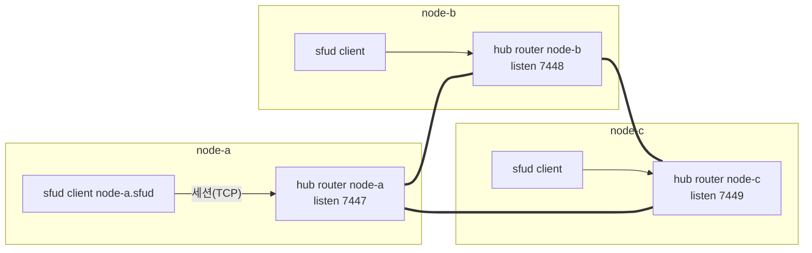

# 12. oxmesh — node 사이 버스의 관리 구조 · 관리 항목 · 실측

> author: kodeholic (powered by Claude) · created: 2026-11-04.
> ★**대조한 커밋** — 서버 `oxlens-sfu` `45fc07d`(`crates/oxmesh` · `oxhubd/src/bus` · `oxsfud/src/bus`).
> ★**실측 회차** — 한 기계 위 세 node(hub + sfud) 개발 형상의 서버 로그와 운영 표면(`/admin/bus`). 값은 돌릴 때마다 바뀌고, 차례 · 모양은 같다.
> 06 장이 「요청 · 통지 · 미디어가 어느 길로 가나」를 그렸다면, 이 장은 그 길을 받치는 버스 자체 — 누가 누구에게 붙고 · 무엇을 선언하고 · 죽고 살 때 무엇이 보이고 · 운영자가 무엇을 읽을 수 있나 — 를 본다.

## 0. 한 줄 목적 · 등장인물

**node 가 셋일 때 버스는 어떤 모양으로 서고, 무엇이 버스 위에 「있다」고 선언되며, node 하나가 죽거나 멎었다 깨어날 때 다른 node 는 무엇을 보고 어떻게 판단하나.**

| 이름 | 실제 값 | 무엇 |
|---|---|---|
| router | hub 마다 하나 — `node-a` · `node-b` · `node-c`(프로세스 안에 임베드) | 서로 ★**전부 직접** 잇는다(한 홉 · 중계 없음) |
| client | sfud 마다 하나 — `node-a.sfud` · … | ★**제 node 의 router 하나에만** 붙는다 |
| 버스 주소 | router listen `127.0.0.1:7447` · `7448` · `7449` · 시드 `connect` = 다른 둘 | 설정 `[bus]`(hub) · `--bus-connect`(sfud) |
| 이름 공간 | `oxdev` → 키 앞자리 `ox/oxdev/int/` | 배포마다 다르다(`--bus-namespace`) |
| 기동 신원 `inst` | hub `04734ceb5601cafe`(node-a) … · sfud 의 `epoch` `cbfad6d8e0dccabf` | 기동마다 새 값 — 토큰 키에 박힌다 |

## 1. 큰 그림 — 그물 · 선언 · 레인



| 선언(토큰 — 값 없이 키뿐) | 누가 | 키 | 누가 본다 |
|---|---|---|---|
| node | hub(유닛이 준비되면) | `node/{node}/{inst}` | 모든 hub(node 집합 · 요청 전 생존 선판정) · ★sfud 도(홈 잃음 판정) |
| 방 | ★**sfud**(방이 생기면) | `room/{room}/{node}/{inst}` | 모든 hub — ★**이것이 방 → node 표**다(06 §3-1) |
| 세션 | hub(`BIND` 뒤) | `sess/{user}/{node}/{sid}` | ★구독하지 않는다 — 필요할 때 get(넘겨받기 · 운영 `cut`) |

| 레인(세션마다 큐 넷) | 무엇 | 차면 |
|---|---|---|
| 제어 | Hello · keepalive · Close | 한도 없음 |
| 선언 | 토큰 · 구독 · router 목록 | 한도 없음 |
| 요청 | `q/node/{node}/…` Request · Reply · Final | 부르는 쪽에 오류 답 |
| 데이터 | `ev/room/{room}` · `ev/user/{user}` put(통지) | ★**버리고 센다** — 세션은 안 닫는다 |

- **선언은 통보가 아니다.** 주체가 죽으면 아무도 지우지 않아도 세션과 함께 키가 사라진다 — 방 소멸 통보를 빠뜨려 죽은 방이 node 를 영영 무는 실패 모드가 없다. 세션이 서면 양쪽이 제가 든 선언 전부를 다시 보낸다(— S3).
- **한 홉이다.** router 는 다른 router 에서 받은 것을 또 다른 router 로 넘기지 않는다 — 그래서 트리 계산 · node 번호가 없고, 100대 미만을 전제한다(— — 100대 실측: 그물이 서기까지 6.1초 · 토큰 하나가 전부에 닿는 p99 4.1ms · 노는 node CPU 0.27%).
- **이벤트가 몰려도 토큰을 못 죽인다.** 통지는 데이터 레인, 토큰은 선언 레인 — 큐가 따로라 통지 폭주가 keepalive 를 막아 세션(그 node 의 토큰 전부)을 잃는 결말이 없다.

## 2. 관리 항목 — 운영자가 읽는 것

### 2-1. `GET /admin/bus` — 이 hub 가 보는 버스

```json
{ "node": "node-a", "inst": "04734ceb5601cafe", "namespace": "oxdev",
  "listen": ["tcp/127.0.0.1:7447"], "connect": ["tcp/127.0.0.1:7448", "tcp/127.0.0.1:7449"],
  "peers": [
    { "node": "node-a.sfud", "role": "client", "links": ["127.0.0.1:56510 · dialer node-a.sfud · sno 1"] },
    { "node": "node-b",      "role": "router", "links": ["127.0.0.1:58970 · dialer node-b · sno 1"] },
    { "node": "node-c",      "role": "router", "links": ["127.0.0.1:58984 · dialer node-c · sno 1"] } ],
  "nodes": [ { "node": "node-a", "inst": "04734ceb5601cafe", "self": true },
             { "node": "node-b", "inst": "1d1afcfccb23eb85" }, { "node": "node-c", "inst": "3f132f629299cfc0" } ],
  "rooms_seen": [ { "room_id": "br7669c4", "node": "node-c", "inst": "865e7db278d8a781" }, … ],
  "isolated": null,
  "last_event": { "at_ms": 1793778984103, "kind": "delete", "key": "room/qa_fault_nopublish/node-c/19955075df6ed529" } }
```

| 칸 | 뜻 | 어디서 |
|---|---|---|
| `peers` | 지금 선 세션 — 상대 · 역할(router / client) · 주소 · ★누가 dial 했나(`dialer`) · 그 프로세스의 세션 번호(`sno`) | 버스 `info()` |
| `nodes` | `node` 토큰이 살아 있는 node 집합(내 것 포함) — 요청 길의 생존 선판정 집합 | hub 의 `View.nodes` |
| `rooms_seen` | 남의 node 에 있는 방(방 토큰) — 방 → node 표의 타 node 몫 | `View.routing` |
| `isolated` | 고립 판정 — `{since_ms, held_rooms}` 이면 「남의 토큰이 일괄로 사라졌고 그 뒤 아직」 | `View.isolated` |
| `last_event` | 마지막 토큰 사건(put / delete · 키) — 「버스가 살아 움직이나」의 가장 싼 증거 | `View.last_event` |

- `?all=1` 을 붙이면 ★**모든 node 의 같은 표**를 한 번에 — hub 가 `q/node/{node}` 요청(`what = bus`)으로 모아 `{"asked": "node-a", "nodes": [{node, bus} …]}` 로 낸다. 실패한 node 는 그 자리에 `error` 가 적힌다(빠뜨리지 않는다 — —). 이 회차에서 node-b 의 표는 `peers` 에 `node-c … sno 5` 가 있다 — node-b 프로세스가 node-c 쪽으로 다섯 번째 세션을 열었다는 뜻(앞의 넷은 재기동 · 교체로 닫혔다).
- ★같은 사실을 세 hub 가 각자 든다 — `nodes` 셋이 같은 `inst` 를 보이면 그물이 수렴한 것이다.

### 2-2. 로그 줄 — 버스가 스스로 남기는 것(`kind=diag` · 대상 `oxmesh::…`)

| 줄 | 언제 |
|---|---|
| `mesh open router=true listen=… connect=… lease_ms=10000` | router 가 섰다(hub 부팅) · `router=false connect=…` 는 client(sfud) |
| `mesh session up peer=… dialer=… sno=… addr=… role=Router/Client` | 세션이 섰다 — 양쪽에 한 줄씩 |
| `mesh session down peer=… reason=shutdown/expired/fenced/replaced/refused/duplicate/protocol/io` | 세션이 닫혔다 — 닫는 까닭이 `reason` |
| `mesh closed` | 그 프로세스의 버스가 닫혔다 |
| `mesh fenced — tick gap over lease` | ★멈췄다 깨어난 프로세스가 제 세션을 전부 닫았다(옛 바이트를 믿지 않는다 — —) |
| `mesh partial — router seen by neighbours but not linked to me` | 부분 단절 — 이웃은 보는데 나는 안 이어진 router 가 lease 넘게 있다 |

hub 가 버스 위에서 판단해 남기는 줄(대상 hub):

| 줄 | 뜻 |
|---|---|
| `node token declared` | 유닛이 준비되어 제 `node` 토큰을 선언했다 |
| `bus isolated — other node tokens all gone (live view …)` · `bus isolation over — …` | 남의 node 토큰이 일괄로 사라졌다 = ★내가 고립됐다 · 다시 보였다 |
| `drop candidate: room token delete settled (live view …)` → `room token gone — local routing dropped` | 방 토큰 Delete 를 가라앉힌 뒤 몰아 판정 — 고립이 아니면 그 방의 로컬 라우팅(관심 구독 · 멤버 표)을 거둔다 |
| `local hub token back — room tokens redeclared (n)` | (sfud) 제 hub 의 node 토큰이 다시 보여 방 토큰을 전량 다시 선언했다 |

### 2-3. 설정 — 어디에 무엇을

| 자리 | 값 | 뜻 |
|---|---|---|
| hub `[bus] listen` | `tcp/127.0.0.1:7447` | 남이 나에게 dial 할 주소(묶는 주소) |
| hub `[bus] connect` | 다른 router 들 | ★시드 — 처음 붙을 길. 방향 규칙과 상관없이 건다 · 새 node 가 들어와도 기존 node 의 설정은 안 고친다 |
| hub `[bus] advertise` | 비면 listen · `0.0.0.0` 이면 상대가 본 내 IP | NAT · 중계기 뒤에서만 손댄다 |
| sfud `--bus-connect tcp/127.0.0.1:7447` · `--bus-namespace oxdev` | 제 hub 하나 | hub 가 유닛을 띄울 때 넘긴다 |
| lease 10,000ms · keepalive = lease/4 · 재연결 100ms 부터 두 배 · 상한 250ms | 값은 — | 양쪽이 각자 잰다 |

## 3. 실측

### 3-1. hub 하나가 다시 뜬다 — node-b(23:43:03 → 05)

```
23:43:03.767 node-b hub  mesh session down peer=node-a dialer=node-b sno=1 reason=shutdown   ← node-b 가 내려간다
23:43:03.767 node-b hub  mesh session down peer=node-c dialer=node-b sno=5 reason=shutdown
23:43:03.767 node-b hub  mesh closed
23:43:03.767 node-a hub  mesh session down peer=node-b dialer=node-b sno=1 reason=shutdown   ← a · c 가 같은 ms 에 안다(FIN)
23:43:03.767 node-c hub  mesh session down peer=node-b dialer=node-b sno=5 reason=shutdown
23:43:05.343 node-b hub  mesh open router=true listen=127.0.0.1:7448 connect=127.0.0.1:7447,127.0.0.1:7449 lease_ms=10000
23:43:05.345 node-b hub  mesh session up peer=node-a dialer=node-b sno=1 addr=127.0.0.1:7447 role=Router   ← 시드로 둘 다 dial(2ms)
23:43:05.345 node-b hub  mesh session up peer=node-c dialer=node-b sno=2 addr=127.0.0.1:7449 role=Router
23:43:05.345 node-a hub  mesh session up peer=node-b dialer=node-b sno=1 addr=127.0.0.1:58727 role=Router
23:43:05.725 node-b sfu  sfud boot … bus-connect=127.0.0.1:7448                              ← 버스 → sfu 차례
23:43:05.731 node-b sfu  mesh open router=false connect=127.0.0.1:7448
23:43:05.731 node-b hub  mesh session up peer=node-b.sfud dialer=node-b.sfud sno=1 role=Client
23:43:05.760 node-b hub  SV-STATE-UNIT-STATE unit=node-b from=Starting to=Running cause=hello · "node token declared"
```
- **기동 차례는 버스 → sfu 다** — 거꾸로면 sfud 가 붙을 router 가 없어 첫 선언이 유실된다.
- **죽음은 즉시 보인다** — 정상 종료라 FIN 이 왔고 a · c 가 같은 ms 에 `session down` 을 찍었다. 급사(FIN 없음)면 lease(10초) 뒤 `expired` 다.
- **다시 뜬 쪽이 건다** — 설정의 시드 둘을 열자마자 dial 했다(2ms). `sno` 가 node-a 쪽은 1, node-c 쪽은 2 — 한 프로세스가 연 세션의 차례다. 방향 규칙(작은 `node_id` 가 dial)은 시드가 아닌 자동 연결에만 적용된다.
- **차례는 버스 → sfu → node 토큰이다.** router 가 서고(05.343) sfud 가 붙고(05.731) 유닛이 `hello` 를 한 뒤(05.760)에야 `node` 토큰이 선다 — 그 전에 그 node 로 온 요청은 생존 선판정에 걸린다(08 §5 의 `5001`). 전체 2.0초, 그중 버스는 0.4초다.

### 3-2. sfud 유닛 하나가 죽는다 — node-b(00:00:50 · 2층 `adv_node_down`)

```
00:00:50.087 node-b hub  SV-STATE-UNIT-STATE unit=node-b from=Running to=Stopping cause=stop
00:00:50.088 node-b sfu  "sfud stopping (SIGTERM)" · mesh session down peer=node-b reason=shutdown · mesh closed
00:00:50.089 node-b hub  mesh session down peer=node-b.sfud dialer=node-b.sfud sno=1 reason=shutdown
00:00:50.091 node-b hub  … Stopping → Stopped · 00:00:50.099 Stopped → Starting cause=load
00:00:50.107 node-b sfu  sfud boot(새 epoch fde9d4a8b12b436a) · 50.110 mesh open · "sfud ready" · mesh session up(role=Client)
00:00:50.207 node-b hub  Starting → Running cause=hello                                       ← 120ms
```
- **유닛의 방 토큰은 세션째 사라진다.** 그 sfud 가 들던 `room/{R}/node-b/{옛 epoch}` 가 Delete 되고(이 회차에는 node-b 에 방이 없었다), 새 유닛은 새 `epoch` 로 돌아온다 — 그 node 의 방을 들던 클라는 서버 연결을 다시 세운다(05 장 표의 마지막 행 · [연:RULE-SES-RES-RESUME-OK](../protocol/03-ses.md#RULE-SES-RES-RESUME-OK)). 방 상태는 유실된다 — 상태의 주인이 sfud 다.
- **hub 는 그대로다.** router 세션 · `node` 토큰은 살아 있어 a · c 의 `nodes` 가 안 바뀐다. 그 120ms 창에 node-b 로 간 방 만들기만 `5001` 이었다(08 §5).

### 3-3. 방이 비어 사라진다 — 토큰 Delete 를 가라앉힌 뒤 몰아 판정

```
00:00:28.68  node-a sfu  AFF.S.left user=botB~sim_manual_layer … cause=leave                 ← 마지막 사람이 나간다
00:01:20.574 node-a sfu  room=manual_layer_… "room removed"                                   ← 방 TTL(마지막 퇴장 뒤 48초 · 회수 tick 5초)
00:01:21.605 node-a hub  room=manual_layer_… "drop candidate: room token delete settled (live view node-a/…,node-b/…,node-c/…)"
00:01:21.605 node-a hub  "room token gone — local routing dropped"
00:01:21.648 node-c hub  (같은 두 줄 — 43ms 뒤)
```
- 방이 없어지면 sfud 가 토큰을 놓고(세션은 그대로), 모든 hub 가 Delete 를 받는다. ★받은 자리에서 바로 지우지 않고 **가라앉기 1,000ms** 동안 더 오는 것이 없을 때 쌓인 것을 몰아 본다 — 고립(남의 node 토큰이 일괄 소멸)이면 아무것도 안 하고, 아니면 그 방의 로컬 라우팅을 거둔다. 로그의 `live view` 가 그 판정에 쓴 node 집합이다.
- 왜 가라앉히나 — 고립은 타 node 세션 여럿이 따로 닫히며 `node` 토큰 Delete 와 방 토큰 Delete 가 섞여 온다. 하나씩 판정하면 「산 방인데 라우팅을 거둬 그 node 에 붙은 사람에게 통지가 영영 안 가는」 결말이 난다.

### 3-4. 재어 둔 것(규격에 실린 수치 — 이 회차 밖)

| 무엇 | 값 | 출처 |
|---|---|---|
| 100대 그물 | 서기까지 6.1초 · 토큰 하나가 전부에 닿는 p99 4.1ms · 노는 node CPU 0.27% | —(20261031) |
| 멈췄다 깨어남(12초 × 20회) · LAN 장비 셋 | 선언 유실 0(옛 zenoh 는 17/20 실패) | — |
| 재연결 상한 250ms | LAN 에서 깨어난 뒤 다시 붙는 시간 — 1초 상한은 그만큼 늦췄다 | —(20261101) |

## 4. 소스 · 규격 좌표

| 무엇 | 서버 | 규격 |
|---|---|---|
| 버스 자체 — 그물 · 세션 신원 · 울타리 · 선언 · 레인 · 요청 · wire | `crates/oxmesh/src/core.rs` · `session.rs` · `keyexpr.rs` · `wire.rs` · `api.rs` | SESSION · FENCE · DECL · LANE · REQUEST · WIRE |
| hub 의 버스 — router 열기 · 토큰 선언 · 관심 구독 · node 간 요청 | `oxhubd/src/bus/mod.rs`(`open` · `start` · `declare_self` · `declare_sess` · `interest` · `call` · `query`) | KEYSPACE · PRESENCE · EVENTS · REQUEST |
| hub 가 본 것 — node · 방 표 · 고립 · 가라앉힌 뒤 판정 | `oxhubd/src/bus/view.rs`(`on_token` · `settle` · `room_node` · `live_nodes`) | — |
| 배치(HRW) | `oxhubd/src/bus/placement.rs` | — |
| sfud 의 버스 — client · 방 토큰 · 통지 put · 홈 잃음 | `oxsfud/src/bus/mod.rs`(`declare_room` · `redeclare_rooms` · `room_notice` · `home_alive` · `isolated`) | — |
| 운영 표면 | `oxhubd/src/ops/admin.rs` `bus_view` · `bus_all` · `ops/http.rs` `/admin/bus` | — |
| 키 공간 | `crates/common/src/keyspace.rs` | — |

(버스의 계약은 전부 서버 정의서다 — 공개 규격 밖. 클라는 버스를 모른다 — 06 장의 「한 홉이 더 든다」가 클라가 보는 전부다.)

## 5. 스스로 확인하는 질문

<details><summary>1. node 가 넷이 되면 설정을 어디 고치나?</summary>

새 node 의 시드(`connect`)에 기존 router 하나만 적으면 된다. 세션이 서면 Hello 에 그 router 가 아는 router 목록이 와서 나머지에 방향 규칙대로 dial 한다. 기존 node 셋의 설정은 그대로다.
</details>

<details><summary>2. node-a 에서 `nodes` 에 node-b 가 빠졌다. node-b 가 죽은 건가, 내가 고립된 건가?</summary>

가를 신호가 없다 — 남이 다 죽어도 내가 보는 것은 같다. 그래서 되돌릴 수 있는 동작에만 쓴다: 남의 토큰이 **일괄**로 사라졌으면 고립으로 보고 로컬 라우팅을 안 거두고 홈 거두기를 미룬다 · `/healthz/ready` 는 안 바꾼다(틀린 판정이면 멀쩡한 마지막 node 까지 LB 에서 빠진다). 하나만 사라졌으면 그 node 가 죽은 것이다.
</details>

<details><summary>3. 통지가 폭주하면 무엇이 먼저 버려지나?</summary>

데이터 레인의 put(통지)이다 — 버리고 센다(`/admin/drops` 의 `bus_ev_drop`). keepalive · 토큰 · 요청은 다른 레인이라 멀쩡하다. 유실은 클라의 `version.seq` 갭으로 드러나고 방을 다시 받아 메운다(10 장의 같은 길).
</details>
