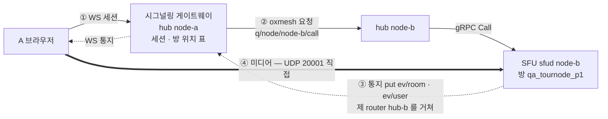
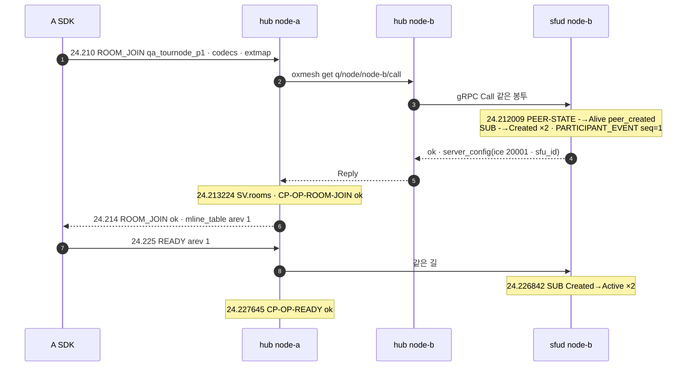

# 13. 다른 node 의 방 — 요청 · 통지 · 미디어가 지나는 길

> author: kodeholic (powered by Claude) · created: 2026-11-09.
> ★**대조한 커밋** — 서버 `oxlens-sfu` `1ef7265` · SDK `oxlens-sdk-web` `de8c4a9`(+탐침) · 2층 `oxlens-labs` `a68d2de` · oxpeer `740f172`
> ★**실측 회차** — 3층 탐침 `tour-learn` 20261109 둘째 판(`TOUR-13`) · 2층 회차 `e2e-20261109-132317`(`peer_recorder_unit_down` · `adv_node_down` · 실증 `bus_node_down`). 값은 돌릴 때마다 바뀌고 차례 · 모양은 같다.

## 1. 30초 요약



- **요청은 세션을 든 hub 를 지난다.** 클라는 node-a 의 hub 하나만 안다. hub-a 가 방 위치 표에서 node-b 를 찾는다. hub-a 는 oxmesh 로 hub-b 에 넘기고, hub-b 가 제 sfud 를 gRPC 로 부른다.
- **통지는 방을 든 sfud 가 버스에 낸다.** 그 방을 구독한 hub 만 받아 WS 로 내린다.
- **미디어는 hub 를 지나지 않는다.** 입장 응답이 node-b 의 UDP 주소를 준다. 브라우저는 거기로 ICE · DTLS 를 직접 맺는다. 방이 놓일 node 는 방 이름으로 계산한다(rendezvous hashing · HRW — §3-1). 방 위치 표가 방 토큰 선언으로 서는 속은 [14](14_OXMESH.md) 가 집이다.

용어(full mesh · liveliness token · rendezvous hashing · fencing 등)의 대응은 [00 표준 용어](00_INDEX.md#표준-용어) · [우리 설계 용어](00_INDEX.md#우리-설계-용어) 에 있다.

## 2. 등장인물 · 값

| 이름 | 실측 값 | 무엇 |
|---|---|---|
| A · B | `tournode_A`(세션 지문 `83e581a6`) · `tournode_B`(`a2f498df`) · 둘 다 1pc | 둘 다 node-a 의 hub 에 `BIND` 했다. `SES.S.bind_new` 줄이 node-a 로그에 있다 |
| 방 | `qa_tournode_p1` | node-b 에 놓인다. 탐침이 서버와 같은 HRW 식을 돌려, node-b 로 떨어지는 첫 이름을 골랐다(`…_p0` 는 다른 node 로 간다) |
| hub(시그널링 게이트웨이 `oxhubd`) | node-a — 개발 형상 `127.0.0.1:1974` | 세션을 든 쪽. 이 장에서 node-a 의 sfud 는 하는 일이 없다 |
| sfud(SFU `oxsfud`) | node-b — `sfu_id` = epoch `5d26606f733fe9f7` · UDP · TCP `20001` | 방을 든 쪽. 이 유닛은 14:16:35.54 에 떴다(탐침 회차 앞에서 세 node 를 다시 띄운 때) |
| node-c | 탐침 창 안 0줄 | 구경꾼. 방이 사라질 때 방 토큰 Delete 만 받는다(§3-5) |
| 로그 갈림 | node-a 16줄 · node-b 50줄 · node-c 0줄 | 탐침이 자른 서버 로그(`13.json` 의 `log`) |
| A 의 m-line | PTT 슬롯 mid `32`(SSRC `3355657681`) · `33`(`2929453362`) · B 의 소리 mid `34`(다운링크 SSRC `4287872912`) | m-line 표(`mline_table`)는 [03](03_PUBLISH_SUBSCRIBE.md) 이 집. 서버가 지은 SSRC 셋 모두 `0x80000000` 이상이다(20261109 고침 · 집은 [02](02_CONNECT_JOIN.md)) |
| B 의 발행 | 업링크 SSRC `4189376536` · `track_id` `t8a5a17f255383c30` | |

PTT 슬롯은 방마다 화자 한 명 몫으로 고정된 오디오 · 비디오 m-line 이다([08](08_SLOT_SPEAKER.md)).

## 3. 정상 길

### 3-1. 방 만들기 — 이름이 node 를 정한다

```
14:37:24.138 STEP ensureRoom                         ← 탐침이 POST /rooms (hub-a)
14:37:24.141228 node=node-b proc=sfu spec=SV-IMPL-ROOM-LIFE room=qa_tournode_p1
                epoch=5d26606f733fe9f7 in.unused_ttl=30 in.departure_ttl=5 msg="room created"
```

hub-a 는 방 위치 표에 그 이름이 없으면 배치를 계산한다. 계산은 이것뿐이다(`oxhubd/src/bus/placement.rs`).

```rust
pub fn score(node: &str, room: &str) -> u64 {          // node_id ‖ 0x00 ‖ room_id
    ...
    splitmix_finish(fnv1a64(&buf))
}
pub fn pick(nodes, room) -> Option<String>             // 점수 최대 · 동점은 node_id 사전순 앞
```

- 이것이 rendezvous hashing(HRW · highest random weight)이다. node 마다 (node, 방) 점수를 내고 가장 큰 node 를 고른다.
- 후보는 `node` 토큰이 살아 있는 node 전부다. 계산은 hub 의 상태를 읽지 않는다. 어느 hub 가 계산해도, hub 가 재시작해도, 같은 이름은 같은 node 로 간다.
- 그래서 시험도 같은 식을 든다. 3층 탐침(`qa/live/fixtures/env.ts` `placementOf`)과 2층 `oxe2epy`(`placement.py`)가 「node-b 에 놓일 이름」을 미리 고른다.
- hub-a 는 node-b 에 `CreateRoom` 을 넘긴다. sfud-b 가 방을 만들고 방 토큰을 선언(declare)한다. 방 토큰은 liveliness token 이다 — 선언한 sfud 의 버스 세션이 살아 있는 동안만 있는 키다.
- hub-a 는 그 토큰이 제 표에 보일 때까지 기다린 뒤 `201` 을 낸다(상한 1초 — `CREATE_VISIBLE_WAIT`). 응답을 받은 클라가 곧바로 `ROOM_JOIN` 해도 표에 방이 있다.

### 3-2. 요청 — ROOM_JOIN 은 hub 한 홉을 더 간다



| | 같은 node(TOUR-02 · `qa_tour_p4` 는 node-a) | 다른 node(이 장) |
|---|---|---|
| `ROOM_JOIN` 보냄 → 응답 받음(브라우저 시계) | 50.160 → 50.165 | 24.210 → 24.214 |
| 길 | hub-a → gRPC → sfud-a | hub-a → oxmesh → hub-b → gRPC → sfud-b |

- 한 기계 위 세 node 라 oxmesh 한 홉이 ms 아래로 묻혔다. 같은 node 5ms, 다른 node 4ms 다. 실제 망에서는 node 사이 왕복만큼 늘 것이다(이 회차로 재지 않았다).
- hub-b 는 넘기기만 하고 줄을 남기지 않는다. 이 창의 node-b 로그 50줄은 전부 `proc=sfu` 다.
- op 결과(`CP-OP-*`)와 세션 전이(`SES.S.*` · `SV.rooms`)는 세션을 든 node-a 에 찍힌다. Peer · 소속 · 발행 · 구독은 방을 든 node-b 에 찍힌다(§7).
- 구독 상태기는 이제 생성 줄(`-→Created cause=load`)과 끝 줄(`→- cause=unload`)을 낸다(20261109 고침 · 집은 [17](17_OPERATIONS.md)).
- node 사이 요청의 시한은 10초다(`NODE_CALL_TIMEOUT`). 보내기 전에 hub-a 는 node-b 의 `node` 토큰이 살아 있는지 본다. 없으면 보내지 않고 `5001` 로 답한다.

### 3-3. 통지 — sfud-b 가 버스에 직접 낸다


- hub 는 구독을 미리 선언한다. 사용자 통지 키 `ev/user/{사용자}` 는 `BIND` 응답 전에 구독한다. 방 통지 키 `ev/room/{방}` 는 제 세션이 그 방에 처음 들어갈 때 구독하고, 그 뒤에 `ROOM_JOIN` 을 넘긴다.
- 그 방에 로컬 멤버가 없는 hub(node-b · node-c)는 그 방 키를 구독하지 않는다. 그래서 그 방 통지가 그쪽으로 가지 않는다. 「그 방 사람이 어느 hub 에 있나」라는 명단은 따로 없다. hub 들이 선언한 구독이 곧 그 명단이다.
- 방 통지와 사용자 통지는 키가 다르다. 그래도 보낸 차례 그대로 왔다. `TRACK_EVENT`(seq 3) 다음 `MLINE_EVENT`(arev 2)다.
- 까닭은 둘이다. sfud 는 put 을 낸 차례대로 한 줄로 내보낸다. 버스는 한 세션 · 한 큐 안의 차례를 지킨다(— 「sfud 의 송신 차례」).
- 통지는 버스의 데이터 큐를 탄다. 버스 세션마다 우선순위 큐(lane) 넷이 있고, 그중 가장 낮은 큐다. 몰리면 버리고 센다([14 §3-4](14_OXMESH.md)).

### 3-4. 미디어 — 곧장 node-b 로

```
ROOM_JOIN ok  server_config.ice = {"ip":"<서버 IP>","port":20001,"tcp_port":20001,"publish_ufrag":"awY1OBok",…}
              server_config.sfu_id = "5d26606f733fe9f7"
14:37:24.214  pc0 remote answer  m=audio 20001 UDP/TLS/RTP/SAVPF 111 | a=mid:0 | … | m=application 20001 …
14:37:24.216982 node=node-b proc=sfu spec=SV-RULE-LINK-TRANSPORT user=tournode_A msg="transport ready (dtls+srtp) publish"
14:37:24.327  A pc0 track {"kind":"audio","mid":"34","streams":["ox-m34"]}
14:37:24.411978 node=node-b proc=sfu spec=SV-STATE-PUBLISH-STATE user=tournode_B key=t8a5a17f255383c30 from=Intended to=Active cause=first_rtp
14:37:24.435  STEP A.hearsB                          ← A 의 trackStats 에 B 의 소리 패킷이 잡혔다
```

- 서버가 SDP 를 짓지 않고 클라가 `server_config` 로 서버 SDP 를 짓는다. 그 이야기는 [02](02_CONNECT_JOIN.md) 가 집이다.
- 여기서 볼 것은 하나다. 포트 `20001` 이 node-b 의 것이다. hub-a 는 미디어 길에 없다.
- SDK 는 PeerConnection 을 `sfu_id` 를 키로 든다(`LinkCore.adopt` · [연:RULE-LINK-PER-SERVER-UNITS](../protocol/09-link.md#RULE-LINK-PER-SERVER-UNITS)). 처음 보는 서버면 새로 세우고, 이미 붙은 서버면 그것을 쓴다.
- 이 회차 SDK 전이 `LINK 5d26606f733fe9f7 … SDK.link_new` 가 그 순간이다. 다른 node 의 방을 하나 더 들으면 PeerConnection 이 하나 더 생긴다. 같은 서버 안의 이야기는 [08](08_SLOT_SPEAKER.md) 이 집이다.

### 3-5. 퇴장과 방 정리(reclaim) — 세 hub 가 각자 표에서 지운다

```
14:37:25.983879 node-a hub  SES.S.leave user=tournode_A cause=LEAVE
14:37:25.985258 node-b sfu  AFF.S.left user=tournode_A cause=session_gone
14:37:25.985569 node-b sfu  SV-STATE-PEER-STATE user=tournode_A key=publish Alive→- cause=session_gone   ← 한 번
14:37:25.989952 node-b sfu  AFF.S.left user=tournode_B cause=session_gone          ← 방이 빈다
14:37:40.543617 node-b sfu  room=qa_tournode_p1 msg="room removed (ttl)"            ← 빈 지 14.55초
14:37:41.938400 node-a hub  drop candidate … → room token gone — local routing dropped
14:37:41.942439 node-c hub  (같은 두 줄)
14:37:41.969886 node-b hub  (같은 두 줄)
```

- sfud-b 가 방을 놓으면 방 토큰이 사라진다. 세 hub 가 각자 그 Delete 를 받는다. 각자 디바운스(debounce — 1초 동안 더 오는 것을 기다림)한 뒤 표에서 지운다.
- 누가 지우라고 알리지 않는다. 선언이 사라진 것을 각자 본다. 디바운스 · 고립 판정은 [14 §3-3 · §4-2](14_OXMESH.md) 가 집이다.
- 이 회차는 지우기까지 1.39 · 1.40 · 1.43초 걸렸다. 다음 탐침(TOUR-11)이 40.79 에 node-a 에 방을 만들었다. 그 방 토큰 선언이 조용한 창을 다시 열었다(추론 — 40.79 + 1초 뒤 판정 고리에서 41.94 에 지웠다). 버스가 바쁘면 늦어진다는 뜻이다([14 §4-1](14_OXMESH.md)).
- A 의 Peer 상태 끝 줄 `Alive→-` 은 한 번이다. 고치기 전 회차에서는 같은 줄이 두 번 찍혔다(20261109 고침 · 서버 `f6bbf02` · 이 실측). 집은 [17](17_OPERATIONS.md) 이다.
- 관찰 하나 — 방이 빈 뒤 정리까지 14.55초다. 고치기 전 회차(같은 날 07:37)는 8.05초였다. sfud 는 5초마다 빈 방을 쓸고(sweep), 빈 것을 처음 본 쓸기부터 `departure_ttl` 5초를 센다. 쓸기 간격과 TTL 이 같아 경계에서 한 번 더 밀린 것으로 읽는다(추론 · 쓸기 시각 30.54 · 35.54 · 40.54). 규격은 이 상한을 정하지 않는다 — 결함 판정이 아니라 판단 거리다.

## 4. 깨지는 길

### 4-1. 방을 든 미디어 유닛이 죽는다 — hub 와 WS 는 산다(2층 `peer_recorder_unit_down`)

botA · botC · 녹음기(oxpeer — 투명 참가자)가 node-a 의 hub 에 붙는다. 2층 `oxe2epy` 가 방을 든 node 의 sfud 유닛만 내리고 16초 뒤 올린다. 이 회차는 방 이름(`…_12638` — 끝 숫자는 2층 회차 꼬리표)이 HRW 로 node-a 에 떨어졌다. 세션 hub 와 방이 같은 node 다. 방 판정 길은 같은 node 든 다른 node 든 같다 — hub 의 방 위치 표를 버스 토큰으로 지우는 길이다.

```
13:52:51.191300 node-a hub  SV-STATE-UNIT-STATE unit=node-a Running→Stopping cause=stop
13:52:51.192060 node-a sfu  mesh closed                                     ← 방 토큰이 sfud 의 버스 세션째 사라진다
13:52:52.242315 node-a hub  room=peer_unit_down_room_… "room token gone — local routing dropped"
13:52:52.242507 node-a hub  SV.rooms user=oxpeer~… hidden+live+bound+rooms→hidden+live+bound  cause=room_dropped
13:52:52.242642 node-a hub  SV.rooms user=botC~…   live+bound+rooms→live+bound  cause=room_dropped
13:52:52.242748 node-a hub  SV.rooms user=botA~…   (같은 줄)
13:53:01.438625 node-a hub  CP-CODE-PEER-NOT-FOUND user=oxpeer~… op=ICE_RESTART    ← 3010
13:53:01.954016 node-a hub  CP-CODE-ROOM-NOT-FOUND user=oxpeer~… op=ROOM_JOIN      ← 3001
13:53:07.184139 node-a hub  SV-STATE-UNIT-STATE unit=node-a Stopped→Starting cause=load  ← 새 epoch bc4ec524f00feacd · 방은 없다
13:53:34.487232 node-a hub  CP-CODE-ROOM-NOT-FOUND user=botA~… op=ROOM_LEAVE     ← 봇은 끝까지 방에 든 줄 알았다
```

- **무엇이 깨졌나** — 방 상태의 주인인 sfud 가 사라졌다. 방은 그 프로세스 메모리에 있으니 같이 사라진다(— 「sfud 급사」 행). 옛 epoch 는 `d391b1c5b2ce2efd` 다.
- **누가 먼저 아나** — 세션을 든 hub 다. 사라진 방 토큰을 1초 디바운스한 뒤(51.19 → 52.24) 그 방의 라우팅을 정리한다. 그리고 세션 셋에서 방을 뺀다(`cause=room_dropped`). 방이 다른 node 에 있었다면, 원인 줄은 그 node 에, 이 결과 줄들은 세션 node 에 갈렸을 것이다(§4-2).
- **무엇이 오가나** — 클라에 통지를 지어 보내지 않는다. 봇 덤프에서 마지막으로 받은 것은 4.42초(유닛을 내리기 0.6초 전)의 RTCP REMB 다. 그 뒤로 WS 신호가 없다. `room_closed` 는 운영의 방 닫힘 전용이다([연:R-ROOM-CLOSED-OPS-ONLY](../protocol/04-room.md#R-ROOM-CLOSED-OPS-ONLY)).
- 녹음기는 그 서버 PeerConnection 의 복구 단계에서 안다. ICE 재시작이 `3010` 을, 재입장이 `3001` 을 받는다. 복구 단계는 [10 §3-6](10_RECOVERY.md), 녹음기 앱이 받는 사건은 [16 §4-1](16_OXPEER.md) 이 집이다.
- **사용자는 무엇을 겪나** — 녹음기 기준 10.76초 뒤(51.19 → 01.95) 「방 없음」이 앱에 온다. 유닛은 16초 뒤 새 epoch 로 돌아오지만 방은 없다. 방을 다시 세우는 것은 앱 몫이다. 봇(aiortc)은 복구를 짓지 않아, 끝에 낸 `ROOM_LEAVE` 가 `3001` 을 받았다.

### 4-2. 방을 든 node 가 통째로 죽는다 — hub 까지(2층 실증 `bus_node_down`)

클라는 node-a 에 붙고, 방 `nd98299_2` 는 node-b(epoch `2b46eff7c81117a5`)에 있다. 실증이 node-b 의 hub 프로세스에 SIGTERM 을 보낸다. sfud 는 부모 생존 채널로 따라 내려간다.

```
13:24:59.706923 node-b hub  CP-CODE-SERVER-SHUTDOWN msg="hub shutdown — SIGTERM"
13:24:59.707083 node-b sfu  "sfud stopping (SIGTERM)"                              ← 같은 ms 에 sfud 도
13:24:59.708047 node-a hub  mesh session down peer=node-b dialer=node-a sno=7 reason=shutdown
13:25:00.771924 node-a hub  room=nd98299_2 drop candidate … (live view node-a/…,node-c/…)  ← node-b 가 빠진 시야
13:25:00.772227 node-a hub  SV.rooms user=nd-u1-98299 … cause=room_dropped
13:25:01.240775 node-a hub  CP-CODE-PEER-NOT-FOUND op=ICE_RESTART                  ← 3010
13:25:01.241731 node-a hub  CP-CODE-ROOM-NOT-FOUND op=ROOM_JOIN                    ← 3001
13:25:01.381373 node-b hub  "node token declared"                                  ← 실증이 다시 세운 node-b
13:25:01.792072 node-b sfu  room=nd98299_2 … "room created"                        ← 같은 이름 재생성 → 다시 node-b
```

- 실증 기록 줄도 같은 것을 적는다 — 「rooms_seen: node-a·node-c 둘 다 nd98299_2→node-b 을 안다」 · 「★통지 합성 없음 — ICE_RESTART 3010 · 재입장 3001 로 결말」 · 「재생성 → node-b」.
- 결말은 §4-1 과 같다(통지 합성 없음 · `3010` · `3001`). 이번에는 세션을 든 쪽이 아니라 방을 든 쪽의 hub 가 죽었다. node-a 의 클라 세션은 멀쩡하다.
- 원인 줄(node-b)과 결과 줄(node-a)이 두 node 로그에 갈렸다. 원인 줄에는 사람 키가 없다.
- 재생성이 같은 node-b 로 간 것은 배치가 순수 함수라서다. node-b 가 1.67초 만에 돌아왔고 이름이 같으니 답이 같다.
- **30초 창(추론 · 실측 안 함)** — `node` 토큰이 사라져도 배치 후보에서는 grace 동안 빼지 않는다(`node_grace_secs` · 이 형상 30초). 흔들림마다 방이 옮겨 다니지 않게 하려는 것이다. 그러니 죽은 node 가 30초 안에 안 돌아오면, 그 node 로 떨어지는 이름의 방 만들기는 그동안 `5001` 일 것이다. 이 회차는 node-b 가 빨리 돌아와 그 창을 재지 못했다.
- 거꾸로 세션을 든 node 가 죽으면 그 세션은 사라진다(재개 불가). 다른 node 의 방에 남은 그 사람의 Peer 는 grace 뒤 축출(eviction)된다. 그 실측(30.41초)은 [14 §4-2](14_OXMESH.md) 가 집이다.

### 4-3. 방이 놓일 node 에 못 닿는다 — `3001` 과 `5001`(2층 `adv_node_down`)

`oxe2epy` 가 이 판의 방을 안 든 node 의 유닛을 내린다. 그동안 그 node 로 떨어지는 이름으로 `POST /rooms` 를 하면 `5001` 이 온다.

```
13:52:43.807647 node-a hub  SV-STATE-UNIT-STATE unit=node-a Running→Stopping cause=stop
13:52:43.816842 node-a hub  CP-CODE-SFU-UNAVAILABLE op=HTTP                        ← 5001 (덤프 3.298 got_code 5001)
13:52:43.819532 node-a hub  SV-STATE-UNIT-STATE unit=node-a Stopped→Starting cause=load
```

- 이 회차의 희생 node 는 node-a 다. 입구 hub 와 같은 node 라 버스 홉이 없다. hub-a 가 제 유닛에 gRPC 로 못 닿아 `fail(5001)` 로 답했다.
- 다른 node 가 희생되면 한 홉이 더 있을 뿐이다. hub-a 가 hub-b 에 넘기고, hub-b 가 같은 `5001` 로 답한다(— 「답하는 관문은 … 빈 성공으로 답하지 않는다」).
- 이 `5001` 에 이제 줄이 있다(`CP-CODE-SFU-UNAVAILABLE`). 「실패 응답 · 끊김 사유는 늘 한 줄」 규칙이다(20261109 고침 · 서버 `1ef7265`). 고치기 전 회차에서는 세 node 로그에 0줄이었다.
- 「배치를 모르는 방」 `3001` 과의 차이는 [12 §4-1](12_ERRORS.md) 이, 거절 줄 꼴은 [17](17_OPERATIONS.md) 이 집이다.

## 5. 왜 이 모양인가

- **서버 간 미디어 중계 · cascading 은 기각** — 클라가 서버마다 PeerConnection 을 따로 갖는다(— 단위 칸). 방이 node 를 넘나드는 설계는 「근간을 흔드는 변경이라 대용량 클라우드 환경을 고민할 때 검토한다」로 미뤘다.
- **전역 카운터식 RoundRobin 은 다시 들이지 않는다** — 배치가 이력에 매이면 2층 격리 실측에서 같은 판을 재현하지 못한다(— 결정 칸).
- **node 급사에 `room_closed` 를 지어 보내지 않는다** — 재기동 입구가 둘(PeerConnection 복구 · `room_closed`)이면 갈린다. 한 클라는 다시 들어가고 다른 클라는 쫓겨난 채 끝난다([연:R-ROOM-CLOSED-OPS-ONLY](../protocol/04-room.md#R-ROOM-CLOSED-OPS-ONLY)).
- **배치 키는 `node_id` 지 `sfu_id` 가 아니다** — `sfu_id` 는 기동마다 새 값이다. 그것을 키로 쓰면 재기동 한 번에 모든 방이 다른 node 로 계산된다.

> ★**우리만의 것 — 방 한 node · 서버 간 미디어 중계 없음**
> - **선택 배경** — 대상이 LAN · 지역 단위이고 node 한 대 천장이 높다. 용량 게이트 기록은 생중계 1,500명에 sfud 1.46코어다(`cap-20261109-135741` — 이 장 회차와 다른 측정). 넘나드는 설계의 동기(지구 규모 지연 · 기계 한 대를 넘는 방)가 우리 대상에 약하다.
> - **얻은 것** — node 사이 RTP 재작성 · 구독 집계 · 상태 동기라는 결함 축이 통째로 없다. 레이어를 고르는 곳이 한 곳뿐이다(중계 구간이 있으면 둘이 된다 — mediasoup `PipeTransport` 는 중계 구간에 전 레이어를 보낸다). 미디어가 서버 사이를 안 흐르니 루프 방지 장치(JVB 의 split-horizon)가 필요 없다. 이 장의 미디어 길은 브라우저 → node-b 한 줄이다(§3-4).
> - **잃은 것** — ①한 방이 기계 한 대를 넘지 못한다. ②node 장애 회복이 「방 닫힘 + 재입장」이다. 이 회차 유닛 죽음에서 녹음기가 `3001` 로 알기까지 10.76초다(§4-1). LiveKit Cloud 는 서버 옮김을 「1초 미만」이라 적는다(블로그 글 — 실측 아님). ③가까운 edge 로 붙이는 장치가 없다. ④죽은 node 를 grace 30초 동안 배치 후보에 남기는 창이 있다(§4-2 — 추론 · 실측 안 함).

> ★**우리만의 것 — rendezvous hashing(HRW) 순수 함수 배치**
> - **선택 배경** — 배치를 기억하는 외부 저장소(LiveKit 의 Redis `room_node_map`)를 두지 않으려 했다. 시험이 위상을 선언할 수 있어야 했다.
> - **얻은 것** — 같은 이름은 어느 hub 가 계산해도, hub 가 재시작해도 같은 node 다. 탐침과 2층 `oxe2epy` 가 같은 식으로 「node-b 에 놓일 이름」을 미리 고른다(§3-1). node 가 늘거나 줄 때 옮겨 가는 방은 1/N 뿐이다(`placement.rs` 1층 `removal_moves_only_its_rooms`).
> - **잃은 것** — 부하를 보지 않는다(LiveKit 은 CPU · 부하 · 지역으로 고른다). 식이 서버 · 2층 `oxe2epy` · 탐침 셋에 따로 있다. 한 걸음만 달라도 선언한 위상이 조용히 거짓이 된다(— — 그 어긋남은 빨강으로 안 온다). 두 hub 의 node 집합 시야가 갈리면 같은 방이 둘로 설 수 있다. 지금은 탐지 · 계수까지다.

> ★**우리만의 것 — hub 다중화(접속점과 방 위치를 가른다)**
> - **선택 배경** — 클라가 어느 hub 에 붙든 어느 방에나 들 수 있어야 한다. 그래야 LB 가 아무 hub 로 보내도 된다.
> - **얻은 것** — A · B 는 node-a 에 붙고 방은 node-b 에 있었다. 클라는 그 사실을 모른다. 세션은 hub 에, 방은 sfud 에 산다(§2).
> - **잃은 것** — 요청마다 hub 한 홉이 더 든다(이 회차는 한 기계라 5ms 대 4ms 로 안 갈렸다 — §3-2). 한 사건의 줄이 두 node 로그로 갈린다(16줄 · 50줄 — §7). 세션을 든 node 가 죽으면, 다른 node 의 방에 남은 그 사람의 Peer 는 grace 뒤에야 축출된다([14 §4-2](14_OXMESH.md)).

## 6. 다른 SFU 는

★아래 「그쪽 방식」은 저쪽 소스 · 문서를 정적으로 읽은 것이다(실측 아님). 블로그 · 제품 문서만 근거인 칸은 그렇게 적는다.

| 대상 | 그쪽 방식 | 우리 | 우리 쪽 장점 | 우리 쪽 대가 |
|---|---|---|---|---|
| LiveKit OSS | 방 → node 를 Redis 해시 `room_node_map` 에 적는다. 이미 배치된 방은 그 node 가 살아 있으면 다시 고르지 않는다. 고르는 기준은 CPU · 부하 · 지역(`livekit §12-1` · `§12-2` · `redisrouter.go` · `selector/regionaware.go`). node 간 미디어 없음(`IsRelayed: false`) | 방 → node 를 HRW 로 계산 · 기억하지 않는다 | 외부 저장소가 없다 · 시험이 위상을 고른다 | 부하를 안 본다 |
| LiveKit Cloud | 참가자를 가까운 edge 에 붙이고 서버끼리 메시로 미디어를 잇는다. 서버 옮김 「1초 미만」(블로그 2022-10 — 소스 아님) | 방 한 node · 중계 없음 | 결함 축이 적다 · 가볍다 | 지구 규모 지연 · 장애 회복이 재입장이다 |
| JVB | 브리지 쌍마다 ICE + DTLS/SRTP 릴레이(구 Octo). 브리지 선택은 Jicofo 가 지역으로. 루프는 같은 mesh 로 되돌리지 않는 split-horizon 한 줄로 막는다(`jvb §8-1` · `§8-2`) | 서버 간 미디어 경로가 없다 | 루프 · 과전달 문제가 원천적으로 없다 | 한 회의가 브리지 하나를 넘지 못한다 |
| mediasoup | 분산은 `PipeTransport` 하나. 정책은 전부 앱. 중계 구간은 모든 encoding 을 보내고 받는 Router 에서 다시 고른다(`mediasoup §8-5`) | 서버가 배치 · PeerConnection 단위까지 정한다 | 레이어 선택 지점이 하나다 | 앱이 배치를 고칠 손잡이가 없다 |
| atm0s | 참가자를 가까운 zone node 에. 트랙마다 채널 id = hash(방 · 사람 · 트랙). DHT 키값(중앙 DB 없음)(`media_core/src/cluster/room.rs`) | 방 단위 해시 · 토큰 선언 | 단위가 굵어 상태가 적다 | 방이 node 를 넘지 못한다 |
| Cloudflare · Millicast | 세션을 anycast 가장 가까운 곳에. 트랙마다 계단식 나무(Cloudflare). origin 클러스터 + 시청자 쪽 클러스터(Millicast). node 간 프로토콜은 미공개(블로그 · 제품 문서) | 같은 LAN · 지역 | 직접 운영 · 디버깅이 가능한 크기 | 지역을 넘는 확장이 없다 |
| MoQ(초안) | 중계기 = CDN. 트랙마다 위쪽 구독 하나로 모을 수 있다(MAY). 중계기끼리 잇는 법은 범위 밖(`moq-transport` `# Relays`) | WebRTC SFU · 중계기 없음 | 지금 브라우저에서 돈다 | 대규모 팬아웃 나무를 못 쓴다 |

- 두 갈래다. 방 한 node(우리 · LiveKit OSS · Galene)와, 방이 node 를 넘나드는 쪽(나머지)이다.
- 넘나드는 쪽은 그 대가로 node 간 RTP 재작성 · 구독 집계 · 상태 동기를 진다. LiveKit OSS 도 node 간 `UpdateSubscribedQuality` 같은 협조 지점을 둔다(`livekit §12-4`).

## 7. 운영에서 보는 법

| 무엇을 | 어디서 | 이 회차에서 |
|---|---|---|
| 세션이 어느 hub 에 붙었나 | 그 node 로그 `SES.S.bind_new` | node-a |
| 방이 어느 node 에 있나 | `GET /admin/rooms` 의 `node` · `sfu_id` 칸 · `GET /admin/bus` 의 `rooms_seen`(남의 node 방만) | node-b · `5d26606f733fe9f7`(방 생성 줄의 `epoch`) |
| op 가 성공했나 | 세션 쪽 hub 로그 `CP-OP-*` · 실패는 `CP-CODE-*` | node-a `CP-OP-ROOM-JOIN … msg=ok` |
| 방에서 무엇이 일어났나 | 방 쪽 sfud 로그 `SV-STATE-*` · `AFF.S.*` · `FLR.S.*` | node-b 50줄 |
| 방이 사라져 라우팅을 정리했나 | 모든 hub 로그 `drop candidate` → `room token gone` · 세션 쪽 `SV.rooms … cause=room_dropped` | §3-5 · §4-1 |
| 실패 응답이 났나 | 응답한 hub 로그 `CP-CODE-<이름>` 한 줄(HTTP 는 `op=HTTP`) | §4-3 `CP-CODE-SFU-UNAVAILABLE` |

- **한 사람의 줄을 두 node 에서 모아 보기** — 탐침이 자른 로그에서 A 의 줄은 node-a 8 · node-b 23 이다. 모두 `session=83e581a6` 하나로 이어진다. `oxadmin history tournode_A` 는 hub 가 전 node 의 줄을 모아 한 표로 낸다(이 회차로 다시 묻지 않았다). 표 읽는 법과 이력 판정기(`judge-history`)는 [17](17_OPERATIONS.md) 이 집이다.
- SDK 쪽 전이 라벨 — `SDK.link_new`(이 서버 PeerConnection 을 처음 세움) · `LINK.C.any.server_ice_same`(입장 응답의 `server_config.ice` 가 보관한 자격과 같다 — PeerConnection 을 그대로 씀).

## 8. 소스 · 규격 좌표

| 무엇 | 소스 | 규격 |
|---|---|---|
| 배치(HRW) | `crates/oxhubd/src/bus/placement.rs` `score` · `pick` · `crates/oxhubd/src/bus/mod.rs` `place` | — |
| 방 만들기 → 그 node 에 넘기기 · 표에 보일 때까지 기다림 | `crates/oxhubd/src/room/mod.rs`(`bus.room_route` → `place` → `bus.call` · `CREATE_VISIBLE_WAIT`) · `crates/oxhubd/src/bus/mod.rs` `room_route` | — |
| op 를 방의 node 로 넘기기 | `crates/oxhubd/src/ses/mod.rs` `route` · `call_node` · `crates/oxhubd/src/bus/mod.rs` `call` · `query` · `call_local` | — |
| node 사이 요청에 답하기 | `crates/oxhubd/src/ops/mod.rs` `answer` | — |
| 통지 put · 관심 구독 | `crates/oxsfud/src/bus/mod.rs` `room_notice` · `user_notice` · `crates/oxhubd/src/bus/mod.rs` `interest` · `interest_room` · `interest_user` | — |
| 방이 사라짐 → 세션에서 방 빼기 | `crates/oxhubd/src/ops/mod.rs`(`BusEvent::RoomDropped`) · `crates/oxhubd/src/ses/mod.rs` `room_dropped` | [연:R-ROOM-CLOSED-OPS-ONLY](../protocol/04-room.md#R-ROOM-CLOSED-OPS-ONLY) |
| 빈 방 쓸기(TTL) | `crates/oxsfud/src/ops/timers.rs` `sweep`(`SWEEP_MS` 5,000) · `crates/oxsfud/src/room/mod.rs` `ttl_due` | — |
| `ICE_RESTART` 를 epoch 로 node 찾기 | `crates/oxhubd/src/ses/mod.rs` `route`(`Op::IceRestart`) · `crates/oxhubd/src/bus/mod.rs` `node_of_epoch` | [연:RULE-LINK-SFU-ID-IS-EPOCH](../protocol/09-link.md#RULE-LINK-SFU-ID-IS-EPOCH) |
| 실패 응답 줄(세션 op · BIND · HTTP) | `crates/oxhubd/src/ses/mod.rs` `code_line` · `crates/oxhubd/src/ops/http.rs` `fail` · `fail_status` · `status_of` | — |
| SDK PeerConnection 은 서버마다 하나 | `oxlens-sdk-web/src/domain/link/core.ts` `LinkCore.adopt` | [연:RULE-LINK-PER-SERVER-UNITS](../protocol/09-link.md#RULE-LINK-PER-SERVER-UNITS) · [연:RULE-LINK-RECOVERY-UNIT](../protocol/09-link.md#RULE-LINK-RECOVERY-UNIT) |
| 시험 쪽 같은 식 | `oxlens-sdk-web/qa/live/fixtures/env.ts` `placementOf` · `oxlens-labs/oxe2epy/oxe2epy/placement.py` | —(해시가 계약이다) |

## 9. 스스로 확인하는 질문

<details><summary>1. A 가 node-a 의 방과 node-b 의 방을 함께 들으면 WS 와 PeerConnection 은 몇 개인가?</summary>

WS 는 하나다. 세션은 node-a 의 hub 에 하나다. PeerConnection 은 서버마다 하나라 둘이다(SDK 가 `sfu_id` 를 키로 든다 — §3-4). node-b 방의 통지는 node-b 의 sfud 가 버스에 낸다. node-a 의 hub 가 그것을 같은 WS 로 내린다.
</details>

<details><summary>2. §4-1 에서 hub 는 방이 사라진 것을 1초 만에 알았다. 그런데 왜 클라에 바로 알리지 않나?</summary>

알리는 입구를 하나로 두려고서다. SFU 가 사라진 결말은 그 서버 PeerConnection 의 복구 길이 정한다. `ICE_RESTART` 가 `3010` 이면 치료 불가로 확정하고 재연결한다. 재입장이 `3001` 이면 앱이 방이 닫힌 것을 안다. 여기에 `room_closed` 통지를 더하면 입구가 둘이 된다. 두 길이 엇갈린 클라는 한쪽은 다시 들어가고 다른 쪽은 쫓겨난 채 끝난다([연:R-ROOM-CLOSED-OPS-ONLY](../protocol/04-room.md#R-ROOM-CLOSED-OPS-ONLY)). 대가는 앱이 「방 없음」을 아는 데 걸리는 시간이다 — 이 회차 10.76초.
</details>

<details><summary>3. (깨지는 길) 방이 다른 node 에 있을 때 녹음기가 「방 없음」을 받았다. 운영자가 까닭을 찾으려면 어느 node 의 무슨 줄을 보나?</summary>

결과와 원인이 다른 node 에 있다(§4-2 꼴). 결과는 세션을 든 node 의 hub 에 있다 — `room token gone` → `SV.rooms … cause=room_dropped` → `CP-CODE-PEER-NOT-FOUND`(3010) → `CP-CODE-ROOM-NOT-FOUND`(3001). 원인은 방을 든 node 에 있다 — `SV-STATE-UNIT-STATE unit=… Running→Stopping` 이나 `CP-CODE-SERVER-SHUTDOWN`. 원인 줄에는 사람 키가 없어 사람 이력에 안 든다. 시각으로 맞대거나 `--room` 으로 묻는다([17](17_OPERATIONS.md)). §4-1 의 이 회차는 방과 세션이 같은 node-a 라 두 줄이 한 로그에 있었다.
</details>

<details><summary>4. node 를 하나 늘리면 이미 있는 방은 어떻게 되나?</summary>

이미 있는 방은 움직이지 않는다. 방 위치 표는 계산이 아니라 방 토큰(sfud 의 선언)이 정한다. hub 는 표에 있는 방이면 다시 계산하지 않는다(`room/mod.rs` 가 `bus.room_route` 를 먼저 본다). 새로 만드는 방만 늘어난 후보로 계산된다. HRW 라 새 node 로 가는 것은 약 1/N 이다. 새 node 가 풀 메시에 붙는 법은 [14](14_OXMESH.md) 가 집이다.
</details>
