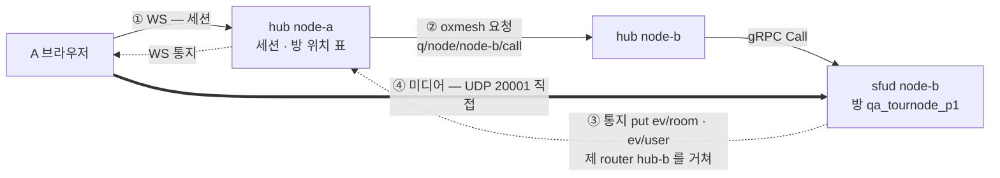
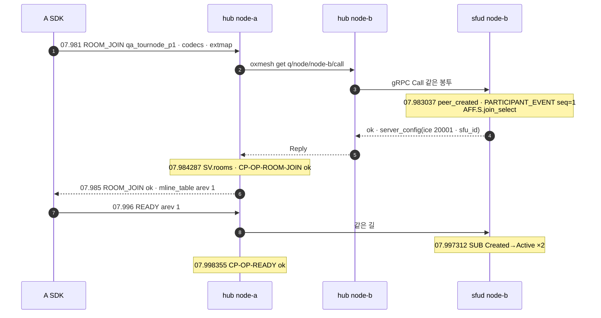
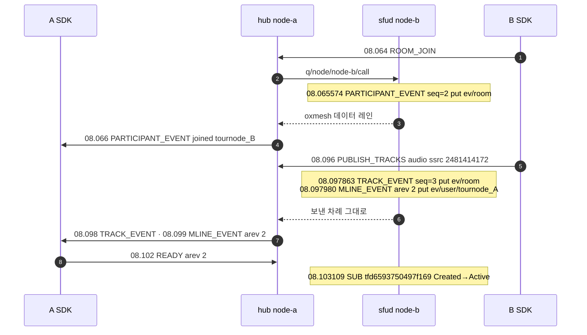

# 13. 다른 node 의 방 — 요청 · 통지 · 미디어가 지나는 길

> author: kodeholic (powered by Claude) · created: 2026-11-09.
> ★**대조한 커밋** — 서버 `oxlens-sfu` `c3642e8` · SDK `oxlens-sdk-web` `9f40557`(+탐침) · 2층 `oxlens-labs` `fc584ff` · oxpeer `93df1c6`
> ★**실측 회차** — 3층 탐침 `tour-learn-20261109`(`TOUR-13`) · 2층 회차 `e2e-20261109-070257`(`peer_recorder_unit_down` · `adv_node_down` · 실증 `bus_node_down`). 값은 돌릴 때마다 바뀌고 차례 · 모양은 같다.

## 1. 30초 요약



- **요청은 세션을 든 hub 를 반드시 지난다.** 클라는 node-a 의 hub 하나만 안다. hub-a 가 방 위치 표에서 node-b 를 찾아 oxmesh 로 hub-b 에 넘기고, hub-b 가 제 sfud 를 gRPC 로 부른다.
- **통지는 방을 든 sfud 가 버스에 직접 낸다.** 그 방에 관심을 선언한 hub 만 받아 WS 로 내린다.
- **미디어는 hub 를 안 지난다.** 입장 응답이 node-b 의 UDP 주소를 주고, 브라우저가 거기로 ICE · DTLS 를 직접 맺는다. 방이 어느 node 에 놓이나는 방 이름의 순수 함수(HRW)이고 hub 는 방 토큰으로 그 표를 든다 — 표의 속은 [14](14_OXMESH.md).

## 2. 등장인물 · 값

| 이름 | 실측 값 | 무엇 |
|---|---|---|
| A · B | `tournode_A`(세션 지문 `ec1d1bc5`) · `tournode_B`(`3bfa9fa6`) · 둘 다 1pc | 둘 다 **node-a** 의 hub 에 `BIND` 했다(`SES.S.bind_new` 줄이 node-a 로그에 있다) |
| 방 | `qa_tournode_p1` | **node-b** 에 놓인다 — 탐침이 서버와 같은 HRW 함수를 돌려 node-b 로 떨어지는 첫 이름을 골랐다(`…_p0` 는 다른 node 로 간다) |
| node-a | hub `127.0.0.1:1974`(dev `system.node-a.toml`) | 세션을 든 쪽. 이 장에서 node-a 의 sfud 는 하는 일이 없다 |
| node-b | sfud `sfu_id` = epoch `7321e06f6909b384` · UDP · TCP `20001` | 방을 든 쪽. 이 유닛은 07:32:42.815 에 떴다 — 앞선 2층 `peer_recorder_unit_down` 이 내렸다 올린 그 유닛이다(§4-1) |
| node-c | 탐침 창 안 0줄 | 구경꾼 — 방이 사라질 때 방 토큰 Delete 만 받는다(§3-5) |
| 로그 갈림 | node-a 16줄 · node-b 42줄 · node-c 0줄 | 탐침이 자른 서버 로그(`13.json` 의 `log`) |
| A 의 줄 | 슬롯 mid `32` · `33` + B 의 소리 mid `34`(다운링크 SSRC `4022555312`) | 줄 배정은 [03](03_PUBLISH_SUBSCRIBE.md) |
| B 의 발행 | 업링크 SSRC `2481414172` · `track_id` `tfd6593750497f169` | |

## 3. 정상 길

### 3-1. 방 만들기 — 이름이 node 를 정한다

```
07:37:07.911 STEP ensureRoom                         ← 탐침이 POST /rooms (hub-a)
07:37:07.912983 node=node-b proc=sfu spec=SV-IMPL-ROOM-LIFE room=qa_tournode_p1
                epoch=7321e06f6909b384 in.unused_ttl=30 in.departure_ttl=5 msg="room created"
```

hub-a 는 방 위치 표에 그 이름이 없으면 배치를 계산한다. 계산은 이것뿐이다(`oxhubd/src/bus/placement.rs`):

```rust
pub fn score(node: &str, room: &str) -> u64 {          // node_id ‖ 0x00 ‖ room_id
    ...
    splitmix_finish(fnv1a64(&buf))
}
pub fn pick(nodes, room) -> Option<String>             // 점수 최대 · 동점은 node_id 사전순 앞
```

- 후보는 `node` 토큰이 든 node 전량이고, ★**hub 의 상태를 읽지 않는다** — 어느 hub 가 계산해도, hub 가 재시작해도 같은 이름은 같은 node 로 간다. 그래서 탐침(`qa/live/fixtures/env.ts` `placementOf`)과 2층 하네스 `oxe2epy`(`placement.py`)가 같은 식을 들고 「node-b 에 놓일 이름」을 미리 고른다.
- hub-a 는 node-b 에 `CreateRoom` 을 넘기고, sfud-b 가 방을 만들며 **방 토큰**을 선언한다. hub-a 는 그 토큰이 제 표에 보일 때까지(상한 1초 — `CREATE_VISIBLE_WAIT`) 기다린 뒤 `201` 을 낸다 — 응답을 받은 클라가 곧바로 `ROOM_JOIN` 해도 표에 방이 있다.

### 3-2. 요청 — ROOM_JOIN 은 hub 한 홉을 더 간다



| | 같은 node(TOUR-02 · `qa_tour_p4` 는 node-a) | 다른 node(이 장) |
|---|---|---|
| `ROOM_JOIN` 보냄 → 응답 받음(브라우저 시계) | 33.827 → 33.831 | 07.981 → 07.985 |
| 길 | hub-a → gRPC → sfud-a | hub-a → oxmesh → hub-b → gRPC → sfud-b |

- 한 기계 위 세 node 라 oxmesh 한 홉이 ms 아래로 묻혔다 — 둘 다 4ms 다. 실제 망에서는 node 사이 왕복만큼 는다(이 회차로 재지 않았다).
- ★**hub-b 는 넘기기만 하고 줄을 남기지 않는다** — 이 창의 node-b 로그 42줄은 전부 `proc=sfu` 다. op 결과(`CP-OP-*`) · 세션 전이(`SES.S.*` · `SV.rooms`)는 세션을 든 **node-a** 에, Peer · 소속 · 발행 · 구독은 방을 든 **node-b** 에 찍힌다(§7).
- node 사이 요청의 시한은 10초다(`NODE_CALL_TIMEOUT`). 보내기 전에 hub-a 는 node-b 의 `node` 토큰이 살아 있는지 먼저 본다 — 없으면 보내지 않고 `5001` 이다.

### 3-3. 통지 — sfud-b 가 버스에 직접 낸다



- hub-a 는 제 세션이 방에 처음 들어갈 때 `ev/room/{방}` 구독을 **먼저** 선언하고 `ROOM_JOIN` 을 **나중에** 넘긴다. `ev/user/{사용자}` 구독은 `BIND` 응답 전에 선언한다. 그 방에 로컬 멤버가 없는 hub(node-b · node-c)는 그 방 키를 구독하지 않으므로 그 방 통지가 그쪽으로 가지 않는다 — 「그 방 사람이 어느 hub 에 있나」의 명단이 따로 없고, hub 들이 선언한 구독이 곧 그 명단이다.
- ★방 통지와 사용자 통지는 키가 다른데도 **보낸 차례 그대로** 왔다 — sfud 는 put 을 낸 차례대로 한 줄로 내보내고, 버스는 한 세션 · 한 레인 안의 차례를 지킨다(— 「sfud 의 송신 차례」). `TRACK_EVENT`(seq 3) 다음 `MLINE_EVENT`(arev 2)다.
- 통지는 버스의 **데이터 레인**을 탄다 — 몰리면 버리고 센다(이 회차 `bus_ev_drop` 0 · 레인은 [14 §3-4](14_OXMESH.md)).

### 3-4. 미디어 — 곧장 node-b 로

```
ROOM_JOIN ok  server_config.ice = {"ip":"<서버 IP>","port":20001,"tcp_port":20001,"publish_ufrag":"RndfbImH",…}
              server_config.sfu_id = "7321e06f6909b384"
07:37:07.985  pc0 remote answer  m=audio 20001 UDP/TLS/RTP/SAVPF 111 | a=mid:0 | … | m=application 20001 …
07:37:07.987989 node=node-b proc=sfu spec=SV-RULE-LINK-TRANSPORT user=tournode_A msg="transport ready (dtls+srtp) publish"
07:37:08.184597 node=node-b proc=sfu spec=SV-STATE-PUBLISH-STATE user=tournode_B key=tfd6593750497f169 from=Intended to=Active cause=first_rtp
07:37:08.100  A pc0 track {"kind":"audio","mid":"34","streams":["ox-m34"]}
07:37:08.206  STEP A.hearsB                          ← A 의 trackStats 에 B 의 소리 패킷이 잡혔다
```

- 서버가 SDP 를 짓지 않고 클라가 응답의 `server_config` 로 서버 SDP 를 짓는 것은 [02](02_CONNECT_JOIN.md) 가 집이다. 여기서 볼 것은 **포트 `20001` 이 node-b 의 것**이라는 하나다 — hub-a 는 미디어 길에 없다.
- SDK 는 미디어 연결을 `sfu_id` 를 키로 든다(`LinkCore.adopt` — 처음 보는 서버면 연결을 세우고 이미 붙은 서버면 그것을 쓴다 · [연:RULE-LINK-PER-SERVER-UNITS](../protocol/09-link.md#RULE-LINK-PER-SERVER-UNITS)). 이 회차 SDK 전이 `LINK 7321e06f6909b384 … SDK.link_new` 가 그 순간이다. 다른 node 의 방을 하나 더 들으면 연결이 하나 더 생긴다 — 연결 단위의 자세한 이야기는 [08](08_SLOT_SPEAKER.md).

### 3-5. 퇴장과 방 소멸 — 세 hub 가 각자 표에서 지운다

```
07:37:09.758813 node-a hub  SES.S.leave user=tournode_A cause=LEAVE
07:37:09.760631 node-b sfu  AFF.S.left user=tournode_A cause=session_gone
07:37:09.765551 node-b sfu  AFF.S.left user=tournode_B cause=session_gone          ← 방이 빈다
07:37:17.819396 node-b sfu  room=qa_tournode_p1 msg="room removed (ttl)"            ← departure_ttl 5초 + 회수 눈금
07:37:18.861017 node-b hub  drop candidate … → room token gone — local routing dropped
07:37:18.905589 node-c hub  (같은 두 줄)
07:37:18.975273 node-a hub  (같은 두 줄)
```

- sfud-b 가 방을 놓으면 방 토큰이 사라지고, **세 hub 가 각자** 그 Delete 를 받아 1초 가라앉힌 뒤 표에서 지운다(1.04 · 1.09 · 1.16초 뒤). 누가 지우라고 알리지 않는다 — 선언이 사라진 것을 각자 본다. 가라앉힘 · 고립 판정은 [14 §3-3 · §4-2](14_OXMESH.md).

## 4. 깨지는 길

### 4-1. 방을 든 node 의 미디어 유닛이 죽는다 — hub 와 WS 는 산다(2층 `peer_recorder_unit_down`)

botA · botC · 녹음기(oxpeer — 투명 참가자)가 node-a 의 hub 에 붙고, 방은 node-b(epoch `fabe64ed1f83963b`)에 있다. 2층 `oxe2epy` 가 node-b 의 sfud 유닛만 내렸다 16초 뒤 올린다. 두 node 의 로그를 한 시각축에 놓으면:

```
07:32:26.819370 node-b hub  SV-STATE-UNIT-STATE unit=node-b Running→Stopping cause=stop
07:32:26.820082 node-b sfu  mesh closed                                    ← 방 토큰이 sfud 의 버스 세션째 사라진다
07:32:27.834295 node-a hub  room=peer_unit_down_room_… "room token gone — local routing dropped"
07:32:27.834473 node-a hub  SV.rooms user=botC~…   live+bound+rooms→live+bound  cause=room_dropped
07:32:27.834615 node-a hub  SV.rooms user=botA~…   (같은 줄)
07:32:27.834737 node-a hub  SV.rooms user=oxpeer~… hidden+live+bound+rooms→hidden+live+bound  cause=room_dropped
07:32:37.063366 node-a hub  CP-CODE-PEER-NOT-FOUND user=oxpeer~… op=ICE_RESTART    ← 3010
07:32:39.024621 node-a hub  CP-CODE-ROOM-NOT-FOUND user=oxpeer~… op=ROOM_JOIN      ← 3001
07:32:42.811101 node-b hub  SV-STATE-UNIT-STATE unit=node-b Stopped→Starting cause=load  ← 새 epoch 7321e06f6909b384 · 방은 없다
07:33:10.114364 node-a hub  CP-CODE-ROOM-NOT-FOUND user=botA~… op=ROOM_LEAVE     ← 봇은 끝까지 방에 든 줄 알았다
```

- **무엇이 깨졌나** — 방 상태의 주인인 sfud 가 사라졌다. 방은 그 프로세스 메모리에 있으니 같이 사라진다(— 「sfud 급사」 행).
- **누가 먼저 아나** — ★**세션을 든 node-a 의 hub** 다. node-b 에서 사라진 방 토큰을 1초 가라앉힌 뒤(26.819 → 27.834) 그 방의 로컬 라우팅을 거두고 세션 셋에서 방을 뺀다. 사건은 node-b 에서 났지만 「방 없음」을 정한 줄은 전부 node-a 에 있다.
- **무엇이 오가나** — ★**클라에 통지를 지어 보내지 않는다.** 봇 덤프에는 이 뒤로 WS 신호가 없다(마지막으로 받은 것은 DC 로 온 발언권 `IDLE` 되풀이 seq 6). `room_closed` 는 운영의 방 닫힘 전용이다([연:R-ROOM-CLOSED-OPS-ONLY](../protocol/04-room.md#R-ROOM-CLOSED-OPS-ONLY)). 녹음기는 그 서버 연결의 복구 사다리에서 `3010` → `3001` 을 받아 방이 닫힌 것을 안다 — 사다리는 [10 §3-6](10_RECOVERY.md), 녹음기 앱이 받는 사건은 [16 §4-1](16_OXPEER.md).
- **사용자는 무엇을 겪나** — 녹음기 기준 약 12초 뒤(26.8 → 39.0) 「방 없음」이 앱에 온다. 유닛은 42.8초에 새 epoch 로 돌아오지만 방은 없다 — 방을 다시 세우는 것은 앱 몫이다. 봇(aiortc)은 복구를 짓지 않아 끝에 낸 `ROOM_LEAVE` 가 `3001` 을 받았다.

### 4-2. 방을 든 node 가 통째로 죽는다 — hub 까지(2층 실증 `bus_node_down`)

클라는 node-a 에 붙고 방 `nd75479_1` 은 node-b(epoch `8aabea0f9fe9d0bf`)에 있다. 실증이 node-b 의 hub 프로세스에 SIGTERM 을 보낸다 — sfud 는 부모 생존 채널로 따라 내려간다.

```
07:04:39.489718 node-b hub  CP-CODE-SERVER-SHUTDOWN msg="hub shutdown — SIGTERM"
07:04:39.489884 node-b sfu  "sfud stopping (SIGTERM)"                              ← 같은 ms 에 sfud 도
07:04:39.491039 node-a hub  mesh session down peer=node-b dialer=node-a sno=5 reason=shutdown
07:04:40.541685 node-a hub  room=nd75479_1 drop candidate … (live view node-a/…,node-c/…)  ← node-b 가 빠진 시야
07:04:40.542240 node-a hub  SV.rooms user=nd-u1-75479 … cause=room_dropped
07:04:41.026596 node-a hub  CP-CODE-PEER-NOT-FOUND op=ICE_RESTART                  ← 3010
07:04:41.027634 node-a hub  CP-CODE-ROOM-NOT-FOUND op=ROOM_JOIN                    ← 3001
07:04:41.172987 node-b hub  "node token declared"                                  ← 실증이 다시 세운 node-b
07:04:41.587491 node-b sfu  room=nd75479_1 … "room created"                        ← 같은 이름 재생성 → 다시 node-b
```

- 4-1 과 같은 결말(통지 합성 없음 · `3010` · `3001`)인데 이번에는 **세션을 든 쪽이 아니라 방을 든 쪽의 hub** 가 죽었다. node-a 의 클라 세션은 멀쩡하다.
- 재생성이 같은 node-b 로 간 것은 배치가 순수 함수라서다 — node-b 가 돌아왔고 이름이 같으니 답이 같다.
- ★**30초 창(추론 · 실측 안 함)** — node 토큰이 사라져도 배치 후보에서는 grace(`node_grace_secs` · 이 형상 30초) 동안 빼지 않는다(— — 흔들림마다 방이 옮겨 다니지 않게). 그러니 죽은 node 가 30초 안에 안 돌아오면 그 node 로 떨어지는 이름의 방 만들기는 그동안 `5001` 일 것이다. 이 회차는 node-b 가 1.7초 만에 돌아와 그 창을 재지 못했다.
- 거꾸로 **세션을 든 node** 가 죽으면 그 세션은 사라지고(재개 불가), 다른 node 의 방에 남은 그 사람의 Peer 는 grace 뒤 거둬진다 — 그 실측(30.09초)은 [14 §4-2](14_OXMESH.md).

### 4-3. 방이 놓일 node 에 못 닿는다 — `3001` 과 `5001`(2층 `adv_node_down`)

`oxe2epy` 가 node-b 의 유닛을 내린 동안 node-b 로 떨어지는 이름으로 `POST /rooms` 를 하면 `5001` 이 온다(07:32:19 · 덤프 3.308). 여러 node 라서 생기는 것은 한 홉뿐이다 — hub-a 가 hub-b 에 넘기고, hub-b 가 제 유닛에 gRPC 로 못 닿아 `fail(5001)` 로 답한다(— 「답하는 관문은 … 빈 성공으로 답하지 않는다」). 「배치를 모르는 방」 `3001` 과의 차이 · 같은 회차의 실측은 [12 §4-1](12_ERRORS.md), 이 `5001` 이 로그 · 계수 어디에도 안 남는 관측 공백(오늘 세 node 로그에 `CP-CODE-SFU-UNAVAILABLE` 0줄)은 [17 §4-3](17_OPERATIONS.md) 이 집이다.

## 5. 왜 이 모양인가

- **서버 간 미디어 중계 · cascading 은 기각** — 클라가 서버마다 연결을 따로 갖는다(— 단위 칸). 방이 노드를 넘나드는 설계는 「근간을 흔드는 변경이라 대용량 클라우드 환경을 고민할 때 검토한다」로 미뤘다.
- **전역 카운터식 RoundRobin 은 다시 들이지 않는다** — 배치가 이력에 매이면 2층 격리 실측에서 같은 판을 재현하지 못한다(— 결정 칸).
- **node 급사에 `room_closed` 를 지어 보내지 않는다** — 재기동 입구가 둘(연결 길 · `room_closed`)이면 한 클라는 다시 들어가고 다른 클라는 쫓겨난 채 끝난다([연:R-ROOM-CLOSED-OPS-ONLY](../protocol/04-room.md#R-ROOM-CLOSED-OPS-ONLY)).
- **배치 키는 `node_id` 지 `sfu_id` 가 아니다** — `sfu_id` 는 기동마다 새 값이라 재기동 한 번에 모든 방이 다른 node 로 계산된다.

> ★**우리만의 것 — 방 한 node · 서버 간 미디어 중계 없음**
> - **선택 배경** — 대상이 LAN · 지역 단위이고 node 한 대 천장이 높다(용량 게이트 기록: 생중계 1,500명 1.5코어 — 이 회차로 재지 않았다). 넘나드는 설계의 동기(지구 규모 지연 · 기계 한 대를 넘는 방)가 우리 대상에 약하다.
> - **얻은 것** — node 사이 재기록 · 구독 집계 · 상태 동기라는 결함 축이 통째로 없다. 레이어를 고르는 곳이 한 곳뿐이고(중계 구간이 있으면 둘이 된다 — mediasoup `PipeTransport` 는 중계 구간에 전 레이어를 보낸다), 미디어가 서버 사이를 안 흐르니 루프 방지 장치(JVB 의 split-horizon)가 필요 없다. 이 장의 미디어 길은 브라우저 → node-b 한 줄이다(§3-4).
> - **잃은 것** — ①한 방이 기계 한 대를 넘지 못한다. ②node 장애 회복이 「방 닫힘 + 재입장」이다 — 이 회차 유닛 죽음에서 녹음기가 `3001` 로 알기까지 약 12초(§4-1). LiveKit Cloud 는 서버 옮김을 「1초 미만」이라 적는다(블로그 글 — 실측 아님). ③가까운 edge 로 붙이는 장치가 없다. ④죽은 node 를 grace 30초 동안 배치 후보에 남기는 창(§4-2 — 추론 · 실측 안 함).

> ★**우리만의 것 — HRW 순수 함수 배치**
> - **선택 배경** — 배치를 기억하는 외부 저장소(LiveKit 의 Redis `room_node_map`)를 두지 않고, 시험이 위상을 **선언**할 수 있어야 했다.
> - **얻은 것** — 같은 이름은 어느 hub 가 계산해도, hub 가 재시작해도 같은 node 다. 탐침과 2층 `oxe2epy` 가 같은 식으로 「node-b 에 놓일 이름」을 미리 고른다(§3-1 · §4-3). node 가 늘거나 줄 때 옮겨 가는 방은 1/N 뿐이다(`placement.rs` 1층 `removal_moves_only_its_rooms`).
> - **잃은 것** — 부하를 보지 않는다(LiveKit 은 CPU · 부하 · 지역으로 고른다). 식이 서버 · 2층 `oxe2epy` · 탐침 셋에 따로 있어 한 걸음만 달라도 선언한 위상이 조용히 거짓이 된다(— — 그 어긋남은 빨강으로 안 온다). 두 hub 의 node 집합 시야가 갈리면 같은 방이 둘로 설 수 있다 — 지금은 탐지 · 계수까지다.

> ★**우리만의 것 — hub 다중화(접속점과 방 위치를 가른다)**
> - **선택 배경** — 클라가 어느 hub 에 붙든 어느 방에나 들 수 있어야 LB 가 아무 hub 로 보내도 된다.
> - **얻은 것** — A · B 는 node-a 에 붙고 방은 node-b 에 있었다 — 클라는 그 사실을 모른다. 세션은 hub 에, 방은 sfud 에 산다(§2).
> - **잃은 것** — 요청마다 hub 한 홉이 더 든다(이 회차는 한 기계라 4ms 대 4ms 로 안 갈렸다 — §3-2). 한 사건의 줄이 두 node 로그로 갈린다(16줄 · 42줄 — §7). 세션을 든 node 가 죽으면 다른 node 의 방에 남은 그 사람의 Peer 를 grace 뒤에야 거둔다([14 §4-2](14_OXMESH.md)).

## 6. 다른 SFU 는

★아래 「그쪽 방식」은 저쪽 소스 · 문서를 정적으로 읽은 것이다(실측 아님). 블로그 · 제품 문서만 근거인 칸은 그렇게 적는다.

| 대상 | 그쪽 방식 | 우리 | 우리 쪽 장점 | 우리 쪽 대가 |
|---|---|---|---|---|
| LiveKit OSS | 방 → node 를 Redis 해시 `room_node_map` 에 적고, 이미 배치된 방은 그 node 가 살아 있으면 다시 고르지 않는다 · 고르는 기준은 CPU · 부하 · 지역(`livekit §12-1` · `§12-2` · `redisrouter.go` · `selector/regionaware.go`) · node 간 미디어 없음(`IsRelayed: false`) | 방 → node 를 HRW 로 계산 · 기억하지 않는다 | 외부 저장소가 없다 · 시험이 위상을 고른다 | 부하를 안 본다 |
| LiveKit Cloud | 참가자를 가까운 edge 에 붙이고 서버끼리 그물로 미디어를 잇는다 · 서버 옮김 「1초 미만」(블로그 2022-10 — 소스 아님) | 방 한 node · 중계 없음 | 결함 축이 적다 · 가볍다 | 지구 규모 지연 · 장애 회복이 재입장이다 |
| JVB | 브리지 쌍마다 ICE + DTLS/SRTP 릴레이(구 Octo) · 브리지 선택은 Jicofo 가 지역으로 · 루프는 같은 mesh 로 되돌리지 않는 split-horizon 한 줄로 막는다(`jvb §8-1` · `§8-2`) | 서버 간 미디어 경로가 없다 | 루프 · 과전달 문제가 원천적으로 없다 | 한 회의가 브리지 하나를 넘지 못한다 |
| mediasoup | 분산은 `PipeTransport` 하나 · 정책은 전부 앱 · 중계 구간은 모든 encoding 을 보내고 받는 Router 에서 다시 고른다(`mediasoup §8-5`) | 서버가 배치 · 연결 단위까지 정한다 | 레이어 선택 지점이 하나다 | 앱이 배치를 고칠 손잡이가 없다 |
| atm0s | 참가자를 가까운 zone node 에 · 트랙마다 채널 id = hash(방 · 사람 · 트랙) · DHT 키값(중앙 DB 없음)(`media_core/src/cluster/room.rs`) | 방 단위 해시 · 토큰 선언 | 단위가 굵어 상태가 적다 | 방이 node 를 넘지 못한다 |
| Cloudflare · Millicast | 세션을 anycast 가장 가까운 곳에 · 트랙마다 계단식 나무(Cloudflare) · origin 클러스터 + 시청자 쪽 클러스터(Millicast) — node 간 프로토콜은 미공개(블로그 · 제품 문서) | 같은 LAN · 지역 | 직접 운영 · 디버깅이 가능한 크기 | 지역을 넘는 확장이 없다 |
| MoQ(초안) | 중계기 = CDN · 트랙마다 위쪽 구독 하나로 모을 수 있다(MAY) · 중계기끼리 잇는 법은 범위 밖(`moq-transport` `# Relays`) | WebRTC SFU · 중계기 없음 | 지금 브라우저에서 돈다 | 대규모 팬아웃 나무를 못 쓴다 |

- **두 갈래다** — 방 한 node(우리 · LiveKit OSS · Galene) / 방이 노드를 넘나든다(나머지). 넘나드는 쪽은 그 대가로 노드 간 재기록 · 구독 집계 · 상태 동기(LiveKit OSS 도 노드 간 `UpdateSubscribedQuality` 같은 협조 지점을 둔다 — `livekit §12-4`)를 진다.

## 7. 운영에서 보는 법

| 무엇을 | 어디서 | 이 회차에서 |
|---|---|---|
| 세션이 어느 hub 에 붙었나 | 그 node 로그 `SES.S.bind_new` | node-a |
| 방이 어느 node 에 있나 | `GET /admin/rooms` 의 `node` · `sfu_id` 칸 · `GET /admin/bus` 의 `rooms_seen`(남의 node 방만) | node-b · `7321e06f6909b384` |
| op 가 성공했나 | 세션 쪽 hub 로그 `CP-OP-*` · 실패는 `CP-CODE-*` | node-a `CP-OP-ROOM-JOIN … msg=ok` |
| 방에서 무엇이 일어났나 | 방 쪽 sfud 로그 `SV-STATE-*` · `AFF.S.*` · `FLR.S.*` | node-b 42줄 |
| 방이 사라져 라우팅을 거뒀나 | 모든 hub 로그 `drop candidate` → `room token gone` · 세션 쪽 `SV.rooms … cause=room_dropped` | §3-5 · §4-1 |

- ★**한 사람의 줄을 두 node 에서 모아 보기** — `oxadmin history tournode_A` 는 hub 가 전 node 의 줄을 모아 한 표로 낸다. 이 회차의 A 는 「기동」 표에 node-a hub 와 node-b sfud 가 같이 나오고, 사건 26줄이 지문 `ec1d1bc5` 하나로 이어진다. 그 표 · 판정기가 잡은 회수 줄 두 번은 [17 §3-3 · §3-4](17_OPERATIONS.md) 가 집이다.
- SDK 쪽 전이 라벨 — `SDK.link_new`(이 서버 연결을 처음 세움) · `LINK.C.any.server_ice_same`(입장 응답의 `server_config.ice` 가 보관한 자격과 같다 — 연결을 그대로 씀).

## 8. 소스 · 규격 좌표

| 무엇 | 소스 | 규격 |
|---|---|---|
| 배치(HRW) | `crates/oxhubd/src/bus/placement.rs` `score` · `pick` · `crates/oxhubd/src/bus/mod.rs` `place` | — |
| 방 만들기 → 그 node 에 넘기기 · 표에 보일 때까지 기다림 | `crates/oxhubd/src/room/mod.rs`(`room_route` → `place` → `bus.call` · `CREATE_VISIBLE_WAIT`) | — |
| op 를 방의 node 로 넘기기 | `crates/oxhubd/src/ses/mod.rs` `route` · `call_node` · `crates/oxhubd/src/bus/mod.rs` `call` · `query` · `call_local` | — |
| node 사이 요청에 답하기 | `crates/oxhubd/src/ops/mod.rs` `answer` | — |
| 통지 put · 관심 구독 | `crates/oxsfud/src/bus/mod.rs` `room_notice` · `user_notice` · `crates/oxhubd/src/bus/mod.rs` `interest` · `interest_room` · `interest_user` | — |
| 방이 사라짐 → 세션에서 방 빼기 | `crates/oxhubd/src/ops/mod.rs`(`BusEvent::RoomDropped`) · `crates/oxhubd/src/ses/mod.rs` `room_dropped` | [연:R-ROOM-CLOSED-OPS-ONLY](../protocol/04-room.md#R-ROOM-CLOSED-OPS-ONLY) |
| `ICE_RESTART` 를 epoch 로 node 찾기 | `crates/oxhubd/src/ses/mod.rs` `route`(`Op::IceRestart`) · `crates/oxhubd/src/bus/mod.rs` `node_of_epoch` | [연:RULE-LINK-SFU-ID-IS-EPOCH](../protocol/09-link.md#RULE-LINK-SFU-ID-IS-EPOCH) |
| REST 실패 응답(줄 · 계수 없음) | `crates/oxhubd/src/ops/http.rs` `fail` · `status_of` | — |
| SDK 연결은 서버마다 하나 | `oxlens-sdk-web/src/domain/link/core.ts` `LinkCore.adopt` | [연:RULE-LINK-PER-SERVER-UNITS](../protocol/09-link.md#RULE-LINK-PER-SERVER-UNITS) · [연:RULE-LINK-RECOVERY-UNIT](../protocol/09-link.md#RULE-LINK-RECOVERY-UNIT) |
| 시험 쪽 같은 식 | `oxlens-sdk-web/qa/live/fixtures/env.ts` `placementOf` · `oxlens-labs/oxe2epy/oxe2epy/placement.py` | —(해시가 계약이다) |

## 9. 스스로 확인하는 질문

<details><summary>1. A 가 node-a 의 방과 node-b 의 방을 함께 들으면 WS 와 미디어 연결은 몇 개인가?</summary>

WS 는 하나다 — 세션은 node-a 의 hub 에 하나다. 미디어 연결은 서버마다 하나라 둘이다(SDK 가 `sfu_id` 를 키로 든다 — §3-4). node-b 방의 통지는 node-b 의 sfud 가 버스에 내고 node-a 의 hub 가 같은 WS 로 내린다.
</details>

<details><summary>2. §4-1 에서 hub 는 방이 사라진 것을 1초 만에 알았다. 그런데 왜 클라에 바로 알리지 않나?</summary>

알리는 입구를 하나로 두려고서다. 미디어 서버가 사라진 결말은 그 서버 연결의 복구 길이 정한다 — `ICE_RESTART` 가 `3010` 이면 치료 불가로 확정하고 재구축하고, 재입장이 `3001` 이면 앱이 방이 닫힌 것을 안다. 여기에 `room_closed` 통지를 더하면 입구가 둘이 되어, 두 길이 엇갈린 클라는 한쪽은 다시 들어가고 다른 쪽은 쫓겨난 채 끝난다([연:R-ROOM-CLOSED-OPS-ONLY](../protocol/04-room.md#R-ROOM-CLOSED-OPS-ONLY)). 대가는 앱이 「방 없음」을 아는 데 걸리는 시간이다 — 이 회차 약 12초.
</details>

<details><summary>3. (깨지는 길) §4-1 에서 녹음기가 「방 없음」을 받았다. 운영자가 까닭을 찾으려면 어느 node 의 무슨 줄을 보나?</summary>

결과와 원인이 다른 node 에 있다. 결과는 세션을 든 node-a 의 hub 에 있다 — `room token gone` → `SV.rooms … cause=room_dropped`(세션 셋) → `CP-CODE-PEER-NOT-FOUND`(3010) → `CP-CODE-ROOM-NOT-FOUND`(3001). 원인은 방을 든 node-b 의 hub 에 있다 — `SV-STATE-UNIT-STATE unit=node-b Running→Stopping`. 원인 줄에는 사람 키가 없어 사람 이력에 안 든다 — 시각으로 맞대거나 `--room` 으로 묻는다([17 §4-3](17_OPERATIONS.md)).
</details>

<details><summary>4. node 를 하나 늘리면 이미 있는 방은 어떻게 되나?</summary>

이미 있는 방은 움직이지 않는다 — 방 위치 표는 계산이 아니라 방 토큰(sfud 의 선언)이 정하고, hub 는 표에 있는 방이면 다시 계산하지 않는다(`room/mod.rs` — `room_route` 가 먼저). 새로 만드는 방만 늘어난 후보로 계산되고, HRW 라 새 node 로 가는 것은 약 1/N 이다. 새 node 가 그물에 붙는 법은 [14](14_OXMESH.md).
</details>
