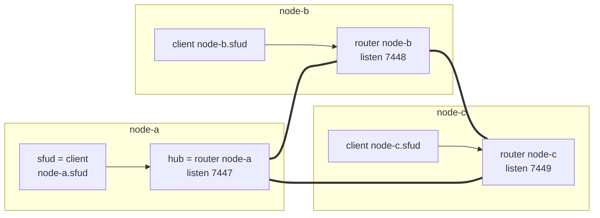
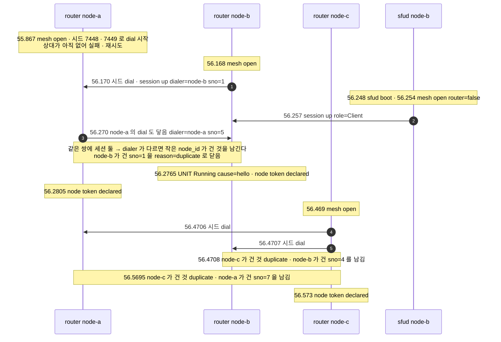
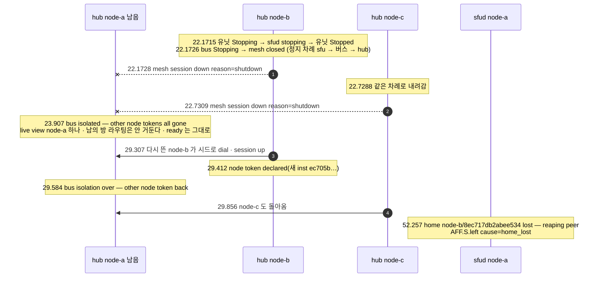

# 14. oxmesh — node 사이 버스: 그물 · 선언 · 레인 · 고립 · 울타리

> author: kodeholic (powered by Claude) · created: 2026-11-09.
> ★**대조한 커밋** — 서버 `oxlens-sfu` `c3642e8`(`crates/oxmesh` · `oxhubd/src/bus` · `oxsfud/src/bus`) · 2층 `oxlens-labs` `fc584ff`
> ★**실측 회차** — 한 기계 위 세 node(hub + sfud) 개발 형상에서 2층 회차 `e2e-20261109-070257` 이 node 를 띄우고 내린 서버 로그와 운영 표면(`/admin/bus`). 값은 돌릴 때마다 바뀌고 차례 · 모양은 같다.

## 1. 30초 요약



- **router 는 hub 마다 하나이고 서로 전부 직접 잇는다 — 한 홉이다.** 받은 것을 다른 router 로 다시 보내지 않는다. sfud 는 제 hub 하나에만 client 로 붙는다.
- **「있다」는 선언으로 말한다.** hub 는 `node` 토큰을, sfud 는 `room` 토큰을 선언하고, 모든 hub 가 그것을 구독해 「node 집합」과 「방 → node 표」를 든다([13](13_MULTI_NODE.md) 의 요청 길이 이 표를 쓴다). 주체가 죽으면 세션째 키가 사라진다 — 지우라는 통보가 없다.
- **세션마다 레인 넷(제어 · 선언 · 요청 · 데이터)이 따로 큐를 갖는다** — 통지가 몰려 데이터 레인이 차도 keepalive · 토큰은 막히지 않는다. 이 버스는 zenoh 를 갈아 끼운 우리 크레이트다(§5).

## 2. 등장인물 · 값

| 이름 | 실측 값 | 무엇 |
|---|---|---|
| router | `node-a` · `node-b` · `node-c` — `mesh open router=true listen=127.0.0.1:7447 connect=127.0.0.1:7448,127.0.0.1:7449 lease_ms=10000` | hub 프로세스 안에 연다. `connect` 는 **시드**(처음 붙을 길) |
| client | `node-a.sfud` … — `mesh open router=false connect=127.0.0.1:7447` | 제 node 의 router 하나에만 |
| 이름 공간 | `namespace oxdev` → 키 앞 `ox/oxdev/int/` | 배포마다 다르다(`[bus] namespace` · sfud `--bus-namespace`) |
| 기동 신원 `inst`(hub) | node-a `0e742f7ca03583b0` · node-b `60bd3cfd674df4d7` · node-c `0add4b761af74bff`(07:44 `/admin/bus`) | hub 기동마다 새 값 — `node` 토큰 키에 들어간다 |
| 기동 신원 `epoch`(sfud) | node-a `8701a55ebcdd350f` | `room` 토큰 키에 들어간다 · `sfu_id` 와 같은 값 |
| 시간 값 | lease 10,000ms · keepalive = lease/4 · 눈금 100ms · 핸드셰이크 시한 5s · dial 재시도 100ms 부터 두 배 · 상한 250ms(`oxmesh/src/core.rs` · `api.rs`) | — |
| 가라앉기 | 1,000ms(`view.rs` `SETTLE_MS`) · 판정 고리 200ms | — |
| node grace | `node-grace-secs=30`(sfud 기동 줄) | 배치 후보 · 홈 거두기에 같은 값 |
| 설정 | hub `[bus] listen` · `connect`(시드) · `advertise`(비면 listen) · `namespace` · sfud `--bus-connect` · `--bus-namespace`(hub 가 유닛을 띄울 때 넘긴다 — 기동 줄 `bus-namespace=oxdev bus-connect=tcp/127.0.0.1:7447`) | — 알리는 주소 |
| 레인 큐 상한 | 데이터 8,192 프레임 · 요청 4,096(`session.rs` `DATA_CAP` · `REQ_CAP`) · 프레임 16 KiB · 메시지 64 MiB | — |

| 선언(토큰 — 키뿐 · 값 없음) | 누가 | 키 | 누가 본다 |
|---|---|---|---|
| node | hub(첫 유닛이 `hello` 한 뒤 **한 번**) | `node/{node}/{hub inst}` | 모든 hub(node 집합 · 요청 전 생존 선판정) · sfud(홈 잃음 판정) |
| room | sfud(방이 생기면) | `room/{방}/{node}/{sfud epoch}` | 모든 hub(history 구독) — **이것이 방 → node 표다** |
| sess | hub(`BIND` 뒤) | `sess/{사용자}/{node}/{session_id}` | 구독하지 않는다 — 필요할 때 get(넘겨받기 · 운영 `cut`) |

## 3. 정상 길

### 3-1. 그물이 선다 — run-all 첫 기동(07:02:55.867 → 56.573)



```
07:02:56.269932 node-b hub  mesh session down peer=node-a dialer=node-b sno=1 reason=duplicate
07:02:56.269998 node-b hub  mesh session up   peer=node-a dialer=node-a sno=5 addr=127.0.0.1:53873 role=Router
07:02:56.470849 node-b hub  mesh session down peer=node-c dialer=node-c sno=2 reason=duplicate
07:02:56.470881 node-b hub  mesh session up   peer=node-c dialer=node-b sno=4 addr=127.0.0.1:7449 role=Router
```

- **시드는 방향 규칙을 안 따른다.** 평소에는 `node_id` 가 작은 쪽만 dial 하지만, 설정의 `connect` 는 처음 붙을 길이라 양쪽이 다 건다. 그래서 같은 쌍에 세션이 둘 서고, 양쪽이 같은 규칙(dialer 가 다르면 작은 `node_id` 가 건 것)으로 따로 판정해 하나를 `duplicate` 로 닫는다(— 중복 연결). 셋이 서로 다 잇기까지 node-a 가 연 때부터 0.71초다.
- **`sno` 는 그 프로세스가 건 dial 의 차례다** — 실패한 dial 도 번호를 먹는다(`core.rs` `dial_wanted` 가 걸 때마다 올린다). node-a 의 `sno=5` · `sno=7` 은 상대가 아직 안 떠 있던 동안의 실패한 시도 뒤의 번호로 읽는다(실패한 시도는 줄을 안 남긴다).
- **차례는 버스 → sfud → node 토큰이다**(— 「기동 — 버스 → sfu」). router 가 서고(56.168) sfud 가 client 로 붙고(56.257) 유닛이 `hello` 를 한 뒤(56.2765)에야 `node` 토큰이 선다. 거꾸로면 sfud 가 붙을 router 가 없어 첫 선언이 유실된다.
- 세션이 서면 양쪽이 ★**제가 지금 든 선언 전부**를 그 세션으로 보내고 끝에 `DeclareDone` 을 붙인다(`core.rs` `install` S3). 재기동한 router 가 그동안 바뀐 남의 상태를 「다음 변경 때까지」 모르는 일이 없다.

### 3-2. 선언이 표가 된다 — `/admin/bus` 가 보이는 것

```json
{ "node": "node-a", "inst": "0e742f7ca03583b0", "namespace": "oxdev",
  "listen": ["tcp/127.0.0.1:7447"], "connect": ["tcp/127.0.0.1:7448", "tcp/127.0.0.1:7449"],
  "peers": [
    { "node": "node-a.sfud", "role": "client", "links": ["127.0.0.1:53871 · dialer node-a.sfud · sno 1"] },
    { "node": "node-b",      "role": "router", "links": ["127.0.0.1:55570 · dialer node-b · sno 1"] },
    { "node": "node-c",      "role": "router", "links": ["127.0.0.1:55116 · dialer node-c · sno 1"] } ],
  "nodes": [ { "node": "node-a", "inst": "0e742f7ca03583b0", "self": true },
             { "node": "node-b", "inst": "60bd3cfd674df4d7" }, { "node": "node-c", "inst": "0add4b761af74bff" } ],
  "rooms_seen": [ { "room_id": "br75514c0", "node": "node-c", "inst": "81e9bd53193c4130" }, … 셋 ],
  "isolated": null,
  "last_event": { "at_ms": 1794177561255, "kind": "delete", "key": "room/qa_tourattr_p3/node-a/8701a55ebcdd350f" } }
```

| 칸 | 뜻 | 소스 |
|---|---|---|
| `peers` | 지금 선 세션 — 상대 · 역할 · 주소 · 누가 dial 했나 · 그 프로세스의 dial 차례 | 버스 `info()` |
| `nodes` | `node` 토큰이 살아 있는 node(내 것 포함) — 요청 전 생존 선판정 집합 | `View.nodes` |
| `rooms_seen` | 남의 node 에 있는 방(방 토큰) — 방 → node 표의 남의 몫 | `View.routing` |
| `isolated` | 「남의 토큰이 일괄로 사라졌고 아직 안 돌아왔다」 | `View.isolated` |
| `last_event` | 마지막 토큰 사건 — 「버스가 살아 움직이나」의 가장 싼 증거 | `View.last_event` |

- 이 표는 run-all 과 탐침이 끝난 뒤의 것이다. node-b · node-c 는 이날 다시 떠서 `peers` 가 저쪽이 건 `sno 1` 이다 — 다시 뜬 쪽이 시드로 먼저 건다. `rooms_seen` 의 셋은 §4-2 의 결함 의심이다.
- `?all=1` 은 hub 가 `q/node/*` 로 모든 node 에 같은 표를 물어 나란히 낸다(못 닿은 node 는 그 칸에 `error`). `oxadmin bus --all` 은 그것을 표로 줄인다:

```
node    sees
node-a  node-a/0e742f7ca03583b0,node-b/60bd3cfd674df4d7,node-c/0add4b761af74bff
node-b  node-a/0e742f7ca03583b0,node-b/60bd3cfd674df4d7,node-c/0add4b761af74bff
node-c  node-a/0e742f7ca03583b0,node-b/60bd3cfd674df4d7,node-c/0add4b761af74bff
합의: 전 node 가 같은 것을 본다
```

셋이 같은 `inst` 를 보이면 그물이 수렴한 것이다. 이 「합의」는 `nodes` 만 견준다 — `rooms_seen` 은 견주지 않는다(§4-2).

### 3-3. 방 토큰이 사라진다 — 가라앉힌 뒤 몰아 판정한다(2층 `adv_room_reclaim`)

```
07:11:05.221990 node-a sfu  AFF.S.left user=botB~adv_room_reclaim … cause=leave        ← 마지막 퇴장(TTL 1초 방)
07:11:11.257129 node-a sfu  room=reclaim_adv_room_reclaim_11542 msg="room removed (ttl)" ← 회수 눈금 5초 둘
07:11:12.292685 node-b hub  drop candidate: room token delete settled (live view node-a/…,node-b/…,node-c/…)
07:11:12.292939 node-b hub  room token gone — local routing dropped
07:11:12.298134 node-a hub  (같은 두 줄)
07:11:12.393151 node-c hub  (같은 두 줄)
dump  room_state since_leave_s=6.02 placed=true  ·  since_leave_s=8.03 placed=false        ← oxe2epy 가 /admin/rooms 로 본 hub 배치
```

- sfud 가 방을 놓으면 방 토큰만 철회한다 — 세션은 그대로다. 세 hub 가 Delete 를 받는다.
- ★**받은 곳에서 바로 지우지 않는다.** 마지막 토큰 사건 뒤 1,000ms 동안 더 오는 것이 없으면 쌓인 것을 몰아 본다 — 고립이면 아무것도 안 하고, 아니면 그 방의 로컬 라우팅(관심 구독 · 멤버 표)을 거둔다. 판정 고리가 200ms 마다 돌아 실제로는 1.04 ~ 1.14초 뒤다. 줄의 `live view` 가 그 판정에 쓴 node 집합이다.
- 왜 가라앉히나 — 고립은 남의 세션 여럿이 **따로** 닫혀 오는 것이다. 버스는 세션 하나가 닫히면 그 세션 몫의 Delete 를 차례대로 내고 끝에 일괄 끝(`BatchEnd`)을 붙이지만, 세션 여럿의 끝은 버스도 모른다. 하나씩 판정하면 「산 방인데 라우팅을 거둬 다시 붙어도 통지가 영영 안 가는」 결말이 난다(— 증상). §4-2 가 실제로 그 일괄을 보인다.

### 3-4. 통지와 요청이 버스를 타는 모양

| 무엇 | 키 | 레인 | 차면 |
|---|---|---|---|
| 통지 put(sfud → 관심 선언한 hub) | `ev/room/{방}` · `ev/user/{사용자}` | 데이터 | ★버리고 센다 — 세션은 안 닫는다(`/admin/drops` `bus_ev_drop` · 07:44 hub · node-a 모두 0) |
| node 사이 요청(op 넘기기 · 방 만들기 · 운영 판독) | `q/node/{node}/call` 등 | 요청 | 부르는 쪽에 오류 답 |
| 토큰 · 구독 · router 목록 | — | 선언 | 한도 없음 |
| Hello · keepalive · Close | — | 제어 | 한도 없음 |

- 큰 메시지(입장 완결 스냅샷 · 방 상세)는 16 KiB 조각으로 나누고, 보내는 쪽이 프레임마다 가장 높은 레인부터 고른다 — 큰 답 하나가 keepalive 를 프레임 하나 넘게 막지 못한다.
- 요청은 대상 세션 신원을 기억한다 — 다른 세션에서 온 늦은 답은 버리고, 대상 세션이 닫히면 시한(10초)을 기다리지 않고 곧바로 끝난다. 실제 요청 · 통지의 시각은 [13 §3](13_MULTI_NODE.md).

## 4. 깨지는 길

### 4-1. 유닛만 죽는다 — node 토큰은 그대로(2층 실증 `bus_decisions` ①)

```
07:05:15.620741 node-b hub  mesh session down peer=node-b.sfud dialer=node-b.sfud sno=1 reason=io   ← kill — FIN 없이 끊김
07:05:15.620786 node-b hub  SV-STATE-UNIT-STATE unit=node-b from=Running to=Down cause=kill
07:05:15.822856 node-b hub  … from=Down to=Starting cause=backoff
07:05:15.834665 node-b sfu  sfud boot … (새 epoch 47d365149b88eeb9)
07:05:15.838017 node-b sfu  mesh open router=false connect=127.0.0.1:7448
07:05:15.840505 node-b hub  mesh session up peer=node-b.sfud … role=Client
07:05:15.932910 node-b hub  … from=Starting to=Running cause=hello                     ← 312ms · node token declared 줄 없음
07:05:16.478235 node-c sfu  room=shut75482 msg="room removed (ttl)"                    ← 상관없는 방 하나가 TTL 로 사라짐
07:05:17.550312 node-b hub  room=opsshape75488 drop candidate … · gc75499b · br75514b2 · shut75482
07:05:17.628958 node-a hub  (같은 넷)
07:05:17.630168 node-c hub  (같은 넷)
```

- **무엇이 깨졌나** — sfud 프로세스만 죽었다(`reason=io`). 그 sfud 가 든 방 셋(`opsshape75488` · `gc75499b` · `br75514b2`)의 `room` 토큰은 아무 정리 코드도 안 돌았는데 client 세션째 사라졌고, 그 방들은 상태의 주인과 함께 없어졌다(클라 쪽 결말은 [13 §4-1](13_MULTI_NODE.md)).
- **판정까지 1.93초** — §3-3 의 1초대보다 길다. 가라앉기는 「그 방」이 아니라 **버스 전체의 토큰 사건이 1초 조용해야** 끝난다. 0.86초 뒤 node-c 에서 상관없는 방 하나가 TTL 로 사라져 그 Delete 가 조용한 창을 다시 열었고, 넷이 한 일괄로 판정됐다. 바쁜 버스일수록 방 소멸의 판정이 늦어진다.
- **무엇이 안 깨졌나** — hub 의 router 세션과 `node` 토큰이다. `node` 토큰의 `inst` 는 **hub 의** 기동 신원이고 첫 유닛 준비 때 한 번만 선언하므로(`supervisor.rs` `became_running`), 유닛이 다시 떠도 「node token declared」 줄이 없고 남이 보는 node-b 의 `inst` 가 그대로다 — 실증이 그것을 확인하고 초록이다. 이 `inst` 를 sfud epoch 로 두면 sfud 만 재기동해도 그 hub 의 산 세션들이 「홈을 잃은 것」으로 보여 다른 node 의 방에서 거둬진다(— 증상 · 버스 모형 판 `bus/homelost_sfudinst`).

### 4-2. hub 둘이 내려간다 — 남은 node 는 「내가 고립됐다」로 본다(2층 실증 `bus_decisions` ②)



- **누가 먼저 아나** — node-a 의 router 가 같은 ms 에 `session down` 을 찍는다(정상 종료라 FIN 이 왔다 · 급사면 lease 10초 뒤 `expired`). hub 의 판정은 마지막 Delete(22.731) 뒤 가라앉혀 23.907 에 나온다 — **두 node 의 Delete 가 한 일괄로 판정됐다.** 남의 `node` 토큰이 하나도 안 남았으니 「남이 다 죽었다」가 아니라 「내가 고립됐다」로 읽고, 되돌릴 수 있는 동작만 한다 — 남의 방 라우팅을 안 거두고 홈 거두기를 미룬다. `/healthz/ready` 는 바꾸지 않는다 — 실증이 남은 node-a 의 ready 200 과 그 node 에 방이 서는 것을 확인했다. ready 를 고립 판정에 묶었다면, 판정이 틀린 이 회차(아래)에서 503 이 멀쩡한 마지막 node 까지 LB 에서 뺐을 것이다(— 증상).
- ★**이 판정은 틀릴 수 있고, 이 회차에서 틀렸다** — b 와 c 는 정말 죽었다. 그 결과 둘이 생겼다:

**① 홈 거두기는 grace 뒤 제대로 일어났다.** 사용자 `bdk75515` 는 node-b 의 hub 에 붙어 node-a 의 방 `bdk75515r2` 에 들어 있었다. 그 홈(`node-b/8ec717db2abee534`)은 돌아오지 않았다(node-b 는 새 `inst` 로 돌아왔다). node-a 의 sfud 는 그 `node` 토큰이 사라진 때부터 grace 30초가 차자(22.17 → 52.257 · 30.09초 · 그 사이 고립은 29.58 에 끝났다) 그 Peer 를 세션 폐기와 같은 길로 거뒀다(`AFF.S.left … cause=home_lost`). 거두지 않으면 죽은 node 에 붙어 있던 사람이 남의 방 명단에 유령으로 남는다.

**② ★결함 의심 — 고립 중에 들고 있던 남의 방이 40분 뒤에도 표에 남았다.** node-c 의 옛 sfud(epoch `81e9bd53193c4130` · 07:05:22.729 에 내려감)가 들던 방 셋이 07:44 에도 node-a 의 표에 있다:

```
oxadmin rooms (node-a)
room_id         node    sfu_id            members
br75514c0       node-c  81e9bd53193c4130  0
porder75483     node-c  81e9bd53193c4130  0
ptt-1794175457  node-c  81e9bd53193c4130  0
/admin/bus?all=1 rooms_seen — node-a 셋 · node-b 0 · node-c 0
이날 세 node 로그 「held room released」 0줄
```

- 고립 중 받은 방 토큰 Delete 는 「들고 있기」로 미뤄 두고, 고립이 끝나면 그 방의 **주인 node 가 살아 있는지**로 놓을지 정한다(`view.rs` `release_held`). node-c 는 새 `inst` 로 살아 돌아왔으니 「살아 있다」로 보고 놓지 않았다 — 그런데 그 방을 든 것은 이미 죽은 옛 sfud 였다. 규격은 「판정이 틀린 것이면 그 방 로컬 라우팅이 남는다 — 그 방 클라는 연결 길로 알고 나간다」(— 분할 · 고립 행)까지는 감수하지만, 「방을 맡은 sfud 가 방을 잃은 채로 있으면 고립되지 않은 hub 는 **언젠가** 그 방의 로컬 라우팅을 거둔다」와는 어긋나 보인다.
- 읽을 수 있는 결과(추론 · 실측 안 함) — 같은 이름의 `POST /rooms` 는 HRW 가 아니라 이 표를 따라 node-c 로 간다(`room/mod.rs` 가 `room_route` 를 먼저 본다) · 방 수 한도(`max_rooms`)가 이 셋을 센다 · 운영 화면에 members 0 인 방이 계속 보인다. `oxadmin bus --all` 의 「합의」는 `nodes` 만 견주어 이 갈림을 「같은 것을 본다」로 낸다.

### 4-3. 멈췄다 깨어남 · 부분 단절 · lease 만료 — 이 형상에서는 한 번도 안 났다

이날 세 node 로그의 `mesh session down` 까닭을 세면:

| node | `shutdown` | `duplicate` | `io` | `expired` | `fenced` · `partial` 줄 |
|---|---|---|---|---|---|
| node-a | 47 | 14 | 0 | 0 | 0 |
| node-b | 84 | 17 | 3 | 0 | 0 |
| node-c | 53 | 17 | 0 | 0 | 0 |

정상 종료(`shutdown`) · 시드 겹침(`duplicate`) · 유닛 kill(`io`)뿐이다. 버스가 막으려고 지은 고장은 이 개발 형상(한 기계 · 정상 종료 위주)에서 일어나지 않는다 — 그래서 그 길은 결정 기록의 시험대 실측으로만 본다(이 회차 밖):

| 깨짐 | 무엇이 · 어떻게 깨지나 | 보이는 줄 | 기록의 실측 |
|---|---|---|---|
| 멈췄다 깨어남(SIGSTOP · GC 정지 · 노트북 덮개) | 깨어난 프로세스에 그동안 쌓인 상대의 keepalive 가 lease 를 갱신해 죽은 세션을 산 것으로 든다 | `mesh fenced — tick gap over lease · all sessions closed` → 새 `sno` 로 다시 dial | 멈춤 12초 × 20 실패 0 · 다시 보임 0.4 ~ 2.0ms · 울타리 21번 발동(zenoh 1.10.1 원본 17/20 실패) |
| 부분 단절(a–b 만 끊기고 둘 다 c 와 이어짐) | 한 홉이라 a · b 가 서로를 못 본다 · c 는 둘 다 본다 | lease 넘게 이어지면 `mesh partial — router seen by neighbours but not linked to me` | 중계는 기각(§5) — 탐지 줄만 |
| 급사(FIN 없음) | 상대가 끊긴 줄 모른다 | lease 10초 뒤 `mesh session down … reason=expired` | 망 멈춤 down 12초 × 8 · 9.6 ~ 10.1초에 끊고 다시 붙음 |
| 통지 폭주 | 데이터 레인 8,192 프레임이 찬다 | `/admin/drops` `bus_ev_drop` 증가 · 클라 `version.seq` 갭 | 1층 `data_lane_full_drops_and_counts_into_the_process_total` |

## 5. 왜 이 모양인가

- **기존 세션에 합류시키지 않는다** — 새 연결을 같은 상대의 옛 세션에 붙이면 lease · 선언 표가 옛 것을 잇는다. 세션은 `(dialer, boot, sno)` 신원으로 가르고, 더 새로우면 옛것을 닫고(`replaced`) 같거나 낡았으면 거절한다(`refused`).
- **부분 단절 때 중계하지 않는다** — 「누가 b 를 보나」 표와 중계 실패 길이 늘고, 같은 LAN 100대 미만에서 드물다. 탐지 줄(`mesh partial`)만 둔다.
- **zenoh 를 포크해 고치지 않는다** — 판을 올릴 때마다 다시 갈라지고, 쓰지 않는 기능의 결함까지 진다. 가져온 것은 키 문법 둘(`*` · `**`)과 원본 시험 이름(대조판)뿐이다.
- **혼잡으로 세션을 닫지 않는다** — zenoh `Block` 의 결말이 「이벤트 하나 때문에 그 세션이 든 토큰 전부가 사라진다」였다(— 증상).
- **울타리 문턱 = lease**(처음엔 lease − keepalive) — 시험대에서 7.5 ~ 10초 멈춤에 쓸데없는 출렁임만 더했다. **dial 재시도 상한 1초 → 250ms** — LAN 장비 셋에서 멈춤 뒤 다시 붙기 중간값이 870ms → 508ms, 망 끊김 1,082ms → 298ms 로 줄었다(대가: 죽은 상대에게 초당 4번 dial).

> ★**우리만의 것 — oxmesh: zenoh 를 갈아 끼운 우리 버스**
> - **선택 배경** — zenoh 1.10.1 router 그물에서 멈췄다 깨어난 node 의 선언(토큰 · 구독 · 응답자 전부)이 이웃에 안 갔다. 원인이 셋이었다: 트리의 새 자식을 그래프 번호로 가림(번호 재사용) · 같은 신원의 새 연결을 옛 세션에 합류 · 옛 세션 정리를 node 신원으로 해 새 세션의 선언까지 지움. 셋 다 「무엇이 새것인지를 세션 신원이 아닌 번호 · ID 로 판정」한 것이었고, 포크 고침은 두 번 실패했다. 그래서 router 한 가지 · 직접 그물 · 한 홉 · 100대 미만으로 줄여 새로 지었다.
> - **얻은 것** — 멈춤 12초 × 20 선언 유실 0(zenoh 원본 17/20 실패) · LAN 장비 셋에서도 선언 유실 0(— — TLA+ 불변식 `Synced` 판 ok). 100대 그물이 서기까지 6.1초 · 토큰 하나가 전부에 닿는 p99 4.1ms · 노는 node CPU 0.27%(— — 한 맥 localhost). 세션 하나 닫힘의 Delete 를 차례대로 내고 끝에 일괄 끝을 붙인다(zenoh 는 차례도 끝 표시도 없었다). 데이터 레인 버림을 센다(`bus_ev_drop` — zenoh 때는 셀 수 없었다). 의존이 tokio · tracing 둘 · 크레이트 2,223줄(이 커밋)이다. 이 장의 실측에서 `expired` · `fenced` 0 · 이 회차 첫 기동의 그물이 0.71초에 섰다(§3-1).
> - **잃은 것** — ①부분 단절에 중계가 없다 — a–b 만 끊기면 둘은 서로를 못 보고 hub 마다 그림이 갈린다(탐지 줄만). ②직접 그물이라 연결이 N(N−1)/2 — 100대 미만이 전제다. ③zenoh 생태계 · 와이어 호환을 버렸다 — 같은 망의 3rd 가 zenoh 로 직접 붙는 길이 사라졌다. ④손 구현 고정 영역이라 규격에서 다시 짓지 않고 사람이 든다. ⑤고립 판정은 여전히 가라앉기(1초)에 기댄다 — 세션 여럿의 끝은 버스가 모르기 때문이다(§3-3 · 이 회차 판정까지 1.18초). ⑥WSL 이 낀 LAN 경로의 처리량(약 10 MB/s)과 멈춤 판 빨강 둘의 원인을 가르지 않았다(결정 기록 미결).

> ★**우리만의 것 — 「있다」는 선언으로 · 방 위치는 sfud 가 신고한다**
> - **선택 배경** — 방 학습 방송(`ROOM_CREATED` / `ROOM_DESTROYED`)의 약점이 「소멸 통보를 빠뜨리면 죽은 방이 node 를 영원히 문다」였다.
> - **얻은 것** — 주체가 죽으면 아무도 안 지워도 키가 사라진다 — §4-1 의 kill 에서 아무 정리 코드도 안 돌았는데 방 토큰이 세션째 없어졌다. 상태를 쥔 쪽(sfud)이 신고하니 「배치를 기억하는 저장소」가 따로 없다. 세션이 서면 선언 전부를 다시 보내 재기동 · 재연결 뒤에도 표가 다시 맞는다.
> - **잃은 것** — 「내가 고립」과 「남이 다 죽음」을 가를 신호가 없다 — 판정은 되돌릴 수 있는 동작에만 쓰고, 틀린 판정의 뒷정리는 §4-2 ② 처럼 샐 수 있다. 토큰은 프로세스가 **멎은** 것은 모른다(세션은 살아 있다) — 그래서 sfud 가 런타임 밖에서 스스로를 감시해 멎으면 끝낸다(— hang — 박동 500ms · 멎음 판정 10초).

## 6. 다른 SFU 는

★아래 「그쪽 방식」은 저쪽 소스를 정적으로 읽은 것이다(실측 아님). zenoh 행만 우리가 직접 잰 것이다.

| 대상 | 그쪽 방식 | 우리 | 우리 쪽 장점 | 우리 쪽 대가 |
|---|---|---|---|---|
| LiveKit | node 간 상태는 Redis 키 둘(`nodes` · `room_node_map`) · node 가용 = 통계 갱신 5초 안 · 죽은 node 정리는 **기동 때 한 번**(`RemoveDeadNodes`) · 신호 릴레이는 psrpc 양방향 스트림(버퍼 1,000 · 재시도 3 · 드롭을 명시적으로 가른다)(`livekit §12-1` · `§12-3`) | 토큰 선언(주체 세션에 묶임) · 프로세스 안 router · 외부 저장소 없음 | 죽은 주체의 키가 저절로 사라진다 · 운영할 저장소가 하나 적다 | Redis 의 넓은 생태계 · 영속을 못 쓴다 · 100대 미만 |
| JVB | 제어는 Jicofo(중앙)가 colibri2(XMPP)로 · 브리지 릴레이는 같은 mesh 에서 온 것을 같은 mesh 로 되돌리지 않는 split-horizon 한 줄(`jvb §2-1` · `§8-2`) | 중앙 조정자 없음 · router 는 받은 것을 다른 router 로 안 보낸다(한 홉) | 조정자가 단일 장애점이 아니다 · 같은 꼴의 루프 방지를 그물 규칙 하나로 | 부분 단절 때 돌아갈 길이 없다 |
| mediasoup | 버스가 없다 — 분산 정책 전부가 앱 몫(`PipeTransport` 하나 · `mediasoup §8-5`) | 버스 · 배치 · 장애 판정을 서버가 든다 | 쓰는 쪽이 짓지 않아도 된다 | 앱이 고칠 손잡이가 없다 |
| Janus | 단일 프로세스 + 다중 스레드 · 기능은 `.so` 로 같은 주소 공간(`Janus §1-2`) — node 간 버스 근거 없음 | hub(router) + sfud(client) 프로세스 분리 · 운명 공유 | 유닛 하나가 죽어도 hub 와 router 세션은 산다(§4-1) | 프로세스 경계 비용 · 버스 하나가 더 있다 |
| atm0s | 중앙 DB 없이 DHT 키값(Kademlia 꼴 XOR) · 트랙마다 채널 id 해시 · 직접 길이 나쁘면 게이트웨이가 중계 | 전부 직접 잇는 그물 · 중계 없음 | 홉이 늘 하나 · 표가 제 것만 본다 | 규모 상한(100대 미만) · 부분 단절에 약하다 |
| zenoh 1.10.1(직접 실측) | linkstate 트리 · 여러 홉 중계 · 같은 ID 세션에 합류 · Delete 차례 · 끝 표시 없음 · 혼잡 정책 `Block`/`Drop` | 코드로 가져온 것은 키 문법 둘(`*` · `**`)뿐 · 선언 재전송 · 레인 · 조각은 꼴만 참고해 새로 지음 | 멈춤 12초 × 20 실패 0 대 17/20 | 와이어 호환 · 생태계 |

## 7. 운영에서 보는 법

| 줄(대상 · 칸) | 언제 | 이날 |
|---|---|---|
| `mesh open router=true listen=… connect=… lease_ms=…` · `router=false connect=…` | router(hub) · client(sfud)가 섰다 | a 17 · b 45 · c 22 |
| `mesh session up peer=… dialer=… sno=… addr=… role=Router/Client` | 세션이 섰다 — 양쪽에 한 줄씩 | |
| `mesh session down peer=… reason=…` | 닫혔다 — 까닭 `shutdown` · `expired` · `fenced` · `replaced` · `refused` · `duplicate` · `protocol` · `io` | §4-3 표 |
| `mesh fenced — tick gap over lease …` · `mesh partial — …` | 멈췄다 깨어남 · 부분 단절 | 0 |
| `node token declared`(hub) | 유닛이 처음 준비되어 `node` 토큰 선언 | a 7 · b 19 · c 10 |
| `SV-STATE-UNIT-STATE unit=…` | 유닛 · 버스 · 로그 유닛 전이(`Starting` · `Running` · `Stopping` · `Down` · `Blocked`) | |
| `bus isolated — other node tokens all gone (live view …)` · `bus isolation over — …` | 고립 판정 · 끝 | a 3 · 3 |
| `drop candidate: room token delete settled …` → `room token gone — local routing dropped` | 가라앉힌 뒤 방 라우팅을 거뒀다 | 각 약 1,300 |
| `drop candidate: held room released — owner node not live …` | 고립 중 들고 있던 방을 놓았다 | 0(§4-2 ②) |
| `home {node}/{inst} lost — reaping peer`(sfud · `SV-IMPL-BUS-HOME-LOST`) | 홈을 잃은 Peer 를 grace 뒤 거둔다 | §4-2 ① |
| `local hub token back — room tokens redeclared (n)`(sfud) | 제 hub 의 `node` 토큰이 다시 보여 방 토큰을 다시 선언 | 0 |

- 운영 표면 — `GET /admin/bus`(이 hub 의 그림) · `?all=1`(전 node 를 나란히) · `oxadmin bus [--all]` · `GET /admin/drops` 의 `bus_ev_drop` · `GET /admin/rooms`(방 → node · `sfu_id`). 로그 줄 꼴 · 사건 이력은 [17](17_OPERATIONS.md) 이 집이다.
- 「버스가 이상하다」를 가르는 차례 — ①`?all=1` 의 `nodes` 가 셋 다 같은가(수렴) ②`peers` 에 상대마다 세션이 하나씩 있나 ③`isolated` 가 `null` 인가 ④`last_event` 가 최근인가 ⑤`rooms_seen` 이 node 마다 맞는가(지금 도구는 ⑤를 안 견준다).

## 8. 소스 · 규격 좌표

| 무엇 | 소스(`oxlens-sfu/crates/…`) | 규격 |
|---|---|---|
| 그물 · 방향 · 시드 · 자동 연결 · 부분 단절 탐지 | `oxmesh/src/core.rs` `dial_wanted` · `check_partial` · `install` · `broadcast_peers` | — |
| 세션 신원 · 중복 · 대체 · 거절 · lease | `oxmesh/src/core.rs` `accept_verdict` · `on_tick` · `close` | — |
| 울타리 | `oxmesh/src/core.rs` `fence`(문턱 `fence_ms` = lease) · `session.rs` `Clock` · `read_loop` | — |
| 선언 · 토큰 계수 · Delete 차례 · 일괄 끝 | `oxmesh/src/core.rs` `tok_add` · `tok_del` · `tok_notify` · `batch_end` · `keyexpr.rs` | — |
| 레인 · 조각 · 혼잡 버림 | `oxmesh/src/session.rs` `Outbox::push`(`DATA_CAP` · `REQ_CAP`) · `wire.rs`(`FRAME_MAX` · `MSG_MAX`) | — |
| 요청 · 펜싱 | `oxmesh/src/core.rs` `route_get` · `forward_reply` · `target_done` · `finish` | — |
| 쓰는 쪽 API | `oxmesh/src/api.rs` `Mesh::open` · `declare_token` · `token_sub` · `put` · `subscribe` · `queryable` · `get` · `info` · `dropped` | — |
| hub 의 버스 — router · 토큰 구독 · 관심 · 요청 | `oxhubd/src/bus/mod.rs` `open` · `start` · `declare_self` · `declare_sess` · `interest` · `call` · `query` | — |
| hub 가 본 것 — 표 · 고립 · 가라앉힘 · 들고 있기 | `oxhubd/src/bus/view.rs` `on_token` · `settle` · `release_held` · `candidates` · `room_node` | — |
| node 토큰은 첫 준비 때 한 번 | `oxhubd/src/ops/supervisor.rs` `became_running` | — |
| sfud 의 버스 — 방 토큰 · 통지 put · 홈 잃음 | `oxsfud/src/bus/mod.rs` `declare_room` · `redeclare_rooms` · `undeclare_room` · `home_alive` · `ops/timers.rs`(홈 거두기) | — |
| 키 공간 | `common/src/keyspace.rs` `Keys` | — |
| 운영 표면 | `oxhubd/src/ops/admin.rs` `bus_view` · `bus_all` · `ops/http.rs`(`/admin/bus` · `/admin/drops`) | — |
| 1층 시험 | `oxmesh/tests/l1_wire.rs` · `l1_mesh.rs` · `l1_zenoh_parity.rs`(원본 시험 이름 그대로) | — |

## 9. 스스로 확인하는 질문

<details><summary>1. node 를 넷으로 늘리면 어느 설정을 고치나?</summary>

새 node 의 `[bus] connect` 에 기존 router 하나만 적으면 된다. 세션이 서면 Hello 에 그 router 가 아는 router 목록이 오고, 새 node 는 모르는 router 에 방향 규칙대로 dial 한다. 기존 node 셋의 설정은 그대로다(— 자동 연결). 새 node 의 `node` 토큰이 뜨면 배치 후보에 들고, 새로 만드는 방만 약 1/4 이 그쪽으로 간다.
</details>

<details><summary>2. node-a 의 <code>nodes</code> 에서 node-b · node-c 가 함께 빠졌다. 둘이 죽은 건가, node-a 가 고립된 건가? 무엇을 하나?</summary>

가를 신호가 없다 — 둘 다 node-a 가 보는 것은 같다. 그래서 「일괄로 다 사라짐 = 내가 고립」으로 읽고 되돌릴 수 있는 동작만 한다: 남의 방 라우팅을 안 거두고, 홈 거두기를 미루고, `/healthz/ready` 는 그대로 둔다. §4-2 의 회차가 바로 그 판정이 틀린 경우(정말 둘이 죽었다)였다 — 홈 거두기는 grace 뒤 제대로 됐지만, 들고 있던 node-c 의 방 셋은 node-c 가 새 기동으로 돌아오자 「주인 node 가 살아 있다」로 보여 지금도 표에 남아 있다(결함 의심).
</details>

<details><summary>3. 유닛(sfud)만 kill 됐다. 다른 hub 의 <code>nodes</code> 칸은 바뀌나? 그 node 의 방은?</summary>

`nodes` 는 안 바뀐다 — `node` 토큰은 hub 가 첫 준비 때 hub 기동 신원으로 한 번 선언하고, 유닛이 다시 떠도 그대로다(§4-1 — 「node token declared」 줄이 없다). 그 유닛의 방은 다르다 — `room` 토큰이 sfud 의 client 세션째 사라지고, 방 상태는 sfud 메모리에 있었으니 유닛이 312ms 만에 돌아와도 방은 없다. 모든 hub 가 가라앉힌 뒤 그 방의 라우팅을 거두고, 클라는 연결 복구 길에서 `3010` · `3001` 로 안다([13 §4-1](13_MULTI_NODE.md)).
</details>

<details><summary>4. 통지가 폭주하면 무엇이 먼저 버려지고, 어디서 보이나?</summary>

데이터 레인의 put(통지)이다 — 큐가 8,192 프레임을 넘으면 버리고 센다. 세션은 안 닫는다 — keepalive(제어) · 토큰(선언) · 요청은 다른 큐라 멀쩡하다. 버린 수는 `/admin/drops` 의 `bus_ev_drop` 에 쌓이고, 빠진 통지는 클라의 `version.seq` 갭으로 드러나 방을 다시 받아 메운다([11](11_STALL_RESYNC.md)). 레인을 하나로 합쳤다면 그 순간 keepalive 가 줄 뒤에 서 lease 가 넘어가고 그 node 의 토큰이 통째로 사라졌을 것이다.
</details>
