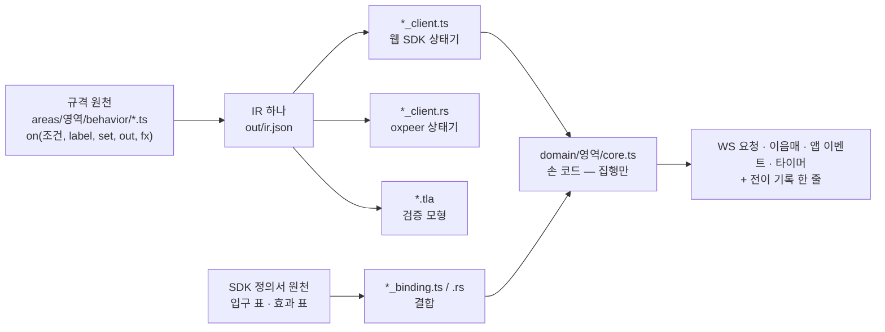
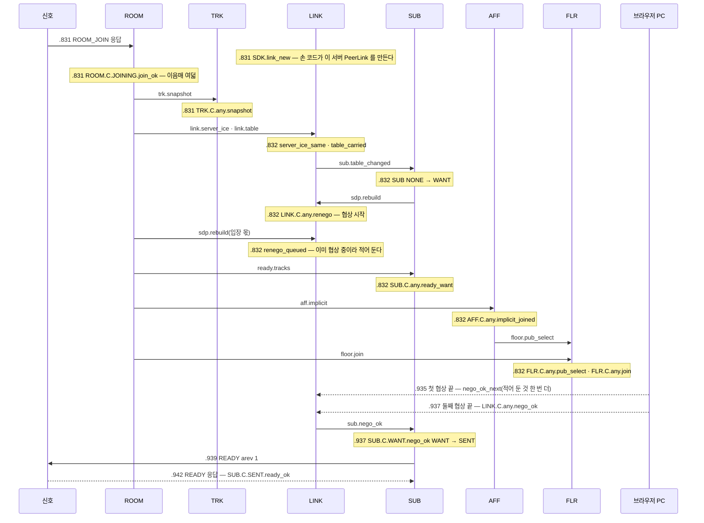
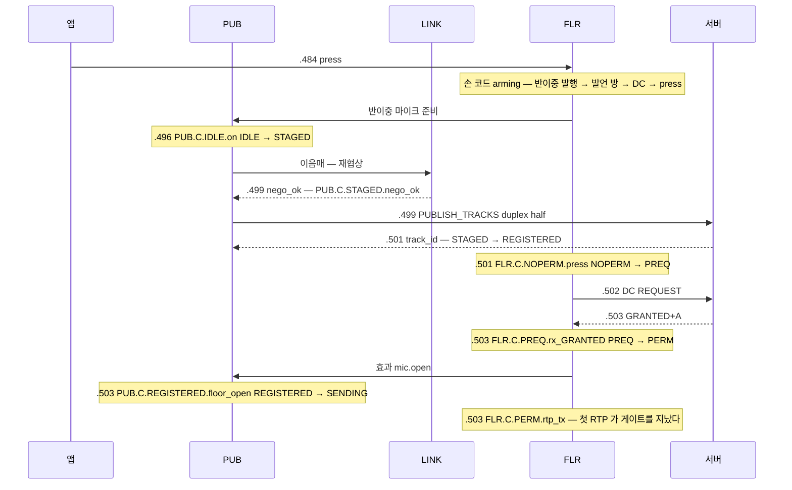
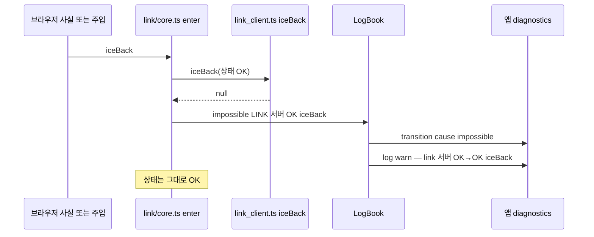
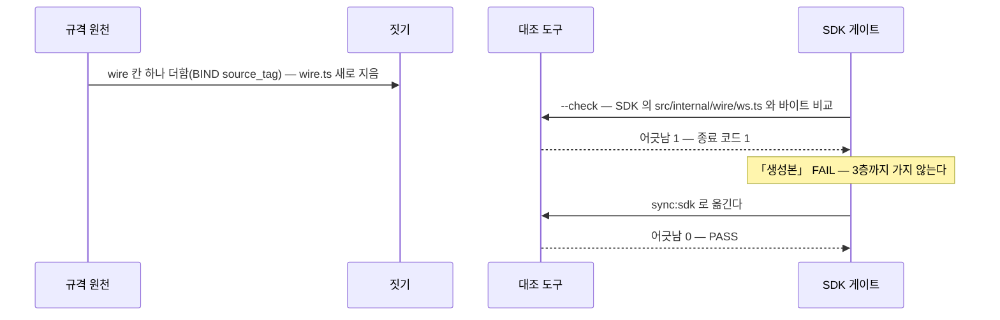

# 15. SDK 안쪽 — 생성 상태기 · 결합 · 집행 · 이음매

> author: kodeholic (powered by Claude) · created: 2026-11-09.
> ★**대조한 커밋** — 서버 `oxlens-sfu` `c3642e8` · SDK `oxlens-sdk-web` `9f40557`(+탐침) · oxpeer `93df1c6`
> ★**실측 회차** — 탐침 `tour-learn-20261109`(TOUR-02 · 07 · 10) · SDK 1층 340/340. 값은 돌릴 때마다 바뀌고 차례 · 모양은 같다.

## 1. 30초 요약



- **판단은 생성 코드가, 집행은 손 코드가 한다.** 상태와 사건을 받아 「다음 상태 · 라벨 · 보낼 것 · 이음매 · 타이머」를 돌려주는 순수 함수는 규격 원천에서 짓는다. `core.ts` 는 그 목록을 차례대로 부를 뿐이다.
- **규격 라벨이 그대로 로그가 된다.** `SUB.C.WANT.nego_ok` 는 원천의 `label` · 웹 상태기 · Rust 상태기 · TLA+ 모형 · SDK 전이 줄에 같은 글자로 있다.
- **입장 응답 하나가 상태기 여섯을 건넌다** — 탐침 TOUR-02 에서 `ROOM_JOIN` 응답을 받은 1ms 안에 ROOM · TRK · LINK · SUB · AFF · FLR 전이가 열한 줄 찍혔다.

## 2. 등장인물 · 값

| 이름 | 값(지금 소스 · 이 회차) | 무엇 |
|---|---|---|
| 웹 생성본 | `src/domain/gen/` 17 파일 2,467 줄 + `src/internal/wire/` 3 파일 930 줄 = 스물 | 상태기 여덟(aff · floor · link · publish · room · session · sub · trk) · 결합 여덟 · 정책 기본값 · wire 셋 |
| oxpeer 생성본 | `src/generated/` 21 파일 5,631 줄 | 같은 상태기 · 결합의 Rust 판 + `ws_wire` · `floor_codec` · `floor_consts` · `sdk_defaults` · `mod.rs` |
| IR 지문 | `2483d3bca9e87f67` | 웹 `sub_client.ts` 와 oxpeer `sub_client.rs` 머리에 같은 값 — 한 IR 에서 나왔다 |
| 손 집행 | `core.ts` 다섯 — aff 205 · flr 372 · link 512 · room 581 · ses 555 줄 | 입구 표 · 효과 표 · 이음매를 차례대로 부른다 |
| 호출 벡터(oxpeer 1층) | aff 159 · floor 1,760 · link 1,179 · publish 191 · room 364 · session 467 · sub 21 · trk 130 | TS 판 상태기에 넣은 호출과 결과 — Rust 판이 같은 결과를 내는지 맞댄다 |
| SDK 1층 | 340 / 340 통과 | `K-sym-IMPL-LINK-PROJECTION-1` 은 148번째 |
| 받지 않는 사건 | 탐침 열 개(02 · 02P · 02T · 06 · 07 · 08 · 09 · 10 · 11 · 13) 전부 0 | 전이 기록 `cause: impossible` 줄 수 |
| 생성본 어긋남 검사 | 3층 게이트 첫 걸음 「생성본」 PASS 24ms | 웹 SDK 게이트가 규격 저장소의 대조 도구를 부른다 |

## 3. 정상 길

### 3-1. 한 걸음 — 원천 한 줄이 네 곳에 같은 글자로

원천(규격 저장소 `areas/sub/behavior/client.ts`)의 한 판단이다.

```ts
export const CNegoOk = decide<{ k: K }>('CNegoOk', { reacts: ['LINK:sub.nego_ok'], … }, ({ k }) => [
  on(k.ready === 'WANT', { label: 'SUB.C.WANT.nego_ok', … },
    set(assign(k.ready, 'SENT')),
    out(ws('READY', 'req'))),
  otherwise({ label: 'SUB.C.any.nego_ok_other', … }),
])
```

짓기가 이것을 셋으로 낸다. 웹 `src/domain/gen/sub_client.ts`:

```ts
export function negoOk(s: St): Step {
  if (s.ready === 'WANT') {
    return done(s, { ...s, ready: 'SENT' }, 'SUB.C.WANT.nego_ok', [{ ws: 'READY', part: 'req' }], [], [], [])
  }
  return done(s, s, 'SUB.C.any.nego_ok_other', [], [], [], [])
}
```

검증 모형 `out/sub/Sub.tla` 73행:

```
IF k.ready = "WANT" THEN T("SUB.C.WANT.nego_ok", …, R([k EXCEPT !.ready = "SENT"], <<WsMsg("READY", "req", <<>>)>>, <<>>))
```

oxpeer `src/generated/sub_client.rs` 도 같은 입구 · 같은 경우 · 같은 라벨이다(머리 「같은 생성기의 TS 판과 한 뿌리」). 그리고 탐침의 SDK 전이 줄:

```
07:35:33.937 SDK  A  SUB qa_tour_p4 WANT → SENT | nego | SUB.C.WANT.nego_ok
```

전이 줄의 꼴은 `영역 · 키 · 이전 → 새 상태 · 원인 · 라벨` 이다. 라벨은 생성 함수가 돌려준 `Step.label` 이고, 원인(`nego`)은 손 코드가 입구를 부를 때 붙인 것이다.

결합(`sub_binding.ts`)은 SDK 정의서 원천에서 짓는다. 하는 일은 셋이다 — `ENTRY`(SDK 가 부르는 입구 목록) · `effect()`(위 효과 하나 → 앱 이벤트 · 동작) · `plan()`(한 걸음의 집행 목록). ★`ENTRY_ALL` 형이 위 상태기의 입구 전부를 열쇠로 요구해서, 위가 입구를 더하거나 빼면 SDK 의 타입 검사가 깨진다.

### 3-2. 입장 응답 하나 → 상태기 여섯(TOUR-02 · A)

`ROOM.C.JOINING.join_ok` 한 걸음은 이음매 여덟을 이 차례로 낸다 — `trk.snapshot` · `link.server_ice` · `link.table` · `sdp.rebuild` · `ready.tracks` · `room.sub_rooms` · `aff.implicit` · `floor.join`(생성 `room_client.ts` 120행). 손 코드는 그 차례대로 받는 영역의 입구를 부른다.



- 1ms(.831 ~ .832) 안에 전이 열두 줄 — 손 라벨 `SDK.link_new` 하나와 생성 라벨 열하나(ROOM 1 · TRK 1 · LINK 4 · SUB 2 · AFF 1 · FLR 2)다. ★`SDK.` 로 시작하는 라벨은 규격 상태기가 아니라 SDK 손 코드가 적은 사건이다(`SDK.pc_ask` · `SDK.link_new` · `SDK.first_up`).
- 「협상이 겹치면 한 번 더」는 손 코드의 판단이 아니다 — 생성 `link_client.ts` 의 `renego` 가 `nego` 가 서 있으면 `dirty` 를 세우고(`renego_queued`) `negoRes` 가 `dirty` 면 `nego_ok_next` 로 다시 짓는다. SUB 에 `nego_ok` 를 알리는 것은 큐가 빈 마지막 협상뿐이다([연:RULE-LINK-SDP-RENEGOTIATE](../protocol/09-link.md#RULE-LINK-SDP-RENEGOTIATE)).
- 같은 순간 서버 로그(`.939` · node-a sfu)에는 `spec=SV-STATE-SUBSCRIBE-STATE … from=Created to=Active cause=ready` 와 `spec=FLR.S.P.join.idle` 이 찍히고, 그 IDLE 이 DC 로 와서 SDK 의 `FLR.C.NOPERM.rx_IDLE`(.942)이 된다. 서버 라벨도 같은 규격 라벨 체계다.

### 3-3. 배정표 통지 → READY 까지 5ms(TOUR-02 · B 가 마이크를 켰다)

```
07:35:34.056 SDK  A  ROOM qa_tour_p4 JOINED → JOINED | TRACK_EVENT | ROOM.C.JOINED.delta_apply_track
07:35:34.056 SDK  A  TRK qa_tour_p4/t44e38a33ca1292d6 - → - | TRACK_EVENT | TRK.C.any.track_event
07:35:34.056 SDK  A  LINK 8701a55ebcdd350f OK → OK | MLINE_EVENT | LINK.C.any.table
07:35:34.056 SDK  A  SUB qa_tour_p4 OK → WANT | table | SUB.C.any.table_changed
07:35:34.056 SDK  A  LINK 8701a55ebcdd350f OK → OK | seam | LINK.C.any.renego
07:35:34.060 WS   A  send req  READY #4 {"room_id":"qa_tour_p4","arev":2,"join_id":"8eb8aacff64fe6f0"}
07:35:34.060 SDK  A  LINK 8701a55ebcdd350f OK → OK | nego.ok | LINK.C.any.nego_ok
07:35:34.060 SDK  A  SUB qa_tour_p4 WANT → SENT | nego | SUB.C.WANT.nego_ok
07:35:34.061 SDK  A  SUB qa_tour_p4 SENT → OK | READY.res | SUB.C.SENT.ready_ok
```

- `TRACK_EVENT` 는 ROOM 이 받아 판정하고(`delta_apply_track`) 이음매 `trk.delta` 로 TRK 에 넘긴다. 옛 SDK 는 이것을 「ROOM 라벨 글자가 `delta_apply` 면 TRK 를 부른다」로 손 배선했다 — 지금은 원천의 이음매다(§5).
- 배정표가 바뀌면 SDP 를 다시 짓고 READY 를 보낸다(배정표 · READY 의 뜻은 [03](03_PUBLISH_SUBSCRIBE.md)). 이 장에서 볼 것은 그 판단이 `link_client.ts` `mlineEvent` → 이음매 `sub.table_changed` → `sub_client.ts` `tableChanged` → 이음매 `sdp.rebuild` 의 사슬이라는 것뿐이다(탐침의 WS 줄 · SDK 줄은 다른 고리에서 찍혀 1ms 안쪽으로 앞뒤가 바뀔 수 있다).

### 3-4. 누름 → 발행 → 발언권 → 마이크(TOUR-07 · A)



- 누름부터 허가까지 19ms(.484 → .503). 발언권 절차 자체는 [07](07_FLOOR.md)의 몫이다. PUB 의 키는 등록 전에는 `audio:microphone`, 등록 뒤에는 서버가 준 `t4f41943c19116e23` 이다.
- ★여기서 손 코드가 맡는 것은 `arming` 의 차례(발행 → 발언 방 → 연결 → 누름 — —)와 효과 `mic.open` 을 발행 입구 `floorOpen` 으로 잇는 한 줄(`domain/flr/core.ts` 352행 `gate`)이다. 「허가 전에는 소리를 내지 않는다」는 PUB 상태기의 `REGISTERED` · `SENDING` 갈래가 정한다.

### 3-5. 되붙은 뒤 「아무것도 안 한다」도 라벨이다(TOUR-10 · A)

```
07:37:04.389 SDK  A  SES session RESUMING → ACTIVE | RESUME.res | SES.C.RESUMING.resume_ok
07:37:04.389 SDK  A  ROOM qa_tourcut_p0 JOINED → JOINED | RESUME.snapshot | ROOM.C.JOINED.resume_snapshot
07:37:04.391 SDK  A  TRK qa_tourcut_p0 - → - | ROOM.C.JOINED.resume_snapshot | TRK.C.any.snapshot_same
07:37:04.391 SDK  A  LINK 8701a55ebcdd350f OK → OK | table | LINK.C.any.table_carried_old
```

`RESUME` 응답이 실어 온 배정표의 `arev` 가 보관값보다 크지 않아 `table_carried_old` 로 끝났다 — 재협상도 READY 도 없다([연:RULE-SES-RESUME-PROC](../protocol/03-ses.md#RULE-SES-RESUME-PROC) 「그대로면 재협상도 READY 도 없다」). 끊김 사다리(백오프 · `drop_carry` · `Backoff`)는 [10](10_RECOVERY.md)이 집이다.

### 3-6. 서버 · oxpeer 도 같은 원천에서

| 누가 | 원천에서 무엇을 받나 | 손으로 짓는 것 | 맞대는 장치 |
|---|---|---|---|
| 웹 SDK | 상태기 여덟 · 결합 여덟 · wire · 정책 기본값(스물) | `core.ts` · `internal/` · `platform/` · `api/` | 생성본 어긋남 검사 · 1층(340) · 3층 |
| oxpeer | 같은 것의 Rust 판(21) + 호출 벡터 | `src/core/` · `src/link/`(전송 · 수신 정리층) · `api.rs` | 생성본 어긋남 검사 · 1층 `vectors_test`(Rust ≡ TS) · 2층 |
| 서버 | ★코드가 아니라 규칙 모듈(TLA+)과 1층 벡터 — 서버 정의서 원천(TS)의 산수 · 판단에서 짓는다 | 서버 전체(재생성 회차가 규격만 보고 짓고, 지금은 대장 행마다 손 수리) | 1층 벡터(`crates/oxsfud/tests/vectors.rs` — 판 묶음이 없거나 비면 빨강) · 발언권 판단은 생성 서버 상태기의 이식(`oxsfud/src/flr/core.rs` 머리) |

- oxpeer 의 Rust 판은 「형 끌어내기는 TS 판 것 그대로 · 찍기만 Rust」다. 모형 레코드 열쇠(`track_id` 등)는 Rust 가 형을 넓힐 수 없어 문자열 열쇠 맵으로 넓혀 짓는다. 서버 로그의 `spec=FLR.S.P.NP_TAKEN.rx_ACK_taken` 같은 라벨도 원천의 라벨이다 — 클라 전이 줄과 서버 로그 줄이 같은 이름표로 짝지어진다(로그 읽는 법은 [17](17_OPERATIONS.md)).

## 4. 깨지는 길

### 4-1. 받지 않는 사건 — 생성 함수가 `null` 을 돌려준다

생성 `link_client.ts` 127행:

```ts
export function iceBack(s: St): Step | null {
  if (!(s.ls === 'WAIT' && s.ice === 'DISC')) return null
```

연결이 멀쩡한(`OK`) 때 「ICE 가 돌아왔다」가 들어오면 규격은 그 칸을 정하지 않았다. 손 코드는 이것을 버리지 않고 적는다.



- 무엇이 깨졌나 — 규격이 「이 상태에서 이 사건은 오지 않는다」고 본 칸에 사건이 왔다. 규격 빈칸이거나 손 코드가 입구를 잘못 부른 것이다.
- 누가 먼저 아나 — SDK 자신. `LogBook.record` 가 `cause === 'impossible'` 이면 debug 가 아니라 warn 으로 적고 콘솔에도 낸다(`platform/log.ts`).
- 사용자는 — 아무것도 못 느낀다(상태 불변). 그래서 경고 한 줄이 유일한 흔적이다. 실측은 1층 `K-sym-IMPL-LINK-PROJECTION-1`(OK 에 `iceBack` 주입 → 전이 기록 `['impossible', 'iceBack']` 하나 · 경고 하나 · 상태 `up` 그대로 — 340 중 148번째 통과)이고, 이 회차 탐침 열 개에서는 한 줄도 없었다.
- ★oxpeer 는 다르다 — `src/core/mod.rs` `impossible()` 은 환경 변수 `OXPEER_TRACE` 가 있을 때만 표준 오류에 「입구 X 를 받지 않는다」 한 줄을 쓰고, 앱에 내는 사건은 없다. 웹의 `diagnostics.on('transition')` 에 해당하는 표면이 oxpeer 에 없다(§9 질문 3).

### 4-2. 생성본 어긋남 — 원천은 바뀌었는데 SDK 는 옛 파일을 들고 있다



- 실제 있었던 일 — 출처 표지(`source_tag`)를 연동규격서에 더한 날, 웹 SDK 3층 게이트의 첫 판이 「생성본」에서 빨갰다(wire 칸이 늘어 웹 생성본이 낡았다). `sync:sdk` 로 옮긴 뒤 다시 돌린 판이 전 단계 통과했다. 웹은 그 칸을 켜지 않아 동작 변화는 없었다.
- 대조 도구는 「주인 없는 생성본」도 센다(원천 산출에 없는 파일이 `src/domain/gen` 에 있으면 어긋남). 결합 파일은 import 한 줄만 SDK 경로로 바꾸고 나머지는 바이트 그대로여야 한다. 이번 회차 `live-20261109-015218` 은 PASS 24ms.

### 4-3. 손 결합이 규격을 비껴갈 때 — 어느 그물이 잡나

생성 상태기는 맞아도, 그것을 부르는 손 코드가 규격과 다르게 움직일 수 있다. oxpeer 를 지으며 실제로 나온 셋이다.

| 결함 | 어떻게 드러났나 | 고친 꼴 |
|---|---|---|
| ① `set_duplex` 가 보내는 `TRACK_SET` 을 손 JSON 으로 지어 `join_id` 가 빠졌다 | 서버 로그 `spec=CP-CODE-MISSING-FIELD … op=TRACK_SET msg="missing field \`join_id\`"`(2026-11-08 12:24:53 · 사용자 `ag2`) · 앱은 매번 `DUPLEX_FAILED` | 같은 꼴의 손 JSON 요청 본문(ROOM_JOIN · ROOM_LEAVE · READY · SUBSCRIBE_LAYER · BIND · RESUME · ICE_RESTART · TRACK_SET)을 생성 wire 요청 형으로 |
| ② 서버를 건너는 발언 방 전환에서 발행 트랙의 서버를 다시 읽지 않았다(— 「moveIn 전에 다시 읽는다」 위반) | 2층 `peer_agent_move` — 고침을 뺀 판 빨강(둘째 방 허가 0) · 넣은 판 초록 | `pub_rebind` |
| ③ 재구축에서 협상 이음매를 곧바로 성공으로 끝내 방 밖에서 `PUBLISH_TRACKS` 가 나갔다 | 2층 `peer_agent_session_cut` 빨강(「재구축인데 다시 발행하지 않았다」) | 협상 이음매를 그 방이 `JOINED` 가 될 때까지 미룬다 |

그물은 여섯 겹이다 — 타입 검사 · `arch_check` · 전이 기록(`impossible`) · 1층 `seams.test.ts`(이음매가 받는 입구에 닿나) · 서버 거절과 로그(`CP-CODE-*`) · 2층 등식과 A/B.

- 타입 검사가 잡는 것 — 위가 입구 · 효과 · 이음매를 늘리거나 줄이면 `ENTRY_ALL` · `effect()` 의 `never` · `seam()` 의 `never` 가 컴파일을 멈춘다. ①은 여기서 못 잡았다 — 요청 본문을 형 없이 지었기 때문이다. 그래서 고침이 「형으로」다.
- `arch_check` 가 잡는 것 — `setXHook` · 훅 표 · `onX` 콜백 필드(콜백 주입), 층 방향(`api → domain → internal → platform`), 영역 거울(— — 영역 없는 디렉터리 · `may_use` 밖 import). 아직 거울이 아닌 곳은 판정표 `tools/arch_known.tsv` 에 사유와 함께 셋이 있고, 표는 줄어들기만 한다.
- 서버가 잡는 것 — 규격 밖 본문은 서버가 거절 코드로 돌려주고 hub 로그에 `CP-CODE-*` 줄을 남긴다(오류 체계는 [12](12_ERRORS.md)).

## 5. 왜 이 모양인가

- **손 상태기를 버린 이유 — 같은 사실이 두 곳에 있으면 한쪽만 고쳐진다.** 실측으로 드러난 꼴이 있다. 웹 SDK 가 「ROOM 이 받은 델타만 TRK 에 닿는다」를 ROOM 라벨 글자(`delta_apply` · `delta_bare`)로 손 배선했고, 같은 규칙이 산문 · TLA+ 모형 파일에도 따로 있었다. 지금은 원천의 이음매 `trk.delta` 하나다(3-3).
- **콜백을 주입하지 않는 이유** — — 가 「옛 구현의 7단 릴레이 교훈」을 근거로 든다. 흐름이 실행 중에만 드러나면 소스로 못 따라간다. 그래서 `core.ts` 는 `plan()` 의 목록을 직접 부르고, 이음매의 받는 곳은 생성 `SEAMS` 표가 정한다.
- **입구 함수를 순수 함수로 둔 이유** — 같은 함수에 같은 입력을 넣으면 같은 `Step` 이 나와야 TLA+ 모형의 실행 기록을 그대로 다시 돌려 볼 수 있다(호출 벡터 · 재생 시험). 시간도 함수 안에 없다 — 걸 타이머는 `Step.start` 목록으로 돌려주고, 손 코드가 건다.
- **받지 않는 사건을 버리지 않는 이유** — — 러너 규율 「조용히 무시하지 않는다 — 전이 기록 `cause:'impossible'` + diagnostics 경고」. 조용히 버리면 규격 빈칸이 관측되지 않는다.
- **결합을 연동규격서가 아니라 SDK 정의서에서 짓는 이유** — 상태기는 모든 클라에 같은 계약(위)이고, 「어느 브라우저 사실이 어느 입구를 부르나」는 플랫폼의 일(아래)이다. 위는 아래를 모른다.

> ★**우리만의 것 — 생성 상태기(라벨이 곧 로그)**
> - **선택 배경** — 규격이 정본이고 코드는 모델이 바뀔 때마다 규격에서 다시 짓는다. 그러려면 판단이 손 코드에 숨어 있으면 안 된다. 실측으로 사본 8쌍(산문 · TLA+ 모형 파일 · SDK 손 배선)이 나왔다.
> - **얻은 것** — 원천 한 줄이 웹 상태기 · Rust 상태기 · TLA+ 모형 · 전이 줄에 같은 라벨로 선다(`SUB.C.WANT.nego_ok` — 3-1). 두 언어 판이 한 IR(`2483d3bca9e87f67`)에서 나오고, oxpeer 1층이 호출 벡터 4,271 개로 Rust ≡ TS 를 맞댄다. 손 코드는 판단을 하지 않아, 전이 줄의 라벨을 규격에서 찾으면 그 줄의 조건 · 동작 · 근거가 나온다.
> - **잃은 것** — 생성기를 유지해야 한다(생성기 · 대조 도구만 4,368 줄 — `ir.mjs` 1,305 · `tla.py` 992 · `axis_client.mts` 665 · `floor_client.mts` 578 · `binding.py` 336 …). Rust 판을 붙일 때 생성기 수리가 둘 나왔다(예약어 `self` · `Self` 를 이름으로 못 쓴다 · 실패 응답에 없는 칸을 `Option` 으로). 원천을 고치면 SDK 쪽으로 옮기는 걸음이 하나 더 있고, 잊으면 게이트가 빨갛다(4-2). 판단이 아닌 것(브라우저 손잡이 · SDP 짓기 · `arming` 차례)은 여전히 손 코드다 — `core.ts` 다섯만 2,225 줄이다.

## 6. 다른 SFU 는

★아래 「그쪽 방식」은 저쪽 소스 · 문서를 정적으로 읽은 대장에 적힌 것이다(실측 아님). 상대가 클라 SDK 를 생성하는지는 대장이 읽지 않아 칸을 두지 않았다.

| 축 | 그쪽 방식 | 우리 | 우리 쪽 장점 | 우리 쪽 대가 |
|---|---|---|---|---|
| 협상 상태기 | LiveKit 서버 `NegotiationState` None → Remote → Retry — Remote 면 오퍼를 안 보내고 Retry 로 표시해 동시 오퍼 폭주를 상태로 막는다 · `offerId`/`answerId` 로 어긋남을 로그로 잡는다(`livekit §7-2` · 손으로 쓴 Go) | 같은 일을 클라 LINK 상태기의 `nego` · `dirty` 가 한다(`renego_queued` → `nego_ok_next`) — 원천에서 생성 · 모형으로 검증 | 겹친 협상의 처리가 모형 판(link)에 들어간다 | 생성기 유지 |
| 상태기 시험 | mediasoup — 순수 함수 부품(`SeqManager` · `NackGenerator` …)은 단위 시험, 상태기 · 전체 경로는 Node 통합 시험 18 파일(`mediasoup §13`) · Janus — 단위 시험이 없고 퍼저 셋 + 종단 시험 하나, 상태기 회귀는 안 잡힌다(`Janus §12`) | 상태기 자체를 모형으로 전수 탐색 + 생성 코드에 모형 실행 기록 · 호출 벡터를 넣어 맞댐 + 1층 · 2층 · 3층 | 「모형이 본 것 = 코드가 하는 것」을 기계가 잰다 | 모형은 축약이다 — 큰 방 · 실제 시간은 못 본다 |
| 시간을 어디서 | str0m — 내부 시계 호출 0, 모든 시간이 바깥 입력(`str0m §2`) · webrtc-rs — 「`Instant::now()` 를 부르는 sans-I/O 코어는 sans-I/O 가 아니다」를 CI 가 검사(`webrtc-rs §5-1`) | 생성 입구 함수 안에 시계가 없다 — 타이머는 `Step.start` 로 돌려준다. 손 코드(`core.ts`)는 플랫폼 시계를 부른다 | 상태기 판단은 결정적이라 재생 시험이 된다 | 손 코드의 시간까지 막는 검사는 없다 |
| 규칙을 검사기로 | webrtc-rs 의 시간 경계 CI job(위) | `arch_check` — 층 방향 · 콜백 주입 · 영역 거울을 빌드 실패로 | 「콜백 주입 금지」가 문장이 아니라 장치다 | 판정표(예외)를 관리해야 한다 |


## 7. 운영에서 보는 법

| 무엇 | 어디서 | 실제 줄(이 회차) |
|---|---|---|
| SDK 전이 | 앱 `client.diagnostics.on('transition', fn)` · 로그 네임스페이스 = 영역 소문자 · debug | `SUB qa_tour_p4 WANT → SENT \| nego \| SUB.C.WANT.nego_ok` |
| 받지 않는 사건 | 같은 이벤트 `cause: 'impossible'` · warn · 콘솔 | 1층에서만 — 이 회차 탐침 0 |
| 손 라벨 | 접두 `SDK.` | `LINK 8701a55ebcdd350f OK → OK \| join \| SDK.link_new` |
| 서버 짝 | hub · sfud 로그 `spec=` | `spec=FLR.S.P.join.idle … cause=ready` |
| oxpeer 전이 | 환경 변수 `OXPEER_TRACE` → 표준 오류 `[oxpeer] 층 키 앞→뒤 라벨 (원인)` | 이 회차에 켜지 않았다 |

클라 전이 줄과 서버 줄을 한 시각축으로 엮어 보는 법 · 세션 지문은 [17](17_OPERATIONS.md)이 집이다.

## 8. 소스 · 규격 좌표

| 무엇 | 좌표 |
|---|---|
| 생성 상태기 · 결합(웹) | `oxlens-sdk-web/src/domain/gen/*_client.ts` · `*_binding.ts`(`ENTRY` · `ENTRY_ALL` · `effect` · `plan`) |
| 한 걸음 집행 | `src/domain/aff/core.ts` `enter` · `step` · `seam`(가장 짧은 본보기) · `src/domain/link/core.ts` `enter` · `step` · `seam` · `negotiate` |
| 전이 기록 · 받지 않는 사건 | `src/platform/log.ts` `LogBook.record` · `impossible` |
| 진단 표면 | `src/api/client.ts` `Diagnostics.on('transition')` |
| 손 라벨 | `src/domain/ses/core.ts`(`SDK.pc_ask`) · `src/domain/link/core.ts`(`SDK.link_new` · `SDK.first_up`) |
| 발언권 arming | `src/domain/flr/core.ts` `arm` · 효과 `mic.open` → `src/domain/pub/registry.ts` `floorOpen` |
| 구조 가드 | `tools/arch_check.mjs` · `tools/arch_known.tsv` · 1층 `test/seams.test.ts` · `test/link.test.ts`(`K-sym-IMPL-LINK-PROJECTION-1`) |
| 게이트 | `scripts/gate.mjs`(첫 걸음 「생성본」) |
| oxpeer | `oxlens-sdk-peer/src/generated/` · `src/core/mod.rs` `record` · `impossible` · `src/vectors_test.rs` · `tests/vectors/*.json` |
| 서버 | `oxlens-sfu/crates/oxsfud/tests/vectors.rs` · `crates/oxsfud/src/flr/core.rs` |
| 규격 | [연:RULE-SUB-READY-PROC](../protocol/08-sub.md#RULE-SUB-READY-PROC) · [연:RULE-SUB-TABLE-PROC](../protocol/08-sub.md#RULE-SUB-TABLE-PROC) · [연:RULE-LINK-SDP-RENEGOTIATE](../protocol/09-link.md#RULE-LINK-SDP-RENEGOTIATE) · [연:RULE-SES-RESUME-PROC](../protocol/03-ses.md#RULE-SES-RESUME-PROC) |


## 9. 스스로 확인하는 질문

<details><summary>1. 탐침에서 `SUB.C.WANT.nego_ok` 를 봤다. 「왜 READY 를 보냈나」의 답은 어디서 찾나?</summary>

손 코드가 아니라 규격이다. 생성 `sub_client.ts` `negoOk` 가 `ready === 'WANT'` 면 `out = READY` 를 돌려주고, 그 원천은 SUB 영역 원천의 `CNegoOk` 판단이다. 같은 라벨을 연동규격서 SUB 장 표에서 찾으면 조건 · 동작 · 근거([연:RULE-SUB-READY-PROC](../protocol/08-sub.md#RULE-SUB-READY-PROC))가 나온다. `core.ts` 는 받은 목록대로 보냈을 뿐이다.
</details>

<details><summary>2. TOUR-02 에서 협상이 두 번(`nego_ok_next` → `nego_ok`) 돌았다. 결함인가?</summary>

아니다. 입장 응답의 이음매 둘이 각각 SDP 다시 짓기를 불렀다 — 배정표 반영(`table_carried` → SUB → `sdp.rebuild`)과 입장 몫 `sdp.rebuild`. 첫째가 협상을 시작했고 둘째는 협상 중이라 `renego_queued` 로 적혔다. 첫 협상이 끝나자 `dirty` 때문에 한 번 더 지었고, 큐가 빈 마지막 협상만 SUB 에 `nego_ok` 를 알렸다. READY 는 한 번(arev 1) 나갔다.
</details>

<details><summary>3. (깨지는 길) oxpeer 에서 규격이 받지 않는 사건이 들어오면 앱은 알 수 있나?</summary>

지금은 모른다. `src/core/mod.rs` `impossible()` 은 `OXPEER_TRACE` 가 켜진 때만 표준 오류에 한 줄을 쓰고 앱에 사건을 내지 않는다. 웹은 `transition` 이벤트(`cause: impossible`) + warn 로그로 낸다. — 는 플랫폼 장 밖(진단 포함)을 공유 계약으로 두므로, 이 차이는 규격과 견줘 볼 빈칸이다.
</details>
