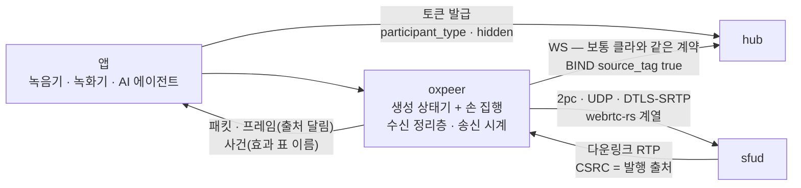
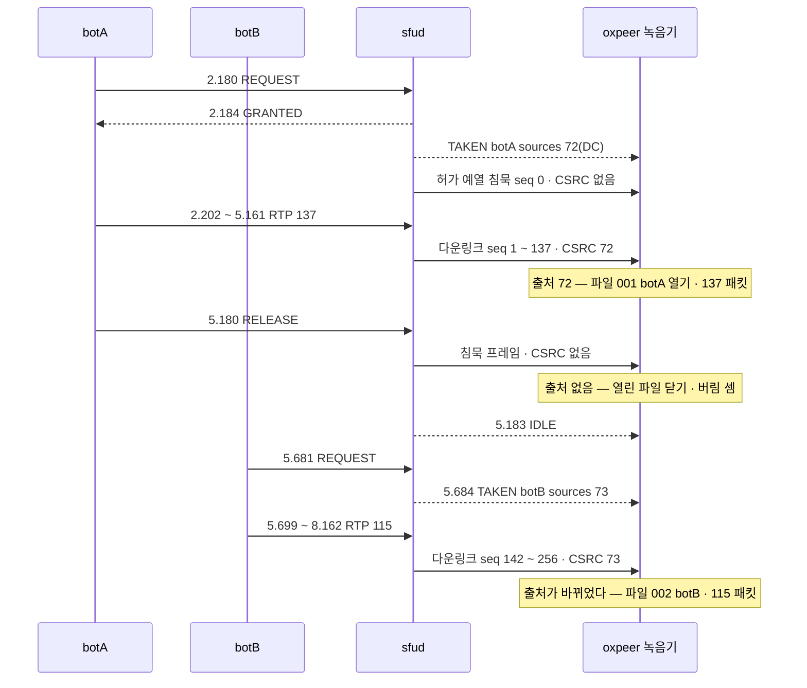
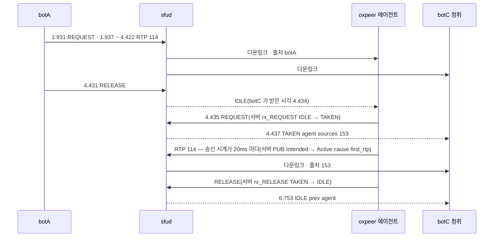
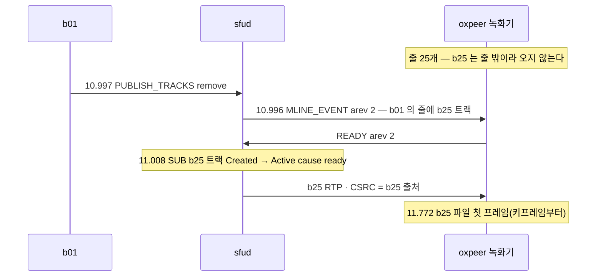

# 16. 서버사이드 SDK oxpeer — 녹음 · 녹화 · 에이전트가 같은 계약으로

> author: kodeholic (powered by Claude) · created: 2026-11-09.
> ★**대조한 커밋** — 서버 `oxlens-sfu` `c3642e8` · SDK `oxlens-sdk-web` `9f40557` · 2층 `oxlens-labs` `fc584ff` · oxpeer `93df1c6`
> ★**실측 회차** — 2층 `e2e-20261109-070257`(oxpeer 시나리오 24) · 3층 `peer_mixed`. 값은 돌릴 때마다 바뀌고 차례 · 모양은 같다.

## 1. 30초 요약



- **서버 코어는 oxpeer 를 모른다.** 녹음기 · 에이전트는 앱이 발급받은 토큰으로 보통 클라와 똑같이 들어온다. 서버 로그에 보이는 차이는 토큰이 정한 `hidden` 한 칸뿐이다.
- **발언 한 건 = 파일 하나는 패킷이 정한다.** 녹음기는 다운링크 패킷의 CSRC(발행 출처)가 바뀌는 곳에서 파일을 자른다 — 2층 `peer_recorder` 에서 `TAKEN` 이 알린 출처 `72` · `73` 이 파일 둘이 됐고, 봇이 보낸 137 · 115 패킷이 그대로 들어갔다.
- **디코딩 · 인코딩은 하지 않는다.** 받는 것은 SRTP 를 푼 코덱 페이로드(또는 조립한 코덱 프레임)이고, 보내는 것은 앱이 인코딩한 프레임이다. 합치기 · 트랜스코딩 · 송신 조절은 앱 몫이다.

## 2. 등장인물 · 값

| 이름 | 값(2층 `e2e-20261109-070257`) | 무엇 |
|---|---|---|
| 녹음기 | `oxpeer~peer_recorder` · 토큰 `participant_type:1` · `hidden:true` | 예제 `examples/recorder` — hub 세션 플래그 `hidden+live+bound` |
| 에이전트 | `agent~peer_agent_echo` · `participant_type:2` · `hidden:false` | 예제 `examples/agent` — hub 세션 플래그 `live+bound` |
| 녹화기 | `oxrec~peer_record_*` | 같은 예제 `--video` — 트랙마다 Matroska 하나 |
| `pc_mode` | `2pc` | sfud 로그에 Peer 키가 둘(`key=publish` · `key=subscribe`) |
| 출처 표지 | BIND `source_tag: true`(늘 켬) | 이 연결에만 다운링크 CSRC 가 실린다 |
| 발행 출처(`peer_recorder`) | botA `72` · botB `73` | `TAKEN` 의 `sources` = 녹음 파일의 `csrc` |
| 녹음 파일 | 001 botA seq 1 ~ 137 · 137 패킷 / 002 botB seq 142 ~ 256 · 115 패킷 | 봇이 보낸 수: botA 137 · botB 115 |
| 출처 없는 패킷 | 8 — 전부 Opus 침묵 프레임 | 서버가 지은 패킷(허가 예열 · 해제 무음) — 어느 파일에도 안 든다 |
| 2층 판정 | oxpeer 시나리오 24 · 빨강 0 · 격리 0 | 녹음 7 · 녹화 6 · 에이전트 11 |
| 3층 섞임 | `PEER-MIX-01` · `-02` · `-B1` PASS | 브라우저 실 인코더 ↔ oxpeer 실 코덱 |

## 3. 정상 길

### 3-1. 들어가기 — 토큰 → BIND → 두 연결 → 듣기 입장

`peer_recorder` 의 산 서버 로그(녹음기 줄만):

```
07:23:07.174451 node=node-a proc=hub kind=ev spec=SES.S.bind_new user=oxpeer~peer_recorder ... from=- to=hidden+live+bound cause=BIND
07:23:07.177672 node=node-b proc=sfu kind=ev spec=SV-STATE-PEER-STATE ... area=LINK key=publish from=- to=Alive cause=peer_created
07:23:07.177817 node=node-b proc=sfu kind=ev spec=SV-STATE-PEER-STATE ... area=LINK key=subscribe from=- to=Alive cause=peer_created
07:23:07.178265 node=node-b proc=sfu kind=ev spec=AFF.S.join_listen user=oxpeer~peer_recorder ... cause=ROOM_JOIN
07:23:07.184200 node=node-b proc=sfu kind=ev spec=SV-STATE-SUBSCRIBE-STATE ... key=ptt-...-audio from=Created to=Active cause=ready
07:23:07.185083 node=node-a proc=hub kind=ev spec=CP-OP-READY user=oxpeer~peer_recorder arev=1 msg=ok
07:23:07.199747 node=node-b proc=sfu kind=diag spec=SV-RULE-LINK-TRANSPORT ... msg="transport ready (dtls+srtp) subscribe"
```

- **토큰** — 앱(서버 프로그램)이 hub 에서 API 키로 직접 받는다([연:RULE-SES-TOKEN-BY-BACKEND](../protocol/03-ses.md#RULE-SES-TOKEN-BY-BACKEND)). 녹음기는 `participant_type:1`, 에이전트는 `2` 를 고르고, `hidden` 은 따로 고른다 — 「녹화가 곧 투명이 아니다」([연:RULE-SES-TOKEN-AXES-SEPARATE](../protocol/03-ses.md#RULE-SES-TOKEN-AXES-SEPARATE)). 이 회차 녹음기는 투명 · 에이전트는 보이는 참가자다.
- **BIND** — `source_tag: true` 를 늘 싣는다(`src/core/ses.rs`). 받는 쪽 능력이라 세션 단위다([연:RULE-SES-SOURCE-TAG-SESSION](../protocol/03-ses.md#RULE-SES-SOURCE-TAG-SESSION)). 서버는 누가 켰는지 보지 않는다.
- **두 연결** — UA `oxpeer` 는 `pc_mode` 능력표에 행이 없어 `2pc` 다(1pc/2pc 의 뜻은 [02](02_CONNECT_JOIN.md)). 그래서 sfud 에 Peer 가 둘 선다. ★SDP 는 없다 — oxpeer 의 「협상」은 배정표를 경로표(ssrc → 방 · 트랙)에 싣는 것이고 늘 곧바로 성공한다.
- **듣기 입장** — 녹음기는 `select:false` 로 든다(`AFF.S.join_listen`). 말하는 에이전트는 `select:true`(`AFF.S.join_select`)로 든다.

### 3-2. 녹음 — 출처가 바뀌는 곳이 파일 경계(`peer_recorder`)



- 시각은 봇 덤프 경과(초)다. 청취 봇 botC 가 같은 슬롯에서 받은 오디오는 seq 0 ~ 259 · 260 개 — 녹음기의 137 + 115 + 출처 없음 8 과 같다.
- ★파일을 자르는 것은 화자 사건이 아니라 패킷이다(`examples/recorder/main.rs` — 출처가 앞 파일과 다르면 닫고 새로 연다 · 출처가 없으면 열린 파일을 닫는다). 화자 사건(`Speaker`)은 경계 밖 기록용으로만 쓴다. 화자 통지는 미디어와 차례 약속이 없어 경계 패킷이 틀릴 수 있기 때문이다([연:RULE-TRK-CSRC](../protocol/06-trk.md#RULE-TRK-CSRC)).
- 출처 번호 → 사람은 무전 슬롯이면 `TAKEN` 의 `SOURCES`([연:RULE-FLR-SLOT-SOURCES](../protocol/10-flr.md#RULE-FLR-SLOT-SOURCES)), 개인 트랙이면 트랙 목록의 `csrc` 로 푼다. 서버가 다운링크에 출처를 싣는 꼴(켠 연결만 CC = 1)은 [08](08_SLOT_SPEAKER.md)이 집이다.
- 파일은 Ogg Opus(다시 인코딩 없음 · RFC 7845)다. 이 회차는 2층 등식 넷(`peer_utterance_speakers` 화자 차례 = 허가 차례 · `peer_payload_identity` · `peer_count_twin` · `peer_boundary`)이 초록이었다.

### 3-3. 녹화 — 브라우저 수신 쪽이 하던 일을 SDK 가 한다

브라우저에서는 libwebrtc 가 하던 일(재정렬 · NACK · PLI · RR · SR 로 벽시계 잇기)을 oxpeer 의 **수신 정리층**(`src/link/recv.rs`)이 한다(— 「수신 정리층」). 무엇을 보낼지는 그 줄의 `rtcp_fb` 가 정한다 — 오디오에는 NACK 이 없다.

| 값(소스 상수 — 정책 손잡이 아님) | 무엇 |
|---|---|
| `NACK_INTERVAL` 100ms · `NACK_TRIES` 10 | 영상 빈 번호를 100ms 마다 다시 묻고 10번이면 포기 |
| `HOLD_NO_NACK` 50ms | NACK 없는 오디오의 순서 기다림 |
| `MAX_GAP` 1,000 | 틈이 이보다 크면 묻지 않고 스트림을 새로 잡는다(키프레임 기다림) |
| `PLI_INTERVAL` 1,000ms · `LAYER_KEY_WAIT` 1,000ms | 프레임을 실제로 버렸을 때만 PLI · 층을 바꾼 뒤 1초 안에 키프레임이 없으면 한 번 |
| `RR_INTERVAL` 1,000ms | RTX 로 메운 것은 받은 수에서 뺀다 — 서버 자동 층의 재료는 망 손실이다 |

`peer_record_video`(봇 둘 · 오디오 + VP8)의 녹화 파일 넷:

| 파일 | 프레임 | 키프레임 | SR 로 이은 프레임(`synced`) | 길이 |
|---|---|---|---|---|
| botA 영상 VP8 | 266 | 9 | 239 | 8,833ms |
| botB 영상 VP8 | 265 | 9 | 238 | 8,800ms |
| botA · botB 오디오 Opus | 463 · 463 | — | 389 · 389 | 9,240ms |

- 첫 SR 이 오기 전 프레임은 받은 시각을 달고(`synced:false`), 녹화기는 파일 시작 벽시계를 첫 동기 프레임에서 거꾸로 셈해 닫을 때 고쳐 쓴다 — 등식 `peer_record_wallclock`(봇 SR 로 셈한 값과 ±3ms)이 초록.
- 받는 단위는 트랙마다 고른다 — 패킷(받은 차례 그대로) 또는 프레임(H264 는 Annex-B · VP8 은 서술자 뗀 것 · 영상은 키프레임부터). ★조립은 디코딩이 아니다.

### 3-4. 말하기 — 무전 되울림 에이전트(`peer_agent_echo`)



- 에이전트 요약 — `heard 114` · `sent 114` · `granted true` · 게이트에 버린 프레임 0 · 들은 패킷의 주인 `botA`. 청취 botC 는 슬롯 오디오 234 개(원래 114 + 되울림 114 + 침묵 6)를 받았다.
- 시각은 봇 덤프 경과다. 에이전트의 걸음은 서버 로그(07:19:48.413 `FLR.S.P.NP_IDLE.rx_REQUEST` · 48.416 `SV-STATE-PUBLISH-STATE … to=Active cause=first_rtp` · 50.729 `rx_RELEASE`)로 같은 축에 놓았다.
- ★**송신 시계** — 앱이 프레임을 실시간보다 빨리 넣어도 SDK 가 프레임 길이대로 고르게 내고, 통(`FRAME_QUEUE` 25)이 차면 `write` 가 기다린다. 몰아 보내면 서버는 그대로 넘기고 받는 쪽 지터 버퍼가 커지기 때문이다(— 「송신 시계」). 놓기 전에 `drain()` 으로 통을 비운다.
- 무전 트랙은 발언권 효과 `mic.open` · `mic.close` 사이에만 나간다 — 생성 발언권 상태기를 웹과 같은 계약으로 쓴다(누름 절차는 [07](07_FLOOR.md)).

### 3-5. 발행 · 대역 추정

- **영상 발행** — `peer_agent_publish` 에서 오디오 526 · 영상 304 프레임을 냈고, 서버의 키프레임 요청이 두 번(발행 뒤 1,002ms · 늦게 든 봇 때문에 2,010ms) 사건 `KeyframeRequested` 로 왔다. 앱이 다음 프레임을 키프레임으로 만든다.
- **시뮬캐스트 발행** — 층마다 앱이 인코딩한 프레임을 `write_layer(0 | 1, …)` 로 넣는다. SDK 는 rid 확장을 싣고 `PUBLISH_TRACKS` 를 `simulcast:true` · `ssrc:0` 으로 낸다(층의 뜻은 [05](05_SIMULCAST_BWE.md)).
- **대역 추정** — 패킷마다 transport-cc 를 싣고 서버 TWCC 피드백에서 손실 기반 · 지연 기울기 · REMB 상한의 최솟값을 목표로 낸다(`src/link/bwe.rs` · 시작 `START_BPS` 300,000). ★목표를 알릴 뿐이다 — 인코더를 맞추는 것은 앱이고, SDK 는 버리거나 늦추지 않는다.

### 3-6. oxpeer 가 복구 사다리를 타는 법

사다리 자체(신호만 · ICE 재시작 · 재구축 · 유닛 죽음)와 녹음기 · 에이전트로 잰 칸마다의 시각은 [10 §2 · §3](10_RECOVERY.md)이 집이다. oxpeer 는 웹과 같은 생성 상태기로 같은 사다리를 탄다. 여기서는 oxpeer 를 쓰는 앱이 알아 둘 것 둘만 적는다.

- ★**세션이 새로 섰는지는 hub 가 말한다.** `peer_recorder_freeze_long`(95초 얼림)에서 oxpeer 의 세션 흐름은 `Resuming → Active` 로만 보이지만, hub 는 옛 세션을 재개 창(`SES.S.TWindow` 07:25:53.870)에서 버리고 새 세션 키로 묶었다(`SES.S.bind_new` 07:26:02.306). 앱이 「이어받았나 · 새로 섰나」를 가르려면 hub 의 `bind_new` · 세션 키를 본다.
- **유닛이 죽으면 방을 다시 세우지 않는다** — 그 서버 연결만 `Closed` 로 끝나고 앱은 `JoinFailed{3001}` 을 받는다(§4-1).

### 3-7. 3층 — 브라우저와 섞어서

`peer_mixed`(3층 `live-20261109-015218`) — `PEER-MIX-01` 브라우저(크로뮴 가짜 장치 · 실 인코더)가 발행한 오디오 · 영상을 oxpeer 녹화기가 6초 받아 쓴 파일이 ffmpeg 로 오류 없이 디코드됐다 · `PEER-MIX-02` 에이전트가 ffmpeg 로 지은 진짜 Opus · H264(640x360)를 브라우저가 디코드했다(폭 640 · 프레임 차분 30 초과 · 샘플 차분 90,000 초과 · 은닉 10% 미만 — 시험의 문턱) · 갈래B `PEER-MIX-B1` 코덱이 아닌 표지 본문이면 패킷은 와도 디코드 프레임 0(의도대로 초록). 와이어(패킷 · 번호 · 신원)는 2층이 보고, 3층은 디코더가 판정을 바꾸는 것만 본다.

## 4. 깨지는 길

### 4-1. 방을 든 미디어 유닛이 내려간다 — 녹음기는 방을 잃고 세션은 산다(`peer_recorder_unit_down`)

서버 쪽 길(hub 가 방 토큰 소멸을 보고 `room_dropped` → `ICE_RESTART` 가 `3010` → 다시 들기가 `3001`)은 [10 §3-6](10_RECOVERY.md) · 두 node 에 걸친 로그는 [13 §4-1](13_MULTI_NODE.md) 이 집이다. 여기서는 ★**녹음기 앱이 받은 사건**을 차례대로 적는다(덤프의 녹음기 요약 · 덤프 5.085 유닛 내림 · 21.086 올림).

```
Link   fabe64ed1f83963b  Up → Wobbly                     ← 미디어가 멎었다 · WS 통지는 없다
Session Active  recovering=true  health=Degraded
Link   Restarting  attempt 1                             ← ICE_RESTART(서버 07:32:37.063 → 3010)
Ptt    NOPERM · FloorTrusted false · Speaker None · Tracks []   ← 그 방의 발언권 · 트랙 표시를 비운다
Session health=Recovering
Link   Rebuilding  cause restart_3xxx                    ← 3xxx = 치료 불가 확정
Link   Closed
JoinFailed  code 3001 ROOM_NOT_FOUND                      ← 다시 들기(서버 07:32:39.025)
Session Active  recovering=false  health=Ok               ← 세션은 산다
```

- 사용자는 — 내리기 전 발언 하나(botA 91 패킷 · seq 1~91)는 파일로 남고, 그 뒤는 아무것도 없다. 유닛을 올린 것(서버 07:32:42 무렵)은 `3001`(07:32:39)보다 늦었다.
- ★방을 다시 만들고 다시 드는 것은 확장(앱) 몫이다 — 녹음기가 대신하지 않는다. 앱이 가를 것은 `JoinFailed` 의 코드 하나다(번호의 뜻은 [12 §4-2](12_ERRORS.md)).
- 덤프 경과 ↔ 서버 시각은 botA 의 BIND(덤프 0.126 = 서버 07:32:21.849)로 맞췄다.

### 4-2. 손실 — 받는 쪽은 메우고, 보내는 쪽은 목표만 낮춘다

로컬호스트에는 손실이 없어 oxpeer 안의 QA 스위치로 흉내 냈다 — 받는 쪽 `OXPEER_QA_DROP_VIDEO_EVERY`(정리층 앞에서 영상 원본을 버림 · RTX 는 안 버림) · 보내는 쪽 `OXPEER_QA_DROP_SEND_EVERY`(영상 델타 패킷을 안 보냄 · transport-cc 번호는 매김 · 보낸 기록엔 남김).

| | 받는 쪽 `peer_record_loss`(N = 15) | 보내는 쪽 `peer_agent_bwe_loss`(N = 2) |
|---|---|---|
| 버린 것 | 106 | 160 |
| 메운 것 | NACK 106 → RTX 복구 106 · 잃음 0 · PLI 0 | 서버 NACK → RTX 160 |
| 서버 로그 | `stat … retransmitted_packets_sent=75 nack_count=75`(07:21:44 · 5초마다 찍는 누계의 중간) | — |
| 대역 추정 | — | 송신 손실 155‰ · 목표 278,181(+1.19s) → 134,850bps(+10.78s) · REMB 2,000,000 은 묶지 않았다 |
| 사용자는 | 파일 프레임 빠짐 0 | 받는 봇은 번호 빠짐 0 — ★다만 인코더를 목표에 맞추지 않으면 계속 그 손실 속에서 보낸다 |

- 누가 먼저 아나 — 받는 쪽은 정리층이 빈 번호를 보고 100ms 뒤 NACK 을 낸다. 보내는 쪽은 서버 TWCC 피드백의 빈 번호를 보고 손실 기반 목표를 깎는다(1초 창).
- ★QA 스위치는 키프레임을 버리지 않는다 — 출발 키프레임이 RTX 로 늦게 오면 그 사이 먼저 온 뒤 번호 패킷을 서버 출발 게이트가 버리는데, 받는 쪽은 그것을 망 손실과 못 가른다(규격이 허용한 구멍으로 기록됨).

### 4-3. 줄 상한을 넘는 방 — 출처가 파일 신원을 지킨다(`peer_record_reassign`)

영상 발행 26 > 한 연결의 영상 줄 상한 25([연:RULE-SUB-FILL](../protocol/08-sub.md#RULE-SUB-FILL)). 녹화기는 25 줄만 받고, 4초에 b01 이 내리면 그 줄이 줄 밖 트랙으로 넘어간다.



- 시각은 서버 시각 07:22 의 초다(MLINE_EVENT 는 sfud · PUBLISH_TRACKS 응답은 hub 가 찍어 0.6ms 뒤바뀌어 보인다). 시나리오는 발행 뒤 4초에 b01 을 내리게 되어 있고, 이 회차 덤프에서는 8.396s 에 내림 요청이 나갔다. b01 파일은 3,500ms · 106 프레임에서 끝났고, b25 파일은 b01 파일 시작보다 4.379초 늦게 열려 6,066ms · 183 프레임이다(다른 파일은 10,033 ~ 10,300ms · 302 ~ 310 프레임). 파일 26 개 모두 `rebased 0`.
- 무엇이 깨질 수 있었나 — 줄 SSRC 는 그대로이고 실린 트랙만 바뀐다. 출처 표지가 없던 때 oxpeer 는 「배정표를 적용한 뒤 그 줄 패킷 = 새 트랙」으로 갈랐고, 재배정 직전 옛 트랙 패킷이 늦게 닿으면 새 트랙 파일에 들어갈 수 있었다. 지금은 패킷마다 CSRC 로 파일 열쇠(`track_id`)를 정해 경계 패킷도 제 파일로 간다.
- 사용자는 — 줄 밖 트랙의 처음(b25 의 첫 4.4초 남짓)은 녹화되지 않는다. 원격 녹화기는 줄 상한을 받아들이기로 정했다. ★「요약에 안 실린 트랙을 적는다」도 같이 정했지만, 예제 녹화기의 요약에는 그런 칸이 없다(이 회차 요약 키 · `examples/recorder/video.rs` 로 확인) — 지금은 파일이 늦게 열린 것으로만 보인다.
- ★시나리오 머리는 「b26 이 줄 밖」이라 적었지만 이 회차는 b25 였다 — 어느 트랙이 줄 밖이 되는지는 발행 차례에 달렸다.

## 5. 왜 이 모양인가

- **뒷문을 두지 않았다** — 서버 쪽 tap(출구만 바꾼 가상 구독자)은 hook 규격서에 적혀 있지만 구현하지 않았고, 요구가 올 때로 미뤘다. 녹음기 · 에이전트는 「코어 입장에서 앱 백엔드와 같은 자격의 사용자」다. 그래서 같은 2층 · 3층 시험이 그대로 이들을 잰다.
- **참가자 종류로 wire 꼴을 가르지 않았다** — CSRC 를 붙일 연결을 `participant_type` 으로 고르는 안은 「서버가 이 값으로 가르는 것은 없다」와 [연:RULE-SES-TOKEN-AXES-SEPARATE](../protocol/03-ses.md#RULE-SES-TOKEN-AXES-SEPARATE) 를 뒤집어 기각했다. 연결이 선언(`source_tag`)하고 서버는 누가 켰는지 모른다 — `pc_mode` 와 같은 꼴([연:RULE-SES-PC-MODE-SESSION](../protocol/03-ses.md#RULE-SES-PC-MODE-SESSION)).
- **libwebrtc 를 쓰지 않았다** — 장치 · 재생이 없어 NetEQ · AEC · 하드웨어 코덱이 필요 없다. 서버와 같은 webrtc-rs 계열(DTLS · SRTP · SCTP)이다.
- **상태기는 손으로 짓지 않았다** — 웹이 받는 생성본의 Rust 판을 같은 원천에서 받는다([15](15_SDK_INSIDE.md)). 손으로 지었던 요청 본문에서 결함이 나와(`TRACK_SET` 의 `join_id` 누락) 요청 본문도 생성 형으로 바꿨다.
- **시험 봇은 oxpeer 를 쓰지 않는다** — oxpeer 는 제품이고 2층 `oxe2epy` 가 잰다. 재는 쪽이 재이는 쪽 밖에 있어야 한다.

> ★**우리만의 것 — 서버사이드 SDK(코어가 모르는 같은 계약)**
> - **선택 배경** — 녹음 · 녹화 · AI 에이전트를 서버 코어에 넣으면 코어가 기능마다 특례를 갖는다. 같은 계약 · 같은 규격 원천 · 서버와 같은 미디어 스택으로 「서버 쪽 클라」를 따로 두었다.
> - **얻은 것** — 서버에 oxpeer 몫의 특례가 없다 — 이 단계에서 서버에 더한 출처 표지도 연결이 선언하는 공용 계약이라 서버는 누가 켰는지 모른다(hub 세션 줄의 차이는 토큰이 정한 `hidden` 한 칸). 발언 한 건 = 파일 하나를 패킷 출처가 정한다 — `TAKEN` 출처 `72` · `73` = 파일 `csrc` · 보낸 137 · 115 = 파일 137 · 115 · 서버 침묵 8 은 어느 파일에도 안 들어감. 줄 재배정을 건너도 파일 신원이 그대로다(파일 26 · `rebased 0`). 2층 24 판 빨강 0 · 3층에서 브라우저 실 코덱과 양방향 디코드.
> - **잃은 것** — 디코딩 · 인코딩 · 트랜스코딩이 없다 — 사람 · 트랙 합치기(음성 + 영상)는 앱 몫(ffmpeg 등)이다. 송신 조절도 앱 몫이다 — 목표가 134,850bps 로 내려가도 SDK 는 보내던 대로 보낸다. 원격 녹화기는 줄 상한에 묶인다 — 26번째 영상 트랙은 첫 4.4초를 못 받았다. 출처 표지를 켠 연결은 다운링크 패킷마다 4바이트가 붙는다. UDP 후보만 쓰고(TCP 없음) `2pc` 만 실측했다.


## 6. 다른 SFU 는

★아래 「그쪽 방식」은 저쪽 소스 · 문서를 정적으로 읽은 대장에 적힌 것이다(실측 아님).

| 축 | 그쪽 방식 | 우리 | 우리 쪽 장점 | 우리 쪽 대가 |
|---|---|---|---|---|
| 서버 쪽 참가자를 누가 띄우나 | LiveKit — 에이전트 워커가 `GET /agent`(WS)로 등록하고 서버가 job 셋(방 생성 · 첫 발행 · 참가)을 보낸다 · `video.agent` grant · 에이전트 참가자는 방 유휴 판정에서 빠진다(`livekit §16` · `§4-2`) | 서버에 배정 평면이 없다 — 앱이 토큰을 받아 언제 들지 정한다 | 코어가 확장의 수명을 몰라도 된다 | 「방이 생기면 자동 녹화」 같은 것은 앱이 짠다 |
| 녹화 · 투명을 무엇으로 표시하나 | LiveKit grant 에 `Hidden` · `Recorder` · `Agent` — recorder 는 트랙 권한 검사를 우회하고, hidden 은 데이터 패킷의 송신자 신원을 지운다(`livekit §2`) | 토큰 클레임 `participant_type`(0 · 1 · 2) · `hidden` 둘 — 서버가 종류로 미디어를 다르게 다루지 않는다 | 종류와 wire 꼴이 묶이지 않는다 | — |
| 녹화 경로 | mediasoup — 전송 종류의 하나인 Plain(평문 · SRTP)으로 FFmpeg 등에 넘긴다(`mediasoup §8-2` ~ `§8-6`) · Janus — 공용 부품 `rtpfwd` 로 밖에 복사 · 녹음은 원본 RTP 를 MJR 로 적고 나중에 변환(`Janus §11-1` ~ `§11-3`) | 따로 띄운 프로세스가 보통 WebRTC 클라로 든다 · 서버 미디어 코어는 WebRTC 전송 하나 | 전송 종류를 늘리지 않는다 · 원격 기계에서도 같은 길 | ICE · DTLS · SRTP 를 한 벌 더 들고 줄 상한에 묶인다 |
| 녹화 신원(누가 보낸 패킷인가) | mediasoup — Consumer 가 Producer 하나에 평생 묶여 신원이 바뀌지 않는다 · Jitsi — 발행 단위 녹화는 bridge 가 colibri2 로 미는 tap · Janus — 발행 핸들에서 녹화 · Google Meet Media API — 가상 스트림에 CSRC 로 참가자 스트림 번호를 싣고 SSRC 는 「디버깅용」, 서버 침묵은 CSRC 없음 | 줄을 돌려쓰는 구조 그대로 · 선언한 연결에만 CSRC | 재배정 · 슬롯을 건너도 패킷마다 신원 | 켠 연결은 패킷마다 4바이트 · RFC 3550 §7.3 CNAME 규정에서 벗어난다(켠 연결 한정) |

★LiveKit 의 Egress(녹화)는 대장이 API 표면(`EgressService` 7 · 사건 `egress_started` 등)만 읽었다(`livekit §13` · `§14-1`) — 미디어 경로 칸은 비운다.


## 7. 운영에서 보는 법

| 무엇 | 줄(이 회차 실측) |
|---|---|
| 투명 녹음기가 붙었다 | hub `spec=SES.S.bind_new … to=hidden+live+bound` |
| 두 연결(2pc) | sfud `spec=SV-STATE-PEER-STATE … key=publish` · `key=subscribe` |
| 듣기 입장 · 말하는 입장 | sfud `spec=AFF.S.join_listen` · `spec=AFF.S.join_select` |
| 녹음기가 화자 통지를 받았다 | sfud `spec=FLR.S.P.NP_TAKEN.rx_ACK_taken … cause=server_rx` |
| 에이전트가 첫 RTP 를 냈다 | sfud `spec=SV-STATE-PUBLISH-STATE … from=Intended to=Active cause=first_rtp` |
| 녹화기 수신 손실 · 복구 | sfud `kind=stat … retransmitted_packets_sent=75 nack_count=75` |
| 이어받기 · 재구축 | hub `SES.S.drop` → `bind_resume` → `resume_ok`(같은 키) / `drop_reclaim cause=cut` · `TWindow` → `bind_new`(새 키) |
| 방을 잃음 | hub `CP-CODE-PEER-NOT-FOUND op=ICE_RESTART` → `CP-CODE-ROOM-NOT-FOUND op=ROOM_JOIN` |

- oxpeer 쪽 — 사건 `Session` · `Link` · `JoinFailed` · `TargetBitrate` · `KeyframeRequested` 와 `client.stats()`(`nack_sent` · `rtx_recovered` · `lost` · `pli_sent` · `rr_sent` · `target_bps` · `send_loss_permille` …). 전이 줄은 환경 변수 `OXPEER_TRACE` 를 켜야 표준 오류로 나온다.
- 사용자 하나의 줄을 hub · sfud 에 걸쳐 모아 보는 법(`/admin/history` · `oxadmin history` · 세션 지문)은 [17](17_OPERATIONS.md).


## 8. 소스 · 규격 좌표

| 무엇 | 좌표 |
|---|---|
| 표면 | `oxlens-sdk-peer/src/api.rs` — `Client::create` · `connect` · `open` · `join` · `join_speaking` · `set_speaking_room` · `publish` · `LocalTrack::write` · `write_layer` · `drain` · `set_duplex` · `ptt_press` · `ptt_release` · `set_unit` · `set_layer` · `stats` |
| 루프 · 집행 | `src/core/mod.rs` `run` · `record` · `impossible` · `src/core/room.rs` `room_step` · `sub_enter` · `floor_enter` · `set_layer` · `src/core/pubs.rs` `publish` · `pub_enter` · `floor_to_pub` · `pub_rebind` · `pub_room_joined` · `src/core/ses.rs`(BIND `source_tag`) |
| 수신 정리층 · 조립 | `src/link/recv.rs` `on_rtp` · `on_sr` · `tick`(상수 `NACK_INTERVAL` · `NACK_TRIES` · `HOLD_NO_NACK` · `MAX_GAP` · `PLI_INTERVAL` · `RR_INTERVAL`) · `src/link/depack.rs` `unpack` |
| 보내는 쪽 | `src/link/send.rs` `packetize` · `frame` · `retransmit` · `sender_report` · `src/link/bwe.rs` `on_feedback` · `on_remb` · `target` |
| 생성본 | `src/generated/`(Rust 판 상태기 · 결합 · wire) · `tests/vectors/` · `src/vectors_test.rs` |
| 예제 | `examples/recorder/main.rs`(출처로 파일 경계) · `mkv.rs` · `ogg.rs` · `examples/agent/main.rs` |
| 서버(소비자가 아니라 계약 상대) | `oxlens-sfu/crates/oxhubd/src/ses/token.rs`(클레임) · `oxhubd/src/ses/mod.rs`(`source_tag`) · `oxsfud/src/fwd/mod.rs` `send_down`(CSRC) · `oxsfud/src/pub/mod.rs` `next_csrc` · `oxsfud/src/ops/floor.rs` `slot_sources` |
| 2층 | `oxlens-labs/oxe2epy/scenarios/peer_*.yaml` |
| 3층 | `oxlens-sdk-web/qa/live/tests/peer_mixed.spec.ts` |
| 규격 | [연:RULE-SES-TOKEN-CLAIMS](../protocol/03-ses.md#RULE-SES-TOKEN-CLAIMS) · [연:RULE-SES-TOKEN-AXES-SEPARATE](../protocol/03-ses.md#RULE-SES-TOKEN-AXES-SEPARATE) · [연:RULE-SES-TOKEN-BY-BACKEND](../protocol/03-ses.md#RULE-SES-TOKEN-BY-BACKEND) · [연:RULE-SES-SOURCE-TAG-SESSION](../protocol/03-ses.md#RULE-SES-SOURCE-TAG-SESSION) · [연:RULE-TRK-CSRC](../protocol/06-trk.md#RULE-TRK-CSRC) · [연:RULE-FLR-SLOT-SOURCES](../protocol/10-flr.md#RULE-FLR-SLOT-SOURCES) · [연:RULE-LINK-EGRESS-REWRITE](../protocol/09-link.md#RULE-LINK-EGRESS-REWRITE) · [연:RULE-SUB-FILL](../protocol/08-sub.md#RULE-SUB-FILL) · [연:RULE-ROOM-HIDDEN-ONLY-FOUR](../protocol/04-room.md#RULE-ROOM-HIDDEN-ONLY-FOUR) |

## 9. 스스로 확인하는 질문

<details><summary>1. 녹음기의 파일 경계를 화자 사건(`TAKEN` · `IDLE`)으로 자르면 무엇이 틀리나?</summary>

화자 사건은 DC 로, 미디어는 RTP 로 따로 와서 차례 약속이 없다. 허가 예열 침묵이 `TAKEN` 보다 먼저 닿기도 하고, 승계에서는 새 화자의 첫 RTP 와 `TAKEN` 의 차례가 정해져 있지 않다. 그래서 경계 패킷 몇 개가 앞뒤 화자로 갈릴 수 있다. 지금은 패킷마다 실린 CSRC(출처)가 바뀌는 곳에서 자르고, 출처 없는 침묵(이 회차 8)은 어느 파일에도 넣지 않는다.
</details>

<details><summary>2. 투명 녹음기도 출처 표지를 받는다. 서버는 녹음기라서 CSRC 를 붙이나?</summary>

아니다. 서버는 BIND 의 `source_tag` 선언만 본다 — `participant_type` 이나 `hidden` 으로 켜고 끄지 않는다([연:RULE-SES-SOURCE-TAG-SESSION](../protocol/03-ses.md#RULE-SES-SOURCE-TAG-SESSION)). 같은 방의 봇들은 선언하지 않아 CC = 0 그대로 받는다. 종류로 가르는 안은 「무엇인가」와 「받는 wire 꼴」을 한 값에 묶어 기각됐다.
</details>

<details><summary>3. (깨지는 길) 녹음 중 방을 든 미디어 유닛이 내려가면 녹음기 세션은 어떻게 되나? 누가 방을 다시 만드나?</summary>

세션은 산다(hub 와 WS 가 살아 있다). 그 서버 연결만 사다리를 탄다 — Wobbly → Restarting → `ICE_RESTART` 가 `3010` → Rebuilding → `ROOM_JOIN` 이 `3001` → Closed. 앱은 `JoinFailed{3001}` 을 받는다. 방은 유닛 메모리와 같이 사라졌고, 방을 다시 만들고 다시 드는 것은 확장(앱) 몫이다. 이 회차에서는 유닛을 올리기(07:32:42 무렵) 전에 이미 `3001`(07:32:39)로 끝났다.
</details>

<details><summary>4. (깨지는 길) 에이전트의 목표 비트레이트가 278,181 에서 134,850 으로 내려갔다. 그다음 송신은 어떻게 되나?</summary>

oxpeer 는 사건 `TargetBitrate` 와 `Stats::target_bps` 로 알릴 뿐 보내는 양을 바꾸지 않는다 — 인코딩을 하지 않으므로 버리거나 늦추지도 않는다. 앱이 인코더 비트레이트를 낮춰야 실제로 줄어든다. 이 회차의 QA 손실(155‰)은 RTX 160 으로 메워져 받는 봇의 번호 빠짐은 0 이었다.
</details>

<details><summary>5. 줄이 25 개인 녹화기가 영상 26 개인 방을 녹화하면 무엇을 잃나?</summary>

줄 밖 트랙은 다른 트랙이 내려 줄이 비기 전까지 오지 않는다. 이 회차는 b01 이 내린 뒤 b25 가 그 줄을 받아, b25 파일은 b01 시작보다 4.379초 늦게 열렸다(183 프레임 · 다른 파일 302 ~ 310). 받은 뒤의 신원은 출처가 지켜 파일 26 개 모두 섞이지 않았다. 빠진 처음을 막으려면 서버 쪽 tap 같은 다른 길이 필요하고, 그것은 요구가 올 때로 미뤄져 있다.
</details>
