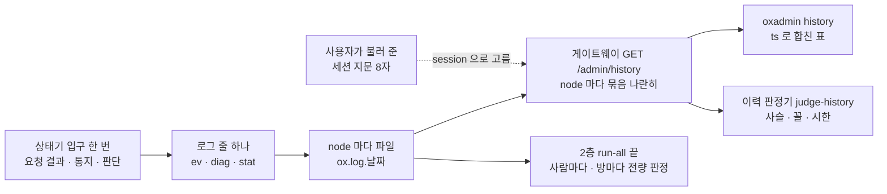

# 17. 운영자가 보는 것 — 로그 한 줄에서 깨짐까지

> author: kodeholic (powered by Claude) · created: 2026-11-09 · 고쳐 씀: 2026-11-09(새 회차 · 표준 용어 · 고쳐진 결함 실측).
> ★**대조한 커밋** — 서버 `oxlens-sfu` `1ef7265` · SDK `oxlens-sdk-web` `de8c4a9` · 2층 `oxlens-labs` `a68d2de` · oxpeer `740f172`
> ★**실측 회차** — 3층 탐침 TOUR-10 · 11 · 13(2026-11-09 둘째 회차) · 2층 run-all `e2e-20261109-132317` · 그 뒤 읽은 이벤트 이력. 값은 돌릴 때마다 바뀌고 차례 · 모양은 같다.

## 1. 30초 요약



- 서버는 상태가 한 걸음 갈 때마다 **규격 라벨을 단 로그 줄 하나**를 쓴다. 한 사람의 줄은 시그널링 게이트웨이(`oxhubd`)의 node 와 방의 node 에 흩어진다. 게이트웨이가 그것을 node 마다 읽어 나란히 돌려준다.
- 사용자가 화면의 **세션 지문(session fingerprint · 8자)**을 불러 주면, 그 값이 곧 서버 줄의 `session=` 이다. 그 세션의 줄이 바로 열린다.
- 이력 판정기는 그 줄을 규격에 댄다. 지난 판에서 잡은 결함 넷이 고쳐졌다. 이제 2층 run-all 이 끝날 때마다 판정기를 회차 전량에 돌린다(§3-5 · 어긋남 0).

## 2. 등장인물 · 값

| 이름 | 실제 값 | 무엇 |
|---|---|---|
| 줄 종류 `ev` | `CP-OP-*` · `CP-CODE-*` · 경우 라벨(`SES.S.drop` · `FLR.S.P.…`) · `SV-STATE-*` | 규격에 이름이 있는 상태 변화 · 요청 결과 · 통지. 로그 수준과 상관없이 늘 난다 |
| 줄 종류 `diag` | `transport ready (dtls+srtp)` · `stall detected — sync_required` | 판단 근거 · 예외. 근거 진술이 있으면 `spec`(예 `SV-IMPL-ROOM-STALL`)을 단다. 그런 줄은 이력 기본에 든다 |
| 줄 종류 `stat` | 5초마다 · 발행 트랙마다 수신 줄 · 구독자 Peer 마다 송신 줄 | 계수 — W3C getStats 이름(`packets_received` · `packets_lost` · `jitter`(초) · `nack_count` …). `--stat` 일 때만 이력에 든다 |
| 세션 지문 | `83e581a6`(TOUR-13 A) · `67084ff3`(TOUR-10 A) | `SHA-256(session_id)` 앞 8자. SDK `session.fingerprint` 와 서버 `session=` 이 같은 값 |
| 창 · 상한 · 보존 | 3,600 초 · node 마다 5,000 줄 · 14 일 | `--since` 를 안 주면 지금 − 1시간. 넘으면 앞을 자르고 `truncated: true`. 보존은 회전으로 닫힌 파일 기준 |
| `stat` 주기 | 5,000 ms | 이 주기보다 짧은 접속은 `stat` 줄이 하나도 안 남을 수 있다(§4-7) |
| 조회 비용 | 0.26 s | `tourcut_A` 를 14:00 부터 세 번 — 세 node 의 오늘 파일 합 71 MB · 이 장을 쓰며 잰 것 |
| 판정기 전수(게이트 ②) | 저장 조각 다시 판정 — 줄 34,310 · 사람 512 · 방 319 · 어긋남 0 · 거절 줄 대조 0 | 2층 run-all 이 끝마다 돈다(§3-5) |

이 장의 사람들(로그의 `user=`)이다.

| 깨짐 | 사용자 | 지문 | 게이트웨이 node · 방 node |
|---|---|---|---|
| 정상 길 | `tournode_A`(3층 브라우저 · 1pc) | `83e581a6` | node-a · node-b |
| 신호만 끊김 | `tourcut_A`(3층 · 1pc) | `67084ff3` | node-a · node-a |
| 미디어 정체(stall) | `tourstall_B`(3층 · 청취자) | `769034f5` | node-a · node-a |
| 유닛 죽음 | `oxpeer~peer_recorder_unit_down`(녹음기 · 투명) · `botA~adv_node_down` | `4720dcb9` · `be52909f` | node-a · node-a / node-a · node-c |
| 선점 · Floor Revoke | `botA~ptt_preempt` · `botB~ptt_preempt` | `05a26dcc` · `c21eed4a` | node-a · node-a |
| 얼림 → 재연결 | `oxpeer~peer_recorder_freeze_long` | `f44c1528` → `e6620821` | node-a · node-b |
| 잘못된 요청 | `botA~adv_wire_reject` | `8bed2462` | node-a · node-c |
| 패킷 손실 | `botA~adv_loss` · `botB~adv_loss` | `78dc13e8` · `c34f423d` | node-a · node-c |

## 3. 정상 길

### 3-1. 로그 한 줄 읽는 법

TOUR-13 의 A 가 node-b 의 방에 들어간 순간, node-b 의 SFU(`oxsfud`)가 쓴 줄 그대로다.

```
ts=2026-11-09T14:37:24.212246+09:00 mono=1248680495 node=node-b proc=sfu kind=ev spec=FLR.S.ws.join session=83e581a6 room=qa_tournode_p1 user=tournode_A epoch=5d26606f733fe9f7 floor_sequence=1 area=FLR key=qa_tournode_p1 from=IDLE to=IDLE cause=ws_join in.perm=true
```

| 칸 | 값 | 읽는 법 |
|---|---|---|
| 머리 | `ts` · `mono` · `node` · `proc` · `kind` · `spec` | 벽시계(오프셋 포함) · 그 프로세스의 단조 µs · 어느 node 의 어느 프로세스 · 줄 종류 · ★규격 라벨 |
| 상관 키 | `session` · `room` · `user` · `epoch` · `floor_sequence` | 규격에 있는 값만. `epoch` 는 SFU 기동 신원(세션 차수가 아니다). `floor_sequence` 는 그 방 floor control 줄의 차례 번호 |
| 전이 칸 | `area=FLR key=qa_tournode_p1 from=IDLE to=IDLE cause=ws_join` | 어느 상태기의 어느 인스턴스가, 무엇 때문에, 어디서 어디로. 같아도 낸다 |
| 입구 인자 | `in.perm=true` | 그 경우를 가른 입구 인자. 메시지 본문은 싣지 않는다 |

- `spec=FLR.S.ws.join` 은 지은 이름이 아니라 **연동규격서 원천이 생성 코드에 남긴 경우 라벨**이다. 소스 파일 · 줄 번호 대신 이 글자로 규격의 그 경우를 찾는다.
- `floor_sequence=1` 은 이번 회차부터 floor control `ev` 줄 전부에 있다(20261109 고침 · 서버 `f6bbf02` · 지금 실측). 장비가 다를 때 floor control 줄의 차례를 이 번호로 가른다.

같은 접속의 다른 종류 줄이다.

```
… node=node-a proc=hub kind=ev spec=CP-OP-ROOM-JOIN session=83e581a6 user=tournode_A msg=ok
… node=node-b proc=sfu kind=diag spec=SV-RULE-LINK-TRANSPORT session=83e581a6 user=tournode_A epoch=5d26606f733fe9f7 msg="transport ready (dtls+srtp) publish"
… node=node-a proc=sfu kind=stat session=769034f5 user=tourstall_B epoch=d6c9ad052c4a12ae packets_sent=105 bytes_sent=14456 retransmitted_packets_sent=0 nack_count=0 pli_count=0
```

- `CP-OP-ROOM-JOIN … msg=ok` 는 게이트웨이가 받은 요청의 결과다. 실패면 `CP-CODE-<이름>` 이다.
- `diag` 는 판단 근거다. `spec` 이 달린 진단 줄은 문맥으로 읽히라고 이력 기본에 든다. `stat` 은 `spec` 이 없고, 비트레이트는 두 줄의 `bytes_*` 차로 구한다.

### 3-2. 세션 지문

TOUR-13 의 A 가 받은 `BIND` 응답의 `session_id` 를 SHA-256 하면 앞 8자가 `83e581a6` 이다. 서버 줄의 `session=83e581a6` 과 같다. `session_id` 원값은 인증 수단이라 문서에 싣지 않는다. 와이어에는 지문이 없다. 양끝이 같은 식으로 따로 셈한다([연:RULE-SES-FINGERPRINT](../protocol/03-ses.md#RULE-SES-FINGERPRINT) `session.fingerprint`).

```
14:37:24.205 SDK  A  SES session CONNECTING → ACTIVE | BIND.res | SES.C.CONNECTING.bind_ok
14:37:24.205121 SRV  node=node-a proc=hub kind=ev spec=SES.S.bind_new session=83e581a6 user=tournode_A area=SES key=83e581a6 from=- to=live+bound cause=BIND
```

클라 전이 기록과 서버 줄이 같은 꼴(`key · from · to · cause · 라벨`)이다. 다만 클라 줄은 아직 서버로 올라오지 않아 이력은 서버 줄만 본다(§4 끝).

### 3-3. 한 사람의 접속 하나를 끝까지 — TOUR-13 의 A

게이트웨이는 node-a, 방은 node-b 다(요청 · 통지가 두 node 를 오가는 길은 [13 §3](13_MULTI_NODE.md)). 줄이 두 파일에 나뉘어 있다. `oxadmin history tournode_A` 가 게이트웨이에게 받은 두 묶음을 `ts` 로 합친다. 칸 일부를 줄였다(값은 그대로 · 괄호는 keys · msg 칸에서 옮긴 것).

```
기동
node    proc  epoch             build                            ts
node-a  hub                     1ef7265593cd.1794201387+oxe2epy  2026-11-09T14:16:35.153575+09:00
node-b  sfu   5d26606f733fe9f7  1ef7265593cd.1794201387+oxe2epy  2026-11-09T14:16:35.542819+09:00

사건 31
+ms     node/proc   kind  spec                      step                                         cause
0.0     node-a/hub  ev    SES.S.bind_new            SES 83e581a6 -→live+bound                    BIND
6.9     node-b/sfu  ev    SV-STATE-PEER-STATE       LINK publish -→Alive                         peer_created
7.1     node-b/sfu  ev    SV-STATE-SUBSCRIBE-STATE  SUB ptt-qa_tournode_p1-audio -→Created       load
7.2     node-b/sfu  ev    AFF.S.join_select         AFF tournode_A -→qa_tournode_p1              ROOM_JOIN
8.1     node-a/hub  ev    SV.rooms                  SES 83e581a6 live+bound→live+bound+rooms     ROOM_JOIN
21.7    node-b/sfu  ev    SV-STATE-SUBSCRIBE-STATE  SUB ptt-qa_tournode_p1-audio Created→Active  ready
21.8    node-b/sfu  ev    FLR.S.P.join.idle         FLR qa_tournode_p1 IDLE→IDLE                 ready   (floor_sequence=3 mbcp_seq=0 — 이 판은 0, §3-4)
22.5    node-a/hub  ev    CP-OP-READY                                                            (arev=1 ok)
67.8    node-b/sfu  ev    SV-STATE-PEER-STATE       LINK publish Alive→Alive                     nominated_new_pair
120.2   node-b/sfu  ev    CP-OP-MLINE-EVENT                                                      (arev=2)
1778.8  node-a/hub  ev    SES.S.leave               SES 83e581a6 live+bound+rooms→-              LEAVE
1780.3  node-b/sfu  ev    SV-STATE-SUBSCRIBE-STATE  SUB ptt-qa_tournode_p1-audio Active→-        unload
1780.4  node-b/sfu  ev    SV-STATE-PEER-STATE       LINK publish Alive→-                         session_gone
```

- **기동 표가 먼저 온다.** 어느 빌드가 이 줄들을 냈는지(`build` · `epoch`)가 묶음 안에 있다.
- **두 node 가 한 표에 섞인다.** 게이트웨이의 세션 걸음(`SES` · `SV.rooms`)과 방 node 의 Peer(서버 쪽 트랜스포트) · 구독 · 소속 · floor control 걸음이 지문 하나로 이어진다.
- 머리가 `SV.` 인 걸음(`SV.rooms`)은 손 코드가 생성 상태기를 덮은 것이다. `grep spec=SV\.` 의 수가 곧 손으로 덮은 횟수다.
- 맨 끝은 Peer 정리(reclaim) 줄 **한 번**이고, 구독 상태기는 `-→Created`(load)로 서서 `Active→-`(unload)로 끝난다(지난 판과의 차이는 §3-4).

### 3-4. 이력 판정기 — 표를 규격에 댄다

서버도 `oxadmin` 도 판정하지 않는다. 판정은 이력 응답(줄이 파일 글자 그대로)을 읽는 쪽이 한다 — `oxe2epy judge-history`. 세 가지를 본다.

| 판정 | 무엇 | 어긋나면 셋 중 하나 |
|---|---|---|
| ①사슬 | 같은 인스턴스(프로세스 안 `area` · `key` — Peer 는 `user` 까지)의 다음 줄 `from` = 앞 줄 `to` | 줄 유실 · 손 코드가 줄 없이 상태를 바꿈 · `from` 을 실제가 아닌 값으로 적음 |
| ②줄 꼴 | 칸 차례 · 상관 키 · `spec` 이 규격 원천에 있나 | 지은 라벨 · 차례 어긋남 · 있어야 할 키 없음(`floor_sequence`) |
| ③시한 | 타이머로 난 걸음의 간격을 규격 값 옆에 | 재전송 간격이 규격보다 이르다 |

이번 회차 A 의 판정이다.

```
이력 판정 — 줄 31 · 사슬 6 인스턴스 · 끊김 0 · 꼴 어긋남 0 · 타이머 걸음 0(이른 것 0) · 물은 축으로 다 안 보여 사슬 판정 밖 전이 줄 5
판정: 어긋남 0
```

같은 판정을 지난 판(서버 `c3642e8`)에 대면 이렇게 나왔다.

```
이력 판정 — 줄 26 · 사슬 6 인스턴스 · 끊김 1 · …
  ①사슬 끊김 node-b LINK publish user=tournode_A: SV-STATE-PEER-STATE → - 다음 SV-STATE-PEER-STATE from=Alive
```

판정기가 잡아 고친 결함 넷이다. 모두 20261109 서버 `f6bbf02` 에서 고쳤고, 이 장의 새 회차에서 그 모습이 실측으로 보인다.

| 결함 | 지난 판에서 본 것 | 고친 꼴 | 지금 실측 |
|---|---|---|---|
| Peer 정리 줄 두 번 | 세션이 사라질 때 퇴장 처리가 마지막 방에서 Peer 를 정리하고, 바깥 축출(eviction) 처리가 같은 Peer 를 또 정리하며 줄을 또 냈다. 워커 부하 계수도 두 번 내려갔다 | `reap` 의 연결 정리를 `closed.swap` 으로 한 번만 | §3-3 끝 줄 `Alive→-` 한 번 |
| 축출된 옛 세션 끝 줄 없음 | 같은 사람이 다시 BIND 해 옛 세션이 밀려나도(`2010`) 끝 줄이 없었다 | 옛 세션도 끝 줄을 낸다 | §4-6 `SES.S.bind_new … from=live+bound to=- cause=evict` |
| 구독 상태기 시작 · 끝 줄 없음 | 재연결 뒤 같은 열쇠의 사슬이 `Created` 부터 다시 시작해 끊김으로 셌다 | `-→Created`(load) · `→-`(unload) 줄 | §3-3 · §4-5 |
| floor control 줄에 `floor_sequence` 없음 | 운영 줄 꼴은 「floor control `ev` 줄 전부」에 요구했다 · 판정기도 못 봤다 | 서버가 `floor_sequence`(방 계수) · `mbcp_seq`(wire 일련번호 — Floor Idle · Floor Taken) 를 싣는다 · 판정기 줄 꼴 규칙. ★`mbcp_seq` 는 처음 고칠 때 다른 칸을 실어 늘 0 이었다. 이 장 회차들이 그 판이다(아래 발췌의 `mbcp_seq=0`). 같은 날 다시 고쳤고 이제 와이어 `SEQ` 와 같다([07 §7](07_FLOOR.md)). 줄 꼴만 보는 판정기는 이 값을 못 잡아, run-all 끝에 「봇이 받은 Floor Taken · Idle 의 seq = 그 방 서버 줄 `mbcp_seq`」 대조를 더했다 | §3-1 · §4-4 |

판정 밖 5 줄은 floor control 줄이다. floor control 의 `from` · `to` 는 방 단위 상태라, 한 사람으로 물으면 남의 걸음이 빠진다. 방으로 물으면 판정에 든다(§4-4).

### 3-5. run-all 이 끝날 때마다 판정기를 전량 돌린다(게이트 ②)

먼저 실제로 난 빨강 하나다. run-all `e2e-20261109-132317` 끝에 판정기 전수가 쓴 `history_gate.txt` 한 줄이다.

```
room=listener_notice_room_ptt_listener_notice_12638 이른 재전송 — T7 937.7ms < 1000ms
```

그 방의 로그 줄 둘을 그대로 보면 까닭이 보인다.

```
ts=2026-11-09T13:48:21.819864+09:00 mono=1256044156 … spec=FLR.S.G.IDLE.T7 … floor_sequence=43 … cause=t7
ts=2026-11-09T13:48:22.757590+09:00 mono=1257047415 … spec=FLR.S.G.IDLE.T7 … floor_sequence=44 … cause=t7
```

- 벽시계(`ts`) 차는 937.7ms 다. 규격 T7 재전송 간격 1,000ms 보다 이르다.
- 단조 시계(`mono`) 차는 1,003.3ms 다. 서버는 규격대로 기다렸다.
- 그 사이 벽시계가 NTP 보정으로 뛰었다. 결함은 판정기에 있었다. 이제 같은 프로세스 줄끼리의 타이머 간격은 `mono` 로 잰다(2층 `a68d2de` · 운영 규격 「한 프로세스 안이면 `mono`」).

한 줄 정의 — **판정기 전수**는 run-all 이 끝날 때 그 회차 구간의 서버 로그 전량을 사람마다 · 방마다 묶어 이력 판정기에 넣는 일이다. 하나라도 어긋나면 run-all 이 빨갛다.

| 손잡이 | 무엇 | 왜 |
|---|---|---|
| 전량 | 회차 구간의 세 node 로그 전부 · 사람마다(`user`) · 방마다(`room` = `key`) | 전에는 `ops_history` 스모크의 두 사람만 판정했다. 다른 시나리오의 사슬 끊김이 안 보였다 |
| 시나리오가 빨개도 돈다 | `rc_hist = _history_gate()` 를 따로 부른다 | 전에는 `rc_all or _history_gate()` 라 앞이 빨가면 판정기가 안 돌았다(회차 둘에서 안 돎) |
| 타이머 간격은 사람마다 | 방 사슬에 섞인 참가자마다의 T21(그 사람의 Floor Taken ACK 대기)을 사람마다 가르지 않고 재면 남의 T21 과 0.4ms 차가 「이르다」가 된다 | 같은 사람 · 같은 타이머 줄끼리 잰다 |
| 거절 줄 대조 | `adv_wire_reject` 의 거절 탐침이 받은 코드마다 서버 로그에 `CP-CODE-<이름>` 줄이 있어야 한다 | 「실패 응답 · 끊김 사유는 늘 한 줄」(§4-6) |

같은 판정기를 저장 조각에 다시 넣어 옛 서버와 새 서버를 견줬다.

| 회차 | 서버 | 줄 | 사슬 끊김 | 줄 꼴 어긋남 | 이른 재전송 | 거절 줄 없음 |
|---|---|---|---|---|---|---|
| `e2e-20261109-070257` | `c3642e8`(고치기 전) | 29,665 | 484 | 7,290(`floor_sequence` 없음) | 0 | 9 |
| `e2e-20261109-132317` | `f6bbf02`(고친 뒤) | 34,310 | 0 | 0 | 0 | 0 |

- 끊김 484 = 정리 줄 두 번 470 + 구독 끝 줄 없음 14 다(결정 기록의 셈).
- 회차 안에서 돈 판정은 줄 34,325 · 어긋남 1(위 T7)이었다. 위 표는 판정기를 고친 뒤 저장 조각을 다시 넣은 값이다(줄 수 차 15 는 넣은 조각 범위 차).

## 4. 깨지는 길

깨짐마다 다섯 칸으로 적는다. ①무엇을 깨뜨렸나 ②사용자가 겪은 것 ③이력 표에 실제로 난 줄 ④판정기 ⑤그 줄이 없었다면.

| # | 깨짐 | 이력에 난 첫 단서 | 판정기 | 이력으로 안 보인 것 |
|---|---|---|---|---|
| 4-1 | 신호만 끊김 | `SES.S.drop … in.c=0` | 0 | — (끊긴 까닭은 `in.c` 가 가른다 — TCP 닫힘 0 · 하트비트 시한 4008) |
| 4-2 | 미디어 정체 | `diag SV-IMPL-ROOM-STALL` → `CP-OP-ROOM-EVENT` | 0 | 정체가 시작된 순간(`stat` 띠로만) · 다시 받기 `GET /rooms` |
| 4-3 | 유닛 죽음 | `SV.rooms … cause=room_dropped` | 0 | 유닛이 죽은 줄 자체(사람 키가 없다) · `5001` 줄도 사람 키가 없다 |
| 4-4 | 선점 · Floor Revoke | 방으로 물으면 `TAKEN→PREVOKE` · `PREVOKE.T8` | 0 · T8 재전송 1,003 ms | `REVOKE` · `GRANTED` 메시지 자체 |
| 4-5 | 얼림 → 재연결 | `SES.S.drop … in.c=4008` → `pair_expired` → `SES.S.TWindow` → 새 지문 `bind_new` | 0 · `TWindow` 60,610 ms | 옛 지문으로 물으면 뒤 절반 |
| 4-6 | 잘못된 요청 | `CP-CODE-<이름> … op=<op>` 여덟 | 0 · 거절 줄 대조 19/19 | BIND · HTTP · 끊김 거절은 사람 키가 없다 |
| 4-7 | 패킷 손실 | 없음(`stat` 이 NACK 앞에 한 번) | 0 | NACK · RTX 낱낱 — 5초 계수뿐 |

### 4-1. 신호(WS)만 끊김 — TOUR-10 의 A

- ① 3층 TOUR-10 이다. 탐침의 TCP 중계가 A 의 WS 만 14:37:15.918 에 끊고, 3초 동안 새 연결을 받지 않는다. 미디어 UDP 는 중계를 안 지난다(사다리는 [10 §3-1](10_RECOVERY.md)).
- ② 앱에는 「다시 잇는 중」이 4.49초 보였다(15.921 `ACTIVE → RESUMING` → 20.408 `RESUME` 으로 `ACTIVE`). 소리 · 영상은 그대로였다(SDK LINK 전이 0).
- ③ 이력이다(첫 줄 14:37:14.295 기준).

```
+ms      node/proc   kind  spec               step                                                             cause
1625.4   node-a/hub  ev    SES.S.drop         SES 67084ff3 live+bound+rooms→live+rooms                         drop    in.c=0
6106.0   node-a/hub  ev    SES.S.bind_resume  SES 67084ff3 live+rooms→live+bound+rooms+resumed                 BIND
6111.8   node-a/hub  ev    SES.S.resume_ok    SES 67084ff3 live+bound+rooms+resumed→live+bound+rooms+resumed   RESUME
```

  1625.4 과 6106.0 사이 4.48 초에 SFU 줄이 **하나도 없다**. Peer 상태기가 한 걸음도 안 걸었다는 뜻이다(걸으면 줄이 난다).
- ④ 줄 36 · 사슬 6 인스턴스 · 끊김 0. 지난 판의 「정리 줄 두 번」 끊김도 이제 없다.
- ⑤ `SES.S.drop` 이 없으면 4.48 초는 「조용했던 시간」으로 읽힌다. `in.c=0` 은 TCP 가 그냥 닫혔다는 뜻이다. 하트비트 시한이면 `in.c=4008` 이다(§4-5 · 고친 경위는 [10 §4-2](10_RECOVERY.md)).

### 4-2. 미디어 정체(stall) — TOUR-11 의 구독자 B

- ① 3층 TOUR-11 이다. 발행자 A 의 마이크 장치를 14:37:43.085 에 죽인다(`killSource`). B 는 듣기만 한다.
- ② B 의 귀에는 A 의 소리가 끊긴다. 7.46 초 뒤(14:37:50.543) SDK 가 `sync_required` 를 받는다. 방을 `GET /rooms` 로 다시 받고 `READY` 를 보낸다.
- ③ `--stat` 으로 물은 B 의 이력이다(첫 줄 14:37:40.854 기준).

```
+ms      node/proc   kind  spec                 keys / msg
4687.7   node-a/sfu  stat                       packets_sent=105 bytes_sent=14456 …
9687.8   node-a/sfu  stat                       packets_sent=105 bytes_sent=14456 …
9688.0   node-a/sfu  diag  SV-IMPL-ROOM-STALL   track=ta484e87c6a451541 stall detected — sync_required in.start=1794202660874 in.window_ms=5000
9688.1   node-a/sfu  ev    CP-OP-ROOM-EVENT
9709.4   node-a/sfu  ev    FLR.S.P.join.idle    IDLE→IDLE ready   (floor_sequence=7 mbcp_seq=0 — 이 판은 0, §3-4)
9710.4   node-a/hub  ev    CP-OP-READY          arev=2 ok
```

  B 에게 보낸 패킷 수는 두 계수 모두 105 다. A 의 발행 트랙 수신 줄(`user=tourstall_A`)도 14:37:45.541 · 50.541 둘 다 `packets_received=105` 다. 마이크를 죽인 뒤 첫 계수부터 멈춰 있다.
- ④ 줄 33 · 끊김 0.
- ⑤ `diag SV-IMPL-ROOM-STALL` 이 없으면 `CP-OP-ROOM-EVENT` 한 줄만 남는다. 그 줄에는 까닭(`stall`)이 없다. 다시 받기 `GET /rooms` 는 HTTP 읽기라 이력에 줄이 없다. 그 뒤 `READY` 로 짐작한다.
- ★정체가 **시작된** 순간은 사건 줄로는 안 보인다. `stat` 띠의 멈춘 수로만 보이고, 5 초 눈금이다.
- 감지 7.46 초 · `in.window_ms=5000` 은 고쳐진 모습이다(지난 판 19.7 초 · `9999` — [11 §4-1](11_STALL_RESYNC.md)이 집).

### 4-3. SFU 유닛 죽음 — 녹음기와 봇

- ① 2층 `peer_recorder_unit_down` 이다. 녹음기(oxpeer · 투명 참가자)가 든 방의 node-a SFU 를 13:52:51.191 에 내린다(SIGTERM). 13:53:07.188 에 다시 세운다. 게이트웨이와 WS 는 산다.
- ② ICE 재시작은 「그 Peer 가 없다」, 다시 들어가기는 「방이 없다」로 끝난다. 세션만 남는다(사다리는 [10 §3-6](10_RECOVERY.md) · 앱이 받는 사건은 [16 §4-1](16_OXPEER.md)).
- ③ 녹음기의 이력이다(첫 줄 13:52:47.172 기준).

```
+ms      node/proc   kind  spec                           step / msg                                          cause
1012.9   node-a/sfu  ev    FLR.S.P.NP_TAKEN.rx_ACK_taken  FLR … TAKEN→TAKEN   (floor_sequence=11)             server_rx
5070.0   node-a/hub  ev    SV.rooms                       SES 4720dcb9 hidden+live+bound+rooms→hidden+live+bound  room_dropped
14266.2  node-a/hub  ev    CP-CODE-PEER-NOT-FOUND         op=ICE_RESTART
14781.5  node-a/hub  ev    CP-CODE-ROOM-NOT-FOUND         op=ROOM_JOIN
47009.9  node-a/hub  ev    SES.S.leave                    SES 4720dcb9 hidden+live+bound→-                    LEAVE
```

  유닛이 죽은 순간(+4019)에는 이 사람의 줄이 없다. 죽은 SFU 는 정리 줄(`→-`)도 못 남긴다. Peer 사슬이 `Alive` 에서 그냥 끝난다.
- ④ 줄 25 · 사슬 6 인스턴스 · 끊김 0. 사슬이 끝난 것은 끊김이 아니다(다음 줄이 없다).
- ⑤ `room_dropped` 손 전이 줄이 없으면 「SFU 줄이 +1012.9 에서 멎고 13 초 뒤 3010 · 14 초 뒤 3001」로만 보인다. 원인 줄은 사람 키가 없어 `user` 이력에 안 든다. 같은 시각의 유닛 줄을 따로 본다.

```
13:52:51.191300 node=node-a proc=hub kind=ev spec=SV-STATE-UNIT-STATE unit=node-a area=OPS key=node-a from=Running to=Stopping cause=stop
13:52:51.191678 node=node-a proc=sfu kind=diag spec=SV-RULE-BUS-FATE epoch=d391b1c5b2ce2efd in.why=SIGTERM msg="sfud stopping (SIGTERM)"
13:52:52.242315 node=node-a proc=hub kind=diag spec=SV-RULE-BUS-EVENTS room=peer_unit_down_room_… msg="room token gone — local routing dropped"
```

  방 liveliness token 줄은 `room` 키가 있다. 그래서 `oxadmin history --room <방>` 에는 세 게이트웨이의 것이 다 나온다. 유닛 상태 줄은 `grep unit=node-a` 로 본다.
- 봇 `adv_node_down` 은 **방이 없는** node-a SFU 를 13:52:43.808 에 내린 판이다(봇의 방은 node-c). 봇 이력에는 `CP-CODE-ROOM-NOT-FOUND op=ROOM_JOIN`(+3282.7 · `3001`)이 있다. 내린 동안의 `POST /rooms` → `5001` 도 이제 줄이 있지만(`13:52:43.816842 … CP-CODE-SFU-UNAVAILABLE op=HTTP` · 20261109 고침) 사람 키가 없어 시각과 `grep CP-CODE` 로 찾는다.
- `3001` 과 `5001` 의 뜻은 [12 §4-1](12_ERRORS.md) · 유닛 내림의 버스 쪽 줄은 [14](14_OXMESH.md)가 집이다.

### 4-4. 선점 · Floor Revoke — `ptt_preempt`

- ① 2층 `ptt_preempt` 다. 우선순위 10 인 botA 가 잡는다. 3 초 뒤 우선순위 200 인 botB 가 Floor Request 를 낸다. botA 는 그 뒤 3 초를 더 쥐었다 놓는다(시나리오가 그렇게 짰다).
- ② botA 는 Floor Revoke 를 받고 말을 멈춰야 한다. botB 는 Floor Queue Position Info 를 받은 뒤, botA 가 Floor Release 를 내면 Floor Granted 를 받는다([연:RULE-FLR-PREEMPT](../protocol/10-flr.md#RULE-FLR-PREEMPT) · [07 §4-1](07_FLOOR.md)).
- ③ 사람 하나로 물으면 반쪽만 보인다. botA 의 이력에는 `FLR.S.P.PREVOKE.T8` 이 갑자기 나온다(`TAKEN→PREVOKE` 걸음은 botB 의 줄이다). ★방으로 묻는다 — `oxadmin history --room preempt_ptt_preempt_12638`(첫 줄 13:48:26.934 기준 · 첫 RTP 걸음 줄은 줄였다).

```
+ms      spec                          step               cause      user                floor_sequence
1478.8   FLR.S.P.NP_IDLE.rx_REQUEST    IDLE→TAKEN         server_rx  botA~ptt_preempt    7
4477.2   FLR.S.P.NP_TAKEN.rx_REQUEST   TAKEN→PREVOKE      server_rx  botB~ptt_preempt    16
5478.4   FLR.S.P.PREVOKE.T8            PREVOKE→PREVOKE    t8         botA~ptt_preempt    17
5478.7   FLR.S.P.NP_TAKEN.rx_QPOS_REQ  PREVOKE→PREVOKE    server_rx  botB~ptt_preempt    18
6481.2   FLR.S.P.PREVOKE.T8            PREVOKE→PREVOKE    t8         botA~ptt_preempt    19
7477.6   FLR.S.P.PREVOKE.rx_RELEASE    PREVOKE→TAKEN      server_rx  botA~ptt_preempt    20
10478.5  FLR.S.P.PERMITTED.rx_RELEASE  TAKEN→IDLE         server_rx  botB~ptt_preempt    29
11480.3  FLR.S.G.IDLE.T7               IDLE→IDLE          t7         (방)                30
```

  `T8` 두 줄이 「Floor Revoke 를 받고도 3 초 동안 놓지 않았다」를 말한다. `T8` 은 Floor Revoke 재전송 타이머다.
- ④ 방 판정 — 줄 54 · 사슬 1 인스턴스 · 끊김 0 · 꼴 어긋남 0. `T8` 첫 걸음 1,001 ms · 재전송 1 회 1,003 ms(규격 1,000) · `T7` 재전송 8 회 1,002~1,004 ms.
- ⑤ `PREVOKE.T8` 줄이 없으면 「Floor Revoke 를 냈는데 왜 3 초 뒤에야 넘어갔나」에 답이 없다. 다만 `REVOKE` · `QUEUE_INFO` · `GRANTED` 메시지 자체는 줄이 아니다. 받은 쪽 걸음과 타이머로 거슬러 읽는다.
- `floor_sequence` 가 방 줄마다 하나씩 오른다(7 → 30 · 줄인 RTP 걸음 줄 포함). 장비가 다르면 `ts` 가 아니라 이 번호로 차례를 가른다.

### 4-5. 프로세스 얼림 → 재연결 — `peer_recorder_freeze_long`

- ① 2층 `peer_recorder_freeze_long` 이다. 녹음기 프로세스를 95 초 얼린다. 게이트웨이는 하트비트 시한(30 초)에 WS 를 닫고 그때부터 재개 창(60 초)을 센다. 깨어날 때는 창이 닫혀 있다(재연결 길은 [10 §3-4](10_RECOVERY.md)).
- ② 녹음기는 끊긴 줄 모르고 깨어나 새 세션으로 방에 다시 들어간다. 얼린 동안의 녹음은 빈다.
- ③ 이력이다(첫 줄 13:44:47.681 기준 · 같은 걸음의 진단 줄 · subscribe 쪽 짝은 줄였다).

```
+ms      node/proc   kind  spec                      step                                          cause
30011.2  node-a/hub  ev    SES.S.drop                SES f44c1528 hidden+live+bound+rooms→hidden+live+rooms  drop  in.c=4008
33096.2  node-b/sfu  ev    SV-STATE-PEER-STATE       LINK publish Alive→Suspect                    pair_expired
90621.5  node-a/hub  ev    SES.S.TWindow             SES f44c1528 hidden+live+rooms→-              TWindow
90625.8  node-b/sfu  ev    SV-STATE-SUBSCRIBE-STATE  SUB ptt-…-audio Active→-                      unload
90626.2  node-b/sfu  ev    SV-STATE-PEER-STATE       LINK publish Suspect→-                        session_gone
99015.4  node-a/hub  ev    SES.S.bind_new            SES e6620821 -→hidden+live+bound              BIND
99793.8  node-b/sfu  ev    SV-STATE-PEER-STATE       LINK publish -→Alive                          peer_created
99794.0  node-b/sfu  ev    SV-STATE-SUBSCRIBE-STATE  SUB ptt-…-audio -→Created                     load
99796.8  node-b/sfu  ev    SV-STATE-SUBSCRIBE-STATE  SUB ptt-…-audio Created→Active                ready
```

  `pair_expired` 줄의 진단 짝은 `peer state Suspect after 33093ms` 다. Peer 가 처음 선 뒤 33.09 초 동안 `Alive` 였다는 뜻이다.
- ④ 줄 63 · 사슬 7 인스턴스 · 끊김 0 · `TWindow` 1 회 60,610 ms(규격 60,000). 지난 판은 같은 판에서 끊김 6(정리 줄 두 번 4 · 구독 상태기 2)이었다. 지금은 첫 세션 구독이 `Active→-` 로 끝나고 새 세션 구독이 `-→Created` 로 서서 사슬이 이어진다.
- ⑤ `in.c=4008` 이 「하트비트 시한으로 게이트웨이가 닫았다」를 말한다. 같은 시각(13:45:17.691976) `CP-CODE-HEARTBEAT-TIMEOUT op=LEAVE` 줄도 나지만 사람 키가 없어 `user` 이력에는 안 든다.
- ★세션 지문이 바뀐다. 사용자가 얼기 전 화면의 `f44c1528` 을 부르면 `--session f44c1528` 은 앞 절반(35 줄)만 연다. `oxadmin history <user>` 로 물으면 두 세션이 한 표에 나온다. `--session e6620821` 은 28 줄로 뒤 절반만 준다.

### 4-6. 잘못된 요청 — `adv_wire_reject` 의 botA

- ① 2층 `adv_wire_reject` 다. 봇들이 일부러 어긋난 요청 열아홉을 보낸다(봇 덤프의 `reject_probe` 기록). botA 는 한 세션으로 여덟을 보낸다.
- ② 요청마다 실패 코드가 돌아온다. 앱은 코드로 갈라 안내한다(코드의 뜻은 [12 §3-1](12_ERRORS.md)).
- ③ botA 의 이력이다(첫 줄 13:32:25.318 기준).

```
+ms     spec                       msg
4371.6  CP-CODE-UNKNOWN-OP         op=0x7fff
4424.8  CP-CODE-INVALID-PAYLOAD    room_id op=ROOM_JOIN
4476.8  CP-CODE-MISSING-FIELD      room_id op=ROOM_JOIN
4529.9  CP-CODE-ROOM-NOT-FOUND     op=ROOM_JOIN
4585.5  CP-CODE-CODEC-REQUIRED     op=PUBLISH_TRACKS
4642.6  CP-CODE-TRACK-NOT-FOUND    op=PUBLISH_TRACKS
4699.7  CP-CODE-FIELD-CONFLICT     muted xor duplex op=TRACK_SET
5610.8  CP-CODE-ROOM-FULL          op=ROOM_JOIN
```

  보낸 여덟에 줄 여덟이다. 첫 줄 — 모르는 op(32767) → `1001 UNKNOWN_OP` — 은 지난 판에 없던 줄이다. 게이트웨이가 op 을 못 읽으면 소켓 처리에서 곧바로 거절했고, 사건 줄을 내는 요청 처리로 넘기지 않았다. 지금은 거절 갈래가 모두 한 곳(`code_line`)에서 줄을 낸다(20261109 고침 · 서버 `1ef7265` · 결재 ①).
- 나머지 열하나 중 botC 의 `CP-CODE-SSRC-COLLISION op=PUBLISH_TRACKS` 만 사람 이력에 든다. BIND 거절 둘(`op=BIND`) · HTTP 거절 다섯(`op=HTTP`) · 끊김 셋(`op=LEAVE`)은 줄은 있지만 사람 키가 없다. 세션이 아직 없거나 세션 밖 요청이라서다(열아홉의 표는 [12 §3-1](12_ERRORS.md)).
- 같은 사람의 BIND 로 밀려난 옛 세션은 끝 줄을 낸다 — `SES.S.bind_new session=11e51057 user=dupprobe~adv_wire_reject … from=live+bound to=- cause=evict`(20261109 고침).
- ④ botA 줄 55 · 끊김 0 · `TWindow` 60,057 ms. 판정기 전수의 거절 줄 대조 — 탐침 열아홉이 받은 코드마다 `CP-CODE` 줄이 있다(19/19). 같은 대조를 지난 판에 대면 아홉이 없었다(§3-5 표).
- ⑤ 코드 줄이 없으면 「버튼이 안 먹는다」 · 「접속이 안 돼요」를 서버에서 가를 수 없다. 운영 규격이 이제 「실패 응답 · 끊김 사유는 늘 `ev` 한 줄」을 정한다(번호 체계는 [12](12_ERRORS.md)).

### 4-7. 패킷 손실 — `adv_loss`

- ① 2층 `adv_loss` 다. 같은 방의 botA · botB 가 받은 영상 seq 57 을 3.277 초에 NACK 한다. 로컬 망이라 진짜 손실은 없고, 서버 재전송 길을 일부러 부른다.
- ② 1 ms 뒤 RTX(PT 97)가 온다. 받는 쪽에는 빈 곳이 없다.
- ③ `--stat` 으로 물어도 NACK 이 찍힌 `stat` 줄이 없다. 접속은 13:31:12.977 → 13:31:17.26(4.28 초)이다. node-c 의 5 초 계수는 13:31:14.97 에 한 번 돌았다 — NACK(3.277 초 ≈ 13:31:16.25)보다 앞이다. 그 줄은 `packets_received=49 packets_lost=0 pli_count=2` · `packets_sent=19 nack_count=0` 이다. 다음 계수 전에 봇이 떠났다. NACK · RTX 는 낱낱의 사건 줄이 없다(패킷 단위 로그는 없다).
- 견줌 — 업링크에 10 % 버림을 넣는 `conf_audio_fault` 는 수신 줄에 손실이 그대로 찍혔다 — `packets_received=115 packets_lost=12 jitter=0.002253`(botA · 13:32:39.970).
- ④ botA 줄 41 · 끊김 0 · `TWindow` 60,035 ms.
- ⑤ 손실과 복구는 5 초 계수의 차로만 보인다. 5 초보다 짧은 접속 · 5 초 안의 순간 손실은 이력에 흔적이 없을 수 있다. 그때는 클라 getStats 쪽 권위를 본다(클라 줄은 아직 서버로 오지 않는다). RTCP 길은 [04](04_PACKET_PATH.md)가 집이다.

★**이력으로 안 보이는 것 넷**(이 회차들에서 실제로 본 것)
1. 사람 키가 없는 줄 — 유닛 내림 · 방 liveliness token 소멸 · BIND · HTTP · 끊김 거절. `--room` · `unit=` · 시각으로 따로 본다.
2. HTTP 성공 읽기 — 다시 받기 `GET /rooms` 는 줄이 없다.
3. 패킷 낱낱 — NACK · RTX 는 5 초 계수뿐이다.
4. 클라가 본 것 — SDK 전이 기록은 같은 꼴이지만 서버로 올리는 길이 아직 없다.

★**남은 관찰 셋**(결함으로 판정하지 않음 · 원인 미확정이거나 규격이 허용한 것)

| 관찰 | 무엇을 봤나 | 이력으로 보이나 |
|---|---|---|
| `peer_agent_bwe_loss` 한 패킷 틈 | 같은 바이너리에서 받는 봇 영상에 한 패킷 구멍이 났다 안 났다 한다(서버 이그레스에서 빠짐 · 손실 QA 판). 이 회차는 구멍 0 | 아니다 — 패킷 단위라 5 초 계수에 묻힌다 |
| oxcap 기동 경합 | 용량 측정 첫 판 `cap-20261109-135708` 이 방 만들기에서 `5001` 을 받았다. 측정기가 서버 준비 전에 방을 만든 것으로 본다 | 이제 보인다 — cap node `13:57:26.824 … spec=CP-CODE-SFU-UNAVAILABLE op=HTTP`(사람 키 없음) |
| RTX 시작 키프레임 구멍 | 출발 키프레임이 RTX 로 늦게 오면, 그 사이 먼저 온 뒤 번호 패킷을 서버 출발 게이트가 버린다. 받는 쪽은 망 손실과 못 가른다([16 §4-2](16_OXPEER.md)) | 아니다 — 규격이 허용한 구멍으로 기록됨 |

## 5. 왜 이 모양인가

| 다른 길 | 버린 까닭 |
|---|---|
| 이력용 저장소(SQL · 색인)를 따로 둔다 | 같은 사실이 로그와 저장소 둘에 든다. 어긋나는 날 어느 쪽이 맞는지 모른다. 원천은 상태기가 낸 `ev` 줄 하나이고, 이력은 그것을 고르기만 한다 |
| Vector 로 모아 Loki 같은 외부 질의 | 업계 표준이지만 소 · 중규모에서 프로세스 · 저장소가 는다. 모으는 길(Vector)은 규격에 두되, 이력은 기대지 않는다 |
| 게이트웨이가 node 묶음을 합쳐 차례를 매겨 낸다 | 장비가 다르면 시계 어긋남이 서버가 정한 차례로 굳는다. 서버는 나란히까지 · 합치기는 도구 |
| 서버가 판정해 결과를 낸다 | 그 판정을 또 믿어야 한다. 판정은 읽는 쪽이 규격 생성본에 대어 한다 |
| 판정은 사람이 필요할 때만 | 지난 판까지 그랬다. 그래서 스모크 두 사람 밖의 끊김 484 · 줄 꼴 7,290 이 회차마다 지나갔다. 지금은 run-all 이 끝마다 전량을 판정한다(§3-5) |
| 패킷마다 줄 | 상용 상한에서 초당 수십만 줄이다. 로거 · 디스크가 먼저 죽는다. 계수 `stat` 은 발행 트랙 · 구독자 Peer 마다 5 초 |
| 로그 수준을 올리면 사건 줄도 준다 | `ev` · `stat` 이 사라지면 사후에 아무것도 못 가른다. 수준은 `diag` 만 거른다 |

> ★**우리만의 것 — 로그 한 줄이 규격 라벨을 들고 다닌다**
> - **선택 배경** — 「규격에 이름이 있으면 `ev` 다 · 이름을 로그에서 짓지 않는다」. 코드는 규격으로 다시 짓는 것이라, 줄이 규격 원천의 경우 라벨을 그대로 들면 줄 → 규격 → 판정이 한 길로 이어진다. 운영성 조사(열린 소스 여섯 · 호스팅 다섯)에서 로그 줄이 규격으로 거슬러 가는 곳은 우리뿐이었다.
> - **얻은 것** — 판정기가 사람이 못 본 결함을 줄만으로 잡는다. 지난 판에서 결함 넷을 잡아 고쳤다(§3-4). 그중 정리 줄 두 번은 워커 부하 계수를 두 번 내리던 실제 결함이었다. 이제 run-all 이 끝마다 34,310 줄 · 사람 512 · 방 319 를 판정한다.
> - **잃은 것** — 로그량. 계수 줄을 넣은 뒤 생중계 1,000 명에서 0 → 44 kB/s · 1,500 명에서 66 kB/s. 규격에 이름이 없는 사건(DTLS 수립 등)은 `diag` 라 사슬 판정 밖이다. 손 코드가 덮은 걸음(`SV.`)은 원천에 없어 셀 수만 있다. 판정기 자체도 틀릴 수 있다 — 이번에 벽시계 937.7ms 를 「이르다」로 짚은 것은 판정기 쪽 결함이었다(§3-5).

> ★**우리만의 것 — 세션 지문**
> - **선택 배경** — 사용자가 지원 창구에 불러 주는 번호와 서버 로그의 세션 키를 같은 값으로 둔다(선례 Cloudflare `cf-ray` · Millicast 의 `Server` 값 · LiveKit 세션 id). `session_id` 원값은 인증 수단이라 못 보인다. 그래서 일방향 지문 8자다.
> - **얻은 것** — 와이어 변경 0. 사용자가 부른 `83e581a6` 으로 게이트웨이 · SFU 두 node 의 줄이 한 번에 열린다(§3-3).
> - **잃은 것** — 32 비트라 같은 때 산 세션끼리 겹칠 수 있다(겹치면 `user` 와 시각이 가른다). 세션이 새로 서면 지문이 바뀐다 — `freeze_long` 에서 `f44c1528` → `e6620821`. 옛 지문으로는 뒤 절반이 안 열린다(§4-5).

## 6. 다른 SFU 는

★아래 「그쪽 방식」은 저쪽 소스 · 공식 문서를 정적으로 읽은 것이다(실측 아님).

| 견줄 것 | 그쪽 방식 | 우리 | 우리 쪽 장점 | 우리 쪽 대가 |
|---|---|---|---|---|
| 지난 세션 열기 | LiveKit Cloud 세션 분석 · Daily 지난 세션 · Agora Call Inspector — 호스팅 제품 기능. atm0s 는 connector 가 사건을 SQL 에 쌓는다. LiveKit 열린 소스 서버에는 찾지 못했다 | 로그 줄을 그대로 골라 node 마다 나란히 | 새 저장소 · 프로세스 0 · 조회 0.26 s(오늘 세 node 71 MB) | 죽은 node 의 줄은 이 길로 못 읽는다(`error`) · 보존 14 일 |
| 로그 꼴 | Janus JSON 로거 · mediasoup DEBUG 문자열 · JVB 자유 문장 · LiveKit zap 구조 | logfmt · 칸 차례 고정 · `spec` = 규격 라벨 | 줄 → 규격 → 판정 | 규격에 없는 이름은 `diag` 로만 |
| 사건을 밖으로 | Janus 사건 처리기 형 9 + 처리기마다 구독 비트마스크 · 운반 플러그인(`Janus §10`) | 사건 밖 내보내기는 hook · 이력은 읽기 | 고를 축이 규격 라벨 하나 | 실시간 밀어내기 · 구독 고르기는 이력이 아니다 |
| 계측 켜기 | mediasoup trace 사건 런타임 켜기 · 기본 꺼짐(`mediasoup §2-3`) · JVB REST 토글 · 비용 표(`JVB §12-1`) | `ev` · `stat` 은 수준과 상관없이 늘 | 사후에 켤 수 없는 것을 미리 가진다 | 로그량(§5 상자) |
| 「참가했다」 시점 | LiveKit webhook `participant_joined` 는 신호가 아니라 미디어 활성 때(`livekit §14-1`) | 상태기 셋(Peer · 발행 · 구독)의 걸음이 따로 줄 | 신호만 붙고 미디어가 안 붙은 것이 표에서 갈린다 | 밖으로 내는 「참가」 하나로 접은 사건은 없다 |
| 품질 한 숫자 | LiveKit E-model 점수(`livekit §10-5`) · Janus link · media 이원화(`Janus §4-8`) | 점수 없음 — W3C 이름의 계수 줄 | getStats 와 한 글자로 견준다 | 사람이 판단해야 한다 · 5 초 눈금(§4-7) |
| 손실 일으켜 보기 | JVB 는 서버 파이프라인 안에서 균등 · 버스트로 떨군다(`JVB §12-4`) | 2층 봇 쪽 fault 주입(`conf_audio_fault`) | 서버 코드에 시험 손잡이가 없다 | 서버 단독으로는 못 만든다 |


## 7. 운영에서 보는 법

이벤트 이력은 「지난 일」이고, 나머지 운영 표면은 「지금」이다. 무엇을 묻느냐로 고른다.

| 묻는 것 | 표면 | `oxadmin` |
|---|---|---|
| 그 사람에게 무슨 일이 있었나 | `GET /admin/history?user=…`(또는 `room=` · `session=` · `diag=1` · `stat=1`) | `history <user>` · `history --room <R>` · `--json`(JSON Lines) |
| 그 이력이 규격과 맞나 | — | `oxe2epy judge-history --user <U>`(또는 `--room <R>` · `--from 응답.json`) |
| 지금 누가 붙어 있나 | `GET /admin/users` | `users` |
| 그 사람의 미디어가 지금 흐르나 | `GET /admin/users/{user_id}/media` | `user <id>` — ★두 번 읽어 Δ |
| 그 방의 지금 상태 | `GET /admin/rooms/{room_id}/snapshot` | `room <id>` |
| 무엇이 몇 번 버려졌나 | `GET /admin/drops` — 유닛마다 사유마다 기동 이래 누적 | `drops` |
| 서버 안에 얼마나 머물렀나 | `GET /admin/transit` — 두 번 읽어 차로 | — |
| SFU · 버스 상태 | `GET /admin/sfus` · `GET /admin/bus`(`?all=1`) | `sfus` · `bus` |

이 장을 쓰며 읽은 세 게이트웨이의 `drops`(14:16:35 기동 이래 · 탐침 회차만 지남)다.

```
unit    sfu_id            name              count
node-a  d6c9ad052c4a12ae  await_keyframe    5
node-a  d6c9ad052c4a12ae  pre_boundary      33
node-b  5d26606f733fe9f7  await_keyframe    232
node-b  5d26606f733fe9f7  pli_throttled     19
node-c  0f4b9cb5c7e13cf1  row_gate          3
```

- 게이트웨이 `code_*` 행이 없다(같은 기간 `CP-CODE` 줄도 0). 로거의 버림(`log_queue_full` · `log_spool_full`)도 없어 기동 이래 로그 줄을 잃지 않았다.
- `drops` 는 붙은 게이트웨이와 그 node 의 SFU 것만 보인다. 다른 node 는 `oxadmin --hub <그 node 의 게이트웨이> drops` 로 묻는다.

다른 장의 사건이 찍히는 줄은 각 장 7 절에 있다. 세션 · 재개는 [10](10_RECOVERY.md) · 정체는 [11](11_STALL_RESYNC.md) · 코드는 [12](12_ERRORS.md) · floor control 은 [07](07_FLOOR.md) · 유닛 · 버스는 [14](14_OXMESH.md) · 녹음기는 [16](16_OXPEER.md)이 집이다. 클라 쪽 전이 라벨이 어디서 오나는 [15](15_SDK_INSIDE.md)가 본다.

## 8. 소스 · 규격 좌표

| 무엇 | 좌표 |
|---|---|
| 줄 만들기 · 지문 · logfmt 해독 | `oxlens-sfu/crates/common/src/log/mod.rs` `fingerprint` · `common/src/log/line.rs` `fields` |
| 게이트웨이 요청 결과 줄(`CP-OP-*` · `CP-CODE-*`) | `crates/oxhubd/src/ses/mod.rs` `handle_request` · `code_line`(한 곳 — 부르는 곳 `ses/conn.rs`(모르는 op · 끊김) · `ses/mod.rs` `fail_bind` · `ops/http.rs`) |
| 끊김 사유 `in.c` | `crates/oxhubd/src/ses/conn.rs` `leave_code`(쓰기 태스크가 끝난 뒤 읽는다) |
| 이력 경로 · 로거 읽기 | `crates/oxhubd/src/ops/admin.rs` `history_ask` · `history` · `history_local` · `ops/logger.rs` `read` |
| SFU 전이 줄 · 계수 줄 | `crates/oxsfud/src/ops/mod.rs` `transition` · `peer_state_changed` · `ops/timers.rs` `stat` |
| 구독 상태기 시작 · 끝 줄 | `crates/oxsfud/src/ops/media.rs`(`load` · `unload`) |
| floor control 줄 키 | `crates/oxsfud/src/ops/floor.rs`(`floor_sequence` · `mbcp_seq`) |
| Peer 정리 | `crates/oxsfud/src/gc/mod.rs` `evict` → `leave` → `reap`(`closed.swap` 으로 한 번만) |
| 정체 판정 | `crates/oxsfud/src/ops/timers.rs` `STALL_MS`(판정 문턱 `STALL_MS / 2`) |
| 표 도구 | `crates/oxadmin/src/main.rs` `history` |
| SDK 세션 지문 | `oxlens-sdk-web/src/platform/sha256.ts` `sessionFingerprint` · `src/domain/ses/core.ts`(BIND 응답에서 셈) · `src/api/client.ts` `fingerprint` |
| 이력 판정기 | `oxlens-labs/oxe2epy/oxe2epy/verifier/history.py` `judge` · `judge_run` · 줄 꼴 `verifier/ops_shape.py` `judge_log` |
| 판정기 전수 · 거절 줄 대조 | `oxe2epy/oxe2epy/run.py` `_history_gate` · `_reject_lines` |
| 규격 | [연:RULE-SES-FINGERPRINT](../protocol/03-ses.md#RULE-SES-FINGERPRINT) · [연:RULE-SES-RESUME-BY-SESSION-ID](../protocol/03-ses.md#RULE-SES-RESUME-BY-SESSION-ID) · [연:RULE-SES-REBUILD](../protocol/03-ses.md#RULE-SES-REBUILD) · [연:RULE-FLR-PREEMPT](../protocol/10-flr.md#RULE-FLR-PREEMPT) · [연:RULE-ERR-ONE-NUMBER-ONE-MEANING](../protocol/11-err.md#RULE-ERR-ONE-NUMBER-ONE-MEANING) · [연:RULE-LINK-RECOVERY-UNIT](../protocol/09-link.md#RULE-LINK-RECOVERY-UNIT) |


## 9. 스스로 확인하는 질문

<details><summary>1. (깨지는 길) 사용자가 「세션 지문 67084ff3 인데 아까 잠깐 끊겼어요」라고 했다. 무엇을 치고, 무엇을 보면 「신호만 끊기고 미디어는 살았다」를 말할 수 있나?</summary>

`oxadmin history <user> --session 67084ff3 --since <그때>` 를 친다. `SES.S.drop`(14:37:15.920)과 `SES.S.bind_resume` · `SES.S.resume_ok`(14:37:20.40x) 사이 4.48 초 동안 SFU(`proc=sfu`) 줄이 하나도 없다. Peer 상태기가 걸으면 반드시 줄이 나므로, 미디어 Peer 는 그대로였다. 같은 세션 지문이 이어졌으니 재개 창 안에서 세션 재개(`RESUME`)한 것이다. `in.c=0` 이라 하트비트 시한이 아니라 TCP 가 닫힌 것이다(§4-1).
</details>

<details><summary>2. 사람 하나로 물은 floor control 이력에서 판정기가 줄 몇 개를 「판정 밖」으로 둔다. 왜이며, 선점을 제대로 보려면 어떻게 묻나?</summary>

floor control 의 `from` · `to` 는 방 단위 상태다. 한 사람으로 고르면 다른 사람이 일으킨 걸음(예 botB 의 `TAKEN→PREVOKE`)이 빠져 사슬을 판정할 수 없다. `oxadmin history --room <방>` 으로 물으면 한 인스턴스의 사슬이 다 보인다. `T8` · `T7` 재전송 간격까지 규격 값 옆에 놓인다. 장비가 달라 `ts` 를 못 믿으면 줄마다 오르는 `floor_sequence` 로 차례를 가른다(§4-4).
</details>

<details><summary>3. (깨지는 길) run-all 의 판정기 전수가 「T7 937.7ms < 1000ms」로 빨갰다. 서버의 T7 재전송이 규격보다 이른 것인가?</summary>

아니다. 같은 두 줄의 `mono` 차는 1,003.3ms 였다. 벽시계 `ts` 가 그 사이 NTP 보정으로 뛰었다. 같은 프로세스 줄끼리의 간격은 단조 시계로 재야 한다. 판정기를 `mono` 로 고친 뒤 저장 조각을 다시 판정하면 어긋남 0 이다(§3-5). 판정기 빨강도 먼저 줄 원문의 두 시계를 견줘 본 뒤에 서버 결함으로 본다.
</details>

<details><summary>4. (깨지는 길) SFU 유닛이 죽었을 때 그 방 사람의 이력에서 원인을 찾을 수 없는 까닭과, 무엇으로 대신 보나?</summary>

유닛 상태 줄 · 종료 진단 줄에는 사람 키가 없고, 죽은 프로세스는 정리 줄도 못 남긴다. 사람 이력에는 결과(`SV.rooms … cause=room_dropped` · 뒤따르는 3010 · 3001)만 난다. 원인은 같은 시각의 `--room <방>`(방 liveliness token 소멸 줄)과 `unit=<node>` 줄(`Running→Stopping cause=stop` · `sfud stopping (SIGTERM)`)로 본다(§4-3).
</details>
