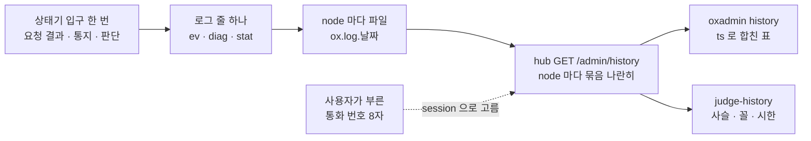

# 17. 운영자가 보는 것 — 로그 한 줄에서 깨짐까지

> author: kodeholic (powered by Claude) · created: 2026-11-09.
> ★**대조한 커밋** — 서버 `oxlens-sfu` `c3642e8` · SDK `oxlens-sdk-web` `9f40557`(+탐침) · 2층 `oxlens-labs` `fc584ff` · oxpeer `93df1c6`
> ★**실측 회차** — 3층 `tour-learn-20261109`(TOUR-10 · 11 · 13) · 2층 `e2e-20261109-070257` · 그 뒤 읽은 사건 이력. 값은 돌릴 때마다 바뀌고 차례 · 모양은 같다.

## 1. 30초 요약



- 서버는 상태가 한 걸음 갈 때마다 **규격 라벨을 단 줄 하나**를 쓴다. 한 사람의 줄은 hub 의 node 와 방의 node 에 흩어지고, hub 가 그것을 node 마다 읽어 나란히 돌려준다.
- 사용자가 화면의 **통화 번호(세션 지문 8자)**를 불러 주면 그 번호가 곧 서버 줄의 `session=` 이다 — 그 세션의 줄이 바로 열린다.
- 이 장은 일곱 가지 깨짐을 실제로 일으킨 회차에서 이력 표에 **무엇이 났고 무엇이 안 났는지**를 적는다. 판정기는 그 표를 규격에 대어 이번에도 결함 하나를 잡았다(§3-4).

## 2. 등장인물 · 값

| 이름 | 실제 값 | 무엇 |
|---|---|---|
| 줄 종류 `ev` | `CP-OP-*` · `CP-CODE-*` · 경우 라벨(`SES.S.drop` · `FLR.S.P.…`) · `SV-STATE-*` | 규격에 이름이 있는 상태 변화 · 요청 결과 · 통지. 수준과 상관없이 늘 난다 |
| 줄 종류 `diag` | `transport ready (dtls+srtp)` · `stall detected — sync_required` | 판단 근거 · 예외. 근거 진술이 있으면 `spec`(예 `SV-IMPL-ROOM-STALL`)을 달고, 그런 줄은 이력 기본에 든다 |
| 줄 종류 `stat` | 5초마다 · 발행 트랙마다 수신 줄 · 구독자 Peer 마다 송신 줄 | 계수 — W3C getStats 이름(`packets_received` · `packets_lost` · `jitter`(초) · `nack_count` …). `--stat` 일 때만 이력에 든다 |
| 세션 지문 | `2fd1fc9a`(TOUR-10 A) · `ec1d1bc5`(TOUR-13 A) | `SHA-256(session_id)` 앞 8자 — SDK `session.fingerprint` 와 서버 `session=` 이 같은 값 |
| 창 · 상한 · 보존 | 3,600 초 · node 마다 5,000 줄 · 14 일 | `--since` 를 안 주면 지금 − 1시간 · 넘으면 앞을 자르고 `truncated: true` · 보존은 회전으로 닫힌 파일 기준 |
| `stat` 주기 | 5,000 ms | 이 주기보다 짧은 접속은 `stat` 줄이 하나도 안 남을 수 있다(§4-7) |
| 조회 비용 | 0.126 s | `tourcut_A` 를 07:00 부터(세 node · 오늘 파일 합 29 MB) 한 번 — 이 장을 쓰며 잰 것 |

이 장의 사람들(로그의 `user=`):

| 깨짐 | 사용자 | 지문 | hub node · 방 node |
|---|---|---|---|
| 정상 길 | `tournode_A`(3층 브라우저 · 1pc · 청취) | `ec1d1bc5` | node-a · node-b |
| 신호만 끊김 | `tourcut_A`(3층 · 1pc) | `2fd1fc9a` | node-a · node-a |
| 전달 정체 | `tourstall_B`(3층 · 청취자) | `be2f060b` | node-a · node-a |
| 유닛 죽음 | `oxpeer~peer_recorder_unit_down`(녹음기 · 투명) · `botA~adv_node_down` | `deb814e1` · `58c420ec` | node-a · node-b / node-a · node-a |
| 선점 · 회수 | `botA~ptt_preempt` · `botB~ptt_preempt` | `1363e9ea` · `7626d2bb` | node-a · node-a |
| 얼림 → 재구축 | `oxpeer~peer_recorder_freeze_long` | `915c6956` → `fcdedaa8` | node-a · node-a |
| 잘못된 요청 | `botA~adv_wire_reject` | `d3579e5a` | node-a · node-a |
| 패킷 손실 | `botA~adv_loss` · `botB~adv_loss` | `70b376ca` · `7e134b05` | node-a · node-c |

## 3. 정상 길

### 3-1. 로그 한 줄 읽는 법

TOUR-13 의 A 가 node-b 의 방에 들어간 순간, node-b 의 미디어 서버가 쓴 줄 그대로다.

```
ts=2026-11-09T07:37:07.983249+09:00 mono=265169267 node=node-b proc=sfu kind=ev spec=FLR.S.ws.join session=ec1d1bc5 room=qa_tournode_p1 user=tournode_A epoch=7321e06f6909b384 area=FLR key=qa_tournode_p1 from=IDLE to=IDLE cause=ws_join in.perm=true
```

| 칸 | 값 | 읽는 법 |
|---|---|---|
| 머리 | `ts` · `mono` · `node` · `proc` · `kind` · `spec` | 벽시계(오프셋 포함) · 그 프로세스의 단조 µs · 어느 node 의 어느 프로세스 · 줄 종류 · ★규격 라벨 |
| 상관 키 | `session` · `room` · `user` · `epoch` | 규격에 있는 값만. `epoch` 는 미디어 서버 기동 신원(세션 차수가 아니다) |
| 전이 칸 | `area=FLR key=qa_tournode_p1 from=IDLE to=IDLE cause=ws_join` | 어느 상태기의 어느 인스턴스가 무엇 때문에 어디서 어디로 — 같아도 낸다 |
| 입구 인자 | `in.perm=true` | 그 경우를 가른 입구 인자(메시지 본문은 싣지 않는다) |

`spec=FLR.S.ws.join` 은 지은 이름이 아니라 **연동규격서 원천이 생성 코드에 남긴 경우 라벨**이다 — 이 글자로 규격 원천의 그 경우를 바로 찾는다. 줄에는 소스 파일 · 줄 번호가 없다. `spec` 이 그것을 대신한다.

같은 접속의 다른 종류 줄:

```
… node=node-a proc=hub kind=ev spec=CP-OP-ROOM-JOIN session=ec1d1bc5 user=tournode_A msg=ok
… node=node-b proc=sfu kind=diag spec=SV-RULE-LINK-TRANSPORT session=ec1d1bc5 user=tournode_A epoch=7321e06f6909b384 msg="transport ready (dtls+srtp) publish"
… node=node-a proc=sfu kind=stat session=be2f060b user=tourstall_B epoch=8701a55ebcdd350f packets_sent=89 bytes_sent=12692 retransmitted_packets_sent=0 nack_count=0 pli_count=0
```

`CP-OP-ROOM-JOIN … msg=ok` 는 hub 가 받은 요청의 결과다(실패면 `CP-CODE-<이름>`). `diag` 는 상태 변화가 아니라 판단 근거이고, `spec` 이 달린 진단 줄은 사건 줄 사이에서 문맥으로 읽히라고 이력 기본에 든다. `stat` 은 `spec` 이 없고, 비트레이트는 두 줄의 `bytes_*` 차로 구한다.

### 3-2. 세션 지문 — 통화 번호

TOUR-13 의 A 가 받은 `BIND` 응답의 `session_id`(원값은 인증 수단이라 문서에 싣지 않는다)를 SHA-256 하면 앞 8자가 `ec1d1bc5` 다 — 서버 줄의 `session=ec1d1bc5` 와 같다. TOUR-10 의 A 도 같은 식으로 `2fd1fc9a`. 와이어에는 지문이 없다 — 양끝이 같은 식으로 따로 셈한다([연:RULE-SES-FINGERPRINT](../protocol/03-ses.md#RULE-SES-FINGERPRINT) `session.fingerprint`).

```
07:37:07.976 SDK  A  SES session CONNECTING → ACTIVE | BIND.res | SES.C.CONNECTING.bind_ok
07:37:07.976146 SRV  node=node-a proc=hub kind=ev spec=SES.S.bind_new session=ec1d1bc5 user=tournode_A area=SES key=ec1d1bc5 from=- to=live+bound cause=BIND
```

클라 전이 기록과 서버 줄이 같은 꼴(`key · from · to · cause · 라벨`)이다. 지금 클라 줄은 서버로 올라오지 않는다 — 이력은 서버 줄만 본다(§4 끝 「안 보이는 것」).

### 3-3. 한 사람의 접속 하나를 끝까지 — TOUR-13 의 A

hub 는 node-a, 방은 node-b 다(요청 · 통지가 두 node 를 오가는 길은 [13 §3](13_MULTI_NODE.md)). 줄이 두 파일에 나뉘어 있고, `oxadmin history tournode_A` 가 hub 에게 받은 두 묶음을 `ts` 로 합친다 — 칸 일부를 줄였다(값은 그대로 · 괄호는 keys · msg 칸에서 옮긴 것).

```
기동
node    proc  epoch             build                            ts
node-a  hub                     c3642e82c3b7.1794175368+oxe2epy  2026-11-09T07:02:55.864580+09:00
node-b  sfu   7321e06f6909b384  c3642e82c3b7.1794175368+oxe2epy  2026-11-09T07:32:42.815342+09:00

사건 26
+ms     node/proc   kind  spec                      step                                         cause
0.0     node-a/hub  ev    SES.S.bind_new            SES ec1d1bc5 -→live+bound                    BIND
6.9     node-b/sfu  ev    SV-STATE-PEER-STATE       LINK publish -→Alive                         peer_created
7.1     node-b/sfu  ev    AFF.S.join_select         AFF tournode_A -→qa_tournode_p1              ROOM_JOIN
8.1     node-a/hub  ev    SV.rooms                  SES ec1d1bc5 live+bound→live+bound+rooms     ROOM_JOIN
21.3    node-b/sfu  ev    FLR.S.P.join.idle         FLR qa_tournode_p1 IDLE→IDLE                 ready
22.2    node-a/hub  ev    CP-OP-READY                                                            (arev=1 ok)
64.8    node-b/sfu  ev    SV-STATE-PEER-STATE       LINK publish Alive→Alive                     nominated_new_pair
121.8   node-b/sfu  ev    CP-OP-MLINE-EVENT                                                      (arev=2)
1782.7  node-a/hub  ev    SES.S.leave               SES ec1d1bc5 live+bound+rooms→-              LEAVE
1784.7  node-b/sfu  ev    SV-STATE-PEER-STATE       LINK publish Alive→-                         session_gone
1784.9  node-b/sfu  ev    SV-STATE-PEER-STATE       LINK publish Alive→-                         session_gone
```

- **기동 표가 먼저 온다** — 이 줄들을 어느 빌드가 냈는지(`build` · `epoch`)가 묶음 안에 있다. node-b 의 `epoch` 기동 시각 07:32:42 는 그 node 가 앞선 2층 회차(§4-3)에서 내려갔다 다시 선 뒤라는 뜻이다.
- **두 node 가 한 표에 섞인다** — hub 의 세션 걸음(`SES` · `SV.rooms`)과 방 node 의 연결 · 소속 · 발언권 걸음이 지문 하나로 이어진다.
- `SV.rooms` 는 손 코드가 생성 상태기를 덮은 걸음이다(머리 `SV.`). `grep spec=SV\.` 의 수가 곧 「생성본을 손으로 덮은 횟수」다. 맨 끝 두 줄이 같은 것은 §3-4 가 잡는다.

### 3-4. 판정기 — 표를 규격에 댄다

서버도 `oxadmin` 도 판정하지 않는다. 판정은 이력 응답(줄이 파일 글자 그대로)을 읽는 쪽이 한다 — `oxe2epy judge-history`. 세 가지를 본다.

| 판정 | 무엇 | 어긋나면 셋 중 하나 |
|---|---|---|
| ①사슬 | 같은 인스턴스(프로세스 안 `area` · `key` — 연결은 `user` 까지)의 다음 줄 `from` = 앞 줄 `to` | 줄 유실 · 손 코드가 줄 없이 상태를 바꿈 · `from` 을 실제가 아닌 값으로 적음 |
| ②줄 꼴 | 칸 차례 · 상관 키 · `spec` 이 규격 원천에 있나 | 지은 라벨 · 차례 어긋남 |
| ③시한 | 타이머로 난 걸음의 간격을 규격 값 옆에 | 재전송 간격이 규격보다 이르다 |

```
이력 판정 — 줄 26 · 사슬 6 인스턴스 · 끊김 1 · 꼴 어긋남 0 · 타이머 걸음 0(이른 것 0) · 물은 축으로 다 안 보여 사슬 판정 밖 전이 줄 5
  ①사슬 끊김 node-b LINK publish user=tournode_A: SV-STATE-PEER-STATE → - 다음 SV-STATE-PEER-STATE from=Alive
판정: ★어긋남 있음
```

정상 접속인데 끊김 하나 — 연결이 회수(`to=-`)된 뒤 같은 연결이 또 `Alive→-` 로 걷는다. 소스를 따라가면 세션이 사라질 때(`session_gone`) 퇴장 처리가 마지막 방에서 Peer 를 거두고, 그 바깥 축출 처리가 같은 Peer 를 한 번 더 거두며 줄을 또 낸다. 상태는 이미 지워졌으니 사용자가 겪는 일은 없다. 그러나 줄이 사실과 다르다 — 이 장의 회차 넷(TOUR-10 · 11 · 13 · `freeze_long`)에서 모두 났고, 봇처럼 `ROOM_LEAVE` 로 먼저 나간 경우에는 안 났다. ★이 장을 쓰며 판정기가 처음 잡은 것이다(소스 좌표는 §8 「회수」 행 — `reap` 은 Peer 표에서 이미 빠졌어도 전이 줄을 낸다).

판정 밖 5 줄은 발언권 줄이다 — 발언권의 `from` · `to` 는 방 단위 상태라 한 사람으로 물으면 남의 걸음이 빠진다. 방으로 물으면 판정에 든다(§4-4).

## 4. 깨지는 길

일곱 깨짐을 각각 ①무엇을 깨뜨렸나 ②사용자가 겪은 것 ③이력 표에 실제로 난 줄 ④판정기 ⑤그 줄이 없었다면 — 으로 적는다.

| # | 깨짐 | 이력에 난 첫 단서 | 판정기 | 이력으로 안 보인 것 |
|---|---|---|---|---|
| 4-1 | 신호만 끊김 | `SES.S.drop … cause=drop in.c=0` | 끊김 1(회수 두 줄) | 끊긴 까닭(TCP 닫힘인지 하트비트 시한인지) |
| 4-2 | 전달 정체 | `diag SV-IMPL-ROOM-STALL` → `CP-OP-ROOM-EVENT` | 끊김 1(회수 두 줄) | 정체가 시작된 순간(`stat` 띠로만) · 다시 받기 `GET /rooms` |
| 4-3 | 유닛 죽음 | `SV.rooms … cause=room_dropped` | 0 | 유닛이 죽은 줄 자체(사람 키가 없다) · `5001` |
| 4-4 | 선점 · 회수 | 방으로 물으면 `TAKEN→PREVOKE` · `PREVOKE.T8` | 0 · `T8` 재전송 1,002 ms | `REVOKE` · `GRANTED` 메시지 자체 |
| 4-5 | 얼림 → 재구축 | `SES.S.drop` → `pair_expired` → `SES.S.TWindow` → 새 지문 `bind_new` | 끊김 6 · `TWindow` 60,571 ms | 끊긴 까닭 · 옛 번호로 물으면 뒤 절반 |
| 4-6 | 잘못된 요청 | `CP-CODE-<이름> … op=<op>` 일곱 | 0 | 모르는 op(`1001`) 거절 |
| 4-7 | 패킷 손실 | 없음(접속이 `stat` 주기보다 짧았다) | 0 | NACK · RTX 낱낱 — 5초 계수뿐 |

### 4-1. 신호(WS)만 끊김 — TOUR-10 의 A

- ① 3층 TOUR-10 — 탐침의 TCP 중계가 A 의 WS 만 07:36:58.825 에 끊고 3초 동안 새 연결을 받지 않는다(미디어 UDP 는 중계를 안 지난다 · 사다리는 [10 §3-1](10_RECOVERY.md)). ② 앱에는 「다시 잇는 중」(58.828 `ACTIVE → RESUMING`)이 5.56초 — 07:37:04.389 `RESUME` 으로 `ACTIVE`. 소리 · 영상은 그대로였다(SDK 연결(LINK) 전이 0).
- ③ 이력(첫 줄 07:36:57.202 기준):

```
+ms      node/proc   kind  spec               step                                                             cause
1625.0   node-a/hub  ev    SES.S.drop         SES 2fd1fc9a live+bound+rooms→live+rooms                         drop    in.c=0
7179.6   node-a/hub  ev    SES.S.bind_resume  SES 2fd1fc9a live+rooms→live+bound+rooms+resumed                 BIND
7185.8   node-a/hub  ev    SES.S.resume_ok    SES 2fd1fc9a live+bound+rooms+resumed→live+bound+rooms+resumed   RESUME
```

  1625.0 과 7179.6 사이 5.55 초에 미디어 서버 줄이 **하나도 없다** — 연결 상태기가 한 걸음도 안 걸었다는 뜻이다(걸으면 줄이 난다).
- ④ 줄 31 · 사슬 6 인스턴스 · 끊김 1 — §3-4 의 회수 두 줄. 끊김 자체로 생긴 어긋남은 없다.
- ⑤ `SES.S.drop` 이 없으면 5.55 초는 「조용했던 시간」으로 읽힌다. 다만 이 줄도 **까닭은 말하지 않는다** — TCP 가 닫힌 여기와 하트비트 시한이 지난 §4-5 가 같은 `cause=drop in.c=0` 이다. 가르려면 앞 줄과의 간격(§4-5 는 접속 30 초 뒤)을 본다. 백오프 사다리 · 재개 창은 [10 §3](10_RECOVERY.md).

### 4-2. 전달 정체 — TOUR-11 의 구독자 B

- ① 3층 TOUR-11 — 발행자 A 의 마이크 장치를 07:37:26.571 에 죽인다(`killSource`) · B 는 듣기만 한다. ② B 의 귀에는 A 의 소리가 끊기고, 19.7 초 뒤(07:37:46.256) SDK 가 `sync_required` 를 받아 방을 `GET /rooms` 로 다시 받고 `READY` 를 보낸다.
- ③ `--stat` 으로 물은 B 의 이력(첫 줄 07:37:24.339 기준):

```
+ms      node/proc   kind  spec                 keys / msg
1915.9   node-a/sfu  stat                       packets_sent=89 bytes_sent=12692 …
6913.7   node-a/sfu  stat                       packets_sent=105 bytes_sent=14456 …
11915.5  node-a/sfu  stat                       packets_sent=105 bytes_sent=14456 …
16915.3  node-a/sfu  stat                       packets_sent=105 bytes_sent=14456 …
21914.7  node-a/sfu  diag  SV-IMPL-ROOM-STALL   track=tb328adadb339c692 stall detected — sync_required in.start=1794177444358 in.window_ms=9999
21914.9  node-a/sfu  ev    CP-OP-ROOM-EVENT
21938.8  node-a/sfu  ev    FLR.S.P.join.idle    IDLE→IDLE ready
21939.6  node-a/hub  ev    CP-OP-READY          arev=2 ok
```

  B 에게 보낸 패킷 수가 07:37:31 부터 105 에 멈춰 있다 — A 의 발행 트랙 수신 줄(`user=tourstall_A`)도 같은 시각부터 `packets_received=105` 그대로다.
- ④ 줄 28 · 끊김 1 — 회수 두 줄.
- ⑤ `diag SV-IMPL-ROOM-STALL` 이 없으면 `CP-OP-ROOM-EVENT` 한 줄만 남는다 — 그 줄에는 까닭(`stall`)이 없다. 다시 받기 `GET /rooms` 는 HTTP 읽기라 이력에 줄이 없다(그 뒤 `READY` 로 짐작한다). ★정체가 **시작된** 순간은 사건 줄로는 안 보이고 `stat` 띠의 멈춘 수로만 보인다 — 5 초 눈금이다. 감지 창 · 주기는 [11 §2](11_STALL_RESYNC.md).

### 4-3. 미디어 서버 유닛 죽음 — 녹음기와 봇

- ① 2층 `peer_recorder_unit_down` — 녹음기(oxpeer · 투명 참가자)가 든 방의 node-b 미디어 서버를 07:32:26.819 에 내리고(SIGTERM) 07:32:42.914 에 다시 세운다 · hub 와 WS 는 산다. ② ICE 재시작은 「그 연결이 없다」, 다시 들어가기는 「방이 없다」로 끝나고 세션만 남는다(사다리는 [10 §3-6](10_RECOVERY.md) · 앱이 받는 사건은 [16 §4-1](16_OXPEER.md)).
- ③ 녹음기의 이력(첫 줄 07:32:22.798 기준):

```
+ms      node/proc   kind  spec                           step / msg                                          cause
1014.9   node-b/sfu  ev    FLR.S.P.NP_TAKEN.rx_ACK_taken  FLR … TAKEN→TAKEN                                   server_rx
5036.5   node-a/hub  ev    SV.rooms                       SES deb814e1 hidden+live+bound+rooms→hidden+live+bound  room_dropped
14265.2  node-a/hub  ev    CP-CODE-PEER-NOT-FOUND         op=ICE_RESTART
16226.4  node-a/hub  ev    CP-CODE-ROOM-NOT-FOUND         op=ROOM_JOIN
47011.4  node-a/hub  ev    SES.S.leave                    SES deb814e1 hidden+live+bound→-                    LEAVE
```

  유닛이 죽은 순간(+4021)에는 이 사람의 줄이 없다. 죽은 미디어 서버는 회수 줄(`→-`)도 못 남긴다 — 연결 사슬이 `Alive` 에서 그냥 끝난다.
- ④ 줄 23 · 끊김 0. 사슬이 끝난 것은 끊김이 아니다(다음 줄이 없다).
- ⑤ `room_dropped` 손 전이 줄이 없으면 「미디어 서버 줄이 +1014.9 에서 멎고 13 초 뒤 3010 · 15 초 뒤 3001」로만 보인다. 원인 줄은 사람 키가 없어 `user` 이력에 안 든다 — 같은 시각의 유닛 줄을 따로 본다.

```
07:32:26.819370 node=node-b proc=hub kind=ev spec=SV-STATE-UNIT-STATE unit=node-b area=OPS key=node-b from=Running to=Stopping cause=stop
07:32:26.819723 node=node-b proc=sfu kind=diag spec=SV-RULE-BUS-FATE epoch=fabe64ed1f83963b in.why=SIGTERM msg="sfud stopping (SIGTERM)"
07:32:27.834295 node=node-a proc=hub kind=diag spec=SV-RULE-BUS-EVENTS room=peer_unit_down_room_… msg="room token gone — local routing dropped"
```

  방 토큰 줄은 `room` 키가 있어 `oxadmin history --room <방>` 에는 세 hub 의 것이 다 나온다. 유닛 상태 줄은 `grep unit=node-b` 로 본다.
- 봇 `adv_node_down` 은 다른 꼴이다 — 봇의 방은 node-a 에 두고 **방이 없는** node-b 를 07:32:19.350 에 내렸다. 봇 이력에는 내리기 직전 탐침 `CP-CODE-ROOM-NOT-FOUND op=ROOM_JOIN`(+3293.5 · `3001`)만 있고, 내린 동안의 탐침(`POST /rooms` → `5001`)은 **줄이 없다**. HTTP 거절은 hub 가 사건 줄을 내지 않는다(같은 시각 `/admin/drops` 에도 `code_5001` 이 없다). `3001` 과 `5001` 의 뜻은 [12](12_ERRORS.md) · 유닛 내림의 버스 쪽 줄은 [14](14_OXMESH.md).

### 4-4. 발언권 선점 · 회수 — `ptt_preempt`

- ① 2층 `ptt_preempt` — 우선순위 10 인 botA 가 잡고, 3 초 뒤 우선순위 200 인 botB 가 요청한다 · botA 는 그 뒤 3 초를 더 쥐었다 놓는다(시나리오가 그렇게 짰다). ② botA 는 `REVOKE` 를 받고 말을 멈춰야 하고, botB 는 줄 맨 앞 안내를 받은 뒤 botA 가 놓으면 허가를 받는다([연:RULE-FLR-PREEMPT](../protocol/10-flr.md#RULE-FLR-PREEMPT) · [07 §4-1](07_FLOOR.md)).
- ③ 사람 하나로 물으면 반쪽만 보인다 — botA 의 이력에는 `FLR.S.P.PREVOKE.T8` 이 갑자기 나온다(`TAKEN→PREVOKE` 걸음은 botB 의 줄이다). ★방으로 묻는다 — `oxadmin history --room preempt_ptt_preempt_11542`(첫 줄 07:28:02.466 기준 · 첫 RTP 걸음 두 줄은 줄였다):

```
+ms      spec                          step               cause      user
1490.3   FLR.S.P.NP_IDLE.rx_REQUEST    IDLE→TAKEN         server_rx  botA~ptt_preempt
4488.5   FLR.S.P.NP_TAKEN.rx_REQUEST   TAKEN→PREVOKE      server_rx  botB~ptt_preempt
5490.0   FLR.S.P.NP_TAKEN.rx_QPOS_REQ  PREVOKE→PREVOKE    server_rx  botB~ptt_preempt
5491.2   FLR.S.P.PREVOKE.T8            PREVOKE→PREVOKE    t8         botA~ptt_preempt
6493.1   FLR.S.P.PREVOKE.T8            PREVOKE→PREVOKE    t8         botA~ptt_preempt
7488.9   FLR.S.P.PREVOKE.rx_RELEASE    PREVOKE→TAKEN      server_rx  botA~ptt_preempt
10490.2  FLR.S.P.PERMITTED.rx_RELEASE  TAKEN→IDLE         server_rx  botB~ptt_preempt
11492.0  FLR.S.G.IDLE.T7               IDLE→IDLE          t7         (방)
```

  `T8` 두 줄이 「회수를 받고도 3 초 동안 놓지 않았다」를 말한다 — `T8` 은 `REVOKE` 재전송 타이머다.
- ④ 방 판정 — 줄 54 · 사슬 1 인스턴스 · 끊김 0 · `T8` 재전송 1 회 1,002 ms(규격 1,000) · `T7` 재전송 7 회 1,000~1,004 ms. 사람으로 물은 판정은 botA 16 줄 · botB 15 줄을 판정 밖으로 둔다.
- ⑤ `PREVOKE.T8` 줄이 없으면 「회수했는데 왜 3 초 뒤에야 넘어갔나」에 답이 없다. 다만 `REVOKE` · `QUEUE_INFO` · `GRANTED` 메시지 자체는 줄이 아니다 — 받은 쪽 걸음과 타이머로 거슬러 읽는다. 사슬은 `from` · `to` 로 잇지만, 장비가 다를 때 차례를 가르는 `floor_sequence` 키는 이 회차 줄에 없다(§8 아래).

### 4-5. 프로세스 얼림 → 세션 재구축 — `peer_recorder_freeze_long`

- ① 2층 `peer_recorder_freeze_long` — 녹음기 프로세스를 95 초 얼린다. 서버는 하트비트 시한(30 초)에 WS 를 닫고 그때부터 재개 창(60 초)을 센다 — 깨어날 때는 창이 닫혀 있다(재구축 길은 [10 §3-4](10_RECOVERY.md)). ② 녹음기는 끊긴 줄 모르고 깨어나 새 세션으로 방에 다시 들어간다 — 얼린 동안의 녹음은 빈다.
- ③ 이력(첫 줄 07:24:23.289 기준 · 같은 걸음의 진단 줄 · 구독 쪽 짝은 줄였다):

```
+ms      node/proc   kind  spec                 step                                          cause
30010.2  node-a/hub  ev    SES.S.drop           SES 915c6956 hidden+live+bound+rooms→hidden+live+rooms  drop
32967.7  node-a/sfu  ev    SV-STATE-PEER-STATE  LINK publish Alive→Suspect                    pair_expired
90580.8  node-a/hub  ev    SES.S.TWindow        SES 915c6956 hidden+live+rooms→-              TWindow
90584.1  node-a/sfu  ev    SV-STATE-PEER-STATE  LINK publish Suspect→-                        session_gone
90584.3  node-a/sfu  ev    SV-STATE-PEER-STATE  LINK publish Suspect→-                        session_gone
99017.2  node-a/hub  ev    SES.S.bind_new       SES fcdedaa8 -→hidden+live+bound              BIND
99426.3  node-a/sfu  ev    SV-STATE-PEER-STATE  LINK publish -→Alive                          peer_created
99428.8  node-a/sfu  ev    SV-STATE-SUBSCRIBE-STATE  SUB ptt-…-audio Created→Active          ready
```

  `pair_expired` 줄의 진단 짝은 `peer state Suspect after 32965ms` — 연결이 처음 선 뒤 32.97 초 동안 `Alive` 였다는 뜻이다.
- ④ 줄 59 · 사슬 7 인스턴스 · ★끊김 6 · `TWindow` 1 회 60,571 ms(규격 60,000). 끊김 넷은 두 세션의 회수 두 줄(§3-4 · 발행 · 구독 연결마다)이다. 둘은 구독 상태기다 — 첫 세션의 구독(`ptt-…-audio` · `-video`)이 회수 때 끝 줄 없이 사라지고, 새 세션이 같은 열쇠로 `Created→Active` 를 다시 걷는다. 판정기는 구독 인스턴스를 사람 · 세션으로 가르지 않으므로 이것을 끊김으로 센다.
- ⑤ ★통화 번호가 바뀐다 — 사용자가 얼기 전 화면의 `915c6956` 을 부르면 `--session 915c6956` 은 앞 절반만 연다. `oxadmin history <user>` 로 물으면 두 세션이 한 표에 나오고, `--session fcdedaa8` 은 26 줄로 뒤 절반만 준다. `SES.S.drop` 하나로는 이것이 하트비트 시한인지 TCP 닫힘인지 모른다(§4-1 과 같은 줄) — 접속 30.0 초 뒤라는 간격이 단서다.

### 4-6. 잘못된 요청 — `adv_wire_reject` 의 botA

- ① 2층 `adv_wire_reject` — botA 가 한 연결로 일부러 어긋난 요청 여덟을 보낸다(봇 덤프의 `reject_probe` 기록). ② 요청마다 실패 코드가 돌아온다 — 앱은 코드로 갈라 안내한다(코드의 뜻은 [12 §3-1](12_ERRORS.md)).
- ③ 이력(첫 줄 07:12:00.676 기준):

```
+ms     spec                       msg
4417.7  CP-CODE-INVALID-PAYLOAD    room_id op=ROOM_JOIN
4470.3  CP-CODE-MISSING-FIELD      room_id op=ROOM_JOIN
4522.0  CP-CODE-ROOM-NOT-FOUND     op=ROOM_JOIN
4579.1  CP-CODE-CODEC-REQUIRED     op=PUBLISH_TRACKS
4633.6  CP-CODE-TRACK-NOT-FOUND    op=PUBLISH_TRACKS
4689.1  CP-CODE-FIELD-CONFLICT     muted xor duplex op=TRACK_SET
5605.3  CP-CODE-ROOM-FULL          op=ROOM_JOIN
```

  보낸 것은 여덟인데 줄은 일곱이다. 첫 탐침 — 모르는 op(32767) → `1001 UNKNOWN_OP`(덤프 4.369 초) — 은 줄이 없다. hub 가 op 을 못 읽으면 소켓 처리에서 곧바로 거절하고, 사건 줄을 내는 요청 처리로 넘기지 않는다. 같은 시각 hub 의 `/admin/drops` 에도 `code_1001` 이 없다.
- ④ 줄 46 · 끊김 0 · `TWindow` 60,276 ms.
- ⑤ 코드 줄이 없으면 「버튼이 안 먹는다」를 서버에서 가를 수 없다 — 그 사각이 실제로 `1001` 에 있다. 번호 체계는 [12](12_ERRORS.md)([연:RULE-ERR-ONE-NUMBER-ONE-MEANING](../protocol/11-err.md#RULE-ERR-ONE-NUMBER-ONE-MEANING)).

### 4-7. 패킷 손실 — `adv_loss`

- ① 2층 `adv_loss` — 같은 방의 botA · botB 가 받은 영상 seq 58 을 3.281 초에 NACK 한다(로컬 망이라 진짜 손실은 없고, 서버 재전송 길을 일부러 부른다). ② 1 ms 뒤 RTX(PT 97 · 원래 seq 58)가 온다 — 받는 쪽에는 빈 곳이 없다.
- ③ `--stat` 으로 물어도 **`stat` 줄이 0** 이다. 접속이 07:10:50.349 → 07:10:54.638(4.29 초)인데 node-c 의 5 초 계수는 07:10:54.866 에 돌았다 — 떠난 지 0.23 초 뒤다. NACK · RTX 는 낱낱의 사건 줄이 없다(패킷 단위 로그는 없다).
- 같은 회차의 1pc 판 `onepc_adv_loss` 는 계수 한 번이 걸렸다 — 07:17:11.256 botA 송신 줄 `packets_sent=66 retransmitted_packets_sent=1 nack_count=1`(수신 줄은 `packets_received=96 packets_lost=0 pli_count=3`). 업링크에 10 % 버림을 넣는 `conf_audio_fault` 는 수신 줄에 손실이 그대로 찍혔다 — `packets_received=95 packets_lost=10 jitter=0.002184`(botA · 07:12:14.866).
- ④ botA 줄 35 · botB 줄 36 · 끊김 0 · `TWindow` 60,234 · 60,228 ms.
- ⑤ 손실과 복구는 5 초 계수의 차로만 보인다. 5 초보다 짧은 접속 · 5 초 안의 순간 손실은 이력에 흔적이 없을 수 있다 — 그때는 클라 getStats 쪽 권위를 본다(클라 줄은 아직 서버로 오지 않는다). RTCP 길은 [04](04_PACKET_PATH.md).

★**이력으로 안 보이는 것 넷**(이 회차들에서 실제로 본 것) — ①끊긴 까닭(`SES.S.drop` 은 TCP 닫힘과 하트비트 시한을 가르지 않는다 · §4-1 · §4-5) ②사람 키가 없는 원인(유닛 내림 · 방 토큰 소멸은 `--room` 이나 `unit=` 으로 따로 · §4-3) ③HTTP 길과 모르는 op(`POST /rooms` 의 `5001` · 다시 받기 `GET /rooms` · `1001` 은 줄이 없다 · §4-2 · §4-3 · §4-6) ④클라가 본 것(화면 · 소리 · 장치 — SDK 전이 기록은 같은 꼴이지만 서버로 올리는 길이 아직 없다).

## 5. 왜 이 모양인가

| 다른 길 | 버린 까닭 |
|---|---|
| 이력용 저장소(SQL · 색인)를 따로 둔다 | 같은 사실이 로그와 저장소 둘에 든다 — 어긋나는 날 어느 쪽이 맞는지 모른다. 원천은 상태기가 낸 `ev` 줄 하나이고, 이력은 그것을 고르기만 한다 |
| Vector 로 모아 Loki 같은 외부 질의 | 업계 표준이지만 소 · 중규모에서 프로세스 · 저장소가 는다. 모으는 길(Vector)은 규격에 두되, 이력은 기대지 않는다 |
| hub 가 node 묶음을 합쳐 차례를 매겨 낸다 | 장비가 다르면 시계 어긋남이 서버가 정한 차례로 굳는다. 서버는 나란히까지 · 합치기는 도구 |
| 서버가 판정해 결과를 낸다 | 그 판정을 또 믿어야 한다. 판정은 읽는 쪽이 규격 생성본에 대어 한다 |
| 패킷마다 줄 | 상용 상한에서 초당 수십만 줄 — 로거 · 디스크가 먼저 죽는다. 계수 `stat` 은 발행 트랙 · 구독자 Peer 마다 5 초 |
| 수준을 올리면 사건 줄도 준다 | `ev` · `stat` 이 사라지면 사후에 아무것도 못 가른다. 수준은 `diag` 만 거른다 |

> ★**우리만의 것 — 로그 한 줄이 규격 라벨을 들고 다닌다**
> - **선택 배경** — 「규격에 이름이 있으면 `ev` 다 · 이름을 로그에서 짓지 않는다」. 코드는 규격으로 다시 짓는 것이라, 줄이 규격 원천의 경우 라벨을 그대로 들면 줄 → 규격 → 판정이 한 길로 이어진다. 운영성 조사(열린 소스 여섯 · 호스팅 다섯)에서 로그 줄이 규격으로 거슬러 가는 곳은 우리뿐이었다.
> - **얻은 것** — 판정기가 사람이 못 본 결함을 줄만으로 잡는다. 연결 첫 지명 줄의 거짓 `from=Suspect` · 세션 `rooms` 칸의 줄 없는 손 전이 · 유닛 죽음 때 `room_dropped` 입구의 빠진 줄을 잡아 고쳤고, 이 장을 쓰며 회수 줄 두 번(§3-4)을 새로 잡았다.
> - **잃은 것** — 로그량. 계수 줄을 넣은 뒤 생중계 1,000 명에서 0 → 44 kB/s · 1,500 명에서 66 kB/s. 규격에 이름이 없는 사건(DTLS 수립 · 회수)은 `diag` 라 사슬 판정 밖이고, 손 코드가 덮은 걸음(`SV.`)은 원천에 없어 셀 수만 있다.

> ★**우리만의 것 — 통화 번호**
> - **선택 배경** — 사용자가 지원 창구에 불러 주는 번호와 서버 로그의 세션 키를 같은 값으로(선례 Cloudflare `cf-ray` · Millicast 의 `Server` 값 · LiveKit 세션 id). `session_id` 원값은 인증 수단이라 못 보인다 — 일방향 지문 8자.
> - **얻은 것** — 와이어 변경 0. 사용자가 부른 `ec1d1bc5` 로 hub · 미디어 서버 두 node 의 줄이 한 번에 열린다(§3-3).
> - **잃은 것** — 32 비트라 같은 때 산 세션끼리 겹칠 수 있다(겹치면 `user` 와 시각이 가른다). 세션이 새로 서면 번호가 바뀐다 — `freeze_long` 에서 `915c6956` → `fcdedaa8`, 옛 번호로는 뒤 절반이 안 열린다(§4-5).

## 6. 다른 SFU 는

★아래 「그쪽 방식」은 저쪽 소스 · 공식 문서를 정적으로 읽은 것이다(실측 아님).

| 견줄 것 | 그쪽 방식 | 우리 | 우리 쪽 장점 | 우리 쪽 대가 |
|---|---|---|---|---|
| 지난 세션 열기 | LiveKit Cloud 세션 분석 · Daily 지난 세션 · Agora Call Inspector — 호스팅 제품 기능. atm0s 는 connector 가 사건을 SQL 에 쌓는다. LiveKit 열린 소스 서버에는 찾지 못했다 | 로그 줄을 그대로 골라 node 마다 나란히 | 새 저장소 · 프로세스 0 · 조회 0.126 s(오늘 세 node) | 죽은 node 의 줄은 이 길로 못 읽는다(`error`) · 보존 14 일 |
| 로그 꼴 | Janus JSON 로거 · mediasoup DEBUG 문자열 · JVB 자유 문장 · LiveKit zap 구조 | logfmt · 칸 차례 고정 · `spec` = 규격 라벨 | 줄 → 규격 → 판정 | 규격에 없는 이름은 `diag` 로만 |
| 사건을 밖으로 | Janus 사건 처리기 형 9 + 처리기마다 구독 비트마스크 · 운반 플러그인(`Janus §10`) | 사건 밖 내보내기는 hook · 이력은 읽기 | 고를 축이 규격 라벨 하나 | 실시간 밀어내기 · 구독 고르기는 이력이 아니다 |
| 계측 켜기 | mediasoup trace 사건 런타임 켜기 · 기본 꺼짐(`mediasoup §2-3`) · JVB REST 토글 · 비용 표(`JVB §12-1`) | `ev` · `stat` 은 수준과 상관없이 늘 | 사후에 켤 수 없는 것을 미리 가진다 | 로그량(§5 상자) |
| 「참가했다」 시점 | LiveKit webhook `participant_joined` 는 신호가 아니라 미디어 활성 때(`livekit §14-1`) | 상태기 셋(연결 · 발행 · 구독)의 걸음이 따로 줄 | 신호만 붙고 미디어가 안 붙은 것이 표에서 갈린다 | 밖으로 내는 「참가」 하나로 접은 사건은 없다 |
| 품질 한 숫자 | LiveKit E-model 점수(`livekit §10-5`) · Janus link · media 이원화(`Janus §4-8`) | 점수 없음 — W3C 이름의 계수 줄 | getStats 와 한 글자로 견준다 | 사람이 판단해야 한다 · 5 초 눈금(§4-7) |
| 손실 일으켜 보기 | JVB 는 서버 파이프라인 안에서 균등 · 버스트로 떨군다(`JVB §12-4`) | 2층 봇 쪽 fault 주입(`conf_audio_fault`) | 서버 코드에 시험 손잡이가 없다 | 서버 단독으로는 못 만든다 |


## 7. 운영에서 보는 법

이력은 「지난 일」이고, 나머지 운영 표면은 「지금」이다. 무엇을 묻느냐로 고른다.

| 묻는 것 | 표면 | `oxadmin` |
|---|---|---|
| 그 사람에게 무슨 일이 있었나 | `GET /admin/history?user=…`(또는 `room=` · `session=` · `diag=1` · `stat=1`) | `history <user>` · `history --room <R>` · `--json`(JSON Lines) |
| 지금 누가 붙어 있나 | `GET /admin/users` | `users` |
| 그 사람의 미디어가 지금 흐르나 | `GET /admin/users/{user_id}/media` | `user <id>` — ★두 번 읽어 Δ |
| 그 방의 지금 상태 | `GET /admin/rooms/{room_id}/snapshot` | `room <id>` |
| 무엇이 몇 번 버려졌나 | `GET /admin/drops` — 유닛마다 사유마다 기동 이래 누적 | `drops` |
| 서버 안에 얼마나 머물렀나 | `GET /admin/transit` — 두 번 읽어 차로 | — |
| 미디어 서버 · 버스 상태 | `GET /admin/sfus` · `GET /admin/bus`(`?all=1`) | `sfus` · `bus` |

이 장을 쓰며 읽은 node-a hub 의 `drops`(07:02:55 기동 이래 · 일부):

```
unit    sfu_id            name              count
hub     -                 code_3001         10
hub     -                 code_3010         5
node-a  8701a55ebcdd350f  await_keyframe    828
node-a  8701a55ebcdd350f  no_pub_room       598
```

`code_1001` · `code_5001` 줄은 없다 — §4-6 · §4-3 의 사각과 같은 곳이다. 로거의 버림(`log_queue_full` · `log_spool_full`)은 세 node 의 hub 에 물어 모두 없었다 — 기동 이래 줄을 잃지 않았다는 뜻이다(`oxadmin --hub <node 의 hub> drops` · `drops` 는 붙은 hub 와 그 node 의 미디어 서버 것만 보인다).

다른 장의 사건이 찍히는 줄은 각 장 7 절에 있다 — 세션 · 재개는 [10](10_RECOVERY.md) · 정체는 [11](11_STALL_RESYNC.md) · 코드는 [12](12_ERRORS.md) · 발언권은 [07](07_FLOOR.md) · 유닛 · 버스는 [14](14_OXMESH.md) · 녹음기는 [16](16_OXPEER.md). 클라 쪽 전이 라벨이 어디서 오나는 [15](15_SDK_INSIDE.md).

## 8. 소스 · 규격 좌표

| 무엇 | 좌표 |
|---|---|
| 줄 만들기 · 지문 · logfmt 해독 | `oxlens-sfu/crates/common/src/log/mod.rs` `fingerprint` · `common/src/log/line.rs` `fields` |
| hub 요청 결과 줄(`CP-OP-*` · `CP-CODE-*`) | `crates/oxhubd/src/ses/mod.rs` `handle_request` |
| 모르는 op 거절(줄 없음) | `crates/oxhubd/src/ses/conn.rs` — op 해독 실패 갈래 `Code::UnknownOp` |
| 이력 경로 · 로거 읽기 | `crates/oxhubd/src/ops/admin.rs` `history_ask` · `history` · `history_local` · `ops/logger.rs` `read` |
| 미디어 서버 전이 줄 · 계수 줄 | `crates/oxsfud/src/ops/mod.rs` `transition` · `peer_state_changed` · `ops/timers.rs` `stat` |
| 회수(두 번 나는 줄) | `crates/oxsfud/src/gc/mod.rs` `evict` → `leave` → `reap` · 다시 `reap` |
| 표 도구 | `crates/oxadmin/src/main.rs` `history` |
| SDK 통화 번호 | `oxlens-sdk-web/src/platform/sha256.ts` `sessionFingerprint` · `src/domain/ses/core.ts`(BIND 응답에서 셈) · `src/api/client.ts` `fingerprint` |
| 판정기 | `oxlens-labs/oxe2epy/oxe2epy/verifier/history.py` · 줄 꼴 `verifier/ops_shape.py` `judge_log` |
| 규격 | [연:RULE-SES-FINGERPRINT](../protocol/03-ses.md#RULE-SES-FINGERPRINT) · [연:RULE-SES-RESUME-BY-SESSION-ID](../protocol/03-ses.md#RULE-SES-RESUME-BY-SESSION-ID) · [연:RULE-SES-REBUILD](../protocol/03-ses.md#RULE-SES-REBUILD) · [연:RULE-FLR-PREEMPT](../protocol/10-flr.md#RULE-FLR-PREEMPT) · [연:RULE-ERR-ONE-NUMBER-ONE-MEANING](../protocol/11-err.md#RULE-ERR-ONE-NUMBER-ONE-MEANING) · [연:RULE-LINK-RECOVERY-UNIT](../protocol/09-link.md#RULE-LINK-RECOVERY-UNIT) |


## 9. 스스로 확인하는 질문

<details><summary>1. (깨지는 길) 사용자가 「통화 번호 2fd1fc9a 인데 아까 잠깐 끊겼어요」라고 했다. 무엇을 치고, 무엇을 보면 「신호만 끊기고 미디어는 살았다」를 말할 수 있나?</summary>

`oxadmin history <user> --session 2fd1fc9a --since <그때>`. `SES.S.drop`(07:36:58.827) 과 `SES.S.bind_resume` · `SES.S.resume_ok`(07:37:04.38x) 사이 5.55 초 동안 미디어 서버(`proc=sfu`) 줄이 하나도 없다 — 연결 상태기가 걸으면 반드시 줄이 나므로, 미디어 연결은 그대로였다. 같은 세션 지문이 이어졌으니 재개 창 안에서 이어받은 것이다(§4-1).
</details>

<details><summary>2. 사람 하나로 물은 발언권 이력에서 판정기가 줄 몇 개를 「판정 밖」으로 둔다. 왜이며, 선점을 제대로 보려면 어떻게 묻나?</summary>

발언권의 `from` · `to` 는 방 단위 상태다. 한 사람으로 고르면 다른 사람이 일으킨 걸음(예 botB 의 `TAKEN→PREVOKE`)이 빠져 사슬을 판정할 수 없다. `oxadmin history --room <방>` 으로 물으면 한 인스턴스의 사슬이 다 보이고 `T8` · `T7` 재전송 간격까지 규격 값 옆에 놓인다(§4-4).
</details>

<details><summary>3. (깨지는 길) 미디어 서버 유닛이 죽었을 때 그 방 사람의 이력에서 원인을 찾을 수 없는 까닭과, 무엇으로 대신 보나?</summary>

유닛 상태 줄 · 종료 진단 줄에는 사람 키가 없고, 죽은 프로세스는 회수 줄도 못 남긴다. 사람 이력에는 결과(`SV.rooms … cause=room_dropped` · 뒤따르는 3010 · 3001)만 난다. 원인은 같은 시각의 `--room <방>`(세 hub 의 방 토큰 소멸 줄)과 `unit=<node>` 줄(`Running→Stopping cause=stop` · `sfud stopping (SIGTERM)`)로 본다(§4-3).
</details>
