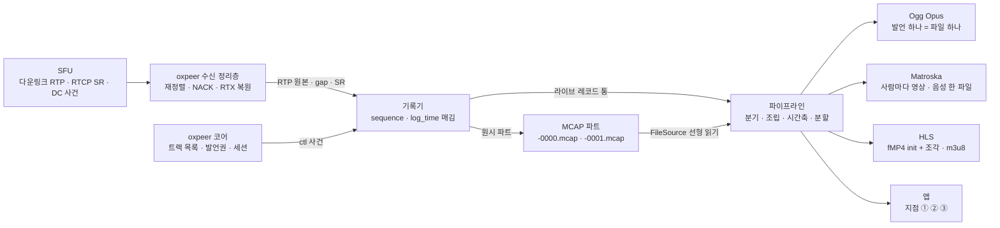
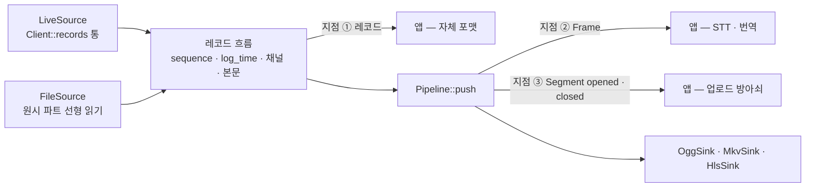
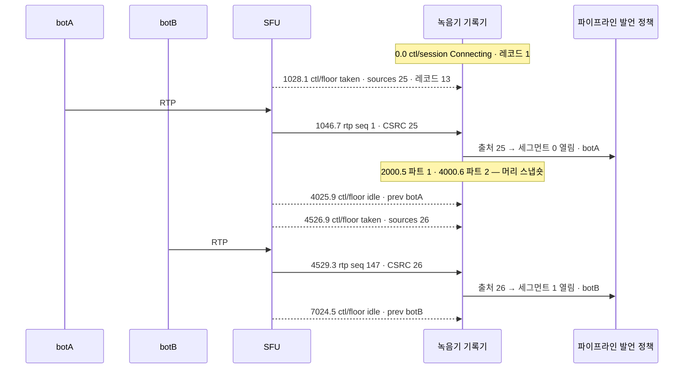

# 18. 녹음 · 녹화 파이프라인 — 원시 기록(MCAP)에서 Ogg · Matroska · HLS 까지

> author: kodeholic (powered by Claude) · created: 2026-11-10.
> ★**대조한 커밋** — oxpeer `50df33e` · 2층 `oxlens-labs` `4211efc` · 3층 `oxlens-sdk-web` `fa02c60` · 서버 빌드 `41fb6cee5551`
> ★**실측 회차** — 2층 `peer_record_raw` · `peer_record_hls`(20261110) · 3층 `peer_hls`. 값은 돌릴 때마다 바뀌고 차례 · 모양은 같다.

## 1. 30초 요약



- **받은 것을 해석하지 않고 먼저 적는다.** SRTP 를 푼 RTP 패킷 원본과 제어 사건(트랙 목록 · 발언권 · 세션 · SR)을 한 줄의 레코드 흐름으로 MCAP 파트에 적는다. `peer_record_raw` 파트 1 은 메시지 108 개 · 12,920 바이트다.
- **같은 레코드열이면 같은 바이트다.** 라이브로 지은 Ogg 2 개와, 원시 파트를 다시 흘려 지은 Ogg 2 개가 바이트로 같았다. HLS 는 14 파일 모두 같았다.
- **디코딩 · 인코딩은 없다.** 음성 구멍은 Opus TOC 한 바이트(PLC 패킷)로 메운다. HLS 는 H264 + Opus 를 fMP4 로 재포장만 한다. VP8 방의 HLS 는 거절한다.
- **녹음 유닛(`oxtapd`)이 이 파이프라인을 코어 유닛으로 쓴다(20261119).** node 마다 하나 · sfud 와 다른 프로세스다. `record:true` 방에 녹화 참가자로 들어 발언 정책으로 발언마다 파일 하나(Ogg · 영상이 든 발언이면 Matroska)를 남기고, 그 발언의 기록에 링크로 잇는다. 집은 [21](21_TALK_RECORD.md) 이다.

## 2. 등장인물 · 값

| 이름 | 값(2층 `e2e-20261110-063915` · `063935`) | 무엇 |
|---|---|---|
| 녹음 회차 | `peer_record_raw` — botA 1초 Floor Request · 4초 Release · botB 4.5초 · 7초 · 판 9초 | 무전 화자 전환 하나 |
| 녹음기 | `oxpeer~peer_record_raw` · 투명(`hidden`) · 녹음기 `oxrec`(`crates/oxrec`) `--raw` | 음성 → Ogg + 원시 파트 |
| 이 회차 손잡이 | 파트 시간 T 2,000ms · 청크 F 1,000ms · `tick` 250ms | 시나리오가 회전을 보려고 줄였다 |
| 기본 손잡이 | F 2초 · `tick` 500ms · 파트 크기 S 1GiB · 파트 시간 T 1시간 · 압축 없음 · fsync 는 파트를 닫을 때만 | 1단계 실측 M6 ~ M9 로 정했다(`RecordConfig::new` — 기본값은 `live` 에 있고 `new` 가 물려받는다) |
| 줄(다운링크 m-line) | `rtp/2741646293` — PTT 슬롯 오디오 · Opus PT 111 · 영상 줄 `2686404948`(VP8 · PT 96 · 이 회차 패킷 없음) | `ctl/track` 의 `rows` 가 알린다 |
| 출처 번호(CSRC) | botA `25` · botB `26` | Floor Taken `sources` = 패킷 CSRC |
| 원시 파트 | 7 개 · `sequence` 1 ~ 368 · 닫힌 까닭 `time` 여섯 · 끝 `close` · 모두 Footer 있음 | §3-1 |
| 녹음 결과물 | Ogg 2 — botA 줄 seq 1 ~ 142 · 142 패킷 · 7,348 B / botB 147 ~ 263 · 117 패킷 · 6,073 B · 출처 없음 8(이 회차 서버가 지은 예열 · 해제 무음 — 20261111 에 걷어냈다) | 라이브 2 = 다시 지은 2 |
| HLS 회차 | `peer_record_hls` — botA · botB 음성 + H264(봇 영상은 1초마다 키프레임) · 판 14초 · 원시 T 4,000ms | 사람마다 묶음 하나 |
| HLS 결과물 | 묶음마다 `init-000.mp4` 1,050 B · `seg-00000` ~ `00003` · `event.m3u8` · `live.m3u8` | 라이브 14 = 다시 지은 14 |
| 3층 | `PEER-MIX-03` · `PEER-MIX-04` PASS | 크로미움 기본 HLS 재생기 |
| 2층 판정 | 두 회차 빨강 0 · 격리 0 — `peer_raw_chain` · `peer_raw_rotation` · `peer_raw_live_equals_file` · `peer_raw_part_selfcontained` · `peer_raw_assembly_ref` · `peer_hls_streams` 포함 | 등식은 §7 |

## 3. 정상 길

### 3-1. MCAP 파트 한 개를 바이트로

MCAP 은 여러 채널의 메시지를 시각 차례로 한 파일에 적는 컨테이너다(mcap.dev · 로봇 센서 기록에서 나왔다). 파일은 레코드(record)의 나열이다. 레코드 몇 개를 묶은 것이 Chunk(청크 — 메시지 묶음)다. 아래는 `peer_record_raw` 의 파트 1(`oxpeer~peer_record_raw-0001.mcap` · 12,920 바이트)을 처음부터 끝까지 편 것이다.

**파일 배치** — 왼쪽은 실제 오프셋(10진)이다.

```
오프셋  레코드              op     크기(머리 9 포함)  담긴 것
─────  ──────────────────  ─────  ────────────────  ──────────────────────────────────────────────
    0  매직                         8                89 4d 43 41 50 30 0d 0a  "\x89MCAP0\r\n"
    8  Header              0x01   39                profile "oxlens" · library "mcap-rust/0.26.0"
   47  Metadata            0x0C   113               oxlens.recording — format 1 · recording_id · sdk
  160  Metadata            0x0C   69                oxlens.part — part 1 · prev_last_sequence 63
  229  Chunk 1             0x06   1,336             ┌ Channel 1 ~ 4 · Message sequence 64 ~ 69
 1565  MessageIndex ×4     0x07   156(넷 합)        └ 청크 1 의 채널마다 (log_time, 오프셋)
 1721  Chunk 2             0x06   4,358             ┌ Channel 5(rtp) · Message sequence 70 ~ 121
 6079  MessageIndex ×2     0x07   862               └
 6941  Chunk 3             0x06   4,190             ┌ Message sequence 122 ~ 171
11131  MessageIndex ×2     0x07   830               └
11961  Metadata            0x0C   74                oxlens.part_end — last_sequence 171 · reason time
12035  DataEnd             0x0F   13                data_section_crc — 데이터 구역 끝
───── 요약 구역(Summary) ──────────────────────────────────────────────────────────────────
12048  Channel ×5          0x04   198(다섯 합)      청크 안 Channel 의 사본
12246  Statistics          0x0B   105               message_count 108 · chunk_count 3 · 채널마다 수
12351  ChunkIndex ×3       0x08   299               청크마다 시각 범위 · 오프셋 · 길이
12650  MetadataIndex ×3    0x0D   129               Metadata 셋의 오프셋 · 이름
12779  SummaryOffset ×4    0x0E   104               요약 구역 묶음(Channel · Statistics · ChunkIndex · MetadataIndex)마다 시작 · 길이
12883  Footer              0x02   29                summary_start 12048 · summary_offset_start 12779 · summary_crc
12912  매직                         8                파일 끝 = 12,920
```

- 앞에서 끝까지 한 번 읽으면(선형 읽기) 모든 메시지가 나온다. 요약 구역은 뒤에서 거꾸로 찾아 들어가는 색인이다. 우리 읽는 쪽은 선형으로만 읽는다(— 「재생 차례 = 파일에 적힌 차례」).
- 청크 안 Channel 레코드는 그 파트에서 채널을 처음 쓸 때 한 번 나온다. 채널 1 ~ 4(제어 · `tick`)는 청크 1 에, 채널 5(`rtp/…`)는 첫 RTP 가 든 청크 2 에 나온다.
- 요약 구역은 명세상 선택이다. 비정상 종료한 파트는 요약 구역뿐 아니라 `part_end` · DataEnd · Footer 도 없다(§4-2).

**레코드 공통 꼴** — 모든 레코드가 같은 머리를 쓴다. 정수는 모두 리틀엔디언이다.

| 칸 | 크기 | 뜻 |
|---|---|---|
| op | 1바이트 | 레코드 종류 |
| length | u64 · 8바이트 | 뒤따르는 body 의 바이트 수(머리 9바이트는 세지 않는다) |
| body | length 바이트 | 종류마다 정한 칸. 글자(String)는 u32 길이 + UTF-8, 맵(Map)은 u32 바이트 길이 + 원소 |

| op | 이름 | 우리 파트에 | op | 이름 | 우리 파트에 |
|---|---|---|---|---|---|
| 0x01 | Header | 있음 | 0x09 | Attachment | 없음 |
| 0x02 | Footer | 있음 | 0x0A | AttachmentIndex | 없음 |
| 0x03 | Schema | 없음(`schema_id` 0) | 0x0B | Statistics | 있음 |
| 0x04 | Channel | 있음 | 0x0C | Metadata | 있음 |
| 0x05 | Message | 있음 | 0x0D | MetadataIndex | 있음 |
| 0x06 | Chunk | 있음 | 0x0E | SummaryOffset | 있음 |
| 0x07 | MessageIndex | 있음 | 0x0F | DataEnd | 있음 |
| 0x08 | ChunkIndex | 있음 | | | |

**① 파일 머리 — 매직 · Header · Metadata 둘**

```
00000000  89 4d 43 41 50 30 0d 0a                   매직 "\x89MCAP0\r\n"
00000008  01                                        op 0x01 Header
00000009  1e 00 00 00 00 00 00 00                   length 30
00000011  06 00 00 00  6f 78 6c 65 6e 73            profile  = 길이 6 · "oxlens"
0000001b  10 00 00 00  6d 63 61 70 2d … 2e 30       library  = 길이 16 · "mcap-rust/0.26.0"
0000002f  0c                                        op 0x0C Metadata
00000030  68 00 00 00 00 00 00 00                   length 104
00000038  10 00 00 00  "oxlens.recording"           name = 길이 16
0000004c  50 00 00 00                               metadata 맵 바이트 길이 80
00000050  06 00 00 00 "format"        01 00 00 00 "1"
0000005f  0c 00 00 00 "recording_id"  16 00 00 00 "oxpeer~peer_record_raw"
00000089  03 00 00 00 "sdk"           0c 00 00 00 "oxpeer 0.1.0"
000000a0  0c  3c 00 00 00 00 00 00 00               op 0x0C Metadata · length 60
000000a9  0b 00 00 00  "oxlens.part"                name = 길이 11
000000b8  29 00 00 00                               맵 바이트 길이 41
000000bc  04 00 00 00 "part"                01 00 00 00 "1"
000000c9  12 00 00 00 "prev_last_sequence"  02 00 00 00 "63"
000000e5  06 …                                      다음 레코드 = Chunk 1
```

- `oxlens.recording` 은 원시 포맷의 판(`format` 1)과 녹음 세션 ID 다. 원시 포맷은 고객이 읽는 계약이라 판 번호를 처음부터 둔다.
- `oxlens.part` 의 `prev_last_sequence` 63 이 사슬의 고리다. 파트 0 의 마지막 `sequence` 가 63 이었다는 뜻이다.

**② 청크 머리 · Channel · RTP Message 한 건**(청크 2 · 오프셋 0x6b9)

```
000006b9  06                                        op 0x06 Chunk
000006ba  fd 10 00 00 00 00 00 00                   length 4,349
000006c2  2b e8 eb 67 4a 7e e6 18                   message_start_time 1794260359589914667
000006ca  aa 0b 09 a3 4a 7e e6 18                   message_end_time   1794260360581680042
000006d2  d5 10 00 00 00 00 00 00                   uncompressed_size 4,309
000006da  d9 63 f1 ef                               uncompressed_crc
000006de  00 00 00 00                               compression = 길이 0 · "" (압축 없음)
000006e2  d5 10 00 00 00 00 00 00                   records 바이트 길이 4,309 — 여기부터 청크 안 레코드
000006ea  04  28 00 00 00 00 00 00 00               op 0x04 Channel · length 40
000006f3  05 00                                     id 5
000006f5  00 00                                     schema_id 0(스키마 없음)
000006f7  0e 00 00 00  "rtp/2741646293"             topic = 길이 14
00000709  0a 00 00 00  "oxlens.rtp"                 message_encoding = 길이 10
00000717  00 00 00 00                               metadata 빈 맵
0000071b  05                                        op 0x05 Message
0000071c  4d 00 00 00 00 00 00 00                   length 77
00000724  05 00                                     channel_id 5 → rtp/2741646293
00000726  46 00 00 00                               sequence 70
0000072a  2b e8 eb 67 4a 7e e6 18                   log_time     1794260359589914667
00000732  2b e8 eb 67 4a 7e e6 18                   publish_time = log_time
0000073a  91 6f 00 2f 00 00 b0 40 a3 6a 33 d5 00 00 00 19   ┐
0000074a  be de 00 03 10 30 52 92 0e 7f 61 00 2f 00 00 00   │ RTP 패킷 55바이트(아래 표)
0000075a  f8 ff fe a0 00 00 01 00 2e 00 00 00 00 00 00 00   │
0000076a  00 00 00 00 00 00 00                              ┘
00000771  05 4d …                                   다음 Message(sequence 71)
```

`log_time` 1794260359589914667 은 1970 기준 ns 다. 2026-11-10 06:39:19.589914667(+09:00)이다. 청크 2 는 06:39:19.590 에서 06:39:20.582 까지 약 1초를 담았다 — 이 회차 F 가 1초다.

Message 의 데이터가 RTP 패킷 원본이다(RFC 3550). SRTP 만 풀었고 헤더 · CSRC · 확장은 받은 그대로다. ★단 RTX 로 메운 패킷은 seq · PT · SSRC 를 원래로 다시 짓고, CSRC · 확장은 재전송 패킷 것을 그대로 둔다. 그래서 복원한 패킷의 확장 값(abs-send-time · transport-wide-cc 번호)은 원래 전송의 값이 아니다.

| 바이트 | 칸 | 값 |
|---|---|---|
| `91` | V · P · X · CC | `1001 0001` — V 2 · P 0 · X 1(확장 있음) · CC 1(CSRC 하나) |
| `6f` | M · PT | `0110 1111` — M 0 · PT 111(Opus — `ctl/track` `rows` 의 `pt`) |
| `00 2f` | sequence number | 47 |
| `00 00 b0 40` | timestamp | 45,120 = 47 × 960(48kHz · 20ms) |
| `a3 6a 33 d5` | SSRC | 2,741,646,293 — 줄 SSRC = 채널 토픽의 숫자 |
| `00 00 00 19` | CSRC | 25 — botA 의 출처 번호(같은 파트 머리의 Floor Taken `sources` [25]) |
| `be de 00 03` | 확장 머리 | `0xBEDE` = 한 바이트 꼴(RFC 8285) · 길이 3 워드(12바이트) |
| `10 30` | 확장 id 1 · 길이 1 | `sdes:mid` = "0" |
| `52 92 0e 7f` | 확장 id 5 · 길이 3 | `abs-send-time` |
| `61 00 2f` | 확장 id 6 · 길이 2 | transport-wide-cc 번호 47 |
| `00 00 00` | 채움 | 4바이트 경계 |
| `f8` | Opus TOC | config 31(CELT · FB · 20ms) · s 0(모노) · c 0(프레임 하나) — RFC 6716 §3.1 |
| `f8 ff fe` … | Opus 본문 23바이트(TOC 포함) | 2층 봇의 표지 — `f8 ff fe` 뒤에 보낸 SSRC `a0 00 00 01`(botA `0xA0000001`) · 보낸 seq `00 2e`(46) · 0 열넷 |

- 확장 번호 → 이름은 서버가 선언한 표다(`server_config.extmap`). 1 · 5 · 6 이 위 셋이다.
- 봇이 보낸 seq 는 46 인데 줄 seq 는 47 이다. 서버가 RTP 헤더를 재작성했다(재작성의 집은 [04 §3-2](04_PACKET_PATH.md)). 이 회차 서버는 줄의 seq 0 에 자기가 지은 예열 침묵을 먼저 넣어서 하나씩 밀렸다. 예열은 20261111 에 걷어냈다 — 지금 슬롯 줄에는 화자 RTP 만 흐른다([08 §3-1](08_SLOT_SPEAKER.md)).
- 이 Message 레코드는 파일에서 86바이트다(머리 9 + 77). Opus 본문은 23바이트다. 1단계 실측 M10 은 음성 원시 파일이 페이로드보다 94 ~ 98% 크다고 적었다 — 레코드 머리 31바이트(op 1 + length 8 + channel 2 + sequence 4 + `log_time` 8 + `publish_time` 8)와 RTP 머리 · CSRC · 확장이 Opus 와 맞먹는다. ★M10 은 합성 Opus 80바이트 기준이다. 이 봇 표지(23바이트)는 작은 쪽 끝이라 비율이 더 크다 — 이 패킷은 (86 − 23) ÷ 23 ≈ 274% 다.

**③ 제어 메시지 머리 — `ctl/floor` · `tick`**

```
000003f6  05  93 00 00 00 00 00 00 00               op Message · length 147
000003ff  02 00                                     channel_id 2 → ctl/floor
00000401  41 00 00 00                               sequence 65
00000405  89 a2 68 67 4a 7e e6 18                   log_time 1794260359581311625
0000040d  89 a2 68 67 4a 7e e6 18                   publish_time
00000415  7b 22 65 76 65 6e 74 22 3a …              {"event":"taken","room":"…","seq":4,"sources":[25],"user_id":"botA~peer_record_raw"}

000005fc  05  18 00 00 00 00 00 00 00               op Message · length 24
00000605  04 00                                     channel_id 4 → tick
00000607  45 00 00 00                               sequence 69
00000609  89 a2 68 67 4a 7e e6 18 89 a2 68 67 4a 7e e6 18   log_time · publish_time
00000619  7b 7d                                     {} — 빈 객체. log_time 이 전부다
```

**④ 파일 끝 — `part_end` · DataEnd · Footer · 매직**

```
00002eb9  0c  41 00 00 00 00 00 00 00               op 0x0C Metadata · length 65
00002ec2  0f 00 00 00  "oxlens.part_end"
00002ed5  2a 00 00 00                               맵 바이트 길이 42
00002ed9  0d 00 00 00 "last_sequence"  03 00 00 00 "171"
00002ef1  06 00 00 00 "reason"         04 00 00 00 "time"
00002f03  0f  04 00 00 00 00 00 00 00  38 fe fd f8  op 0x0F DataEnd · data_section_crc
          … 요약 구역(12048 ~ 12882) …
00003253  02                                        op 0x02 Footer
00003254  14 00 00 00 00 00 00 00                   length 20
0000325c  10 2f 00 00 00 00 00 00                   summary_start        12,048(0x2F10)
00003264  eb 31 00 00 00 00 00 00                   summary_offset_start 12,779(0x31EB)
0000326c  06 fc 26 16                               summary_crc
00003270  89 4d 43 41 50 30 0d 0a                   매직 — 파일 끝 0x3278 = 12,920
```

요약 구역의 Statistics 는 이 파트의 셈을 다시 적는다 — `message_count` 108 · `channel_count` 5 · `metadata_count` 3 · `chunk_count` 3 · 채널마다 메시지 수 `ctl/track` 1 · `ctl/floor` 1 · `ctl/session` 3 · `tick` 8 · `rtp` 95. 108 = 171 − 64 + 1 이다.

**우리 채널** — — 원문에서 옮겼다. 처음 나온 채널은 Channel 레코드가 이 이름과 `message_encoding` 을 싣는다.

| 토픽 | `message_encoding` | 무엇 | 언제 |
|---|---|---|---|
| `rtp/<줄 SSRC 10진>` | `oxlens.rtp` | 복호한 RTP 패킷 원본(헤더 · CSRC · 확장) | 정리층이 차례를 세워 내보낼 때마다 |
| `ctl/track` | `json` | 그 방의 받는 트랙 목록 전체 — `room` · `tracks` · `rows`(줄 SSRC → `track_id` · `kind` · `codec` · `pt`) | 목록이 바뀔 때 · 파트 머리 |
| `ctl/floor` | `json` | `room` · `event`(`taken` · `idle` · `granted`) · `user_id` · `sources` · `seq`(허가 번호 — `granted` 는 null) — `granted` 는 받은 내 허가(발언권을 청하는 peer 만 · 녹음기는 청하지 않아 적지 않는다 · [19 §4-4](19_AGENT_BRIDGE.md)) | 받을 때 · 파트 머리 |
| `ctl/session` | `json` | `event`(`session` · `link` · `joined` · `join_failed` · `left` · `forced` · `rebuilt` · `closed`)과 값 | 받을 때 · 파트 머리 |
| `clock/sr` | `json` | `ssrc` · `ntp`(64비트) · `rtp` — RTCP SR 의 NTP · RTP 짝(RFC 3550 §6.4.1) | SR 을 받을 때 · 파트 머리 |
| `gap` | `json` | `ssrc` · `from` · `to` · `count` · `reason`(`nack_exhausted` · `stream_reset`) | 정리층이 NACK 을 포기하거나 스트림을 새로 잡을 때 |
| `tick` | `json` | 빈 객체 | 고정 주기 |

- 채널을 줄(다운링크 SSRC)마다 두는 까닭 — m-line 재배정으로 실린 트랙이 바뀌어도 줄 SSRC 는 그대로다. 신원(`track_id`)은 읽는 쪽이 패킷의 CSRC 와 `ctl/track` 으로 정한다.
- `clock/sr` 실물은 HLS 회차에 있다 — `{"ntp":16140901067185455105,"rtp":1000,"ssrc":2953682052}`. 2층 봇이 시험용으로 지은 NTP 라 상위 32비트(초)가 2019년을 가리킨다.

**파트 회전 · 머리 스냅숏 · 사슬** — 이 회차 파트 일곱이다.

| 파트 | 바이트 | `sequence` | `rtp` | `tick` | `ctl/track` · `floor` · `session` | `part_end.reason` |
|---|---|---|---|---|---|---|
| 0 | 8,596 | 1 ~ 63 | 47 | 7 | 2 · 2 · 5 | `time` |
| 1 | 12,920 | 64 ~ 171 | 95 | 8 | 1 · 1 · 3 | `time` |
| 2 | 11,097 | 172 ~ 261 | 74 | 9 | 1 · 3 · 3 | `time` |
| 3 | 8,407 | 262 ~ 326 | 51 | 8 | 1 · 2 · 3 | `time` |
| 4 | 3,283 | 327 ~ 341 | 0 | 8 | 1 · 3 · 3 | `time` |
| 5 | 3,852 | 342 ~ 359 | 0 | 8 | 2 · 2 · 6 | `time` |
| 6 | 2,274 | 360 ~ 368 | 0 | 4 | 1 · 1 · 3 | `close` |

- 사슬 — 파트 k 머리의 `prev_last_sequence` + 1 = 파트 k 첫 메시지의 `sequence` 다. 63 + 1 = 64 · 171 + 1 = 172 · … · 359 + 1 = 360. 빠진 파트가 있으면 이 등식이 깨진다(2층 등식 `peer_raw_chain`). 파트 0 머리에는 `prev_last_sequence` 가 없다.
- 회전 — 크기 S · 시간 T 중 먼저 닿는 쪽에서, 그다음 레코드가 올 때 닫고 연다. 이 회차는 T 2초라 모두 `time` 이다. 녹음기를 닫은 마지막 파트만 `close` 다.
- 파트 4 ~ 6 은 RTP 가 0 이다. 발언이 7.0초에 끝났기 때문이다. `tick` 이 「아무것도 안 온 시간」을 남긴다.

파트 1 의 첫 여섯 메시지다. 모두 같은 `log_time`(`89 a2 68 67 4a 7e e6 18` = 06:39:19.581311625)이다.

| `sequence` | 채널 | 본문 | 무엇 |
|---|---|---|---|
| 64 | `ctl/track` | `{"room":"…","rows":{"2686404948":{…"pt":96…},"2741646293":{"codec":"opus","kind":"audio","pt":111,…}},"tracks":[…]}` | 머리 스냅숏 ① 트랙 목록 |
| 65 | `ctl/floor` | `{"event":"taken",…,"seq":4,"sources":[25],"user_id":"botA~peer_record_raw"}` | ② 지금 발언권 |
| 66 | `ctl/session` | `{"event":"joined","room":"…"}` | ③ 세션 · 연결 |
| 67 | `ctl/session` | `{"event":"link","server":"600c04eacb063ae6","state":"Up"}` | |
| 68 | `ctl/session` | `{"event":"session","reason":null,"recovering":false,"state":"Active"}` | |
| 69 | `tick` | `{}` | 회전을 일으킨 레코드 |

- 머리 스냅숏은 영상의 키프레임과 같은 생각이다. 파트 1 만 읽어도 「줄 2741646293 은 Opus PT 111」 「지금 화자는 botA, 출처 25」를 안다. 그래서 파트 k 는 앞 파트 없이 지어진다(2층 등식 `peer_raw_part_selfcontained`). 이 회차에 SR 이 없어 `clock/sr` 는 머리에 없다.
- 시각 2000.5ms(파트 0 첫 메시지 기준)에 온 `tick` 이 T 를 넘겼다. 기록기는 파트 0 을 닫고 파트 1 을 연 뒤 머리 다섯을 같은 시각으로 적고, 그 `tick` 을 여섯째로 적었다(`src/record/mod.rs` `push` → `close_part` → `open_part` → `write`).
- 파트 4 는 `ctl/floor` 가 회전을 일으켰다. 머리의 `idle seq 7` 바로 뒤에 같은 시각(8026.0ms)으로 새 사건 `idle seq 8` 이 있다.

같은 순간이 운영 로그(oxpeer 줄 — §7)에도 남는다.

```
06:39:19.586762 proc=peer kind=diag spec=SD-RULE-PLAT-REC-PART … in.reason=time in.last_sequence=63 in.bytes=6111 msg="raw part closed"
06:39:19.587354 proc=peer kind=diag spec=SD-RULE-PLAT-REC-PART … in.part=1 in.prev_last_sequence=63 msg="raw part opened"
```

`in.bytes` 는 Message 마다 31 + 본문 길이를 더한 값이다(`write`). 파일 크기(8,596)와 다르다 — 청크 머리 · Channel · 색인 · 요약 구역을 세지 않는다.

**청크는 시간으로 닫는다** — 파트 1 의 청크 셋이다.

| 청크 | 오프셋 | `message_start_time` ~ `end_time`(06:39) | 메시지 |
|---|---|---|---|
| 1 | 229 | 19.581311625(한 시각) | 64 ~ 69 — 머리 다섯 + `tick` 하나 |
| 2 | 1,721 | 19.589914667 ~ 20.581680042 | 70 ~ 121 — `rtp` 48 · `tick` 4 |
| 3 | 6,941 | 20.598536750 ~ 21.563989625 | 122 ~ 171 — `rtp` 47 · `tick` 3 |

- 청크는 크기가 아니라 시간으로 닫는다. 기록기는 `tick` 이 올 때, 앞 청크를 닫은 뒤 F − `tick`/2 가 지났으면 청크를 닫는다(`push`). 이 회차는 F 1초 · `tick` 250ms 라 청크 2 · 3 이 약 1초씩이다.
- ★비정상 종료 때 잃는 것은 아직 닫히지 않은 청크뿐이다. 그래서 **손실 상한 = F** 다. 기본 F 2초 · `tick` 500ms 는 1단계 실측 M6 으로 정했다 — F 1 · 2 · 5 · 10초의 쓰기 비용이 미디어 1초당 0.13 ~ 0.19ms(오디오 1) · 0.6 ~ 1.1ms(영상 1) · 2.5 ~ 3.0ms(영상 26)로 F 에 거의 달리지 않았다.
- fsync 는 파트를 닫을 때만 한다(`close_part` 의 `sync_all`). 청크마다 하면 오디오 1 트랙 F 1초에서 0.17 → 4.9ms/미디어초로 비쌌다(M8). 프로세스가 죽어도 페이지 캐시는 남으므로 손실 상한 F 는 fsync 없이 선다. 전원 손실 내구성이 필요하면 `fsync_on_flush` 를 켠다.
- 압축은 기본 없음이다(M9). 영상이 크기를 정하는데 lz4 · zstd 이득이 3 ~ 4% 였다. 오디오만이면 lz4 −21% · zstd −30% 였다.
- 파트 크기 S 1GiB · 시간 T 1시간(M7) — 시간당 원시 크기가 오디오 1 트랙 28MB · 영상 1 트랙(1.5Mbps) 745MB · 영상 26 + 음성 4 3.9GB 였다(합성 페이로드). 영상 26 은 약 15분마다 크기로, 오디오 · 영상 1 은 시간으로 회전한다. 실 인코더로 다시 쟀다(3층 탐침 `probe/peer_raw_size.spec.ts` · 크로미움 가짜 장치 H264 1280폭 · 영상 339kbps · 음성 37kbps) — 시간당 189MiB · 그중 MCAP 머리 · 색인 · RTP 머리 몫이 14.9%. 크기는 비트레이트에 비례한다. 영상 1.5Mbps 면 시간당 약 813MB 로 합성 값과 맞고, 영상이 약 2.0Mbps 를 넘어야 크기(S)가 시간(T)보다 먼저 닿는다. 머리 몫은 패킷이 꽉 찰수록 줄어 이 값이 상한이다.

### 3-2. 레코드 흐름 · 지점 셋 · 라이브 = 파일



- **레코드 하나** = `sequence`(u32) · `log_time`(ns) · 채널 · 본문이다. 원시 파트의 Message 하나와 같다. 라이브든 파일이든 같은 값이 흐른다.
- **시각은 `log_time` 하나다**. 녹음 세션을 시작할 때 UTC 를 한 번 잡고, 그 뒤는 단조 시계 경과를 더한다. `sequence` 와 `log_time` 은 기록기 한 곳(잠금 하나 안)에서 함께 매긴다. 전송로가 여럿이라 따로 매기면 파일 차례와 시각이 어긋나기 때문이다.
- **지점 셋** — ① 레코드(자체 포맷 · 완전 자작) ② 프레임(조립 · 시간축 뒤 — `track_id` · 사용자 · 출처 · 코덱 · 키프레임 · RTP 시각 · UTC · 바이트) ③ 세그먼트 사건(열림 · 닫힘). ★내장 결과물(Ogg · Matroska · HLS)도 ② ③ 만 쓴다. 내장만의 특권 경로가 없다.
- **파이프라인 안에서 시스템 시계를 읽지 않는다**. 시간은 `log_time` · RTP 시각 · SR 뿐이다. 결과물에 짓는 순간의 벽시계도 넣지 않는다 — HLS init 의 `mvhd` 생성 시각 칸이 0 인 것이 그 결과다(§3-6).
- ★그래서 **라이브 = 파일**이다. 이 회차 녹음기는 끝난 뒤 같은 파이프라인을 `FileSource` 로 다시 돌려 `rebuild/` 에 지었다. 요약 `rebuild_compare` 는 `{'live': 2, 'rebuilt': 2, 'same': 2, 'differ': 0}` 이다(Ogg 2 바이트 같음 · 2층 등식 `peer_raw_live_equals_file`).

역압 — 라이브 통(`Client::records(capacity)`)은 상한이 있다. 넘치면 버리지 않고 원시 파트 꼬리 읽기로 갈아탄다. 그 길은 §4-1 이다.

### 3-3. 파이프라인 단계 · 발언 정책

`record::Pipeline` 은 레코드 하나를 받아 출력 열(`Output::Frame` · `Segment` · `Orphan`)을 돌려주는 순수 상태기다. 콜백이 없다 — 쓰는 쪽이 출력을 꺼내 직접 쓴다.

| 단계 | 하는 일 |
|---|---|
| 분기 | 줄(`rtp/<SSRC>`) → `ctl/track` `rows` 로 코덱 · 시계. 패킷의 CSRC → 출처. CSRC 가 없으면 「출처 없음」(서버가 지은 것 — 지금은 대역 probe 패딩뿐 · [연:RULE-TRK-CSRC](../protocol/06-trk.md#RULE-TRK-CSRC)). 프레임의 트랙 = 출처 트랙(개인 트랙이면 그 `track_id`) · 아니면 줄 트랙(무전 슬롯) |
| 조립 | 같은 RTP 시각을 한 프레임으로 잇는다 — 영상은 marker 에서 끝 · 음성은 패킷 하나가 프레임 하나. `gap` 이 지나간 프레임 · 출처가 갈린 프레임은 깨진 것으로 버린다 · 영상은 키프레임부터 |
| 시간축 | 줄마다 마지막 `clock/sr` 로 RTP 시각 → UTC. 첫 SR 전 프레임은 UTC 가 없다 |
| 분할 | 정책을 갈아 끼운다 — `Policy::Utterance`(발언) · `Policy::Span{time_ns, bytes}`(길이). 세그먼트 열쇠는 트랙 하나 · 줄이 바뀌는 것만으로는 닫지 않는다 |

발언 정책은 「줄마다 출처가 앞과 다르면 새 세그먼트 · 출처 없는 프레임이면 열린 세그먼트를 닫고 그 프레임은 어느 세그먼트에도 넣지 않는다」다. 녹음기 예제가 이 정책 + `OggSink` 를 쓴다. 이 회차의 레코드 시각 차례다(파트 0 첫 메시지 기준 ms).



- 이 회차 서버(빌드 `41fb6cee5551`)는 슬롯에 CSRC 없는 무음을 더 냈다 — 예열 seq 0(1028.5 · Floor Taken 뒤 0.4ms) · 146(botB 허가 직후) · 해제 무음 seq 143 ~ 145(4025.1 부터) · 264 ~ 266(7024.7 부터 · 마지막 RTP 7068.6). 파이프라인은 그것을 출처 없음(`Orphan`)으로 버리고, 두 세그먼트를 `no_source` 로 닫았다(142 · 117 패킷). 예열 · 해제 무음은 20261111 에 걷어냈다([08 §3-1](08_SLOT_SPEAKER.md)) — 위 그림에서 그 화살표를 뺐다.
- 지금 서버라면 슬롯 줄에는 화자 RTP 만 온다. 코드 읽기 기준(`record/pipeline.rs` `split` · `finish` · 걷어낸 뒤 회차로는 아직 안 쟀다)으로는 세그먼트 0 이 출처가 26 으로 바뀌는 패킷에서 `source` 로 닫히고, 마지막 세그먼트는 녹음을 끝낼 때 `end` 로 닫힌다. 출처로 세그먼트를 가르는 이 정책은 다음 작업(녹음 지터 버퍼 · CSRC 는 식별에만)에서 바뀐다.
- 이 회차의 서버 무음 순서로 본 것 — 첫 발언의 끝은 서버 무음(4025.1)이 Floor Idle(4025.9)보다 먼저 왔고, 둘째 발언의 끝은 Floor Idle(7024.5)이 서버 무음(7024.7)보다 먼저 왔다. DC 사건과 RTP 는 차례 약속이 없다. 그래서 경계는 패킷의 CSRC 가 정한다([08 §3-3](08_SLOT_SPEAKER.md)).
- 첫 botA 패킷은 Floor Taken(1028.1) 뒤 18.6ms(1046.7)에 왔다.

녹음기 요약(Ogg 결과물)이다.

```
{'speaker': 'botA~peer_record_raw', 'csrc': 25, 'packets': 142, 'samples': 136320, 'first_seq': 1, 'last_seq': 142, 'reason': 'no_source', 'filled': 0, 'first_ts': 960, 'end_ts': 137280, 'file': '…-0000-botA_peer_record_raw.ogg'}
{'speaker': 'botB~peer_record_raw', 'csrc': 26, 'packets': 117, 'samples': 112320, 'first_seq': 147, 'last_seq': 263, 'reason': 'no_source', 'filled': 0, 'first_ts': 162144, 'end_ts': 274464, 'file': '…-0001-botB_peer_record_raw.ogg'}
orphan_packets 8 records {'before_key': 0, 'broken': 0, 'degraded': False, 'frames': 267, 'packets': 267, 'records': 367, 'unrouted': 0} rebuild_compare {…줄임}
```

- 142 + 117 + 8 = 267 패킷이다. 출처 없는 8 은 seq 0 · 143 ~ 146 · 264 ~ 266 이다(이 회차 서버가 지은 예열 · 해제 무음 — 지금은 걷어냈다).
- 표본 수 = RTP 폭이다. botA 136,320 = 137,280 − 960 = 142 × 960 이다. 구멍이 없어 `filled` 0 이다.
- Ogg 머리는 RFC 7845 꼴이다. botA 파일 첫 페이지는 `4f 67 67 53`("OggS") · 일련번호 `00 00 00 00`(= 세그먼트 번호 0) · `OpusHead`(판 1 · 채널 1 · pre-skip 0 · 48,000Hz)다. 둘째 페이지 `OpusTags` 의 vendor 는 고정 글자 "oxpeer recorder" 다. 파일 이름의 `-0000-` · `-0001-` 도 세그먼트 번호다. 벽시계가 들어가지 않는다.

### 3-4. 음성 구멍 — Opus PLC 로 메운다

먼저 실제 바이트다. 위 RTP 의 Opus TOC 가 `f8` 이었다.

```
f8 = 11111 0 00
     ───── ─ ──
     config 31   s 0   c 0
PLC 패킷 = TOC & 0xFC = f8   (한 바이트 — c 를 0 으로: 프레임 하나 · 본문 없음)
```

본문 없는 프레임을 받은 Opus 디코더는 손실로 보고 은닉(PLC — packet loss concealment)한다. 인코딩이 아니다.

| 축 | 규칙 |
|---|---|
| 구멍 | RTP 시각으로 잰다 — 같은 세그먼트의 음성 프레임이 앞 프레임 끝(앞 RTP 시각 + TOC 가 말하는 표본 수)보다 늦게 시작하면 그 차가 구멍이다. 손실 · 무전 발언 사이 침묵을 한 셈으로 다룬다 |
| 메움 | 개수 = 구멍 ÷ 앞 프레임 길이(20ms 면 960 표본). 나머지(앞 프레임 길이 미만)는 다음 구멍으로 넘긴다 |
| 상한 | 구멍이 G(기본 5분 — Jitsi 기본과 같다)를 넘으면 세그먼트를 닫고(`gap`) 새로 연다 |
| 영상 | 메우지 않는다 — 깨진 뒤는 다음 키프레임부터 |
| 알림 | 메운 프레임은 `Frame.filled` · 세그먼트 사건의 `filled` |

2층 `peer_record_audio_loss`(무전 화자 둘 · QA 스위치 `OXPEER_QA_DROP_AUDIO_EVERY` 10 — 받은 음성 원본 10 개마다 하나를 정리층 앞에서 버림)의 실측이다(`e2e-20261109-232433`).

- QA 가 버린 수 26 = 정리층 `lost` 26 = 원시 `gap(nack_exhausted)` 의 `count` 합 26(파트마다 8 · 12 · 6)이다. 음성에는 NACK 이 없어 정리층은 기다림(`HOLD_NO_NACK`) 뒤 포기하고 `gap` 을 적는다.
- 메운 PLC 는 24 다. 나머지 둘은 발언 사이에 빠진 패킷이라 어느 세그먼트에도 들지 않았다.
- 2층 등식 `peer_audio_gap_filled` — ①발언마다 표본 수 = RTP 폭(나머지 < 960) ②메운 PLC > 0(아니면 빈 판정) ③`gap` 합 = `lost`.

### 3-5. Matroska 녹화 — 녹음과 같은 파이프라인 위

녹화기(예제 `--video`)도 레코드 흐름 + `Pipeline` + `MkvSink` 다. 예전에는 SDK 가 조립한 프레임 통을 받아 예제 안에서 파일을 갈랐다. 그래서 원시 파트로 다시 지을 수 없었고, 녹음과 다른 코드를 탔다(20261110 고침).

★결과물은 사람마다(무전 슬롯은 방마다) 영상 · 음성을 한 파일에 담는다. 파일 하나에 TrackEntry 가 둘이고, 두 트랙이 한 시각축 위에 선다(20261110 설계 변경 — 예전에는 트랙마다 따로 파일이었다 · §5).

먼저 실제 파일 하나다. 장시간 판(`e2e-20261110-195027`)의 `…-botA_peer_record_long-0002.mkv` 는 TrackEntry 둘(1 = VP8 영상 · 2 = Opus 음성) · 길이 62.2초 · 음성 첫 블록 0ms · 영상 첫 블록 2,152ms · 기준 `utc` · 닫힌 까닭 `span` 이다. 바이트 머리는 아래 헥사, 열 파일의 값은 그 아래 표에 있다.

| 축 | 규칙(분기 행은 닫힌 까닭 행은 소스 `MkvFile.reason`) |
|---|---|
| 묶음 | 파일 하나 = 개인 트랙은 주인마다 · 무전 슬롯은 방마다. 종류마다 트랙 하나 — 영상 · 음성 TrackEntry 둘. 같은 종류 둘째 트랙은 따로 묶음이다(HLS 묶음과 같다 · §3-6) |
| 파일 경계 | 발언 정책(기본) — 개인 트랙은 녹화 내내 한 파일이다. 무전 슬롯은 출처가 바뀐 첫 프레임에서 새 파일을 연다(발언 하나 = 파일 하나 · 그 파일 안 영상은 첫 키프레임부터). 길이 정책(`--span-secs`) — 파일 시작에서 T 지난 뒤 영상 첫 키프레임에서 새 파일을 연다(영상이 없는 묶음은 아무 음성 프레임). T − 1초에 영상 키프레임을 요청한다(`MkvSink::take_keyframe_requests` → 앱이 `Client::request_keyframe`). 파이프라인은 잇는 길이 정책이다 |
| 여는 보류 | 묶음 첫 프레임부터 모았다가 파일 머리(Tracks)를 쓴다 — 표 아래 글머리 |
| 코덱 | VP8 그대로(`V_VP8`) · H264 는 Annex-B → 길이 앞붙임(`V_MPEG4/ISO/AVC` · avcC — ISO/IEC 14496-15) · Opus 그대로(`A_OPUS`). CodecPrivate · 화면 크기는 트랙의 첫 프레임(영상은 키프레임)에서 읽는다. H264 매개변수는 블록 안에도 그대로라 해상도가 바뀌어도 같은 파일이다 |
| 분기 | 프레임의 트랙 = 출처 트랙(CSRC). m-line 재배정 직후 늦게 온 옛 트랙 패킷이 새 트랙 파일에 섞이지 않는다(§4-7) |
| 시각 기준 | 파일마다 열 때 정한다(Matroska 파일은 서로 독립이다 — HLS 는 묶음에 한 번). 든 트랙 모두에 UTC 있는 프레임이 있으면 `utc`(트랙마다 첫 UTC 프레임에서 RTP 경과를 거꾸로) · 하나라도 없으면 전부 `log_time`(섞지 않는다). 블록 시각 = 파일 원점에서 + 트랙 RTP 경과(넘침은 펼친다). 줄이 바뀌면 두 프레임의 `log_time` 차로 잇는다 — 줄마다 RTP 시각 기준이 다르기 때문이다([연:RULE-SUB-FILL](../protocol/08-sub.md#RULE-SUB-FILL)). DateUTC = 파일 원점(2001-01-01 기준 ns). `log_time` 으로 연 파일도 닫기 전에 SR 을 받으면 DateUTC 를 UTC 로 고쳐 쓴다(`set_date`) — 닻은 영상 트랙(없으면 음성)이고 요약 `date_track` 에 적는다(§4-9) |
| 블록 · 클러스터 | 블록은 받은 차례로 쓴다. SimpleBlock 머리의 트랙 번호가 어느 TrackEntry 의 블록인지 말한다(두 종류가 다 있으면 1 = 영상 · 2 = 음성). 상대 시각은 Cluster Timestamp 기준 i16 ms(TimestampScale 1,000,000). 새 클러스터는 영상 키프레임(영상 없는 파일은 5초) · 30초 · 상대 시각이 i16 을 넘을 때 연다. Cues 는 영상 키프레임으로 연 클러스터마다(영상 없는 파일은 클러스터마다) · 가리키는 트랙은 영상(없으면 음성)이다. 길이 정책 경계에서 자르는 키프레임 앞에 받은 음성은 앞 파일에 든다 |
| 닫기 | 열 때는 크기 모르는 꼴(Segment · Cluster 크기 `01 ff ff ff ff ff ff ff` — 라이브 Matroska · 도중에 죽어도 읽힌다). 닫을 때 Segment 크기 · Duration · Cues · SeekHead 를 고쳐 쓴다 |
| 닫힌 까닭 | `MkvFile.reason` — `span`(길이 정책) · `source`(무전 슬롯 화자 바뀜) · `late_track`(연 뒤 새 종류가 듦) · `track`(트랙이 방에서 사라짐) · `no_source` · `gap` · `end`(녹화를 끝냄) |
| 결정론 | 파일 이름(`<묶음>-0000.mkv` …) · 트랙 번호 · TrackUID 는 묶음 · 파일 차례에서 센다. 같은 레코드열이면 같은 바이트다. 키프레임 요청은 결과물 바이트를 바꾸지 않는다 |

여는 보류는 이렇게 간다.

- Matroska 는 파일 머리(Tracks)가 블록보다 먼저 온다. 그래서 묶음 첫 프레임부터 모은다.
- 모은 프레임에 음성과 영상 키프레임이 다 있고 두 트랙에 UTC(SR)가 있으면 연다. 아니면 보류 H(기본 2초 · `log_time` · `MkvConfig` 의 `hold`)가 지난 뒤 연다. 한 종류만 있는 묶음은 H 뒤에 연다.
- ★길이 정책으로 자른 뒤 이어지는 파일도 같은 길로 연다. 원점 = 모은 프레임 가운데 가장 이른 시각이다. 다만 앞 파일 음성 끝이 그보다 100ms 안쪽으로 이르면 거기로 당긴다(같은 시각 기준일 때) — 음성이 파일 사이에서 빈틈 없이 이어진다(§4-8).
- 무전 슬롯은 모으던 프레임도 출처가 바뀌면 곧바로 파일로 내고 닫는다. 화자는 출처 사용자로 견준다 — 같은 화자라도 음성 · 영상 CSRC 가 다르다(사용자를 모를 때만 같은 종류의 CSRC 로).
- 파일을 연 뒤에 새 종류 트랙이 들면 그 파일을 닫고(`late_track`) 새로 연다.

쓰는 EBML ID 는 Matroska 표준 그대로다(`src/record/mkv.rs` 상수 · `track_entry`) — EBML `1A 45 DF A3` · Segment `18 53 80 67` · Info `15 49 A9 66` · Tracks `16 54 AE 6B` · TrackEntry `AE` · TrackNumber `D7` · CodecID `86` · Cluster `1F 43 B6 75` · Timestamp `E7` · Cues `1C 53 BB 6B` · SeekHead `11 4D 9B 74` · SimpleBlock `A3` · DateUTC `44 61` · Duration `44 89`. 한 파일의 Tracks 안에 TrackEntry 가 둘 있고, SimpleBlock 마다 머리 첫 바이트(트랙 번호)가 어느 쪽 블록인지 가른다. §2 의 두 회차에는 Matroska 결과물이 없다. 바이트 대조는 1층 시험(`writes_two_tracks_with_numbered_blocks_and_date` · `finished_file_is_sized_indexed_and_has_duration` · `mkv_sink_is_deterministic_and_rebases_across_rows`)과 `scripts/media_check.sh`(ffmpeg 디코드 오류 0)가 한다.

**한 파일 머리를 바이트로** — `scripts/media_check.sh` 가 지은 `av.mkv`(440,878 바이트)다. ffmpeg 가 지은 진짜 H264(640x360 → 320x180 · 영상 120 프레임) + Opus(음성 101 프레임)를 `MkvSink` 한 묶음으로 썼다(예제 `mkvcheck`). DateUTC 는 시험 표본이 정한 시각이다. 왼쪽은 실제 오프셋(16진)이다.

```
00000000  1a 45 df a3  a3                           EBML · 크기 35
00000005  42 86 81 01 · 42 f7 81 01                 EBMLVersion 1 · EBMLReadVersion 1
00000015  42 82 88  6d 61 74 72 6f 73 6b 61         DocType "matroska"
00000028  18 53 80 67  01 00 00 00 00 06 b9 fa      Segment · 크기 440,826(닫을 때 고쳐 씀 — 열 때는 01 ff ff ff ff ff ff ff)
00000034  11 4d 9b 74  ac                           SeekHead 44 — Info · Tracks · Cues 위치(뒤는 Void 채움)
00000094  15 49 a9 66  c1                           Info 65
00000099  2a d7 b1 83  0f 42 40                     TimestampScale 1,000,000 ns(블록 시각 단위 = ms)
000000c4  44 61 88  0b 67 3d 3f 82 7f 00 00         DateUTC 821,692,800,000,000,000 ns(2001-01-01 기준 → 2027-01-15 08:00:00 UTC)
000000cf  44 89 88  40 af 3e 00 00 00 00 00         Duration 3,999.0(ms · float64 · 닫을 때 고쳐 씀)
000000da  16 54 ae 6b  40 92                        Tracks 146
000000e0  ae d4                                     ┌ TrackEntry 84 — 영상
000000e2  d7 81 01                                  │ TrackNumber 1
000000e5  73 c5 81 11 · 83 81 01                    │ TrackUID 17 · TrackType 1(영상)
000000ec  86 8f  56 5f 4d 50 45 47 34 …             │ CodecID "V_MPEG4/ISO/AVC"
00000100  63 a2 a9  01 42 c0 1e ff e1 00 19 67 …    │ CodecPrivate 41 = avcC(baseline · 레벨 3.0 · SPS 1 · PPS 1)
0000012c  e0 88  b0 82 02 80  ba 82 01 68           └ Video — PixelWidth 640 · PixelHeight 360
00000136  ae ba                                     ┌ TrackEntry 58 — 음성
00000138  d7 81 02                                  │ TrackNumber 2
0000013b  73 c5 81 12 · 83 81 02                    │ TrackUID 18 · TrackType 2(음성)
00000142  86 86  41 5f 4f 50 55 53                  │ CodecID "A_OPUS"
0000014d  63 a2 93  "OpusHead" 01 01 00 00 80 bb …  │ CodecPrivate 19 — 판 1 · 채널 1 · pre-skip 0 · 48,000Hz
00000163  e1 8d  b5 88 40 e7 70 … · 9f 81 01        └ Audio — SamplingFrequency 48,000.0 · Channels 1
00000172  1f 43 b6 75  01 00 00 00 00 02 9a 9b      Cluster · 크기 170,651(다음 클러스터를 열 때 고쳐 씀)
0000017e  e7 81 00                                  Timestamp 0 ms
00000181  a3 76 60   81  00 00  80  00 00 00 19 67 …   SimpleBlock 13,920 · 트랙 1 · 상대 0 · 키(0x80) · 길이 앞붙임 SPS
000037e4  a3 f7      82  00 00  80  78 81 …            SimpleBlock 119 · 트랙 2 · 상대 0 · Opus
0000385d  a3 ca      82  00 14  80  78 9e …            SimpleBlock 74 · 트랙 2 · 상대 20
000038a9  a3 52 e1   81  00 21  00  00 00 02 b3 …      SimpleBlock 4,833 · 트랙 1 · 상대 33 · 키 아님(0x00)
```

- SimpleBlock 머리는 「크기 · 트랙 번호(vint) · 상대 시각(i16 빅엔디언) · flags」다. `81` 은 트랙 1(영상) · `82` 는 트랙 2(음성)다. 첫 클러스터 안에서 영상 0 · 33 · 66 · 100ms 와 음성 0 · 20 · 40 · 60ms 블록이 받은 차례로 섞여 있다.
- 음성 블록은 flags 가 모두 `0x80`(키)이다. `MkvSink` 는 음성 프레임을 늘 키로 표시한다(`frame` 의 `key: kind == Kind::Audio || f.keyframe`).
- TrackUID = (파일 차례 + 1) × 16 + 트랙 번호다. 이 파일은 묶음의 첫 파일이라 17 · 18 이다. 벽시계 · 난수를 쓰지 않으므로 같은 레코드열이면 같은 바이트다.
- 둘째 클러스터는 오프셋 0x29c19 에서 Timestamp 1,000(`e7 82 03 e8`)으로 열린다 — 영상 키프레임(1초마다)이 클러스터를 연다. 파일 끝 Cues(0x6b9eb)는 0 · 1,000 · 2,000 · 3,000ms 네 점이고 모두 트랙 1(영상)을 가리킨다.

장시간 한 판 `peer_record_long`(`e2e-20261110-195027` · run-all 밖 · 10분 · 2봇 음성 + VP8 · 원시 파트 60초 · 길이 정책 60초)이다.

| 잰 것 | 값 |
|---|---|
| 녹화기 `phys_footprint` | 3.4 MiB(입장 직후) → 4.6(60초) → 5.4 MiB(594초) · 뒤 절반 기울기 0.067 MiB/분(문턱 1 MiB/분) |
| 열린 fd | 15(입장 직후) → 17(10초 표본부터 · 443초 표본 하나만 15) — 결과물이 60초마다 바뀌어도 핸들이 쌓이지 않는다 |
| 원시 파트 | 11(600 ÷ 60 = 10 + 끝 조각) |
| 결과물 | 20 — 사람마다 10 · 모두 영상 · 음성 두 종류(TrackEntry 둘). 닫힌 까닭 `span` 18 · `track` 2(봇이 나가 목록에서 빠짐) |
| 시각 기준 | `base` — `utc` 16 · `log_time` 4(사람마다 0000 · 0001). SR 은 0001 끝 무렵에 왔다 — 0001 의 영상 1,800 프레임 가운데 마지막 168, 음성 2,947 가운데 마지막 275 만 UTC 가 있다. DateUTC — `utc` 18(그 가운데 0001 둘은 닫을 때 영상 닻으로 고침 · `date_track: video`) · `log_time` 2(0000) |
| 라이브 = 파일 | 20/20 바이트 같음 · 레코드 159,625 · 패킷 158,324 · 프레임 89,914 · 깨짐 0 · 줄 모름 0 |
| 2층 판정 | 빨강 0 · 판정한 등식 46 |

botA 파일 열 개다(요약 `mkv_files` · 파일 원점 기준 ms).

| 파일 | 길이(초) | 영상 첫 블록 | 음성 첫 블록 | 기준 · DateUTC | 닫힌 까닭 |
|---|---|---|---|---|---|
| 0000 | 60.6 | 578 | 0 | `log_time` · `log_time` | `span` |
| 0001 | 61.0 | 1,038 | 0 | `log_time` · `utc`(닻 `video`) | `span` |
| 0002 | 62.2 | 2,152 | 0 | `utc` · `utc` | `span` |
| 0003 | 63.3 | 3,252 | 0 | `utc` · `utc` | `span` |
| 0004 | 64.9 | 4,852 | 0 | `utc` · `utc` | `span` |
| 0005 | 66.5 | 6,532 | 0 | `utc` · `utc` | `span` |
| 0006 | 68.1 | 8,092 | 0 | `utc` · `utc` | `span` |
| 0007 | 69.6 | 9,632 | 0 | `utc` · `utc` | `span` |
| 0008 | 71.3 | 11,252 | 0 | `utc` · `utc` | `span` |
| 0009 | 42.9 | 12,812 | 0 | `utc` · `utc` | `track` |

- 0000 ~ 0008 은 영상 1,800 프레임(60초)이다(0009 는 봇이 나가 903). 파일 길이 = 앞쪽 음성만 있는 구간 + 영상 60초다. 0002 는 2.15초 + 60초 = 62.2초다.
- 음성만 있는 구간이 파일마다 약 1.4초씩 는다(578 → 12,812ms · 아홉 번에 12.2초). 영상 1,800 프레임(60초)을 받는 동안 음성은 약 2,930 프레임(58.6초 분량)만 온다. 봇 음성은 실시간보다 느리게 나가는데 RTP 시각은 프레임마다 960 을 더한다. 그래서 음성 RTP 시계가 영상보다 약 2.3% 느리고, SR 로 이은 음성 시각이 영상보다 분당 약 1.4초 뒤처진다. 녹화기는 SR 이 말하는 시각에 블록을 놓으므로 자른 키프레임 뒤에 받은 음성이 파일 앞쪽에 선다. 추정 보정은 두지 않는다(§5).
- 이어짐 — 0002 의 첫 음성 RTP 5,708,160 은 0001 마지막 음성 5,707,200 + 960 이다. 첫 영상 RTP 10,890,000 은 0001 마지막 영상 10,887,000 + 3,000 이다. 파일 사이에 빠지거나 겹친 프레임이 없다.
- 0001 의 DateUTC 는 2019-02-02 를 가리킨다. 2층 봇이 시험용으로 지은 NTP 라서다(§3-1 `clock/sr`).

### 3-6. HLS — fMP4 재포장 · 묶음 · 조각

| 축 | 규칙 |
|---|---|
| 묶음 | HLS 스트림 하나 = 개인 트랙은 주인마다 · 무전 슬롯은 방마다. 종류마다 트랙 하나(영상 · 음성) |
| 정책 | 파이프라인은 잇는 길이 정책(끝없음 — 트랙마다 세그먼트 하나). ★조각 자르기는 결과물 안 규칙이다. 영상 · 음성을 같은 시각에서 잘라야 하는데 파이프라인 세그먼트는 트랙마다이기 때문이다 |
| 자르기 | 조각 시작에서 목표 T(기본 4초) 지난 뒤 영상 첫 키프레임(영상이 없으면 아무 음성 프레임). T − 1초에 영상 키프레임을 요청한다(결과물이 요청 목록을 내고 앱이 `Client::request_keyframe` → 수신 정리층이 PLI). `EXT-X-TARGETDURATION` = ⌈1.5 T⌉ = 6 고정 · 넘은 조각은 센다 |
| 시각 | 첫 조각을 닫을 때 기준을 정한다 — 모든 트랙에 UTC(SR) 프레임이 있으면 `utc` · 하나라도 없으면 전부 `log_time`(섞지 않는다). RTP 시각 넘침은 펼친다(끊김 아님 · `tfdt` 는 64비트) |
| 끊김 | 새 init + `EXT-X-DISCONTINUITY` — H264 SPS · PPS 가 init 과 달라짐(해상도 · 층 바뀜) · 트랙이 듦 · 다시 열림 · 빠짐. 사설 태그는 두지 않는다 |
| 코덱 | 영상 `avc1` + avcC(키프레임 안의 SPS · PPS — 샘플에서는 SPS · PPS · AUD 를 뺀다) · 음성 `Opus` + `dOps`. H264 아닌 영상 묶음은 거절하고 사유를 낸다 |

- 키프레임 요청이 필요한 까닭은 실측 M4 다 — 브라우저(크로미움 실 인코더)는 주기 키프레임이 없었다. 151 프레임 · 5초에 키프레임 3(첫 키 + 요청분)이었다. SPS · PPS 는 늘 키프레임 안(IDR 앞)에만 왔다.
- 이 회차 요약 — 묶음마다 `base utc` · `kreq 4`(키프레임 요청 넷) · `over 0`(목표를 넘은 조각 0)이다.

재생 목록 실물이다(botA 묶음 `event.m3u8` · RFC 8216).

```
#EXTM3U
#EXT-X-VERSION:7
#EXT-X-TARGETDURATION:6
#EXT-X-INDEPENDENT-SEGMENTS
#EXT-X-PLAYLIST-TYPE:EVENT
#EXT-X-MEDIA-SEQUENCE:0
#EXT-X-DISCONTINUITY-SEQUENCE:0
#EXT-X-MAP:URI="init-000.mp4"
#EXTINF:4.000,
seg-00000.m4s
#EXTINF:4.000,
seg-00001.m4s
#EXTINF:4.000,
seg-00002.m4s
#EXTINF:2.800,
seg-00003.m4s
#EXT-X-ENDLIST
```

- `EXT-X-MAP` — 조각을 풀 init 세그먼트(트랙 · 코덱 머리)를 가리킨다. 끊김이 나면 그 앞에 `EXT-X-DISCONTINUITY` 와 새 `EXT-X-MAP`(`init-001.mp4`)이 온다. 이 회차는 해상도가 그대로라 끊김이 없다.
- `PLAYLIST-TYPE:EVENT` — 앞은 지우지 않고 뒤에만 더하는 목록이다. 닫을 때 `ENDLIST` 를 단다. `live.m3u8` 은 같은 꼴에서 `PLAYLIST-TYPE` 이 없고 최근 6 조각 창이다(`MEDIA-SEQUENCE` · `DISCONTINUITY-SEQUENCE` 로 창 앞을 알린다).
- 목록은 임시 파일에 다 쓴 뒤 이름을 바꿔 단다. 읽는 재생기가 반쯤 쓴 목록을 보지 않는다.

**init 세그먼트**(`init-000.mp4` · 1,050 바이트 · ISO BMFF). 상자(box)는 4바이트 크기(빅엔디언) + 4바이트 종류다.

```
00000000  00 00 00 1c 66 74 79 70                   ftyp 28
00000008  69 73 6f 36 00 00 00 00                   major "iso6" · minor 0
00000010  69 73 6f 36 63 6d 66 63 6d 70 34 31       compatible "iso6" "cmfc"(CMAF) "mp41"
0000001c  00 00 03 fe 6d 6f 6f 76                   moov 1,022
00000024  00 00 00 6c 6d 76 68 64 00 00 00 00       mvhd 108 · v0
00000030  00 00 00 00 00 00 00 00 00 00 03 e8       creation · modification 0 · timescale 1,000
          …
```

| 오프셋 | 상자 | 무엇 |
|---|---|---|
| 0x90 | `trak` → `mdia` → `minf` → `stbl` → `stsd` → `avc1` → `avcC` | 영상 트랙 1 · 90kHz |
| 0x24a | `trak` → … → `stsd` → `Opus` → `dOps` | 음성 트랙 2 · 48kHz |
| 0x3d2 | `mvex` → `trex` × 2 | 「견본은 조각(`moof`)에 온다」는 선언 · 트랙마다 기본값 |

- `dOps` 실물은 `00 01 00 00 00 00 bb 80 00 00 00` 이다 — 판 0 · 채널 1 · pre-skip 0 · 48,000Hz · gain 0 · mapping family 0.
- `mvhd` 의 생성 · 수정 시각이 0 이다. 짓는 순간의 벽시계를 넣지 않는다(§3-2).
- 이 회차 봇 H264 는 표지 프레임이라 SPS · PPS 가 없다. avcC 실물이 `01 42 e0 1f ff e0 00`(baseline · `level_idc` 31(레벨 3.1) · SPS 0 개 · PPS 0 개)이다. 진짜 H264 의 avcC 는 3층(`PEER-MIX-03` · `04`)이 디코드로 확인한다.

**미디어 조각**(`seg-00000.m4s` · 17,229 바이트) — CMAF 조각은 `styp` + `moof` + `mdat` 이다.

```
00000000  00 00 00 18 73 74 79 70                   styp 24
00000008  6d 73 64 68 00 00 00 00 6d 73 64 68 6d 73 69 78   major "msdh" · minor 0 · compatible "msdh" "msix"
00000018  00 00 10 ac 6d 6f 6f 66                   moof 4,268
00000020  00 00 00 10 6d 66 68 64 00 00 00 00 00 00 00 01   mfhd 16 · v0 · sequence_number 1
00000030  00 00 05 e0 74 72 61 66                   traf 1,504(영상)
00000038  00 00 00 10 74 66 68 64 00 02 00 00 00 00 00 01   tfhd 16 · flags 0x020000(default-base-is-moof) · track_ID 1
00000048  00 00 00 14 74 66 64 74 01 00 00 00               tfdt 20 · v1(64비트)
00000054  00 00 00 00 00 00 d7 3c                           baseMediaDecodeTime 55,100
0000005c  00 00 05 b4 74 72 75 6e 00 00 07 01               trun 1,460 · v0 · flags 0x000701
00000068  00 00 00 78                                       sample_count 120
0000006c  00 00 10 b4                                       data_offset 4,276 = moof 4,268 + mdat 머리 8
00000070  00 00 0b b8  00 00 00 41  02 00 00 00             견본 1 — duration 3,000 · size 65 · flags 0x02000000
0000007c  00 00 0b b8  00 00 00 41  01 01 00 00             견본 2 — duration 3,000 · size 65 · flags 0x01010000
          …
00000610  00 00 0a b4 74 72 61 66                   traf 2,740(음성 · track_ID 2 · tfdt 0 · sample_count 223)
000010c4  00 00 32 89 6d 64 61 74                   mdat 12,937 — 견본 바이트
```

- `trun` flags 0x000701 = data-offset · sample-duration · sample-size · sample-flags 가 있다는 뜻이다. 견본마다 12바이트다. 120 × 12 + 20 = 1,460 이다.
- 견본 flags `0x02000000` 은 sample_depends_on 2(다른 견본에 기대지 않음 = 키프레임)다. `0x01010000` 은 기댐 · `is_non_sync` 1 이다. 첫 견본이 키프레임이라 조각 하나만으로 디코드를 시작한다(`INDEPENDENT-SEGMENTS`).
- duration 3,000 은 90kHz 에서 33.3ms(30fps)다.

botA 묶음 조각 넷이다(요약 값 · 영상 90kHz · 음성 48kHz).

| 조각 | `EXTINF` | 영상 `tfdt` · 견본 · 길이 | 음성 `tfdt` · 견본 · 길이 | 바이트 |
|---|---|---|---|---|
| seg-00000 | 4.000 | 55,100 · 120 · 360,000 | 0 · 223 · 214,080 | 17,229 |
| seg-00001 | 4.000 | 415,100 · 120 · 360,000 | 214,080 · 197 · 189,120 | 16,319 |
| seg-00002 | 4.000 | 775,100 · 120 · 360,000 | 403,200 · 197 · 189,120 | 16,319 |
| seg-00003 | 2.800 | 1,135,100 · 84 · 252,000 | 592,320 · 137 · 131,520 | 11,447 |

- 앞 조각의 `tfdt` + 길이 = 다음 조각의 `tfdt` 다(영상 55,100 + 360,000 = 415,100 · 음성 214,080 + 189,120 = 403,200). 조각 사이가 끊기지 않는다.
- 영상 `tfdt` 가 0 이 아니다. 묶음 기준(`utc`)에서 영상 첫 키프레임까지 55,100 / 90,000 = 0.612초가 흘렀다. 음성은 기준에서 바로 시작했다.
- 모든 조각의 첫 견본 flags 가 키프레임(33554432 = 0x02000000)이다. botB 묶음은 끝 조각이 2.767 이고 나머지는 같은 꼴이다.
- 라이브 = 파일 — `rebuild_compare` `{'live': 14, 'rebuilt': 14, 'same': 14, 'differ': 0}`(두 묶음 × 7 파일). 레코드 4,284 · 패킷 4,169 · 프레임 2,395 · 깨짐 0 · 줄 모름 0 · 강등 없음.
- 원시 파트는 다섯이다(T 4초 · 넷 `time` · 끝 `close`). `clock/sr` 는 파트마다 4 개다. 파트 0 의 넷은 받은 SR 본체다(약 2.8초 — 줄 넷: 봇 둘 × 음성 · 영상). 파트 1 ~ 4 의 넷은 전부 머리 스냅숏이다 — 이 봇은 SSRC 마다 SR 을 한 번만 보낸다.

3층 `peer_hls`(`live-20261110-060240`)다. 브라우저의 기본 재생기가 끊김을 건너 재생하는지를 본다.

- `PEER-MIX-03` — 브라우저(크로미움 실 인코더 H264 + Opus)가 발행하고 녹화기 `--hls` 가 쓴 목록을 크로미움 기본 HLS 재생기가 끝까지 재생했다. 길이 14.009초 · 프레임 279 · 버림 0 · 오류 없음. ★브라우저 송신 해상도가 320x180 → 480x270 → 640x360 → 960x540 으로 오르는 동안 끊기지 않고 이어 재생했다. 해상도가 바뀔 때마다 새 init + 끊김이 들어갔다 — 재생 목록을 보고에 붙여 대조한 판(20261110 · `PEER-MIX-03` 이 목록을 단언)에서 화면 크기 바뀜 3 · `EXT-X-DISCONTINUITY` 3 · `EXT-X-MAP` 4 였다.
- `PEER-MIX-04` — 해상도가 바뀌는 진짜 H264(ffmpeg 640x360 → 320x180)를 `HlsSink` 로 지은 목록을 끊김 · init 교체를 건너 재생했다. 프레임 120 · 버림 3.
- 재생기 표(실측 M5) — 크로미움 153 기본 HLS 는 통과다. 파이어폭스 155 는 기본 HLS 가 없다(hls.js 가 있어야 잰다). WebKit · Safari 는 이 회차로 재지 않았다. HLS 업계 기본 음성은 AAC 다 — AAC 가 필요하면 도메인이 트랜스코딩한다.

## 4. 깨지는 길

### 4-1. 느린 소비자 — 통이 넘치면 원시 파트 꼬리 읽기로 강등(D14)

- **무엇이 깨졌나** — 앱이 라이브 레코드 통(`Client::records`)을 늦게 비워 통이 찼다.
- **누가 먼저 아나** — 기록기다. 통에 넣지 못하는 순간 그 통을 놓고 「넘친 첫 `sequence` · 그때 열린 파트」를 적는다(`src/record/mod.rs` `tap`).
- **무엇이 오가나** — 통은 버퍼를 비운 뒤 그 파트를 처음부터 선형으로 읽어 넘친 순번부터 이어 준다(`src/record/live.rs` `poll`). 닫힌 청크까지만 읽힌다 — 쓰는 중인 청크는 머리 length 칸이 아직 u64 최댓값이라 거기서 멈춘다(실측 M11). `tick` 마다 다시 읽는다. 순번으로 겹침을 거른다.
- **사용자는** — 결과물에 빠짐 · 겹침이 없다. 대신 늦음이 최대 F 만큼 는다. 운영 로그에 `kind=diag spec=SD-RULE-PLAT-REC-API in.from_sequence=… in.part=… msg="live record consumer overflowed - tail read from raw part"` 한 줄 · `stat` 의 `record_degraded` 가 오른다.
- 원시 기록을 끈 구성(`RecordConfig::live` — 원시 파트 폴더 없이 라이브 통만)이면 그 통을 멈추고 사건 `Event::RecordConsumerStopped{overflow}` 를 낸다. 섞인 결과를 몰래 내지 않는다.
- 왜 통로 위에 얹지 않았나 — 1단계 실측 M1 에서 앱 통로(`Media` · `Frames`)는 상한 있는 채널에 `try_send` 였다. 차면 버리고 센다. 그 위에 원시 기록을 얹으면 느린 앱이 원시 파일에 구멍을 낸다. 그래서 기록기는 정리층 출구에서 바로 적는다.
- ★이 강등은 1층(20회 반복 · 빠짐 · 겹침 0)만 확인했다. 2층에서 실제로 넘치게 한 판은 없다 — 이 회차로 재지 않았다.

같은 단계에서 드러나 고친 결함 둘(20261109).

- 늦게 연 통이 해석 상태를 몰랐다. 예제가 입장 뒤 통을 열어 `ctl/track` 을 못 받았고, 2층 `peer_recorder` 에서 패킷 271 이 전부 「줄 모름」이었다(발언 0). → 통을 열 때 기록기가 지금 상태(트랙 · 발언권 · 세션 · SR 의 마지막 레코드)를 먼저 넣는다. 파트 머리 스냅숏과 같은 생각이다(1층 `late_subscriber_gets_current_state_first`).
- 닫힌 기록기가 `tick` 으로 새 파트를 열었다. `close()` 뒤 `tick` 태스크가 레코드를 넣으면 파트가 없으니 새로 열었다. → 닫힌 기록기는 아무것도 받지 않는다(`closed_recorder_takes_nothing_and_opens_no_new_part`).

### 4-2. 비정상 종료(SIGKILL) — 잃는 것은 닫히지 않은 청크뿐

- **무엇이 깨졌나** — 2층 `peer_record_raw_kill` 은 판 6.3초에 녹음기를 SIGKILL 로 죽인다(파트 T 3초 · F 1초 · `tick` 250ms).
- **파일은** — 마지막 파트에 `part_end` · DataEnd · 요약 구역 · Footer 가 없다. Footer 가 없다는 것이 곧 「정상으로 닫히지 않았다」는 표시다. 읽는 쪽(`scan_part` — `mcap` sans-IO 선형 리더)은 마지막 닫힌 청크까지 읽는다.
- **얼마나 잃나** — 등식 `peer_raw_crash_bound` 는 「남은 파트를 선형으로 읽은 마지막 `log_time` ≥ 죽인 시각 − F」다. 1단계 게이트 run-all(`e2e-20261109-175429`)에서 잃은 것은 309.6ms < F 1초였다.
- 첫 판에서 등식 하나를 바로잡았다. 회전(6.0초) 0.31초 뒤에 죽으면 마지막 파트는 메타데이터만 있고 닫힌 청크가 없다. 그래서 사슬 등식은 그 파트의 머리 · 첫 순번을 보지 않는다.
- 이 회차 파일은 보관하지 않아 바이트를 보이지 못한다.

### 4-3. HLS — 첫 조각을 쓰기 전에 SPS 가 바뀌었다(결함 ⓐ · 20261110 고침)

- **무엇이 깨졌나** — 첫 조각을 쓰기 전에 H264 SPS 가 바뀌면 `HlsSink` 가 앞 SPS 를 덮어썼다. 앞 프레임이 틀린 avcC 로 디코드됐다.
- **누가 먼저 아나** — 실측 스크립트(`scripts/media_check.sh`)의 ffmpeg 디코드 오류가 잡았다.
- **고침** — 「이미 가진 매개변수와 다르면」 그 프레임에서 끊는다(새 init + 끊김). 재발 시험 `hls_parameter_change_before_first_segment_keeps_old_parameters_for_earlier_frames` — 고치기 전 빨강 · 고친 뒤 초록.

### 4-4. HLS 무전 슬롯 — 조각 사이 음성 디코드 시각 672 표본 끊김(결함 ⓑ · 20261110 고침)

- **무엇이 깨졌나** — 화자가 바뀔 때 RTP 시각이 프레임 배수가 아닌 폭으로 뛰면 PLC 나머지(< 960)가 남는다. 조각 안은 견본 길이를 누적했고, 다음 조각의 `tfdt` 는 RTP 위치로 셌다. 둘이 672 표본 어긋났다.
- **누가 먼저 아나** — 2층 `peer_record_hls_ptt` 의 조각 잇기 판정.
- **고침** — 음성은 견본 길이 누적이 시각축이다(Ogg 그래뉼과 같다 · RTP 와의 차는 PLC 나머지 < 한 프레임). 재발 시험 `hls_audio_decode_time_is_cumulative_across_segments_despite_plc_remainder`.

### 4-5. 재생기 쪽 — ffmpeg HLS 읽개는 `EXT-X-MAP` 교체를 따라가지 않는다

- 끊김 뒤 조각을 앞 init 으로 풀다 디코드 오류가 났다.
- 조각마다 자기 init 을 붙여 풀면 오류 0 이다(640x360 60 프레임 · 320x180 60 프레임).
- 우리 결과물 결함이 아니다. RFC 8216 은 끊김 뒤 새 `EXT-X-MAP` 을 허용한다. 끊김을 건너는 재생 판정은 3층 브라우저(`PEER-MIX-03` · `04`)가 맡는다.

### 4-6. 녹화 층 상한 — 손실 동안 낮은 층 · 멎으면 내림 뒤 15초가 지나서 되올린다(M12 · 손실이 멎는 판)

먼저 실제 값이다. 손실이 멎는 판(`peer_record_loss_stops` · `e2e-20261110-205202`)이다. 녹화기는 시뮬캐스트 층 상한을 최상위로 건다(`set_layer` spatial 1). QA 손실(영상 원본 10 개마다 하나 버림)은 녹화기 기동 뒤 10초까지만 건다. 녹화기는 TWCC 피드백을 내지 않는다.

녹화 파일 시각은 RTP 시각(30fps 표기)이다. 봇이 실제로는 조금 느리게 보내(초당 약 28 프레임), 파일 14.00초가 벽시계 15.07초에 해당한다. 8.94s 는 벽시계로 잰 손실 멈춤을 파일 시작에서 센 값이다.

| 녹화 파일 시각 | 서버 로그(`SV-RULE-SIM-TICK`) | 받은 영상 블록 |
|---|---|---|
| 0 ~ 3.00s | — | `h` 프레임 · QA 손실은 NACK → RTX 로 메움 |
| 3.00s | 20:52:12.068 `auto layer → l` · `in.loss=0.105` · `in.v2=false` | `h118` → `h120`(키) → `l120`(키). `h119` 가 빠졌다 |
| 8.94s | QA 손실 멎음(녹화기 기동 뒤 10초) | `l` 프레임 · 끊김 없음 |
| 17.00s | 20:52:27.135 `auto layer → h` · `in.loss=0.000` — 내림 뒤 15.07초 | `l539` → `h540`(키) · 끊김 없음 |
| 17 ~ 31.7s | — | 판 끝까지 `h` |

- **되올림** — 서버는 TWCC 가 없으면 v1 길로 판단한다(`oxsfud` `sim/mod.rs` `tick`). RR 손실이 2% 이하이고, 손실 8% 이상 · NACK 초당 20 넘음 · 드롭이 없고, 마지막 내림 뒤 backoff(15초 · 올린 뒤 5초 안에 다시 무너지면 두 배씩 최대 60초)가 지나면 올린다. 같은 판 세 번의 내림 → 올림 간격은 15.07 · 15.10 · 15.10초였다(`e2e-20261110-205202` · `205316` · `205355`) — backoff 15초에 다음 판정 차례까지의 지연이 더해진 값이다. 손실이 멎은 때부터 세면 8.65 · 8.57 · 8.58초다 — 15초는 멎은 때가 아니라 마지막 내림부터 센다.
- 앞 판(`e2e-20261110-020607` · M12)에서 판 끝까지 `l` 이었던 것은 손실을 판 내내 걸었기 때문이다. 결함이 아니다.
- **층이 바뀌는 순간 1 패킷** — 세 판 모두 `lost` 1 이었고, 늘 내림 경계 바로 앞 옛 층 프레임(`h119`)이었다. 서버는 출처를 바꾼 뒤 닿은 「경계 앞」 seq 의 NACK 을 버린다(20261028 R3). 재작성기는 단일 오프셋이라 seq 마다 어느 출처였는지 기억하지 않는다. 경계 앞 seq 를 지금 오프셋으로 되돌리면 새 층의 엉뚱한 원본을 RTX 로 보내게 되므로 버린다(서버 규격 fwd 「NACK」 · rtcp 「구독자가 다른 출처 · 다른 seq 의 원본을 받는다」). 빠진 `h119` 는 새 층 키프레임 `l120` 앞 프레임이라, 되찾았더라도 디코드에 쓰이지 않는다. 손실이 없는 되올림 때에는 끊김이 없었다. 규격이 감수하는 창이고 결함이 아니다(M12 판의 `lost` 1 도 같은 꼴 — `h118` → `h120`).
- **누가 아나** — 2층 `peer_layer_recovers`(손실 동안 `h → l` · 멎은 뒤 `l → h` 되올림과 판 끝까지 `h` 3초 이상 · 멎고 1초 뒤부터 번호 끊김 0 — 경계 앞 끊김도 허용하지 않는다). `peer_record_files` ⑤는 층 바꿈 경계 앞 끊김(빠진 프레임 2 이하 · 끊김 뒤 세 블록 안에 층이 바뀜)만 빼고 번호 끊김을 빨강으로 본다. `peer_rtx_recovery` 는 `lost` 가 있으면 그런 경계 앞 끊김이 있어야 한다고 본다.
- **사용자는** — 손실이 이어지는 동안 녹화는 낮은 층에 머문다. 멎은 뒤에는 RR 손실이 2% 이하로 돌아오고, 마지막 내림 뒤 15초가 지나면 높은 층으로 돌아온다(이 판에서는 멎고 8.6초 뒤 · 내림 뒤 15.07초). HLS 결과물은 층이 바뀔 때마다 해상도가 바뀐다(새 init). 층이 바뀌는 순간 옛 층 프레임 하나쯤이 빠질 수 있다. 레이어 판정 자체는 [05](05_SIMULCAST_BWE.md)에서 다룬다.

### 4-7. 늦게 온 옛 트랙 패킷 — 분기가 출처 트랙이라 섞이지 않는다

- **무엇이 깨질 수 있었나** — m-line 재배정 직후 옛 트랙 패킷이 늦게 닿으면, 줄 기준으로는 새 트랙 프레임으로 판정된다.
- **지금** — 프레임의 트랙 = 출처 트랙(CSRC)이다. 목록에서 이미 빠진 개인 트랙으로 판정된 늦은 프레임은 세그먼트에 넣지 않고 `Counts.late` 로 센다. 장시간 판에서 옛 회차 `e2e-20261110-005358` 은 1(봇 퇴장 직후) · 새 회차 `e2e-20261110-195027` 은 0 이었다.
- 단계 4 의 1층이 차례 결함 하나를 잡았다 — 늦은 델타가 줄 재설정의 키프레임 대기에 먼저 걸려 `late` 가 아닌 `before_key` 로 세졌다. → 분기 · 떠난 트랙 판정을 키프레임 대기 앞으로 옮겼다.
- m-line 재배정과 커버리지는 [16 §4-3](16_OXPEER.md)이 집이다.

### 4-8. 보내는 쪽 음성 시계가 영상보다 느릴 때 — 이어지는 파일 앞 음성이 0 ms 로 눌렸다(20261110 고침)

먼저 실제 값이다. 장시간 첫 판(`e2e-20261110-192034` · 길이 정책 60초)의 botA 파일 0002 를 자른 순간이다.

| 받은 차례 | 프레임 | RTP 시각 | SR 로 셈한 시각 | 옛 블록 시각 |
|---|---|---|---|---|
| ① | 영상 키프레임(T 지나 자른 것) | 10,890,000(90kHz) | K | 0 ms — 이 키 하나로 파일을 열었다(원점 = K · 0001 이 `log_time` 기준이라 100ms 당김도 걸리지 않았다) |
| ② | 그 뒤 받은 첫 음성 | 5,666,880(48kHz) | K − 3,012 ms | 0 ms — 원점보다 이르다 → 0 에 눌림 |
| ③ … | 이어지는 음성(20ms 간격) | +960 씩 | K − 2,992 ms … | 0 ms … 원점에 닿을 때까지 모두 0 |

2층 등식이 낸 빨강이다(같은 판 · botA · 파일 이름 앞 접두는 줄임).

```
botA-0002.mkv 립싱크 — 첫 영상 · 음성 블록 시각 차 0ms ≠ 봇 SR 로 셈한 3012.2ms
botA-0002.mkv audio 첫 표지 블록 벽시계 1549107705677 != SR 로 셈한 1549107702665.1(차 +3011.9ms)
```

botA 의 음성 벽시계 차는 파일마다 +1,511.9(0001) · +3,011.9 · +4,391.9 · +5,811.9 · +7,291.9 · +8,771.9 · +10,211.9 · +11,531.9 · +12,531.9ms(0009)로 커졌다. 파일 0001 은 음성 첫 70여 블록이 0 ms 였다. 이 판 빨강은 등식 둘 · 위반 34줄(`peer_record_av_files` 16 · `peer_record_wallclock` 18)이었다.

- **무엇이 깨졌나** — 영상 1,800 프레임(60초)을 받는 동안 봇 음성은 약 2,930 프레임(58.6초 분량)만 보낸다. RTP 시각은 프레임마다 960 을 더한다. 음성 RTP 시계가 영상보다 약 2.3% 느리다. SR 은 그 시계대로 RTP 와 벽시계를 잇는다. 그래서 SR 로 셈한 음성 시각은 같은 순간 받은 영상보다 분당 약 1.4초씩 이르게 나온다. 길이 정책으로 자를 때 옛 코드는 이어지는 파일을 자른 키프레임 하나로 열었다(원점 = 그 키 시각 — 앞 파일 음성 끝이 100ms 안쪽이면 거기까지. 0003 부터 영상 첫 블록이 100ms 인 까닭이다). 그 뒤 받은 음성은 SR 시각이 키보다 이르다. 블록 시각이 음수가 되어 0 으로 눌렸다.
- **누가 먼저 아나** — 2층 장시간 판의 `peer_record_wallclock`(DateUTC + 첫 블록 = SR 시각 ±3ms)과 `peer_record_av_files` 의 립싱크(첫 영상 · 음성 블록 시각 차 = 봇 SR 로 셈한 차 ±5ms)다. 같은 판의 라이브 = 파일 20/20 · fd · 메모리는 맞았다. 바이트가 같아도 시각이 틀릴 수 있다.
- **고침** — 이어지는 파일도 여는 보류 길로 연다(`frame` 에서 `cont` 를 세우고 `open_file` 로). 자른 키프레임과 그 뒤 음성을 모은 다음, 원점 = 모은 프레임 가운데 가장 이른 시각으로 정한다. 음성 블록은 0 부터, 영상 첫 블록은 그 차만큼 뒤에 선다. 고친 뒤 판(`e2e-20261110-195027`)의 botA 0002 는 영상 첫 블록 2,152 ms · 음성 첫 블록 0 ms 다(§3-5 표).
- **재발 시험** — 1층 `mkv_span_with_audio_clock_behind_video_places_every_block_on_its_sr_time`. 음성 시계를 3% 느리게 지은 레코드열로 길이 정책 4초 파일을 짓고, 파일마다 두 트랙 첫 블록이 SR 시각과 ±1.5ms 안인지 · 음성이 빠짐없이 어느 한 파일에 드는지 본다. 옛 동작에서 빨강(25ms 밀림) → 고친 뒤 초록.
- **사용자는** — 보내는 쪽 음성 · 영상 시계가 어긋나는 일은 실제로도 있다(사운드카드 시계 · ppm 단위). 봇은 그것을 약 2% 로 크게 보인다. 녹화기는 SR 이 말하는 대로 놓는다. 그래서 길게 녹화할수록 파일 앞에 음성만 있는 구간이 길어진다 — SR 이 그렇게 말하기 때문이다.

### 4-9. SR 이 파일 도중에 올 때 — DateUTC 는 닻 트랙에만 맞는다

먼저 실제 값이다. 장시간 둘째 판(`e2e-20261110-193800`)의 파일 0001 은 SR 이 오기 전에 열렸다. 기준은 `log_time` 이다. SR 은 파일 끝 무렵에 왔다. 2층 등식 하나가 낸 위반 두 줄이다(파일 이름 앞 접두는 줄임).

```
botA-0001.mkv audio 첫 표지 블록 벽시계 1549107644625 != SR 로 셈한 1549107644565.1(차 +59.9ms)
botB-0001.mkv audio 첫 표지 블록 벽시계 1549107644641 != SR 로 셈한 1549107644585.1(차 +55.9ms)
```

같은 파일의 영상은 맞았다. 차례로 보면 이렇다.

| 때 | 일 | 블록 · DateUTC |
|---|---|---|
| 파일을 열 때 | SR 이 아직 없다 → 기준 `log_time` | 원점 = 모은 프레임을 `log_time` 축(트랙 첫 프레임 `log_time` + RTP 경과)에 놓은 시각 가운데 가장 이른 것. 영상 · 음성 블록은 저마다 그 축에 놓인다 |
| 파일 도중 | SR 이 온다 → 두 트랙에 UTC 가 생긴다 | 이미 쓴 블록은 그대로다 |
| 닫을 때 | DateUTC 를 UTC 로 고쳐 쓴다(`close_file` → `set_date`) | DateUTC = 원점 + (닻 트랙 첫 프레임을 SR 로 셈한 시각 − 그 프레임의 `log_time`) — 닻은 영상(없으면 음성). 요약 `date: utc`(지금 코드는 `date_track: video` 도 적는다) |

- **무엇이 어긋나나** — 영상의 「UTC − `log_time`」 차와 음성의 그 차는 다르다. 두 트랙 패킷이 녹화기에 닿는 시각 차(도착 차)만큼 다르다. 한 파일의 DateUTC 는 한 값이다. 그래서 닻 트랙(영상 · 없으면 음성) 블록만 UTC 와 맞는다. 다른 트랙은 도착 차만큼 어긋난다 — 이 판에서 음성 +59.9 · +55.9ms 였다. 닫을 때 고쳐 쓰는 칸은 DateUTC 하나다. 블록은 이미 받은 차례로 쓰였다.
- **왜 그대로 두나** — 규칙 그대로다(— 시각 행). 트랙 사이 맞춤은 `log_time` 그대로 두고, 벽시계는 닻 트랙 하나로 고친다. 요약 `MkvFile.date_track` 이 그 닻을 적는다. `utc` 기준으로 연 파일은 닻이 없다(`date_track` 없음 — 모든 트랙이 SR 시각이다).
- **누가 먼저 아나** — 2층 `peer_record_wallclock` 이 처음엔 두 트랙을 다 견줘 빨강(등식 하나 · 위반 두 줄)을 냈다. 지금은 `date_track` 이 있으면 그 트랙만 견준다. 립싱크(`peer_record_av_files`)는 원래 `utc` 기준 파일만 잰다. 고친 뒤 판(`e2e-20261110-195027`)에서는 사람마다 0001 이 `date_track: video` 였고 빨강 0 이었다.
- **재발 시험** — 1층 `mkv_av_log_time_file_patched_by_late_sr_names_its_anchor_track`. SR 을 여는 보류(2초) 뒤 3초에 오게 짓는다. 파일은 `log_time` 기준 · DateUTC 는 `utc` · 닻은 `video` 이고, 영상 첫 블록이 SR 시각과 ±1.5ms 안인지 본다. SR 을 제때 받은 같은 레코드열은 `utc` 기준 · 닻 없음이다.
- **사용자는** — 파일 두 트랙을 벽시계로 맞춰 보려면 `base` 가 `utc` 인 파일만 믿는다. `date_track` 이 있는 파일은 그 트랙만 UTC 와 맞는다. 녹화 시작 직후 SR 이 늦게 오는 앞 파일에서 이 일이 난다.

## 5. 왜 이 모양인가

- **채취는 수신 정리층 출구에서** — 정리층(NACK · PLI · RR)은 산 상대가 있어야 뜻이 있는 제어 루프다. 파일을 다시 읽을 때는 보낼 곳이 없다. 프레임으로 뜨면 패킷마다의 CSRC(파일 신원)를 잃는다. 조립은 결정론이라 짓는 쪽에서 다시 한다. 1단계 실측 M3 에서 앱이 받던 패킷은 정리층 재정렬 전이었고 헤더 원본이 없었다. 그래서 정리층에 출구(`Out::Raw` · `Out::Gap`)를 새로 냈다. RTX 로 메운 패킷은 원래 패킷으로 다시 지어 적는다(seq = OSN · PT · SSRC 원래 · 앞 두 바이트 뗌 · `rtx_original`).
- **원시 컨테이너는 MCAP** — 처음엔 자작 TLV 였다. 선례 대조에서 바꿨다. 한 파일에 여러 채널을 차례대로 섞는다(Janus MJR 은 트랙마다 파일이라 트랙 사이 · 제어와 미디어 사이 차례를 못 남긴다). 청크 CRC · 색인 · 공식 Rust 크레이트(`mcap` 0.26 · sans-IO 리더) · 기성 도구가 있다. LiveKit Egress 도 MCAP 을 쓴다.
- **청크는 시간으로 닫는다** — 크기로 닫으면 청크가 열려 있는 시간이 비트레이트에 달린다. 음성만인 방일수록 오래 열린다. 시간으로 닫아야 손실 상한이 F 하나로 선다.
- **시계는 레코드에만** — `tick` 을 적어 「아무것도 안 온 시간」을 파일에 남긴다. 시간으로 판정하는 단계(구멍 상한 · 세그먼트 길이 · HLS 조각)가 다시 읽을 때 같아진다. 그래야 「라이브 = 파일」을 시험 등식으로 쓸 수 있다.
- **파이프라인 하나 · Source 둘** — 「파일로부터 짓기」와 「메모리에서 바로 짓기」가 같은 코드를 탄다. 분할 정책만 갈아 끼운다. 무전 녹취와 10시간 녹화가 다른 코드를 타지 않는다.
- **SR 로만 벽시계를 잇는다** — Janus · Twilio 는 SR 을 남기지 않아 후처리에 휴리스틱(skew 보정 · restamp)이 붙었다. 우리는 `clock/sr` 를 적고 추정 보정을 두지 않는다.
- **PLC 는 인코딩이 아니다** — TOC 한 바이트를 짓는다. SDK 는 인코딩하지 않는다는 원칙([16 §5](16_OXPEER.md))을 지킨다. Jitsi 녹음기와 같은 셈이다.
- **Matroska 는 사람마다 한 파일** — 립싱크는 두 트랙이 한 파일 · 한 시각축에 있어야 재생기가 맞춘다. 설계 §7-1 도 「같은 파일의 오디오는 영상이 자른 시각에서」라고 적었다. 처음 구현(단계 4)은 옛 예제의 트랙마다 파일 꼴을 물려받아 설계와 어긋났다. 검토에서 드러나 사람마다 영상 · 음성 한 파일로 바로잡았다(20261110 결정). 트랙마다 파일이면 Twilio 처럼 사용자가 트랙마다 offset 으로 맞춰야 한다(§6).
- **HLS 는 재포장만** — VP8 · AAC 가 필요하면 도메인이 트랜스코딩한다. HLS 조각 자르기를 결과물 안에 둔 것은 영상 · 음성을 같은 시각에서 잘라야 하기 때문이다(설계 D9 는 파이프라인 정책으로 적었으나 단계 5 에서 바꿨다).

> ★**우리만의 것 — 원시 기록 + 결정론 파이프라인(라이브 = 파일)**
> - **선택 배경** — 녹음 요구는 「무전 발언 하나 = 파일 하나」부터 「10시간 녹화」 · 「HLS 로 바로」 · 「도메인이 메모리에서 직접 뽑기」까지 갈린다. 결과물마다 따로 지으면 같은 녹음이 결과물마다 다른 사실을 말한다. 받은 것을 해석 없이 먼저 적고, 모든 결과물을 그 레코드열 하나에서 결정론으로 짓기로 했다.
> - **얻은 것** — 같은 레코드열이면 같은 바이트다 — Ogg 2/2 · Matroska 20/20(10분) · HLS 14/14. 결과물을 잃어도 원시 파트로 다시 짓는다. 파트 하나만으로도 짓는다(머리 스냅숏). 비정상 종료 손실 상한 F(실측 309.6ms < 1초). 패킷마다 CSRC 가 남아 m-line 재배정 · PTT 슬롯을 건너도 파일 신원이 그대로다. 앱은 내장 결과물과 같은 지점 셋을 쓴다. 장시간 판 메모리 뒤 절반 0.067 MiB/분 · fd 15 ~ 17.
> - **잃은 것** — 음성 원시 파일이 페이로드보다 94 ~ 98% 크다(M10 · 시간당 28MB). 원시 파트에 복호한 미디어가 평문으로 남는다(저장 시 암호화는 범위 밖). HLS 음성은 Opus 라 Safari · 파이어폭스(hls.js) 재생은 미측정이고 AAC 가 필요하면 트랜스코딩해야 한다. VP8 방은 HLS 를 거절한다. 최악 F(기본 2초)만큼 잃을 수 있다. 느린 소비자의 꼬리 읽기는 2층에서 재지 않았다.


## 6. 다른 SFU 는

★아래 「그쪽 방식」은 설계 기록 §2 선례표다. 오픈소스는 소스를, 상용은 공개 문서를 정적으로 읽었다(2026-11-09). 실측이 아니다.

| 선례 | 원시 저장 | 장시간 · 분할 | 시계 · 구멍 | 우리와 다른 점 |
|---|---|---|---|---|
| Janus | 트랙마다 MJR — 머리 `MJR00002` + JSON(종류 · 코덱 · 확장 ID 맵 · 생성 시각 · 첫 프레임 벽시계) · 프레임 = `MEET` + 상대 ms + 길이 + RTP. ★기록할 때 SSRC · seq · ts 를 연속값으로 재작성한다(`src/record.c`) | 회전 없음 · pause/resume 만 | SR 을 적지 않는다 → 후처리기 `janus-pp-rec` 에 skew 보정 · restamp 휴리스틱 | 우리는 RTP 원본을 그대로 둔다(재작성하면 CSRC 신원이 지워진다) · SR 을 적는다 |
| LiveKit Egress | GStreamer · MCAP 싱크 — 트랙 = 토픽 · 4MiB 청크 · CRC · 무압축 · 담는 단위는 프레임 | 파일은 최대 길이 · 크기에서 정지(회전 없음) · 장시간은 HLS 세그먼트(`splitmuxsink` 기본 4초 · event + live 목록) | HLS 음성 기본 AAC(트랜스코딩) | 우리는 패킷을 담는다(CSRC 유지) · 청크를 시간으로 닫는다 · 파트를 회전한다 · Opus 그대로 |
| Jitsi 멀티트랙 녹음기 | 브리지가 WS 로 미는 미디어 사건(JSON) → 다중 트랙 MKA, 또는 받은 사건을 JSON 줄 그대로 | — | 구멍을 인코더 없이 Opus PLC 패킷으로(직전 TOC) · 상한(기본 5분)을 넘으면 새 트랙 | PLC 셈은 같다 · 우리는 RTP 원본을 적는다 |
| Pion · webrtc-rs | 부품 — `samplebuilder`(재정렬 · 조립) + ogg · ivf · h264 writer + rtpdump · Rust 판 `webrtc-media` | — | — | 우리 조립의 대조군이다(`rawtool --ref` · 등식 `peer_raw_assembly_ref`) |
| Twilio | 참가자 트랙마다 파일(오디오 .mka · 영상 .mkv) · 사후 Compositions 로 합성 | — | 손으로 합치면 트랙마다 offset · start_time 으로 사용자가 맞춘다 | 우리는 사람마다 영상 · 음성 한 파일이다 · DateUTC · HLS `utc` 기준을 SR 로 셈한다 |
| Amazon Chime | 캡처 파이프라인이 청크를 S3 에 — 음성 · 영상 외에 DC 메시지 · 회의 사건도 산출물 | 5초마다 청크 업로드 · 연결은 캡처가 끝난 뒤 | — | 제어 사건을 같은 파일 · 같은 차례에 적는다 |
| Agora 개인 녹화 모드 | HLS 자체가 저장 포맷 — 사용자마다 M3U8 + TS 조각 · 실시간 업로드 | — | 시작 · 재시작을 사설 태그(`EXT-X-AGORA-TRACK-EVENT`)와 UTC 로 · 재개마다 새 M3U8 | 우리는 표준 `EXT-X-DISCONTINUITY` 만 쓴다 · 원시 기록이 따로 있다 |


## 7. 관측하는 법

oxpeer 는 서버와 같은 운영 로그 꼴(`proc=peer`)로 낸다. 같은 장비면 hub 로거로 보내 서버 줄과 한 파일에 섞인다. 줄 읽는 법은 [17 §3-1](17_OPERATIONS.md)이 집이다. 이 회차 녹음 줄이다(머리 일부 줄임).

```
06:39:17.581479 proc=peer kind=diag spec=SD-RULE-PLAT-REC-PART in.part=0 msg="raw part opened"
06:39:19.586762 proc=peer kind=diag spec=SD-RULE-PLAT-REC-PART … in.reason=time in.last_sequence=63 in.bytes=6111 msg="raw part closed"
06:39:19.587354 proc=peer kind=diag spec=SD-RULE-PLAT-REC-PART … in.part=1 in.prev_last_sequence=63 msg="raw part opened"
06:39:19.587719 proc=peer kind=stat … links=2 dtls_open=2 … record_parts=2 record_subscribers=1 record_degraded=0 record_stopped=0 disk_free_bytes=675112685568
06:39:19.612035 proc=peer kind=stat … track=ptt-…-audio ssrc=2741646293 packets_received=49 packets_lost=0 jitter=0.000927
```

| 무엇 | 어디서 보나 |
|---|---|
| 파트를 열고 닫음 · 사슬 | `diag spec=SD-RULE-PLAT-REC-PART` 의 `in.part` · `in.prev_last_sequence` · `in.last_sequence` · `in.reason` |
| 디스크 하한으로 멈춤 | 경고 `diag spec=SD-RULE-PLAT-REC-PART in.min_free_bytes=… msg="raw recording stopped - disk low or part not writable"` · 사건 `RecordStopped{disk_low}` · `stat record_stopped` |
| 느린 소비자 강등 · 멈춤 | `diag spec=SD-RULE-PLAT-REC-API in.from_sequence=…` · `stat record_degraded` · 사건 `RecordConsumerStopped` |
| 남은 디스크 · 파트 수 · 통 수 | `stat` 프로세스 줄 `disk_free_bytes` · `record_parts` · `record_subscribers` |
| 받는 줄의 손실 | `stat` 수신 줄 `packets_received` · `packets_lost` · `jitter` |

- 원시 파트를 사람이 읽는 길 — 예제 `rawtool`(`cargo run -p oxpeer --example rawtool --features record -- frames <raw 폴더> <recording_id> [--part K] [--ref]`)이 프레임 목록(트랙 · RTP 시각 · 키프레임 · 길이 · CRC · 첫 · 끝 레코드 순번)을 JSON 으로 낸다. `--part K` 는 그 파트 하나만, `--ref` 는 `webrtc-media` 대조군(기능 `record-ref`)으로 같은 목록을 낸다. `rawtool nals` 는 H264 프레임마다 NAL 종류를 낸다(M4).
- 2층 `oxe2epy` 는 oxpeer 코드를 쓰지 않는 독립 판독기로 읽는다 — `oxe2epy/mcap_read.py`(압축 없는 청크) · `oxe2epy/fmp4_read.py`(init 트랙 · 조각 `tfdt` · `trun` · 재생 목록). 재는 쪽이 재이는 쪽 밖에 있다.
- MCAP 공식 CLI(`mcap info` · `mcap recover` …)로도 열린다고 설계가 적었다. 이 회차로 열어 보지 않았다.
- 녹음기 요약 JSON(예제 끝 줄)이 결과물 · 계수를 낸다 — 발언마다 `speaker` · `csrc` · `packets` · `samples` · `first_seq` · `last_seq` · `reason` · `filled` · 계수 `records`(`packets` · `frames` · `unrouted` · `broken` · `before_key` · `degraded`) · `rebuild_compare`. §3-3 · §3-6 의 값이 거기서 나왔다.

2층 등식(`oxe2epy/oxe2epy/verifier/equations.py`).

| 등식 | 판정 |
|---|---|
| `peer_raw_chain` | `prev_last_sequence` + 1 = 첫 `sequence` · 빠진 파트 0 |
| `peer_raw_rotation` | 정상으로 닫힌 판의 파트 수 · 모든 파트에 Footer |
| `peer_raw_crash_bound` | SIGKILL 판 — 마지막 `log_time` ≥ 죽인 시각 − F |
| `peer_raw_live_equals_file` | 라이브 결과물 바이트 = 원시 파트로 다시 지은 결과물 바이트 |
| `peer_raw_part_selfcontained` | 파트 k 단독으로 지은 프레임열 = 전체로 지은 프레임열의 그 구간 |
| `peer_raw_assembly_ref` | 우리 프레임열 = `webrtc-media` `SampleBuilder` 프레임열 |
| `peer_audio_gap_filled` | 표본 수 = RTP 폭 · `gap` 합 = `lost` · 메운 PLC > 0 |
| `peer_hls_streams` | 조각 · 키프레임 · 디코드 시각 잇기 · 재생 목록 · SR 기준 · 립싱크(봇 SR 벽시계 차 ±5ms) · 요청 |
| `peer_record_long_resources` | 장시간 판 — footprint 뒤 절반 기울기 · fd 폭 · 파트 · 세그먼트 수 |


## 8. 소스 · 규격 좌표

| 무엇 | 좌표 |
|---|---|
| 채취 출구 | `oxlens-sdk-peer/crates/oxpeer/src/link/recv.rs` `Out::Raw` · `Out::Gap` · `release` · `src/link/transport.rs` `deliver` · `rtx_original` · QA `OXPEER_QA_DROP_AUDIO_EVERY` |
| 기록기 | `src/record/mod.rs` `RecordConfig`(`new` · `live`) · `Channel` · `Record` · `Inner::push` · `write` · `tap` · `open_part` · `close_part` · `flush` · `stop` |
| 라이브 통 · 강등 | `src/record/live.rs` `Records` · `poll` · `record_at` · `src/api.rs` `Client::records` |
| 파일 읽기 | `src/record/file.rs` `FileSource` · `scan_part` · `PartScan` |
| 파이프라인 | `src/record/pipeline.rs` `Pipeline`(`new` · `with_gap_max` · `push` · `finish` · `split` · `fill` · `close`) · `Policy` · `Frame` · `Segment` · `Output` · `Counts` |
| 결과물 | `src/record/ogg.rs` `OggSink` · `opus_samples` · `src/record/mkv.rs` `MkvSink`(`with` · `write` · `take_keyframe_requests` · `finish` · `files`) · `MkvConfig`(`span` · `hold`) · `MkvFile`(`tracks` · `base` · `date` · `date_track` · `start_ms` · `reason`) · `MkvTrack` · `Mkv`(`create` · `push` · `set_date` · `finish`) · `open_file` · `close_file` · `src/record/hls.rs` `HlsSink`(`write` · `take_keyframe_requests` · `finish`) · `HlsConfig` · `init_segment` · `media_segment` · `playlists` |
| 키프레임 요청 | `src/api.rs` `Client::request_keyframe` |
| 실행 파일 · 예제 | `crates/oxrec/src/main.rs`(`--raw` · `--hls` · `--video` · `--span-secs` · `--raw-part-ms` · `--raw-flush-ms` · `--raw-tick-ms`) · `crates/oxrec/src/video.rs` · `crates/oxpeer/examples/rawtool.rs`(`frames` · `nals`) |
| 2층 | `oxlens-labs/oxe2epy/scenarios/peer_record_raw*.yaml` · `peer_record_audio_loss` · `peer_record_hls*` · `peer_record_long` · `oxe2epy/oxe2epy/mcap_read.py` · `fmp4_read.py` · 등식 §7 |
| 3층 | `oxlens-sdk-web/qa/live/tests/peer_hls.spec.ts`(`PEER-MIX-03` · `04`) · 탐침 `tests/probe/peer_h264_paramsets.spec.ts`(M4) |
| 규격 | — |
| 외부 표준 | MCAP 명세(mcap.dev) · RFC 3550(RTP · SR) · RFC 8285(헤더 확장) · RFC 6716(Opus TOC) · RFC 7845(Ogg Opus) · Matroska(EBML) · ISO/IEC 14496-12(ISO BMFF) · 14496-15(avcC) · RFC 8216(HLS) |

## 9. 스스로 확인하는 질문

<details><summary>1. 파트 3 파일 하나만 받았다. 그 파트의 RTP 가 어느 코덱이고 누구 목소리인지 어떻게 아나?</summary>

파트 머리 스냅숏이 알린다. 파트 3 의 첫 메시지들(`sequence` 262 ~ 266)은 `ctl/track`(줄 2741646293 → Opus PT 111) · `ctl/floor`(`taken` · `sources` [26] · botB) · `ctl/session` 이다. 그 뒤 RTP 의 CSRC 26 이 botB 다. 앞 파트가 없어도 지어진다. 사슬(`prev_last_sequence` 261 + 1 = 262)로는 앞 파트가 있었다는 것과 빠지지 않았다는 것을 안다.
</details>

<details><summary>2. 같은 녹음을 라이브로 지은 Ogg 와, 원시 파트로 다시 지은 Ogg 가 바이트로 같으려면 무엇이 지켜져야 하나?</summary>

파이프라인 안에 레코드 밖의 입력이 없어야 한다. 시간은 `log_time` · RTP 시각 · SR 뿐이고 시스템 시계를 읽지 않는다. 파일 이름 · 일련번호 · 생성 시각도 레코드에서 센다(Ogg 일련번호 = 세그먼트 번호 · vendor 고정 · HLS `mvhd` 생성 시각 0). 그리고 「아무것도 안 온 시간」도 `tick` 레코드로 파일에 남는다. 이 회차는 Ogg 2/2 · HLS 14/14 가 같았다.
</details>

<details><summary>3. (깨지는 길) 녹음기가 SIGKILL 로 죽었다. 마지막 파트는 어떻게 생겼고 무엇을 잃었나?</summary>

마지막 파트에는 `part_end` · DataEnd · 요약 구역 · Footer 가 없다. Footer 가 없는 것이 비정상 종료 표시다. 선형 리더는 마지막 닫힌 청크까지 읽는다 — 쓰는 중이던 청크는 length 칸이 아직 채워지지 않아 거기서 멈춘다. 잃은 것은 닫히지 않은 청크뿐이라 상한은 F 다. 1단계 게이트 회차에서 309.6ms(F 1초)였다.
</details>

<details><summary>4. (깨지는 길) 앱이 라이브 레코드 통을 늦게 비웠다. 결과물에 구멍이 나나?</summary>

원시 기록이 켜져 있으면 나지 않는다. 기록기는 그 통을 놓고 넘친 첫 `sequence` 와 열린 파트를 적는다. 통은 그 파트를 처음부터 읽어 넘친 순번부터 이어 준다. 닫힌 청크까지만 읽히므로 늦음이 최대 F 만큼 늘 뿐이다. 운영 로그 `SD-RULE-PLAT-REC-API` 한 줄과 `record_degraded` 로 보인다. 원시 기록을 껐다면 통을 멈추고 `RecordConsumerStopped` 를 낸다. 이 길은 1층만 확인했다.
</details>

<details><summary>5. HLS 조각이 4.000 초씩 잘렸다. 봇이 아니라 브라우저가 발행하면 왜 키프레임 요청이 필요한가?</summary>

조각은 목표 T(4초)가 지난 뒤 첫 영상 키프레임에서 잘린다. 실측 M4 에서 브라우저는 주기 키프레임이 없었다(5초에 3 — 첫 키 + 요청분). 요청이 없으면 조각이 한없이 길어진다. 그래서 `HlsSink` 가 T − 1초에 요청 목록을 내고, 앱이 `Client::request_keyframe` 을 부르면 수신 정리층이 PLI 를 낸다(간격 1초 · 서버 스로틀 그대로). 이 회차 요청은 묶음마다 4 번 · 목표를 넘은 조각 0 이었다. 요청은 결과물 바이트를 바꾸지 않는다 — 받은 프레임만이 입력이다.
</details>
