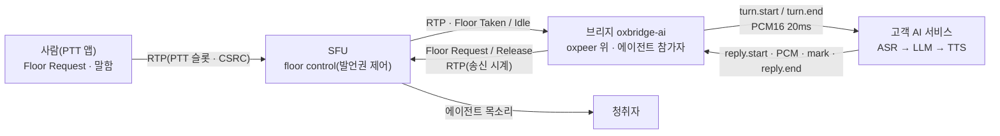
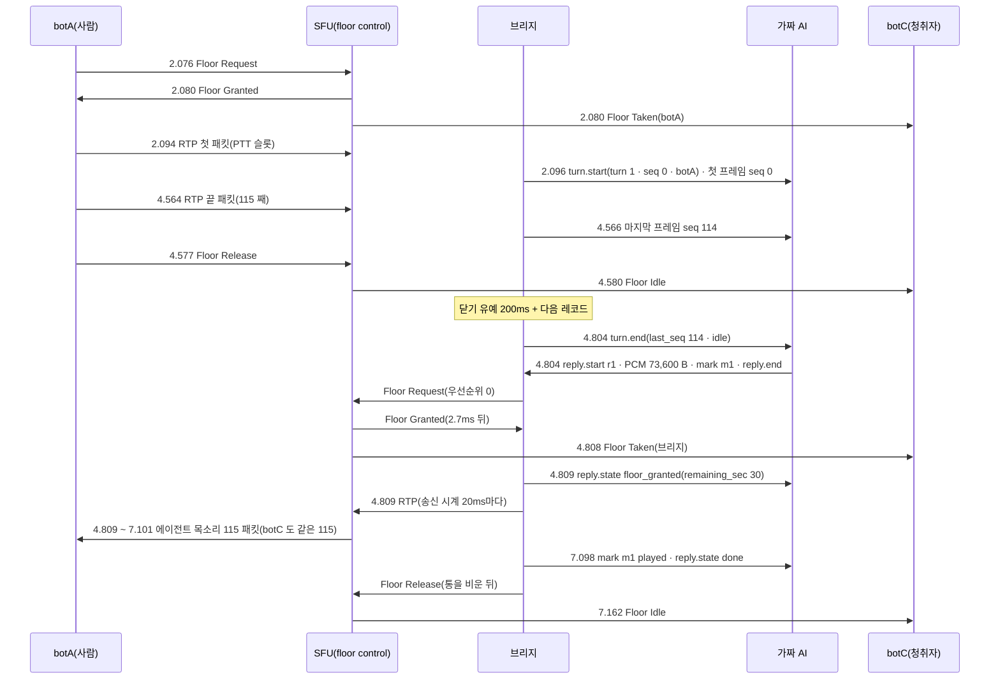
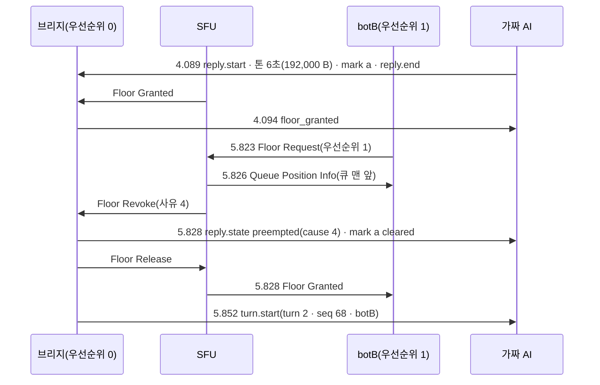
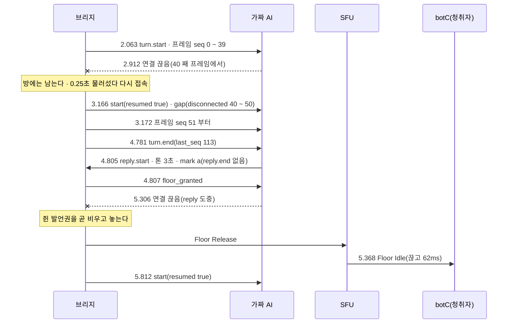

# 19. AI 에이전트 브리지 — 무전 방에서 듣고, 발언권을 잡고, 음성으로 답한다

> author: kodeholic (powered by Claude) · created: 2026-11-12.
> ★**대조한 커밋** — oxpeer `59d3720`(브리지는 그때 `bridge/` — 지금 경로는 워크스페이스 `crates/oxbridge-ai` · `crates/oxpeer` · context) · 2층 `oxlens-labs` `f4616cb` · 3층 `oxlens-sdk-web` `e79e1e3` · 서버 빌드 `5c9d2870ae16`
> ★**실측 회차** — 2층 `bridge_*` 시나리오 열하나(20261112) · 3층 `PEER-BRIDGE-01`. 값은 돌릴 때마다 바뀌고 차례 · 모양은 같다.

## 1. 30초 요약



- **턴은 발언권이 정한다.** 사람이 허가를 받았다는 Floor Taken 부터 Floor Idle(또는 다음 Floor Taken)에 닫기 유예를 더한 때까지가 턴 하나다. 소리 크기로 말 끝을 짐작(VAD)하지 않는다. 경계는 녹음 파이프라인의 발언 정책을 그대로 쓴다([18 §3-3](18_RECORDING.md)).
- **브리지는 사실을, 고객은 추론을.** 브리지는 누가 언제 말했나 · Opus ↔ PCM · 발언권 잡기와 놓기 · 송신 시계(pacer — 프레임 길이대로 고르게 내보내기)를 맡는다. 무엇을 답할지는 고객 AI 가 정한다. 둘 사이의 이음매(브리지 ↔ AI 의 WebSocket 인터페이스)는 연결 하나다. 텍스트 프레임은 JSON 사건, 바이너리 프레임은 PCM 이다.
- **발언권을 인질로 잡지 않는다.** 서버는 허가 뒤 RTP 가 4초(`T1`) 없으면 알리지 않고 회수한다. 브리지는 그보다 1초 먼저(3초) 스스로 놓는다. 사람이 우선순위 1 이상으로 누르면 에이전트는 선점된다.

## 2. 등장인물 · 값

| 이름 | 값(2층 `e2e-20261112-085827`) | 무엇 |
|---|---|---|
| 브리지 | `oxbridge-ai`(oxpeer 저장소 워크스페이스 멤버 `crates/oxbridge-ai`) · 참가자 종류 `participant_type:2` · 사용자 `bridge~<시나리오>` | 방 하나 · 에이전트 하나 · 프로세스 하나 |
| 가짜 AI | 2층 `oxlens-labs/oxe2epy/oxe2epy/fakeai.py`(하네스 루프 안 WS 서버) · 3층 `qa/live/fixtures/fakeai.ts` | 실제 모델이 없다 — 정해진 꼴로 답하고 받은 것을 적는다 |
| 사람 | 봇 `botA` · `botB`(화자) · `botC`(청취자) · 오디오 20ms 한 패킷 | 2층 헤드리스 봇 |
| 이음매 판 | `start.version` 1 · 표본률 16,000Hz · 20ms = 320 표본 = 640 바이트 · 바이너리 머리 8 바이트 | — |
| 무음 상한 `L` | 3,000ms = 서버 `T1`(4,000ms) − 여유 1초 | — |
| 통(버퍼) 상한 | AI 로 가는 음성 5초(브리지 기본 `--ws-queue-ms 5000`) · 커널 송신 버퍼 32KiB(`ws.rs` `SEND_BUF` — 16kHz 음성 약 1초) · reply 통 = 위 발화 상한(`T2` 30초)만큼 | 규격 — 는 「상한」과 「음성 약 1초」만 정한다 · 값은 브리지 기본값 |
| 에이전트 우선순위 | 0 고정 | 사람 앱이 1 이상이면 선점된다 |
| 정상 길 | `bridge_echo` — 턴 1 · AI 로 115 프레임 · 송출 115 프레임 · mark `m1` played · reply `done` | §3 |
| 깨지는 길 | `bridge_noend` · `bridge_preempt` · `bridge_deny` · `bridge_queued` · `bridge_slow_ai` · `bridge_ai_cut` · `bridge_speaker_drop` | §4 |
| 정상 변형 | `bridge_hold_silence`(누른 채 1.5초 쉼 → 턴 1) · `bridge_repress`(놓고 0.3초 뒤 다시 → 턴 2) · `bridge_fixed_marks`(mark 둘) | §3-3 |
| 버그 계수(A10) | 열한 시나리오 모두 0 — 유예 창 밖 프레임(출처 있음 · 없음) · 앞 화자 · 허가 전 · `lost` · 디코딩 오류 | §4-1 · §7 |
| 지연(A4) | 브리지 몫(AI 첫 음성 → 첫 RTP) 1 ~ 3ms(큐 대기 판은 대기 1,971ms 포함) · 턴 끝 → AI 첫 음성(가짜 AI 즉답) 1 ~ 39ms | 요약 `lat_bridge_ms` · `lat_ai_ms` |
| 자원(A6) | 세션 하나 — CPU 코어 하나의 3.5 ~ 4.4%(debug 빌드 · 10 ~ 14초 판) · 메모리(phys_footprint) 시나리오별 봉우리 3.92 ~ 5.51MB(10⁶ 바이트) · fd 13 ~ 14 | 단계 사이 판 `e2e-20261112-084003` |
| 3층 | `PEER-BRIDGE-01` passed · 16.8초 | 크로뮴 실 인코더 → 브리지 → 가짜 AI → 브리지 → 청취 브라우저 디코드 |
| 2층 판정 | 브리지 열하나 빨강 0 — 등식 일곱(§7 — 여덟째 `bridge_turn_end_follows_release` 는 §4-4 결함 둘째 뒤에 더함) | 전량 113/113 |

## 3. 정상 길

### 3-1. 되울림 한 번 — `bridge_echo`

botA 가 1초에 Floor Request 하고 3.5초에 Release 한다. 가짜 AI 는 턴의 PCM 을 그대로 reply 로 돌려준다. 시각은 덤프 시계(초)다.



- **턴 = 발언 하나.** 브리지는 라이브 레코드 통을 녹음 파이프라인(발언 정책)에 넣는다. 파이프라인이 Floor Taken 에서 발언을 열고 Floor Idle 에서 닫는다. 브리지는 발언 번호마다 턴 하나를 연다. 이 판은 턴 1 이고, botA 가 보낸 115 패킷이 AI 로 간 115 프레임(seq 0 ~ 114)과 같다.
- **`turn.end` 는 Floor Idle 보다 224ms 늦다**(4.580 → 4.804). 닫기 유예 200ms 동안 앞 화자의 늦은 패킷을 그 발언에 넣는다. 그 뒤 첫 레코드에서 닫는다. 브리지는 레코드 `tick` 을 50ms 로 줄여 이 늦음을 묶는다.
- **음성은 흐르는 대로 간다.** 프레임마다 바이너리 하나다. 머리는 `kind`(1 = 음성) · `stream`(0) · `reserved` · `seq`(u32 리틀엔디언) 여덟 바이트이고, 뒤에 PCM16LE 640 바이트가 붙는다. `seq` 는 보낸 프레임마다 1씩 오르고 `turn.start.seq` · `turn.end.last_seq` · `gap` 과 같은 축이다.
- **reply 는 고객이 명시한다.** `reply.start` 에서 브리지가 Floor Request 한다. 허가가 오면 쌓인 PCM 을 20ms 로 잘라 Opus 로 인코딩하고 송신 시계로 낸다. `reply.end` 가 왔고 통이 비면 Floor Release 한다. 놓는 때를 무음 시간으로 짐작하지 않는다.
- **mark 는 Twilio 와 같다.** 앞 음성을 다 내보낸 뒤 `played` 로 돌아온다(7.098). 비워지면 `cleared` 로 돌아온다(§4).

브리지 쪽 발언권 걸음은 oxpeer 운영 로그에 이렇게 남는다(벽시계 · 머리 일부 줄임). Floor Request 에서 Floor Granted 까지 2.7ms 다.

```
09:08:35.585106 proc=peer kind=ev spec=FLR.C.NOPERM.press      user=bridge~bridge_echo from=NOPERM to=PREQ  cause=app
09:08:35.587794 proc=peer kind=ev spec=FLR.C.PREQ.rx_GRANTED   user=bridge~bridge_echo from=PREQ   to=PERM  cause=DC
09:08:35.589449 proc=peer kind=ev spec=FLR.C.PERM.rtp_tx       user=bridge~bridge_echo from=PERM   to=PERM  cause=pacer
09:08:37.938690 proc=peer kind=ev spec=FLR.C.PERM.release      user=bridge~bridge_echo from=PERM   to=PREL  cause=app
09:08:37.942042 proc=peer kind=ev spec=FLR.C.PREL.rx_ACK_release user=bridge~bridge_echo from=PREL to=NOPERM cause=DC
```

### 3-2. 이음매 사건

| 방향 | 사건 | 이 판에서 |
|---|---|---|
| 브리지 → AI | `start` — `version` · `session` · `room` · `agent{user_id}` · `audio{encoding:"pcm_s16le", rate, channels:1, frame_ms:20}` · `participants` · `custom` · `resumed` | 1.079 · `resumed:false` |
| 브리지 → AI | `participant{action, user_id}` | 사람이 들고 날 때 |
| 브리지 → AI | `turn.start{turn, speaker, seq}` · `turn.end{turn, last_seq, reason}` | 2.096 · 4.804 |
| 브리지 → AI | `gap{from_seq, to_seq, reason}` — `network` · `overflow` · `disconnected` | §4-5 · §4-6 |
| 브리지 → AI | `reply.state{reply, state, …}` · `mark{name, status}` · `stop{reason}` | 4.809 · 7.098 |
| AI → 브리지 | `reply.start{reply}` · `mark{name}` · `reply.end{reply}` · `clear` · 머리 없는 PCM16LE | 4.804 |

`reply.state` 의 값은 서버가 준 사유를 그대로 옮긴다.

| 위에서 온 것 | `reply.state` |
|---|---|
| Floor Granted | `floor_granted{remaining_sec}` |
| Queue Position Info | `floor_queued{position}` |
| Floor Deny | `floor_denied{cause}` |
| Floor Revoke 사유 4(선점) | `preempted` |
| Floor Revoke 사유 2(발화 상한 `T2`) | `truncated{limit:"floor_max"}` |
| Floor Revoke 사유 3(권한 회수) | `revoked` |
| 브리지 무음 상한 `L` · reply 통 상한 | `truncated{limit:"silence"}` · `truncated{limit:"buffer"}` |
| 앞선 Floor Revoke 없이 남의 Floor Taken | `lost` — 0 이어야 한다 |
| `reply.end` 뒤 통이 빔 · `clear` | `done` · `done{cleared:true}` |

### 3-3. 정상 변형 — 쉼 · 다시 누름 · mark 둘

- **누른 채 쉬기(`bridge_hold_silence`)** — botA 가 누른 채 1.5초 보내지 않았다. 청취자 botC 의 슬롯 패킷이 두 덩어리로 갈렸다(2.085 부터 46 · 4.586 부터 이어서). 그래도 Floor Idle 이 없으니 턴은 하나다. 턴의 순번 수 92 = botA 가 그 허가 동안 보낸 92 다. 쉼이 서버 `T1`(4초)보다 짧아 회수되지 않았다.
- **같은 화자 다시 누르기(`bridge_repress`)** — botA 가 3.559 에 Release 하고 3.858 에 다시 Floor Request 했다. Floor Idle → Floor Taken 이라 턴 둘이다. 턴 1 은 3.788 에 닫히고(`last_seq` 68), 턴 2 는 3.875 에 열린다(`seq` 69). 화자는 둘 다 botA 다.
- **mark 둘(`bridge_fixed_marks`)** — 가짜 AI 가 톤 1.0초 · mark `a` · 톤 0.6초 · mark `b` 를 한 번에 보냈다. 브리지가 실시간보다 빨리 받은 PCM 을 20ms 마다 낸다. `a` 는 4.810(허가 3.822 + 약 1초) · `b` 는 5.410(+ 0.6초)에 `played` 로 돌아왔다. 송출 80 프레임 = 1.6초다.

### 3-4. 3층 — 실 인코더와 실 디코더

`PEER-BRIDGE-01` 은 브라우저 둘과 브리지 · 가짜 AI(되울림)를 한 방에 둔다. 말하는 브라우저가 Floor Request 하고 2.5초 말한다. 크로뮴 가짜 장치의 소리를 실제 Opus 인코더가 만든다. 브리지가 그 Opus 를 PCM 으로 풀어 AI 로 보낸다. AI 가 되돌린 PCM 을 브리지가 다시 Opus 로 지어 낸다. 듣는 브라우저가 그것을 실제로 디코드한다.

판정은 디코더 쪽 값이다 — 에이전트가 화자로 뜬 뒤 1.5초 동안 디코드한 샘플 차분이 50,000 보다 크고, 디코더가 은닉(Opus PLC)한 샘플이 그 10% 보다 적다. 브리지 요약에서는 턴 1 · reply `done` 1 · 디코딩 오류 0 · 송출 프레임 100 초과 · 버그 계수 0 을 본다. 이 판은 16.8초에 통과했다. 와이어 셈(턴 경계 · 순번 축)은 2층이 본다.

## 4. 깨지는 길

### 4-1. 서버 `T1` 의 무통지 회수 — 무음 상한이 막는다(`bridge_noend`)

**무엇이 깨질 수 있나.** 서버는 허가한 뒤 RTP 를 받을 때마다 `T1`(4초)을 다시 건다. 만료하면 회수하는데 화자에게는 알리지 않는다([연:RULE-FLR-PROC-TAKEN-IDLE](../protocol/10-flr.md#RULE-FLR-PROC-TAKEN-IDLE) 5). 발언권이 빈 채 남으면 그 뒤 그 사람의 RTP 는 통지 없이 버려진다([연:FLR.S.P.NP_IDLE.rx_RTP_drop](../protocol/10-flr.md#FLR.S.P.NP_IDLE.rx_RTP_drop)). AI 의 TTS 가 4초 넘게 늦으면, 에이전트는 말한다고 믿는데 아무도 못 듣는다.

**브리지가 막는 법.** 허가를 받은 때와 마지막 프레임을 낸 때 중 늦은 쪽부터 `L`(3초) 동안 낼 음성이 없으면, 브리지가 먼저 Floor Release 하고 `truncated{limit:"silence"}` 를 알린다. 첫 음성 대기와 reply 안의 무음이 한 규칙이다. 무음 프레임으로 버티지 않는다 — 버티면 고객 쪽 결함이 채널을 발화 상한(30초)까지 묶는다.

**이 판.** 가짜 AI 가 톤 0.4초 · mark `a` 뒤 `reply.end` 를 보내지 않았다.

| 시각 | 무엇 |
|---|---|
| 3.799 | `reply.start` · PCM 12,800 B(0.4초) · mark `a` |
| 3.803 | `floor_granted` |
| 4.186 | mark `a` played — 20 프레임을 다 냄 |
| 7.187 | `truncated{limit:"silence"}` — 마지막 프레임 + 3.0초 · 브리지 진단 줄 `reply_truncated_silence quiet_ms=3000` |

남은 빈틈도 적어 둔다. 발언권이 빈 채 남은 무통지 회수는 받는 쪽에서 볼 길이 없다. 남이 Floor Taken 을 받으면 `lost` 로 잡히지만 아무도 안 누르면 소식이 없다. 그래서 `L` 이 주 장치다. 열한 판 모두 `lost` 0 이었다.

### 4-2. 선점 — 사람이 우선순위 1 로 누른다(`bridge_preempt`)

선점은 요청 우선순위가 화자의 허가 우선순위보다 클 때만 일어난다([연:RULE-FLR-PREEMPT](../protocol/10-flr.md#RULE-FLR-PREEMPT)). 기본값이 모두 0 이면 선점이 없고 줄을 선다. 그래서 에이전트는 늘 0 으로 누르고, 사람 앱이 1 이상으로 누를 때 끊긴다. 이 값을 사람 앱에 정하는 것은 배치 몫이다.



에이전트는 6초 중 87 프레임(1.74초)만 냈다. 남은 음성은 버리고 다시 내지 않는다 — 낡은 답을 늦게 몰래 내지 않는다. 다시 할지는 고객이 정한다. 선점한 사람의 말은 그대로 다음 턴이 된다.

### 4-3. 거절 — 토큰의 발언권 비트를 내렸다(`bridge_deny`)

에이전트 토큰의 `permission.floor_request` 를 거짓으로 발급했다(권한은 토큰 클레임이다). `reply.start`(3.829) 3ms 뒤 `floor_denied{cause:102}`(권한 없음)가 왔다. mark `a` · `b` 는 `cleared` 로 돌아왔다. 송출은 0 이다. 진단 줄은 `reply_state {'cause':102,'reply':'r1','state':'floor_denied'}` 다.

### 4-4. 사람이 쥔 동안 reply — 큐 대기와 승계(`bridge_queued`)

가짜 AI 가 `turn.start` 에 곧바로 reply 를 보냈다. botA 가 아직 말하는 중이다. 우선순위가 같으니(0) 선점이 아니라 줄을 선다.

| 시각 | 무엇 |
|---|---|
| 2.085 | `reply.start` · 톤 1초 · mark `a` · `reply.end` |
| 2.088 | `floor_queued{position:1}` |
| 4.053 | botA Floor Release |
| 4.057 | 대기열 승계 — 청취자에게 Floor Taken(브리지) |
| 4.058 | `floor_granted` |
| 5.047 | mark `a` played · `done` — 50 프레임 |

★**결함(20261112 고침).** 처음 판(`e2e-20261112-082957`)에서 청취자가 에이전트 창에 받은 슬롯 패킷이 0 이었다. 브리지는 50 프레임을 냈다고 셌다. 원인은 oxpeer 다. 대기열 승계로 Floor Granted 가 오면 SDK 상태기는 「의지 표시」를 기다린다(승계 시한 `T132` 동안). SDK 규격은 누름 방식 기본값 hold 에서 「승계 허가가 온 순간 누른 채면 의지 표시를 넣는다」고 정한다. oxpeer 는 그것을 넣지 않았다. 그래서 마이크 게이트가 열리지 않았고 음성은 모두 게이트에서 버려졌다. 서버사이드 누름은 늘 hold 라, 누른 채면 곧 의지 표시를 넣도록 고쳤다. 고친 뒤 판(`e2e-20261112-083513`)에서 50 = 50 이 됐다. 등식 `bridge_reply_reaches_room` 이 잡았다.

★**결함 둘째(20261112 고침).** 전량 판(`e2e-20261112-085827`)에서 이 판의 `turn.end` 는 6.342 에 왔다. botA 가 놓은 4.053 보다 2.289초 늦다(slow 를 뺀 다른 판들은 놓음 뒤 0.226 ~ 0.240초). 턴의 프레임 수는 맞았다(92 = 92). 늦은 것은 `turn.end` 시각뿐이다.

| 시각 | 무엇 |
|---|---|
| 4.057 | 승계 — 청취자들은 Floor Taken(브리지)을 받는다 |
| 4.057 | 브리지 자신은 같은 허가를 Floor Granted 로 받는다(`FLR.C.QUEUED.rx_GRANTED` · AI 에는 `floor_granted` 4.058) — 원시 기록 `ctl/floor` 에는 받은 Floor Taken · Floor Idle 만 적었으므로 아무것도 남지 않는다 |
| 5.107 | 브리지가 놓는다(mark `a` played · `done` 5.047 뒤) → Release 확인(ACK)만 온다(`FLR.C.PREL.rx_ACK_release` 5.111). 놓은 화자에게는 Floor Idle 방송이 가지 않는다([연:RULE-FLR-PROC-PERM-RELEASE](../protocol/10-flr.md#RULE-FLR-PROC-PERM-RELEASE) 3 · 원문 6.3.5.5.4) |
| 5.110 | 다른 봇들 Floor Idle |
| 6.113 | 브리지에 처음 닿은 경계 — 1초 뒤 Floor Idle 재전송(`T7` · `FLR.S.G.IDLE.T7`) |
| 6.342 | `turn.end`(그 +229ms — 닫기 유예) |

발언 정책은 botA 발언이 끝났다는 경계를 4.057 이 아니라 6.113 에야 받았다. 적는 길목은 oxpeer `floor_receive` 하나다(`floor_record`). 읽는 쪽은 파이프라인 `floor` 에 `granted` 갈래 하나를 더했다.

- 받은 Floor Granted 도 적는다 — `{event:"granted", user_id:<나>, seq:null}`(출처 번호 · 허가 번호 없음). 받은 메시지 그대로이고 Floor Taken 으로 꾸미지 않는다.
- 적는 때는 상태기가 앞 화자 표시를 지우는 첫 허가(`app_speaker_none`)뿐이다 — 요청 뒤 허가 · 놓는 중 승계 허가 · 큐 승계 허가. Floor Granted 에는 허가 번호가 없어 파이프라인이 재전송을 가릴 수 없기 때문이다. 큐 승계 허가의 재전송(ACK 를 요구하는 A 비트가 선 재전송 — [07장](07_FLOOR.md))과 쥔 동안 온 허가는 상태기가 효과 없이 끝내므로 줄이 나지 않는다. 놓는 중 승계 허가의 재전송은 다시 적힐 수 있으나 지울 발언이 없어 해가 없다.
- 발언 정책은 `granted` 를 다음 허가처럼 받아 앞 발언을 닫되(사유 `taken`) 새 발언은 열지 않는다. 에이전트는 자기 발언을 받지 않는다(서버가 화자를 뺀다 — 받은 자기 슬롯 음성 `self_frames` 0).
- 자기 놓음은 적지 않는다. 확인을 받은 순간 서버가 이미 다음 사람에게 넘겼을 수 있어 「방이 비었다」는 사실이 아니다. 다음 Floor Taken · Floor Idle 이 닫는다.

고친 뒤 판(`e2e-20261112-154058`)에서 놓음 → `turn.end` 는 0.229초(사유 `taken`)다. 새 등식 `bridge_turn_end_follows_release`(놓음 뒤 0.5초 안)가 잡는다. 이 갈래만 끈 변이 판(`e2e-20261112-154454`)은 2.278초로 빨강이다.

### 4-5. 느린 AI — `gap(overflow)` 와 커널 송신 버퍼(`bridge_slow_ai`)

가짜 AI 가 첫 `turn.start`(2.083) 뒤 6초 동안 읽지 않았다. 이 판은 48kHz 라 한 프레임이 1,928 바이트다. 넘침을 보려고 AI 로 가는 통을 200ms 로 줄였다(`ws_queue_ms: 200`). botA 가 5초 동안 229 프레임을 말했다. AI 가 다시 읽기 시작한 8.084 에 212 프레임과 `gap{from_seq:202, to_seq:218, reason:"overflow"}`(17 프레임)를 받았다. 받은 순번과 gap 이 0 ~ 228 을 빠짐없이 덮는다. 수신 루프는 막히지 않았다 — 턴 순번 수 229 = botA 송신 229 · 버그 계수 0.

★**결함 둘(20261112 고침).**
1. **커널 송신 버퍼.** 처음 판에서는 넘침이 0 이었다. 운영체제가 소켓 송신 버퍼를 자동으로 키워(맥 최대 4MB) 443KB 를 다 삼켰다. 그러면 「AI 로 가는 통은 상한」이 뜻을 잃고, AI 가 다시 읽을 때 수 초 묵은 음성이 쏟아진다. 브리지가 소켓 송신 버퍼를 32KiB(16kHz 음성 약 1초)로 묶도록 고쳤다. 규격 문장으로 올렸다.
2. **꼬리 넘침.** 넘쳐 버린 뒤 음성이 더 오지 않으면 `gap(overflow)` 가 영영 나가지 않았다. 이제 다음에 내보내는 것보다 먼저 낸다.

**변이 A/B.** 브리지가 `gap(overflow)` 를 내지 않게 바꾸고 돌리면 빨강 셋이 났다(`e2e-20261112-083819`) — 받지도 알리지도 않은 순번 18 · 넘침 gap 합 0 ≠ 버린 18 · gap 없음. 되돌리면 초록이다.

### 4-6. AI 가 끊긴다 — `resumed` 와 `gap(disconnected)`(`bridge_ai_cut`)

가짜 AI 가 두 번 끊었다. 한 번은 턴 도중, 한 번은 reply 도중이다.



- 끊긴 동안 지은 프레임과 통에 남았던 프레임은 `gap(disconnected)` 로 알린다. AI 가 받은 103 프레임 + gap 11 = 다음 순번 114 다. 끊는 순간 이미 소켓에 실려 날아가던 프레임은 브리지가 모른다. 순번이 이어져 있어서 AI 쪽이 빈칸을 안다.
- reply 도중 끊기면 결과(`reply.state`)를 알릴 길이 없다. 브리지는 알리지 않고 곧 놓는다. 이 판은 25 프레임을 내고 놓았다. 방 참가는 그대로다(진단 줄 `ai_disconnected` → `ai_connected resumed=true`).

### 4-7. 화자가 누른 채 사라진다 — 4.23초(`bridge_speaker_drop`)

botA 가 Floor Granted 를 쥔 채 연결이 갑자기 끊겼다(3.809 — 봇 프로세스를 죽임). 서버는 RTP 가 멎은 뒤 `T1`(4초)로 회수하고 Floor Idle 을 냈다(7.796 — 3.99초 뒤). 브리지의 `turn.end` 는 8.038 이다(끊김 4.229초 뒤 · Floor Idle + 닫기 유예). 브리지는 이 늦음을 덮지 않는다. 회수 뒤 botB 가 누른 말은 턴 2(`seq` 69)가 됐다.

## 5. 왜 이 모양인가

- **턴 판정을 소리로 하지 않는다.** 전화 · 회의용 음성 에이전트는 VAD 로 「말이 끝났나」를 추정한다. 끝 판정 최소 · 최대 시간, 거짓 끼어들기 같은 손잡이가 붙는다. 무전은 발언의 끝이 Floor Idle 로 확정된다. 그 사실을 그대로 주면 손잡이가 필요 없다. 누른 채 쉬어도(§3-3) 한 턴이고, 다시 누르면 두 턴이다.
- **경계는 녹음 파이프라인 것을 그대로 쓴다.** 녹음도 같은 질문(이 발언은 언제 시작하고 끝났나)을 묻는다. 녹음 쪽 2층이 실제 경쟁 셋을 실측했다 — Floor Taken 보다 먼저 온 새 화자 프레임, Floor Idle 보다 늦게 온 앞 화자 프레임, 같은 허가의 재전송이다. 처음 설계는 「유예 없이, 창 밖은 모두 버그」였다. 그대로 두면 정상 경쟁에서 첫 음절과 말끝이 잘린다. 결재로 녹음 규칙을 따르기로 했다. 대가는 `turn.end` 200ms(이 회차 224ms)다.
- **브리지가 고객에게 접속한다.** Twilio · Vonage 와 같은 방향이다. 고객은 WS 서버 하나만 띄우면 된다. 언어 바인딩 없이 네트워크 규격이라, 고객 프로세스가 죽어도 방 연결은 산다(§4-6).
- **텍스트는 JSON, 음성은 머리 8 바이트 + PCM.** base64 JSON(Twilio)은 33% 부풀고 파싱이 든다. Vonage 처럼 바이너리로 보내되 순번 머리를 붙였다. 순번 하나가 턴 · gap · 끊김을 한 축으로 잇는다.
- **리샘플러가 없다.** libopus 가 8 · 12 · 16 · 24 · 48kHz 로 직접 디코딩 · 인코딩한다. 이음매 표본률을 그 집합으로 묶었다. 코덱은 libopus 1.6.1 을 정적으로 묶는다(브리지 크레이트에 `unsafe` 가 없다 — FFI 는 `opusic-c` 안쪽).
- **누르는 때는 `reply.start`, 놓는 때는 `reply.end`.** TTS 준비와 발언권 왕복을 겹치려고 음성보다 먼저 누른다. 대신 첫 음성이 `L` 안에 와야 한다(§4-1). TTS 가 느린 고객은 첫 음성이 준비된 뒤 `reply.start` 를 보내면 된다.
- **브리지는 oxpeer 공개 표면만 쓴다.** 별도 크레이트라 컴파일러가 강제한다. 브리지를 지으며 oxpeer 에 빠진 것(회수 · 거절 사유, 허가 시간, 대기 순번, `T1` 값, 앱 운영 로그 입구)이 드러나 oxpeer 를 고쳤다. 큐 승계 hold 결함(§4-4)도 그렇게 나왔다.

> ★**우리만의 것 — 발언권이 턴을 정하는 AI 이음매**
> - **선택 배경** — 무전 채널에 AI 를 들이려면 「사람 말이 끝났나」와 「AI 가 말해도 되나」를 정해야 한다. 전화 · 회의 쪽 선례는 둘 다 추정(VAD · 끼어들기 휴리스틱)이다. 무전에는 둘 다 이미 서버 판정이 있다 — floor control(발언권 제어)이다. 그 판정을 그대로 이음매에 싣기로 했다.
> - **얻은 것** — 턴 경계가 사실이다. 열한 판에서 턴의 순번 수가 화자가 보낸 패킷 수와 같았고, 버그 계수는 0 이었다. 에이전트 발화도 사람과 같은 규칙(대기열 · 선점 · 발화 상한)을 따른다. 고객은 VAD · 끼어들기 손잡이를 고를 필요가 없다. 브리지 몫 지연은 1 ~ 3ms 다.
> - **잃은 것** — `turn.end` 가 Floor Idle 보다 약 224ms 늦다(닫기 유예). 화자 연결이 갑자기 끊기면 턴 끝이 4.23초 늦다(`T1`). 사람 앱이 우선순위를 정하지 않으면 사람이 에이전트 뒤에 줄을 선다. 1판은 무전 방 하나 · 에이전트 하나 · 슬롯 음성만이다 — 회의 방 · 영상 · 전이중 트랙에서 반이중으로 바꿔 말한 화자의 턴은 범위 밖이다. 무통지 회수 뒤 발언권이 빈 채 남는 경우는 받는 쪽에서 볼 수 없다.


## 6. 다른 SFU 는

★아래 「그쪽 방식」은 설계 기록 §3 의 선례표다. 오픈소스는 소스를, 상용은 공개 문서를 정적으로 읽었다(2026-11-10). 실측이 아니다.

| 선례 | 이음매 꼴 | 끼어들기 · 재생 확인 | 턴 판정 · 화자 | 우리와 다른 점 |
|---|---|---|---|---|
| Twilio Media Streams | 플랫폼이 고객 WS 서버로 접속 · 텍스트 JSON 사건(`connected` · `start` · `media` · `stop` · `mark` · `dtmf`) · 음성은 μ-law 8kHz base64 | `mark` 는 재생을 마치면 되돌아옴 · `clear` 는 쌓인 음성을 비우고 남은 mark 를 모두 되돌림 | 통화 하나(inbound · outbound) | mark 의미는 같다 · 우리는 PCM16 바이너리 · 화자와 턴 경계를 사실로 준다 |
| Vonage Audio Connector | 고객 WS 로 접속 · 바이너리 = 머리 없는 PCM16 20ms · 텍스트 = JSON 사건 | 비우기 지시 → `websocket:cleared` | 화자를 가르려면 흐름마다 WS 를 따로 연다 | 우리는 한 연결에 순번 머리를 붙인다(`stream` 칸은 다중 화자 판을 위해 비워 둠) |
| Fonoster + Pipecat | Fonoster 가 Twilio 메시지를 그대로 말한다 — Twilio 용 봇이 코드 수정 없이 붙는다 | `clear` · mark 되돌림이 Twilio 와 같다 | — | Twilio 호환 모드는 1판 밖(고객 요구가 확인되면 2판 후보) |
| Pipecat | 직렬기 하나로 이음매를 갈아 끼운다(Twilio · Vonage · Telnyx · Plivo · Exotel · Genesys · Jambonz) | 파이프라인의 끼어들기 프레임을 이음매의 `clear` 로 번역 | — | 우리 이음매용 직렬기 하나를 더하면 붙는 꼴로 지었다 |
| LiveKit Agents | 에이전트가 방에 참가자로 든다 · Python SDK 는 Rust 코어 위 FFI | 턴 판정 모드 `stt` · `vad` · `realtime_llm` · `manual`(`commit_user_turn`) · VAD 기본 끝 판정 0.5 ~ 3.0초 · 거짓 끼어들기 2.0초 뒤 재개 | 참가자마다 트랙 | 우리 턴은 `manual` 모드의 신호를 브리지가 사실로 주는 꼴이다 · 언어 바인딩 대신 네트워크 규격 |


## 7. 관측하는 법

브리지는 oxpeer 와 같은 운영 로그 꼴(`proc=peer`)로 낸다. 브리지가 판단한 것은 진단 줄(`kind=diag`)이고, 근거는 `SD-` + 이 장의 규격 라벨이다. 줄 읽는 법은 [17 §3-1](17_OPERATIONS.md)이 집이다. 이 회차 줄이다(벽시계 · 머리 일부 줄임).

```
09:08:03.049262 proc=peer kind=diag spec=SD-RULE-PLAT-AGENT-CONNECT user=bridge~bridge_ai_cut what=ai_connected msg="resumed=false"
09:08:04.915398 proc=peer kind=diag spec=SD-RULE-PLAT-AGENT-FAULT   user=bridge~bridge_ai_cut what=ai_disconnected msg=닫힘
09:08:05.168905 proc=peer kind=diag spec=SD-RULE-PLAT-AGENT-CONNECT user=bridge~bridge_ai_cut what=ai_connected msg="resumed=true"
09:08:21.232854 proc=peer kind=diag spec=SD-RULE-PLAT-AGENT-REPLY   user=bridge~bridge_deny   what=reply_state msg="{'cause':102,'reply':'r1','state':'floor_denied'}"
09:09:22.071098 proc=peer kind=diag spec=SD-RULE-PLAT-AGENT-SILENCE user=bridge~bridge_noend  what=reply_truncated_silence msg="quiet_ms=3000"
09:09:36.070059 proc=peer kind=diag spec=SD-RULE-PLAT-AGENT-REPLY   user=bridge~bridge_preempt what=reply_state msg="{'cause':4,'reply':'r1','state':'preempted'}"
```

| 무엇 | 어디서 보나 |
|---|---|
| AI 연결 · 끊김 · 다시 붙음 | `diag` `what=ai_connected`(`resumed`) · `ai_disconnected` |
| reply 가 정상 끝이 아님 | `diag` `what=reply_state`(`floor_denied` · `preempted` · `truncated` · `revoked` · `lost`) · 무음 상한은 `reply_truncated_silence quiet_ms=…` |
| 무통지 회수(0 이어야 함) | `diag` `what=floor_lost_silent taken_by=…` |
| 유예 창 밖 프레임(0 이어야 함) | `diag` `what=orphan_frame source=… user=… total=…`(앞 20 줄 뒤로는 100 째마다) |
| 디코딩 · 인코딩 오류 | `diag` `what=decode_error` · `encode_error` |
| 브리지의 발언권 걸음 | `ev` `area=FLR` 줄 — `FLR.C.NOPERM.press` → `FLR.C.PREQ.rx_GRANTED` → `FLR.C.PERM.rtp_tx` → `FLR.C.PERM.release` → `FLR.C.PREL.rx_ACK_release`(§3-1) |
| 계수 | 운영 `stat` 줄에는 표의 칸만 싣는다 — 브리지 계수는 끝 요약 JSON 한 줄이 든다 |

끝 요약 JSON(브리지 표준 출력 마지막 줄)의 주요 칸 — `room` · `user` · `session` · `rate` · `turns` · `frames_to_ai` · `next_seq` · `frames_sent` · `overflow_frames` · `gaps_network` · `ws_connects` · `ws_downs` · `replies{started, done, cleared, granted, queued, denied, preempted, truncated_silence, truncated_buffer, truncated_floor, revoked, lost, ws_cut, overlap}` · `orphan_sourced` · `orphan_sourceless` · `self_frames` · `self_utterances` · `pipeline{frames, filled, other_speaker, unheld, broken}` · `ignored_samples` · `tx_dropped` · `decode_errors` · `encode_errors` · `lat_ai_ms` · `lat_bridge_ms` · `silence_ms` · `stop_reason` · `end_wall_ms`. 응답 지연을 둘로 가른다 — `lat_ai_ms` 는 턴 끝 → AI 첫 음성(고객 몫), `lat_bridge_ms` 는 AI 첫 음성 → 첫 RTP(브리지 몫)다. 지연 불만이 오면 누구 몫인지 이 둘로 가른다.

2층 등식(`oxe2epy/oxe2epy/verifier/equations.py` · 분모가 0 이면 Vacuous 로 빨강).

| 등식 | 판정 |
|---|---|
| `bridge_turns_follow_floor` | AI 가 받은 `turn.start` 화자 차례 = 봇 발언(Floor Request 하나에 Floor Granted 하나) 차례 · 열린 턴은 모두 닫힘 · 사유는 `idle` · `taken` · `left` |
| `bridge_frames_account` | 받은 순번 ∪ gap = [0, 다음 순번) · 겹침 없음 · 넘침 gap 합 = 버린 수 · 프레임은 모두 어느 턴 안 · 끊긴 순간 날아가던 프레임은 끊김 gap 바로 앞 빈칸만 허용 |
| `bridge_turn_frames_match_speaker` | 턴의 순번 수 = 그 턴 화자 봇이 그 허가 동안 보낸 패킷 수 |
| `bridge_bug_counts_zero` | 유예 창 밖 프레임 · 앞 화자 · 허가 전 · `lost` · 디코딩 · 인코딩 오류 = 0 |
| `bridge_reply_outcome` | `reply.state` 차례 · mark 마다 `played` · `cleared` · 재접속 수 · `gap` 이 시나리오 기대대로 |
| `bridge_reply_reaches_room` | 청취 봇이 에이전트 창(에이전트 Floor Taken ~ 다음 Floor Taken · Floor Idle)에 받은 슬롯 패킷 = 브리지 송출 프레임 |
| `bridge_turn_end_follows_release` | 화자가 놓아 닫힌 턴은 놓음(RELEASE 송신) 뒤 0.5초 안에 `turn.end` 가 AI 에 닿는다 — 승계가 누구에게 가든(남에게 Floor Taken · 나에게 Floor Granted). 가짜 AI 가 일부러 읽지 않는 판(slow)은 판정하지 않는다 — AI 가 받은 시각이 브리지가 낸 시각이 아니다 |
| `bridge_floor_released` | 에이전트 창은 모두 닫힘 · 길이 ≤ 송출 음성 + `L` + 1.5초 · AI 가 reply 중에 끊으면 1.5초 안에 닫힘 |

## 8. 소스 · 규격 좌표

| 무엇 | 좌표 |
|---|---|
| 브리지 배선 | `oxlens-sdk-peer/crates/oxbridge-ai/src/main.rs` — `Bridge`(`turn_out` · `emit_audio` · `acts` · `ai_in` · `participants` · `summary`) · `Tx`(`Frame` · `Press` · `Release`) · 레코드 `tick` 50ms |
| 이음매 꼴 | `crates/oxbridge-ai/src/seam.rs` — `VERSION` · `audio_frame` · `parse_text` · `FromAi` · `pcm_from_bytes` · `rate_ok` |
| 코덱 | `crates/oxbridge-ai/src/codec.rs` — `Codec`(`decode` · `encode`) · `level_dbov`(RFC 6464) |
| 턴 | `crates/oxbridge-ai/src/turn.rs` — `Turns::push` · `TurnOut`(`Start` · `End` · `Audio` · `Orphan`) |
| reply · 발언권 | `crates/oxbridge-ai/src/reply.rs` — `Replies`(`reply_start` · `pcm` · `mark` · `reply_end` · `clear` · `ws_down` · `ptt` · `foreign_taken` · `tick` · `peer_state`) · `Limits`(`default_for` · `with_silence`) · `MARGIN_MS` |
| AI 연결 | `crates/oxbridge-ai/src/ws.rs` — `OutQueue`(`audio` · `pop` · `cut`) · `spawn` · `SEND_BUF` |
| oxpeer 표면 | `oxlens-sdk-peer/crates/oxpeer/src/api.rs` — `PttInfo` · `FloorCause` · `floor::{T1_MS, deny, revoke}` · `Event::Ptt` · `Client::log` · `src/log.rs` `AppLine` · `src/core/room.rs` `ptt_info` · `ptt_rx` · `ptt_settle` · `hold_intent_due` · `floor_receive` · `floor_record`(`ctl/floor` 한 줄) |
| 파이프라인(턴 경계) | `src/record/pipeline.rs` `Pipeline::push` · `floor` · `Policy::Utterance`([18 §3-3](18_RECORDING.md)) |
| 2층 | `oxlens-labs/oxe2epy/oxe2epy/fakeai.py` · `oxpeer.py` `Bridge` · `orchestrator.py` `_bridge` · 시나리오 `oxlens-labs/oxe2epy/scenarios/bridge_*.yaml` · 등식 §7 |
| 3층 | `oxlens-sdk-web/qa/live/tests/peer_bridge.spec.ts`(`PEER-BRIDGE-01`) · `fixtures/fakeai.ts` · `fixtures/oxpeer.ts` `buildPeer` · `runPeer('oxbridge-ai', …)` |
| 규격 | [연:RULE-FLR-TIMERS](../protocol/10-flr.md#RULE-FLR-TIMERS) · [연:RULE-FLR-PROC-TAKEN-IDLE](../protocol/10-flr.md#RULE-FLR-PROC-TAKEN-IDLE) · [연:RULE-FLR-PROC-PERM-RELEASE](../protocol/10-flr.md#RULE-FLR-PROC-PERM-RELEASE) · [연:RULE-FLR-PREEMPT](../protocol/10-flr.md#RULE-FLR-PREEMPT) · [연:RULE-FLR-APP-EXPOSE](../protocol/10-flr.md#RULE-FLR-APP-EXPOSE) |
| 외부 표준 | RFC 6455(WebSocket) · RFC 6716(Opus) · RFC 7587(Opus RTP) · RFC 6464(오디오 레벨) · 3GPP TS 24.380(floor control) |

## 9. 스스로 확인하는 질문

<details><summary>1. 사람이 버튼을 누른 채 1.5초 아무 말도 안 했다. AI 는 턴을 몇 개 받나? VAD 를 쓰는 에이전트라면?</summary>

하나다. 턴 경계는 Floor Taken 과 Floor Idle 이 정하고, 누른 채 쉬는 동안 Floor Idle 은 오지 않는다(`bridge_hold_silence` — 턴 1 · 순번 92 = 보낸 92). VAD 에이전트는 끝 판정 시간(LiveKit 기본 0.5 ~ 3.0초)에 따라 둘로 자를 수 있다. 쉼이 서버 `T1`(4초)보다 길었다면 서버가 회수해 Floor Idle 을 내고, 그때는 턴이 닫힌다.
</details>

<details><summary>2. `turn.end` 가 Floor Idle 보다 224ms 늦게 왔다. 무엇 때문이고, 이 늦음을 없애면 무엇을 잃나?</summary>

닫기 유예다. Floor Idle 과 미디어는 다른 길(데이터 채널 · RTP)로 와서, 앞 화자의 마지막 패킷이 Floor Idle 보다 늦게 닿을 수 있다. 유예 200ms 동안 그 출처의 프레임을 앞 발언에 넣고, 그 뒤 첫 레코드에서 닫는다(브리지는 `tick` 을 50ms 로 줄였다). 유예를 없애면 정상 경쟁에서 말끝이 잘리고 버그 계수가 0 이 아니게 된다. 녹음 쪽 2층이 그 경쟁을 실측했다.
</details>

<details><summary>3. (깨지는 길) AI 의 TTS 가 첫 음성까지 5초 걸린다. `reply.start` 를 바로 보내면 무슨 일이 생기나? 브리지가 무음 상한을 두지 않았다면?</summary>

허가 뒤 3초(`L`) 동안 음성이 없어 브리지가 놓고 `truncated{limit:"silence"}` 를 알린다. AI 는 첫 음성이 준비된 뒤 `reply.start` 를 다시 보내면 된다. 상한이 없었다면 서버 `T1`(4초)이 알리지 않고 회수한다. 아무도 안 누르면 발언권이 빈 채 남고, 그 뒤 에이전트 RTP 는 통지 없이 버려진다 — 에이전트는 말한다고 믿는데 아무도 못 듣는다([연:FLR.S.P.NP_IDLE.rx_RTP_drop](../protocol/10-flr.md#FLR.S.P.NP_IDLE.rx_RTP_drop)).
</details>

<details><summary>4. (깨지는 길) 에이전트가 말하는 중 사람이 눌렀는데 끊기지 않고 줄을 섰다. 왜이고, 끊기게 하려면?</summary>

선점은 요청 우선순위가 화자의 허가 우선순위보다 클 때만 일어난다. 에이전트는 0 으로 누르고, 사람 앱도 기본 0 이면 같은 값이라 대기열에 선다. 사람 앱이 `ptt.priority` 를 1 이상으로 누르면 서버가 에이전트에게 Floor Revoke(사유 4)를 보낸다. 브리지는 `preempted` 를 알리고 남은 음성을 버린다(`bridge_preempt` — 6초 중 87 프레임만 나감).
</details>

<details><summary>5. (깨지는 길) AI 가 6초 동안 읽지 않았는데 브리지는 처음에 아무것도 버리지 않았다. 왜 문제이고, 무엇으로 고쳤나?</summary>

운영체제가 소켓 송신 버퍼를 수 MB 까지 키워 음성을 거기 쌓았다(첫 판 443KB). 그러면 브리지의 「AI 로 가는 통은 상한」이 뜻을 잃는다. AI 가 다시 읽을 때 수 초 묵은 음성이 한꺼번에 오고, 지연만 커진다. 송신 버퍼를 32KiB 로 묶어, 넘치면 브리지가 오래된 것부터 버리고 `gap(overflow)` 로 알리게 했다(이 회차 17 프레임 · 순번 202 ~ 218).
</details>

<details><summary>6. (깨지는 길) 에이전트가 줄을 서 있다가 차례가 왔는데, 왜 처음엔 에이전트 목소리가 방에 안 들렸나?</summary>

대기열 승계로 Floor Granted 가 오면 SDK 는 승계 시한(`T132`) 동안 사용자의 의지 표시를 기다린다. 누름 방식 hold 에서는 그 순간 버튼이 눌려 있으면 곧 의지 표시를 넣어야 한다. oxpeer 는 넣지 않아 마이크 게이트가 닫힌 채였다. 브리지는 50 프레임을 냈다고 셌지만 방에는 0 이었다. 서버사이드 누름은 늘 hold 라 누른 채면 곧 의지 표시를 넣도록 고쳤다(`hold_intent_due`). 등식 `bridge_reply_reaches_room` 이 잡았다.
</details>
