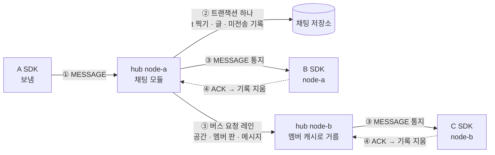
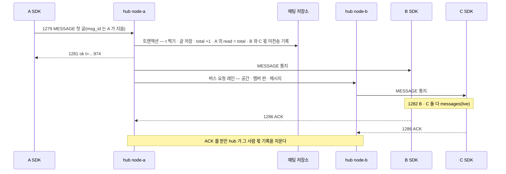
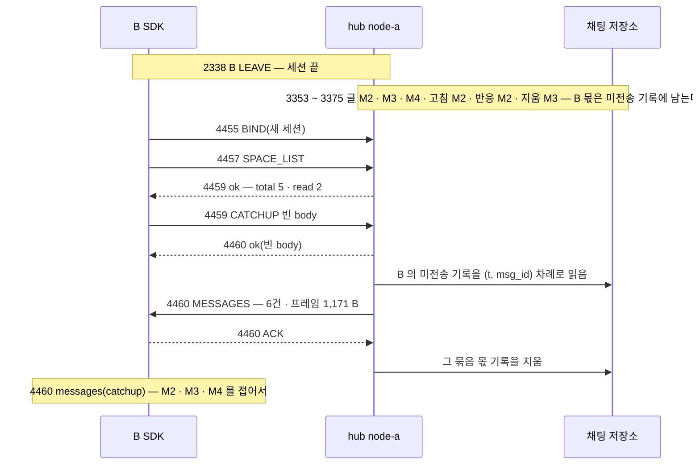

# 20. 채팅 — 공간의 메시지 · 실시간 통지와 ACK · 미전송 기록 · 따라잡기

> author: kodeholic (powered by Claude) · created: 2026-11-18.
> ★**대조한 커밋** — 서버 `oxlens-sfu` `1560cb3` · SDK `oxlens-sdk-web` `80dc7cf`(+탐침 `68f9d4f`) · 2층 smoke 는 서버 `c2b7364`(작업 트리 — `1560cb3` 의 ACK 묶음 지우기 직전) · 하네스 `ee779fea4fc9` · ★20261119 고쳐 씀 — 저장소 꼴 셋 · 혼잡 묶기 · 발언 기록 한 줄은 서버 `cfaf091` · SDK `8ee8e2d` 까지
> ★**실측 회차** — 3층 탐침 `TOUR-20`(20261118 두 판) · 2층 smoke `chat_fanout` · `chat_refused` · `chat_handover_reach` · `chat_live_bundle` · 통지 넘침 · 처리량 측정 · 저장소 꼴 측정(20261117 ~ 18). 값은 돌릴 때마다 바뀌고 차례 · 모양은 같다.

## 1. 30초 요약



- **채팅은 시그널링 게이트웨이(hub) 안의 모듈이다.** 미디어 서버(SFU · `oxsfud`)를 지나지 않는다. 방 입장(`ROOM_JOIN`)도 필요 없다. `BIND` 로 세션이 서면, 내가 멤버인 모든 공간의 메시지가 그 세션으로 온다.
- **차례는 `t` 하나다.** `t` 는 서버가 저장할 때 매긴 ms 다. 저장과 같은 트랜잭션에서 받을 사람마다 미전송 기록을 쓴다. 받는 쪽이 ACK 하면 그 사람 몫을 지운다. 남은 기록이 곧 못 받은 것이다.
- **실시간과 따라잡기, 두 길이다.** 실시간은 `MESSAGE` 통지 한 건씩이다(받는 쪽이 밀리면 줄에 쌓인 것을 `MESSAGES{live:true}` 하나로 묶는다 — §4-4). 놓친 것은 앱이 `CATCHUP` 을 부르면 서버가 `MESSAGES` 묶음으로 이어 보낸다. 같은 메시지가 두 번 올 수 있다. 받는 쪽이 `msg_id` 로 거른다(적어도 한 번 전달 · at-least-once).

## 2. 등장인물 · 값

| 이름 | 값 | 무엇 |
|---|---|---|
| 사람 | A `tourchat_A` · B `tourchat_B` = node-a hub(`127.0.0.1:1974`) · ★C `tourchat_C` = node-b hub(`1975`) · B 는 ③에서 끊고 ④에서 새 세션(B2)으로 다시 붙는다 | `TOUR-20` · 세 사람 모두 웹 SDK |
| 공간 | `qa_tourchat_space_20261118135239` · 멤버 A · B · C | 회차마다 새로 만든다(`chat_seed`). 개발 저장소가 회차를 넘어 남기 때문이다 |
| 채팅 저장소 | `[chat] db` 값의 꼴이 고른다 — `memory:`(프로세스 메모리 · 재기동하면 사라짐) · `sqlite:<경로>`(파일 하나) · `postgres://…`(PostgreSQL · 연결 풀 `db_pool` 기본 16). 이 회차는 `sqlite:` 파일 하나(`/tmp/oxlens/chat.db`)를 개발 형상 세 node 가 함께 쓴다 | 계약은 세 꼴이 같고 잠금만 다르다(§4-5). 비밀번호는 설정에 싣지 않는다(`PGPASSWORD` · `~/.pgpass`) |
| op 여섯 | `MESSAGE`(0x0501 · 양방향) · `SPACE_HISTORY`(0x0502) · `SPACE_LIST`(0x0503) · `SPACE_VIEW`(0x0504) · `CATCHUP`(0x0505) · `MESSAGES`(0x0506 · 서버 → 클라 통지 — 따라잡기 묶음 · 혼잡할 때 묶인 실시간 `live:true`) | 모두 데이터 단(lane 2)이다. 방 · 트랙 통지는 1 단이다. 단은 달라도 연결 · 송신 창은 같이 쓴다 |
| `msg_id` | 소문자 hex 36자 = 사용자 해시 8 + 짓는 쪽 ms 12 + 무작위 16. 예: A 의 첫 글 `858d1a12` · `01a1ecfff98d` · `9aa2fe2c190b4231`(`0x01a1ecfff98d` = 1794977560973) | 보내는 클라가 짓는다. 서버는 꼴을 보지 않는다(64자 이하 · 비지 않음만) |
| `t` | 첫 글 `1794977560974` — `msg_id` 시각보다 1ms 뒤 · 탐침 시작 + 1,279ms | 서버가 저장 트랜잭션 안에서 매긴 ms |
| 멤버 변경 메시지의 보낸 사람 | `$sys`(`msg_id` 앞 8자 `81330e4c`) | 시드가 저장소에 넣은 `add` 셋(`t` …701 · …702 · …703) |
| 고정 한도 | `content` 65,535 B · 요청 몸 131,072 B | [연:RULE-CHAT-CONTENT](../protocol/14-chat.md#RULE-CHAT-CONTENT). 배포 설정이 아니다 |
| 설정 기본값 | `MESSAGES` 묶음 100건 또는 512 KB · 미전송 기록 보관 7일 | — |
| 통지 흐름 | 통지 창 8(서버 정책 `ws_flow_window` · 규격 범위 1 ~ 10) · 창이 차면 실시간 채팅 통지를 줄 끝에서 `MESSAGES{live:true}` 로 묶는다(묶음 몸 64 KiB 까지) · 연결의 송신 줄 합이 1,000 개를 넘거나 쥔 바이트가 4 MiB 를 넘으면 `FLOW_OVERFLOW` 로 끊는다 | [연:RULE-TRN-FLOW-CONTROL](../protocol/02-trn.md#RULE-TRN-FLOW-CONTROL)(범위 · 1,000) · [연:RULE-CHAT-RECV](../protocol/14-chat.md#RULE-CHAT-RECV) · `oxlens-sfu/policy.toml` · `[chat] live_bundle_max_bytes` · `[hub] send_queue_max_bytes`(둘 다 잠정 기본값) · §4-4 |
| 실시간 도달 | 보낸 쪽 응답 뒤 0 ~ 1ms. node-b 의 C 도 node-a 의 B 와 같은 ms | `TOUR-20` 두 회차 · 같은 기계 loopback |
| 따라잡기 묶음 | 6건 · 프레임 1,171 B(머리 8 B 포함 · JSON 몸 1,163 B) · `CATCHUP` 요청에서 묶음까지 1ms 안 | `TOUR-20` ④ |
| 처리량(맥 · 멤버 20) | `sqlite:` 약 4,700 msg/s(전달 약 90,000/s · 고치기 전 약 975) · `postgres://` 약 710 ~ 1,840 msg/s(판마다 흔들림) | §4-5 |
| 2층 | smoke `chat_fanout` · `chat_refused` · `chat_handover_reach` 모두 PASS · 혼잡 묶기 `chat_live_bundle` PASS · 채팅 smoke 넷을 `sqlite:` · `postgres://` 두 꼴로 돌려 판정 같음 | run-all `e2e-20261118-115302` · `e2e-20261118-174842` · `-212244` · `-212101` |
| 3층 시험 | `CHAT-01` ~ `CHAT-04`(게이트) · 탐침 `TOUR-20`(판정 없음) | `qa/live/tests/chat.spec.ts` |


## 3. 정상 길

시각은 탐침 시작부터 ms 다. 시계가 둘이다. WS 프레임은 Playwright 쪽이 받은 시각이라 브라우저보다 2 ~ 5ms 늦게 찍힌다. SDK 사건은 페이지의 `Date.now()` 다. 그래서 받는 쪽 SDK 사건이 보낸 쪽 응답 프레임보다 앞서 보일 수 있다. ★도착은 SDK 사건 시각으로, 차례는 프레임으로 읽는다.

### 3-1. 글 한 건 — 같은 node 와 다른 node 에 같은 ms

A 가 첫 글 M1 을 보낸다. B 는 같은 node-a 에, C 는 node-b 에 붙어 있다.



실제 프레임이다(WS 8바이트 머리 뒤 JSON).

```
A → hub  MESSAGE 요청  {"space_id":"qa_tourchat_space_20261118135239","msg_id":"858d1a1201a1ecfff98d9aa2fe2c190b4231","content":"첫 글"}
hub → A  MESSAGE 응답  {"t":1794977560974}
hub → B  MESSAGE 통지  {"space_id":"…","msg_id":"858d1a12…4231","user_id":"tourchat_A","t":1794977560974,"content":"첫 글"}
B → hub  ACK          {}
```

- **보낸 세션에는 통지가 없다.** A 는 응답의 `t` 로 자기 글의 차례를 안다. A 의 공간 목록은 응답 직후 total 1 · read 1 이다. 서버가 글을 저장할 때 보낸 사람의 `read` 도 그 순간의 `total` 로 올리기 때문이다([연:RULE-CHAT-UNREAD](../protocol/14-chat.md#RULE-CHAT-UNREAD)).
- **보낸 사람은 `user_id` 로 정해진다.** 통지의 `user_id` 는 서버가 세션에서 넣는다. 요청 body 에는 `user_id` 가 없다.
- **`msg_id` 시각과 `t` 는 다른 시계다.** `msg_id` 의 12자는 A 브라우저의 ms(…973)이고, `t` 는 서버가 저장할 때의 ms(…974)다. 차례는 `t` 로만 정한다.
- **받는 쪽 도착 · ACK 에는 서버 줄이 없다.** 이 회차 서버 로그에서 이 글의 흔적은 보낸 세션의 `CP-OP-MESSAGE … msg=ok` 한 줄뿐이다(§7).

#### 다른 node 로 가는 길

C 는 node-b 의 hub 에 붙어 있다. node-a 의 hub 는 커밋 뒤 버스(oxmesh)의 요청 레인으로 node-b 의 hub 에 `{space_id, 멤버 판, 메시지}` 를 보낸다([14](14_OXMESH.md)). 받을 사람 목록은 싣지 않는다. node-b 의 hub 가 그 공간의 멤버 캐시로 자기 세션을 거른다. 이 회차에서 C 는 B 와 같은 1282 에 받았다. 둘째 회차(`b`)도 B · C 가 같은 1254 였다.

- **어느 node 에 보내나.** 기본은 그 순간 멤버(`명단(t)`)가 세션을 둔 node 뿐이다. hub 는 세션마다 liveliness token(`sess` 토큰 — [14](14_OXMESH.md))으로 「이 사용자는 이 node 에 있다」를 안다(`[bus] follow_sessions`). 명단을 못 읽으면 좁히지 않고 아는 node 전부에 보낸다.
- **멤버 캐시는 판으로 맞춘다.** 보낸 hub 가 공간의 멤버 판을 싣는다. 받는 hub 는 자기 캐시 판이 그보다 작을 때만 저장소에서 다시 읽는다. 무효화 메시지를 따로 날리지 않는다.
- **명단은 메시지 시점으로 고른다.** 받는 hub 는 지금 명단이 아니라 `t_M` 의 명단으로 거른다. 그래서 메시지 뒤에 들어온 사람은 빠지고, 메시지 뒤에 나간 사람은 받는다.

2층 `chat_fanout` 도 같은 꼴을 본다. 보낸 node-a 의 `sess` 표는 b → node-b · c → node-c · d → node-b 였다. a 의 글이 b · c 와 node-a 로컬의 f 에 갔고, 보낸 세션에는 0 이었다(①). 나중에 넣은 멤버 d(node-b)는 그 뒤 메시지부터 받았다(④). ★2층 smoke 줄의 「22ms」는 지연이 아니다. 받았는지를 20ms 마다 보는 폴링 칸이다.

### 3-2. 답장 · 고침 · 반응 — 원본을 가리키는 새 메시지

기능은 새 메시지로 보낸다. 새 메시지가 `ref` 로 원본을 가리킨다. 서버는 원본을 바꾸지 않는다(예외는 지움 하나 — §3-4).

| `kind` | 뜻 | `ref` | `content`(저장 · 통지) | 이 회차 |
|---|---|---|---|---|
| (없음) | 글. `ref` 가 있으면 답장 | 답장일 때 원본 | 본문 | B 의 답장 R1 |
| `edit` | 고침(원본의 보낸 사람만) | 늘 원본 | 고친 본문 통째 | A 가 M1 을 고침 |
| `react` | 반응 | 원본 | 빈 문자열 · `keys` 에 내 반응 전체 | C 의 👍 |
| `delete` | 지움(원본의 보낸 사람만) | 원본 | 빈 문자열 | §3-4 |

`react` · `delete` 의 요청에는 `content` · `ext` 를 싣지 않는다. 실으면 서버가 그 종류에 없는 칸으로 보고 `1002` 로 거절한다. 저장 · 통지 때는 서버가 `content` 를 빈 문자열로 채운다. 이 회차의 반응 · 지움 요청 프레임에도 `content` 가 없다.

| 갈래 | 보냄(요청 프레임) | 응답 | 받는 쪽 SDK 사건 | ACK |
|---|---|---|---|---|
| B 답장 R1(`ref` M1) | 1796 | 1799 | A · C `messages{live}` 1799 | 1802 |
| A 고침 M1 | 1805 | 1808 | B · C `updates` 1808 | 1810 |
| C 반응 M1(👍) | 1817 | 1818 | A · B `updates` 1819 | 1820 |

- **답장은 글이다.** 그래서 안 읽은 수를 올린다. A 의 목록은 R1 을 받고 unread 0 → 1 이 됐다. 답장 본문에 원문 인용을 넣지 않는다. 받는 쪽이 `ref` 로 원문을 찾아 그린다.
- **고침 · 반응 · 지움은 관계 메시지다.** 안 읽은 수를 올리지 않는다(`total` 은 글과 발언 기록만 센다).
- **SDK 가 원본에 접어서 낸다.** 앱은 관계 메시지를 따로 받지 않는다. 이미 낸 글이 바뀌면 `updates` 사건으로 접은 뒤의 글 전체를 받는다. 반응까지 받은 B 의 M1 은 이렇다.

```
{"msgId":"858d1a12…4231","content":"고친 첫 글","edited":true,"deleted":false,"reactions":{"👍":["tourchat_C"]}}
```

- **보낸 쪽도 접힌다.** A 는 자기 고침의 통지를 받지 않는다. 그래서 SDK 가 `edit()` 의 성공 응답(1808)에서 스스로 접어 `updates` 를 낸다.
- **「마지막」은 `(t, msg_id)` 가 가장 큰 것이다.** 고침은 원본마다, 반응은 (원본, 보낸 사람)마다다. 도착 차례가 아니다. 반응은 늘 전체를 다시 보낸다. 빈 배열이면 내 반응을 모두 지운다.
- **서버만 만드는 종류가 둘 더 있다 — 무전 발언 기록.** 발언권 허가 하나가 `talk` 하나다(`user_id` = 화자). 끝 상태 · 녹취 링크는 그것을 가리키는 `talk_update` 로 붙는다. `talk` 는 글처럼 안 읽은 수에 들고 답장 · 반응의 원본이 된다. 집은 [21](21_TALK_RECORD.md) 이다.

### 3-3. 끊긴 사이 — 미전송 기록과 따라잡기

B 가 연결을 끊는다(`LEAVE` · 재개 창 없음). 그 사이 A · C 가 글 셋을 보내고 고치고 반응하고 지운다. B 가 새 세션으로 다시 붙어 따라잡는다.



- **기록은 저장과 같은 트랜잭션에 쓴다.** M2 가 저장되는 순간, 그 `t` 의 멤버(보낸 사람 빼고) 몫 `(user_id, msg_id, t)` 이 같이 들어간다. B 는 그때 소켓이 없었다. 그래서 B 몫이 ACK 없이 남았다.
- **`SPACE_LIST` 는 서버의 수다.** total 5 = M1 · R1 · M2 · M3 · M4(지운 M3 도 글이라 센다). read 2 = B 가 R1 을 보낸 순간의 total 이다. 안 읽은 수는 5 − 2 = 3 이다.
- **따라잡기는 앱이 부른다.** SDK 는 다시 붙은 뒤에도 스스로 `CATCHUP` 을 부르지 않는다. 언제 부를지(다시 붙은 뒤 · 앱을 켤 때)는 앱이 정한다.
- **응답과 묶음은 따로 온다.** 서버는 `CATCHUP` 에 빈 body 로 바로 답한다. 남은 것은 `MESSAGES` 통지로 이어 보낸다. 끝 표지는 없다.
- **묶음은 동시에 하나다.** ACK 가 와야 다음 묶음을 읽어 넣는다. 그래서 따라잡기가 통지 창(이 배포 8)을 다 쓰지 않는다. 방 · 트랙 통지가 이미 실린 묶음 뒤에 오래 서지 않는다.
- **관계도 같은 묶음에 온다.** 묶음 6건은 글 셋(M2 · M3 · M4)과 관계 셋(고침 M2 · 반응 🎉 · 지움 M3)이다. M3 의 `content` 는 이미 빈 문자열이다. SDK 는 이것을 접어 `messages{catchup}` 하나로 낸다 — M2 는 「고친 둘째」 · `edited` · 🎉, M3 은 `deleted`, M4 는 그대로.

#### 처음 접속 때도 같은 길

탐침은 셋이 붙자마자 `CATCHUP{}` 을 불렀다(259 ~ 261). 시드가 넣은 멤버 변경 메시지 `add` 가 왔다. A 는 셋(A · B · C 추가), B 는 둘(B · C), C 는 하나(C)를 받았다. 멤버 변경 메시지도 그 `t` 의 멤버에게만 기록이 생기기 때문이다. A 를 넣은 …701 에는 A 뿐이었고, C 를 넣은 …703 에는 셋 다 멤버였다.

```
{"space_id":"…","msg_id":"81330e4c01a1ecfff4953847bb2de9ea48aa","user_id":"$sys","t":1794977559701,"content":"","kind":"add","target":"tourchat_A"}
```

`user_id` 는 행위자다. 사용자가 아니면 `$sys` 다. `$` 는 사용자 id 에 올 수 없어 어떤 사람과도 겹치지 않는다. 문구(「OO 님이 들어왔습니다」)는 클라가 `kind` 로 그린다. 멤버 변경 메시지는 안 읽은 수에 넣지 않는다.

### 3-4. 지움 — 서버가 본문을 비운다

지움만 원본을 바꾼다. 서버는 지움을 저장하는 같은 트랜잭션에서 원본의 `content` 를 빈 문자열로, `ext` 를 없앤다. 그 원본을 가리키는 고침의 `content` · `ext` 와 반응의 `keys` 도 같이 비운다. 봉투(`space_id` · `msg_id` · `user_id` · `t` · `kind` · `ref`)는 남긴다.

- **끊긴 사이 지운 M3.** B 가 따라잡기로 받은 M3 은 `"content":""` 였다. 지운 본문은 다시 받아도 오지 않는다.
- **실시간 지움(⑥).** A 가 M1 을 지웠다 — 요청 5992 · 응답 5997 · B2 · C `updates` 5997 · ACK 6000. 받는 쪽 결과는 `{"content":"","edited":false,"deleted":true,"reactions":{}}` 다. 앞서 붙은 고침과 👍 도 사라졌다.
- **지운 원본에는 더 붙이지 못한다.** 고침 · 반응 · 지움은 `3017 REF_DELETED` 다. 답장은 된다(답장은 원본을 바꾸지 않는다).

### 3-5. 다시 가져오기 · 안 읽은 수 · 읽음

| 갈래 | 요청 | 응답 | 무엇이 왔나 |
|---|---|---|---|
| `SPACE_HISTORY{space_id}` | 5467 | 5471 · 프레임 2,542 B(머리 포함) | 보이는 메시지 8(`add` 셋 · M1 · R1 · M2 · M3 빈 본문 · M4) · `relations` 5 · `more:false`. SDK `messages{history}` 5470 — 앞서 낸 M2 ~ M4 는 `msg_id` 로 걸렀다 |
| `SPACE_VIEW{space_id}` | 5478 | 5481 `{"read":5}` | 서버가 B 의 `read` 를 그 순간의 `total` 로 올렸다 |
| `SPACE_LIST` | 5482 | 5486 | 그 공간 total 5 · read 5 · 안 읽은 수 0 |

- **쪽은 보이는 메시지로 센다.** 보이는 것은 글 · 발언 기록(`talk` — [21](21_TALK_RECORD.md)) · 멤버 변경 메시지다. 관계 메시지는 `messages` 에 들지 않는다.
- **관계는 줄여서 따로 싣는다.** `relations` 에는 그 쪽 글을 가리키는 것만 든다. 지움은 하나, 고침은 원본마다 마지막 하나, 반응은 (원본, 보낸 사람)마다 마지막 하나다. 서버는 포인터 칸만 보고 줄인다. 본문은 읽지 않는다. 이 회차는 M1 의 고침 · 👍, M2 의 고침 · 🎉, M3 의 지움 — 다섯이다.
- **이어 받기는 `t` 로 한다.** `before` 면 받은 첫 `t`, `after` 면 받은 끝 `t` 를 넘긴다. 쪽은 같은 `t` 를 가르지 않는다. 그래서 빠짐 · 겹침이 없다.
- **안 읽은 수 = `total − read`.** `total` 은 공간의 글과 발언 기록 수, `read` 는 내가 읽은 수다. 실시간 글을 받으면 클라가 그 공간 `total` 을 하나 올린다. 맞추는 것은 다시 받은 `SPACE_LIST` 다.

## 4. 깨지는 길

### 4-1. 받는 hub 가 멈췄다 — 실시간이 안 오고 기록이 메운다

- **무엇이 깨지나.** 받는 사람이 붙은 hub 가 멈췄다. 보낸 hub 의 버스 요청이 시간 초과로 실패한다.
- **누가 먼저 아나.** 보낸 hub 다. node 마다 `chat_fanout_fail` 을 하나 센다. 다시 보내지는 않는다.
- **무엇이 남나.** 받는 사람 몫의 미전송 기록이다. ACK 가 없어 지워지지 않았다.
- **사용자는 무엇을 겪나.** 그 글이 실시간으로 안 온다. 앱이 다음에 `CATCHUP` 을 부르면 온다. 잃지는 않는다. 그때까지 안 읽은 수도 그만큼 틀린다.

2층 `chat_handover_reach` ④가 이것을 일부러 일으킨 양성 대조다. 이 smoke 는 공용 개발 형상(node-a · b · c)이 아니라 따로 띄운 node 셋 `ch-a` · `ch-b` · `ch-c` 에서 돈다. `ch-c` 의 hub 를 `SIGSTOP` 으로 멈추자 실시간 도달이 거짓이 됐다. 보낸 `ch-b` 의 `chat_fanout_fail` 이 1 올랐다. `SIGCONT` 뒤 `MESSAGES` 로 메워졌다. 멈춘 시간 · 메울 때까지 걸린 시간은 이 회차에 없다.

같은 꼴의 창이 셋 더 있다([연:RULE-CHAT-LIVE-SOCKET-LOSS](../protocol/14-chat.md#RULE-CHAT-LIVE-SOCKET-LOSS)). 저장 뒤 통지를 내기 전에 hub 가 죽는 경우, 막 붙은 세션의 `sess` 토큰이 아직 다른 node 에 닿지 않은 경우, 진행 중인 따라잡기가 저장소 장애로 멈춘 경우다. 셋 다 소켓은 살아 있다. 그래서 앱은 놓친 줄 모른다. 남은 몫은 기록에 있어 다음 `CATCHUP` 에 온다. 이 회차로 재지 않았다.

### 4-2. 세션이 다른 node 로 넘어갔다 — 실시간은 그대로

2층 `chat_handover_reach` 다. smoke 가 따로 띄운 node 셋 `ch-a` · `ch-b` · `ch-c` 에서 돈다. U 의 세션이 `ch-a` 에서 `ch-b` 로 넘겨받기(`RESUME`)됐다([10](10_RECOVERY.md)). `ch-c` 의 hub 가 든 `sess` 표에서 U 의 위치가 `[ch-b]` 로 바뀌었다(①). 넘어간 뒤에도 양방향 실시간이 닿았고(②), `ch-b` · `ch-c` 의 Δ`chat_fanout_fail` 은 0 이었다(③).

이 판은 넘겨받기 뒤 실시간이 이어지는지를 본다. 규격의 증상은 따로 있다 — `sess` 표를 세션 번호만으로 지우면 깨진다. 새 node 의 「있다(Put)」가 옛 node 의 「없다(Delete)」보다 먼저 닿은 hub 가, U 의 새 위치까지 표에서 지운다. 그러면 U 몫이 실시간으로 안 간다. 묻지도 않은 node 라 `chat_fanout_fail` 도 0 이다. 그래서 표는 (세션, node) 짝의 집합으로 든다. ★이 smoke 는 그 결함을 결정적으로 잡지 못한다. 넘겨받기 길에서는 보통 옛 node 의 「없다」가 먼저 닿아, 표를 옛 꼴로 되돌려도 초록일 공산이 크다. 차례가 뒤집히는 경우를 결정적으로 보는 것은 1층 시험이다.

### 4-3. 받는 쪽이 통지에 실패로 답했다 — ACK 가 아니다

정상 클라는 이렇게 하지 않는다. 통지에는 ACK 하나로 답한다. 아래는 2층 봇이 일부러 일으킨 형상이다.

통지에는 ACK(빈 body 성공)로 답한다([연:RULE-TRN-NOTIFY-ACK](../protocol/02-trn.md#RULE-TRN-NOTIFY-ACK)). 받는 쪽이 실패로 답하면 서버는 그것을 ACK 로 세지 않는다.

| 무엇 | 2층 `chat_refused` |
|---|---|
| 실시간 `MESSAGE` 10건에 실패로 답함 | 창 8 을 넘어 10/10 모두 닿음 — 실패 답도 ACK 와 같이 창을 연다 |
| 그 10건의 기록 | 지워지지 않음 — 다음 `CATCHUP` 묶음 11건에 10건이 모두 들었다 |
| `MESSAGES` 에 실패로 답함 | 다시 `CATCHUP` 하면 같은 묶음이 온다 |
| OK 로 답한 묶음 | 그 몫만 지워짐 — 다음 묶음은 새로 실패로 답한 하나뿐 |
| 연결 | 유지(`LEAVE` 0 · 요청이 돈다) · node-b `notice_refused` +13 |

통지에 돌아온 응답을 무엇이든 ACK 로 세면, 실패로 답한 몫까지 지워진다. 그 사람은 그 메시지를 영영 못 받는다. 따라잡기에도 없다.

### 4-4. 통지가 밀렸다 — 묶고, 그래도 넘치면 세션째 끊긴다(20261118 고침)

- **무엇이 깨지나.** 받는 단말이 느리거나 공간에 반응이 폭주한다. 통지가 ACK 보다 빨리 쌓인다.
- **누가 먼저 아나.** hub 다. 그 세션의 통지 창(8)이 다 차면 실시간 채팅 통지가 송신 줄에 머문다.
- **무엇이 오가나.** ★hub 는 줄에 넣는 순간, 줄 끝에 아직 안 나간 실시간 채팅 통지가 있으면 그것과 합친다. `MESSAGE` 하나였으면 `MESSAGES{live:true}` 로 바꾼다. 묶음 몸이 64 KiB 를 넘으면 다음 묶음으로 간다. 묶음 ACK 하나가 묶음 몫 전부의 미전송 기록을 지운다. 창에 빈 칸이 있을 때는 묶지 않는다 — 모으려고 기다리지 않아 평소 지연은 그대로다. 방 · 트랙 통지(1 단)는 묶지 않고 채팅 묶음보다 앞서 나간다.
- **사용자는 무엇을 겪나.** 늦게라도 모두 실시간으로 받는다. SDK 는 묶인 실시간을 출처 `live` 로 낸다(따라잡기와 가른다).

2층 `chat_live_bundle` 이 이것을 일부러 일으켰다. 받는 봇 r 은 ACK 를 1초 늦춘다. 그래서 r 의 처리율은 창 8 / 1초 = 초당 8 프레임이다. 보내는 봇이 초당 120 건을 12초 보낸다.

| 무엇 | r(ACK 1초 늦춤) | q(즉시 ACK · 대조) |
|---|---|---|
| 실시간으로 받은 건수 | 1,441 / 1,441 · 겹침 0 | 1,441 / 1,441 |
| 받은 꼴 | 묶음 13 개(2 ~ 185 건 · 몸 최대 24,446 B) + 홀로 `MESSAGE` 83 | 모두 `MESSAGE` 한 건씩 · 묶음 0 |
| 끊김 | `LEAVE` 0 · 끝난 뒤 `SPACE_LIST` 가 돈다 | — |
| 방 통지 | r 의 ACK 를 쥐어 창을 채운 뒤 방에 사람이 들자, 풀린 r 의 첫 프레임이 그 `PARTICIPANT_EVENT` 였다. 먼저 저장된 채팅 160 건은 그 뒤에 왔다 | — |

- **묶음이 13 개뿐인 까닭.** r 의 ACK 가 1초 뒤 몰려 돌아온다. 첫 빈 칸이 줄 끝의 큰 묶음을 가져가고, 이어진 빈 칸들은 그사이 들어온 한 건씩을 가져간다. 그래서 1초마다 큰 묶음 하나와 홑 프레임 여럿이 나갔다(12초 × 창 8 ≈ 96 = 13 + 83).
- **갈래B(합치기를 끈 빌드).** 같은 형상에서 r 이 8.93초에 `LEAVE{4007 FLOW_OVERFLOW}` 를 받았다(두 판). 아래 모형의 9.00초와 0.8% 어긋난다.

**넘침의 문은 남았다 — 세션째 끊긴다.** 줄 개수가 1,000 을 넘거나, 줄에 쥔 바이트가 4 MiB 를 넘으면 hub 는 `LEAVE 4007 FLOW_OVERFLOW` 를 보내려 하고 소켓을 닫는다. `LEAVE` 가 닿는 것은 보장이 아니다(못 보낼 수 있다 — —). 바이트 문은 묶음 때문에 새로 섰다 — 묶음 하나가 줄에서 한 개로 세어져, 개수만으로는 쥔 양이 묶이지 않는다. ★끊기면 채팅만이 아니다. 같은 세션의 무전 · 통화도 같이 끊긴다. 규격의 `4007` 뜻은 「재접속 소용없다」다. SDK 는 앱에 `closed{4007, FLOW_OVERFLOW, retryable:false}` 사건으로 올리고 다시 붙지 않는다. `retryable` 은 SDK 사건의 칸이다. wire 의 `LEAVE` 에는 없다. 묶음이 생긴 뒤로 채팅 통지만으로 이 문에 닿은 회차는 없다. 바이트 문으로 끊기는 형상과 묶음 바이트 상한 값은 아직 재지 않았다.

#### 묶기 전(20261117) — 얼마나 빨리 넘쳤나

묶기 전에는 모형 하나로 맞았다. 서버는 창 8 개를 보내고 ACK 를 기다린다. 그래서 처리율은 μ = 8 / ACK 왕복이다. 통지가 초당 λ 로 오면 줄이 λ − μ 로 쌓인다. 끊길 때까지 T = 1,008 / (λ − μ) 다(줄 1,000 + 창 8). 묶기는 처리율을 「창 × 묶음 크기 / 왕복」으로 올려 이 천장을 걷었다.

| 받는 쪽 | λ(건/초) | 모형 T | 실측 T(묶기 전) |
|---|---|---|---|
| ACK 를 100ms 늦추는 봇(μ 80) | 120 | 25.2초 | 24.60초 |
| ACK 를 250ms 늦추는 봇(μ 32) | 96 | 15.75초 | 15.67초 |
| 웹 SDK(Node 에서 돌림) · RTT 200ms 프록시 | 120 | 12.6초 | 12.83초 |
| oxpeer(방 듣기 입장) · RTT 200ms 프록시 | 120 | 12.6초 | 12.66초 |
| ACK 를 늦추는 봇 · λ = 0.8 μ 세 판 | — | 안 넘침 | 90초 동안 안 넘침 |

- **SDK 몫은 작다.** 웹 SDK 와 oxpeer 는 통지를 받는 즉시, 앱 처리 전에 ACK 한다. localhost 실효 왕복에서 SDK 몫은 0.03 ~ 0.10ms 였다. 그래서 실제 μ ≈ 8 / 망 RTT 다.
- **방 명단은 늦게 맞춰진다.** 방에 든 세션이 넘쳐 끊기면, 서버는 재개 창(60초) 동안 그 세션과 방 명단을 그대로 든다. 같은 방의 다른 참가자는 끊긴 뒤 60.6초에야 `PARTICIPANT_EVENT{left}` 를 받았다. 클라는 바로 닫고 돌아오지 않는다. 그 60초 동안 명단과 실제가 갈린다. 지금도 넘침으로 끊기면 같다.
- **끊긴 순간의 수.** 넘친 일곱 판 모두 「보낸 통지 − 받은 통지」가 정확히 1,002 였다. 줄 1,001 과 서버 안 한 건이다.

### 4-5. 큰 공간 — 오류 없이 응답만 길어진다(20261118 고침) · 저장소 꼴마다 다르다

처리량의 꺾임 신호는 응답 시간 하나다. 오류 응답 · `FLOW_OVERFLOW` · 서버 버림(`/admin/drops`)은 모두 0 이었다. 응답만 0.3ms 에서 창이 다 찬 값(약 205ms)으로 뛰었다.

★**원인과 고침.** 천장은 메시지 수가 아니라 전달 수였다. ACK 하나마다 미전송 기록 한 건을 지우는 트랜잭션 하나가 들었다. 그 지우기가 모두 저장소 연결 하나 앞에 줄 섰다. 고치기 전 맥은 약 18,500 전달/s(멤버 20 에서 약 975 msg/s)에서 멈췄다. ACK 를 모아 묶음마다 한 트랜잭션에 지우게 고쳤다(서버 `1560cb3`). 묶음 사이에 저장소의 다른 일이 줄 서 있으면 한 번 비켜 준다.

| | 고치기 전 | 고친 뒤 |
|---|---|---|
| 맥 · 멤버 20 천장 | 약 975 msg/s | 약 4,700 msg/s(전달 약 90,000/s) |
| Pi 4 · 멤버 20 천장 | 약 320 msg/s | 약 733 msg/s |
| 맥 · 큰 공간(초당 글 10) | 멤버 1,000 건강 · 2,000 무너짐 | 같음(2,000 의 시한 초과 4 → 0) |
| Pi · 큰 공간(초당 글 10) | 500 건강 · 1,000 무너짐(응답 p50 3.8초) | 500 건강 · 1,000 아직 무너짐(p50 1.5초) |

큰 공간은 저장 쪽 천장이 남았다. 메시지 하나가 기록을 멤버 수 − 1 줄 넣는다. 이것은 알고 정한 비용이다. Pi 가 1.69 코어에서 멈추는 까닭은 재지 않았다.

위 표는 모두 `sqlite:` 꼴이다. 큰 공간은 저장 쪽 천장이 남았다.

#### 저장소 꼴마다 — 맥 `sqlite:` 대 `postgres://`(20261118)

같은 맥에서 두 꼴을 번갈아 쟀다(PostgreSQL 18.7 기본 설정 · 꼴마다 두 판).

| | `sqlite:` | `postgres://` |
|---|---|---|
| 멤버 20 · 공간 하나 천장 | 약 4,690 ~ 4,830 msg/s | 약 710 ~ 1,840 msg/s(판마다 크게 흔들림) |
| 멤버 1,000 · 초당 글 10 | 10/s · 응답 p50 5.1 ~ 55.9ms | 10/s · 응답 p50 7.7 ~ 10.9ms |
| 멤버 2,000 · 초당 글 10 | ★무너짐 — 받아들임 6.3 ~ 6.6/s · 응답 p50 6.8 ~ 7.9초 | ★버팀 — 10/s · 응답 p50 15 ~ 25ms |

- **공간 하나의 처리량은 `sqlite:` 가 높다.** `postgres://` 를 막은 것은 공간 행 잠금이었다. 한 판의 기다림 표본 320 중 224 가 `Lock:transactionid` 였다. 메시지 저장이 같은 트랜잭션에서 공간 행(`total` +1 · 마지막 `t`)을 갱신하고 커밋까지 쥔다. 그래서 같은 공간의 저장이 그 행 하나에 줄 선다. 연결 풀 크기(16 · 64)는 천장을 바꾸지 않은 것으로 보인다(풀마다 한 판). 공간을 여럿으로 흩은 판은 재지 않았다.
- **큰 공간은 `postgres://` 가 버틴다.** `sqlite:` 는 저장소 잠금 하나 안에서 기록 1,999 줄을 넣고 디스크에 동기화한다. `postgres://` 는 쓰기가 병렬이다.
- **오류 · 끊김 · 버림은 모든 행에서 0 이었다.** 꺾임 신호는 여기서도 응답 시간 하나다.
- **`memory:` 꼴은 2층 · 3층 · 측정 밖이다.** 지금 공간 · 멤버를 채우는 시드 도구는 저장소에 직접 쓴다. 프로세스 메모리에는 닿지 않는다. 공간을 만들고 멤버를 넣는 입구(아직 후보 — 누가 어떤 면으로 할지 정하지 않음)가 서야 잰다. 서버 1층 시험은 세 꼴 모두에서 같은 시험을 돈다.
- **Pi 에는 PostgreSQL 이 없다.** 위 Pi 값은 `sqlite:` 꼴이다. 기계가 여럿이면 `postgres://` 를 쓴다 — SQLite 파일은 네트워크 파일 시스템 위에 두지 않는다(파일 잠금을 기계 사이에서 믿을 수 없다).


### 4-6. 거절 — 번호 하나에 뜻 하나

| 번호 | 이름 | 언제 | 실측 |
|---|---|---|---|
| `3012` | `SPACE_NOT_FOUND` | 공간이 없다 · 공간에 붙지 않은 방의 `room_id` 로 보냈다 | 이 회차에 없음 |
| `3013` | `NOT_SPACE_MEMBER` | 그 공간의 멤버가 아니다 | 3층 `CHAT-02` |
| `3014` | `CHAT_DISABLED` | 이 배포에 `[chat]` 이 없다(다시 해도 같다) | 이 회차에 없음 |
| `3015` | `MSG_ID_CONFLICT` | 같은 `msg_id` 가 다른 내용으로 이미 있다 | 2층 `chat_fanout` ③ |
| `3016` | `REF_NOT_FOUND` | `ref` 가 그 공간의 글이 아니다 | 이 회차에 없음 |
| `3017` | `REF_DELETED` | 지운 원본을 고치거나 반응하거나 지우려 했다 | 2층 `chat_fanout` ⑦ · 3층 `CHAT-04` |
| `3018` | `NOT_REF_SENDER` | 남의 글을 고치거나 지우려 했다 | 2층 `chat_fanout` ⑦ |
| `5003` | `INTERNAL_ERROR` | 저장소 장애. 같은 `msg_id` 로 다시 보내면 닫힌다 | 이 회차에 없음 |

같은 `msg_id` 를 같은 내용으로 다시 보내면 거절이 아니다. 처음 매긴 `t` 로 성공하고, 받는 쪽에 통지를 더 내지 않는다(2층 `chat_fanout` ②). 그래서 응답을 잃은 클라는 같은 `msg_id` 로 다시 보내면 된다. 실패 번호 전반은 [12](12_ERRORS.md) 가 집이다.

## 5. 왜 이 모양인가

- **hub 안에 둔다 · sfud 를 지나지 않는다.** 방 이벤트와 채팅은 놓쳤을 때의 성질이 다르다. 방 이벤트는 상태의 변화다. 놓치면 지금 상태를 다시 받으면 끝이다. 그래서 재개 창 동안 일부러 버리고 `RESUME` 스냅샷으로 메운다([10](10_RECOVERY.md)). 채팅은 이력이다. 놓친 한 건을 다시 받아야 한다. 그래서 채팅은 방(미디어 서버의 TTL 자원)에 얹지 않았다. 처음 설계는 따로 둔 메시지 프로세스(`msgd`)였다. 그러면 hub 가 받을 사용자 목록을 실어 보내야 했다. 3,000 명 공간이면 목록 3,000 이 node 수만큼 실린다. Mattermost 앱 서버처럼 한 프로세스가 WS · 저장 · 거르기를 하는 꼴로 바꿨다.
- **`t` 는 저장 트랜잭션 안에서 찍는다.** 처리 줄이나 저장소 앞에서 찍으면, 기다린 시간만큼 `t` 가 밀려 먼저 보낸 글이 뒤에 선다. 설계는 공간마다 저장을 한 줄로 세우지 않는 것이다. 공간 행 갱신은 원자적 덧셈 · 최댓값뿐이다. 대가로 `t` 는 유일하지 않다. 같은 ms 의 둘은 `msg_id` 로 줄 세운다. `memory:` · `sqlite:` 꼴은 쓰기 트랜잭션이 저장소 전체를 잠가 `t` 차례가 곧 커밋 차례다. `postgres://` 꼴은 쓰기가 병렬이라 그렇지 않을 수 있다. 다만 공간 행 갱신이 커밋까지 행 잠금을 쥐어, 실측에서는 같은 공간의 저장이 그 행에 줄 섰다(§4-5). 그 갱신을 저장 트랜잭션에서 뺄지는 아직 정하지 않았다.
- **놓친 것은 「마지막 `t` 뒤」로 당기지 않는다.** 함정이 있다. C 가 `t=102`, D 가 `t=103` 을 보냈는데 102 가 더 늦게 커밋됐다. B 는 103 을 실시간으로 받고 끊겼다. 다시 붙어 「103 뒤」를 당기면 102 를 영영 못 본다. 그래서 커서를 쓸 때 매긴 번호가 아니라 받는 사람 쪽에 건다. 받는 사람마다 미전송 기록을 두고 ACK 로 지운다. Signal 의 받는 기기마다 큐와 같은 꼴이다.
- **따라잡기는 앱이 부르고, 묶음은 하나씩.** SDK 가 스스로 「놓쳤다」를 판정하지 않는다. 기록은 서버가 든다. 묶음을 창만큼 한꺼번에 보내면 그 뒤에 방 · 트랙 통지가 오래 선다(규격 예시 셈: 512 KB × 8 = 4 MB · 5 Mbps 에서 약 6.7초). 그래서 ACK 가 와야 다음 묶음이다. 앱이 ACK 를 늦추면 서버도 그만큼 늦게 보낸다.
- **기능은 새 메시지로 · 원본은 바꾸지 않는다.** 버전이 다른 SDK 가 섞여 붙는다. 서버가 클라 버전을 몰라도 되게 했다. 모르는 `kind` 는 `content` 가 비어 있지 않으면 글로 보이고, 비어 있으면 무시된다. 옛 클라에서 고침은 새 글처럼 보이고, 반응 · 지움은 무시된다. 지움은 서버가 본문을 비우므로 다시 받으면 맞다.
- **`msg_id` 는 클라가 짓는다.** 저장은 됐는데 응답만 잃었을 때, 같은 `msg_id` 로 다시 보내면 처음 `t` 가 온다(멱등 키 · idempotency key). 클라의 저장 상태(카운터)에 기대지 않는다. 재설치 · 새 기기에서도 겹치지 않아야 한다.

> ★**우리만의 것 — 미디어 시그널링 관문 안의 채팅**
> - **선택 배경** — 무전 채널에는 문자도 같이 오간다. 무전 방은 `room_id` 가 곧 `space_id` 다. 채팅을 미디어 서버와 같은 연결에 실으면 앱은 접속 하나로 둘 다 받는다. 채팅을 따로 둔 서비스로 만드는 대신 시그널링 게이트웨이(hub)의 모듈로 넣었다. 통지 · ACK · 흐름 조절 장치도 방 통지와 같은 것을 쓴다.
> - **얻은 것** — `BIND` 하나로 미디어 시그널링과 채팅이 함께 선다. 따로 띄울 프로세스 · 따로 맺을 연결이 없다. 실시간은 응답 뒤 0 ~ 1ms 에 닿았고, 다른 node 의 사람도 같은 ms 였다(`TOUR-20`). 받을 사람 목록 없이 보내고, 받은 hub 가 자기 세션만 거른다. 같은 ACK 장치라 실패 답 · 무소켓 버림이 기존 계수(`notice_refused` · `notice_no_socket`)로 보인다.
> - **잃은 것** — 격리가 없다. 통지 넘침의 문(줄 1,000 개 · 쥔 바이트 4 MiB)을 넘으면 세션째 끊겨 무전 · 통화도 같이 끊긴다(`4007` · §4-4). 혼잡 묶기(20261118) 전에는 RTT 200ms 단말이 초당 통지 40 을 넘으면 닿았다. 묶기 뒤로 채팅 통지만으로 닿은 회차는 없다. 저장소가 느리면 시그널링에 번질 수 있어, 채팅 처리를 따로 둔 작업 풀로 갈랐다. 큰 공간의 저장 천장(`sqlite:` 꼴 맥 멤버 2,000 · Pi 1,000 에서 무너짐 · 맥 `postgres://` 꼴은 2,000 을 버팀 · §4-5)이 hub 프로세스 안에 있다. 메시지마다 멤버 수만큼 기록을 쓰고 ACK 마다 지운다.


## 6. 다른 제품은

★아래 「그쪽 방식」은 저쪽 소스 · 규격 문서를 정적으로 읽은 조사 기록을 옮긴 것이다. 일부는 원문 줄 단위로 다시 확인하지 않았다. 실측이 아니다. SFU 가 아니라 채팅 · 메시징 제품과 견준다.

| 제품 | 놓친 것을 어떻게 받나 | 고침 · 반응 · 지움 | 안 읽은 수 | 우리와 다른 점 |
|---|---|---|---|---|
| Mattermost(v12.1.0) | 이벤트마다 연결 순번을 매기고 최근 128개를 둔다. 같은 연결로 다시 붙으면 이어 보낸다. 못 이으면 내 채널 목록을 다시 받고, 보고 있는 채널 하나만 마지막 글 시각 이후를 다시 읽는다 | 고침 = 같은 Id 덮어쓰기 + 이전 판 행 · 반응 = 따로 둔 표 · 지움 = 소프트 삭제(답글도 함께) · 지운 글은 서버가 본문을 비워 내보냄 | 채널 글 수 − 멤버 읽은 수. 고침 · 반응은 안 센다. 입퇴장 글은 뺀다 | 서버 꼴(한 프로세스가 WS · 저장 · 거르기 · 노드 사이에 뿌림)은 같다. 우리는 놓친 것을 받는 사람마다 기록으로 든다. 원본을 덮어쓰지 않는다 |
| Matrix | (Synapse) 가장 작은 미완 번호 바로 아래까지만 토큰으로 내준다. 방마다 한 번에 한 트랜잭션으로 저장한다 | 고침 = `m.replace`(같은 보낸 사람 · 고침의 고침 아님 · 마지막 = 서버 시각, 같으면 `event_id` 사전순) · 지움 = redaction 이 원본 내용을 지운다 · 원본을 지우면 그 고침은 타임라인에서 빠지고, 가리키던 자식 이벤트는 남는다 | 메시지 수가 아니라 알림 수만 규격. 반응 · 고침은 기본 규칙이 뺀다 | 고침의 「마지막」 규칙은 같다. 우리는 공간마다 저장을 줄 세우지 않는다. 지울 때 고침 본문 · 반응도 같이 비운다 |
| XMPP | 연결마다 처리 개수 `h` 로 재개한다(XEP-0198). 세션이 끝났으면 보관함(MAM)으로 간다 | 고침 = 늘 원본 id(XEP-0308) · 반응 = 전체를 다시 보내고 빈 것이 모두 지움(XEP-0444) · 지움 = 톰스톤(XEP-0424) | 세는 규칙이 없다(「여기까지 봤다」 하나 — XEP-0490) | 반응 전체 다시 보내기는 같다. 포인터 검사를 받는 클라가 하는 XMPP 와 달리 서버가 저장 때 거절한다 |
| Tinode | 이 기록에 없음 | 고침 = `head.replace` · 반응 없음 · 지움 = 그 seq 하나만 비움 · 서버는 `head` 를 검사하지 않는다 | seq 차이 — 관계도 다 센다 | 우리는 `total` 을 글만 센다. 지울 때 붙은 것도 같이 비운다 |
| Signal | 받는 기기마다 큐. 키 = 커밋 때 정해지는 번호. ack 하면 지우고 보관 일수가 지나면 지운다 | — | — | 미전송 기록의 꼴이 같다. 우리 키는 `(user_id, msg_id)` 이고 차례는 `t` 다 |
| Discord · Zulip | 세션마다 순번(`s`) · 큐마다 `last_event_id`. 짧은 끊김은 세션 버퍼로 다시 보내고, 세션이 사라지면 처음부터 다시 받는다. Zulip 은 커밋 뒤에만 큐에 넣는다 | Discord 답장은 원본이 지워지면 `referenced_message: null` 로 풀어 준다 | — | 우리는 세션 버퍼를 hub 세션 전체에 걸지 않는다. 방 이벤트의 「버리고 스냅샷」 설계를 지키기 위해서다 |


## 7. 관측하는 법

채팅의 서버 줄은 보낸 세션의 op 줄뿐이다. 받는 쪽 도착 · ACK 는 줄이 없다. 이 회차 node-a 의 줄이다(머리 일부 줄임).

```
13:52:40.975875 node=node-a proc=hub kind=ev spec=CP-OP-MESSAGE      session=bdd8e5fb user=tourchat_A msg=ok
13:52:41.493395 node=node-a proc=hub kind=ev spec=CP-OP-MESSAGE      session=dc559df3 user=tourchat_B msg=ok
13:52:42.032147 node=node-a proc=hub kind=ev spec=SES.S.leave        session=dc559df3 user=tourchat_B from=live+bound to=- cause=LEAVE
13:52:44.154014 node=node-a proc=hub kind=ev spec=CP-OP-SPACE-LIST   session=b1b4b673 user=tourchat_B msg=ok
13:52:44.154834 node=node-a proc=hub kind=ev spec=CP-OP-CATCHUP      session=b1b4b673 user=tourchat_B msg=ok
13:52:45.163973 node=node-a proc=hub kind=ev spec=CP-OP-SPACE-HISTORY session=b1b4b673 user=tourchat_B msg=ok
```

C 가 node-b 에 붙어 보낸 반응은 node-b 로그에만 있다(`13:52:41.513409 … spec=CP-OP-MESSAGE session=288870a0 user=tourchat_C msg=ok`). 회차 창 전체로 node-a 26 줄 · node-b 7 줄 · node-c 0 줄이었다. 줄 읽는 법 · 세션 지문은 [17 §3](17_OPERATIONS.md) 이 집이다.

| 무엇 | 어디서 보나 |
|---|---|
| 누가 무엇을 보냈나 · 따라잡기 · 목록 · 읽음 | `CP-OP-MESSAGE` · `CP-OP-CATCHUP` · `CP-OP-SPACE-LIST` · `CP-OP-SPACE-HISTORY` · `CP-OP-SPACE-VIEW` 줄(보낸 세션의 hub) |
| 거절 | `CP-CODE-<이름>` 줄 · 응답의 `{code, name, permanent}`([12](12_ERRORS.md)) |
| 다른 node 로 못 뿌림 | 계수 `chat_fanout_fail`(hub `/admin/drops`) · 줄 `spec=SV-IMPL-CHAT-FANOUT node=<못 닿은 node> space=… msg_id=… msg=chat_fanout_fail`(소스의 줄 꼴 — 이 회차 로그 조각에서는 찾지 못했다) |
| 통지에 실패로 답함 | 계수 `notice_refused`(2층 `chat_refused` 에서 node-b +13) |
| 소켓 없는 세션이라 버림 | 계수 `notice_no_socket` — 그 몫은 미전송 기록에 남는다 |
| 혼잡 묶음 | 받는 쪽의 `MESSAGES{live:true}` · SDK `messages` 출처 `live` — 서버 쪽 계수 · 줄은 따로 없다 |
| 통지 넘침 | `LEAVE 4007`(줄 1,000 개 또는 쥔 바이트 4 MiB) · hub `SES.S.drop … in.c=4007` |
| 저장소 꼴 | hub 기동 배너 `chat.db`(비밀번호는 `***`) · `chat.db_pool`(`postgres://` 꼴만 값 · 아니면 `-`) |
| 저장소 장애 | 응답은 `5003 INTERNAL_ERROR` 하나다. 원인(잠김 · 디스크 · 표 꼴)은 진단 줄에 남긴다(— — 이 회차에 없음) |
| 처리량이 한계에 닿음 | 응답 시간 하나 — 오류 · 끊김 · 버림은 0 인 채 응답이 창이 다 찬 값으로 뛴다(§4-5) |
| SDK 쪽 | `client.chat` 사건 `messages`(출처 `live` · `catchup` · `history` — 혼잡할 때 묶인 실시간도 `live`) · `updates`(접은 뒤의 글) · `spaces`(목록) |

2층 채팅 smoke 넷(`chat_fanout` · `chat_refused` · `chat_handover_reach` · `chat_live_bundle`)은 run-all 에 든다. `run-all --chat-db postgres` 는 회차마다 새 PostgreSQL DB 를 만들어 같은 판정을 돌리고 끝에 지운다. 발언 기록 smoke 는 [21](21_TALK_RECORD.md) 이 집이다. 3층은 `CHAT-01` ~ `CHAT-04` 가 게이트에 든다 — 방 밖 멤버에게 감 · 멤버 아님 거절 · 따라잡기 · 관계 메시지 접기.

## 8. 소스 · 규격 좌표

| 무엇 | 좌표 |
|---|---|
| 채팅 모듈 | `oxlens-sfu/crates/oxhubd/src/chat/mod.rs` — `Chat`(`handle` · `catchup_page` · `acked` · `recipients` · `roster_at_least` · `purge_loop`) · `ack_writer` · `outgoing` · `valid_msg_id` · `fanout_others` · `Limits` |
| 저장소 | `crates/oxhubd/src/chat/store.rs`(`memory:` · `sqlite:` 꼴) · `chat/store/pg.rs`(`postgres://` 꼴 — `FOR UPDATE` · `ON CONFLICT`) — `Store`(`post` · `join` · `leave` · `roster` · `history_within` · `list` · `view` · `catchup` · `ack_drain` · `purge`) · `check_ref` · `erase` · `record` · `fold_relations` · `within` · `sys_msg_id` · `Roster::at` |
| 세션 쪽 | `crates/oxhubd/src/ses/mod.rs` — `chat_op` · `start_catchup` · `catchup_run` · `chat_fanout` · `deliver_chat` · `deliver_chat_local` · `push_notice` · 계수 `notice_no_socket` · `notice_refused` · `chat_fanout_fail` |
| 통지 흐름 | `crates/oxhubd/src/ses/conn.rs` — `serve`(줄 합 `QUEUE_MAX` 초과 → `FlowOverflow`) · `Writer::push`(줄 끝 실시간 채팅 통지에 합쳐 `MESSAGES{live:true}`) · `Held`(쥔 바이트 · 상한 넘으면 넘침) · `Out::Refused` → `notice_refused` · `crates/oxhubd/src/ops/admin.rs` `drops` |
| 설정 | `oxlens-sfu/dev/system.node-*.toml` `[chat] db`(꼴 셋 · `db_pool` · `live_bundle_max_bytes`) · `[hub] send_queue_max_bytes` · 읽기 `crates/common/src/system.rs` · `[bus] follow_sessions`(개발 형상은 적지 않아 기본값 켬 — 읽는 곳 `crates/oxhubd/src/main.rs` · `bus/view.rs` `follow_sessions`) |
| SDK | `oxlens-sdk-web/src/domain/chat/core.ts` — `ChatCore`(`newMsgId` · `send` · `relate` · `catchup` · `history` · `spaces` · `view`) · `ChatMessage` · `Space` · `MessageSource` |
| 2층 | `oxlens-labs/oxe2epy/oxe2epy/smoke/chat_fanout.py` · `chat_refused.py` · `chat_handover_reach.py` · `chat_live_bundle.py` · 꼴 고르기 `oxe2epy/chatdb.py` |
| 3층 | `oxlens-sdk-web/qa/live/tests/chat.spec.ts`(`CHAT-01` ~ `CHAT-04`) · 탐침 `tests/probe/tour_capture.spec.ts` `TOUR-20` |
| 규격(연동) | [연:RULE-CHAT-SPACE](../protocol/14-chat.md#RULE-CHAT-SPACE) · [연:RULE-CHAT-DISABLED](../protocol/14-chat.md#RULE-CHAT-DISABLED) · [연:RULE-CHAT-MSG-ID](../protocol/14-chat.md#RULE-CHAT-MSG-ID) · [연:RULE-CHAT-SEND](../protocol/14-chat.md#RULE-CHAT-SEND) · [연:RULE-CHAT-CONTENT](../protocol/14-chat.md#RULE-CHAT-CONTENT) · [연:RULE-CHAT-RECV](../protocol/14-chat.md#RULE-CHAT-RECV) · [연:RULE-CHAT-ORDER](../protocol/14-chat.md#RULE-CHAT-ORDER) · [연:RULE-CHAT-MISSED](../protocol/14-chat.md#RULE-CHAT-MISSED) · [연:RULE-CHAT-LIVE-SOCKET-LOSS](../protocol/14-chat.md#RULE-CHAT-LIVE-SOCKET-LOSS) · [연:RULE-CHAT-MEMBER-NOTICE](../protocol/14-chat.md#RULE-CHAT-MEMBER-NOTICE) · [연:RULE-CHAT-KIND](../protocol/14-chat.md#RULE-CHAT-KIND) · [연:RULE-CHAT-REPLY](../protocol/14-chat.md#RULE-CHAT-REPLY) · [연:RULE-CHAT-EDIT](../protocol/14-chat.md#RULE-CHAT-EDIT) · [연:RULE-CHAT-REACT](../protocol/14-chat.md#RULE-CHAT-REACT) · [연:RULE-CHAT-DELETE](../protocol/14-chat.md#RULE-CHAT-DELETE) · [연:RULE-CHAT-REF-CHECK](../protocol/14-chat.md#RULE-CHAT-REF-CHECK) · [연:RULE-CHAT-FOLD](../protocol/14-chat.md#RULE-CHAT-FOLD) · [연:RULE-CHAT-UNKNOWN-KIND](../protocol/14-chat.md#RULE-CHAT-UNKNOWN-KIND) · [연:RULE-CHAT-HISTORY-PAGE](../protocol/14-chat.md#RULE-CHAT-HISTORY-PAGE) · [연:RULE-CHAT-VISIBLE](../protocol/14-chat.md#RULE-CHAT-VISIBLE) · [연:RULE-CHAT-UNREAD](../protocol/14-chat.md#RULE-CHAT-UNREAD) · [연:RULE-CHAT-VIEW](../protocol/14-chat.md#RULE-CHAT-VIEW) · [연:RULE-CHAT-UNDELIVERED](../protocol/14-chat.md#RULE-CHAT-UNDELIVERED) · [연:RULE-CHAT-CATCHUP](../protocol/14-chat.md#RULE-CHAT-CATCHUP) · [연:EX-CHAT-CATCHUP](../protocol/14-chat.md#EX-CHAT-CATCHUP) · [연:RULE-CHAT-CATCHUP-BUNDLE](../protocol/14-chat.md#RULE-CHAT-CATCHUP-BUNDLE) · [연:R-CHAT-MISSED-PRECEDENT](../protocol/14-chat.md#R-CHAT-MISSED-PRECEDENT) · [연:R-CHAT-RELATION-PRECEDENT](../protocol/14-chat.md#R-CHAT-RELATION-PRECEDENT) · [연:R-CHAT-MEMBER-NOTICE-PRECEDENT](../protocol/14-chat.md#R-CHAT-MEMBER-NOTICE-PRECEDENT) · [연:RULE-TRN-NOTIFY-ACK](../protocol/02-trn.md#RULE-TRN-NOTIFY-ACK) · [연:RULE-TRN-FLOW-CONTROL](../protocol/02-trn.md#RULE-TRN-FLOW-CONTROL) · [연:RULE-TRN-CLOSE](../protocol/02-trn.md#RULE-TRN-CLOSE) · [연:RULE-CHAT-TALK](../protocol/14-chat.md#RULE-CHAT-TALK)(→ [21](21_TALK_RECORD.md)) |
| 규격(서버 · SDK) | —(닫힘) |
| 외부 | Matrix Client-Server API(event replacements · redactions) · XEP-0198 · XEP-0308 · XEP-0424 · XEP-0444 · XEP-0490 · RFC 6455(WebSocket) |

## 9. 스스로 확인하는 질문

<details><summary>1. A 가 보낸 글이 node-b 에 붙은 C 에게 어떻게 가나? hub 는 C 가 node-b 에 있다는 것을 무엇으로 아나?</summary>

node-a 의 hub 가 저장을 커밋한 뒤, 버스의 요청 레인으로 node-b 의 hub 에 공간 · 멤버 판 · 메시지를 보낸다. 받을 사람 목록은 싣지 않는다. node-b 의 hub 가 그 공간의 멤버 캐시로 `t_M` 시점의 명단과 자기 세션을 맞춰 C 에게 통지한다. C 의 위치는 세션마다 선언되는 `sess` 토큰(liveliness token)으로 안다. 기본 설정은 멤버 세션이 있는 node 에만 보낸다. `TOUR-20` 에서 C 는 같은 node 의 B 와 같은 1282 에 받았다.
</details>

<details><summary>2. 다시 붙은 클라가 「받은 마지막 `t` 뒤」를 당겨 가면 무엇을 놓치나? 우리는 무엇으로 막나?</summary>

`t` 는 저장할 때 매긴 값이고, 커밋 차례와 다를 수 있다. 102 를 매긴 쪽이 103 보다 늦게 커밋되면, 103 을 실시간으로 받고 끊긴 클라는 「103 뒤」에서 102 를 영영 못 본다. 우리는 받는 사람마다 미전송 기록을 저장과 같은 트랜잭션에 쓰고, ACK 로만 지운다. `CATCHUP{}` 은 그 남은 기록을 보낸다. 커서가 쓰는 쪽 번호가 아니라 받는 사람 쪽에 걸려 있다.
</details>

<details><summary>3. B 가 다시 붙었는데 SDK 가 끊긴 사이 메시지를 스스로 가져오지 않았다. 결함인가?</summary>

아니다. 따라잡기는 앱이 부른다. 언제 부를지(다시 붙은 뒤 · 앱을 켤 때)는 앱이 정한다. 기록은 서버가 들고 있어 늦게 불러도 잃지 않는다(보관 7일). `TOUR-20` 에서 탐침이 `CATCHUP{}` 을 부르자 6건 묶음이 1ms 안에 왔다.
</details>

<details><summary>4. 지운 글의 본문을 따라잡기나 `SPACE_HISTORY` 로 다시 받을 수 있나? 고친 본문은?</summary>

없다. 서버가 지움을 저장하는 같은 트랜잭션에서 원본의 `content` 를 비우고 `ext` 를 없앤다. 그 원본을 가리키는 고침의 `content` · `ext` 와 반응의 `keys` 도 같이 비운다. `TOUR-20` 의 M3 은 따라잡기 묶음과 `SPACE_HISTORY` 모두에서 `content:""` 였다. 고침 본문만 남기면, 모르는 `kind` 를 글로 보이는 옛 클라에서 지운 글이 다시 보인다.
</details>

<details><summary>5. (깨지는 길) 받는 단말이 ACK 를 1초씩 늦게 보낸다. 공간에 글이 초당 120 건 온다. 무슨 일이 생기나? 넘치면 채팅만 끊기나?</summary>

창 8 이 1초마다 한 번 비므로 한 건씩 보내면 초당 8 건밖에 못 나간다. 묶기 전에는 줄이 초당 112 씩 쌓여 1,008 / 112 = 9.0초에 넘쳤다(갈래B 실측 8.93초 · `4007`). 지금은 창이 차면 줄 끝의 실시간 채팅 통지를 `MESSAGES{live:true}` 하나로 묶는다. 2층 `chat_live_bundle` 에서 12초 동안 1,441 건이 모두 실시간으로 닿았고(묶음 13 · 홀로 83) 끊김은 0 이었다. 넘침의 문(줄 1,000 개 · 쥔 바이트 4 MiB)은 남았다. 그 문을 넘으면 세션째 끊겨 같은 세션의 무전 · 통화도 같이 끊긴다. SDK 는 `closed{retryable:false}` 로 올리고 다시 붙지 않는다.
</details>

<details><summary>6. (깨지는 길) 받는 쪽이 통지에 실패로 답했다. 그 메시지는 사라지나? 반대로 서버가 실패 답도 ACK 로 셌다면?</summary>

사라지지 않는다. 실패 답은 ACK 가 아니라 미전송 기록이 지워지지 않는다. 다음 `CATCHUP` 묶음에 다시 온다. 실패 답도 창은 연다. 그래서 실시간 흐름은 막히지 않는다(2층 `chat_refused` — 10건 실패 답에도 10/10 도달 · 다음 묶음에 10건 모두). 서버가 실패 답을 ACK 로 셌다면 그 몫이 지워져, 그 사람은 그 메시지를 영영 못 받는다.
</details>

<details><summary>7. (깨지는 길) 받는 사람의 hub 가 잠깐 멈췄다. 보낸 쪽은 무엇을 하고, 받는 사람은 무엇을 겪나?</summary>

보낸 hub 의 버스 요청이 실패한다. 보낸 hub 는 그 node 몫으로 `chat_fanout_fail` 을 하나 세고, 다시 보내지 않는다. 받는 사람의 미전송 기록은 ACK 가 없어 남아 있다. 받는 사람은 실시간으로 못 받고, 앱이 다음 `CATCHUP` 을 부를 때 받는다. 2층 `chat_handover_reach` ④가 `SIGSTOP` 으로 이것을 일으켰다 — 실시간 도달 거짓 · `chat_fanout_fail` +1 · `SIGCONT` 뒤 `MESSAGES` 로 메움.
</details>
