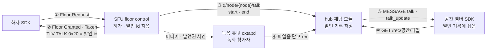
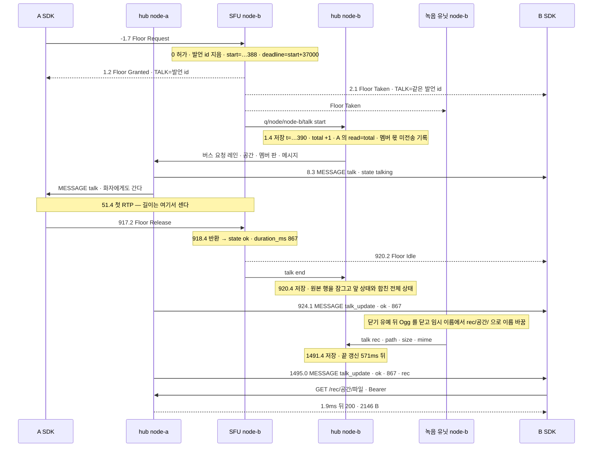

# 21. 무전 발언 기록 · 녹취 — 발언권 허가 하나가 채팅 메시지 하나가 되기까지

> author: kodeholic (powered by Claude) · created: 2026-11-19.
> ★**대조한 커밋** — 서버 `oxlens-sfu` `cfaf091`(녹음 유닛 포함 — 그 커밋 때 크레이트 이름 `oxrecd` · 20261123 부터 `oxtapd`) · oxpeer `0d95b19` · 웹 SDK `oxlens-sdk-web` `8ee8e2d` · 2층 `oxlens-labs` `385f4ed`
> ★**실측 회차** — 2층 smoke `chat_talk_record` · `rec_unit_down`(20261119) · 같은 형상의 손 측정(20261119) · SDK 1층. 값은 돌릴 때마다 바뀌고 차례 · 모양은 같다.

## 1. 30초 요약



- **발언권 허가 하나가 공간의 메시지 하나가 된다.** SFU(`oxsfud`)가 허가할 때 발언 id 를 짓는다. 그 값이 Floor Granted · Taken 의 TLV `TALK`(0x20)와 발언 기록의 `msg_id` 에 똑같이 실린다. `user_id` 는 화자다. 서버가 찍으므로 위조할 수 없다.
- **원본은 바꾸지 않고 갱신을 쌓는다.** 허가 때 `talk`(상태 `talking`)가 가고, 끝나면 `talk_update`(상태 · 길이)가, 녹음하는 방이면 파일이 닫힌 뒤 `talk_update`(녹취 링크)가 또 간다. 갱신은 늘 전체 상태다. SDK 가 원본에 접어서 앱에 낸다.
- **녹음과 상관없이 남는다.** 녹음 유닛은 SFU 와 다른 프로세스다. 죽어도 무전과 발언 기록은 돈다. node 가 준비 상태(ready)에서 빠지지도 않는다.

## 2. 등장인물 · 값

| 이름 | 값 | 무엇 |
|---|---|---|
| 사람 | A `la49365` · B `lb49365` = 공간 멤버 · C `lc49365` = 방 참가자이고 공간 멤버가 아님 · 셋 다 node-a hub(`127.0.0.1:1974`)에 붙음 | 손 측정 봇 셋(2층 봇과 같은 꼴) |
| 방 = 공간 | `learn21_49365` · `record:true` · HRW 로 node-b | 무전 방은 `room_id` 가 곧 `space_id` 다([20](20_CHAT.md)) |
| 녹음 유닛 | `rec-node-b` — node 마다 하나 · SFU 와 같은 node · 다른 프로세스 · 녹화 참가자(종류 1 · 투명)로 듦 | 방이 생기고 1.2ms 에 들기 시작 · 3.3ms 에 입장 끝 |
| 발언 id | `81330e4c` + 허가 ms 12 hex + 난수 16 hex. 예 `81330e4c` · `01a1f147a75c` · `c8861efd5639e57a`(`0x01a1f147a75c` = 1795049367388 = `talk.start`) | SFU 가 허가 때 짓는다. DB 를 기다리지 않는다 |
| `deadline` | 허가 + 37,000ms(T1 4 s + T2 30 s + T3 3 s) — 이 회차 발언 여섯 모두 | 끝 갱신이 없을 때 받는 쪽이 `lost` 로 보는 시각 |
| 짧음 기준 | `floor.talk_min_ms` 500 | 정책. 길이 < 500 이면 `short` |
| 정상 길 시각 | `talk` 통지 3.2 ~ 8.3ms · 끝 갱신 통지 5.7 ~ 16.0ms(반환을 받은 뒤) · 녹취 갱신은 끝 갱신 저장 571 ~ 599ms 뒤 · 내려받기 1.9 ~ 2.1ms | `ok` 발언 셋 |
| 프레임 | `talk` 249 B · 끝 갱신 314 B · 녹취 갱신 461 B(머리 8 B 포함) | `ok` 발언 |
| 녹취 | `rec/learn21_49365/learn21_49365-<발언 id>-la49365.ogg` · 2,146 B · `audio/ogg` · 800ms | `<root>/rec/<공간>/<공간>-<발언 id>-<화자>.ogg` |
| 다시 보내기 | 일시 실패면 100ms 부터 두 배씩 · 5 s 상한 · 60 s 넘으면 버리고 `talk_drop` +1 | — |
| 보관 | `rec_keep_days` 기본 30 일 · 하루 한 번 지움 | — |
| 2층 | smoke `chat_talk_record` · `rec_unit_down` PASS | run-all `e2e-20261119-083119` |


## 3. 정상 길

시각은 SFU 가 Floor Request 를 받은 순간부터 ms 다. 봇 · 서버가 한 기계라 벽시계 하나로 잰다. 발언 기록의 `t` 는 ms 정수라 1ms 안은 가르지 못한다.

### 3-1. 한 발언의 일생 — 허가에서 내려받기까지

A 가 0.87초 말하고 놓는다. 방은 node-b 에 있고, A · B 는 node-a hub 에 붙어 있다.



같은 회차의 `ok` 발언 셋이다.

| 갈래(SFU 가 받은 순간부터) | 첫째 | 둘째 | 셋째 |
|---|---|---|---|
| Floor Granted(화자) · Floor Taken(B) | 1.2 · 2.1 | 0.6 · 0.9 | 1.3 · 1.9 |
| `talk` 저장 `t` · B 가 통지를 받음 | 1.4 · 8.3 | 0.0 · 3.2 | 1.1 · 5.7 |
| Floor Release 를 받음 · B 의 Floor Idle | 918.4 · 920.2 | 880.5 · 882.5 | 872.4 · 874.3 |
| 끝 갱신 저장 `t` · B 가 통지를 받음 | 920.4 · 924.1 | 882.0 · 886.5 | 874.1 · 888.4 |
| `duration_ms` | 867 | 871 | 862 |
| 녹취 갱신 저장 `t`(끝 갱신 뒤) · 통지 | 1,491.4(+571) · 1,495.0 | 1,481.0(+599) · 1,484.8 | 1,468.1(+594) · 1,470.1 |
| `GET /rec` 왕복 | 1.9 | 2.1 | 2.0 |

- **방이 있는 node 의 hub 가 저장한다.** SFU 는 자기 node 의 hub 에만 묻는다(`q/node/{node}/talk`). 사람들이 다른 node 에 붙어 있으면 그 hub 가 버스로 뿌린다. 이 회차는 저장한 hub 가 node-b, 받은 사람의 hub 가 node-a 였다. 채팅 글과 같은 뿌리기다([20 §3-1](20_CHAT.md)).
- **허가와 기록은 따로 간다.** Floor Granted 는 기록을 기다리지 않는다. 발언 id 를 SFU 가 지으므로 저장 전에 Granted · Taken 에 실을 수 있다. 그래서 받는 쪽에는 Floor Taken 이 `talk` 보다 먼저 닿는다(이 회차 2.3 ~ 6.2ms 앞).
- **보낸 세션이 없어 화자도 받는다.** 글은 보낸 세션을 빼고 뿌린다. 발언 기록은 서버가 만든 메시지라 뺄 세션이 없다. A 도 자기 `talk` 를 받았다.
- **공간 멤버가 아니면 통지는 안 간다.** C 는 방에서 같이 듣지만 공간 멤버가 아니다. C 가 받은 `MESSAGE` 통지는 0 이었다. 거꾸로 C 가 말하면 C 의 발언도 기록된다(§3-2 표의 `short` · `cut`).
- **길이는 첫 RTP 부터다.** 허가에서 첫 RTP 까지 51.4ms, 거기서 반환까지 867ms 다. 말 너무 김(T2)과 같은 기준이다.
- **녹취는 끝 갱신보다 0.57 ~ 0.60초 늦다.** 녹음 파이프라인은 반환 뒤 200ms 동안 앞 화자의 늦은 프레임을 그 발언에 넣는다(닫기 유예 — 파이프라인 자체는 [18 §3-3](18_RECORDING.md)). 나머지 약 0.37 ~ 0.40초가 어디서 드는지는 이 회차로 가르지 않았다. 녹취 길이 800ms 는 받은 프레임 40 개(20ms 마다)다.

실제 프레임이다(B 가 받은 것 · WS 8바이트 머리 뒤 JSON).

```
talk         {"space_id":"learn21_49365","msg_id":"81330e4c01a1f147a75cc8861efd5639e57a","user_id":"la49365","t":1795049367390,"content":"","kind":"talk",
              "talk":{"state":"talking","room_id":"learn21_49365","start":1795049367388,"deadline":1795049404388}}
talk_update  {"space_id":"learn21_49365","msg_id":"81330e4c01a1f147a75cfb32aa2fc09231c1","user_id":"la49365","t":1795049368309,"content":"","kind":"talk_update",
              "ref":"81330e4c01a1f147a75cc8861efd5639e57a",
              "talk":{"state":"ok","room_id":"learn21_49365","start":1795049367388,"deadline":1795049404388,"duration_ms":867}}
talk_update  {… "msg_id":"81330e4c01a1f147a75c670c750247fd8433","t":1795049368880, "ref":"81330e4c01a1f147a75cc8861efd5639e57a",
              "talk":{"state":"ok", … ,"duration_ms":867,
                      "rec":{"path":"rec/learn21_49365/learn21_49365-81330e4c01a1f147a75cc8861efd5639e57a-la49365.ogg","size":2146,"mime":"audio/ogg","duration_ms":800}}}
```

- **갱신의 `msg_id` 도 서버가 짓는다.** `81330e4c` + 발언 id 의 시각 12자 + SHA-256(발언 id ‖ 꼬리 — `:end` · `:rec` · `:regrant:<deadline>`) 앞 8 byte 다. 같은 알림이 다시 와도 같은 값이라, 두 번째는 처음 `t` 로 성공하고 통지를 더 내지 않는다(멱등 키 · idempotency key).
- **둘째 갱신이 첫째를 다시 싣는다.** 녹취 갱신에도 `state` · `duration_ms` 가 그대로 들었다. 갱신은 덧붙이기가 아니라 전체 상태다. 받는 쪽은 `(t, msg_id)` 가 가장 큰 갱신 하나만 보면 된다.
- **`content` 는 빈 문자열이다.** 멤버 변경 메시지와 같은 꼴이다. 옛 클라는 모르는 `kind` 의 빈 본문을 무시한다. 문구(「A · 0.9초」)는 앱이 `talk` 칸으로 그린다.

### 3-2. 상태 여섯과 `deadline`

상태는 발언권이 끝난 까닭에서 나온다. 서버와 SDK 는 `state` · `reason` 을 그대로 내고, 화면 문구는 앱이 정한다.

| `state` | 발언권이 끝난 까닭 | 이 회차 | 녹취 |
|---|---|---|---|
| `talking` | 허가 — 처음 상태 | 발언 여섯 모두 이 상태로 시작 | — |
| `ok` | 화자의 Floor Release · 쥔 채 발언 방을 내림 · 방에서 나감 — 길이 ≥ 500ms | 867 · 871 · 862ms | 2,146 B |
| `short` | 위와 같고 길이 < 500ms | C 의 433ms · 2층 「허가 직후 놓음 · 길이 0」 | C 의 것 1,126 B · 400ms |
| `cut` | Floor Revoke 를 보낸 뒤 끝남 · `reason` = 회수 사유 값(2 말 너무 김 · 3 권한 회수 · 4 선점 · 7 다른 이가 회수 …) | B 가 228ms 말하는 중 C 가 우선순위 200 으로 선점 → `reason` 4 | 616 B · 200ms |
| `silent` | T1 만료 — 허가 뒤 RTP 를 한 번도 못 받음 | 허가 4,004ms 뒤 · `duration_ms` 0 | 없음 |
| `lost` | T1 만료 — 받다가 멎음 · 세션이 지워짐 · 방을 잃음(강퇴 · 방 닫힘 · `RESUME` 스냅샷에 없는 방) | 2층 「말하다 멎어 T1」 | — |

- **선점은 끝과 시작이 붙어 온다.** B 의 끝 갱신(`cut` · 4)이 오고 2.0ms 뒤 새 화자 C 의 `talk` 가 왔다(저장 `t` …191 · …194). SFU 는 한 걸음에서 앞 발언의 끝을 먼저 줄에 넣고 새 발언의 시작을 넣는다. 줄은 방마다 하나라 그 차례대로 저장된다.
- **녹취는 상태와 무관하다.** `short` · `cut` 도 받은 프레임이 있으면 파일이 남는다. `silent` 는 프레임이 없어 파일이 없다.
- **재허가는 같은 발언이다.** 쥔 채 Floor Request 를 다시 보내면 같은 발언 id 로 Floor Granted 가 다시 온다. 서버는 새 `deadline` 을 갱신으로 싣는다. 2층에서는 `deadline` 이 577ms 늘었고, 끝 갱신은 같은 기록에 붙었다.

**`deadline` — 끝을 못 받은 발언.** `talk` 에는 `deadline` = 허가 + T1 + T2 + T3 이 실린다. 발언은 이 시각 전에 반드시 끝난다(T2 가 말을 끊고 T3 가 회수를 마친다). 그래서 끝 갱신 없이 지금이 `deadline` 을 넘으면, 받는 쪽은 그 발언을 `lost` 로 보인다. 저장된 기록은 `talking` 그대로다. 모든 SDK 가 같은 규칙으로 판정한다. 받는 쪽 시계 차만큼 이르거나 늦다.

### 3-3. 쪽 · 안 읽은 수 · 접기

같은 회차 끝에 A 가 `SPACE_HISTORY`, A · B 가 `SPACE_LIST` 를 불렀다.

| 요청 | 결과 |
|---|---|
| `SPACE_HISTORY` | 보이는 메시지 8 = 멤버 변경 `add` 둘 + `talk` 여섯(모두 원본이라 `talking`) · `relations` 6 = 발언마다 마지막 `talk_update` 하나(`ok` 셋 · `cut` · `short` · `silent`) · 응답 프레임 4,408 B |
| B 의 `SPACE_LIST` | total 6 · read 4 |
| A 의 `SPACE_LIST` | total 6 · read 6 |

- **발언 기록은 글처럼 센다.** `total` 6 은 발언 기록 여섯이다. 갱신은 세지 않는다.
- **화자의 `read` 는 자기 발언 때 오른다.** B 는 넷째 발언(선점된 것)의 화자라 read 4 다. 그 뒤 C 와 A 의 두 발언이 B 에게 안 읽음이다. A 는 마지막 발언(`silent`)의 화자라 read 6 이다. 자기 글을 보낼 때 read 가 오르는 것과 같은 규칙이다([20 §3-5](20_CHAT.md)).
- **SDK 가 접는다.** 웹 SDK 는 `talk` 를 본문이 비어도 `messages` 로 낸다. `talk_update` 는 고침처럼 원본에 접어 `updates` 로 낸다. 원본보다 먼저 온 갱신은 들고 있다가 붙인다. `talking` 인 기록에는 `deadline` 에 시계를 건다. 끝 갱신 없이 지나면 `lost` 로 `updates` 를 낸다(SDK 1층 시험).
- **답장 · 반응은 된다 · 고침 · 지움은 안 된다.** 발언 기록은 답장과 반응의 원본이 된다. 고칠 본문이 없고, 무전 기록은 보관이 기본이라 고침 · 지움은 `3016 REF_NOT_FOUND` 다.
- **내려받기는 `fetchRec`.** 웹 SDK `client.chat.fetchRec(msg)` 가 `{base}/` + `talk.rec.path` 를 받아 Blob 으로 준다. 토큰은 `Authorization` 머리로만 싣는다. 주소에 싣지 않는다. oxpeer 는 아직 접지 않는다 — `talk` · `talk_update` 를 사건 하나씩 그대로 낸다.

## 4. 깨지는 길

### 4-1. 녹음 유닛이 죽었다 — 무전 · 기록은 그대로

- **무엇이 깨지나.** 녹음 유닛 프로세스가 죽는다.
- **누가 먼저 아나.** 그 node 의 hub 슈퍼바이저다. 유닛 상태가 `Running` 이 아니게 되고, 다시 띄운다.
- **무엇이 오가나.** SFU · hub 는 그대로다. 발언권과 발언 기록은 녹음 유닛을 거치지 않는다.
- **사용자는 무엇을 겪나.** 무전은 끊기지 않는다. 그동안의 발언은 상태 · 길이와 함께 남는다. 녹취 링크만 안 붙을 수 있다.

2층 `rec_unit_down` 이 방이 있는 node 의 녹음 유닛을 hub 운영 표면(`POST /admin/supervisor/kill/rec-{node}`)으로 세 번 죽였다.

| 무엇 | 실측 |
|---|---|
| 죽인 직후 `/healthz/ready` | 세 번 모두 200 |
| 녹음 유닛이 `Running` 이 아님을 본 판 | 3/3 |
| 미디어 서버 유닛 | `Running` 그대로 |
| 그동안의 발언 기록 | `ok` 셋 |
| 녹음 유닛 | 되살아나 방에 다시 듦(방 요약 `rec` 참) |

이 smoke 는 죽은 동안의 발언에 녹취가 붙었는지는 보지 않는다. 갈래B(hub 가 녹음 유닛도 ready 에 세게 되돌림)에서는 녹음 유닛이 내려간 동안 ready 가 503 이었다. 그 빌드는 하네스 기동 관문에서도 503 으로 멈췄다.

### 4-2. SFU 가 끝을 못 알렸다 — `deadline` 으로 `lost`

- **무엇이 깨지나.** 발언 중에 SFU 가 패닉하거나 멈춘다. 끝 알림(`end`)을 보내지 못한다.
- **누가 먼저 아나.** 아무도 바로 모른다. hub 는 SFU 의 죽음을 보고 발언을 닫지 않는다(결재로 버린 길 — §5).
- **무엇이 남나.** 저장소의 발언 기록은 `talking` 그대로다.
- **사용자는 무엇을 겪나.** `deadline`(허가 + 37초)이 지나면 SDK 가 그 발언을 「연결 끊김(`lost`)」으로 바꿔 보인다. 그 전까지는 「말하는 중」이다.

이 갈래는 SDK 1층 시험으로만 봤다. 낼 때 이미 지난 기록은 처음부터 `lost` · 재허가 갱신은 새 `deadline` 으로 시계를 다시 건다 · `lost` 뒤에 끝 갱신이 오면 그 상태로 바뀐다. 2층 · 3층에서 SFU 를 죽여 재지는 않았다. 방이 정상으로 멈추는 길(방 닫힘 · 강퇴)은 SFU 가 열린 발언을 `lost` 로 닫아 알린다(서버 1층).

### 4-3. 시작이 거절됐다 — 기록이 없는 방

- **무엇이 깨지나.** 방 id 와 같은 공간이 없다(공간에 붙지 않은 방). 또는 그 배포에 채팅이 꺼져 있다.
- **누가 먼저 아나.** SFU 다. hub 가 `start` 에 `3012 SPACE_NOT_FOUND`(또는 `3014 CHAT_DISABLED`)로 답한다.
- **무엇이 오가나.** SFU 는 다시 보내지 않는다. 그 발언의 재허가 · 끝 알림도 보내지 않는다. 원본이 없는데 60초 동안 다시 하다 버리는 헛일을 막는다.
- **사용자는 무엇을 겪나.** 아무것도 없다. 무전은 그대로이고 기록만 없다.

`e2e-20261119-083119` 전량 동안 node-a 에 이 줄이 33 번 찍혔다. 공간이 없는 다른 시나리오의 방들이다.

```
08:36:22.077634 node=node-a proc=sfu kind=diag spec=SV-IMPL-FLR-TALK-REPORT room=t1d-1795044981 … talk=81330e4c01a1f104bd3c66d5c60fffc58f7c report=start code=3012 msg="talk not recorded — no space or chat off for this room"
```

### 4-4. 원본보다 갱신이 먼저 닿았다 — `5003` 으로 답하고 다시

- **무엇이 깨지나.** hub 가 `end` · `rec` 를 받았는데 그 발언 기록이 아직 없다.
- **누가 먼저 아나.** hub 다. `5003 INTERNAL_ERROR`(영구 아님)로 답하고 진단 줄 `SV-IMPL-CHAT-TALK` 「talk record not yet stored」를 남긴다.
- **무엇이 오가나.** 부르는 쪽(SFU · 녹음 유닛)은 `3012` · `3014` 가 아니면 모두 다시 보낸다. 원본이 저장되면 그때 갱신이 들어간다.
- **사용자는 무엇을 겪나.** 갱신이 늦게 온다. 잃지는 않는다.

SFU 는 방마다 한 줄로 알린다. `end` 는 그 `start` 의 답을 받은 뒤에 나간다. 그래서 SFU 의 알림끼리는 보통 이 창이 열리지 않는다. 열리는 때는 둘이다 — `start` 를 60초 다시 하다 버린 뒤의 `end`(원본이 끝내 없어 그것도 버려진다), 그리고 녹음 유닛의 `rec`(다른 프로세스라 SFU 와 차례가 묶이지 않는다). 이 갈래는 서버 1층 시험으로만 봤다.

### 4-5. 다시 보내기를 넘겼다 — `talk_drop`

- **무엇이 깨지나.** hub 가 60초 동안 답하지 않거나 계속 일시 실패로 답한다.
- **누가 먼저 아나.** 알리는 쪽이다. 100ms 부터 두 배씩(5초 상한) 다시 보내다 60초를 넘기면 버린다.
- **무엇이 남나.** 계수 `talk_drop` +1 과 진단 줄 「talk report dropped after retry limit」. 그 알림(시작 · 끝 · 녹취 중 하나)은 기록에 없다.
- **사용자는 무엇을 겪나.** 시작이 빠지면 그 발언이 없고, 끝이 빠지면 `deadline` 뒤 `lost` 로 보이고, 녹취가 빠지면 링크가 없다.

2층 `chat_talk_record` 의 Δ`talk_drop` 은 0 이었다. 버스 데이터 레인을 혼잡하게 만든 채 발언 여럿을 재는 형상은 아직 없다. 발언 알림은 설계상 데이터 레인이 아니라 요청 레인으로 간다.

### 4-6. 내려받기가 거절됐다 — 멤버 아님 · 없는 발언 · 보관 지남

| 경우 | 응답 | 2층 `chat_talk_record` |
|---|---|---|
| 공간 멤버(보이기 시작점 뒤) | 200 · 몸 크기 = `rec.size` | 2,146 B · 앞 4 바이트 `OggS` |
| 공간 멤버가 아님 | 403 · `3013 NOT_SPACE_MEMBER` | 방에서 같이 들은 c 도 403 |
| 공간 멤버지만 보이기 시작점 앞의 발언 | 403 · `3013 NOT_SPACE_MEMBER` | 이 smoke 로 재지 않았다 |
| 없는 발언 id | 404 · `3019 REC_NOT_FOUND` · `permanent:true` | 404 |
| 파일이 지워짐(보관 지남) | 404 · `3019 REC_NOT_FOUND` · `permanent:true` | 파일을 지운 뒤 404 · 링크(갱신)는 남음 |

- **방에서 같이 들었어도 공간 멤버가 아니면 못 받는다.** 거르기는 `SPACE_HISTORY` 와 같다. 녹취는 공간의 기록이기 때문이다.
- **링크는 남고 파일만 사라진다.** 보관이 지나도 발언 기록 갱신은 지우지 않는다. 앱은 「보관 기간 지남」을 그릴 수 있다.


## 5. 왜 이 모양인가

- **발언 기록은 서버(floor control)가 화자 이름으로 만든다.** 다른 길은 결정 둘(`user_id` = 화자 · 녹취가 없어도 남는다) 중 하나를 어긴다. 녹음기가 보내면 `user_id` 가 녹음기가 되고, 녹음기가 없으면 기록도 없다. 화자 단말이 놓은 뒤 보내면, 놓자마자 끊긴 단말의 발언이 사라지고 권위도 없다. 발언권을 아는 것은 SFU 하나다.
- **발언 id 는 SFU 가 허가 때 짓는다.** DB 가 매긴 번호를 기다리면 Floor Granted 가 저장 왕복만큼 늦는다. 허가 ms 와 보안 난수로 지어 SFU 가 다시 떠도 겹치지 않는다. 같은 값을 Granted · Taken(TLV 0x20) · 기록의 `msg_id` · 녹취 파일 이름이 함께 쓴다. 모르는 TLV 는 읽지 않으므로 옛 클라는 깨지지 않는다.
- **SFU → hub 는 버스 요청이고, 방마다 한 줄이다.** 버스의 사건 넣기(`ev` put)는 데이터 레인이라 혼잡하면 버린다. 그러면 몰린 순간 발언 기록이 말없이 빠진다. 그래서 답을 받는 요청으로 보낸다. `end` 를 `start` 와 따로 띄우면 갱신이 원본보다 먼저 닿는다. 그래서 앞 답을 받고 다음을 보낸다.
- **원본은 고치지 않고 갱신을 쌓는다.** 채팅의 규칙 「원본은 바꾸지 않는다(지움만 예외)」를 지킨다. 버전이 다른 SDK 가 섞여 붙어도 서버는 클라 버전을 몰라도 된다. 갱신은 늘 전체 상태다. 덧붙이기로 쓰면 늦게 저장된 쪽이 앞 칸을 잃는다 — 보통 차례(끝 → 녹취)면 마지막 갱신에 끝 상태가, 녹취가 먼저 저장되면 녹취가 빠진다. hub 는 원본 행을 잠그고 앞 갱신과 합쳐 쓴다. 갈래B(합치지 않음)는 앞의 것이었다 — 보통 차례에서 녹취 갱신이 원본 상태만 보고 써서, 녹취만 든 마지막 갱신이 `talking` 으로 남아 2층이 빨강이었다.
- **녹음 유닛을 SFU 밖에 둔다.** 20261118 녹음기 꼬리 읽기에서 패닉이 났다(청크를 닫는 순간의 길이 칸 넘침). 녹음기가 SFU 안에 있었다면 무전 서버가 같이 죽었다. 디스크 일도 패킷 길과 갈린다. SFU 는 디스크 없는 중계로 둔다. 같은 node 에 두므로 미디어는 로컬 SFU 에서 받고 node 를 건너지 않는다.
- **녹음 유닛을 준비 상태(ready)에서 뺀다.** ready 에 세면 녹음 유닛 하나가 내려간 동안 node 전체가 로드 밸런서에서 빠진다. 녹음이 멎어도 무전은 받아야 한다. 유닛 상태는 `/admin/supervisor/status` 에 그대로 보인다.
- **SFU 의 죽음을 hub 가 지켜 닫지 않는다.** 처음 안은 hub 가 방 토큰 소멸을 보고 열린 발언을 닫는 것이었다. 결재에서 바뀌었다 — 발언 상한(T1 + T2 + T3)을 서버가 아니 그 값을 메시지에 싣고, 받는 쪽이 같은 규칙으로 판정한다. 장치 하나가 줄었다. 대가는 저장소 기록이 `talking` 으로 남는 것이다. T2 는 끄는 값이 없다(정책 하한 5 s). 발언 상한을 없애는 배포가 생기면 이 판정 밖이다.
- **임시 이름으로 다 쓰고 이름을 바꿔 닫는다.** 기계가 여럿이면 모든 node 가 같은 저장소를 `[data] root` 에 마운트하는 것이 배포 조건이다. 반쯤 쓴 파일을 다른 기계의 hub 가 내주지 않게 한다.

> ★**우리만의 것 — 발언권 서버가 대화 기록의 권위**
> - **선택 배경** — 무전 채널의 기록은 「누가 언제 얼마나 말했나」다. 그 사실을 아는 것은 발언권을 중재하는 SFU 하나다. 녹음 · 채팅이 따로 사실을 지어내지 않게, 발언권 허가 하나를 공간의 메시지 하나로 남겼다.
> - **얻은 것** — 짧은 · 끊긴 · 소리 없는 발언까지 상태와 함께 남는다(2층 `ok` · `short` · `cut` · `silent` · `lost` 와 재허가). 녹음 유닛이 죽어도 기록은 남는다(`rec_unit_down` 3/3). 화자 이름을 서버가 찍어 위조할 수 없다. 기록 통지는 허가 뒤 3 ~ 8ms 에 닿았다. 발언 id 하나가 발언권 메시지 · 기록 · 파일 이름을 잇는다.
> - **잃은 것** — 녹취 링크는 끝 갱신보다 0.57 ~ 0.60초 늦게 붙는다. 발언 하나에 메시지가 셋(원본 · 끝 · 녹취)이라 저장 · 통지가 그만큼 는다. SFU 가 끝을 못 알리면 저장소에는 `talking` 이 남고, 받는 쪽은 37초 뒤에야 `lost` 를 본다. 기계가 여럿이면 공유 저장소 마운트가 배포 조건이다.


## 6. 다른 제품은

★아래 「그쪽 방식」은 저쪽 소스를 정적으로 읽은 기록이다. 실측이 아니다. 무전 기록을 채팅에 남기는 제품이 드물어 통화 기록을 남기는 제품과 견준다.

| 무엇 | Mattermost Calls(플러그인 소스) | 우리 |
|---|---|---|
| 기록을 만드는 쪽 · 이름 | 서버 플러그인이 통화 시작 게시물(`custom_calls`)을 ★시작한 사람 이름으로 만든다 | SFU(발언권) → hub 가 ★화자 이름으로 만든다 |
| 끝날 때 | ★같은 게시물을 고쳐 쓴다(`end_at` · 상태 · 참가자) · 사람은 그 게시물을 고칠 수 없다 | 원본은 그대로 · 끝 상태를 갱신 메시지로 쌓는다 · 사람은 고치거나 지울 수 없다 |
| 녹화 파일 | ★플러그인 봇 이름의 새 게시물(녹화 잡이 그 API 를 부름)을 통화 게시물 스레드에 붙인다 · 통화 게시물의 칸에도 파일 id 를 고쳐 쓴다 | 녹음 유닛이 파일을 닫으면 hub 가 ★같은 화자 이름의 갱신으로 링크를 붙인다 |
| 단위 · 상한 | 한 통화에 녹화는 동시에 하나(여럿을 차례로 할 수 있다) · 길이 상한(기본 60 분)에 이르면 그 녹화가 끝난다 | 발언마다 파일 하나 · 발언 상한은 발언권의 T2 |
| 서버가 끝을 못 알릴 때 | 이 조사 범위 밖이다 | `deadline` 으로 받는 쪽이 `lost` 판정 |

- **나눔은 같다.** 기록은 사람 이름(서버가 만듦), 녹화는 따로 붙는 것이다. 다른 점은 원본을 고쳐 쓰느냐다. 우리는 채팅의 「원본은 바꾸지 않는다」를 지켜 갱신으로 접는다.


## 7. 관측하는 법

정상 길에는 발언 기록 줄이 없다. 이 회차 node-b 의 줄은 발언권 줄뿐이었다.

```
09:49:27.388606 node=node-b proc=sfu kind=ev spec=FLR.S.P.NP_IDLE.rx_REQUEST   session=12ee3c30 room=learn21_49365 user=la49365 … from=IDLE to=TAKEN cause=server_rx
09:49:27.439961 node=node-b proc=sfu kind=ev spec=FLR.S.P.PERMITTED.rx_RTP     session=12ee3c30 room=learn21_49365 user=la49365 … cause=rtp
09:49:28.306989 node=node-b proc=sfu kind=ev spec=FLR.S.P.PERMITTED.rx_RELEASE session=12ee3c30 room=learn21_49365 user=la49365 … from=TAKEN to=IDLE cause=server_rx
```

녹음 유닛은 oxpeer 를 쓰는 프로그램이라 `proc=peer` 줄을 낸다(`ROOM.C.NONE.join` · `FLR.C.NOPERM.rx_TAKEN` 꼴). 줄 읽는 법은 [17 §3](17_OPERATIONS.md) 이 집이다.

| 무엇 | 어디서 보나 |
|---|---|
| 발언 · 상태 | 공간의 메시지 — `SPACE_HISTORY` 의 `talk` · `relations` 의 `talk_update`. 서버 로그에는 정상 줄이 없다 |
| 기록이 없는 방(시작 거절) | SFU `SV-IMPL-FLR-TALK-REPORT … report=start code=3012`(또는 `3014`) |
| 알림을 버림 | 계수 `talk_drop` — hub `/admin/drops` 의 미디어 서버 줄과 녹음 유닛 줄(`unit` = `rec-{node}` · `sfu_id` = 그 유닛의 기동 신원) · 진단 줄 「talk report dropped after retry limit」 |
| 원본 없는 갱신 | hub `SV-IMPL-CHAT-TALK` 「talk record not yet stored」 |
| 녹음 유닛 상태 | `/admin/supervisor/status` 의 `rec-{node}`(`Running` · 재기동 수) · 방 요약 `rec`(녹화 참가자가 들어 있음) |
| node 준비 | `/healthz/ready` — 녹음 유닛은 세지 않는다 |
| 녹취 파일 | `<root>/rec/<공간>/<공간>-<발언 id>-<화자>.ogg`(영상 무전 발언이면 `.mkv`) · 쓰는 동안은 `<root>/.rec-part/` · 기동 때 남은 반쪽 파일을 지운다 |
| SDK 쪽 | `client.chat` 사건 `messages`(`talk` 칸) · `updates`(접은 뒤) · 발언권 `PttState.talkId` · `speaker` 사건 `talkId` · `fetchRec` 의 `3019` |

2층 smoke 둘(`chat_talk_record` · `rec_unit_down`)은 run-all 에 든다. 봇의 발언권 등식 `talk_id_carried` 는 발언권이 있는 시나리오마다 Granted · Taken 에 발언 id 가 실렸는지 · 한 id 가 화자 하나에만 묶였는지 본다.

## 8. 소스 · 규격 좌표

| 무엇 | 좌표 |
|---|---|
| 발언 판정(SFU) | `oxlens-sfu/crates/oxsfud/src/flr/talk.rs` — `Talk` · `deadline` · `end_state`(끝난 까닭 → 상태) · `Queue` |
| 알림 줄(SFU) | `crates/oxsfud/src/ops/floor.rs` — `talk_start` · `talk_steps`(끝 · 재허가) · `talk_reporter`(방마다 한 줄 · 거절된 발언 건너뜀) · `stop`(방 멈춤 → `lost`) · `talk_deadline` |
| 알림 꼴 · 다시 보내기 | `crates/common/src/talk.rs` — `Report`(`Start` · `Regrant` · `End` · `Rec`) · `talk_id` · `update_msg_id` · `judge` · `deliver` |
| 저장(hub) | `crates/oxhubd/src/ses/mod.rs` `talk`(버스 요청 답 · 뿌리기) · `chat/mod.rs` `Chat::talk` · `rec_seen` · `chat/store.rs` `Store::talk` · `talk_msg` · `talk_merged` · `talk_missing` · `talk_update_ok` · `rec_path_ok` · `chat/store/pg.rs`(PostgreSQL 꼴 `FOR UPDATE`) |
| 내려받기 | `crates/oxhubd/src/ops/http.rs` — `rec_file` · `rec_answer` · `rec_talk_id` · `byte_range` |
| 녹음 유닛 | `crates/oxtapd/src/main.rs`(`discover` — 버스로 그 node 의 방 토큰을 보고 `record` 가 참인 방에 듦) · `src/lib.rs`(`Layout` · `Talks::feed` · `settle_file` · `OneFilePerTalk` · `sweep` · `report_line` · `Svc` · `admin_answer`) · 슈퍼바이저 `crates/oxhubd/src/ops/supervisor.rs` `down_units`(rec 를 뺌) |
| oxpeer 녹음기 | `oxlens-sdk-peer/crates/oxpeer/src/record/pipeline.rs`(발언 번호 = `TAKEN` 의 발언 id · 닫기 유예 `ENDING_GRACE_NS`) · `record/ogg.rs` · `record/mkv.rs`(이름 `{방}-{발언 id}-{화자}`) |
| 웹 SDK | `oxlens-sdk-web/src/domain/chat/core.ts`(`talk_update` 접기 · `deadline` 시계 · 안 읽은 수) · `src/api/client.ts` `fetchRec` · `src/platform/net.ts` `httpBlob` · `src/domain/flr/core.ts`(`talkId`) |
| 2층 | `oxlens-labs/oxe2epy/oxe2epy/smoke/chat_talk_record.py` · `rec_unit_down.py` · 봇 TLV `wire1/mbcp.py` `F_TALK` |
| 규격(연동) | [연:RULE-CHAT-TALK](../protocol/14-chat.md#RULE-CHAT-TALK) · [연:RULE-CHAT-TALK-STATE](../protocol/14-chat.md#RULE-CHAT-TALK-STATE) · [연:RULE-CHAT-TALK-UPDATE](../protocol/14-chat.md#RULE-CHAT-TALK-UPDATE) · [연:RULE-CHAT-REC-FILE](../protocol/14-chat.md#RULE-CHAT-REC-FILE) · [연:CHAT.type.TalkInfo](../protocol/14-chat.md#CHAT.type.TalkInfo) · [연:CHAT.type.TalkRec](../protocol/14-chat.md#CHAT.type.TalkRec) · [연:CHAT.http.REC_FILE](../protocol/14-chat.md#CHAT.http.REC_FILE) · [연:RULE-CHAT-KIND](../protocol/14-chat.md#RULE-CHAT-KIND) · [연:RULE-CHAT-MSG-ID](../protocol/14-chat.md#RULE-CHAT-MSG-ID) · [연:RULE-CHAT-UNREAD](../protocol/14-chat.md#RULE-CHAT-UNREAD) · [연:RULE-CHAT-REF-CHECK](../protocol/14-chat.md#RULE-CHAT-REF-CHECK) · [연:RULE-CHAT-FOLD](../protocol/14-chat.md#RULE-CHAT-FOLD) · [연:RULE-CHAT-HISTORY-PAGE](../protocol/14-chat.md#RULE-CHAT-HISTORY-PAGE) · [연:RULE-FLR-TLV](../protocol/10-flr.md#RULE-FLR-TLV) · [연:RULE-FLR-SERVER-EVENTS](../protocol/10-flr.md#RULE-FLR-SERVER-EVENTS) · [연:ROOM.http.CREATE_ROOM](../protocol/04-room.md#ROOM.http.CREATE_ROOM) · [연:RULE-TRN-ENDPOINTS](../protocol/02-trn.md#RULE-TRN-ENDPOINTS) |
| 규격(서버 · SDK) | — |
| 외부 | 3GPP TS 24.380(Floor Granted · Taken · Revoke 사유) · RFC 7845(Ogg Opus) · RFC 9110 §14(Range) |

## 9. 스스로 확인하는 질문

<details><summary>1. 발언 id 는 누가 언제 짓나? 왜 hub(저장)가 아니라 그쪽인가?</summary>

SFU 가 Floor Request 를 허가하는 순간 짓는다. `81330e4c` + 허가 ms 12 hex + 난수 16 hex 다. hub 가 저장할 때 매기면 Floor Granted 가 저장 왕복을 기다려야 한다. SFU 가 지으면 Granted · Taken 의 TLV `TALK` 에 바로 싣고, 같은 값이 기록의 `msg_id` 와 녹취 파일 이름이 된다. 이 회차 Granted 는 허가 1.2ms 뒤, 저장은 1.4ms 뒤였다 — 둘은 서로를 기다리지 않는다.
</details>

<details><summary>2. 녹음하는 방에서 한 발언에 `MESSAGE` 통지가 몇 개 오나? 각각 무엇을 싣나?</summary>

셋이다. 허가 때 `talk`(`talking` · `start` · `deadline`), 끝날 때 `talk_update`(상태 · `duration_ms`), 파일이 닫히면 `talk_update`(같은 상태 + `rec`)다. 갱신은 늘 전체 상태라 녹취 갱신에도 상태 · 길이가 다시 들어 있다. 이 회차 `ok` 발언은 249 · 314 · 461 B 였고, 녹취 갱신은 끝 갱신 0.57 ~ 0.60초 뒤였다. 녹음하지 않는 방은 앞 둘로 끝난다.
</details>

<details><summary>3. 방에서 같이 듣는 C 는 공간 멤버가 아니다. C 의 발언은 기록되나? C 는 남의 녹취를 받나?</summary>

C 의 발언은 기록된다. 발언권 허가마다 기록이 생기고, 화자가 공간 멤버인지는 보지 않는다(2층 「공간 밖 화자 c 의 발언도 기록」). 하지만 C 에게는 통지가 가지 않고(이 회차 0), 녹취를 받으려 하면 403 `3013` 이다. 녹취는 공간의 기록이고, 받는 거르기는 `SPACE_HISTORY` 와 같다.
</details>

<details><summary>4. (깨지는 길) 녹음 유닛이 죽었다. 무전은? node 는 로드 밸런서에서 빠지나?</summary>

무전은 그대로다. 발언권과 발언 기록은 녹음 유닛을 거치지 않는다. node 는 빠지지 않는다 — hub 는 녹음 유닛을 ready 에 세지 않는다(2층 3/3 판 ready 200). 슈퍼바이저가 다시 띄우면 녹음 유닛은 `record:true` 방에 다시 든다. 죽은 동안의 발언은 상태와 함께 남고, 녹취 링크만 안 붙을 수 있다. ready 에 세게 되돌린 갈래B 에서는 503 이었다.
</details>

<details><summary>5. (깨지는 길) 발언 중 SFU 가 패닉해 끝 알림이 영영 안 왔다. 화면에는 무엇이 보이나? 저장소에는?</summary>

`deadline`(허가 + T1 + T2 + T3 = 37초)까지는 「말하는 중」이다. 그 뒤 SDK 가 끝 갱신 없이 지난 `talking` 을 `lost`(연결 끊김)로 바꿔 낸다. 저장소 기록은 `talking` 그대로다 — hub 는 SFU 의 죽음을 보고 닫지 않는다. 판정 규칙이 모든 SDK 에 같아서 저장소를 고치지 않아도 화면이 같다. 시계 차만큼 이르거나 늦다.
</details>

<details><summary>6. (깨지는 길) 갱신을 「덧붙이기」로 저장하면 무엇이 깨지나?</summary>

늦게 저장된 갱신이 앞 갱신의 칸을 잃는다. 보통 차례(끝 → 녹취)면 녹취 갱신이 원본(`talking`)만 보고 써서 끝 상태가 빠진다. 녹취가 먼저 저장되면(녹음 유닛과 SFU 는 다른 프로세스라 차례가 묶이지 않는다) 끝 갱신에 녹취가 빠진다. 받는 쪽은 가장 큰 `(t, msg_id)` 의 갱신 하나만 보므로, 앞의 경우 그 발언이 `talking` 으로 남는다. 그래서 hub 는 원본 행을 잠그고 앞 갱신과 합친 전체 상태를 쓴다. 합치기를 뺀 갈래B 에서 2층 `chat_talk_record` 가 앞의 증상(녹취만 든 마지막 갱신 · `talking`)으로 빨강이었다.
</details>
